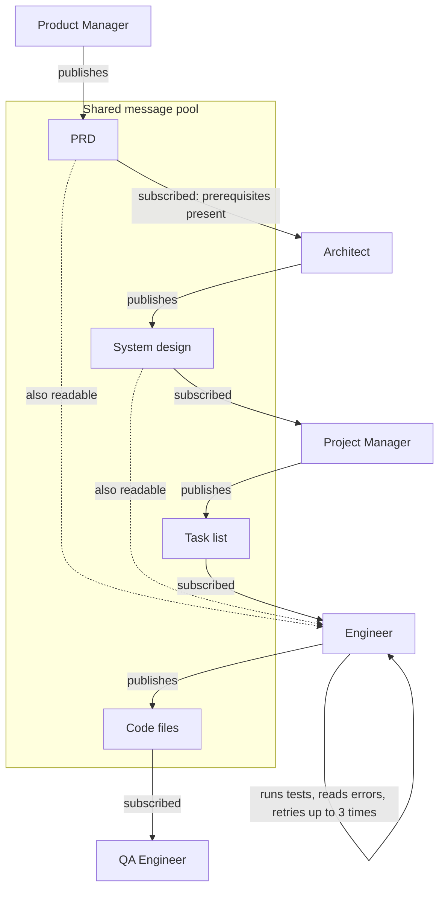

# MetaGPT: Meta Programming for A Multi-Agent Collaborative Framework

> **Paper:** Hong, Zhuge, Chen, Zheng, Cheng, Zhang, Wang, Wang, Yau, Lin, Zhou, Ran, Xiao, Wu and Schmidhuber (DeepWisdom, King Abdullah University of Science and Technology and several other institutions), 2023 (first posted August 2023; this guide follows arXiv v7, 1 November 2024) - [arXiv abstract](https://arxiv.org/abs/2308.00352) - [local PDF](../../papers/2308.00352.pdf)
>
> **Short name:** MetaGPT. Section, table and figure numbers follow the arXiv HTML rendering of v7. Figure 4 (the HumanEval and MBPP bar chart) is an image whose bar values the text rendering does not carry, so this guide quotes only numbers the prose gives for it. The rendering names no venue; treat the paper as an arXiv preprint here.

## Read this first

**The claim in one sentence.** If several language-model agents are given fixed job titles, are made to hand each other formatted documents (a product requirements document, a design, a task list) in a fixed order, and the coder is made to run its own tests and retry, the resulting programs run more often and need fewer human fixes than programs from agents that simply chat with each other.

**Who this is for.** Anyone deciding whether an assistant should be one agent with tools or a team of role-playing agents, and anyone who wants to know what "structured output" and "publish-subscribe" buy in practice. It is the third multi-agent paper in this stage and the first that argues against free conversation as the glue between agents.

**Afterwards you will be able to** trace one request through the five roles using the paper's own demo; say what a message pool and a subscription are; read the paper's tables and say what each number counts; explain why the "state of the art" claim on HumanEval shrinks once Table 7 is read; and sketch a small, safer version for work over private business documents.

**Reading time.** About 55 minutes for the guide; the paper's appendix is where the real examples live. **Have read first:** [CAMEL](./17-camel.md) (the role-play chat that MetaGPT reacts against), [AutoGen](./18-autogen.md) (a general framework for conversing agents, the other main design point), [ReAct](../02-building/10-react.md) (every MetaGPT agent behaves "ReAct-style") and [HumanEval](../03-evaluation-and-code/14-humaneval.md) (the benchmark behind the headline number). Read [the multi-agent survey](./20-multi-agent-survey.md) afterwards for where this design sits among others. Terms: the [glossary](../../references/glossary.md).

**The one thing most people get wrong.** They read "MetaGPT beats ChatDev and AutoGPT" as "role-playing teams beat single agents". The software comparison (Table 1) is MetaGPT against one rival (ChatDev) on seven tasks the authors chose from a benchmark they built and scored by hand; the wider comparison (Table 4) gives only an average of 1.0 for each other framework with no configuration described. And no experiment keeps the roles but removes the structured documents, so the central causal claim is argued, not isolated.

## The paper in one worked example

The paper's Appendix B walks one request through the whole company. We follow it, and then add a second part (the retry loop of Section 3.3) and a third (one cost row from Table 9). Appendix B is a demo, not an experiment, and as printed it contains a visible mismatch flagged below.

### Part A - one request through five roles (Appendix B)

**The user's input (Appendix B.1, verbatim in effect):** "write a python3 GUI app such that you can draw an image with it".

**Stage 1 - Product Manager writes a Product Requirement Document (PRD).** Fixed section headings, several holding a Python list: Original Requirements, Product Goals, User Stories, Competitive Analysis, Requirement Analysis, Requirement Pool, UI Design draft, Anything UNCLEAR. Real content: "The boss requires a Python3 GUI color meter that outputs the RGB values when it moves."; three goals; three user stories of the form "As a user, I want ..., so that ..."; five named competitor products (Color Cop, Just Color Picker, Instant Eyedropper, ColorZilla, ColorPic) with a strength and weakness each; a Requirement Pool of five (task, priority) pairs, four P0 and one P1 ("Test the application for accuracy and performance"); and "There are no unclear points." A quadrant chart accompanies it (Figure 7). RGB means red-green-blue, the three numbers that describe a screen colour.

**Stage 2 - Architect writes the system design.** Sections printed: Implementation approach (use Python's Tkinter library for the window, the PIL imaging library, "Pillow", to read screen pixels, threading for real-time updates, and unittest for tests), Python package name ("color_meter"), File list (main.py, color_picker.py, gui.py, tests.py), and Anything UNCLEAR ("The requirement is clear to me."). The Architect also produces data structures and interface definitions (Figure 8) and a program call flow (Figure 9), which are diagrams.

**Stage 3 - Project Manager writes the task list.** Sections printed: Required Python third-party packages (tkinter==8.6 and Pillow==8.3.1), Required Other language third-party packages (none), Full API spec ("No APIs are used in this project."), Logic Analysis (one line per file saying what it does), Task list, Shared Knowledge, and Anything UNCLEAR. The Logic Analysis names five files: main.py, canvas.py, tools.py, color_picker.py and file_manager.py.

**Stage 4 - Engineer writes code.** The paper prints one generated file, color_picker.py: a `ColorPicker` class wrapping a Tkinter button that opens the system colour chooser, stores the choice (default 'black') and returns it from `get_color()`.

**Stage 5 - QA Engineer writes unit tests.** The printed tests build a Tkinter root window, check the default colour is 'black', set '#ffffff' and read it back. The import line for `ColorPicker` is commented out, with a comment suggesting the class be moved to color_picker.py.

**Output.** The paper says MetaGPT "generates a functional application named Drawing App" (Figure 10).

**What does not line up (this guide's reading).** (1) The user asked for a drawing app, but the printed PRD describes a colour meter and the design names the package "color_meter". (2) The Architect's file list (main.py, color_picker.py, gui.py, tests.py) differs from the Project Manager's (main.py, canvas.py, tools.py, color_picker.py, file_manager.py). (3) Appendix B calls the sequence flow chart Figure 12, but Figure 12 belongs to a different example (a recommendation engine); the Drawing App call flow is Figure 9. (4) With its import commented out, the printed test would raise a `NameError` unless the class sits in the same file. A guess: the appendix stitches together excerpts from different runs. The demo shows each stage following its schema, not the stages agreeing.

```mermaid
flowchart LR
  U["User input: draw-an-image GUI app"] -->|"raw requirement"| PM["Product Manager"]
  PM -->|"PRD: goals, user stories, requirement pool P0/P1"| AR["Architect"]
  AR -->|"system design: file list, data structures, call flow"| PJ["Project Manager"]
  PJ -->|"task list, packages, per-file logic analysis"| EN["Engineer"]
  EN -->|"code files, e.g. color_picker.py"| QA["QA Engineer"]
  QA -->|"unit tests, test run results"| EN
  QA -->|"checked code"| OUT["Output: Drawing App"]
```



Notice that every arrow carries a named document, and that the only arrow that goes backwards is the test result returning to the Engineer. That backward arrow is the executable-feedback loop of Part B.

### Part B - the retry loop (Section 3.3 and Figure 2, right)

The paper describes the loop in prose: the Engineer writes code from the requirements and design, writes and runs the matching unit tests, and receives the results. If they pass, further development tasks start. If not, the Engineer debugs and re-programs. This repeats "until the test is passed or a maximum of 3 retries is reached". Figure 2's caption adds that on an error the Engineer checks past messages in memory and compares them with the PRD, system design and code files.

The paper prints no full retry trace, so here is one **constructed by this guide** from error labels Table 9's revision column lists (such as "TypeError", "dependency error"): attempt 0, tests on the first draft of canvas.py raise `TypeError`; the Engineer reads the error and the design's data structures and patches the call. Attempt 1 raises `ModuleNotFoundError: No module named 'PIL'`; the Engineer adds Pillow to the requirements. Attempt 2 passes and the file is marked done. On this reading "maximum of 3 retries" allows up to four test runs; the paper does not say whether the first run counts.

### Part C - one cost row (Table 9)

Table 9's first printed row, for MetaGPT without the feedback loop: 5 code files, 196 lines, 39.2 lines per file, 3 document files, 210 document lines, 24,087 prompt tokens, 6,157 completion tokens, 582.04 seconds, $1.09. A token is a piece of a word, the unit of billing; prompt tokens are what the model reads, completion tokens what it writes. The row is internally consistent (5 x 39.2 = 196; 3 x 70 = 210). This guide also infers the prices: at $0.03 per 1,000 prompt tokens and $0.06 per 1,000 completion tokens, 24.087 x 0.03 + 6.157 x 0.06 = $1.09, and row 2 (32,517 and 6,238 tokens) gives $1.35, as printed. The paper does not state those prices.

## Words you need

| Term | Plain definition | Example from the worked example |
|---|---|---|
| Standard operating procedure (SOP) | A written, fixed sequence of who does what and what each person must hand over, borrowed from human organisations; here encoded as the order of roles and the prompt each role gets | Product Manager, then Architect, then Project Manager, then Engineer, then QA Engineer, each producing a defined document |
| Role | An agent given a name, goal, constraints, context and skills (Section 3.1), so it behaves like one job title | The Architect, whose prompt asks for a file list and interface definitions, not code |
| Structured output | A required format for an agent's reply: fixed headings and typed lists that downstream roles can rely on | The PRD with "Product Goals" as a list of strings and "Requirement Pool" as (task, priority) pairs |
| Message pool | A shared place where every agent writes its structured messages and from which any agent can read, instead of messaging one agent at a time | The PRD is written once and is available to the Architect, the Engineer and the QA Engineer |
| Subscription | A filter by which an agent receives only the message types its role cares about; an agent acts only once all its prerequisite messages have arrived (Section 3.2) | The Architect follows PRDs; QA Engineer documents are of lesser concern to it |
| Executable feedback | Running the generated code and its tests and feeding the output (pass, fail, error text) back to the coder, up to 3 retries (Section 3.3) | The TypeError and ModuleNotFoundError in the constructed trace |

## Tutorial 1 - Intuitive understanding

### What was broken before

Earlier "teams of AI agents" mostly worked by chatting. In the role-play style of CAMEL ([CAMEL guide](./17-camel.md)), two agents send each other natural-language messages until something comes out. The MetaGPT authors name three problems. Free chat invites idle talk; the paper's own parody is a Product Manager and an Architect exchanging "Hi, hello and how are you?" and "Have you had lunch?" (Section 1). Information drifts along a chain of turns, like the children's telephone game (Section 3.2). And an early mistake, which the authors call a cascading hallucination, is carried into every later step because nothing checks an intermediate result against a standard.

Table 1 puts numbers on the rival's version of this: ChatDev's programs score 2.25 on a hand-assigned 1-4 executability scale (1 non-functional, 2 runnable but imperfect, 3 nearly perfect, 4 flawless; Section 4.1) and need 2.5 human fixes per task, a fix being a manual correction of up to about 3 lines.

### The idea

The analogy is a well-run software company with a template at every desk. A product manager writes requirements in a standard format, an architect turns them into a design in a standard format, a project manager splits the work into files, engineers code, testers test. The paper makes language-model agents do the same: each gets a job, a template for its output and a rule about whose output it must read. The written-down procedure is the SOP, which the abstract says is "encoded" into prompt sequences.

Two devices make the company run. The message pool is a shared notice board where every finished document is pinned, so the Engineer need not ask the Product Manager for the PRD. A subscription is a filter on that board, so the Architect is not distracted by test reports. Executable feedback is a test bench: the Engineer runs the code and reads the real error.

**Where the analogy breaks.** Human staff notice when a colour-meter PRD does not match a drawing-app request and speak up. These agents follow the template whether or not the upstream document makes sense; Part A shows such a mismatch surviving into the printed artifacts. A real company also learns across projects, while each main experiment here is independent (the authors list cross-project learning as an outlook, Appendix A.1). And the tester is mostly the same model that wrote the code, not an independent judge.

### How it works, step by step

1. **Assign roles (Section 3.1).** Five roles, each with a profile (name, profile, goal, constraints), context and skills. The Product Manager can search the web; the Engineer can execute code. All follow ReAct-style behaviour ([ReAct](../02-building/10-react.md)).
2. **Order the work (Section 3.1).** Requirement, PRD, system design, task list, code, tests: the five-stage table in Part A.
3. **Publish structured messages (Section 3.2).** Each role writes its fixed-format document to the pool; the PRD's headings are the schema.
4. **Subscribe (Section 3.2).** A role acts only after all its prerequisite messages exist; the Engineer waits for design and task list.
5. **Run and retry (Section 3.3).** The Engineer writes and runs tests, reads the output and revises up to 3 times (Part B).
6. **Deliver.** The finished project is the output (Figure 10).



Notice that no arrow runs from one agent straight to another: everything passes through the pool. The Engineer's self-loop is the only place an actual program run enters.

### What the results say

**Public coding benchmarks (Section 4.2, Figure 4).** HumanEval has 164 hand-written Python function problems; MBPP (Mostly Basic Python Problems) has 427 tasks as the paper describes it. Pass@1 is the share of problems whose single generated solution passes the hidden tests. The paper reports MetaGPT with GPT-4 (a closed large model from OpenAI) at **85.9% on HumanEval and 87.7% on MBPP**: about 86 and 88 problems in every 100 pass hidden tests. Section 4.4 says executable feedback adds "4.2% and 5.4%" Pass@1, which this guide reads as percentage points (the introduction says "absolute improvement" for MBPP): about 4 and 5 more problems per 100. This guide infers the no-feedback scores were about 81.7% and 82.3%; the paper's text does not print them. The paper's GPT-4 baseline is the 67% reported in the GPT-4 technical report (Appendix C.2), but its own re-run in Table 7 gets 72.4% to 81.2%; see Tutorial 3.

**SoftwareDev (Table 1).** SoftwareDev is a set of 70 prompts the authors collected; seven were randomly chosen for this table.

| Measure | ChatDev | MetaGPT without feedback | MetaGPT |
|---|---|---|---|
| (A) Executability (1-4, human-rated) | 2.25 | 3.67 | 3.75 |
| (B) Running time (seconds) | 762 | 503 | 541 |
| (B) Token usage | 19,292 | 24,613 | 31,255 |
| (C) Code files | 1.9 | 4.6 | 5.1 |
| (C) Lines of code per file | 40.8 | 42.3 | 49.3 |
| (C) Total code lines | 77.5 | 194.6 | 251.4 |
| (D) Productivity (tokens per line, lower better) | 248.9 | 126.5 | 124.3 |
| (E) Human revision cost (fixes per task) | 2.5 | 2.25 | 0.83 |

In plain terms: executability 3.75 against 2.25 means MetaGPT's programs were judged nearly perfect on average while ChatDev's sat between "runnable but imperfect" and "nearly perfect". Human fixes of 0.83 against 2.5 is about three times fewer (a 67% drop). The run took about 29% less time (541 against 762 seconds) while using about 62% more tokens; the paper argues the cost per line is half because MetaGPT wrote about 3.2 times as many lines (251.4 against 77.5). The prose says MetaGPT "takes less time (503 seconds)"; 503 belongs to the no-feedback variant, and the full system's 541 is still below 762.

**The feedback loop.** Between the last two columns: executability 3.67 to 3.75 (+0.08), revisions 2.25 to 0.83, tokens up about 27% and time up about 8%. The loop mostly pays by cutting manual fixes, not by shifting the 1-4 rating.

**Roles and rivals.** Table 3 (two tasks) has executability rising from 1.0 for a lone Engineer to 4.0 with four roles; Table 4 averages are 1.0 for AutoGPT, LangChain and AgentVerse, 2.1 for ChatDev and 3.9 for MetaGPT (details in Tutorial 3).

### What this does not show

- It does not show that role-playing teams beat a single strong agent with tools and tests; no such arm exists.
- It does not show that structured documents are the cause; no experiment swaps them for chat.
- The software results rest on seven chosen tasks rated by hand, with no variance and no description of who rated or whether they knew which system made each program.
- The introduction's "100% task completion" has no defined metric in the body; this guide could not find where it is computed.
- Everything in the main text uses GPT-4. Table 5 hints at weaker backends: with Deepseek Coder 33B (open weights), executability was 1.4 on five tasks against 3.8 for GPT-4, and the run took 1,186 seconds against 553.

### Teach-back

1. What is the difference between a message pool and a subscription?
<details><summary>Answer</summary>The pool is the shared board where all structured messages are published and from which any agent can read. A subscription is a per-role filter over it, so each agent acts only on the kinds listed in its profile and only once its prerequisites have arrived. The pool removes one-to-one asking; the subscription limits information overload.</details>

2. Why does Part A's mismatch matter to the paper's argument?
<details><summary>Answer</summary>The paper says structured outputs keep communication consistent. The printed artifacts follow their templates yet disagree with each other and with the request, so the demo shows format compliance, not content consistency.</details>

3. MetaGPT used more tokens than ChatDev (31,255 against 19,292) yet the paper calls it more efficient. What is the argument and its weak point?
<details><summary>Answer</summary>It divides tokens by lines of code (124.3 against 248.9). Lines are a poor unit of value: more lines are not better software, and ChatDev's programs were much shorter.</details>

## Tutorial 2 - Practitioner understanding

### The design in concrete terms

**Roles and what each emits (Section 3.1 and Appendix B).** The Product Manager reads the requirement (and may search the web) and emits the PRD plus a quadrant chart. The Architect reads the PRD and emits the design, interfaces and a call-flow diagram. The Project Manager reads the design and emits the task list with pinned package versions. The Engineer reads tasks, design and PRD and emits one code file per task. The QA Engineer reads the code and emits `unittest` classes.

**"Anything UNCLEAR"** appears in every upstream document: a sanctioned place for a role to state what it could not resolve. In the demo it read "There are no unclear points" and "The requirement is clear to me" even though the PRD and request disagreed, so the field is only as honest as the model.

**Communication.** Messages go to a shared pool; subscription is by role profile; a role runs "only after receiving all its prerequisite dependencies" (Section 3.2). The paper gives no wire format or pool code. From background knowledge of the open-source project (unverified here), a role "watches" message types; check the repository.

**Settings the paper gives.** For the loop, only the maximum of 3 retries (Section 3.3). Backends: GPT-3.5, GPT-4 and Deepseek Coder 33B (Table 5); Table 9's text says GPT-4 32K. Temperature, prompts and timeouts are not given in the sections read, and the HumanEval and MBPP prompt changes ("slightly modified", Section 4.1) are not printed. Table 7's three settings are described in Tutorial 3.

### A minimal version

A small sketch of the three ideas (typed messages in a pool, subscription, bounded test-and-fix loop), constructed by this guide and not the paper's code. `llm(prompt)` stands for any chat-model call returning JSON text.

```python
import json, subprocess, tempfile, pathlib
from dataclasses import dataclass

@dataclass
class Message:
    kind: str      # "prd" | "design" | "tasks" | "code"
    body: dict     # must contain the keys listed in SCHEMAS[kind]
    author: str

SCHEMAS = {
    "prd":    {"goals", "user_stories", "requirement_pool", "unclear"},
    "design": {"approach", "file_list", "interfaces", "unclear"},
    "tasks":  {"packages", "logic_analysis", "task_list", "unclear"},
    "code":   {"files"},          # {"files": {"main.py": "..."}}
}

class Pool:
    def __init__(self): self.msgs, self.subs = [], {}
    def subscribe(self, role, kinds): self.subs[role] = set(kinds)
    def publish(self, m):
        missing = SCHEMAS[m.kind] - m.body.keys()
        if missing: raise ValueError(f"{m.author}: missing {missing}")
        self.msgs.append(m)
    def ready(self, role):         # act only when all prerequisites exist
        return self.subs[role] <= {m.kind for m in self.msgs}
    def view(self, role):          # filtered context for this role
        return [m.body for m in self.msgs if m.kind in self.subs[role]]

def run_tests(files):
    d = pathlib.Path(tempfile.mkdtemp())
    for name, src in files.items(): (d / name).write_text(src)
    p = subprocess.run(["python", "-m", "unittest", "-v"], cwd=d,
                       capture_output=True, text=True, timeout=60)
    return p.returncode == 0, (p.stdout + p.stderr)[-2000:]

def engineer(pool, max_retries=3):
    ctx = json.dumps(pool.view("engineer"))
    code = json.loads(llm(f"Write files and tests as JSON.\n{ctx}"))
    for _ in range(max_retries + 1):       # first run plus 3 retries
        ok, report = run_tests(code["files"])
        if ok: break
        code = json.loads(llm(f"Tests failed:\n{report}\nFix:{json.dumps(code)}"))
    pool.publish(Message("code", code, "engineer"))
    return ok

pool = Pool()
pool.subscribe("engineer", ["design", "tasks"])
```

Shapes: `publish` rejects a message missing required keys, and `run_tests` returns `(ok, tail)` where the tail is the last 2,000 characters of test output, the "executable feedback". Use a real sandbox, since the model writes arbitrary code.

### What it costs

**Observed (Table 9, MetaGPT without feedback, 70-task averages per the caption).** Prompt tokens 26,626.86, completion tokens 6,218.00, time 516.71 seconds, $1.12, 4.71 code files, 191.57 lines. Prompt tokens exceed completion tokens about 4.3 to 1 (26,627 / 6,218). This guide infers the ratio is high because each role re-reads upstream documents; the pool and subscription limit that, but the paper never measures how much.

**Observed (Table 1).** The feedback loop adds about 6,640 tokens (31,255 minus 24,613) and 38 seconds (541 minus 503) per task.

**Worked example at assumed prices (constructed by this guide).** At $3 per million prompt tokens and $15 per million completion tokens, the Table 9 averages cost 26,627 x 3 / 1,000,000 = $0.080 plus 6,218 x 15 / 1,000,000 = $0.093, about $0.17 per task. Roles run in sequence, so 100 tasks in series take about 14.4 hours (100 x 516.71 / 3,600).

**Does the paper's own dollar figure recompute?** Rows 1 and 2 of Table 9 do (Part C); the 70-task average does not: 26.627 x 0.03 + 6.218 x 0.06 = $1.17 against the printed $1.12, and the ten printed rows also average $1.17. The text calls the backend GPT-4 32K, which this guide expects to cost more per token than the implied rate; the paper does not reconcile this.

**Latency.** Table 5: 75.18 seconds with GPT-3.5, 552.94 with GPT-4, 1,186.20 with Deepseek Coder 33B.

### How it fails

The paper has no systematic error analysis; evidence is Table 9's revision column and a few remarks. Rows marked "guide" are inference.

| Symptom | Likely cause | Mitigation |
|---|---|---|
| PRD, design and task list name different files (Part A) | no cross-document check; roles see only subscribed messages (guide) | validator comparing file lists before coding |
| TypeError, ModuleNotFoundError, "dependency error", "PNG file missing" (Table 9) | code written without being run; missing assets and packages | sandboxed loop that installs declared packages; list assets in the task schema |
| Runs but does the wrong thing | the model that wrote the code also wrote the tests (guide) | tests derived from PRD acceptance items, or a separate checker |
| Weak backend breaks the pipeline | Table 5: executability 1.4 with Deepseek Coder 33B | stronger model for Architect and Engineer; test stages separately |

### Evaluating your version

- **Metric.** Hidden-test pass rate where you have tests (as in [HumanEval](../03-evaluation-and-code/14-humaneval.md)); otherwise a blind 1-4 rating plus a count of manual fixes, on at least 30 tasks with 10 held out (Prerequisite 4 shows why seven is too few).
- **Baselines, same model and token budget.** (1) one agent, one prompt; (2) one agent with a test runner and 3 retries; (3) your multi-role pipeline. The paper has only arm 3; arm 2 tells you whether roles earn their tokens.
- **Stop rule.** Keep roles only if arm 3 beats arm 2 by at least 0.5 executability points or at least 30% fewer fixes at no more than twice arm 2's cost; otherwise stop at arm 2.

### Adopt, adapt or skip

**Recommendation for a team building an assistant over private business documents: adapt three ideas, skip the fixed five-role pipeline as a default.**

- **Adopt typed handoff documents for long jobs.** For a many-step job such as a monthly report, have each stage write a short schema-bound note with an unresolved-questions field, so a person can correct one stage without redoing the rest, and add a cross-check, since schemas alone do not ensure consistency.
- **Adopt execution as the judge wherever it exists.** The best-supported finding is that running and reading errors helps (revisions 2.25 to 0.83; +4.2 and +5.4 points). The business analogue is a deterministic verifier: totals that must reconcile, a quoted figure that must appear in the source.
- **Adapt subscription as context filtering.** Each stage reading only what it needs is context engineering; the 4.3 to 1 prompt-to-completion ratio shows why it matters.
- **Skip role-played agents by default.** A thin loop where one model chooses among a few good tools, runs a verifier and keeps notes gets the executable-feedback benefit without the handoffs. The paper never tests that, so it neither supports nor refutes it. For this stage's through-question, MetaGPT is the opposite design and its evidence is thin exactly where the comparison matters; the transferable pieces are the context filter, the typed artifacts and the verifier.
- **Open or smaller models.** Table 5's one data point (1.4 against 3.8, five tasks) suggests this pipeline demands a strong backend. To make smaller models perform through context and instructions, treat structured artifacts as a way to shrink what each call must hold, and test that yourself.
- **Privacy.** Executing model-written code needs a sandbox; the paper says MetaGPT "operates locally" and offers open-source backends (Appendix D.2).

## Tutorial 3 - Researcher understanding

### Formal setup

**Notation.** Let R = {r_1, ..., r_5} be the roles. Role r_i has an output schema S_i (required headings and types), a dependency set D_i of message kinds, and a generator g_i, a language-model call conditioned on the role prompt and the pool messages of kinds in D_i. Let P_t be the set of messages published by step t. Role r_i is enabled at t exactly when every kind in D_i appears in P_t (the paper: it "activates its action only after receiving all its prerequisite dependencies"). It then publishes a_i = g_i(P_t restricted to D_i), which must conform to S_i.

**Executable feedback.** Let c_0 be the first code and T the tests. For k = 0..3: if run(c_k, T) passes, stop; otherwise c_{k+1} = fix(c_k, error_k, memory). This guide reads that as at most 4 test runs; the paper says "a maximum of 3 retries".

**Pass@k (Section 4.1).** Pass@k = E over problems of [1 - C(n-c, k) / C(n, k)], with n samples per problem and c passing. For n = 5, c = 2, k = 1 this is 1 - 3/5 = 0.4. For k = 1 it reduces to c / n, averaged over problems. The paper does not give n for MetaGPT; 85.9% is not an integer out of 164 (141/164 = 85.98%, 140/164 = 85.37%), nor is 87.7% out of 427 (374/427 = 87.59%, 375/427 = 87.82%), so either several samples were averaged or figures were truncated.

### The claims, stated precisely

1. **SOP-structured teams produce more coherent solutions than chat-based teams** (abstract). Evidence: Table 1 (ChatDev, seven tasks), Table 4 (four rivals). Strength: moderate for ChatDev, weak and underspecified for the rest.
2. **Executable feedback improves code quality** (Section 4.4): +4.2 and +5.4 Pass@1 points; Table 1 revisions 2.25 to 0.83. Strength: plausible and consistent with prior execution-feedback work, one configuration per set.
3. **More roles help** (Table 3). Strength: weak; two tasks and a non-monotone table.
4. **State of the art on HumanEval and MBPP** (Sections 1 and 4.2). Strength: depends on Figure 4's baselines and the 67% GPT-4 figure.
5. **"100% task completion"** (Section 1). Strength: no defined metric in the text read.
6. **Other frameworks "can easily integrate SOP-like designs"** (Section 4.3). A conjecture; no experiment.

### Evidence, table by table

**Figure 4 (HumanEval and MBPP, single attempt).** Bars for domain code models (AlphaCode, Incoder, CodeGeeX, CodeGen, CodeX, CodeT), general models (PaLM, GPT-4) and MetaGPT. The text says several baselines come from Dong et al. (2023), so they carry other people's prompts and settings. Identifies an association between the full system and higher scores than the listed baselines; does not separate framework from backend.

**Table 7 (GPT variants on HumanEval, five runs each).** Averages and sample standard deviations, which this guide recomputed from the five runs and found to match:

| Setting | Model | Average | Std. |
|---|---|---|---|
| A (raw benchmark prompt) | gpt-4-0613 | 0.724 | 0.013 |
| A | gpt-3.5-turbo-0613 | 0.357 | 0.007 |
| B (regex parsing of code) | gpt-4-0613 | 0.812 | 0.016 |
| B | gpt-3.5-turbo-0613 | 0.346 | 0.007 |
| C (system prompt "only respond with Python code") | gpt-4-0613 | 0.800 | 0.014 |
| C | gpt-3.5-turbo-0613 | 0.577 | 0.007 |

This guide's reading: plain GPT-4 reaches 81.2% with parsing, so MetaGPT's 85.9% is about 4.7 points above it, and the inferred no-feedback 81.7% is only 0.5 points above, inside one run-to-run standard deviation (1.6 points). On HumanEval, then, most of the visible gain over a competent bare model is the feedback loop, and the contrast with 67% is largely a handling contrast, as the paper itself says ("GPT-4 is more sensitive to prompt, code parser, and post-processing"). GPT-3.5 swings 23 points (34.6% to 57.7%) from handling alone.

**Table 1 (SoftwareDev, seven tasks).** Values are in Tutorial 1. Checks by this guide: tokens divided by lines reproduces productivity (19,292 / 77.5 = 248.9; 24,613 / 194.6 = 126.5; 31,255 / 251.4 = 124.3) and files times lines per file reproduces total lines (1.9 x 40.8 = 77.5; 4.6 x 42.3 = 194.6; 5.1 x 49.3 = 251.4). But 3.75 and 3.67 cannot be means of one integer rating on each of seven tasks (7 x 3.75 = 26.25), so there are multiple ratings or runs the paper does not describe. Identifies an association on seven tasks; the main text does not state the backend model used for ChatDev.

**Table 3 (role ablation, two tasks).**

| Roles present | #Agents | #Lines | Expense | Revisions | Executability |
|---|---|---|---|---|---|
| Engineer | 1 | 83.0 | $0.915 | 10 | 1.0 |
| Engineer, Product | 2 | 112.0 | $1.059 | 6.5 | 2.0 |
| Engineer, Product, Architect | 3 | 143.0 | $1.204 | 4.0 | 2.5 |
| Engineer, Product, Project | 3 | 205.0 | $1.251 | 3.5 | 2.0 |
| All four | 4 | 191.0 | $1.385 | 2.5 | 4.0 |

Revisions fall 75% (10 to 2.5) while expense rises about 51% ($0.915 to $1.385). Yet the prose says roles "consistently" improve revisions and executability, while executability drops from 2.5 to 2.0 between rows 3 and 4 and lines fall from 205 to 191 in the full system. Half-values (6.5, 2.5, 3.5) fit averages of two tasks. The QA Engineer is absent, and the table does not say whether feedback was on.

**Table 4 (executability across frameworks).** Only the average row survived the text rendering available to this guide: AutoGPT 1.0, LangChain 1.0, AgentVerse 1.0, ChatDev 2.1, MetaGPT 3.9; per-task cells could not be recovered. Table 1 has ChatDev 2.25 and MetaGPT 3.75; the text attributes ChatDev's 2.1 to Zhao et al. (2023) while the reference list carries ChatDev as Qian et al. (2023); LangChain was run "with Python Read-Eval-Print Loop (REPL) tool" and nothing else is stated. Four systems at exactly 1.0 suggests a hard floor for programs that did not run.

**Tables 5 and 6.** Table 5 (five tasks): GPT-3.5 gave 75.18 s, 161.6 lines, executability 2.8, revisions 2.4; GPT-4 552.94 s, 178.2, 3.8, 1.2; Deepseek Coder 33B 1,186.20 s, 120.2, 1.4, 2.6. Table 6 contrasts the prompt "Create a brick breaker game." with a detailed one: executability 3.8 against 4.0, revisions 1.2 against 1.6. Printed productivity (163.8 and 118.0) does not equal tokens divided by lines (28,384.2 / 178.2 = 159.3; 29,657.0 / 257.0 = 115.4); a mean of per-task ratios could explain that, but the stated definition says otherwise.

**Table 9 (no-feedback statistics, 70-task average).** Average row: 4.71 code files, 191.57 lines, 26,626.86 prompt and 6,218 completion tokens, 516.71 s, $1.12, revision cost 0.51 (items scored 2, 3 or 4 only) and executability 3.36. The text says 11 tasks; the table and caption show ten. Against Table 1's no-feedback column, executability is 3.67 on the seven-task subset but 3.36 over 70, so the subset looks better than the full set; the revision figures (2.25 against 0.51) use different eligibility rules and are not comparable error rates.

### Ablations and what they isolate

- **Roles (Table 3).** Isolates adding job titles together with their documents, on two tasks. It cannot separate title from document and omits QA.
- **Executable feedback (Section 4.4, Table 1, Figure 4).** The cleanest ablation: same pipeline with and without the loop. Caveat: the Engineer writes its own tests.
- **Backend (Table 5).** Isolates the model on five tasks; the pipeline is not a substitute for capability.
- **Instruction detail (Table 6).** A short prompt scores 3.8 against 4.0; the PRD stage is not isolated.
- **Not ablated.** Structured against free-text messages with the same roles, pool against direct messages, subscription against broadcast, and role order: the paper's three named mechanisms have no experiment of their own.

### Threats to validity specific to this paper

1. **Self-built benchmark, hand scoring.** Seven of 70 SoftwareDev tasks, a four-level rubric, no description of raters, blinding or agreement.
2. **Unknown baseline configuration.** AutoGPT, LangChain and AgentVerse all score 1.0 with no stated backend, prompts, tools or budgets, so framework and setup cannot be separated; ChatDev's 2.1 (Table 4) may come from a citation while 2.25 (Table 1) is a run.
3. **Copied baselines and contamination.** Several HumanEval baselines come from Dong et al. (2023) under their own settings; HumanEval and MBPP are public and no contamination check is reported.
4. **Self-written tests.** The loop is gated by tests the same model wrote.
5. **Cost accounting.** Tokens per line rewards verbosity; the dollar rates are inferred and the 70-task average does not recompute.
6. **Authors' interest and drift.** The authors include the framework's developer company, a reason to want independent replication; this guide read an arXiv preprint rendering and did not verify peer-review status. Headline results use 2023 GPT-4 snapshots and will not reproduce exactly today.

### Open problems and follow-ups

- One agent plus test runner against the five-role pipeline at equal budget.
- Structured against free-text handoff with identical roles.
- Cross-document consistency checking, since the demo shows mismatch.
- Learning across projects: the outlook mechanism (Appendix A.1) updates each role's constraint prompt from past feedback but is not evaluated and cannot change the communication format.
- Dynamic procedures and agent economies (Appendix A.2); human interrupts and checkpoints (Appendix D.1).
- Evaluation on real repositories ([SWE-bench](../03-evaluation-and-code/16-swe-bench.md)) rather than self-built prompts; broader comparisons in [the multi-agent survey](./20-multi-agent-survey.md).

### What would change my mind

- A one-agent-plus-tests arm matching MetaGPT's executability and revisions at similar cost over 30 or more tasks would make roles look like decoration and the loop the active ingredient.
- A roles-with-free-chat arm matching the structured version would end the claim that structure is the cause.
- A blinded rescoring of Table 1's outputs, and published configurations for the other frameworks, preserving the gaps would make me trust the comparisons.

## Reading map for the PDF

| Section or figure | What it contains | First pass | Answered in this guide |
|---|---|---|---|
| Abstract and Section 1 | the claim, SOP motivation, headline numbers, contributions | read | Read this first |
| Section 3.1, Figure 1 | roles and the SOP workflow | read | Tutorial 1, steps 1-2 |
| Section 3.2, Figure 2 left | structured interfaces, message pool, subscription | read | Tutorial 1, Prerequisite 2 |
| Section 3.3, Figure 2 right | executable feedback, 3 retries | read | Worked example Part B |
| Section 4.1 | datasets, metrics, baselines | read | Words you need; Prerequisites 1 and 4 |
| Section 4.2, Table 1, Figures 4-5 | main results | read | Tutorial 1 results; Tutorial 3 evidence |
| Section 4.4, Table 3 | role and feedback ablations | read | Ablations section |
| Appendix B | full demo of one request | read first, in fact | Worked example Part A |
| Appendix C, Tables 4-9 | extra results, backends, prompt level, GPT variants | read Tables 4, 5, 7, 9 | Tutorial 3, evidence |
| Appendix D | limitations and ethics | skim | How it fails |

## Questions readers get stuck on

### What exactly is an "SOP" here, and where is it written down?

In the paper's design it is the fixed order of roles plus the prompt and output template each role gets. It is not a separate document the model reads; it is encoded as "prompt sequences" (abstract). The procedure is the software-company one: requirements, design, task split, code, tests. Changing the domain means writing a new set of roles and templates.

### What is the difference between "structured output" and just asking for JSON?

The paper's structured outputs are role-specific documents with fixed headings (PRD, design, task list) holding both prose and typed lists. The difference from generic JSON is the content contract: each field is a thing the next role needs (a file list, priorities, API spec). A JSON wrapper around vague content would not give that benefit. The paper does not test the two against each other.

### Is the executable-feedback gain of 4.2 and 5.4 points relative or absolute?

The introduction calls the MBPP figure an "absolute improvement" and Section 4.4 gives both as Pass@1 gains, so this guide reads them as percentage points: roughly four more problems solved per 100 on HumanEval. The inferred no-feedback scores (81.7% and 82.3%) assume that reading.

### Why does the headline say state of the art when plain GPT-4 gets 81% in Table 7?

Because the comparison the paper puts in Figure 4 uses 67% (from the GPT-4 report) for GPT-4, not the authors' own re-measure. Table 7 shows 72.4%, 81.2% and 80.0% for the three handling settings. The honest reading is that MetaGPT's gain over a well-handled bare GPT-4 is a few points (this guide: about 4.7 against the 81.2% setting), not 19. The [HumanEval guide](../03-evaluation-and-code/14-humaneval.md) explains why the evaluation harness matters this much.

### Why do Tables 1 and 4 give different numbers for ChatDev and MetaGPT?

Table 1 reports 2.25 and 3.75 on seven tasks; Table 4 reports 2.1 and 3.9 as averages in the appendix. The paper does not say why they differ or whether the task set is the same. This guide speculates: different runs or rater passes, or a ChatDev figure carried over from a citation, which the text does attribute for 2.1.

### Why do all three of AutoGPT, LangChain and AgentVerse get exactly 1.0?

Because the rubric gives 1 to code that does not run, and the authors report these systems produced non-executable code on their tasks. The paper explains the failure as these systems lacking "systematically deconstructing requirements" (Appendix C.2). It does not describe configurations, so a reader cannot tell if the result reflects the frameworks or the setup.

### Why not just let one agent write the PRD, the design and the code?

You can, and many assistants do; the paper never tests it. The authors argue that separate roles with separate templates prevent skipped steps and let each step be checked. This guide's counter-argument is that one strong model with a test runner may capture the retry benefit without the handoff costs; the experiment that would settle it is missing.

### Does MetaGPT work with open models or smaller ones?

It runs, but Table 5 shows a poor outcome in one test: Deepseek Coder 33B reached executability 1.4 against 3.8 for GPT-4 on five tasks and took more than twice as long. For a team that wants smaller models to perform through context, instructions and memory, this says the pipeline in this form is demanding, not that structured artifacts cannot help.

## Prerequisites you actually need

### Prerequisite 1 - Pass@k and the unbiased estimator

Pass@k asks: if the model produced k attempts, would at least one pass the hidden tests? To estimate it, draw n samples per problem, count c that pass, and use 1 - C(n-c, k) / C(n, k), where C(a, b) counts ways to choose b items from a. Tiny example: n = 10, c = 3, k = 1 gives 1 - C(7,1) / C(10,1) = 1 - 7/10 = 0.3. With k = 2: 1 - C(7,2) / C(10,2) = 1 - 21/45 = 0.533. Used in: Section 4.1, Figure 4, Table 7 (one decimal-fraction score per run). Reference: [the HumanEval guide](../03-evaluation-and-code/14-humaneval.md) and the repository [math bridge](../../references/math-bridge.md).

### Prerequisite 2 - Publish-subscribe messaging

A broker holds messages by topic; senders publish to a topic without knowing who reads, and receivers subscribe to the topics they care about. Tiny example: topics {prd, design, code}. The Architect subscribes to {prd}; the QA Engineer to {code}. When the Product Manager publishes a prd, only the Architect is woken. A rule "act only when all subscribed topics have a message" is a join: an Engineer subscribed to {design, tasks} stays idle until both exist. Used in: Section 3.2 and Figure 2 left. Compare the point-to-point conversation of [AutoGen](./18-autogen.md) and the dialogue of [CAMEL](./17-camel.md); for how agents more generally exchange messages see [interoperability](./21-interoperability.md).

### Prerequisite 3 - Unit tests, exit codes and error traces

A unit test calls your code with known inputs and compares the output with the expected result. A test run exits with status 0 if everything passed, otherwise non-zero, and prints a trace naming file, line and error type. Tiny example: `assertEqual(cp.get_color(), 'black')` passes if the default colour is black; a missing import raises `NameError` and fails every test at once. Used in: Section 3.3, Part A's QA output, Part B. Reference: the Python `unittest` documentation and [HumanEval](../03-evaluation-and-code/14-humaneval.md).

### Prerequisite 4 - Averages of small ordinal ratings

A rating from 1 to 4 is ordered but not evenly spaced (2 to 3 may not equal 3 to 4), so means are a convenience. With few items, one rating moves the mean a lot. Tiny example: seven tasks rated 4, 4, 4, 4, 4, 4, 3 average 3.857. A reported 3.75 cannot come from seven single ratings (multiples of 1/7 around there are 3.714 and 3.857), so there are multiple ratings per task, or multiple runs. Compare Table 3, where averages of two tasks come in halves (6.5, 2.5, 3.5). Used in: Tables 1, 3, 4, 5, 6. Reference: [HELM](../03-evaluation-and-code/13-helm.md) discusses reporting uncertainty on benchmarks.

## Where this sits in the curriculum

**Before it.** [CAMEL](./17-camel.md) is the free-dialogue role-play MetaGPT reacts against; [AutoGen](./18-autogen.md) is a general toolkit for conversing agents; [ReAct](../02-building/10-react.md) is the behaviour loop each agent follows; [HumanEval](../03-evaluation-and-code/14-humaneval.md) is the benchmark behind the headline.

**How it differs from the two nearest papers.** Against CAMEL, MetaGPT replaces open dialogue between two agents with a fixed five-stage pipeline exchanging documents. Against AutoGen, which leaves the procedure to the builder, MetaGPT is one opinionated procedure (a software company) with templates, a shared pool and a built-in test loop: less flexible, a stronger default for one domain.

**What to read next.** [The multi-agent survey](./20-multi-agent-survey.md) places this design among alternatives; [interoperability](./21-interoperability.md) covers how agents from different systems might exchange messages. For the stage's through-question (is a thin runtime around one model with a few good tools enough?), continue to [SWE-bench](../03-evaluation-and-code/16-swe-bench.md) for evaluation on real repositories and to [CodeAct](../06-agent-systems/25-codeact.md), which gets execution feedback by letting the model write code as its action instead of assigning roles.

## Checkpoint

1. **Explain.** Name the three mechanisms the paper uses for communication and control, and say which of them has its own ablation.
<details><summary>Answer</summary>Structured communication interfaces, the shared message pool with subscription, and executable feedback. Only executable feedback has its own ablation (Section 4.4). Roles have one (Table 3) but it conflates role and document; the pool and subscription have none.</details>

2. **Compute.** MetaGPT used 31,255 tokens and wrote 251.4 lines. What is its productivity, and how many times lower is it than ChatDev's 248.9?
<details><summary>Answer</summary>31,255 / 251.4 = 124.3 tokens per line. 248.9 / 124.3 = 2.0, so about half as many tokens per line, even though total tokens were about 62% higher (31,255 / 19,292 = 1.62).</details>

3. **Compute.** Using Table 7 and the stated 4.2-point feedback gain, how much better is MetaGPT's 85.9% than bare GPT-4 with regex parsing, and did the no-feedback system beat bare GPT-4?
<details><summary>Answer</summary>Bare GPT-4 with setting B averages 81.2%, so 85.9 - 81.2 = 4.7 points. The no-feedback figure is 85.9 - 4.2 = 81.7%, 0.5 points above 81.2% and smaller than the run-to-run standard deviation of 1.6 points, so it is not distinguishable from bare GPT-4. This is this guide's inference, not a claim in the paper.</details>

4. **Critique.** The paper says roles "consistently improve" revisions and executability (Table 3). Find a row that contradicts "consistently" and give two other reasons for caution.
<details><summary>Answer</summary>Executability falls from 2.5 (Engineer, Product, Architect) to 2.0 (Engineer, Product, Project). Other reasons: only two tasks, so values are averages of two; and the QA Engineer is absent while roles and documents are added together, so it cannot say which matters.</details>

5. **Apply.** You are building an assistant that produces a monthly summary from a folder of private files. Name one mechanism from MetaGPT you would copy, one you would skip, and the baseline you would run first.
<details><summary>Answer</summary>Copy: a deterministic verifier loop (totals must reconcile, quoted figures must appear in the source) with at most three retries; or typed intermediate notes. Skip: five role-played agents by default. First baseline: one agent with the same tools and the verifier, same model and budget, on at least 30 real cases, before adding any roles.</details>
