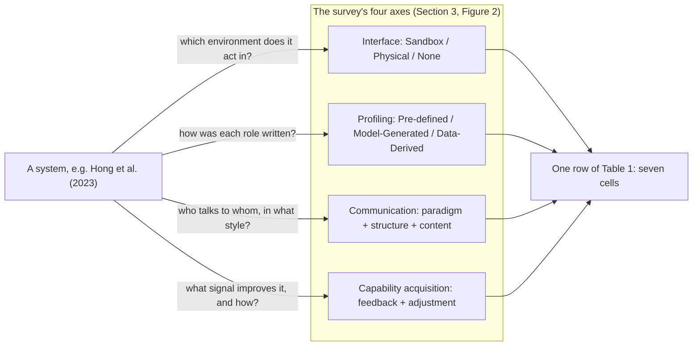
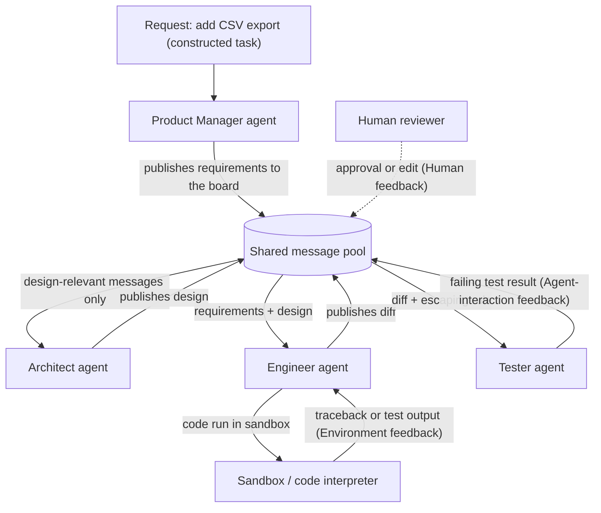

# Large Language Model based Multi-Agents: A Survey of Progress and Challenges

> **Paper:** Guo, Chen, Wang, Chang, Pei, Chawla, Wiest and Zhang (University of Notre Dame, King Abdullah University of Science and Technology and others), 2024 - [arXiv abstract](https://arxiv.org/abs/2402.01680) - [local PDF](../../papers/2402.01680.pdf)
>
> **Short name:** the multi-agent survey. **What was followed:** the arXiv HTML rendering of v2 (dated 19 April 2024, category cs.CL). Section, table and figure numbers follow that rendering. The rendering flattens Table 1 into one cell per line, so some cell-to-column alignments in this guide are reconstructed and flagged where it matters. This is a survey: it runs no experiments of its own. The rendering names no venue; treat it as an arXiv paper whose peer-review status this guide cannot confirm.

## Read this first

**The claim in one sentence.** Systems in which several language-model agents talk to each other can be described along four axes (how agents touch their environment, how each agent's role is defined, how agents communicate, and how agents improve), and the published systems fall into two application families, problem solving and world simulation, with six open challenges listed at the end.

**What kind of paper this is.** A map, not a result. It reports other people's systems, counts papers in a figure, and tabulates 31 systems by category (this guide's count of rows in Table 1). It reports no matched comparison of multi-agent against single-agent systems, and nothing in it shows that several agents beat one well-prompted agent. Read it as a vocabulary and a filing cabinet. That is useful, and it is also the whole of what it is.

**Who this is for.** Anyone who has read a framework paper ([CAMEL](./17-camel.md), [AutoGen](./18-autogen.md), [MetaGPT](./19-metagpt.md)) and wants a shared language to compare them, or who must choose between several cooperating agents and one agent with good tools.

**Afterwards you will be able to** place any multi-agent system on the survey's axes; say which axis values the survey assigns to MetaGPT and which ones this guide has to infer for CAMEL and AutoGen; list the survey's application domains and challenges accurately; and state precisely what the survey cannot tell you.

**Reading time.** About 50 minutes for this guide; the paper itself is short on argument and long on tables and references. **Have read first:** [ReAct](../02-building/10-react.md) (the single-agent think-act loop the survey builds on), then ideally the three framework guides above. After this guide read [Interoperability](./21-interoperability.md) (how separate agents are wired together at the protocol level) and the [agentic tool use survey](../06-agent-systems/27-agentic-tool-use-survey.md) (the single-agent counterpart).

**The one thing most people get wrong.** They see a taxonomy and a rising paper-count chart (Figure 1) and conclude that multi-agent design is the proven direction. The survey counts papers, not outcomes, and its Section 6.5 says benchmarks are far from comprehensive.

## The paper in one worked example

A survey has no single trace, so the example below is **constructed by this guide**. It is a small software task, and the same task is described three ways using the survey's vocabulary. Every classification that comes straight from the survey is marked "survey"; every classification this guide had to infer is marked "inferred". Every number that is not the survey's is marked "constructed".

### The task (constructed by this guide)

A small web app lists invoices. The product owner wants a "Download as CSV" button on the invoice list. The hidden catch, which a good team should notice: if an invoice customer name begins with `=`, `+`, `-` or `@`, a spreadsheet program may treat the cell as a formula (a known issue called CSV or formula injection), so exported cells need escaping. The deliverable is a code change plus one test.

### The survey's four axes, applied to three designs

The survey dissects a system along (1) the **agents-environment interface**, (2) **agent profiling**, (3) **agent communication** (paradigm, structure, content) and (4) **capability acquisition** (feedback and adjustment). The table applies those axes to three ways of building the invoice-export team.

| Axis (survey section) | Design 1: two-role chat | Design 2: staged pipeline with shared board | Design 3: coder plus executor conversation |
|---|---|---|---|
| Interface (3.1) | Sandbox if a code runner is attached; otherwise None | Sandbox (code interpreter) | Sandbox (code execution is the point) |
| Profiling method (3.2) | Pre-defined (inferred) | Pre-defined (survey, Table 1, Hong et al.) | Pre-defined (inferred) |
| Profiles (Table 1 column) | "Product owner", "engineer" | "Product Manager", "Engineer" are the survey's examples; this guide adds architect and tester | "Assistant" (writes code), "executor" (runs it), optional human proxy |
| Paradigm (3.3) | Cooperative | Cooperative (survey) | Cooperative |
| Structure (3.3, Figure 3) | Two peers; closest survey label is Decentralized (inferred) | Layered plus Shared Message Pool (survey) | Depends on how you program it: centralised if one agent routes, decentralised if peers address each other (inferred) |
| Feedback (3.4) | Agent interaction (plus Environment if a runner is attached) | Environment, Agent interaction, Human (survey) | Environment (test output), Human if the proxy asks you |
| Adjustment (3.4) | Memory only (what is in the chat history) | Memory, Self-Evolution (survey lists both for Hong et al.) | Memory; Dynamic Generation if you spawn a reviewer on demand |

Reading the middle column: the survey's Table 1 row for Hong et al. (the MetaGPT paper) reads Sandbox / Pre-defined / "Product Manager, Engineer" / Cooperative / "Layered, Shared Message Pool" / "Environment, Agent interaction, Human" / "Memory, Self-Evolution". That row is the only one of the three framework systems the survey itself classifies. The row for Qian et al. (2023), a software-company simulation whose well-known name is ChatDev (the name is this guide's knowledge, not in the rendering), reads Sandbox / "Pre-defined, Model-Generated" / "CTO, programmer" / Cooperative / Layered / "Environment, Agent interaction, Human" / "Memory, Self-Evolution". The row for Dong et al. (2023b) differs only in profiles ("Analyst, coder") and in having no Human feedback.

### Tracing Design 2 on the task (constructed)

1. **Product Manager** reads the one-line request and publishes to the board: "Add CSV export of the invoice list; columns: number, customer, amount, date; escape cells that begin with = + - @." (Whether a manager would remember the escaping rule is the weak point; the survey says nothing about that.)
2. **Architect** subscribes to the manager's message and publishes a design: one `export_csv(invoices)` function, one route, one button.
3. **Engineer** subscribes to both messages, writes the function and the route, runs them in the sandbox, and reads the interpreter output (Environment feedback in the survey's sense).
4. **Tester** subscribes to the engineer's message and the manager's escaping rule, writes a test with a customer named `=SUM(A1)`, and publishes a failing result if the engineer forgot escaping (Agent-interaction feedback).
5. The engineer fixes it. A human reviewer may approve the diff (Human feedback).

Where this trace is **the survey's** and where it is **constructed**: the roles and the pipeline shape come from the survey's description of software development (Section 4.1.1: roles "like product managers, programmers, and testers", waterfall or Standardized Operating Procedure workflows, "usually layered" structure). The invoice task, the architect, the escaping rule and the test are constructed.



Notice that the survey's unit of analysis is a row of seven cells; two systems that share all seven cells are indistinguishable to this taxonomy even if they behave very differently.



Notice that the board lets the tester see the manager's escaping rule without the engineer having to restate it. Remove the board and the same information must be forwarded by hand, one message per reader.

## Words you need

| Term | Plain definition | Example from the worked example |
|---|---|---|
| LLM-MA (Large Language Model based Multi-Agent system) | The survey's abbreviation for a system in which several language-model-driven agents interact. | The four-role invoice team in Design 2. |
| Agents-environment interface | How agents perceive and act on their surroundings. The survey gives three values: Sandbox (a human-built simulated environment), Physical (the real world) and None. | The code interpreter that runs the engineer's function is a Sandbox. |
| Agent profiling | How an agent's role is specified. Three methods: Pre-defined (written by the designer), Model-Generated (written by a model), Data-Derived (built from an existing dataset). | The Product Manager prompt written by hand is Pre-defined. |
| Communication paradigm | The style of interaction: Cooperative (shared goal), Debate (argue and critique to reach consensus), Competitive (conflicting goals). | The invoice team is Cooperative; a reviewer arguing against the engineer would be Debate. |
| Communication structure | The wiring of who talks to whom: Layered, Decentralized, Centralized, or Shared Message Pool (Section 3.3, Figure 3). | Design 2 is Layered with a Shared Message Pool. |
| Shared Message Pool | A board where agents publish messages and subscribe to the ones relevant to their profile; the survey credits MetaGPT with proposing it. | The tester subscribes to the manager's escaping rule. |
| Feedback (four sources) | Information about an action's outcome: from the Environment, from Agent interactions, from a Human, or None. | The interpreter's traceback is Environment feedback. |
| Agents adjustment | How agents improve: Memory (retrieve past experience), Self-Evolution (modify own goals, plans or weights), Dynamic Generation (create new agents on the fly). | Spawning a security-reviewer agent only when the diff touches export code. |


## Tutorial 1 - Intuitive understanding

### What was broken before

Before this survey, papers on teams of language-model agents were each describing their own setup in their own words. One paper's "role" was another's "persona"; one called a shared notice board "a blackboard", another called it a "message pool". A newcomer reading five papers got five vocabularies. The survey's own motivation (Section 1) is that earlier efforts "were undertaken independently", so there was no systematic review that could "establish comprehensive blueprint of this field".

### The idea

**Analogy.** A library catalogue does not say whether a book is good; it gives subject, author and shelf so you can find similar books and see what is missing. The survey catalogues multi-agent systems the same way: each is filed by interface, profile, communication and improvement mechanism, on two big shelves, problem solving and world simulation.

**Where the analogy breaks.** A library catalogue is neutral about quality, and so is this survey, but readers do not treat it that way. Cataloguing 31 systems in a table looks like evidence that each works well. The table records what each paper claims to have built; it does not record whether it beat a simpler baseline. Also, a catalogue's categories are exclusive (a book sits on one shelf), while the survey's cells often hold two values at once (a system can be "Centralized, Decentralized" in structure). So the filing is looser than a library's.

### How it works, step by step

The survey's method is descriptive, so the steps are the choices a reader makes with its axes, shown on the invoice example.

1. **Environment.** Sandbox, Physical or None. The invoice team uses a sandbox; the survey's debate rows use None because agents only exchange arguments.
2. **Role writing.** Pre-defined means you write the Product Manager prompt. Model-Generated means a model writes it. Data-Derived means roles come from data, as in the Table 1 row that builds simulated users from MovieLens-1M (Zhang et al. 2023a).
3. **Paradigm.** Cooperative suits the invoice task; Debate suits questions with checkable answers; Competitive suits games.
4. **Structure.** Layered for a staged workflow, Decentralized (peer to peer, which Section 3.3 says world simulations commonly use), Centralized (one coordinator), or the Shared Message Pool (publish and subscribe).
5. **Feedback.** Environment (test output, interpreter errors), Agent interaction (a reviewer's critique), or Human.
6. **Adjustment.** Memory (retrieve past experience), Self-Evolution (change goals, plans or weights), Dynamic Generation (add agents). The survey says most systems rely on memory.

### What the results say

The survey reports no experimental results of its own. What it reports, and what the numbers count, are these.

- **A rising count of papers (Figure 1).** The figure counts papers per category at 3-month intervals, per its caption, with a number on each leaf of the category tree. In the rendering I read, the leaf numbers are not recoverable as text, so this guide cannot quote them. What the figure supports: the number of papers on multi-agent systems rose over the period. What it does not support: that multi-agent systems work better.
- **Table 1: 31 rows, two families.** By this guide's count of rows: 11 under problem solving (3 software development, 3 embodied agents, 1 science experiments, 4 science debate) and 20 under world simulation (5 society, 3 gaming, 2 psychology, 4 economy, 2 recommender systems, 2 policy making, 2 disease propagation). Some rows cover two papers (the Werewolf and Avalon rows each cite two). So "31" counts rows, not papers.
- **Structure usage in Table 1 (this guide's tally from the flattened table).** Of the 11 problem-solving rows, 3 list Layered (all software development), 1 lists Shared Message Pool (the MetaGPT row), 5 list Centralized and 7 list Decentralized (some rows list both). Of the 20 world-simulation rows, 13 list Decentralized and 7 have "-" for structure; none lists Layered or Centralized. In plain terms: staged pipelines are a software-development habit, and peer-to-peer wiring is the world-simulation habit. The survey states the second pattern in Section 3.3 ("commonly employed in world simulation applications"); the counts are this guide's reading of the table.
- **Scale figures the survey quotes (Section 4.2).** A 25-agent community (Park et al. 2023); 1,000 personas (Park et al. 2022); networks of 8,563 and 17,945 agents (Gao et al. 2023a); 1,000 agents from MovieLens-1M in Agent4Rec (Zhang et al. 2023a). These count agents in simulations, not accuracy; cost is left to Section 6.4.
- **Two result-like statements the survey repeats from others.** Du et al. (2023) is described as showing that debate "can improve factuality" across six tasks; Xiong et al. (2023) as claiming debate improves inter-consistency between models (Section 4.1.4). No numbers or baselines are given, so the size of the improvements is unavailable here.

### What this does not show

- **It does not show multi-agent beats one agent.** No section reports a matched comparison (same model, same token budget, same tasks) of one agent versus several. Section 2.2 contrasts the two designs in prose, saying multi-agent systems "emphasize diverse agent profiles, inter-agent interactions, and collective decision-making", and stops there.
- **It does not rank the three frameworks.** Section 5.1 describes MetaGPT, CAMEL and AutoGen side by side. It reports no benchmark that compares them.
- **It does not tell you which taxonomy cell is best.** There is no table of "layered beat decentralised by x points".
- **It does not test its hallucination-cascade or collective-intelligence claims.** Sections 6.2 and 6.3 state them as challenges; they are the authors' view, not findings.

### Teach-back

1. Name the survey's four axes and give one value for each in the invoice example.

<details>
<summary>Answer</summary>

Interface (Sandbox), profiling (Pre-defined), communication (Cooperative, Layered plus Shared Message Pool, text), capability acquisition (Environment, Agent interaction and Human feedback; Memory and Self-Evolution adjustment, the survey's classification of the MetaGPT row).

</details>

2. Why is "31 systems in Table 1" not evidence that multi-agent systems work?

<details>
<summary>Answer</summary>

Table 1 lists what each paper built and how; it holds no single-agent baseline and no outcome numbers, so inclusion says nothing about performance.

</details>

3. In Design 2, who gives Environment feedback and who gives Agent-interaction feedback?

<details>
<summary>Answer</summary>

The sandbox (interpreter output, test run) gives Environment feedback to the engineer; the tester's published failing test gives Agent-interaction feedback.

</details>

4. Where does the survey itself file CAMEL and AutoGen in Table 1?

<details>
<summary>Answer</summary>

It does not. Table 1 has a row for MetaGPT (Hong et al.) but none for CAMEL (Li et al. 2023b) or AutoGen (Wu et al. 2023a). CAMEL is discussed in Sections 4.1.1 and 5.1, AutoGen only in 5.1, so their cells in this guide are inferences.

</details>

## Tutorial 2 - Practitioner understanding

### The design in concrete terms

There is no system to build here; the "design" is the taxonomy's decision list. Below is every category the survey names, with its exact values, so that you can fill in a design document without opening the paper. Nothing is added to the survey's categories.
The survey's categories are those in the worked-example axes table and the Words table, plus the application subdomains (Problem Solving: software development, embodied agents, science experiments, science debate; World Simulation: societal simulation, gaming, psychology, economy, recommender systems, policy making, disease propagation) and the six challenges (6.1 to 6.6). The survey gives no hyper-parameters or prompts, because it builds nothing.

**Single-agent background (Section 2.1).** The survey builds on three single-agent abilities: decision-making thought (break tasks into subgoals, explore paths, learn from experience), tool use, and memory (in-context learning as short memory, an external vector database as long memory). Those three are exactly what a "thin runtime around one model with a few good tools" already provides. Multi-agent systems add the other axes on top.

**How Section 5.1 describes the three frameworks.** MetaGPT embeds human workflow via SOPs and an assembly line of roles, to reduce hallucination. CAMEL (Communicative Agent Framework) aims at autonomous cooperation through "inception prompting". AutoGen is highly customisable, with agents programmed "using both natural language and code". The survey writes no comparison of the three.

**Where the survey puts each framework (what it states and what it does not).**

| System | Table 1 row? | Where described | Interface | Profiling | Paradigm | Structure | Feedback | Adjustment |
|---|---|---|---|---|---|---|---|---|
| MetaGPT (Hong et al. 2023) | Yes | 4.1.1, 5.1 | Sandbox | Pre-defined | Cooperative | Layered, Shared Message Pool | Environment, Agent interaction, Human | Memory, Self-Evolution |
| CAMEL (Li et al. 2023b) | No | 4.1.1 ("a simple role-play agent framework ... two roles"), 5.1 | not stated | not stated | Cooperative (inferred from "autonomous cooperation") | not stated; two-party chat | not stated | not stated |
| AutoGen (Wu et al. 2023a) | No | 5.1 only | not stated | not stated | not stated | not stated; "customization" is the stated property | not stated | not stated |

The empty cells are the finding; for real values go to [CAMEL](./17-camel.md), [AutoGen](./18-autogen.md) and [MetaGPT](./19-metagpt.md). The MetaGPT row lists Self-Evolution, which Section 3.4 defines as agents "modifying themselves"; whether iterative executable feedback meets that definition is a judgement call.

### A minimal version

For a survey the minimal version is a **classification worksheet**: a script that holds candidate systems as rows in the survey's vocabulary, refuses values the survey does not define, and counts where you are concentrated. Standard library only.

```python
from dataclasses import dataclass, field
from collections import Counter

# Allowed values copied from the survey (Sections 3.1-3.4).
AXES = {
  "interface": {"Sandbox", "Physical", "None"},
  "profiling": {"Pre-defined", "Model-Generated", "Data-Derived"},
  "paradigm":  {"Cooperative", "Debate", "Competitive"},
  "structure": {"Layered", "Decentralized", "Centralized", "Shared Message Pool"},
  "feedback":  {"Environment", "Agent interaction", "Human", "None"},
  "adjust":    {"Memory", "Self-Evolution", "Dynamic Generation"},
}

@dataclass
class Row:
    name: str
    family: str                       # "Problem Solving" or "World Simulation"
    cells: dict = field(default_factory=dict)   # axis -> set of values
    inferred: set = field(default_factory=set)  # axes YOU filled in, not the paper

def check(r: Row):
    for axis, vals in r.cells.items():
        bad = vals - AXES[axis]
        if bad:
            raise ValueError(f"{r.name}: {axis} has non-survey values {bad}")

def tally(rows, axis):
    c = Counter()
    for r in rows:
        c.update(r.cells.get(axis, set()))
    return c

rows = [
  Row("MetaGPT", "Problem Solving", {"interface": {"Sandbox"}, "profiling": {"Pre-defined"},
      "paradigm": {"Cooperative"}, "structure": {"Layered", "Shared Message Pool"},
      "feedback": {"Environment", "Agent interaction", "Human"},
      "adjust": {"Memory", "Self-Evolution"}}),
  Row("Invoice-team-v1 (mine)", "Problem Solving", {"structure": {"Layered"},
      "feedback": {"Environment"}, "adjust": {"Memory"}}, inferred={"structure"}),
]
for r in rows: check(r)
print(tally(rows, "structure"))
# Counter({'Layered': 2, 'Shared Message Pool': 1})
```

Shapes: input is a list of `Row`; output is a `Counter` per axis. The `inferred` set keeps the survey's cells apart from your guesses, the same distinction this guide makes in the worked example. If a value you want does not fit a set, that is a finding about the taxonomy; do not patch it silently.

### What it costs

Classifying costs reading time, roughly 10 to 15 minutes per system with its paper in hand (this guide's assumption). The real cost question is what the **design** costs at run time, which the survey names only qualitatively (Section 6.4: each agent "demands substantial computational power and memory"). Below is a constructed comparison on the invoice task; the prices are assumptions, not any vendor's list prices.

Assumptions: every call in the multi-agent designs has a 1,000-token fixed prompt (role plus task); each message is 400 tokens and each call outputs one; the single agent starts at 1,000 tokens and its context grows by 600 per step; input 3 dollars and output 15 dollars per million tokens; 20 seconds per call, calls in sequence.

| Design | Calls | Input tokens | Output tokens | Cost | Wall-clock |
|---|---|---|---|---|---|
| Single agent, one growing context, 6 steps | 6 | 1,000+1,600+2,200+2,800+3,400+4,000 = 15,000 | 6 x 400 = 2,400 | 0.045 + 0.036 = 0.081 dollars | 120 s |
| Eight-call pipeline, every call reads every prior message (broadcast) | 8 | 8 x 1,000 + 400 x (0+1+...+7 = 28) = 19,200 | 3,200 | 0.0576 + 0.048 = 0.1056 dollars | 160 s |
| Eight-call pipeline, shared pool, each call reads at most 3 prior messages (0,1,2,3,3,3,3,3 = 18 messages) | 8 | 8,000 + 18 x 400 = 15,200 | 3,200 | 0.0456 + 0.048 = 0.0936 dollars | 160 s |

Broadcast costs 0.1056 / 0.081 = about 1.30 times the single agent; the pooled design about 1.16 times. The pool recovers most of the input overhead (19,200 down to 15,200 tokens, 21 percent) but still pays more output and 40 more seconds. The survey gives no figure for the pool's saving, so the toy shows only direction.

### How it fails

The survey has no error analysis. Rows marked S come from the survey's named challenges; rows marked G are this guide's inferences from the taxonomy.

| Symptom | Likely cause | Mitigation |
|---|---|---|
| An invented fact appears and every agent repeats it | One agent hallucinates and others accept it, the cascade of Section 6.2 (S) | Add a feedback source that is not an agent (test run, retrieval check, human), since agent critique can share the same blind spot (G) |
| Token use far above a single-agent baseline | Broadcast structure; every agent re-reads everything (G) | Subscription pool or layered structure |
| Debate converges to a wrong consensus | Copies of one model share errors; agreement is not independent (G, Prerequisite 4) | An external verifier before accepting consensus |
| Agents improve alone but the team does not | Memory and Self-Evolution adjust agents separately (6.3, S) | Evaluate the team's outcome, not each role's output |
| More agents, worse coordination | Orchestration complexity rises with agent count (6.4, S) | Start with the smallest role set that covers a failure you have seen |

### Evaluating your version

Two different things can be evaluated, and the survey supports only the first.

**(1) Is your classification reliable?** If two people file the same ten systems with the worksheet, how often do they agree? Cohen's kappa corrects raw agreement for chance. Constructed toy: two raters label the structure of 10 systems and agree on 8, so observed agreement is 0.8. Rater A says "Layered" for 4 and "other" for 6; rater B says 5 and 5. Chance agreement is 0.4 x 0.5 + 0.6 x 0.5 = 0.5, so kappa = (0.8 - 0.5) / (1 - 0.5) = 0.6. Stop rule: if kappa on structure is under 0.6 after one calibration round, tighten the definitions, with written examples for borderline cases such as a two-party chat. The survey reports no agreement check of its own.

**(2) Does a multi-agent design beat one agent on your work?** The survey cannot answer this. Minimum design: 40 or more real tasks, the same base model, a fixed token budget per task, both designs on every task, success judged by a test or rubric fixed in advance. Metrics: tasks solved out of 40, cost per solved task, median wall-clock. Baseline: one agent with the same tools and as much prompt effort as the team. Stop rule: adopt the team only if it solves at least 5 more tasks of 40 in a paired comparison and its cost per solved task is within a limit set beforehand. The 5-of-40 margin is this guide's illustration, not a standard.

### Adopt, adapt or skip

**Adopt the vocabulary; skip the survey as evidence.** For a team building an assistant over private business documents, the survey is worth an hour as shared language: write each design decision as interface, profiling method, paradigm, structure, feedback source and adjustment mechanism. It is not a reason to use several agents.

**Adapt** by asking, per axis, what a single agent with a thin runtime already gives you. Environment feedback and Memory are single-agent features. The multi-agent additions are role separation, structure, agent-to-agent feedback and Dynamic Generation, and each adds calls, so each must earn its place with a measured gain on your tasks. **Skip** the world-simulation half unless you simulate customers or markets.

**Where this bears on the curriculum's through-question** (is a thin runtime around one model with a few good tools the right architecture?): the survey does not settle it. Its Section 2.1 shows the single-agent ingredients (planning, tool use, memory) are the base layer; Section 6.3 admits joint adjustment is unsolved; nothing shows a team beating a single agent. That matches this curriculum's caution: treat multi-agent structure as a hypothesis to test against a single-agent baseline built on good context, instructions and memory. For small or open models, Section 6.4 notes that agents typically sit on large models such as GPT-4 and that more agents multiply resource needs, which argues for testing the single-agent-with-better-context option first.

## Tutorial 3 - Researcher understanding

### Formal setup

A survey has little notation, so this section builds a minimal formalisation that is **this guide's, not the paper's**, to make the taxonomy precise.

Let a system be a tuple S = (E, P, C, L) where:
- E in {Sandbox, Physical, None} is the interface (set-valued allowed, e.g. "Sandbox, Physical").
- P is a set of profiling methods drawn from {Pre-defined, Model-Generated, Data-Derived}.
- C = (pi, sigma, kappa) where pi is a subset of {Cooperative, Debate, Competitive} (paradigm), sigma is a subset of {Layered, Decentralized, Centralized, Shared Message Pool} (structure) and kappa is the content (text in almost all cases).
- L = (F, A) where F is a subset of {Environment, Agent interaction, Human, None} (feedback) and A is a subset of {Memory, Self-Evolution, Dynamic Generation} (adjustment).

Toy instance (the MetaGPT row): E = {Sandbox}, P = {Pre-defined}, pi = {Cooperative}, sigma = {Layered, Shared Message Pool}, F = {Environment, Agent interaction, Human}, A = {Memory, Self-Evolution}. The taxonomy is many-to-one: the survey's 31 rows occupy a small corner of the possible signatures, so be careful about calling cell counts "trends".

Two systems with the same signature may be different systems; the taxonomy is a many-to-one map from systems to signatures.

### The claims, stated precisely

1. **Descriptive (Section 3):** LLM-MA systems can be dissected into interface, profiling, communication and capability acquisition, with the values listed above. A classification can be useful or not; it cannot be wrong.
2. **Coverage (Section 4, Table 1):** the literature divides into problem solving (four subdomains) and world simulation (seven). This rests on a search the rendering does not describe; I found no inclusion criteria.
3. **Structural patterns (3.3, 4.1.1, 4.2):** software development tends to be layered and world simulation decentralized. The table rows support it; this guide's tally agrees.
4. **Challenges (Section 6):** six open problems, argued and not measured. Sections 6.2 and 6.3 assert hallucination cascades and isolated adjustment with no experiment.
5. **Implicit (Introduction, Conclusion):** multi-agent systems "have shown inspiring collective intelligence". The survey does not test this; it relies on the cited papers.

### Evidence, table by table

**Figure 1 (growth of the field).** Rows: categories in a tree (problem solving and world simulation with sub-categories); x axis: time in 3-month intervals; leaf numbers: papers per category. Identifies: nothing causal. Associates: topic interest over time. Limit: counts depend on how the authors searched, not described in the rendering; the leaf numbers are not extractable here.

**Figures 2 and 3 (architecture; communication structures).** Figure 2 is a schematic of the four-part decomposition; Figure 3 draws the four structures (Layered, Decentralized, Centralized, Shared Message Pool). They identify nothing; they define the vocabulary of Table 1's columns.

**Table 1 (summary of the LLM-MA studies).** Rows: studies grouped by application family and subdomain. Columns: motivation, research domain and goals, work, interface, profiling methods, profile examples, paradigms, structure, feedback, adjustment. A "-" means "not specifically mentioned in this work" (caption). Headline patterns (this guide's tally): all three Layered-structure software rows are problem solving; the one Shared Message Pool is in the MetaGPT row; Decentralized dominates world simulation (13 of 20 rows); Memory appears in most rows; Self-Evolution in four (Qian, Hong, Dong and Zhao et al.). Identifies: how the authors characterise each study. Associates only: it cannot say whether a structure causes better outcomes, because no outcomes are tabulated.

**Table 2 (datasets and benchmarks).** Rows: benchmarks by domain, with who used them and a data link ("/" means unavailable). Problem solving: HumanEval, MBPP (Mostly Basic Python Problems) and SoftwareDev for software; RoCoBench, C-WAH and TDW-MAT for embodied AI; MMLU, MedQA, PubMedQA, GSM8K, StrategyQA and Chess Move Validity for science debate. World simulation: SOTOPIA, Werewolf, Avalon, Welfare Diplomacy, MovieLens-1M and others. Takeaway the survey draws (5.2): problem-solving benchmarks mostly test planning and reasoning; world-simulation ones test alignment with the real world; science-team experiments and economic modelling lack comprehensive benchmarks. The "Science Debate" label groups ordinary question-answering sets, so it names the method (debate), not the domain.

### Ablations and what they isolate

There are none; the survey runs no experiments. The nearest thing is within surveyed papers, summarised without numbers: debate improving factuality (Du et al.), debate improving inter-consistency (Xiong et al.), and a comparison of four communication frameworks (centralized, decentralized and two hybrids) for multi-robot coordination (Chen et al. 2023d, Section 4.1.2). The last touches the structure axis, but no figures are given. What would isolate that axis: fix the model, task and token budget and vary only the structure value.

### Threats to validity specific to this paper

- **Selection.** Coverage depends on what the authors searched and chose. CAMEL and AutoGen are covered in prose but absent from Table 1, so the table is not exhaustive.
- **Classification by self-report.** Rows record what cited papers say about themselves, filed by the survey authors; MetaGPT's "Self-Evolution" is a judgement call.
- **Flattened table.** In the rendering I read, Table 1 is unaligned text, so some cell assignments (for example which profile example belongs to which society row) are reconstructed and should be checked against the PDF.
- **Time lag.** The paper is from early 2024 and covers mostly 2023 work with GPT-class models; later single-agent tool use and protocol work is absent (see [Interoperability](./21-interoperability.md) and the [agentic tool use survey](../06-agent-systems/27-agentic-tool-use-survey.md)).
- **Internal tensions (not errors, but unresolved).** Section 4.1.4 presents debate as improving factuality while Section 6.2 argues that a hallucination in one agent is accepted and spread by others. Both can be true in different settings; the survey does not say when each dominates.

**Inconsistencies found in the rendering (flagged, not fixed).**
1. Section 3.4 says that for some world-simulation works such as propagation simulation there is no feedback ("None"), yet the Table 1 rows for the two disease-propagation studies list "Environment, Agent interaction" (Ghaffarzadegan et al.) and "Environment, Agent interaction" (Williams et al.). I found no row whose feedback cell reads "None".
2. Section 4.2.4 says economic-simulation agents "interact in cooperative or debate, decentralized environments", while Table 1's economy rows list Competitive for Zhao et al. and "Cooperative, Competitive" for the information-marketplace row.
3. Section 5.1 presents CAMEL and AutoGen as two of the three main frameworks, but neither has a Table 1 row, so the taxonomy is not applied to them anywhere in the paper.
4. Figure 1's leaf counts and some Table 1 cell alignments could not be recovered from the HTML text; the PDF was not rendered here, so I flag them as unverified rather than guess.

### Open problems and follow-ups

The survey's six challenges (6.1 to 6.6) are: multi-modal environments (most work is text-only); hallucination (one agent's error cascades; untested here, see Prerequisite 4); collective intelligence (Memory and Self-Evolution adjust agents in isolation, and learning from instant feedback needs a reliable interactive environment); scaling up (cost rises with agent count; "scaling laws of multi-agents" are called for but no curve is given); evaluation and benchmarks (narrow scenarios, missing emergent behaviour, and no benchmarks for science-team experiments, economic analysis or disease propagation); and applications and beyond (finance, education, healthcare, urban planning, plus lenses such as cognitive science and complex systems). Table 2 is called "a starting point, and far from being comprehensive". This guide adds one follow-up: a controlled study that varies only the structure value.

### What would change my mind

- A matched comparison, same model and same budget, in which a role-structured team reliably beats a single agent given the same tools and prompt effort, on tasks outside the team's own benchmark, would move me from "taxonomy is useful, benefit unproven" to "structure matters".
- An ablation across the structure axis (layered versus decentralized versus pooled) with outcome numbers would turn the survey's descriptive patterns into design guidance.
- A measured hallucination-cascade study showing error rising with agent count would confirm Section 6.2; consensus lowering error would favour the debate papers.
- Evidence that small or open models, given careful context, instructions and memory in a single-agent runtime, match multi-agent teams would support this curriculum's through-question; the reverse would weaken it.

## Reading map for the PDF

| Section or figure | What it contains | First pass | Guide section that answers the questions it raises |
|---|---|---|---|
| Abstract and 1 Introduction (Figure 1) | Motivation, paper-count growth chart, outline | Read | Read this first; Tutorial 1, "What the results say" |
| 3.2 Agents profiling | Pre-defined, Model-Generated, Data-Derived | Read | Prerequisite 3 |
| 3.3 Communication, Figure 3 | Paradigms, four structures, content | Read closely | Prerequisite 2; Tutorial 2 cost table |
| 3.4 Capabilities acquisition | Feedback sources; Memory, Self-Evolution, Dynamic Generation | Read closely | worked example; Tutorial 2 table |
| Table 1 | 31 rows classifying systems | Skim first, then use as lookup | Tutorial 3, "Evidence, table by table" |
| 4.1 Problem solving | Software development, embodied, science experiments, science debate | Skim; read 4.1.1 | Worked example; FAQ on CAMEL/MetaGPT |
| 5.1 Frameworks | MetaGPT, CAMEL, AutoGen descriptions | Read | Tutorial 2 framework table |

## Questions readers get stuck on

#### Is a "multi-agent" system really several models, or one model playing several parts?

Usually one model (often the same large model) prompted with different role descriptions, which is what the profiling axis describes. The survey does not require different models; Section 2.2 simply speaks of multiple autonomous agents, "each of which is equipped with unique strategies and behaviors". One consequence, taken up in Prerequisite 4, is that the "different" agents may share the same blind spots.

#### Where are CAMEL and AutoGen in the survey's big table?

Nowhere in Table 1. CAMEL appears in Section 4.1.1 (a simple two-role framework that works from a one-sentence instruction) and Section 5.1; AutoGen appears only in 5.1. MetaGPT (Hong et al.) is the only one of the three with a Table 1 row. This guide's placement of the other two in the worked example is inferred and marked as such.

#### What is the difference between communication paradigm and communication structure?

The paradigm is the attitude of the exchange (Cooperative, Debate or Competitive), the structure is the wiring (Layered, Decentralized, Centralized or Shared Message Pool). A debate can run in a decentralized wiring or through a central judge (the survey's Table 1 lists the Proponent, Opponent, Judge system as Centralized and Decentralized). The two axes are independent, which is why Table 1 has two separate columns.

#### What is a Shared Message Pool and why is it listed as a structure?

It is a board that every agent can write to; agents subscribe to the messages relevant to their profile, so they do not receive every message. The survey says MetaGPT proposed it "to improve the communication efficiency" and treats it as the fourth structure beside Layered, Decentralized and Centralized. The survey does not measure the efficiency gain; the cost table in Tutorial 2 is a constructed illustration.

#### Does the survey show that multi-agent systems outperform a single agent?

No. It runs no experiments and reports no head-to-head with a single-agent baseline. It repeats claims from individual papers without numbers. The comparison has to come from the primary papers or from your own run, as in Tutorial 2's evaluation plan.

#### Why does Figure 1 count papers, and what can I conclude from it?

It counts the number of surveyed papers in each category every three months (per the caption), to show the field growing fast. You can conclude that research attention is growing and where it is concentrated. You cannot conclude that the approaches work, that the counts are complete (the search method is not described), or that growth will continue.

#### What is the difference between Memory, Self-Evolution and Dynamic Generation?

Memory means storing past interactions and feedback and retrieving them when acting, so the agent's weights and role description stay the same. Self-Evolution means the agent itself changes: its goals or plans are modified, or it is trained on communication logs (the survey cites Learning through Communication, which turns multi-agent communication logs into training data). Dynamic Generation means the system creates a new agent mid-run. Only the second and third change the system's structure or the agent's own definition.

#### Why not just use one agent with a longer prompt and better tools?

You may well be right to. The survey does not argue against it and does not test it. Specialisation (distinct profiles) and interaction among agents are the two benefits it names in Section 1, and both are plausible; neither is measured. The sensible move is to start with a single agent and add structure when a measured failure (for example a missed escaping rule) is fixed by a second role or a checker.

## Prerequisites you actually need

### Prerequisite 1 - The single-agent loop and feedback

**Plain explanation.** One agent repeats: read the situation, choose an action, get an observation, and decide again. Everything in the survey's feedback axis is a variant of what the observation is.

**Tiny example.** An engineer agent runs `export_csv` and the interpreter replies `NameError: name 'escape' is not defined`. That text is Environment feedback; the next action is to define `escape`. A human replying "also strip leading plus signs" is Human feedback.

**Where used.** Sections 2.1 and 3.4. **Where to learn more.** [ReAct](../02-building/10-react.md), and the [glossary](../../references/glossary.md).

### Prerequisite 2 - Communication structures as networks, and what they cost

**Plain explanation.** A structure is a graph: agents are dots, allowed conversations are lines. The number of lines bounds how much message traffic is possible.

**Tiny example (constructed).** With 5 agents: full peer-to-peer has 5 x 4 / 2 = 10 channels; a star with one central agent has 4; a layered arrangement of 1, 2 and 2 agents that talk only to adjacent layers has 1 x 2 + 2 x 2 = 6. A shared pool has 5 links to the pool, but how much each agent reads depends on its subscriptions.

**Where used.** Section 3.3 and Figure 3. **Where to learn more.** [Interoperability](./21-interoperability.md) for how channels are wired in practice, and the [math bridge](../../references/math-bridge.md) for general notation.

### Prerequisite 3 - Role prompting (profiles)

**Plain explanation.** A profile is text placed at the start of an agent's prompt that fixes its role, skills and constraints. The model is the same; the role text changes what it tends to produce.

**Tiny example.** "You are the Tester. Given a diff, write one failing test for each rule in the requirements" versus "You are the Engineer. Write the function." The two prompts differ by about 25 words; whether the outputs differ in ways that matter is empirical.

**Where used.** Section 3.2 and Table 1's profile columns. **Where to learn more.** [CAMEL](./17-camel.md) (role-playing with inception prompts) and [MetaGPT](./19-metagpt.md) (roles tied to SOPs).

### Prerequisite 4 - Voting, debate and correlated errors

**Plain explanation.** Asking several agents and taking the majority helps only if their mistakes are not the same mistakes.

**Tiny example (constructed, not from the survey).** Three independent agents each right with probability 0.7. Majority is right when at least two are: 3 x 0.7 x 0.7 x 0.3 + 0.7 x 0.7 x 0.7 = 0.441 + 0.343 = 0.784, a gain from 0.70 to 0.784. If all three are copies of one model that makes the same error on a given question, they agree on the wrong answer together and the majority is no better than one agent.

**Where used.** Section 4.1.4 (debate), Section 6.2 (hallucination cascade). **Where to learn more.** [Chain-of-thought](../02-building/07-chain-of-thought.md) for the single-model reasoning that debate builds on.

## Where this sits in the curriculum

**Read before:** [ReAct](../02-building/10-react.md) for the single-agent loop, and ideally [CAMEL](./17-camel.md), [AutoGen](./18-autogen.md) and [MetaGPT](./19-metagpt.md), since the survey assumes you will map them.

**Versus the two nearest papers.** The framework papers each build and demonstrate one system; this survey builds nothing but gives the axes for comparing them. The [agentic tool use survey](../06-agent-systems/27-agentic-tool-use-survey.md) is its single-agent mirror and sits closer to the curriculum's through-question; this one is the catalogue of the alternative to be tested against it.

**Read next.** [Interoperability](./21-interoperability.md), because once agents are separate processes the question is how they exchange messages across systems. Then return to the single-agent end of the curriculum (the [agentic tool use survey](../06-agent-systems/27-agentic-tool-use-survey.md)) to see what a strong single-agent baseline looks like.

## Checkpoint

1. **Explain.** List the survey's three communication paradigms and four communication structures, and say why they are separate axes.
2. **Explain.** Name the two application families and three subdomains in each.
3. **Compute.** Five agents; how many channels in a full peer-to-peer network, and in a star? Which structure would you pick to limit channels and why?
4. **Compute.** Using the constructed cost table, what is the ratio of pooled-pipeline cost to single-agent cost, and what does the ratio change if the output price doubles to 30 dollars per million? (Show the arithmetic.)
5. **Critique.** A colleague says "the survey proves multi-agent systems outperform single agents". Give two specific reasons from the paper why that does not follow.
6. **Critique.** Find the mismatch between Section 3.4's remark about propagation simulation and Table 1's disease rows.


<details>
<summary>Answers</summary>

1. Paradigms: Cooperative, Debate, Competitive (the attitude of the exchange). Structures: Layered, Decentralized, Centralized, Shared Message Pool (the wiring). They are independent: a Debate can be wired through a central judge or peer to peer, as the Proponent, Opponent, Judge row in Table 1 shows with its Centralized and Decentralized entries.
2. Problem Solving: software development, embodied agents, science experiments, science debate. World Simulation: societal simulation, gaming, psychology, economy, recommender systems, policy making, disease propagation simulation. Any three from each are correct.
3. Peer to peer: 5 x 4 / 2 = 10. Star: 4. Star limits channels but makes the central agent a bottleneck and a single point where an error spreads to everyone; the layered option (6 channels in the Prerequisite 2 example) limits channels while keeping stages.
4. Single agent: 15,000 input and 2,400 output. Pooled: 15,200 input and 3,200 output. At 3 and 15 dollars: 0.081 versus 0.0936, ratio 1.156. With output at 30: single = 0.045 + 2,400 x 30/1,000,000 = 0.045 + 0.072 = 0.117; pooled = 0.0456 + 3,200 x 30/1,000,000 = 0.0456 + 0.096 = 0.1416; ratio 0.1416 / 0.117 = 1.21. The pooled design's penalty grows when output is the expensive part, because it produces more output.
5. First, no section reports a controlled comparison of one agent versus several (the survey runs no experiments); Section 2.2 is a prose contrast. Second, Section 6.5 itself says evaluation is narrow and benchmarks incomplete, and Figure 1 counts papers not outcomes. Also acceptable: Table 1 records self-described design choices, not results.
6. Section 3.4 says that in cases such as propagation simulation "feedback is not a component of the system" (None). Table 1's two disease-propagation rows list "Environment, Agent interaction" as feedback, and I found no row with None.
</details>
