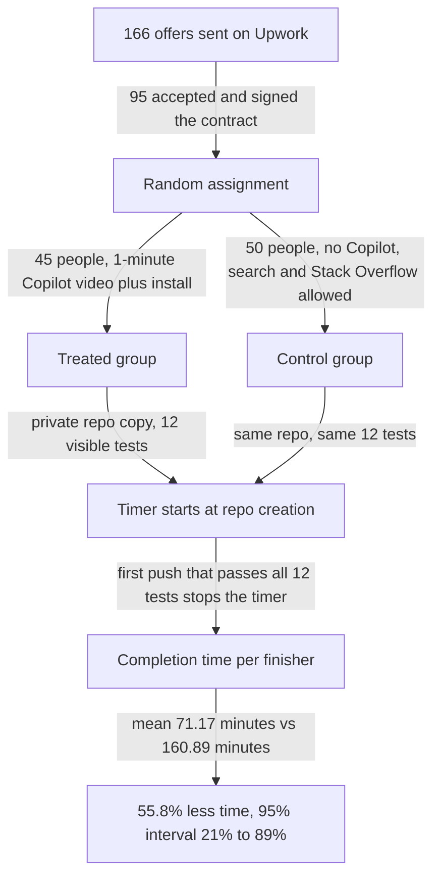
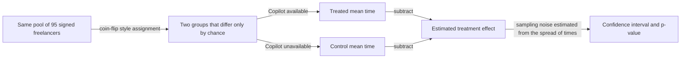

# The Impact of AI on Developer Productivity: Evidence from GitHub Copilot

> **Paper:** Peng, Kalliamvakou, Cihon and Demirer (GitHub Inc.; one author also at MIT Sloan; the corresponding address is at Microsoft Research), 2023 - [arXiv abstract](https://arxiv.org/abs/2302.06590) - [local PDF](../../papers/2302.06590.pdf)
>
> **Version followed:** the arXiv HTML rendering of v1 (13 February 2023, category cs.SE). Section names and figure and table numbers below follow that rendering. The paper has no numbered sections, only unnumbered headings (Introduction, Study Design, Results, Discussion), one table (Table 1) and eight figures. It is a short arXiv preprint; this guide found no peer-reviewed venue named in the text, so weigh it as a preprint. It is a field experiment (a randomised controlled trial), not a machine-learning method paper.

## Read this first

**The claim in one sentence.** In a 2022 experiment, professional freelance programmers who were randomly given GitHub Copilot (an AI tool that suggests code while you type) finished one specific coding task, writing a small web server in JavaScript, in an average of 71.17 minutes, against 160.89 minutes for programmers without it, which the authors report as 55.8% faster.

**Who this is for.** Anyone deciding whether an AI assistant is "worth it" who wants to know how far a number like "55.8% faster" can be trusted. For a small business the method is the point: answer "do we buy this?" with an experiment, not an opinion.

**Afterwards you will be able to** explain what "randomised", "treatment effect", "confidence interval" and "p-value" mean using the paper's own numbers; recompute the headline percentage; read the 21% to 89% interval; list what the experiment does and does not show; and design a small pilot of your own with a baseline and stop criteria.

**Reading time.** About 40 minutes; the paper itself is short. **Have read first:** [HumanEval](../03-evaluation-and-code/14-humaneval.md), which tests whether a model writes correct small functions in a lab with no people involved, so you can see the gap between "the model is good at code" and "people with the model work faster". Read [Customer support](./23-customer-support.md) afterwards for a field study of non-coding work.

**The one thing most people get wrong.** They quote "55.8% faster" as "Copilot makes developers 55.8% more productive at their jobs". The paper measured the time to pass 12 automated tests on one self-contained task, for the people who finished it, in one recruited online group. It did not measure a day of real work, a large codebase, code quality, or learning. Also, "55.8% less time" is not "55.8% more output": finishing in 44.2% of the time is about 2.26 times the speed (this guide's arithmetic), yet the paper writes the 55.8% as both a time reduction and a productivity increase.

## The paper in one worked example

The paper has one task and two groups, so the worked example is the experiment itself, traced from recruiting to the headline arithmetic. Everything quoted here is from the paper unless marked "this guide". Some figures in the paper are images (the job posting, contract and email), and this guide could read only the captions and surrounding text of those, not the image contents.

### Step 1 - recruiting (Study Design, Figures 1 and 2)

The experiment ran from 15 May 2022 to 20 June 2022, "right before GitHub Copilot became generally available" (the authors' words for when the product launched to the public). The authors posted a job on Upwork, a freelancing marketplace, advertising paid work for freelance developers. The caption of Figure 1 says the posting started on 25 May 2022, ten days after the stated experiment start; the paper does not explain the gap (flagged in the FAQ).

A total of 166 offers were sent and 95 were accepted (Results). Once a freelancer signed the Upwork contract (Figure 2), they were "randomly split" into control and treatment groups: 45 treated and 50 control (Results).

### Step 2 - instructions, task and outcomes (Figures 3 and 4, Study Design)

The treatment group watched a one-minute Copilot video and received installation instructions; the control group got no Copilot but could use internet search and Stack Overflow (a programming question-and-answer site). Telemetry showed every treated participant configured Copilot and accepted suggestions, except five who "did not finish the sign up" and started without it. The paper does not say how those five were analysed.

Each participant clicked a link to GitHub Classroom (a teachers' tool for handing out and grading coding assignments), which created a private copy of a template repository containing the task description and a skeleton. The task was to implement an HTTP server in JavaScript (a small program that answers web requests); the exact wording is in the image of Figure 4, which this guide could not read. The repository held twelve visible tests that participants could not change, and every push ran them.

Two outcomes were defined. **Task success** is the percentage of a group that "adequately completed the task" (this guide reads that as passing all 12 tests). **Task completion time** runs from creation of the repository copy to the first push passing all 12 tests. Pay was tied to completion time (scale in Figure 1), so both groups had reason to hurry.


### Step 3 - the headline arithmetic (Results, Figure 6)

| Quantity | Value | Source |
|---|---|---|
| Mean completion time, treated | 71.17 minutes | Results |
| Mean completion time, control | 160.89 minutes | Results |
| Difference | 89.72 minutes (this guide: 160.89 - 71.17) | this guide |
| Relative reduction | 55.8% (this guide recomputes 1 - 71.17/160.89 = 0.5576, which rounds to 55.8%) | Results; recomputation by this guide |
| p-value (t-test) | 0.0017 | Results |
| 95% confidence interval for the improvement | 21% to 89% | Results, abstract and Introduction |
| Success rate difference | +7 percentage points (treated higher), 95% interval -0.11 to 0.25, not statistically significant | Results |
| Outliers | four people above 300 minutes, all in the control group; results "remain robust" without them | Results |

Two cautions already visible. First, the averages are "conditioning on completing the task": people who never passed all 12 tests are not in the averages. Second, the paper says 35 developers "from both the treated and control groups completed the task and survey" (Results). That sentence can be read as 35 in each group or 35 in total. Out of 95 who signed up, a total of 35 is a completion rate of 37%, and 70 would be 74%; the paper never states the number per group, so the sample behind 71.17 and 160.89 is not known from the text. This guide could not resolve this from the text and flags it as the single most important unknown.

### Step 4 - who benefited most (Table 1, discussed in Tutorial 3)

The authors regressed each person's transformed outcome on traits and report that less experienced developers, people who code more hours a day and people aged 25 to 44 gained most.



Notice that the only thing that differs between the two arms is the Copilot access and video; the pipeline, tests and timer are identical. That is what lets the authors read the time gap as an effect of Copilot rather than of the task.



Notice that the interval and p-value come only from the spread of the times and the number of finishers; they say nothing about whether the task resembles your work. That second question is the one a business reader should spend most time on.

## Words you need

| Term | Plain definition | Example from the worked example |
|---|---|---|
| Randomised controlled trial (field experiment) | An experiment in which people are assigned to groups by chance, and one group gets the thing being tested. "Field" means it ran with real freelancers in their normal setting, not a lab. | The 95 signed freelancers were randomly split into 45 treated and 50 control. |
| Treatment group / control group | The group that gets the intervention, and the comparison group that does not. | Treated: Copilot plus a one-minute video. Control: no Copilot. |
| Treatment effect | The difference in the outcome caused by the treatment, estimated here as the difference in average outcomes between groups. | 160.89 minus 71.17 = 89.72 minutes, or 55.8% of the control mean. |
| Confidence interval (95%) | A range built so that, if you repeated the whole experiment many times, about 95 of every 100 such ranges would contain the true effect. It shows how precisely the effect is pinned down. | The effect is 55.8% faster, with a 95% interval of 21% to 89%. |
| p-value | The probability of seeing a gap at least this big if Copilot did nothing and only chance separated the groups. A small p-value means chance alone would rarely produce the gap. | p = 0.0017 for the time difference (a t-test, defined in Prerequisite 2). |
| Heterogeneous treatment effect | The effect differs between kinds of people. | Table 1: bigger gains for less experienced developers. |
| Willingness to pay | The most someone says they would pay for a product, here as a monthly price. The paper calls its measure the "irrelevant price". | Treated group average $27.25 per month; control group $16.91 (Figure 8). |

## Tutorial 1 - Intuitive understanding

### What was broken before

Before this paper, evidence that AI coding tools help came mostly from opinions ("developers say they feel faster") and from lab benchmarks (does the model write correct code for a puzzle?). Neither answers the manager's question: if my people use this, do they finish work sooner? The paper says there was "little research on productivity impacts of AI-powered tools in professional contexts" (Introduction) and claims to be, "to the best of our knowledge", the first controlled experiment of AI tools in professional software development (Discussion).

The paper's own survey shows why opinion is weak. Participants who had used Copilot and participants who had only watched a demo both guessed an average 35% gain (Results, Figure 7), against a measured 55.8% cut in time. Guessing is not measuring. The second problem is that programming output is hard to measure; the authors sidestep it with one standard task and an automatic pass or fail (Study Design).

### The idea

**The analogy.** Imagine testing a new kind of kitchen knife. You do not ask chefs whether it feels sharper. You recruit chefs, flip a coin for each to decide who gets the new knife, give everyone the same onions to dice, and time them. Because the coin, not the chef, decided who got the knife, fast chefs and slow chefs end up in both groups, roughly evenly. If the new-knife group is clearly quicker, the knife is the most likely reason.

**Where the analogy breaks.** Dicing onions is a single task whose end is obvious. Software work in a company is mostly reading existing code, deciding what to build, and fixing what someone else wrote, and the paper tested none of that. Also, the chefs in the analogy would all finish, but here some recruited freelancers did not finish (how many is unclear, see the FAQ) and are missing from the timing numbers. Also, a one-minute video is a very light training dose; real use over months could look different.

### How it works, step by step

Each step is shown on the worked example.

1. **Recruit and consent.** 95 freelancers accepted a paid job on Upwork. The result applies to people like them: mostly aged 25 to 34, mostly from India and Pakistan, median yearly income $10,000-$19,000, mostly with four-year degrees, about six years of coding on average and about nine hours of coding on a working day (Results text on Figure 5).
2. **Randomise.** Chance decides who gets Copilot. Why it matters: it removes the worry that, say, better programmers chose the tool.
3. **Give an identical task with an automatic judge**, and measure time to pass all tests and the fraction who pass.
4. **Compare averages and quantify noise.** The gap of 89.72 minutes becomes 55.8% with an interval and a p-value.
5. **Look for who gains more** with a regression over traits (Table 1), and **ask participants** for a self-estimated gain (Figure 7) and a willingness to pay (Figure 8).

### What the results say

**Completion time (Results, Figure 6).** Treated 71.17 minutes, control 160.89 minutes. In plain terms: where the average control developer needed a bit over two and a half hours (160.89 minutes is 2 hours 41 minutes), the average treated developer needed a bit under an hour and a quarter (71.17 minutes). Out of every 100 minutes a control developer spent, a treated developer spent about 44 (this guide: 71.17 / 160.89 = 0.442). The p-value of 0.0017 means that if Copilot did nothing, a gap this large would arise by luck about 17 times in 10,000 repeats (the standard reading).

**The confidence interval.** The 95% interval of 21% to 89% says the data are consistent with Copilot saving anywhere from about a fifth of the time to almost nine-tenths of it. The low end would still be useful; the high end is a nine-fold speed-up (1 / (1 - 0.89) = 9.1, this guide's arithmetic) that no one should plan around. A good business reading is: "probably a big gain on this task, but the size is uncertain by a factor of several".

**Success rate (Results).** The treated success rate was 7 percentage points higher, meaning that out of every 100 people, about 7 more passed all the tests in the treated group, but the 95% interval was -0.11 to 0.25, which covers "11 points worse" through "25 points better". So the paper does not show that Copilot helps people finish, only (conditional on finishing) finish sooner. The paper does not state the two success rates themselves.

**Who gains most (Table 1).** The authors report that less experienced developers, people who code more hours per day, and "older" developers (the regression dummy is ages 25 to 44) benefited more. Only the hours and age rows have p below 0.05; experience has p = 0.0629 (Tutorial 3). The authors speculate that this shows "promise" for helping people move into software careers.

**Self-estimates and willingness to pay (Figures 7 and 8).** Both groups guessed an average 35% productivity gain, below the measured figure. The treated group would pay up to $27.25 per month, the control group $16.91 (a difference the authors call significant at the 95% level; the paper gives no sample sizes or interval for it). In plain terms: people who had actually used the tool valued it about 61% higher than people who had only seen a demo (this guide: 27.25 / 16.91 = 1.61).

### What this does not show

- **Not real work.** One self-contained, well-specified task with automatic tests. The Discussion says the study did not examine "large projects in professional proprietary and/or open-source settings".
- **Not code quality or security.** The Discussion states that quality is not examined. The tests check that 12 behaviours work, not whether the code is clean, safe or maintainable.
- **Not learning.** If developers learn less when a tool writes the code, it would not show up in a single task. The paper does not study it.
- **Not the whole group.** The averages are for people who finished. The paper does not say how many did not, per group.
- **Not other languages or tasks.** The Discussion says benefits "may vary across specific tasks and programming languages".
- **Not an economy figure.** The Discussion extrapolates to the 4.6 million US computer and mathematical workers of 2021 ($464.8 billion, about 2% of GDP) and "a significant amount of cost savings". That is the authors' speculation, and their own caveats argue against it.

### Teach-back

1. Why did the researchers randomise instead of letting developers choose Copilot?
2. What exactly does "55.8% faster" compare, and what is 55.8% of?
3. What would you tell a manager about the 95% interval of 21% to 89%?
4. The success-rate gap was +7 points but "not statistically significant". What does that mean?
5. Name two things the experiment cannot tell you about Copilot at a software company.

<details>
<summary>Answers 1 to 3</summary>

1. Developers who choose a tool may differ (more curious, more experienced), and those differences would be mixed into the result. A coin flip spreads such differences evenly across the groups on average, so a gap can be attributed to the tool.
2. Average finishing time: 71.17 minutes against 160.89. It is 89.72 / 160.89 = 55.8% of the control mean, a cut in time. It is not a 55.8% rise in output; the speed ratio is 160.89 / 71.17 = 2.26 (this guide's arithmetic).
3. A large saving is likely, but the data cannot tell a 21% saving from an 89% one, because few people finished and times varied. Plan around the low end and verify with your own pilot.
</details>

<details>
<summary>Answers 4 and 5</summary>

4. The gap is small relative to noise, and the interval runs from 11 points worse to 25 points better. That is inconclusive, not evidence of no effect.
5. Any two of: large existing codebases, code quality or security, learning, design and discussion work, effects over months, people unlike the recruited freelancers.

</details>

## Tutorial 2 - Practitioner understanding

For a small business, the practical content of the paper is not Copilot itself. It is the experiment design: a recipe for finding out whether a tool saves your people time on your tasks. This tutorial adapts the usual practitioner subsections to that: the pilot is the thing you build.

### The design in concrete terms

**Setup as the paper describes it.**

| Element | The paper's choice | Why it matters to you |
|---|---|---|
| Assignment | Randomly split after signing the contract (45 treated, 50 control) | Randomness is what makes the comparison fair |
| Task | One standard task: implement an HTTP server in JavaScript | Fixed, so every participant faces the same difficulty |
| Treatment | Copilot installed, 1-minute intro video | A very light dose of training |
| Control | Anything except Copilot, including search and Stack Overflow | Control is "normal practice", not "no help" |

**Estimation as described.** The headline is a difference in group means with a t-test and a 95% interval. The heterogeneity analysis assumes the treatment effect is "a linear function of the covariates" (a straight-line relationship with each trait), applies a Horvitz-Thompson transformation of the outcome (from Athey and Imbens, 2015) and regresses the transformed outcome on traits. The paper does not give the formula, the outcome units, or how the 55.8% interval was computed (for a ratio such as 1 - treated/control, the usual methods are the delta method or a bootstrap; this guide cannot tell which was used).

**Not given in the paper.** There are no hyper-parameters. Also missing: Copilot settings, per-group finishers and success rates, how much treated people used suggestions, and the standard errors behind the 55.8%.

### A minimal version

This is a pilot-analysis script. It reads a table with one row per person and gives the same outputs the paper reports (difference in means, percent faster, a confidence interval and a p-value) plus the two numbers the paper omits (how many were assigned and how many finished, per group). It uses only the Python standard library. A bootstrap (re-drawing people with replacement many times) gives the interval for "percent faster" without assuming a formula, and a permutation test (shuffling the group labels) gives the p-value.

```python
import csv, math, random, statistics as st

# pilot.csv columns: person, arm (assist|control), minutes, passed (1|0), task
def load(path):
    rows = list(csv.DictReader(open(path)))
    pick = lambda arm: [float(r["minutes"]) for r in rows
                        if r["arm"] == arm and r["passed"] == "1"]
    return rows, pick("assist"), pick("control")

def welch(a, c):                       # difference in means and its standard error
    se = math.sqrt(st.variance(a) / len(a) + st.variance(c) / len(c))
    return st.mean(c) - st.mean(a), se

def boot_ci(a, c, n=10000, seed=1):    # 95% interval for "fraction of time saved"
    rnd = random.Random(seed); out = []
    for _ in range(n):
        ra = [rnd.choice(a) for _ in a]; rc = [rnd.choice(c) for _ in c]
        out.append(1 - st.mean(ra) / st.mean(rc))
    out.sort(); return out[int(.025 * n)], out[int(.975 * n)]

def perm_p(a, c, n=10000, seed=2):     # chance of a gap this big if labels were random
    rnd = random.Random(seed); pool = a + c
    d0 = abs(st.mean(c) - st.mean(a)); hit = 0
    for _ in range(n):
        rnd.shuffle(pool); x, y = pool[:len(a)], pool[len(a):]
        hit += abs(st.mean(y) - st.mean(x)) >= d0
    return hit / n

rows, a, c = load("pilot.csv")
for arm in ("assist", "control"):      # report attrition per arm: the paper does not
    g = [r for r in rows if r["arm"] == arm]
    print(arm, "assigned", len(g), "passed", sum(r["passed"] == "1" for r in g))
d, se = welch(a, c)
print("mean minutes assist %.1f control %.1f" % (st.mean(a), st.mean(c)))
print("difference %.1f min (SE %.1f), %.1f%% faster" % (d, se, 100 * (1 - st.mean(a) / st.mean(c))))
print("95%% bootstrap CI for %% faster: %.1f to %.1f" % tuple(100 * x for x in boot_ci(a, c)))
print("permutation p = %.4f" % perm_p(a, c))
```

**Input shape.** One row per person: `p0,assist,40,1,t1`. **Output shape,** run on the 12-person constructed table in Tutorial 3 (this guide ran the script on it):

```
assist assigned 6 passed 6
control assigned 6 passed 6
mean minutes assist 65.8 control 163.3
difference 97.5 min (SE 21.3), 59.7% faster
95% bootstrap CI for % faster: 45.6 to 69.9
permutation p = 0.0018
```


### What it costs

A pilot costs people's time plus tool licences. All numbers below are assumptions by this guide for a small business, not figures from the paper.

Assumptions: a fully loaded cost of 30 per hour of staff time (in whatever currency you use), a task that takes about 2 hours without the tool and about 1 hour with it, 16 participants per arm, one task per person, a tool licence of 20 per person per month for one month, and 4 hours of someone's time to set up the tasks and checks and 4 hours to analyse and write up.

| Item | Arithmetic | Cost |
|---|---|---|
| Control arm working time | 16 people x 2 hours x 30 | 960 |
| Assisted arm working time | 16 people x 1 hour x 30 | 480 |
| Licences | 16 x 20 | 320 |
| Setup and analysis | 8 hours x 30 | 240 |
| Total | | 2,000 |

If the work would be done anyway, only the licences and the 8 hours of setup and analysis are extra: 320 + 240 = 560. The paper's own payment scale is only in an image (Figure 1).

**How many people.** Rule of thumb (this guide's calculation, standard for two groups): per arm, n = 2 x (1.96 + 0.84)^2 x s^2 / d^2, with d the effect to detect and s the spread, both on the log of time. If s is 0.6 (an assumption; the paper does not give it), detecting a 40% saving takes about 22 people per arm and a 20% saving about 113. Small pilots can only confirm big effects, which is the paper's situation too.

### How it fails

The paper has no error analysis, because it is not a model paper. The table below is this guide's own, built from the paper's design and its stated caveats; the third column is what to do in your pilot.

| Symptom | Likely cause | Mitigation |
|---|---|---|
| Averages look great but many people never finished | Averages computed over finishers only; the tool may change who finishes | Report assigned and finished per arm; analyse time with a cap (for example, give non-finishers the maximum time) as a second view |
| One or two huge times drag the control average | Outliers (the paper has four above 300 minutes, all control) | Report the median too; rerun without the outliers, as the paper says it did |
| Assisted arm is faster but the output is worse | Time was measured, quality was not | Add a quality check (reviewer score, error count, rework time) as a second outcome |
| Gain disappears on real work | The pilot task was a self-contained exercise | Pilot on a sample of real tickets; run a second, longer phase |

### Evaluating your version

These steps are this guide's recommendations, built on the paper's design.

1. **Choose tasks.** 5 to 10 real, well-specified tasks, each under half a day, each with a pass or fail check defined in advance by someone other than the participant (the paper's 12 tests, but more than one task).
2. **Set the baseline first.** Record the mean, median and spread of time for the last 20 to 30 comparable tasks done the normal way. This is the number to beat.
3. **Randomise** people or tasks by a coin flip, not by who volunteers. If each person does tasks in both arms, randomise the order; that is stronger than the paper's between-person design.
4. **Pre-write the decision rule.** For example: adopt if the assisted arm saves at least 20% of time, the lower end of the 95% interval is above 0%, quality is no worse within a stated margin, and fewer than a stated share of people drop out.
5. **Stop criteria.** Stop early for harm if quality failures in the assisted arm exceed control by a stated margin. Otherwise run to the planned size; stopping the moment p dips below 0.05 inflates false positives.
6. **Report** per arm the number assigned and finished, mean, median and spread; the difference and percent saved with a 95% interval; a quality result; and what the tasks do not represent. The paper measured time, success and a perception survey; add quality and usage.

### Adopt, adapt or skip

**Adopt the design, not the number.** For a team building or buying an assistant over private business documents, the transferable thing is the method: a fixed task set, an automatic or independent judge, random assignment, a clock, and a pre-agreed decision rule. The number 55.8% should not appear in a business case; it is a result for coders on a single JavaScript exercise.

**Adapt.** Swap the task for yours (drafting a customer reply, summarising a contract against a checklist, reconciling a ledger), swap the 12 tests for a checklist scored by someone who does not know which arm produced the work, and add the quality outcome the paper lacked. Put the pilot's gain next to the cost in the table above to get a payback period.

**Skip** using this paper as evidence for assistants over private business documents. It involves no document retrieval, no data privacy, no review burden and no non-coding work, and its tool is a typing-time autocomplete that proposes code, not an agent. On the curriculum's through-question (whether a thin runtime around a model that selects a few good tools is the right architecture for assistants, and whether context, instructions and memory can make smaller or open models perform well), the paper is silent: it does not vary the model, the instructions or the context. Its only link is indirect: it shows how to measure whether any such design is worth deploying. For a business support setting, read [Customer support](./23-customer-support.md) next for a field study on non-coding work.

## Tutorial 3 - Researcher understanding

### Formal setup

Let i index the 95 randomised participants. D_i is 1 if i is assigned Copilot and 0 otherwise. Y_i is completion time in minutes, observed only if i finishes (F_i = 1). X_i is the vector of the eight traits in Table 1. Assignment is random, so D_i is independent of every trait.

The estimand is the average treatment effect on time among finishers: tau = E[Y | D = 1, F = 1] - E[Y | D = 0, F = 1]. Finishing may itself depend on D, which is the central weakness. The paper's estimate is the difference in sample means, 71.17 - 160.89 = -89.72 minutes, presented as 89.72 / 160.89 = 55.8%; the t-test (p = 0.0017) tests that the two means are equal.

**Numeric toy instance (constructed by this guide, not paper data).** Twelve people, six per arm, all finish. Treated times: 40, 55, 60, 70, 80, 90 (mean 65.83). Control times: 100, 130, 150, 170, 190, 240 (mean 163.33). Difference 97.50 minutes, or 59.7% less time. Sample variances are 324.17 and 2386.67, so the standard error of the difference is sqrt(324.17/6 + 2386.67/6) = 21.26 minutes. The t-statistic is 97.50 / 21.26 = 4.59, about 6.3 degrees of freedom (Welch approximation), two-sided p roughly 0.003. The 95% interval is 97.5 plus or minus 2.43 x 21.26, about 46 to 149 minutes, or roughly 28% to 91% of the control mean. The bootstrap in Tutorial 2 treats the percentage directly and gives 45.6% to 69.9%; two valid methods can disagree noticeably with six people per arm.

**The permutation reading.** With 12 people there are 924 ways to pick which six are labelled treated. Only 2 labelings (the actual one and its mirror image) give a gap as large as 97.5 minutes, so p = 2 / 924 = 0.0022 (this guide ran the count). That is the literal meaning of a p-value: the share of arbitrary relabelings that produce a gap this big.

**What the paper's interval implies (this guide's inference).** The interval 21% to 89% has half-width near 34 points, so the implied standard error is about 34 / 1.96 = 17.5 points and z is about 55.8 / 17.5 = 3.2, which corresponds to p near 0.001. The reported 0.0017 is consistent with that within rounding. The sample sizes are not recoverable from the text.

**Heterogeneity model.** Assume the effect is linear in the traits: tau(x) = beta_0 + beta' x. The Horvitz-Thompson transformation (Athey and Imbens, 2015) builds Y*_i = Y_i D_i / p - Y_i (1 - D_i) / (1 - p), whose average given X_i equals tau(X_i); regressing Y* on X estimates beta. The paper does not print the formula; this is the standard form of the cited method. Toy instance with p = 0.5: a treated person with Y = 70 has Y* = 140, and a control person with Y = 160 has Y* = -320. Each person's Y* is very noisy, which is why the standard errors in Table 1 are large.

### The claims, stated precisely

1. On the one task, among those who completed it, mean completion time was 71.17 minutes with Copilot and 160.89 minutes without, a 55.8% reduction, p = 0.0017, 95% interval 21% to 89% (Results). **Causal**, for finishers, because assignment was random, under the caveat of selection into finishing.
2. The success rate was 7 percentage points higher with Copilot, with an interval of -0.11 to 0.25 (Results). **Not distinguishable from zero.**
3. Developers with less experience, more hours of coding per day, and ages 25 to 44 saw bigger gains (Results, Table 1). **Associational** (subgroup traits were not randomised), and only partly significant.
4. Self-estimated gain was about 35% in both groups (Figure 7), and willingness to pay was $27.25 against $16.91 per month (Figure 8, called significant at 95%, offered as "indirect evidence"). **Descriptive, stated preferences.**
5. The authors' interpretation: the effects are "statistically and practically significant" and suggest promise for novice transitions into software careers (Introduction, Discussion). **Speculative**, since no hiring or learning outcome was observed.

### Evidence, table by table

**Figure 6 - time to completion.** Overlaid histograms (treated blue, control orange) of finishing times, including four control participants beyond 300 minutes. It supports claim 1: an effect on time among finishers. This guide cannot read the image, so per-bin counts are not available.

**Results text, success rate.** One sentence: +7 percentage points, interval [-0.11, 0.25]. No group rates are printed. It identifies nothing about finishing because the interval spans zero.

**Table 1 - heterogeneous treatment effects.** Rows are the intercept and eight traits; columns are estimate, standard error (SE), t-statistic and p-value.

| Row | Estimate | SE | t | p |
|---|---|---|---|---|
| (Intercept) | 78.01 | 67.84 | 1.15 | 0.2552 |
| Programming experience (years) | 8.23 | 4.36 | 1.90 | 0.0629 |
| Hours of programming per day | -11.70 | 4.74 | -2.47 | 0.0168 |
| Age: 25-44 | -74.55 | 33.52 | -2.22 | 0.0303 |
| Unemployed | -35.98 | 36.33 | -0.99 | 0.3263 |
| Income less than $20,000 | 0.64 | 27.47 | 0.02 | 0.9814 |
| No college | -36.57 | 32.89 | -1.11 | 0.2711 |
| Language preference: Java | -11.77 | 33.16 | -0.35 | 0.7240 |
| Language preference: Python | 22.90 | 42.19 | 0.54 | 0.5895 |

How to read it (this guide's inference, since the paper does not state the outcome units). The outcome is presumably the transformed completion time in minutes, so a negative effect is a time saving. Then a positive coefficient (experience, +8.23) means each added year shrinks the saving by about 8 minutes, so less experienced people gain more; negative coefficients (hours coded, age 25-44) mean larger savings. The signs match the paper's description only under this reading. The t-statistics recompute: 8.23 / 4.36 = 1.89 (printed 1.90), -11.70 / 4.74 = -2.47, -74.55 / 33.52 = -2.22.

What it identifies: assignment was random, so the effect is identified within any subgroup, but the traits were not randomised, so "experience" may stand in for something else, such as country or familiarity with the task. With eight traits tested, the chance of at least one p-value below 0.05 by luck alone is 1 - 0.95^8 = 0.34 (this guide's arithmetic, assuming independence).

**Figures 5, 7 and 8.** Figure 5 describes the participants. Figure 7 shows self-estimated gains (both arms near 35%). Figure 8 shows the "irrelevant price", described as the highest monthly price at which a person would still want a release notification: a stated preference, not a payment.

### Ablations and what they isolate

The paper varies nothing but Copilot access. Two robustness statements exist. **Dropping the four outliers:** the paper says results "remain robust" but gives no numbers; since all four were control, dropping them lowers the control mean and shrinks the gap, so the claim is that it stays significant, and the reader cannot check it. **The heterogeneity regression:** fitting eight traits at once isolates each trait holding the others fixed, but with this sample the standard errors are large.

**Not isolated** (and worth saying plainly): the one-minute video versus the tool itself; whether the effect is from suggestions accepted or from faster look-ups; whether Copilot or the control's use of Stack Overflow explains the difference; a no-video treated arm.

### Threats to validity specific to this paper

| Threat | What the paper gives | Why it matters |
|---|---|---|
| Attrition and conditioning on finishing | 95 signed up; 35 "completed the task and survey" (ambiguous whether per group or in total) | If the tool changes who finishes, the finisher-only comparison is biased; unfinished people are not in the means |
| Small and unreported group sizes | 45 and 50 assigned; finishers per group not printed | Explains the wide 21% to 89% interval |
| Treatment noncompliance | Five treated participants started without Copilot | Dilutes the effect if analysed by assignment; unknown handling |
| Unmeasured quality | Discussion says quality not examined | Faster but worse code would be no gain |
| Single task | HTTP server in JavaScript | Self-contained, well documented, familiar in training data, so the best case for a code model (this guide's inference) |
| Population | Online freelancers, mostly 25-34, mostly India and Pakistan, median income $10,000-$19,000 | May not match employees at a company |
| Incentive | Pay depends on speed | Rewards speed over quality; both arms |
| Preprint, no pre-registration stated | Version 1, arXiv | The analysis plan is not documented |
| Author affiliations | GitHub (product owner) and Microsoft | The paper has no conflict-of-interest statement in the text read; the reader should note the authors work at the company that sells the product (a plain fact, not an accusation) |

### Open problems and follow-ups

- Repeat inside large existing codebases, with review and maintenance burden counted, and measure quality and security (the Discussion lists both as unexamined).
- Test whether novice gains persist or displace learning; the career-transition claim needs longitudinal data.
- Use a stronger training dose than a one-minute video, over weeks, and report attrition, per-arm success rates and the full regression specification.
- Extend to non-coding assistants, as [Customer support](./23-customer-support.md) does.

### What would change my mind

I would trust the 55.8% more if finisher counts were large and similar across arms (say 40 or more each), and less if the roughly 60 non-finishers (if the 35 is a total) were concentrated in one arm. I would drop the novice-gain story if a pre-registered subgroup analysis found the experience coefficient near zero, since here it has p = 0.0629. I would revise "practically significant" if faster solutions turned out to cost more rework later, and I would accept economy-wide arithmetic only with evidence from tasks like most of a developer's day.

## Reading map for the PDF

| Section or figure | What it contains | First pass | Answered in this guide at |
|---|---|---|---|
| Abstract | The claim: 55.8% faster; heterogeneous effects | Read | Read this first |
| Introduction | Motivation, design summary, the 21-89% interval | Read | Tutorial 1, What was broken before |
| Study Design | Dates, recruiting, tests, outcomes, GitHub Classroom set-up | Read closely | The paper in one worked example |
| Results, first part | Offers, accepts, group sizes, headline numbers | Read closely | Worked example, Step 3; Tutorial 1 results |
| Figure 5 | Participant demographics | Skim | Tutorial 1, step 1; Threats to validity |
| Figure 6 | Distribution of completion times | Look | Tutorial 3, Evidence |
| Table 1 | Heterogeneity regression | Read with care | Tutorial 3, Evidence; FAQ |
| Figure 7 | Self-estimated gains | Skim | Tutorial 1; FAQ |
| Figure 8 | Willingness to pay | Skim | Tutorial 1; FAQ |
| Discussion | Limits, economic extrapolation | Read | What this does not show |

## Questions readers get stuck on

### What does "55.8% faster" actually mean?

It compares average completion times: 71.17 minutes with Copilot against 160.89 minutes without, a gap of 89.72 minutes. That gap is 55.8% of the control average (89.72 / 160.89 = 0.558). It describes a cut in time. If you want the speed ratio, divide the other way: 160.89 / 71.17 = 2.26, so assisted people worked about 2.26 times as fast on this task. "55.8% faster" and "2.26 times as fast" are the same data stated differently, and mixing them up is a common error.

### What is a confidence interval, and why is 21% to 89% so wide?

It is a range that shows how precisely the study pinned down the effect. If the whole experiment were repeated many times, about 95 of every 100 intervals built this way would contain the true effect. The width comes mainly from having few finishers and large differences in times between people, so the study cannot tell a 21% saving from an 89% saving. Wider intervals are normal in small field experiments; the right response is to treat the estimate as "large but imprecise".

### What is a p-value, and does 0.0017 mean there is a 99.83% chance Copilot works?

No. The p-value is the probability of seeing a gap at least this large if the tool had no effect and only chance separated the groups. A value of 0.0017 means such a gap would arise by luck about 17 times in 10,000. It does not state the probability that Copilot works, and it says nothing about whether the gap matters in practice, whether the task matches your work, or whether the groups were fair. The permutation example in Tutorial 3 shows the idea with 12 people.


### Does the paper say how many people finished, and how many in each group?

Not clearly. It says 95 accepted and were randomised (45 treated, 50 control), and that "thirty-five developers from both the treated and control groups completed the task and survey". That could mean 35 in each group (70 finishers) or 35 in total. This guide could not settle it from the text. It matters because the averages are over finishers only; if only 35 of 95 finished, most participants are missing from the headline numbers, and how that missingness differs by arm is unknown.


### Table 1 says experience has a positive coefficient, yet the text says less experienced developers benefit more. Which is right?

Both can be right, depending on the sign convention. This guide infers that the outcome in the regression is time in minutes, where a larger negative effect is a bigger saving. Then a positive coefficient on experience means that more experience shrinks the saving, so less experienced people gain more. The paper never states the units or the sign convention, so the reader has to infer it. Also, the experience row has p = 0.0629, above the usual 0.05 cut-off, so "less experienced benefit more" is suggestive, not firmly established, while the hours and age rows are below 0.05.

### Who are the "older" developers in the heterogeneity result?

The Results text calls them "older developers (developers aged between 25 and 44)", and the Table 1 note says "the age group above 25". Since the participants were mostly 25 to 34 (Results), that dummy variable mostly separates a small group under 25 from everyone else. So "older" here really means "not the youngest", which is a much weaker claim than the abstract's phrase "older programmers" suggests. This is this guide's reading, flagged as an inconsistency in how the paper labels the group.

### Why not just ask developers how much faster they are?

The paper's own survey shows why: both the treated and the control groups guessed about 35%, while the measured figure was 55.8% (Figure 7 and Results). Self-reports are shaped by expectations and memory, and they were close to equal in the two arms even though one arm had never used the tool in the task. A clock plus an automatic judge is more reliable, though it applies only to the measured task.

### Is a 55.8% saving on one task the same as a 55.8% gain in a developer's output?

No. A developer's week includes meetings, reading existing code, reviewing, debugging old systems and waiting, none of which was measured. If coding like this is a third of the week and you save 55.8% of that third, the whole week is shortened by about 19% (this guide's illustrative arithmetic, with the "third" an assumption). The paper's Discussion extrapolates anyway to the whole economy ($464.8 billion in earnings). This guide's arithmetic gives 464.8 x 0.558 = about $259 billion, but the paper does not print that number and its own caveats argue against such an extrapolation.


## Prerequisites you actually need

### Prerequisite 1 - Averages and percent change

A percent reduction is (control - treated) / control. Toy example (constructed): control takes 100 minutes, treated takes 40. Reduction = 60 / 100 = 60%. The speed ratio is 100 / 40 = 2.5 times. A 60% cut in time is a 150% rise in speed, not a 60% rise.

Used in: the headline "55.8%" (Results). Check: (160.89 - 71.17) / 160.89 = 0.5576. For a gentle refresher on reading numbers like these, see the repository's [math bridge](../../references/math-bridge.md).

### Prerequisite 2 - Spread, standard error, t-test and confidence interval

Spread (standard deviation) says how far individual times scatter from their average. The standard error of a mean is the spread divided by the square root of the number of people; the standard error of a difference combines the two groups. A t-test divides the observed difference by its standard error; a ratio above about 2 is a gap more than two standard errors wide, which chance rarely produces. A 95% interval is roughly the difference plus or minus 2 standard errors (a little more with few people).

Toy example (constructed): a difference of 90 minutes with a standard error of 30 gives t = 3 and an interval of about 90 plus or minus 60, so 30 to 150. If the standard error were 60, t = 1.5 and the interval would be about -30 to 210, which includes zero, so "not significant".

Used in: the p-value 0.0017 and the intervals (Results); the success-rate interval -0.11 to 0.25 is the not-significant case.

### Prerequisite 3 - Random assignment and what it buys

When assignment is by chance, the groups differ only by luck before treatment, so differences afterwards can be put down to the treatment, plus noise that the interval measures. It does not fix people dropping out afterwards.

Toy example (constructed): 10 people, 5 skilled and 5 less skilled. If skilled people pick the tool, the tool group is 100% skilled and a gap in times reflects skill. If a coin picks, a typical split is about 2 or 3 skilled people per group, so skill is spread roughly evenly.

Used in: Study Design (the random split) and the whole causal reading of Results. The same logic is why the heterogeneity result is only associational: the traits in Table 1 were not randomised.

### Prerequisite 4 - Regression with a transformed outcome

A regression fits a line relating an outcome to traits. In the paper, the outcome is first transformed so that it, on average, equals each person's treatment effect (see the formula in Tutorial 3), and then it is regressed on traits to see whose effect is larger. A coefficient is the change in the effect for one extra unit of the trait.

Toy example (constructed): suppose the fitted effect (in minutes) is -40 - 5 x (hours coded per day - 4). Someone coding 4 hours a day saves 40 minutes; someone coding 8 hours saves 40 + 20 = 60 minutes. The coefficient on hours is -5 per hour.

Used in: Table 1. Table 1 estimates for hours per day is -11.70 per hour. Background on regressions is in the [glossary](../../references/glossary.md).


## Where this sits in the curriculum

**Read before.** [HumanEval](../03-evaluation-and-code/14-humaneval.md), for what the underlying model (Codex) was scored on in the lab with no humans involved. Skim [SWE-bench](../03-evaluation-and-code/16-swe-bench.md) to see how later benchmarks moved from isolated functions toward real repositories; this paper's main limit is its isolated task.

**Nearest papers.** Compared with HumanEval, this paper measures people with the tool, and time rather than correctness. Compared with [Customer support](./23-customer-support.md), the other field study in this stage, it uses one fixed task with a clock rather than ongoing work (this guide's reading of how the two studies are set up; check the next guide for its own design).

**Through-question.** The agent-stage question, whether a thin runtime around a model that chooses among a few good tools is the right architecture, and whether context, instructions and memory can make open or smaller models perform well, is not addressed here: Copilot is an autocomplete-style tool and no model, prompt or context variation was tested. What the paper contributes is a measurement method that can compare any two assistant designs on your own work.

**Read next.** [Customer support](./23-customer-support.md), then [SWE-agent](../06-agent-systems/26-swe-agent.md) to see an agent evaluated on real repositories.

## Checkpoint

1. **Compute.** Treated mean 71.17 minutes, control mean 160.89. Give the percent reduction and the speed ratio.
2. **Explain.** What does an interval of 21% to 89% tell you that 55.8% alone does not?
3. **Compute.** Assisted people took 30, 40, 50 minutes and control people 60, 80, 100. Give the means, the difference and the percent saved.
4. **Critique.** The averages cover only people who completed the task. How could that mislead?
5. **Explain.** Why is the experience pattern in Table 1 only suggestive?
6. **Design.** Write a three-line decision rule for a pilot of an AI assistant drafting customer emails, with a quality condition.
7. **Critique.** A colleague says "Copilot makes our team 55.8% more productive, so we need 36% fewer developers." Give two reasons the paper does not support this.

<details>
<summary>Answers 1 to 4</summary>

1. 89.72 / 160.89 = 0.5576, so 55.8%; speed ratio 160.89 / 71.17 = 2.26.
2. It shows the precision: savings from about a fifth to nearly nine-tenths of the time are all compatible with the data, so 55.8% is a best guess with a large error bar.
3. Means 40 and 80; difference 40 minutes; 40 / 80 = 50% saved (constructed numbers).
4. If the tool changes who finishes, the two sets of finishers are not comparable, so the means mix the effect on time with the effect on who is counted. The paper does not give finishers per arm.
</details>

<details>
<summary>Answers 5 to 7</summary>

5. Its p-value is 0.0629, above 0.05; it is one of eight traits tested on a small sample; and traits were not randomised.
6. Example: adopt if median drafting time falls at least 20% with the lower 95% bound above 0, reviewer-rated major rewrites rise by no more than 5 points, and at least 80% of assigned staff finish; stop early if rewrites rise by more than 10 points (illustrative thresholds).
7. The 55.8% is a time cut on one self-contained task, not a rise in output across a job, and a 55.8% time cut is not a 55.8% output rise; quality, large codebases and learning were not measured. Also, 36% fewer developers is this guide's reading of 1 - 1/1.558, which the paper never claims.

</details>

