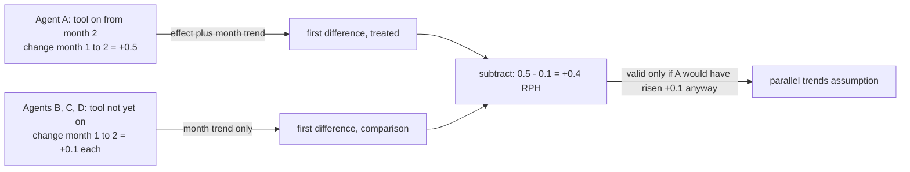
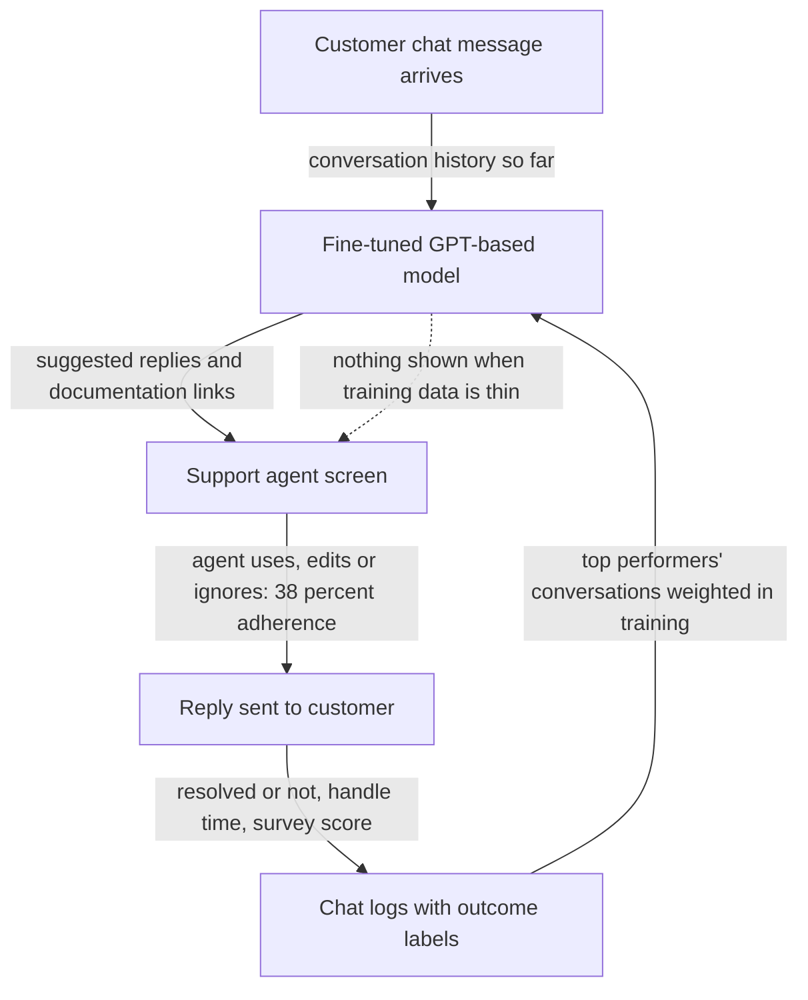

# Generative AI at Work

> **Paper:** Erik Brynjolfsson (Stanford and National Bureau of Economic Research, NBER), Danielle Li (Massachusetts Institute of Technology, MIT, and NBER) and Lindsey Raymond (MIT), first posted April 2023 - [arXiv abstract](https://arxiv.org/abs/2304.11771) - [local PDF](../../papers/2304.11771.pdf)
>
> **Version followed:** arXiv v2 (stamped 6 November 2024), read through the arXiv HTML rendering; section, table and figure numbers follow it. Version 1 (April 2023) had different headline numbers (14 percent, "5,000 agents"); this guide says where it matters. This is an economics field study, not a machine learning method paper. The guide understands it was later published in a peer-reviewed economics journal (Quarterly Journal of Economics, 2025); the arXiv text does not say so and this was not verified.

## Read this first

**The claim in one sentence.** When a company gave customer-support agents a chat assistant built on a fine-tuned Generative Pre-trained Transformer (GPT) model, which suggested replies and linked internal documentation, agents who had it resolved about 15 percent more customer issues per hour than comparable agents who did not have it yet, with the gain concentrated in novices and low performers and little or none for the most experienced.

**Who this is for.** Anyone deciding whether an AI assistant is worth rolling out to staff, and anyone who must judge a claim of the form "AI made our team X percent more productive". It is the first guide here about measuring an assistant on real work, not building one.

**Afterwards you will be able to** explain difference-in-differences (comparing the change for people who got a tool with the change for people who had not yet got it) by arithmetic, say what the paper's numbers count and do not count, and design a small honest pilot with a baseline, a staggered rollout and a stop rule.

**Reading time.** About 50 minutes; 20 for Tutorial 1 alone. **Have read first:** [GPT-3](../01-foundations/03-gpt3.md), for the kind of model underneath. The stage neighbour [22-productivity](./22-productivity.md) is useful context but not required.

**The one thing most people get wrong.** The headline is not "the AI made agents 15 percent better". It is "being given access, in a staggered rollout, raised resolved chats per hour by about 15 percent on average, while agents were free to ignore the suggestions and followed them only about 38 percent of the time". The effect is a bundle of model, interface, onboarding session and agents' choices. And the average hides the main finding: roughly zero for the top fifth of agents, about 0.5 more resolutions per hour (36 percent, per the paper) for the bottom fifth.

## The paper in one worked example

The paper has no single transcript to trace, so the example has two parts. Part A is **constructed by this guide**: a four-agent panel showing how a staggered rollout identifies an effect. Part B uses the **real numbers** from the paper's main table, read the same way.

### Part A - a constructed panel (every number is invented by this guide)

Four agents are observed for four months. The outcome is the paper's primary one, **resolutions per hour** (RPH). The tool is switched on for A in month 2, B in month 3, C in month 4, and never for D. This guide built the numbers from a known recipe: permanent levels (A 1.6, B 2.0, C 1.8, D 2.2), a month effect shared by everyone (0, +0.1, +0.3, +0.2, think of tax season), and exactly +0.4 RPH for any agent with the tool. Real data would also have noise; this panel has none, on purpose.

| Agent | Month 1 | Month 2 | Month 3 | Month 4 | Tool on from |
|---|---|---|---|---|---|
| A | 1.6 | **2.1** | **2.3** | **2.2** | month 2 |
| B | 2.0 | 2.1 | **2.7** | **2.6** | month 3 |
| C | 1.8 | 1.9 | 2.1 | **2.4** | month 4 |
| D | 2.2 | 2.3 | 2.5 | 2.4 | never |

Bold cells have the tool on. Three ways to read the effect, two wrong.

**Wrong way 1 - compare treated with untreated in the same month.** In month 3, A and B average (2.3 + 2.7) / 2 = 2.5; C and D average (2.1 + 2.5) / 2 = 2.3; the gap is 0.2. In months 2 and 4 the gaps are 0.0. These understate the true 0.4 because the early agents happened to be lower-level. In the real data the bias runs the other way: Table 1 shows agents who eventually got the tool were already stronger (2.0 RPH, against 1.7 for never-treated).

**Wrong way 2 - compare each agent with their own past.** Agent A averaged 1.6 in month 1 and (2.1 + 2.3 + 2.2) / 3 = 2.2 afterwards, a rise of 0.6. That overstates by 0.2 because the month effects lifted everybody.

**Right way - difference-in-differences.** A's change from month 1 to 2 is 2.1 - 1.6 = +0.5. Agents who did not yet have the tool changed by +0.1 each (B 2.0 to 2.1, C 1.8 to 1.9, D 2.2 to 2.3). The month effect sits in both numbers, so subtract: 0.5 - 0.1 = **+0.4**. The first difference is before versus after; the second is treated versus not-yet-treated. B's turn gives the same: B rises 2.1 to 2.7 (+0.6), while C and D, still without the tool, rise +0.2 each, and 0.6 - 0.2 = 0.4.

A regression with a constant per agent, a constant per month and one 0/1 column "tool on this month" averages all such comparisons at once. This guide ran it on the table and it returns 0.400 exactly. The paper's Equation 1 is that regression plus a tenure control.



Notice the last edge: +0.4 is the tool's effect only if A would have moved like everyone else without it. That untestable assumption, **parallel trends**, carries the whole method. In practical terms, +0.4 is 25 percent of A's own starting level of 1.6, and about one extra resolved chat every 2.5 hours worked (1 / 0.4).

### Part B - the real numbers, read the same way

**What is counted.** One observation is an agent in a calendar month. RPH is the resolution rate times chats handled per hour (Table 1 and Table 3 means: 0.82 x 2.56 = 2.10). Appendix A.2.3 says "divide", which this guide treats as a wording slip because only multiplication reproduces the means.

**The comparison.** Table 2, column 3 (the preferred specification): coefficient **0.301** (standard error 0.0329) on "Post AI x Ever Treated", from 12,295 agent-months, with controls for calendar month, agent and months of tenure. An agent-month with the tool on has about 0.30 more resolutions per hour than the same agent without it.

**Why 15 percent, and why it used to be 14.** The text divides by the pre-treatment mean 1.97 and reports 15.2 percent (this guide: 0.301 / 1.97 = 15.3). The table's own mean is 2.176 and 0.301 / 2.176 = 13.8 percent, which is likely why version 1 said 14. Always ask "percent of what".

**In practice.** At 2 RPH an agent working 150 hours resolves about 300 chats; at 2.3, about 345. The paper's back-of-envelope (Section 7) is that the firm could field the same issues with 12 percent fewer worker-hours. This guide checks: 1 - 1/1.14 = 12.3 percent, but 1 - 1/1.15 = 13.0, so the 12 percent matches the old 14 percent figure and was apparently not updated.

## Words you need

| Term | Plain definition | Example from the worked example |
|---|---|---|
| Staggered rollout | A tool is switched on for different people at different dates | A in month 2, B in month 3, C in month 4, D never |
| Difference-in-differences (DiD) | Change for the treated minus the same change for a comparison group | 0.5 - 0.1 = 0.4 for A |
| Resolutions per hour (RPH) | Chats successfully resolved per hour worked; the main outcome | 1.97 pre-tool mean (real) |
| Fixed effect | A separate constant per agent (or month, or tenure month) that soaks up what does not change | Agent constant absorbs A's level of 1.6 |
| Parallel trends | Without the tool, treated and comparison would have changed equally | A would have gone 1.6 to 1.7 |
| Event study | Effect plotted month by month relative to switch-on, to see jumps and pre-existing drift | Constructed: 0, 0, +0.4, +0.4, +0.4 |
| Average handle time (AHT) | Minutes to finish a chat | Fell 3.7 minutes (Table 3) |
| Net Promoter Score (NPS) | Percent who would recommend minus percent who would not | Mean 79.6 (Table 3) |
| Adherence | Share of the tool's suggestions an agent actually uses | 38 percent on average (Section 5.1) |
| Outage | Period when the tool showed no suggestions, used as a natural experiment on learning | 10 September 2020 (Figure A.15) |

## Tutorial 1 - Intuitive understanding

### What was broken before

Support at scale has three problems (Section 2.1). New agents take months to become productive. Turnover is high: the paper cites industry estimates of 60 percent of agents leaving each year at $10,000 to $20,000 each. And what separates good from average agents is tacit: good agents ask more questions before diagnosing, which is slower at first and saves time later, but nobody wrote that down. Coaching in this firm was a weekly one-to-one where a manager reviewed a few conversations, and often only said "reduce your handling time".

The paper's footnote 11 shows the product knowledge needed: a customer cannot track employees' hours on business trips. On the premium version, the agent should diagnose why remote timekeeping is not working; on the standard version, the right answer is to upgrade. A new agent must hold that in their head while handling a frustrated customer.

### The idea

**Analogy.** A restaurant chain gives its kitchens a new recipe-card system but can train only a few cooks a week, so the cards reach cooks at different dates. Compare how a cook's dishes per hour changed in the week they got the cards with how the not-yet-trained cooks' dishes changed that same week. The waiting cooks show what would have happened anyway: busy season, new menu, everyone speeding up with practice. If trained cooks pull ahead, the cards did it.

**Where the analogy breaks.** First, a recipe card is fixed; here a model wrote new suggestions for every conversation. Second, cooks do not choose whether to use the card; agents saw suggestions and chose, so the paper measures the effect of being offered the tool, not of following it. Third, who was trained first was decided by managers trying to keep teams covered, not by a coin flip, so the waiting cooks are an imperfect stand-in.

### How it works, step by step

1. **The firm and the tool.** A Fortune 500 company selling business software to small US businesses employs chat agents, mostly in the Philippines (89 percent outside the US, Section 3.2), directly and through subcontractors. The tool, from a separate AI firm, "builds on a recent version of GPT" fine-tuned on labelled customer-agent conversations (outcomes such as resolution and handling time), with agents the firm called top performers flagged, plus a further step "similar in spirit" to the human-feedback method of [InstructGPT](../02-building/08-instructgpt.md) favouring empathy, relevant documentation and professional language (Section 2.3). It outputs suggested replies and links to internal documentation, visible only to the agent, who decides what to send. It stays silent when it has too little training data.
2. **The rollout.** Agents got the tool after a three-hour online session. Few sessions were available and the licence budget was capped, so access spread over autumn 2020 and winter 2021 (Section 3.1). Managers split teammates across sessions to keep coverage, so within teams the share with the tool rose from about 5 percent in October 2020 to about 70 percent in January 2021. In Part A, this is A, then B, then C.
3. **The data.** About 3 million chats by 5,172 agents (Table 1): 944,848 chats by 3,517 never-treated agents, 881,101 by 1,340 agents before treatment, 1,180,446 by 1,636 agents after. Productivity is measured per agent-month because resolution is recorded monthly.
4. **The comparison.** Equation 1 is the Part A regression plus a constant per month of tenure, so a third-month agent is compared with other third-month agents.
5. **The checks.** Because newer work shows that the simple regression can mislead when effects vary by start date or over time, the authors add four newer estimators, month-by-month event studies, and an analysis of the days the tool crashed.



Notice the loop at the bottom: agents' replies become future training data. The authors warn (Sections 5.1 and 7) that if top agents lean on the tool and write less original material, that loop could weaken.

### What the results say

Numbers are from the paper unless marked as this guide's arithmetic.

**Average productivity (Table 2, column 3).** +0.301 RPH, 15.2 percent of the pre-treatment mean 1.97 per the text. In plain terms: where an untreated agent resolved 100 chats, a treated agent resolved about 115. The effect appears in the first month, grows slightly in the second, and stays stable to the end of follow-up (Figure 2).

**Where it comes from (Table 3).** Handle time fell 3.746 minutes (text: 3.7, "8.5%" of a 43-minute baseline; this guide gets 8.7 percent, and 9.2 against the table mean 40.64). Chats per hour rose 0.365 (about 15 percent of 2.4). Resolution rate rose 0.0132 (1.3 points from 82 percent), not significant (standard error 0.00882). So the gain is mostly speed plus more multitasking, not better resolution. NPS changed by -0.119 on a mean near 80: nothing detectable.

**Who gains (Table A.6, Figure 3).** By skill fifth at deployment (an index averaging ranks on handle speed, resolution and satisfaction): +0.527, +0.315, +0.302, +0.261, and +0.015 for the top fifth, indistinguishable from zero (standard error 0.065). By tenure at deployment: under one month +0.707, over 12 months +0.028 (also zero). The top group shows small but significant declines in resolution rate and satisfaction (Figure A.6), which the authors read as possible distraction or taking the easy option.

**Experience curve (Figure 4).** Everyone starts near 1.8 RPH. Never-treated agents need 8 to 10 months to reach about 2.5; agents with the tool from day one reach 2.5 in two months and pass 3 by month five. The introduction summarises it: treated agents with two months of tenure perform like untreated agents with more than six.

**Learning, not only leaning (Figure 6).** During outages, chats by agents with longer prior exposure were faster than their pre-tool baseline, but only for high-adherence agents. The authors read this as durable learning; the estimates are noisy (see Tutorial 3).

**Work experience (Table 4, Figures 10 and 11).** Customer sentiment, scored on a -1 to +1 scale by a classifier, rose 0.177, "half a standard deviation". Requests to speak to a manager fell 0.00875 against a table mean of 0.0377, about 23 percent (this guide), matching the text's "almost 25%". Attrition among agents under six months of tenure fell about 10 percentage points, 40 percent of a 25 percent baseline (Section 6.3), though without agent constants.

**Rare problems (Figure 7).** Handle-time savings were about 10 percent on the two commonest topics, 14 percent for moderately rare topics, 11 percent for the rarest: the tool helped most where agents were least practised.

### What this does not show

- **One company, one tool, one task type** (the authors' own words, Section 7): a stable product with repetitive text-chat questions.
- **No firm-level outcome.** Nothing on pay, hiring, profit or demand. The 12 percent fewer hours is a back-of-envelope.
- **Not the effect of following suggestions.** Adherence is a choice, so the adherence analysis only associates.
- **Not long-run.** Data run September 2019 to June 2021 (Appendix A.1); the experience-curve figure stops five months after treatment because data thin out.
- **Not small businesses as users.** The customers were small businesses; the tool users were large-company support staff.

### Teach-back

**1. In Part A, why does the month-3 same-month comparison (gap 0.2) miss the true 0.4?**

<details><summary>Answer</summary>

Treated and untreated agents differ in permanent level as well as in the tool. In month 3, A and B (levels 1.6 and 2.0) average 1.8 and C and D (1.8 and 2.2) average 2.0, so the comparison mixes the tool with that gap. Agent constants remove it by comparing each agent only with their own past.

</details>

**2. Why not compare each agent before and after?**

<details><summary>Answer</summary>

Other things changed over the same months. In Part A, A's before-after gain was 0.6 while the tool effect was 0.4; the extra 0.2 was the shared month effect. The not-yet-treated agents reveal how much would have happened anyway.

</details>

**3. Why is 15 percent misleading for an agent in the top skill fifth?**

<details><summary>Answer</summary>

The effect is very uneven: +0.015 RPH, indistinguishable from zero, for the top fifth, against +0.527 for the bottom fifth. A manager with mostly experienced agents should expect much less, and possibly a small quality decline.

</details>

## Tutorial 2 - Practitioner understanding

### The design in concrete terms

**The tool (Section 2.3, Figure A.1).** Input: the running conversation, so earlier mentions such as the product version are used. Output: real-time suggested replies, for example greetings that set expectations, and links to knowledge-base excerpts. Behaviour: abstains when training data is insufficient (30 to 40 percent of chats had no suggestion even when the system worked, Section 5.2); agent-only visibility; use, edit or ignore. The paper gives no model size, prompt, fine-tuning settings, latency or price; this guide cannot supply them.

**Measures (Section 3.2, Appendix A.2).**

| Measure | Definition | Data level |
|---|---|---|
| RPH | Resolution rate times chats per hour | Agent-month; only agents with quality metrics (12,295 agent-months in Table 2 column 3) |
| AHT, chats per hour | End minus start time (winsorised at 99th percentile); chats per hour counting simultaneous chats | Chat, aggregated; all agents (21,839 agent-months) |
| Resolution rate | An algorithm over chat text and later contacts | Agent-month |
| NPS | Random post-chat survey | Agent-month |
| Skill index | Ranks within employer and month on speed, resolution, satisfaction, averaged over three months, cut into fifths | Agent |
| Adherence | Suggestions copied or closely retyped, in the first month | Agent |

**Equations.** Equation 1: `y(i,t) = delta(t) + alpha(i) + beta * AI(i,t) + gamma * X(i,t) + error`, with `y` the outcome of agent `i` in month `t`, `delta` a month constant, `alpha` an agent constant, `AI` equal to 1 once the tool is on, `X` tenure-month constants, standard errors clustered by agent. Equations 2 to 6 replace `beta * AI` with several betas, each times a 0/1 group (skill fifth, tenure group, adherence fifth, topic frequency). Equation 7 models leaving in a month, with no agent constants since an agent leaves once.

**Language models as instruments.** Topic labels and English-fluency scores came from Gemini (Google DeepMind), sentiment from a fine-tuned classifier (SiEBERT). Fluency scoring was checked on 100 chats against two humans (native fluency model mean 4.29, humans 4.22; comprehensibility 4.31 against 4.40; Appendix A.2.5).

### A minimal version

For a small business running a pilot, the minimal version is the analysis, not the tool. The script takes a CSV (`agent, month, treat_month, rph`, with `treat_month` blank if never treated) and returns the estimate, a bootstrap interval that resamples whole agents, and an event study that doubles as a pre-trend check. It needs only numpy.

```python
import csv, sys
import numpy as np

def load(path):
    rows = []
    for r in csv.DictReader(open(path)):
        tm = int(r["treat_month"]) if r["treat_month"] else None
        rows.append((r["agent"], int(r["month"]), tm, float(r["rph"])))
    return rows

def twfe(rows):
    """agent constant + month constant + beta * (tool on). Returns beta."""
    agents = sorted({r[0] for r in rows}); months = sorted({r[1] for r in rows})
    X, y = [], []
    for a, m, tm, v in rows:
        on = 1.0 if (tm is not None and m >= tm) else 0.0
        X.append([a == x for x in agents] + [m == k for k in months[1:]] + [on])
        y.append(v)
    return np.linalg.lstsq(np.array(X, float), np.array(y), rcond=None)[0][-1]

def event_study(rows, window=2):
    """per event time k: (treated change vs month before switch-on) minus
    the same change for agents still untreated in both months."""
    by = {}
    for a, m, tm, v in rows: by.setdefault(a, {})[m] = (tm, v)
    out = {}
    for k in range(-window, window + 1):
        diffs = []
        for a, d in by.items():
            tm = next(iter(d.values()))[0]
            if tm is None or (tm - 1) not in d or (tm + k) not in d: continue
            m = tm + k
            ctrl = [by[b][m][1] - by[b][tm - 1][1] for b in by if b != a
                    and m in by[b] and (tm - 1) in by[b]
                    and (by[b][m][0] is None or by[b][m][0] > max(m, tm - 1))]
            if ctrl: diffs.append((d[m][1] - d[tm - 1][1]) - np.mean(ctrl))
        out[k] = round(float(np.mean(diffs)), 3) if diffs else None
    return out

def bootstrap_ci(rows, n=500, seed=0):
    """resample WHOLE agents, the unit that was rolled out."""
    rng = np.random.default_rng(seed)
    agents = sorted({r[0] for r in rows}); est = []
    for _ in range(n):
        pick = rng.choice(agents, len(agents))
        boot = [(f"{a}#{i}", m, tm, v) for i, a in enumerate(pick)
                for (b, m, tm, v) in rows if b == a]
        try: est.append(twfe(boot))
        except Exception: pass
    return np.percentile(est, [2.5, 97.5])

if __name__ == "__main__":
    rows = load(sys.argv[1])
    pre = np.mean([v for a, m, tm, v in rows if tm is not None and m < tm])
    b = twfe(rows); lo, hi = bootstrap_ci(rows)
    print(f"effect {b:.3f} ({100*b/pre:.1f}% of pre-tool mean {pre:.2f}); 95% CI {lo:.2f}..{hi:.2f}")
    print("event study:", event_study(rows))
```

On the Part A panel the output is `effect 0.400 (20.9% of pre-tool mean 1.92); 95% CI 0.40..0.40` and event study `{-2: 0.0, -1: 0.0, 0: 0.4, 1: 0.4, 2: 0.4}`. The interval is a point only because the constructed data has no noise. Limits: this is the simple regression the paper warns can mislead when effects change over time (it checks four newer estimators, Table A.9); it omits tenure constants; and under about 30 agents the interval will be wide, which is the honest answer.

**Spreadsheet version.** One row per agent-month. For each agent's first treated month, compute (their RPH minus their own pre-tool average) minus (the average of that same quantity for agents not yet started that month). Average across agents. That is a 2x2 difference-in-differences, repeated.

### What it costs

The paper gives no prices, so everything below uses **assumptions made by this guide**. The paper's own anchors: one three-hour onboarding session per agent, no later training (Section 3.1), and bonuses of an estimated 20 to 40 percent of take-home pay (managers' estimate, Section 2.2).

Take 40 agents, each working 150 hours a month at 2.0 RPH, in four waves of 10 switched on two weeks apart, after a four-week baseline and followed for eight weeks.

| Item | Arithmetic |
|---|---|
| Onboarding time | 40 x 3 = 120 agent-hours, about 240 resolutions forgone at 2.0 RPH |
| Baseline output | 40 x 150 x 2.0 = 12,000 resolutions a month |
| Gain at the paper's 15 percent | +1,800 a month, or 13 percent fewer hours for the same output (1 - 1/1.15) |
| Gain at 5 percent | +600 a month, or 4.8 percent fewer hours |
| Break-even tool fee per agent per month | 150 hours x share of hours saved x hourly cost W: 19.5 W at 15 percent, 7.1 W at 5 percent |

At an assumed W of 10 currency units an hour the break-even fee is about 195 units at 15 percent and about 71 at 5 percent. This assumes the saved hours become either more resolved chats or lower payroll, which the paper does not test; it warns that inelastic demand could turn gains into less labour demand and that managers expected performance targets to be raised, a "ratchet effect" (Section 7). A cost the paper names but does not price: top agents supply the training signal yet gain nothing, so you may need to reward them for continuing to write their own replies.

### How it fails

The paper has no error analysis of wrong suggestions. This table is grounded in what it does report.

| Symptom | Likely cause | Mitigation |
|---|---|---|
| Best agents' resolution and satisfaction slip (Figure A.6) | They accept an adequate suggestion instead of a better own reply (authors' reading) | Track quality for experienced staff separately; let them opt out |
| Low use: adherence 23 to 50 percent interquartile (Section 5.1) | Suggestions sometimes irrelevant; early scepticism | Measure it; expect it to rise, as it did |
| No suggestion in 30 to 40 percent of chats | By design, abstains when data is thin | Analyse chats with and without suggestions separately |
| Speed up, satisfaction flat (Table 3) | Gain is speed, not quality, on the survey measure | Do not claim a satisfaction gain; check sentiment and escalations |
| Larger gain among heavy followers (Figure 5) | Selection of motivated agents (Section 5.1) | Treat as descriptive, not proof of mechanism |
| Estimate swings between methods (Table A.9: 0.219 to 0.576) | Estimators weight comparisons differently | Report a range |
| Early adopters differ from late ones | Managers chose the order (Section 3.1) | Randomise the order; read the pre-trend |

### Evaluating your version

**Metric.** One primary outcome fixed in advance (RPH here; finished jobs per person-hour elsewhere) and three guardrails: a quality measure, a customer measure and a staff measure (leaving, sick days).

**Size.** The paper has 5,172 agents; you will not. With 30 to 60 people, only effects around 10 percent or more can be separated from noise (this guide's rough judgement; compute your own with the bootstrap). Ten people can tell a very large effect from none.

**Baseline.** At least four weeks of data for everyone before anyone gets the tool, plus skill and tenure recorded beforehand, since the skill split is the paper's central result.

**Rollout.** Randomise who goes first, in at least three waves. The paper had managers choose and used team-level timing as an instrument (Table A.2).

**Stop rule (this guide's, not the paper's).** After eight weeks, stop expanding if (a) the interval for the primary outcome lies below your break-even gain, (b) any guardrail falls beyond a pre-agreed amount in any skill third, (c) adherence is under 15 percent after four weeks, or (d) the pre-trend plot already diverges. Otherwise widen, and re-check at twelve weeks, since the paper's effect was flat from month 2 onward.

### Adopt, adapt or skip

**Recommendation for a team building an assistant over private business documents: adopt the measurement design, adapt the product pattern, treat the training recipe as unproven.**

- **Adopt** the staggered, ideally randomised rollout, the split by skill and tenure, per-person constants and guardrails. It is cheap, and it protects you from vendor claims that are really before-after comparisons (Wrong way 2).
- **Adapt** the pattern: suggest the next message, link the right internal document, keep the human deciding, stay quiet when unsure, log what staff did. These are design choices, not fine-tuning requirements.
- **Do not copy the training recipe on this paper alone.** It credits fine-tuning on top performers plus a feedback step but never compares that with a plain prompted model or a retrieval-only version. This guide infers that for a small firm, curated example replies, written instructions and retrieved documents in the prompt are a cheaper first test, and might work with open or smaller models. That is the curriculum's "performance through context, instructions and memory" hypothesis; the paper offers no evidence on it.
- **Do not read it as evidence on autonomous agents.** The tool advises a worker. It says nothing on whether a thin runtime around a model with a few high-quality tools is the right architecture for a coding or office assistant; it supports only that keeping a human in charge was part of what worked.
- **Expect the gain among newer staff.** An experienced team may see little and slightly worse quality; frequent hiring strengthens the case (Figures 4 and 11).

## Tutorial 3 - Researcher understanding

### Formal setup

Agent `i`, calendar month `t`. `AI(i,t)` is 1 once the tool is on. `g(i)` is the first month with the tool (infinite if never). `y(i,t)(1)` and `y(i,t)(0)` are potential outcomes with and without the tool. Other symbols as in Equation 1 above. Identifying assumptions: parallel trends (the expected change in `y(i,t)(0)` does not depend on `g(i)`); no anticipation; and, for the Sun and Abraham (2021) dynamic estimator, cohort effects sharing one event-time profile (Section 3.3).

**Toy instance (constructed).** Agent 1 gets the tool in month 2 and goes 1.6 to 2.1; agent 2 does not and goes 2.0 to 2.1. Then beta = (2.1 - 1.6) - (2.1 - 2.0) = 0.4. With staggering, beta becomes a weighted average of many such 2x2 comparisons, and weights can be negative when already-treated agents act as the comparison for newly treated ones. That is the problem cited in Section 3.3 (Goodman-Bacon; de Chaisemartin and D'Haultfoeuille; Callaway and Sant'Anna; Borusyak and co-authors).

### The claims, stated precisely

1. The tool raised RPH by 0.301 (standard error 0.0329), 15.2 percent of the pre-treatment mean 1.97 per the paper, 13.8 percent of the table mean 2.176 by this guide (Table 2).
2. The gain is speed and multitasking: handle time -3.746 minutes, chats per hour +0.365, resolution rate +0.0132 (not significant), NPS -0.119 (not significant) (Table 3).
3. Effects fall monotonically with skill and tenure and are indistinguishable from zero for the top fifth and for tenure above 12 months (Table A.6). Skill regressions control tenure and vice versa.
4. Access speeds ramp-up and steepens the curve for those treated later (Figure 4).
5. Suggestive mechanisms (Section 5): returns rise with adherence; gains persist in outages in proportion to prior exposure and adherence; gains are largest on moderately rare topics; fluency and similarity to high performers rise.
6. Experience of work improves: customer sentiment up, manager requests down, attrition down for newer agents (Section 6).

### Evidence, table by table

**Table 1.** Counts and means by group. Raw RPH: 1.7 never, 2.0 treated-pre, 2.5 treated-post. **Associates only**; the paper says the raw gap mixes selection with effect. Small oddity: the text says handle times are "centered at 40" for never-treated and pre-treatment agents, while the table gives 43 for both.

**Table 2.** Column 1 (month and location constants): 0.469, plus a separate pre-existing "Ever Treated" gap of 0.110. Column 2 (agent constants): 0.371. Column 3 (tenure constants): 0.301. The shrinkage shows selection and tenure confounding were real and positive. **Identifies causally** under parallel trends. Observations fall from 13,192 to 12,295 with agent constants, unexplained; this guide infers single-observation agents drop out.

**Figure 2 (event study).** Coefficients by month relative to switch-on, Sun and Abraham estimator; the text describes a jump in month 1 and slight growth in month 2, then stability. The pre-period coefficients are not quoted in the text, so the pre-trend test lives only in the figure, which this guide cannot see.

**Table 3.** AHT and chats per hour use 21,839 agent-months, RPH and resolution rate 12,295, NPS 12,541. RPH therefore describes only agents whose employers recorded quality metrics (Section 3.2).

**Table A.6 and Figure 3.** Skill: 0.527, 0.315, 0.302, 0.261, 0.015. Tenure: 0.707, 0.388, 0.361, 0.337, 0.028. The text's 36 percent for the bottom skill fifth uses a group baseline the table does not show; 0.527 / 2.176 would be 24 percent, so the 36 cannot be recomputed. The introduction's "approximate increase of 30%" for the same group differs again. Skill groups are formed on prior performance, so regression to the mean is a rival explanation; Figure A.9 plots raw RPH by tercile and the authors report no convergence.

**Table A.7 and Figure 5 (adherence).** 0.213, 0.233, 0.293, 0.309, 0.432. Against 2.176 these are about 10 and 20 percent; the text says "close to 25%" at the top. **Associates only**: the authors list selection and selection on gains. They add that adherence rose over time within agents (Figure A.14), including for top agents who gained nothing, so over-reliance is another reading. Section 5 also gives adherence as 35 percent on average; Section 5.1 gives 38.

**Table A.8 and Figure 6 (outages).** Chat-level event-study coefficients on duration in minutes. Outage-period chats of high-adherence agents get faster after several months of exposure. **A caution from the table**: in the outage columns the pre-treatment "lead" coefficients are large and significant (for example +2.085 minutes ten months before in column 2 and +3.391 in column 3, against 0.684 and not significant in the non-outage column), and some lag cells show zero standard errors. The authors say outage estimates are noisy and may reflect different chat types. Treat the learning result as suggestive.

**Figure 7 and the second "Table A.9" (topics).** The rendering numbers two different tables A.9 (estimators, and topic commonality). The topic table's coefficients (-0.100 to -0.142, dependent-variable mean about 0.916) have no stated units and do not match the minutes in the text, so this guide uses the text's figures. The topic labels come from a language model that matched human majority labels 66 percent of the time and unanimous labels 87 percent (Appendix A.2.6). The appendix also says both "over 98%" and "85%" of chats were classified into topics.

**Table 4 and Figure 10.** Customer sentiment +0.177; agent sentiment +0.0198 with significance stars (standard error 0.00599) although the text says "no detectable effect" and "about 1% of a standard deviation", a ratio that implies a standard deviation near 2 on a scale from -1 to 1. Manager requests -0.00875 against a mean of 0.0377 supports the text's percentage but not its stated baseline of "approximately 6 percentage points". **Identifies causally** under parallel trends, but sentiment is a model's score of text and the tool was trained to be empathetic, so tone may shift without experience shifting.

**Table A.11 and Figure 11 (attrition).** No agent constants. Overall -0.0868; by tenure -0.095 (first month), -0.121, -0.085, -0.080, -0.031 (over 12 months, not significant). The dependent-variable mean of 0.288 for "leaves this month" looks high for a monthly outcome next to the 60 percent annual figure, and the unit is not explained. **Associates**, as the authors say.

**Table A.1 (pilot).** About 50 agents in August 2020, about half randomised, but the control group's identities were lost, so the 22 treated were compared with all pre-treatment agents (Section 4.1.1): RPH +0.202 (standard error 0.0850), about 10 percent of 1.956. The only randomised element is therefore not analysed as a clean trial.

**Tables A.2 and A.9 (robustness).** Instrumenting adoption with team, office or employer timing gives 0.550. The estimator table gives TWFE 0.296, Borusyak-Jaravel-Spiess 0.576, Callaway-Sant'Anna 0.489, de Chaisemartin-D'Haultfoeuille 0.219, Sun-Abraham 0.521 (it sits in a slot labelled A.5). The text says "in most cases" the alternatives are larger: three of four are.

### Ablations and what they isolate

This is observational, so the "ablations" are specification changes.

| Change | Isolates | Result |
|---|---|---|
| Add agent constants, then tenure constants | Selection, then accumulating experience | 0.469 to 0.371 to 0.301 (Table 2) |
| Swap estimator | Contamination from already-treated comparisons | 0.219 to 0.576 (Table A.9) |
| Instrument with team timing | Manager choice of order | 0.550 (Table A.2) |
| Cluster by team or location; weight by chats | Standard-error and weighting sensitivity | similar (Tables A.3, A.4) |
| Raw RPH by skill tercile | Regression to the mean | no convergence (Figure A.9) |
| First-month effect by adoption cohort | Model versions | similar (Figure A.10) |

Not ablated: the model. There is no arm with a plain prompted model, retrieval only, suggestions without documentation links, or the tool without the onboarding session.

### Threats to validity specific to this paper

1. **Non-random timing.** Managers allocated sessions; ever-treated agents were already stronger. Parallel trends is plausible, not guaranteed.
2. **Outcome sample.** RPH exists only where employers recorded quality metrics.
3. **Access, not use.** Average adherence is 38 percent, so the estimate is an effect of being offered the tool.
4. **Model drift.** The tool was updated during the study; versions are not described, and the cohort check covers only first-month effects.
5. **Language-model measurement.** Resolution, sentiment, fluency and topic come from algorithms or models, validated on small samples (100 chats for fluency; three raters for topics).
6. **Spillovers.** The paper treats agents as independent (Section 2.2); shared team targets or chat routing could break that.
7. **Generalisability.** One firm, one product, English chat, mostly Philippines-based staff, 2020 to 2021, an unspecified model, and a frontier that has since moved.

### Open problems and follow-ups

- **What drives the gain?** Fine-tuning on top performers, suggested replies, documentation links, or onboarding? Removing one at a time would tell; the paper's tacit-knowledge story is called suggestive (Section 5.4.2).
- **Equilibrium effects.** Pay, hiring and demand are unobserved (Sections 1 and 7).
- **Incentives for experts** who supply the training signal but gain nothing.
- **Newer models and longer horizons.**
- **Learning versus dependence**, where the only direct evidence is the noisy outage analysis.

### What would change my mind

- **Selection explains it.** A randomised-order rerun showing no jump relative to not-yet-treated colleagues would overturn the main claim; the evidence so far (constants, instrument, five estimators, the pilot) makes that unlikely.
- **Learning is not real.** If outage gains vanished after handling the pre-trends in Table A.8, for example by matching chat types, I would drop the learning claim.
- **The recipe is not the point.** The same design with a plain prompted model plus retrieval over internal documents producing a similar gain would move the value to the interface and the human-in-the-loop arrangement.
- **Top-agent harm.** If the small quality declines disappeared under a formal test, treat them as noise; a larger decline would argue against rolling out to experts.

## Reading map for the PDF

| Section or figure | What it contains | First pass | Guide section |
|---|---|---|---|
| Abstract, Section 1 | Claim, related work, primer | Abstract only | Read this first |
| Section 2 | Firm, job, tool | Read 2.2 and 2.3 | Tutorial 1 step 1 |
| Section 3.1 | The rollout | Read | Tutorial 1 step 2 |
| Section 3.2, Table 1 | Sample, raw differences | Read | Evidence, Table 1 |
| Section 3.3, Equation 1 | Regression and staggered-design caveats | Read slowly | Part A, Formal setup |
| Section 4.1, Tables 2 and 3, Figure 2 | Main effect, components | Read | Part B, claims 1 and 2 |
| Sections 4.1.1 to 4.1.3 | Pilot, instrument, robustness | Skim | Evidence, Tables A.1, A.2, A.9 |
| Section 4.2, Figures 3 and 4 | Skill, tenure, experience curve | Read | Tutorial 1 results |
| Sections 5.1 and 5.2 | Adherence, outages | Read, with Table A.8 | Evidence |
| Sections 5.3 and 5.4 | Rare topics, fluency, text similarity | Skim | Evidence, Open problems |
| Section 6, Table 4 | Sentiment, escalation, attrition | Read | Evidence |
| Section 7 | Caveats | Read | What this does not show |
| Appendices A to H | Variable definitions, prompts, equations, extra tables | Skim A.2 and A.3; skip the rest | Design in concrete terms |

## Questions readers get stuck on

### Is "15 percent" or "14 percent" right?

Both appear in the paper's history. Version 1 said 14 percent and 5,000 agents; version 2 says 15 percent and 5,172 agents. The coefficient in Table 2 is 0.301; dividing by the pre-treatment mean 1.97 gives 15.3 percent, by the sample mean 2.176 gives 13.8 percent. Quote the version and the denominator.

### What does "staggered" add over giving the tool to half the staff at once?

At any date there are people with the tool and people about to get it, managed alike and facing similar customers. That lets each person be compared with their own past and with not-yet-treated colleagues on the same dates. In this paper the staggering was forced by training capacity and licence budget, not chosen as a design.

### Is this a randomised controlled trial?

No, except for a small piece. Timing was shaped by managers and logistics. A pilot in August 2020 randomised about half of roughly 50 agents, but the controls' identities were lost, so even that was analysed with difference-in-differences (Section 4.1.1). The causal claim rests on parallel trends and robustness checks.

### Why does adding controls shrink the estimate from 0.469 to 0.301?

Agents treated earlier were already better and more experienced, and experience grows with time. Column 1 credits the tool with those pre-existing gaps. Agent constants remove permanent differences and tenure constants remove the effect of being a month older in the job. What remains, 0.301, is the change coinciding with switch-on after both adjustments.

### If top agents gain nothing, why did they follow the tool as often as others?

The paper does not know. High-skill agents raised adherence as fast as others although their gains were smaller and, on some quality measures, negative (Section 5.1). The authors speculate they over-rely on an adequate suggestion, which could degrade future training data. Other explanations, such as pressure to hit handle-time targets, fit the data equally.

### Does the outage analysis show agents really learned?

It is the paper's best evidence and still only suggestive. Chats during outages were faster than the pre-tool baseline after more months of exposure, and only for agents who had followed suggestions closely. But outages are rare, may coincide with unusual chats, and Table A.8's outage columns already differ before treatment. Read it as consistent with learning.

### What system was used, and can I reproduce it?

The paper says "a recent version of GPT", fine-tuned on labelled conversations with weight on top performers, with a further feedback step in the spirit of InstructGPT, outputting suggested replies and documentation links (Section 2.3). It gives no size, prompt, data volume, settings or price, and the tool is a commercial product of a separate firm. You can reproduce the study design and the product pattern, not the system. For the model family, see [GPT-3](../01-foundations/03-gpt3.md).

### Why did only novices gain? Is the tool teaching them what experts know?

That is the authors' interpretation: trained on top agents' conversations, the tool exposes novices to behaviours they lacked, while experts see their own practice. Supporting evidence includes text similarity between low- and high-skill agents rising from 0.55 to 0.61 (Section 5.4.2), which the authors call only suggestive. It cannot rule out that novices simply gain from any fast documentation lookup.

## Prerequisites you actually need

### Prerequisite 1 - Percent of what

A percent change needs a denominator. Tiny example: a gain of 0.30 is 15.2 percent of 1.97, 13.8 percent of 2.18, and 20 percent of 1.50. Used in: Table 2 text against table; the 14 versus 15 percent history. Reference: the repository [math bridge](../../references/math-bridge.md).

### Prerequisite 2 - Panel data and a constant per person

A panel follows the same people over time. A fixed effect is a constant for each person capturing everything about them that does not change. Tiny example: agent A is always 0.4 below agent D; removing each agent's own average removes that gap, so A's month-to-month changes are compared with D's changes, not levels. Used in: Equation 1, Table 2 columns 2 and 3. Reference: any econometrics text on fixed-effects regression.

### Prerequisite 3 - Standard errors and intervals

A standard error says how much an estimate would wobble across repeated studies; estimate plus or minus two standard errors is roughly a 95 percent interval. Tiny example: 0.301 with standard error 0.0329 gives about 0.235 to 0.367; the top-skill 0.015 with standard error 0.065 gives about -0.115 to 0.145, which includes zero. Clustering by agent means one agent's months are not counted as independent evidence. Used in: every table and every "indistinguishable from zero". Reference: the repository [glossary](../../references/glossary.md).

### Prerequisite 4 - What a fine-tuned GPT-style model is

A language model predicts the next piece of text; fine-tuning continues training on narrower examples, here labelled support chats; a feedback step then favours replies people rated well. Tiny example: given "I can't log in", the base model might continue with anything, while the tuned one is steered toward a polite diagnostic question. Used in: Section 2.3. Reference: [GPT-3](../01-foundations/03-gpt3.md) and [InstructGPT](../02-building/08-instructgpt.md).

## Where this sits in the curriculum

**Have read before.** [GPT-3](../01-foundations/03-gpt3.md) for the model type; [InstructGPT](../02-building/08-instructgpt.md) for the feedback step. Nothing in the agents stage is required.

**Nearest guides.** The stage neighbour [22-productivity](./22-productivity.md) shares the small-business subject; this paper is a measured field study of one deployment with worker-level outcomes. Among technical guides, the nearest in spirit is [HELM](../03-evaluation-and-code/13-helm.md), since both are about evaluating AI honestly; HELM scores models on fixed tasks, this paper scores people working with a model in a real setting under a causal design.

**Through-question.** The curriculum asks whether a thin runtime around a model with a few high-quality tools is the right architecture for assistants such as Claude Code or ChatGPT, and whether models can perform through context, instructions and memory, including open or smaller ones. This paper does not answer that. It supplies a method for measuring whether an assistant helped real work, and one piece of evidence about what helped: a human kept in charge, abstention when unsure, and a firm's best practice carried to its least experienced staff. Whether context, instructions and retrieved memory could carry that best practice instead of fine-tuning is untested here.

**Read next.** [22-productivity](./22-productivity.md) if you have not, then [HELM](../03-evaluation-and-code/13-helm.md) to contrast model-side with work-side evaluation. For agents that act with tools, continue to stage 6, beginning with [CodeAct](../06-agent-systems/25-codeact.md).

## Checkpoint

**1. Explain.** Define difference-in-differences in one sentence using agents and a tool, and name the assumption it needs.

<details><summary>Answer</summary>

It is the change in an outcome for agents who got the tool minus the change over the same period for agents who had not yet got it. It needs parallel trends: without the tool, both groups would have changed equally.

</details>

**2. Compute.** Agent E goes from 1.8 to 2.4 RPH when the tool is switched on; agents F and G, not yet on it, go from 2.0 to 2.2 and from 1.6 to 1.8. Give the estimate and its percent of E's earlier level.

<details><summary>Answer</summary>

E changed +0.6; F and G each +0.2. Estimate 0.6 - 0.2 = 0.4 RPH, which is 0.4 / 1.8 = 22.2 percent of E's earlier level.

</details>

**3. Compute.** Table 2 gives 0.301 with standard error 0.0329. Give an approximate 95 percent interval and the percent gain on a baseline of 1.97.

<details><summary>Answer</summary>

Plus or minus 0.066 gives roughly 0.235 to 0.367. On 1.97 that is 15.3 percent, with an interval of about 11.9 to 18.6 percent (this guide's arithmetic).

</details>

**4. Critique.** A vendor says handle time fell 20 percent comparing the month before and the month after switch-on. Give two reasons that may overstate the tool, and what a staggered rollout adds.

<details><summary>Answer</summary>

Other things changed over the same months (season, workload, staff gaining experience), and the staff given the tool early may have been chosen because they were doing well. Staggering adds not-yet-treated staff over the same dates so common changes cancel; randomising the order removes the selection worry.

</details>

**5. Critique.** Returns are about twice as high for agents who followed suggestions most. Why does it not follow that making staff follow the tool will double the gain?

<details><summary>Answer</summary>

Adherence is chosen by the agent, so the gap may reflect who they are or which chats they face, not what following does (the authors say this, Section 5.1). Also, top agents raised adherence without gaining, so following is not always beneficial.

</details>

**6. Scope.** Name three features of the setting that limit carrying 15 percent to another business.

<details><summary>Answer</summary>

Any three of: one firm and one tool; one occupation with a stable product and repetitive questions; worker-level outcomes only (no pay, hiring, demand or profit); a novice-heavy, high-turnover workforce; a 2020 to 2021 model; undisclosed model, prompts and price.

</details>

**7. Design.** You have 36 agents and a 12-week pilot. Sketch the rollout and a stop rule.

<details><summary>Answer</summary>

Four weeks of baseline for all, then three randomly chosen waves of 12 switched on at weeks 5, 7 and 9, with one primary outcome, quality and customer guardrails, and skill and tenure recorded first. Stop expanding if the primary interval is below break-even, a guardrail falls beyond the agreed limit in any skill third, adherence is under 15 percent after four weeks, or the pre-trend already diverges.

</details>
