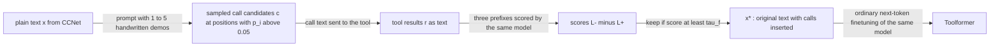
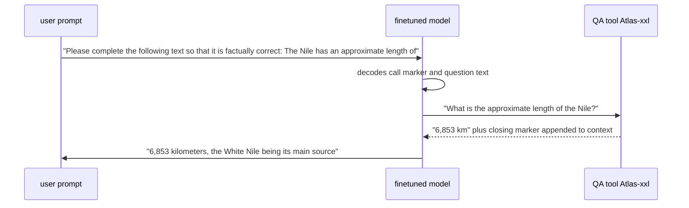

# Toolformer: Language Models Can Teach Themselves to Use Tools

> **Paper:** Schick, Dwivedi-Yu, Dessì, Raileanu, Lomeli, Zettlemoyer, Cancedda and Scialom (Meta AI Research; Universitat Pompeu Fabra for one author), 2023 - [arXiv abstract](https://arxiv.org/abs/2302.04761) - [local PDF](../../papers/2302.04761.pdf)

## Read this first

**The claim in one sentence.** A 6.7-billion-parameter language model can be taught, without human labels, to insert calls to five simple tools (a calculator, a question-answering system, a Wikipedia search engine, a translator and a calendar) into ordinary text, by keeping only those self-written calls that make the next few words easier to predict; after finetuning on the kept calls it beats same-size baselines, and sometimes the 175-billion-parameter GPT-3, on tasks where those tools help.

**Who this is for.** Anyone who has to decide how a language model should be connected to tools: product builders who use "function calling" today and want to know where the idea came from, and researchers who want to understand a clean example of self-supervised data generation.

**What you will be able to do afterwards.**

- Trace one candidate tool call through the four stages (sample, execute, filter, finetune) with the exact loss rule.
- Explain why the filter compares three situations and why the loss is weighted toward the next few tokens.
- Read each results table and say what a number counts, what it is compared with, and what it does not show.
- State precisely what the paper cannot do (chain tools, interact with a tool over several turns) and why that matters for agent design.

**Reading time for this guide.** About 50 minutes. The paper is short; the appendices hold the prompts and hyper-parameters that this guide quotes.

**Have read first.** [GPT-3](../01-foundations/03-gpt3.md) for few-shot prompting and the idea of in-context learning; [Chain of thought](../02-building/07-chain-of-thought.md) for what a prompted reasoning trace looks like; [RAG](../02-building/06-rag.md) for retrieval-augmented generation, since two of the five tools are retrieval systems; [ReAct](../02-building/10-react.md) for the contrasting approach, where a prompted model alternates thought, action and observation; [LoRA](../02-building/09-lora.md) is optional, because Toolformer does full finetuning rather than adapter training.

**The one thing most people get wrong.** Toolformer is usually remembered as "the model that calls tools". The distinctive contribution is narrower and more interesting: it is a recipe for *manufacturing training data* from the model's own guesses, using the model's own prediction loss as the judge. At test time it makes at most one call per input, the calls are independent of each other, and the model never sees a second tool result. It is not an agent loop.

## The paper in one worked example

The paper's Table 10 lists real candidate calls found in web text together with their filter scores. The example below follows the first Nile-length candidate through the whole pipeline. The text, the call, the tool answer and the score of 2.08 are in the paper; the per-token losses are **constructed by this guide** (the paper does not publish them) and are chosen so that the arithmetic reproduces the paper's score. Token boundaries are also illustrative.

**Starting text** (from a web document, Table 10): "The Nile has an approximate length of 6,853 kilometers, the White Nile being its main source."

**Step 1 - Sample (Section 2, "Sampling API Calls").** The model is shown a prompt that explains the question-answering call format and gives two worked examples (Appendix A.2), then the text itself. At every position i it reports the probability p_i that the next thing it would write is the opening call marker. Say that at the position just before "6,853" this probability is 0.31. The sampling threshold is 0.05 (Appendix A), so the position survives. The model is then asked to continue from that point with the call marker as a prefix, and it writes a candidate: `QA(What is the approximate length of the Nile?)`. Up to five candidates per position are drawn (Appendix A); this one is c.

**Step 2 - Execute (Section 2, "Executing API Calls").** The question goes to the question-answering tool, which is Atlas-large, a retrieval-augmented language model finetuned on the Natural Questions dataset (Section 3, Appendix A.1). It returns the string `6,853 km`. This is the result r.

**Step 3 - Filter (Section 2, "Filtering API Calls").** The model measures how well it predicts the text that follows the call position, "6,853 kilometers, the White Nile being ...", under three different prefixes. Only the next few tokens count much, because the weights fall off linearly: w̃_t = max(0, 1 − 0.2t), then normalised to sum to one (Section 4.1). For t = 0, 1, 2, 3, 4 and beyond the raw weights are 1, 0.8, 0.6, 0.4, 0.2, 0, which sum to 3.0, so the normalised weights are 0.333, 0.267, 0.200, 0.133, 0.067 and zero afterwards.

| Prefix given to the model | Meaning | Constructed per-token loss at t = 0..4 (nats) | Weighted loss |
|---|---|---|---|
| nothing, L(ε) | no call at all | 6.0, 3.5, 2.0, 1.5, 1.0 | (6.0 + 2.8 + 1.2 + 0.6 + 0.2) / 3 = 3.60 |
| call without answer, L(e(c, ε)) | the question is visible, the answer is not | not listed; assume the weighted total is 3.40 | 3.40 |
| call with answer, L(e(c, r)) | question and answer both visible | 2.2, 1.1, 0.8, 0.7, 0.6 | (2.2 + 0.88 + 0.48 + 0.28 + 0.12) / 3 = 1.32 |

The negative-side loss L⁻ is the smaller of the first two rows, 3.40. The positive-side loss L⁺ is 1.32. The filter statistic is L⁻ − L⁺ = 2.08, which matches the paper's value. The filtering threshold for this tool is 1.0 (Appendix A), and 2.08 ≥ 1.0, so the call is kept.

Notice what the model checked: not "is the answer correct" but "does seeing the answer make my own next words less surprising". The expensive token is "6,853" (loss 6.0 without help, 2.2 with it). The call earns its place there.

**Step 4 - Finetune (Section 2, "Model Finetuning").** The kept call is written back into the original text *at position i, with its answer*, producing the training sequence from Table 10: "The Nile has an approximate length of `[QA(What is the approximate length of the Nile?) -> 6,853 km]` 6,853 kilometers, the White Nile being its main source." (The paper uses plain square brackets and an ASCII arrow for the special markers; footnote 1.) The model is finetuned on a large set of such sequences with the ordinary next-word objective. Everything except the inserted call is identical to the original text.

**What the same table says about rejected candidates** (all from Table 10, scores L⁻ − L⁺):

| Candidate | Score | Verdict at threshold 1.0 | Why |
|---|---|---|---|
| WikiSearch(War memorial Flodden) in a text about the Flodden Window | 5.49 | keep | the retrieved passage names the battle and the builder that follow in the text |
| Calendar() placed before "March 10" in a library notice | 2.11 | keep | the date lets the model predict "March 10" |
| Calculator(735 / 499) → 1.47 in a Venus temperature sentence | 1.59 | keep | the next token "1.47" is now given |
| WikiSearch(Fast train success) | 0.92 | drop | below 1.0, although it still lowered the loss |
| Calculator(85 / 23) → 3.70 where the text says 65% | −0.02 | drop | the tool's answer disagrees with the text, so it does not help |
| QA(Who was last time I was with?) → The Last Time | −1.23 | drop | a vague question and an irrelevant answer raise the loss |

**At inference (Section 2, "Inference").** The finetuned model writes text normally. When it emits the arrow token, decoding pauses, the real tool runs, and the result plus the closing marker are appended; decoding then resumes. The diagram below shows the training-data pipeline; the second shows the same Nile example at inference.



What to notice: the same model plays four roles (annotator, sampler, judge, student), and the only external things in the loop are the tools and a handful of demonstrations per tool.



What to notice: control passes to the tool exactly once, and the tool's answer is spliced into the context as plain text. There is no planner, no schema and no second round.

## Words you need

| Term | Plain definition | Example from the worked example |
|---|---|---|
| API call c = (a_c, i_c) | A pair: the tool's name and the text input given to it | a_c = QA, i_c = "What is the approximate length of the Nile?" |
| Linearised call e(c) and e(c, r) | The call written as ordinary tokens inside text, without and with its result | e(c, r) is the bracketed QA call, arrow, and "6,853 km" |
| Candidate call | A call the model proposed during sampling, before any judgement | the Nile question, before it is scored |
| Sampling threshold τ_s | A call is only attempted where the model gives the call marker at least this probability (default 0.05) | p_i = 0.31 at the Nile position passes |
| Weighted cross-entropy loss L_i(z) | The model's average surprise at the tokens from position i onward, given prefix z, with nearby tokens weighted more | 3.60 with no prefix, 1.32 with the call and result |
| Filtering threshold τ_f | A call survives if giving the model the call and its result lowers this loss by at least τ_f compared with the best alternative (default 1.0) | 2.08 ≥ 1.0 |
| Augmented dataset C* | The original corpus with surviving calls inserted; it contains exactly the same text plus the calls | the Nile sentence with the call spliced in |
| Zero-shot | Evaluation with an instruction only and no in-context examples | the prompt "Please complete the following text so that it is factually correct" |
| Toolformer (disabled) | The finetuned model with the call marker's probability forced to zero at inference | isolates the benefit of finetuning from the benefit of calling |
| Perplexity | Exponentiated average per-token loss; lower means the model finds the text less surprising | 10.3 on WikiText for GPT-J + CC (Table 8) |
| GPT-J + CC | GPT-J finetuned on the same CCNet subset *without* any calls | the control that holds the data and training constant |
| CCNet | A large web-text corpus (Wenzek et al.) from which the paper takes its training subset | source of the Nile sentence |

## Tutorial 1 - Intuitive understanding

### What was broken before

A language model reads vast amounts of text and learns to continue it. That makes it fluent but unreliable at jobs where a tiny, exact program does better. The paper's introduction names five gaps: no access to recent events, a tendency to invent facts, weak support for low-resource languages, poor arithmetic and no sense of what day it is. Ask a plain GPT-J model "Please complete the following text so that it is factually correct" with the Nile sentence and it must recall the length from memory; on the SQuAD facts from the LAMA benchmark (a set of statements with one missing fact) it gets 17.8 out of 100 right (Table 3).

The obvious fix is to let the model use a calculator, a search engine and so on. The introduction argues that earlier ways of doing this had two problems. Some relied on large amounts of human annotation: people write examples of when and how to use the tool. Others hard-wired tool use to one task with task-specific few-shot prompts. The first is costly, and the authors note that "what humans find useful may be different from what a model finds useful." The second means the user has to know in advance which tool to use. Toolformer wants a model that, given a bare instruction, decides for itself.

### The idea

**Analogy.** Imagine an apprentice who reads a huge pile of finished documents. At each sentence the apprentice jots down, in the margin, "I could have looked this up" or "I could have computed this", and writes the question or the sum. A clerk then runs every jotted query. Finally the apprentice re-reads each sentence with and without the clerk's answer and keeps a margin note only if having the answer really made the next few words easier to guess. The apprentice then rewrites the whole pile with the surviving notes and studies it, until consulting the clerk at the right moment becomes a habit.

**Where the analogy breaks.** The apprentice is judging "would this help me write the true continuation", which is a different question from "would this help a user". The judge is a number, a drop in prediction loss, not a person's sense of usefulness. The paper's own Table 10 shows the number can be fooled: the "Fast train success" search returned unrelated song trivia and still lowered the loss. Also, a real apprentice could ask a follow-up if the clerk's answer was poor; the Toolformer student cannot (Section 7).

### How it works, step by step

1. **Pick text and demonstrations.** A CCNet subset, pre-selected for some tools (Section 4.1); each tool gets a prompt with a handful of demos (Appendix A.2).
2. **Propose.** Keep positions where the call marker has probability above 5% (top five per text) and sample up to five calls each (Appendix A).
3. **Run and score.** Execute each call; keep it if the full version beats the better of the other two prefixes by the threshold (Section 2).
4. **Rewrite and finetune.** Insert surviving calls, drop texts with none left (Section 4.1), and finetune the same model.
5. **Use it.** At inference, decoding stops at the arrow, the tool runs and decoding resumes (Section 2). At inference, decoding stops at the arrow, the tool runs and decoding resumes (Section 2).

### What the results say

All numbers below are accuracy-style scores on a 0-100 scale unless stated; each cites its table. "Toolformer" means GPT-J (6.7 billion parameters) after the pipeline, with decoding that allows a call whenever the call marker is among the ten most likely next tokens (Section 4.2).

**Facts (LAMA, Table 3).** The score counts how often the correct word appears among the first five words the model writes. Toolformer scores 33.8 on SQuAD, 11.5 on Google-RE and 53.5 on T-REx. The plain GPT-J scores 17.8, 4.9 and 31.9. The paper's "11.7, 5.2 and 18.6 points" are gains over the best GPT-J-based baseline, which in each case is Toolformer with calls disabled (22.1, 6.3, 34.9). In plain terms, on T-REx, out of every 100 statements, about 19 more were completed correctly than by the best baseline of the same size, and the model asked the QA tool in 98.1% of cases. Against GPT-3 (175B) the margins are smaller: 33.8 versus 26.8, 11.5 versus 7.0, 53.5 versus 39.8, i.e. 7.0, 4.5 and 13.7 points. (Wikipedia search was blocked on this benchmark, because LAMA statements come from Wikipedia.)

**Arithmetic (ASDiv, SVAMP, MAWPS; Table 4).** The score counts the first number the model writes (or the number after an equals sign) as its answer. Toolformer gets 40.4, 29.4 and 44.0. With calls disabled the same finetuned model gets 14.8, 6.3 and 15.0, and GPT-3 gets 14.0, 10.0 and 19.8. So allowing calls roughly triples the score on ASDiv (40.4 versus 14.8, about 26 more correct answers per 100 problems) and multiplies SVAMP by about 4.7. The model called the calculator on 97.9% of examples. Note the disabled model is itself better than plain GPT-J (14.8 versus 7.5 on ASDiv); the authors surmise that seeing many calculator examples improved its own arithmetic.

**Open-domain questions (WebQS, NQ, TriviaQA; Table 5).** The score counts whether the first 20 generated words contain the right answer. Toolformer gets 26.3, 17.7 and 48.8 versus 18.5, 12.8 and 43.9 for GPT-J, mostly using Wikipedia search (99.3% of calls). GPT-3 still wins: 29.0, 22.6, 65.9. On TriviaQA the gap to GPT-3 is 17.1 points. The authors attribute this to a crude search engine and an inability to reformulate queries (Section 4.2.3).

**Translation-assisted QA (MLQA; Table 6).** Calls help in every language compared with the disabled model (for example Spanish 20.6 versus 19.8, Chinese 16.8 versus 15.0), but Toolformer does not consistently beat plain GPT-J (German 13.5 versus 16.5, Arabic 3.7 versus 8.2), because finetuning on CCNet itself hurt several languages.

**Dates (TempLAMA and Dateset; Table 7).** On the synthetic Dateset, Toolformer scores 27.3 versus 5.9 disabled, 3.9 for GPT-J and 0.8 for GPT-3. The calendar was used in 54.8% of cases and the authors credit the whole gain to it. On TempLAMA the calendar was used in only 0.2% of cases; the small gain (16.3 versus 13.7 for GPT-J) came from the other tools.

**No loss of language ability (Table 8).** Perplexity with calls disabled is 10.3 on WikiText and 10.5 on held-out CCNet, identical to GPT-J + CC, so inserting calls into the training data cost nothing measurable. (GPT-J itself: 9.9 and 10.6.)

**Model size (Figure 4).** Tool use pays off only from about 775 million parameters upwards; smaller GPT-2 models score about the same with and without calls, except for Wikipedia search, which is easy to use (Section 4.4). The exact bar heights are in a figure and are not reproduced here.

### What this does not show

- It does not show that Toolformer beats GPT-3 in general. It beats it on LAMA, the maths sets, Dateset and TempLAMA; it loses on all three open-domain QA sets (Tables 3-7).
- It does not show multi-step tool use. The authors say it cannot chain tools or use a tool interactively (Section 7).
- It does not show robustness to phrasing; the authors found the model "sensitive to the exact wording" when deciding whether to call (Section 7).
- It does not show the filter picks truly useful calls; the evidence is five qualitative rows with scores (Table 10) and downstream gains.
- Comparisons are zero-shot with lenient matching (first five words, first 20 words, first number). The scoring is lenient equally for all models, but the absolute numbers are not comparable with exact-match results in other papers.

### Teach-back

1. Why does the filter compare against *two* alternatives and take the minimum? 
<details>
<summary>Answer</summary>
L⁻ is the smaller of the loss with no call and the loss with the call but no result (Section 2). If only the first were used, a call that merely changed the context (for example by repeating a key phrase in a question) could look helpful without the tool contributing anything. Using the better of the two forces the *result* to be what produces the gain.
</details>

2. In the Nile example, which single token drives the score, and why does the weighting scheme matter? 
<details>
<summary>Answer</summary>
The first token after the call position ("6,853") carries the largest loss (6.0 constructed) and the largest weight (0.333). The weights decay to zero after four tokens, so calls only score well if the information they give is useful right where they are placed (Section 4.1).
</details>

3. Toolformer (disabled) beats plain GPT-J on arithmetic. Does that mean the calculator is unnecessary? 
<details>
<summary>Answer</summary>
No. On ASDiv the disabled model scores 14.8 and the enabled one 40.4 (Table 4). Finetuning on calculator examples lifts the model's own arithmetic a little, but most of the gain needs the live calculator.
</details>

## Tutorial 2 - Practitioner understanding

### The design in concrete terms

**Call format.** Tool inputs and outputs must be plain text (Section 2). A call with result is written `<API> name(input) → result </API>`, but in practice the paper uses the existing tokens " [", "]" and "->" so the vocabulary does not change (Section 2, footnote 1). No JSON schema, no argument types: the "arguments" are a string.

**The five tools (Section 3, Table 1, Appendix A.1).**

| Tool | Input | Output | Implementation |
|---|---|---|---|
| Question answering | a factoid question | a short answer, such as "New Haven, Connecticut" | Atlas-large for data creation, Atlas-xxl at inference |
| Wikipedia search | a search term | a short snippet | BM25 retriever over the KILT Wikipedia dump |
| Calculator | an expression, only + - * / | the value, rounded to two decimals; nothing if invalid | a short Python script |
| Calendar | nothing | "Today is Monday, January 30, 2023." | returns the current date |
| Machine translation | a phrase in any language | English text | 600M-parameter NLLB, source language detected by fastText |

**Hyper-parameters (Appendix A, B; Section 4.1).**

| Setting | Default tools (QA, search, calendar) | Calculator and translation |
|---|---|---|
| Sampling threshold τ_s | 0.05 | 0.0 |
| Positions kept per text (k) | 5 | 20 |
| Calls sampled per position (m) | 5 | 10 |
| Filtering threshold τ_f | 1.0 | 0.5 |

Calculator and translation use looser settings because heuristic pre-filtering leaves only a small subset of texts. Finetuning uses effective batch size 128, learning rate 1e-5 with linear warm-up over the first 10% of training, maximum sequence length 1,024, up to 25,000 examples per tool, up to 2,000 steps on 8 NVIDIA A100 40GB GPUs with bf16 and DeepSpeed ZeRO-3, with the checkpoint chosen by perplexity on 1,000 held-out CCNet examples evaluated every 500 steps (Appendix B).

**Dataset size (Table 2).** Examples surviving the filter, by threshold:

| Tool | τ_f = 0.5 | τ_f = 1.0 | τ_f = 2.0 |
|---|---|---|---|
| Question answering | 51,987 | 18,526 | 5,135 |
| Wikipedia search | 207,241 | 60,974 | 13,944 |
| Calculator | 3,680 | 994 | 138 |
| Calendar | 61,811 | 20,587 | 3,007 |
| Machine translation | 3,156 | 1,034 | 229 |

The threshold is a strong dial: raising it from 0.5 to 1.0 cuts QA data to 36% (18,526 of 51,987). The calculator and translation sets are tiny, which is why the paper used 0.5 for them. This guide infers that the 25,000-per-tool cap in Appendix B means Wikipedia search and (at 0.5) calendar data were subsampled.

### A minimal version

Pseudocode for the data pipeline for one tool; `lm` is any causal language model that exposes next-token log-probabilities.

```python
W = [1.0, 0.8, 0.6, 0.4, 0.2]                  # w~_t = max(0, 1 - 0.2 t) for t = 0..4
W = [w / sum(W) for w in W]                      # normalised: sums to 1

def weighted_loss(lm, prefix, text, i):
    """-sum_t w_t * log p(x_{i+t} | prefix, x_{<i+t}) over the next 5 tokens."""
    toks = lm.tokenize(text)
    ctx = lm.tokenize(prefix) + toks[:i]
    total = 0.0
    for t, w in enumerate(W):
        if i + t >= len(toks): break
        total -= w * lm.logprob(toks[i + t], ctx)
        ctx.append(toks[i + t])
    return total

def annotate(lm, tool, text, tau_s=0.05, k=5, m=5, tau_f=1.0):
    kept = []
    P = tool.prompt                                # handwritten demos, Appendix A.2
    probs = [lm.prob_of(CALL_START, P + text_prefix(text, i)) for i in range(n_tokens(text))]
    positions = sorted([i for i, p in enumerate(probs) if p > tau_s],
                       key=lambda i: -probs[i])[:k]
    for i in positions:
        base = weighted_loss(lm, "", text, i)                     # L_i(empty)
        for _ in range(m):
            call = lm.sample(P + text_prefix(text, i) + CALL_START, stop=CALL_END)
            if call is None: continue                              # never closed
            result = tool.run(call)                                # text in, text out
            if result is None: continue
            l_plus  = weighted_loss(lm, f"[{call} -> {result}]", text, i)
            l_noans = weighted_loss(lm, f"[{call}]", text, i)
            l_minus = min(base, l_noans)
            if l_minus - l_plus >= tau_f:
                kept.append((i, call, result, l_minus - l_plus))
    return kept

def splice(text, kept):                           # build x*
    for i, call, result, _ in sorted(kept, key=lambda c: -c[0]):
        text = insert_at(text, i, f"[{call} -> {result}] ")
    return text
# finetune lm on [splice(x, annotate(...)) for x in corpus if any call survives]
```

Shapes: `text` is a string, `kept` is a list of tuples (position, call string, result string, score), and the training set is strings containing bracketed calls. Note the filter scores the call as a *prefix* in front of the text, not in the middle: the paper does this because the base model has not yet seen calls in the middle of text and would be thrown off (Section 2, footnote 3). At inference the loop is: decode until the arrow, run the tool, append the result and "]", continue.

### What it costs

Assumptions: this is the guide's arithmetic, not the paper's. The paper does not report annotation compute beyond the finetuning hardware in Appendix B.

- **Candidate volume.** For default tools, at most k × m = 5 × 5 = 25 candidate calls per document; for calculator and translation, 20 × 10 = 200. For 1 million documents that is up to 25 million QA or search calls to execute, and up to 200 million calculator calls (though the calculator heuristics shrink the document pool; Appendix A.1).
- **Scoring passes.** Each position needs one pass for L(ε), and each candidate needs two more (with and without the result), by this guide's reading of the formulas. So one default document can need up to 5 + 2 × 25 = 55 short forward passes, plus the prompt pass for p_i and 25 sampling decodes.
- **Yield.** Section 7 says processing more than a million documents gave "only a few thousand" useful calculator calls, and Table 2 gives 3,680 at τ_f = 0.5. If you ran the calculator pipeline on 1 million documents, a yield on the order of 0.4% of documents is the paper's order of magnitude. This is the "sample-inefficient" limitation.
- **Run-time.** Each call pauses decoding, so latency per call is the tool's latency plus one resumed decode. The paper limits evaluation to one call per input, so worst-case extra latency per answer is one tool round trip. The paper explicitly says the model does not take tool cost into account when deciding to call (Section 7).
### How it fails

| Symptom | Likely cause | Mitigation | Grounding |
|---|---|---|---|
| Model rarely calls a tool on greedy decoding (WebQS: 8.5% of examples at k = 1) | the call marker rarely wins as the single top token | decode with the marker among the top k tokens (k = 10 in the paper) | Table 9, Section 5 |
| Model calls the tool but ignores a bad result, or follows a bad result | training data contains noisy kept calls | keep some noise; the authors argue noise teaches the model not to follow results blindly | Section 5, Data Quality |
| Poor search results (NQ 17.7 versus GPT-3's 22.6) | weak BM25 retrieval; the model cannot rephrase or browse | stronger retriever, and an interactive loop (the paper does not do this) | Section 4.2.3, Section 7 |
| Answer needs two tools in sequence (date, then lookup) | each call is sampled independently, so training has no chains | not solvable inside this recipe; needs sequential data | Section 4.2.5, Section 7 |
| Behaviour changes when the instruction is reworded | model's decision to call is prompt-sensitive | evaluate several phrasings; do not rely on one prompt | Section 7 |
| Finetuning lowers a skill unrelated to tools (MLQA German 13.5 versus 16.5 for GPT-J) | finetuning on a web subset shifts the distribution | include a GPT-J + CC control and evaluate on your own slices | Table 6 |
| Calls that reduce loss but add nothing (Fast train success, 0.92) | the loss can fall for spurious reasons | raise τ_f; inspect top and bottom of the score distribution | Table 10 |

### Evaluating your version

- **Metric for the tool decision.** On a held-out set of prompts, record (a) whether the model called, (b) the call text, (c) whether the answer was right, and compare to the same model with calls disabled. This mirrors the "Toolformer versus Toolformer (disabled)" contrast.
- **Baselines.** Always include the base model, the base model finetuned on the *same texts without calls* (the paper's GPT-J + CC), and the disabled model. Without the second you cannot tell tool benefit from data shift.
- **Test size.** The paper does not report test-set sizes or confidence intervals in the main text; set your own. As a guide-author rule of thumb, with 500 test items and scores near 50%, a 5-point gap between two models is only about 1.6 standard errors, so treat gaps under about 6 points as noise unless the comparison is paired.
- **Language-modelling check.** Perplexity with calls disabled on a held-out slice of your own data (Table 8: 10.3 versus 10.3 on WikiText, 10.5 versus 10.5 on CCNet).
- **Stop rule.** Stop raising the number of sampled candidates when the kept-call count per 1,000 documents stops growing and a manual read of 50 kept calls shows fewer than 80% judged helpful (this threshold is the guide's suggestion; the paper only inspects examples qualitatively).

### Adopt, adapt or skip

**Skip the full recipe** for a team building an assistant over private business documents, **adapt two of its ideas**, and do not treat it as the architecture for the agent itself.

Why skip: the recipe requires finetuning a base model, which is only practical for open-weight models; it yields single, independent calls; and modern hosted models already accept tool descriptions at run time, so you do not need to train the habit of calling a document search. Your tools will change (a new index, a new calculator), and each change would need a re-run of sampling, filtering and finetuning.

What to adapt: (1) **loss-based filtering as a data-quality test.** If you ever finetune a model to produce tool calls from logs, keep a call only if giving the model the call *and the result* beats the better of "no call" and "call without result"; it is a cheap, label-free check. (2) **Compare with a finetuned-without-tools control**, because Table 6 shows finetuning alone can hurt.

On the stage's question - whether a thin runtime around a model that chooses among a few high-quality tools is the right architecture - this paper offers partial support and one warning. It supports the premise that tool *selection* can be learned by the model rather than coded as rules (Section 4.2 shows no task-specific tool instructions). It warns that one-shot, independent calls are not enough: the authors themselves identify chaining and interaction as missing (Section 7), which is the part an assistant with a runtime loop adds. That assistants built later fill this gap with a loop is this guide's inference; the paper does not discuss it.

## Tutorial 3 - Researcher understanding

### Formal setup

**Notation (Section 2).** A language model M gives probabilities p_M(z_{n+1} | z_1..z_n). A corpus C = {x_1, ..., x_|C|} of plain texts. A text x = x_1, ..., x_n. An API call c = (a_c, i_c) with response r. Linearisations e(c) = <API> a_c(i_c) </API> and e(c, r) = <API> a_c(i_c) → r </API>. ε is the empty sequence.

**Call-position probability.** p_i = p_M(<API> | P(x), x_{1:i−1}), where P(x) is the tool's prompt with the text. Positions I = {i : p_i > τ_s}, truncated to the top k.

**Weighted loss.** L_i(z) = −Σ_{j=i}^{n} w_{j−i} · log p_M(x_j | z, x_{1:j−1}), with weights w_t = w̃_t / Σ_s w̃_s and w̃_t = max(0, 1 − 0.2t) (Section 4.1).

**Two instances.** L_i⁺ = L_i(e(c_i, r_i)). L_i⁻ = min(L_i(ε), L_i(e(c_i, ε))). Keep c_i if L_i⁻ − L_i⁺ ≥ τ_f.

**Numeric toy instance.** Suppose only two tokens matter after position i, with weights 0.6 and 0.4. With no call the token losses are 4.0 and 2.0, so L(ε) = 0.6 × 4.0 + 0.4 × 2.0 = 3.2. With the call but no answer they are 3.5 and 2.0, so L = 2.9. With the call and answer, 1.0 and 1.5, so L⁺ = 0.6 + 0.6 = 1.2. Then L⁻ = min(3.2, 2.9) = 2.9 and the score is 1.7, above τ_f = 1.0, so the call is kept. If the answer instead gave 3.0 and 1.5 (L⁺ = 2.4), the score is 0.5 and the call is dropped at τ_f = 1.0 but kept at 0.5.

### The claims, stated precisely

1. **Method claim.** A pretrained LM plus a handful of demonstrations per tool is sufficient to create finetuning data that teaches when, how and with what arguments to call tools, using only a perplexity-based criterion (Abstract, Section 2).
2. **Performance claim.** The resulting GPT-J-based model improves zero-shot results across LAMA, three maths sets, three open-domain QA sets, MLQA and two temporal sets (Tables 3-7), outperforming GPT-3 (175B) on several (LAMA, maths, Dateset, TempLAMA) but not on open-domain QA (Table 5).
3. **No-regression claim.** With calls disabled, perplexity is unchanged relative to GPT-J finetuned on the same data without calls (Table 8).
4. **Scale claim.** Tool-use gains emerge at around 775M parameters (Figure 4, Section 4.4); the gap with and without tools remains large for the biggest model tested.
5. **Self-reported limits.** No chaining, no interaction, prompt sensitivity, sample inefficiency and no cost awareness (Section 7).

### Evidence, table by table

**Table 2 (dataset size).** Rows are tools, columns are τ_f of 0.5, 1.0 and 2.0; it shows how selective the filter is, but the paper reports no downstream ablation over τ_f.

**Table 3 (LAMA).** Rows: GPT-J, GPT-J + CC, Toolformer (disabled), Toolformer, OPT 66B, GPT-3 175B; columns SQuAD, Google-RE, T-REx. Headline: 33.8 / 11.5 / 53.5. The comparison Toolformer versus Toolformer (disabled) is the cleanest causal contrast available (same weights, only the ability to call differs, though forcing the marker probability to zero is itself an intervention). Associational: the claim that this is "because" the model asks the QA tool rests on the reported 98.1% call rate. One caveat the paper states: Wikipedia search was disabled; the QA tool (Atlas finetuned on Natural Questions) is itself a retrieval-augmented model that likely holds much of this knowledge, so the table measures how well the model can delegate, not how much it knows.

**Table 4 (maths).** Same rows; columns ASDiv, SVAMP, MAWPS. Headline: 40.4 / 29.4 / 44.0 versus disabled 14.8 / 6.3 / 15.0. The calculator handles only four operations and the problems are simple word problems, so this does not test multi-step reasoning.

**Table 5 (open QA).** Headline: Toolformer 26.3 / 17.7 / 48.8 versus GPT-3 29.0 / 22.6 / 65.9. The QA tool was disabled to avoid trivialising the task (Atlas was trained on NQ), so search is the only helpful tool.

**Table 6 (MLQA).** Rows as before plus two English-only upper bounds (GPT-J All En, GPT-3 All En). The within-model contrast (disabled versus enabled) is positive in all six languages. The across-model contrast with GPT-J is mixed; the authors attribute the deficit to finetuning on CCNet, but no experiment isolates the cause beyond the GPT-J + CC rows, which do show drops in German, Chinese and Arabic (14.9, 13.7, 4.6 versus 16.5, 18.2, 8.2).

**Table 7 (temporal).** Dateset has 9,400 template questions in total, generated from 500 random current dates (Appendix D, Table 11). The paper's own breakdown shows calendar use of 54.8% on Dateset and 0.2% on TempLAMA, which separates "gain due to the calendar" from "gain due to other tools".

**Table 8 (perplexity).** Compares models with calls disabled only; perplexity with calls enabled is intractable (footnote 8).

**Table 9 (decoding k).** For T-REx: overall 34.9 (k = 0, no calls), 47.8 (k = 1), 52.9 (k = 3), 53.5 (k = 10); call rates 0, 40.3, 82.8, 98.1%. For WebQS: 18.9, 19.3, 26.3, 26.3; call rates 0, 8.5, 99.3, 100%. The calibration statement is an association: at k = 1 on T-REx, examples where the model chose not to call scored 44.3, above the 34.9 the model scores with calls off, so it tends to call on its harder cases.

**Table 10 (qualitative).** Ten rows with scores from 5.49 to −1.23 and a hand-assigned usefulness mark; the only direct evidence about filter quality, and the selection of rows is not described as random.

### Ablations and what they isolate

- **Toolformer versus Toolformer (disabled).** Isolates the run-time benefit of tools from the training-data effect.
- **GPT-J + CC versus GPT-J.** Isolates the effect of finetuning on CCNet text.
- **Toolformer (disabled) versus GPT-J + CC.** Isolates the effect of the inserted calls themselves on the model's own ability; visible in Table 4 (14.8 versus 9.6 on ASDiv).
- **Decoding k (Table 9).** Isolates the willingness to call from the quality of the call.
- **Model size (Figure 4).** Isolates how much model capacity tool use needs.
- **Not ablated.** The paper does not compare the filter against no filtering, a different weighting, or different τ_f at downstream level, despite reporting dataset sizes for three thresholds. So the claim that the loss rule is what makes the data useful rests on Table 10 and the overall results, not on a controlled comparison.

### Threats to validity specific to this paper

- **Zero-shot with lenient scoring.** The criteria (answer within five, ten or twenty words; first number) favour models that mention many candidates. Toolformer's decoding tweak (k = 10) and its single-call restriction are tuned for the benchmarks; the paper reports the k effect but not how k was chosen for each benchmark.
- **Tool strength confounds.** Atlas-xxl was trained on Natural Questions and is itself a retrieval model; much of the LAMA gain may be the strength of the tool, not the learning method.
- **Distribution shift from finetuning.** Because training examples are only those with surviving calls (Section 4.1, footnote 4), the finetuning distribution differs from the original corpus; Table 8 checks perplexity but not other abilities, and Table 6 shows some regress.
- **Weak baselines on MLQA.** The paper notes OPT and GPT-3 mostly failed to answer in English, so those rows say little.
- **Single model family.** One base model for the main results and no variance is reported; Dateset is synthetic and template-based (Appendix D).

### Open problems and follow-ups

The paper itself names: chained tool use, interactive search (query refinement and browsing), prompt sensitivity, sample efficiency (suggesting iterating the procedure), and tool-cost awareness (Section 7). The guide adds, as its own inference, that the finetuned model has no way to represent multiple turns, tool failure, or tools whose output depends on side effects; those matter for coding or file-editing tools. [CodeAct](25-codeact.md) and [SWE-agent](26-swe-agent.md) deal with executable and interactive action spaces.

### What would change my mind

- A controlled comparison showing that unfiltered sampled calls give the same downstream scores would undermine the importance of the loss rule.
- Evidence that the QA tool's own training on Natural Questions explains most of the LAMA gain (for example, a weaker QA tool giving near-baseline scores) would shift credit from the method to the tool.
- A replication with a different base model family and with variance estimates would be needed before treating the 775M-parameter emergence point as general.
- Showing that a prompted model with the same tools (no finetuning) matches Toolformer zero-shot would suggest finetuning is unnecessary; the paper does not run that comparison.

## Reading map for the PDF

| Section or figure | What it contains | First pass | Guide section that answers its questions |
|---|---|---|---|
| Abstract, Section 1, Figures 1-2 | Motivation, the two desiderata, the pipeline picture | Read | Worked example, Tutorial 1 |
| Section 2 | The loss formulas, filter, linearisation, inference | Read slowly | Formal setup, FAQ |
| Section 3, Table 1 | The five tools and example I/O | Read | Design in concrete terms |
| Section 4.1, Table 2 | CCNet, weights, thresholds, baselines, dataset counts | Read | Design in concrete terms, Evidence |
| Section 4.2, Tables 3-7 | Zero-shot results per tool | Read | What the results say, Evidence |
| Section 4.4, Figure 4 | Scaling with GPT-2 sizes | Read | Evidence, FAQ |
| Section 5, Tables 9-10 | Decoding k, qualitative data quality | Read | Worked example, Evidence |
| Section 7 | Limitations | Read | Adopt, adapt or skip |
| Appendix A | Defaults, per-tool heuristics, all five prompts | Read | Design in concrete terms, A minimal version |
| Appendix D, Table 11 | Dateset construction | Skim | Evidence |

## Questions readers get stuck on

### Is Toolformer an agent?

No in the sense of an agent loop. It makes at most one call per input in the evaluation (Section 4.2), each call is generated independently of every other, and the model sees only one tool result. The authors state it cannot chain tools or use them interactively (Section 7). It is a model that has learned when a single lookup or computation is worth inserting, which is a smaller thing than choosing a sequence of actions.

### What exactly does "self-supervised" mean here?

No human labels say where a call belongs. The labels are produced by the model itself (it proposes the calls) and by a rule computed from its own loss (it keeps the helpful ones). Humans supply a few demonstrations per tool and the tools themselves, and heuristics choose which documents to annotate (Appendix A.1), so it is label-free rather than human-free.

### Why compare against both "no call" and "call without result"?

A call without a result still contributes its text to the context. If a question itself repeats words that appear later in the sentence, the loss can fall without the tool being useful. Taking the minimum of the two alternatives sets a higher bar, so any gain has to come from the answer (Section 2).

### Why is the call placed in front of the text when scoring, but in the middle for training?

The base model has never seen calls in the middle of text, so inserting one would disrupt the flow and raise the loss for reasons unrelated to usefulness (Section 2, footnote 3). A prefix avoids this. After finetuning, the model sees calls in the middle, and that is where it is expected to produce them.

### Is the 98.1% tool-use rate impressive or an artefact?

It is partly an artefact of the decoding trick. With ordinary greedy decoding, the model called the QA tool on 40.3% of T-REx examples; moving to k = 10 raised this to 98.1% (Table 9). On WebQS the corresponding figures are 8.5% and 100%. The high rates in Tables 3-5 reflect the nudge plus the benchmark design (the tool was selected to be useful), not unprompted judgement.

### How can Toolformer (disabled) beat plain GPT-J if it has no tools?

It was finetuned on text containing many calculator and QA calls with correct answers. On ASDiv that took the disabled model from 7.5 to 14.8 (Table 4). The authors surmise the finetuning improved the model's own maths. This also means "with versus without tools" for the same weights is a better test of tool use than comparison with GPT-J.

### Why does GPT-3 still win on open-domain QA?

Because 175 billion parameters store far more facts, and Toolformer's search is a simple BM25 retriever that often returns a poor match; the model cannot reformulate or browse results (Section 4.2.3). TriviaQA shows the widest gap: 48.8 versus 65.9.

### Why did the calendar not help on TempLAMA?

The best strategy there is two steps: get the date, then ask a QA system about it. That needs chaining, which the training data does not contain, and the evaluation allows only one call (Section 4.2.5). The calendar was used in 0.2% of cases, and the gain came from search and QA. The calendar helped on Dateset, where the date alone answers the question.

### Why not just prompt a big model with the tool descriptions, as ReAct does?

The paper's position is that prompt-based approaches tailor few-shot examples to a task where the needed tool is known ahead of time (Section 6). Toolformer wants the model to decide in a zero-shot setting. The paper does not run a prompted-model comparison at this scale, so whether a prompt would do as well is not tested here. [ReAct](../02-building/10-react.md) answers a different need: sequences of actions and observations.

## Prerequisites you actually need

### Prerequisite 1 - Next-token probability and cross-entropy loss

A language model assigns a probability to each possible next token. Its loss on a token is the negative natural logarithm of the probability it gave the actual token; a small probability means a big loss. Example: if the model gave "6,853" a probability of 0.0025, the loss is −ln(0.0025) ≈ 6.0; if the answer in the context lifts that to 0.11, the loss is about 2.2. The paper uses this in Section 2 (the weighted loss L_i). See [GPT-3](../01-foundations/03-gpt3.md) for next-word training.

### Prerequisite 2 - Conditioning a language model on a prefix

A model's prediction changes when text is put in front of the passage it is predicting. The paper exploits this: it places the call and answer in front of x_{i:n} and measures the change in loss. Example: the same model gives different probabilities to "6,853" depending on whether "[QA(...) -> 6,853 km]" precedes it. Used in Section 2 and footnote 3. See [GPT-3](../01-foundations/03-gpt3.md) for in-context conditioning.

### Prerequisite 3 - Zero-shot prompting and greedy decoding

Zero-shot means the model gets an instruction but no worked examples. Greedy decoding chooses the single most likely next token each time. Toolformer evaluation is zero-shot and uses greedy decoding with one change: a call may start whenever the marker is among the top k tokens. Example: if the marker has probability 0.04 and is ranked 3rd, greedy decoding ignores it, but k = 10 lets the call start. Used in Section 4.2 and Section 5. See [Chain of thought](../02-building/07-chain-of-thought.md) for prompting styles.

## Where this sits in the curriculum

**Before it.** [GPT-3](../01-foundations/03-gpt3.md) supplies in-context learning, which Toolformer uses to annotate its own corpus; [RAG](../02-building/06-rag.md) supplies the idea of external text feeding a model.

**Against the two nearest papers.**

- *ReAct.* ReAct prompts a frozen model with thought, action and observation steps and can run many turns. Toolformer trains the weights on single, self-filtered calls and cannot take a second step. ReAct is about control flow; Toolformer is about learning tool choice from data.
- *RAG.* RAG retrieves for every input; Toolformer's search is a learned, optional call (the paper draws this contrast in Section 6).

**What it contributes to the lineage of function calling.** The paper reports a text-based call format, training from the model's own filtered outputs, and zero-shot use across several tools. This guide infers that later tool-calling systems differ by adding structured argument schemas, multi-turn loops and selection among many tools; the paper itself does not make claims about those systems.

**Read next.** [CodeAct](25-codeact.md), where the action space becomes executable code and an interactive loop (the opposite of single independent calls); then [SWE-agent](26-swe-agent.md), where the design of the interface between model and tools becomes the object of study. The [survey](27-agentic-tool-use-survey.md) and the [Claude Code study](28-dive-into-claude-code.md) answer the stage's through-question about thin runtimes around few high-quality tools.

## Checkpoint

1. **Compute.** A call has L(ε) = 2.5, L(e(c, ε)) = 2.8 and L(e(c, r)) = 1.3. Is it kept at τ_f = 1.0? At τ_f = 2.0?
<details>
<summary>Answer</summary>
L⁻ = min(2.5, 2.8) = 2.5. L⁺ = 1.3. The score is 1.2. Kept at τ_f = 1.0 (1.2 ≥ 1.0) and dropped at τ_f = 2.0.
</details>

2. **Compute.** Using Table 3, how many points does Toolformer gain on T-REx over (a) plain GPT-J, (b) Toolformer with calls disabled, (c) GPT-3?
<details>
<summary>Answer</summary>
(a) 53.5 − 31.9 = 21.6; (b) 53.5 − 34.9 = 18.6, which is the paper's "best baseline" gain; (c) 53.5 − 39.8 = 13.7.
</details>

3. **Explain.** Why can the paper not report perplexity with calls enabled?
<details>
<summary>Answer</summary>
The probability of a token would need to be summed over every call the model could have made at every earlier position, which is intractable (Section 4.3 footnote 8). It reports perplexity with calls disabled instead (Table 8).
</details>

4. **Critique.** A colleague says "Toolformer proves loss-based filtering is necessary". What does the paper actually support?
<details>
<summary>Answer</summary>
It supports that the filtered data works (Tables 3-7) and that high scores line up with intuitively useful calls (Table 10). It runs no comparison with an unfiltered or differently filtered dataset, so necessity is not tested.
</details>

5. **Critique.** An assistant must look up a customer-policy document and then compute a refund from the figure in it. Can the Toolformer recipe handle this as published?
<details>
<summary>Answer</summary>
Not as published. This needs a retrieval call followed by a calculator call that uses the retrieved number, i.e. a chain. The authors state the lack of chaining as a limitation because calls are generated independently and no chained examples exist in training (Section 7). Whether a variant could be made to do this is a guide inference, not something the paper shows.
</details>
