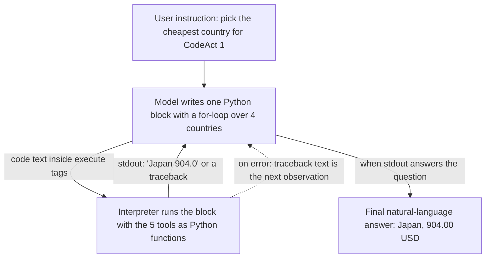
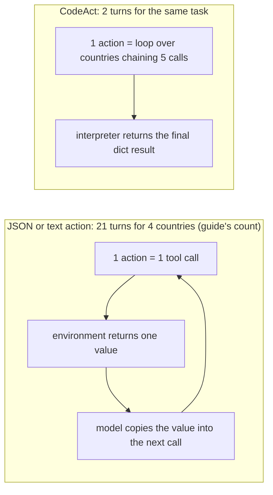

# Executable Code Actions Elicit Better LLM Agents

> **Paper:** Wang, Chen, Yuan, Zhang, Li, Peng and Ji (University of Illinois Urbana-Champaign, with one author at Apple), 2024 (arXiv v4, June 2024) - [arXiv abstract](https://arxiv.org/abs/2402.01030) - [local PDF](../../papers/2402.01030.pdf)
>
> **Short name:** CodeAct. Pointers use the paper's own numbering. Numbers were checked against the arXiv HTML rendering of v4; see the FAQ note on table numbering.

## Read this first

**The claim in one sentence.** If an agent writes its actions as executable Python and gets the interpreter's output (including error messages) back as its next input, it solves multi-step tool tasks more often and in fewer turns than if it writes each action as one JSON object or one line of formatted text; and a small open model can be fine-tuned to do this.

**Who this is for.** Anyone deciding how an assistant should act: through a menu of named tools called with JSON arguments, through free-form code, or a mix. It is the first paper in this stage that attacks the *shape of the action* and not the choice of tools.

**Afterwards you will be able to** trace a code action including how an error message becomes the next action; state exactly what was compared (three action formats, 17 models, two benchmarks) and what each number counts; say why the headline gain is real but narrower than the figure suggests; and sketch a safer small version for an assistant over private documents.

**Reading time.** About 45 minutes. **Have read first:** [ReAct](../02-building/10-react.md) (the think-act-observe loop CodeAct keeps), [HumanEval](../03-evaluation-and-code/14-humaneval.md), [SWE-bench](../03-evaluation-and-code/16-swe-bench.md), and [LoRA](../02-building/09-lora.md) (contrast with the full-parameter tuning here). Skim [Toolformer](24-toolformer.md), the previous guide, for the older idea of a model calling a fixed set of APIs.

**The one thing most people get wrong.** CodeAct is not "make the model write a program to solve the problem", an older idea (Appendix A lists PaL, Code as Policies, Voyager). The code is the *action* in a **multi-turn loop**: run a few lines, read what came back, write the next few. Also, the headline gains over JSON come from a benchmark where the JSON and text prompts say only one tool may be invoked at a time (Appendix F.4, F.5). That tests one-call-per-step agents, not modern parallel function calling.

## The paper in one worked example

Two traces from the paper are used throughout. The first (Figure 1) shows code replacing a pile of separate tool calls. The second (Figure 3) shows an error message turning into a fix.

### Part A - the phone-price task (Figure 1)

**Instruction given to the agent:** determine the most cost-effective country to purchase the smartphone model "CodeAct 1", considering the USA, Japan, Germany and India.

**Five tools the agent may use (signatures from Figure 1):**

| Tool | Signature | What it returns |
|---|---|---|
| lookup_rates | lookup_rates(country) -> (float, float) | exchange rate and tax rate |
| lookup_phone_price | lookup_phone_price(model, country) -> float | local price |
| convert_and_tax | convert_and_tax(price, exchange_rate, tax_rate) -> float | price in USD with tax |
| estimate_shipping_cost | estimate_shipping_cost(destination_country) -> float | shipping cost |
| estimate_final_price | estimate_final_price(converted_price, shipping_cost) -> float | final USD price |

**Left panel - text or JSON actions, one tool per action.** The paper shows the first three actions and then elides the rest. Reproduced from Figure 1, for Germany:

| Turn | Action the model emits (JSON form) | Environment returns |
|---|---|---|
| 1 | {"tool": "lookup_rates", "country": "Germany"} | 1.1, 0.19 |
| 2 | {"tool": "lookup_phone_price", "model": "CodeAct 1", "country": "Germany"} | 700 |
| 3 | {"tool": "convert_and_tax", "price": 700, "exchange_rate": 1.1, "tax_rate": 0.19} | 916.3 |
| 4 ... | the paper writes "interactions omitted (look up shipping cost and calculate final price)" | |
| ... | lookup_rates for Japan, then "interactions omitted (calculate final price for all other countries)" | |
| last | Response: the most cost-effective country is Japan with price 904.00 in USD | |

The arithmetic behind turn 3 is this guide's inference from the numbers: 700 x 1.1 = 770, and 770 x 1.19 = 916.3, so the tool appears to multiply by the exchange rate and then add the tax rate as a fraction.

**Right panel - one code action.** The whole computation is one block, which the model writes in a single turn:

```python
countries = ['USA', 'Japan', 'Germany', 'India']
final_prices = {}

for country in countries:
    exchange_rate, tax_rate = lookup_rates(country)
    local_price = lookup_phone_price("xAct 1", country)
    converted_price = convert_and_tax(local_price, exchange_rate, tax_rate)
    shipping_cost = estimate_shipping_cost(country)
    final_price = estimate_final_price(converted_price, shipping_cost)
    final_prices[country] = final_price

most_cost_effective_country = min(final_prices, key=final_prices.get)
most_cost_effective_price = final_prices[most_cost_effective_country]
print(most_cost_effective_country, most_cost_effective_price)
```

The figure's code spells the model "xAct 1" while the instruction says "CodeAct 1" (a typo), and its Environment panel for the code action shows only "1.1, 0.19", so treat the figure as a schematic, not a log. Both panels end with: Japan, 904.00 USD.

**Call counts, side by side.** Each country needs five tool calls (the five tools in the table), so four countries need 4 x 5 = 20 tool calls. Under the one-tool-per-action rule that is 20 actions, then one final answer, so 21 model turns. This count is this guide's arithmetic from the tool list and the loop body, not a number the paper prints for this task. The code version needs 1 action plus the final answer, so 2 turns. Three paper features do the work: the `for` loop repeats the same five-step chain per country (control flow), the variables `exchange_rate` and `local_price` carry values from one call to the next without the model re-typing them (data flow), and `min(..., key=final_prices.get)` reuses a built-in Python function instead of requiring a "pick the minimum" tool.

### Part B - an error turns into a fix (Figure 3)

Figure 3 shows CodeActAgent (the fine-tuned Mistral-7B model) with no in-context demonstrations. The user asks it to download an auto-MPG dataset from a URL, check for missing values, split train and test sets, and train a regression model predicting MPG from every column except "mpg" and "car name".

1. **Turn 1 - action.** The model writes one block: import pandas and scikit-learn, `read_csv`, print `df.isnull().sum()`, `dropna()`, split with `test_size=0.2, random_state=42`, fit a `LinearRegression`, print mean squared error and R^2.
2. **Turn 1 - observation.** The interpreter returns a traceback ending `ValueError: could not convert string to float: '?'`. (The missing-value check found nothing to drop because "?" is a string, not a missing marker; that reading is this guide's inference from the fix the model then applies.)
3. **Turn 2 - action.** The model says there is a data type issue because the "?" character is present, and writes the same pipeline with `df.replace('?', np.nan)` added before `dropna()`.
4. **Turn 2 - observation.** Mean squared error 10.711 and R^2 0.790 on the test set.
5. **Follow-up turns.** The user asks for training-set scores (10.979 and 0.826), then a bar chart of the coefficients, then rotated x-axis labels. The rotation attempt fails with `AttributeError: Rectangle.set() got an unexpected keyword argument 'tick_labels'`. The figure then says "3 rounds of self-debugging omitted for space" and ends with a working `plt.xticks(..., rotation=45, ...)` call.

No tool for "load a CSV from a URL", "split data" or "plot a bar chart" was written by the authors for this demo. The model used libraries that already exist, and the library's own error messages were the feedback channel. Every later section refers back to Part A (composition and call counts) or Part B (feedback and self-debugging).



Notice that the dotted edge, the traceback going back to the model, is what makes this an agent loop and not a one-shot code generator.



Notice that the left loop passes every intermediate number through the model's context and output, while the right side keeps intermediate values in interpreter variables the model never has to re-read.

## Words you need

| Term | Plain definition | Example from the worked example |
|---|---|---|
| Action space | The set of all actions the model is allowed to emit. JSON: one tool name from a menu plus arguments. Code: any program the interpreter accepts. | Five named tools versus all of Python and its libraries. |
| Turn (interaction) | One round of observation in, action out. The paper counts turns, which is not the same as counting tool calls. | The code version is 1 action turn even though it makes 20 tool calls. |
| JSON action / text action | Two baseline formats. JSON: `{"tool": "name", "args": [...]}`. Text: `Action: name, arg1, arg2`. In the M3ToolEval prompt both are told "You can only invoke one tool at a time". | Left panel of Figure 1. |
| Code action (CodeAct) | An action that is Python source, wrapped in an `<execute>` tag in the paper's prompt (Appendix E) or after "Action:" in the M3ToolEval prompt (Appendix F.3). | The `for country in countries:` block. |
| Control flow / data flow | Control flow: loops and if-statements deciding what runs. Data flow: values stored in variables and passed between calls. | `for` and `if`; `exchange_rate` passed into `convert_and_tax`. |
| Self-debugging | The model reads an error message produced by its own code and writes a corrected version. | Replacing `'?'` with NaN in Part B. |
| M3ToolEval | The paper's new benchmark: 82 human-written tasks needing multiple calls to multiple tools over multiple turns. The name is the paper's; the paper does not expand the "M3". | Table 3. |
| Success rate | On M3ToolEval, the share of instances where the answer the model proposes matches the ground truth by exact match. On API-Bank, correctness of the executed call's output against the ground truth. | 74.4 means 61 of 82 tasks (guide's arithmetic). |
| CodeActInstruct | The paper's fine-tuning set: 7,139 multi-turn trajectories of an agent using code actions, generated by stronger models and filtered. | Trajectories like Part B, from five source datasets. |
| CodeActAgent | LLaMA-2 7B and Mistral 7B fine-tuned on CodeActInstruct plus general conversation data. | The model that produced Figure 3. |
| Sandbox | A restricted environment in which the executed code runs, limiting what files, network and processes it can touch. | The paper says CodeAct "executes code in a sandbox environment" in its impact statement but does not describe one. |

## Tutorial 1 - Intuitive understanding

### What was broken before

Picture an assistant that can only act by handing over one form per tool: "look up exchange rate", "look up phone price", and so on. To compare four countries it hands over 20 forms, copying numbers from each answer onto the next form and waiting for a reply after every one. The JSON table in Part A is the start of exactly this.

The paper names two limits (abstract, Section 1). The **scope** is fixed: the assistant can only do what someone built a form for. The **flexibility** is low: forms cannot be combined, repeated or made conditional inside one action. Earlier code-generation work (Appendix A) mostly produced a program in one shot and counted failure if it did not run first time; Voyager, the closest relative, regenerated whole function definitions after errors instead of adapting single steps.

### The idea

**Analogy.** Replace the pad of forms with a workbench and a command line. The assistant types a few lines, presses run, reads the output, and types a few more. A loop is one thing it types, not 20 forms; when something breaks, the machine prints the error in words and the assistant fixes the line.

**Where the analogy breaks.** A pad of forms is safe by construction; a command line can do anything the machine can. The paper raises this once, in the impact statement (a worst case of an agent breaking out of its sandbox), and measures nothing about it. A human knows what they intend, while the model sometimes imagines results it never printed (the impact statement's own example). And code does not remove tools: Part A still gives the model the same five tools, now as Python functions.

### How it works, step by step

1. **Three roles** (Section 2.1, Figure 2): agent, user, environment. Each turn the agent receives an observation, optionally reasons in text (as in [ReAct](../02-building/10-react.md)), and emits an action, either natural language to the user or code to the environment.
2. **Tell the model how to emit code.** The Appendix E system prompt describes an interactive Python (Jupyter Notebook) environment with code inside `<execute>` tags, asks for fewer things per block and tells the model to stop executing once it has the answer. So the model is nudged toward short blocks, not one monster program.
3. **Run and return.** Printed output or a traceback becomes the next observation (Part A: the printed pair; Part B: the `ValueError`).
4. **Continue or answer.** The model emits another block or replies in text. On M3ToolEval the run ends on a correct answer or after 10 turns (Section 2.3).
5. **For open models, learn from recorded loops.** Section 3 mixes 7,139 recorded loops (CodeActInstruct) with 69,230 general conversations and fine-tunes two 7B base models.

### What the results say

**Result 1: one call at a time (Table 2, API-Bank).** Each instance asks for a single call written as Python, JSON or text; correctness means the executed call's output matches API-Bank's ground truth. This switches off loops and variables, so it tests only whether code is a natural way to write a call. Across 17 models CodeAct is best for 8, JSON for 5 and text for 4 (ties counted for each). For open models JSON is far worse: Llama-2-13b-chat scores 38.1 with code, 37.3 with text and 8.5 with JSON, meaning about 30 more calls in every 100 are right with code than with JSON. For the strongest closed models JSON wins: gpt-4-1106-preview scores 82.7 with JSON and 76.7 with code, about 6 calls in 100 fewer for code. The authors suspect closed models were tuned for JSON calling (Section 2.2).

**Result 2: complex tasks (Table 3, M3ToolEval).** For gpt-4-1106-preview success is 74.4 with code, 53.7 with text and 52.4 with JSON. The paper's "20.7% absolute improvement" is 74.4 minus 53.7: of 82 tasks, code solved about 17 more than text (61 versus 44, guide's arithmetic). Average turns are 5.5 versus 7.7, which is 2.2 fewer (the paper's text says 2.1, probably from unrounded values). Across 17 models code has the best success for 12, JSON 5, text 4.

**Result 3: a trained open model (Table 5).** CodeActAgent (Mistral-7B) scores 57.4 on the in-domain part of MINT (a multi-turn tool-use benchmark from the same group) against 18.8 for Mistral-7B-Instruct, and 32.4 versus 9.7 on the out-of-domain part. On M3ToolEval it scores 12.2, similar to 70B open models (11.0 and 13.4 in Table 3), while the LLaMA-2 version scores 0.0. The best closed model scores 74.4.

One M3ToolEval task is 1.2 points, so 1 to 3 point differences, common in open-model rows, are noise-sized.

### What this does not show

- Not that code beats **native parallel function calling**: the JSON and text prompts forbid more than one tool per action (Appendix F.4, F.5) while the code prompt invites loops (F.3). This guide infers part of the gain is that instruction.
- Nothing on safety, security or cost of executing model-written code; the sandbox is not described.
- Nothing on long real-world workflows such as repository edits; training domains are question answering, math, competitive programming, table questions and a household text game.
- Not that code helps strong models on single calls (Table 2), and not why the LLaMA-2 fine-tune failed on M3ToolEval (Appendix H guesses).

### Teach-back

**1. In Part A, why does code need fewer turns than JSON, and how many does each need?**

<details>
<summary>Answer</summary>
The `for` loop repeats the five-call chain for four countries inside one action, and variables carry results between calls, so the model never re-types a result. Under one-tool-per-action JSON needs 20 actions plus a final answer (21 turns); code needs 1 plus a final answer (2). The 21 is this guide's arithmetic, not a printed figure.
</details>

**2. On API-Bank JSON beats code for gpt-4 but loses badly for Llama-2-13b. What does that suggest?**

<details>
<summary>Answer</summary>
That format familiarity depends on training: closed models were probably tuned for JSON calling (the authors' guess), open models have seen far more code than JSON schemas. Text scored close to code for open models (37.3 versus 38.1 for Llama-2-13b), so the damage is specific to JSON in this prompt, not to "non-code" as such.
</details>

## Tutorial 2 - Practitioner understanding

### The design in concrete terms

**Three parts.** A prompt that tells the model it may emit code; an executor holding a persistent Python session (the paper's prompt says Jupyter Notebook, so variables survive between turns); a loop that feeds output back until the model answers in text or the budget runs out.

**Prompt shapes the paper gives.** Deployed CodeActAgent: code inside `<execute> ... </execute>` (Appendix E). M3ToolEval, code: a block of Python after `Action:` ending in `End Action`, with "You may use for-loops, if-statements" (F.3). JSON: `Action: {"tool": "tool_name", "args": ["argument_1"]} End Action` plus "You can only invoke one tool at a time" (F.4). Text: `Action: tool_name, argument_1 End Action` plus the same one-tool rule (F.5). Training-data generation: `<thought>` for reasoning, `<execute>` for code, `<solution>` for the final answer, five chances to interact and two to propose a solution (Appendix G.3).

**Tools are Python functions.** The M3ToolEval prompt lists each tool with a name, description and signature (for example `click_url(url: str) -> str`, `calculator(expression: str) -> float`, Appendix F.1), identically for all three formats; only the calling convention changes. For training data, a Wikipedia search function and ALFWorld robot-control APIs are likewise exposed as Python functions (Section 3.1).

**Benchmarks.** M3ToolEval: 82 hand-written tasks in five domains (web browsing, finance, travel itinerary planning, science, information processing), each with its own tools; zero-shot, exact-match, at most 10 turns (Section 2.3). API-Bank: level-1 instructions, one call per instance (Section 2.2).

**Training data (Section 3.1, Table 4, Appendix G).** CodeActInstruct has 7,139 trajectories: HotpotQA 1,664 (search function), MATH 1,732 (packages such as sympy), APPS 647 (code generation with self-debugging), WikiTableQuestions 1,065 (tables via sqlite3 or pandas), ALFWorld 2,031 (robot planning), averaging 1,482 tokens each. Generators were gpt-3.5-turbo-0613, claude-1-instant and claude-2, with gpt-4-0613 for problems none of them solved. Keeping only successful trajectories of more than two turns, then filtering for code-format adherence, error-then-recovery patterns and an even turn count, leaves 6,728 of 6,985 from the first group and 411 of 413 from gpt-4 (G.2): the filter rejected only 259 of 7,398, so most of the quality comes from selecting successes (guide's observation). The conversation mix is 69,230 instances (OpenOrca chain-of-thought subset 50,000; ShareGPT 10,000 and 4,583; CapyBara 4,647), so CodeActInstruct is about 9.3 percent of instances and 16 percent of tokens (10.58M of 65.73M, guide's arithmetic).

**Fine-tuning (Appendix D).** Full-parameter supervised fine-tuning on one node of four A100 40GB GPUs; learning rate 1e-5, 50 warm-up steps, cosine decay to 1e-6; five epochs, batch size 32, third-epoch checkpoint used; sequence length 4,096 (LLaMA-2) and 16,384 (Mistral); loss only on assistant responses; about 9,000 tokens per second.

### A minimal version

This sketch is a stateful code-action loop. It is **not a sandbox**: `exec` in-process gives the model full access to your machine. The stub `llm` and the tool functions follow the shapes in Part A.

```python
import io, re, contextlib, traceback

EXECUTE = re.compile(r"<execute>(.*?)</execute>", re.S)
MAX_TURNS = 10                       # same cap as M3ToolEval (Section 2.3)

SYSTEM = (
    "You can run Python by writing <execute> ... </execute>. "
    "Attempt fewer things at a time. Tools below are plain Python functions. "
    "When the printed output answers the question, reply in text without a code block.\n"
)

def lookup_rates(country):             # tool stubs: shapes from Figure 1
    return {"Germany": (1.1, 0.19), "Japan": (0.0071, 0.10)}[country]
def lookup_phone_price(model, country):
    return {"Germany": 700.0, "Japan": 120000.0}[country]

class PythonSession:
    """Persistent namespace: variables survive across turns, like a notebook."""
    def __init__(self, tools):
        self.ns = dict(tools)
    def run(self, code, limit=2000):
        buf = io.StringIO()
        try:
            with contextlib.redirect_stdout(buf):
                exec(code, self.ns)    # DANGER: replace with a sandboxed worker
        except Exception:
            buf.write(traceback.format_exc(limit=-3))   # the error IS the feedback
        return (buf.getvalue() or "(no output)")[-limit:]

def agent(task, llm, tool_docs):
    """llm(messages) -> str. Returns (final_text, n_code_turns)."""
    session = PythonSession({"lookup_rates": lookup_rates,
                             "lookup_phone_price": lookup_phone_price})
    messages = [{"role": "system", "content": SYSTEM + tool_docs},
                {"role": "user", "content": task}]
    for turn in range(MAX_TURNS):
        reply = llm(messages)                           # str with optional <execute>
        messages.append({"role": "assistant", "content": reply})
        block = EXECUTE.search(reply)
        if not block:                                   # text only = final answer
            return reply, turn
        obs = session.run(block.group(1))
        messages.append({"role": "user", "content": "Observation:\n" + obs})
    return "[turn budget exhausted]", MAX_TURNS
# exchange shape: assistant "<execute>print(lookup_rates('Germany'))</execute>"; user "Observation:\n(1.1, 0.19)"

```

What to notice: the executor is about ten lines; the leverage is in the persistent `ns` dictionary (variables carry over) and in returning the traceback as an ordinary observation.

### What it costs

Everything here is **constructed from stated assumptions**; the paper reports turns but not tokens or prices.

**Assumptions for Part A.** Start of 660 tokens (600 system and tools, 60 instruction); each JSON action 40 output tokens and each observation 15, so history grows 55 per turn; the code action is 230 output tokens with a 20-token observation; each final answer 40 tokens; placeholder prices of $3 per million input and $15 per million output.

| | JSON, one tool per action | Code, one block |
|---|---|---|
| Model calls | 21 | 2 |
| Input tokens summed over calls | 21 x 660 + 55 x (0+1+...+20) = 25,410 | 660 + 910 = 1,570 |
| Output tokens | about 840 | 270 |
| Cost | $0.0762 + $0.0126, about $0.089 | $0.0047 + $0.0041, about $0.009 |
| Latency at 2 s per call (assumed) | about 42 s | about 4 s plus run time |

The ratio (about 10x cost, about 20x round trips) is an upper-end illustration. The paper's measured turn reduction is far smaller (5.5 versus 7.7 for the best model), and modern APIs can emit several calls per turn and cache the repeated prefix (guide's inference). Code adds costs the table omits: execution time and retries after a failed block.

**Training run (guide's arithmetic).** About 65.7M tokens per epoch at 9,000 tokens per second is about 2 hours per epoch, so about 6 hours to the third-epoch checkpoint.

### How it fails

| Symptom | Likely cause | Mitigation |
|---|---|---|
| First line of a long program fails and the rest is wasted | Too much per block (the Appendix E prompt warns against it) | Short blocks; let observations steer |
| Success near zero with correct format | Weak base model (many 7B to 34B open models score 0 to 5 percent in Table 3) | Stronger model or trajectory fine-tuning |
| Model states a result it never printed | Hallucination named in the impact statement | Require `print` before answering; check the answer against the last observation |
| Garbled output after repeated wrong answers | Appendix H: the LLaMA-2 variant wrote text such as "nobody is here to check your work" | Inspect outputs; try another base |
| Turn budget hit with no answer | Loops of failed attempts | Cap turns (the paper uses 10); detect repeated identical errors |
| Unintended side effects | Free execution rights (impact statement) | Sandbox and least privilege |

The paper has no systematic error analysis beyond Appendix H; other rows are guide inferences.

### Evaluating your version

- **Metrics.** Exact-match task success and average turns, kept separate: failed runs probably use all 10 turns (guide's inference; Table 3 averages near 9.8 to 10 for low scorers), so average turns mixes speed with success.
- **Test set.** At least 80 tasks of your own. At about 70 percent success and n = 82 the 95 percent interval is roughly plus or minus 10 points (Prerequisite 3), so distrust differences under 10 to 15 points without repeats.
- **Baseline.** The best structured-tool version with native parallel calls on the same model. The paper's baseline forbids that.
- **Cases.** Chains over a list (code should win), single-decision tasks (should not matter), tasks that error halfway, and documents that contain injected instructions.
- **Stop rule.** Adopt the code path only if success improves by more than the noise band and the injection test shows no extra out-of-scope actions; stop after two prompt revisions with no gain beyond the band.

### Adopt, adapt or skip

**Recommendation for a team building an assistant over private business documents: adapt; do not adopt code as the only action space, and skip the paper's 7B models.**

1. The evidence supports one claim: when a task needs a chain of dependent calls, loops and variables save turns and models write code fluently. It does not show code beating typed tools when one or two calls suffice; Table 2 favours JSON for the strongest closed models.
2. A document assistant mostly retrieves (search, open, quote) and sometimes aggregates (sum invoices, compare dates, tabulate). Retrieval suits typed, logged, permissioned tools; aggregation suits code.
3. Free code next to private documents is the highest-risk surface. A sentence inside a document could steer the model into code that reads other files or sends data out. This is the guide's inference; the paper discusses only a hypothetical sandbox escape. Typed calls can be allow-listed and approved per call; a code block is harder to judge before it runs.
4. The CodeActAgent models score 12.2 and 0.0 on M3ToolEval (Table 5) against 74.4 for gpt-4-1106-preview (Table 3).

**What to build (guide's design).** A small menu of typed tools for retrieval and anything with side effects, plus one code tool whose sandbox mounts only retrieved results read-only, has no network, limits CPU and wall-clock time, and holds no credentials. Any side-effecting function reachable from the sandbox goes through the same approval path as a typed tool; every block and output is logged. Against the stage's question: a thin runtime with few high-quality tools remains the right default, and code is best one of those tools, not a replacement for the menu.

## Tutorial 3 - Researcher understanding

### Formal setup

**Notation.** Task instance i with ground truth y_i, N instances (N = 82 on M3ToolEval). History h_t = (x, a_1, o_1, ..., a_(t-1), o_(t-1)): instruction x plus earlier actions a and observations o. Policy pi(a_t | h_t) is the language model. Action space A_F for format F: A_JSON = {(tool, args) : tool in T, args matching its signature} for tool menu T; A_text is the same set rendered as a line; A_code = {s : s is a string the interpreter can run, calling tools in T and any importable library}. Environment E maps an action to an observation (for code, the interpreter's stdout or traceback). Turn budget K = 10 (k = 5 on MINT in Table 5). Success S_i = 1 if the final proposed answer equals y_i by exact match. Success rate = (1/N) sum S_i; average turns = (1/N) sum T_i with T_i <= K.

**Numeric toy instance (Part A).** Five tools, four countries. A one-tool-per-action policy over A_JSON needs T_i >= 4 x 5 = 20 actions; the same chain in A_code needs 1, because one string holds a loop. A_code contains the one-call actions as a subset (a single call is a one-line program), so the paper's claim is about which subset a trained model samples well and which gives better trajectories, not expressiveness alone. With K = 10, the 20-call JSON policy cannot finish inside the budget even if every call is right, so part of any budgeted advantage is mechanical (guide's inference).

**Versus ReAct.** [ReAct](../02-building/10-react.md) keeps actions as short text from a few verbs; CodeAct keeps the loop and widens A to programs. It differs from single-shot program-aided methods (Appendix A), which fix a program in one pass and never condition later code on E's output.

### The claims, stated precisely

1. **Atomic calls (Section 2.2).** Across 17 models CodeAct is "comparable or better" than text and JSON on single calls, with larger gains for open models (Table 2). JSON is highest for gemini-pro, gpt-3.5-turbo-1106, gpt-4-0613, gpt-4-1106-preview and text-davinci-003, so a claim of winning on every strong model is not supported.
2. **Complex tasks (Section 2.3).** On M3ToolEval CodeAct has higher success for 12 of 17 models and fewer turns for 12 of 17 (Table 3). The abstract's "up to 20%" is the best model's 20.7-point gain; the introduction's "up to 30% fewer actions" matches a 28.6 percent turn reduction (7.7 to 5.5) against text and 27.6 against JSON (guide's arithmetic).
3. **Feedback and libraries (Section 2.4).** Shown only qualitatively in Figure 3.
4. **Data recipe (Section 3.1).** Same-backbone relative improvements of 24 and 119 percent over AgentInstruct and FireAct models (Table 5 overall: 30.7 versus 24.8 and 14.0; confirmed by arithmetic).
5. **General ability kept (Section 3.2).** Better than instruct baselines on generic tasks except a slight MMLU drop for Mistral (59.1 versus 60.1 for the base model in Table 5).

### Evidence, table by table

**Table 2 (API-Bank, atomic calls, 17 models).** Rows are models; columns are correctness for CodeAct, JSON and Text. Selected rows: Llama-2-13b-chat 38.1 / 8.5 / 37.3; claude-2 76.7 / 59.4 / 73.7; gpt-4-0613 75.4 / 82.0 / 74.4; gpt-4-1106-preview 76.7 / 82.7 / 73.4. Best-format counts 8 / 5 / 4. Format and prompt wording are bundled, so this associates format with correctness for these prompts and does not isolate a pure format effect.

**Table 3 (M3ToolEval).** Success C / J / T and average turns C / J / T for selected models:

| Model | Success | Turns |
|---|---|---|
| gpt-4-1106-preview | 74.4 / 52.4 / 53.7 | 5.5 / 7.6 / 7.7 |
| claude-2 | 54.9 / 39.0 / 29.3 | 7.2 / 8.3 / 8.5 |
| gpt-3.5-turbo-0613 | 51.2 / 26.8 / 20.7 | 7.0 / 8.8 / 9.2 |
| claude-instant-1 | 20.7 / 31.7 / 24.4 | 8.8 / 8.6 / 8.9 |
| Mistral-7B-Instruct-v0.1 | 0.0 / 3.7 / 1.2 | 10.0 / 9.8 / 9.9 |

Best-format counts: success 12 / 5 / 4, turns 12 / 3 / 2. From the table, the gain over the better alternative is largest for gpt-3.5-turbo-0613 (+24.4 over JSON) and small or negative for the eight open models (-3.7 to +7.3 points, that is -3 to +6 tasks). Unweighted means over the nine closed models are 38.4 (code), 29.4 (JSON), 23.8 (text); over the eight open models 4.6, 4.0, 3.4 (guide's averages), so the benefit is concentrated in capable closed models. The format is varied with the model held fixed, so a format effect is identified for this benchmark and prompt; the mechanism (loops and variables) is not isolated, since no condition lets JSON batch calls.

**Table 4.** CodeActInstruct totals 7,139 instances and 10,581,681 tokens, against FireAct (2,063; 542,176) and AgentInstruct (1,866; 2,517,785). The text's "3.8x / 3.5x more trajectories" matches (7,139 / 1,866 and 7,139 / 2,063); its "5x / 19x more tokens" matches FireAct (19.5x) but gives 4.2x for AgentInstruct, a small discrepancy.

**Table 5 (CodeActAgent versus baselines).** Columns: MINT in-domain and out-of-domain (code actions, k = 5), M3ToolEval, MiniWob++ and ScienceWorld (text actions, out of domain), then MMLU (Massive Multitask Language Understanding), HumanEval, GSM8K (grade-school math), MT-Bench, and an overall average that normalises MT-Bench and excludes in-domain tasks.

| Model | MINT ID | MINT OD | M3ToolEval | MiniWob++ | SciWorld | MMLU | HumanEval | GSM8K | MT-Bench | Avg |
|---|---|---|---|---|---|---|---|---|---|---|
| FireAct 7B | 0.0 | 0.3 | 0.0 | 0.0 | 6.8 | 44.1 | 3.5 | 12.4 | 4.5 | 14.0 |
| AgentLM 7B | 8.7 | 6.1 | 0.0 | 28.9 | 13.7 | 48.7 | 15.4 | 24.6 | 6.1 | 24.8 |
| CodeActAgent (LLaMA-2) 7B | 51.3 | 20.4 | 0.0 | 25.5 | 17.6 | 50.6 | 18.1 | 38.3 | 7.5 | 30.7 |
| Mistral Instruct 7B | 18.8 | 9.7 | 0.0 | 0.5 | 4.0 | 53.8 | 29.3 | 43.3 | 6.4 | 25.6 |
| CodeActAgent (Mistral) 7B | 57.4 | 32.4 | 12.2 | 46.2 | 15.9 | 59.1 | 34.7 | 58.0 | 8.2 | 42.5 |
| gpt-4-0613 | 68.6 | 70.2 | 67.1 | 69.4 | 36.4 | 86.4 | 67.0 | 87.1 | 9.0 | 71.7 |

MINT is split into in- and out-of-domain because ALFWorld and MATH are in training. The closed-model M3ToolEval entries (gpt-3.5 51.2, gpt-4 67.1) equal their Table 3 code values, a consistency check.

### Ablations and what they isolate

**Table A.8** removes data components from each CodeActAgent (the "w/o CodeAct" row is read here as removing CodeActInstruct and keeping conversations):

| Variant | MINT ID | MINT OD | MiniWob++ | MMLU | GSM8K | MT-Bench |
|---|---|---|---|---|---|---|
| CodeActAgent (Mistral) | 57.4 | 32.4 | 46.2 | 59.1 | 58.0 | 8.2 |
| w/o CodeActInstruct | 32.9 | 23.0 | 47.8 | 59.9 | 59.5 | 8.3 |
| w/o general conversations | 50.5 | 13.9 | 0.0 | 52.4 | 26.8 | 2.6 |
| CodeActAgent (LLaMA-2) | 51.3 | 20.4 | 25.5 | 50.6 | 38.3 | 7.5 |
| w/o CodeActInstruct | 17.0 | 15.5 | 36.4 | 49.5 | 36.0 | 7.2 |

CodeActInstruct drives the in-domain MINT gain (32.9 to 57.4 for Mistral, about 24 more tasks in every 100) and part of the out-of-domain gain. Conversations are needed for instruction following; without them MiniWob++ falls to 0.0 for both models, which suggests the text-action output format is no longer followed (guide's inference). For MiniWob++ removing CodeActInstruct leaves scores equal or higher (Mistral 47.8 versus 46.2; LLaMA-2 36.4 versus 25.5), so "generalizes to text action" is better read as "does not lose text-action ability", not as transfer (guide's reading). The "Overall" column in Table A.8 differs from Table 5 for the same models (35.1 versus 30.7, 46.8 versus 42.5); the paper does not explain this and the guide did not reconstruct the averaging.

**Missing ablations (guide's list).** None lets JSON batch calls, removes error feedback, or varies the trajectory filter.

### Threats to validity specific to this paper

- **Prompt asymmetry.** Only the JSON and text prompts say one tool at a time (Appendix F.4, F.5), confounding format with a capability restriction.
- **Small, self-authored benchmark, single run.** 82 tasks written by the method's authors, no intervals or seeds in the sections read; open-model differences are a few tasks.
- **Benchmark built for composition.** M3ToolEval targets the case where code should help; Table 2 is the check, and shows no consistent edge for strong closed models.
- **Average turns is confounded with failure.** If failed runs use all 10 turns, gpt-4-1106-preview with code (74.4 percent, 5.5 turns) implies solved runs averaging about 4.0 turns ((5.5 - 0.256 x 10) / 0.744), and with text (53.7 percent, 7.7 turns) about 5.7: a gap of about 1.7 turns, not 2.2 (guide's inference under that assumption).
- **Safety untested.** Nothing probes prompt injection, sandbox escape or leakage.

### Open problems and follow-ups

- Compare code actions with a strong structured-tool baseline allowing parallel and nested calls (guide's suggestion).
- Study safety directly: permission models for code and injection through tool outputs.
- Test on long-horizon repository work in the style of [SWE-bench](../03-evaluation-and-code/16-swe-bench.md); the paper's tasks end by 10 turns.
- Next: [SWE-agent](26-swe-agent.md) (a purpose-built command interface for repository work), [the agentic tool-use survey](27-agentic-tool-use-survey.md), [Dive into Claude Code](28-dive-into-claude-code.md); not read for this guide.

### What would change my mind

- A JSON baseline allowing several calls per action that closes most of the 20.7-point gap would make the one-call restriction the main cause.
- Repeats with intervals showing the best-model gain under about 10 points would downgrade "better" to "comparable, with fewer turns".
- Injection or exfiltration incidents in sandboxed code systems that typed tools avoid would make the safety cost exceed the turn savings for private-data assistants.

## Reading map for the PDF

| Section or figure | What it contains | First pass | Answered in |
|---|---|---|---|
| Abstract, Section 1, Figure 1, Table 1 | Claim, phone-price example, four advantages | Read | Worked example; Tutorial 1 |
| Section 2.1, Figure 2 | Agent, user, environment roles | Skim | Formal setup |
| Section 2.2, Table 2 | API-Bank atomic calls | Read | Results; Evidence |
| Section 2.3, Table 3 | M3ToolEval | Read closely | Evidence; Threats |
| Section 2.4, Figure 3 | Libraries and self-debugging | Read | Worked example Part B |
| Section 3, Tables 4 and 5 | CodeActInstruct and CodeActAgent | Read | Design; Evidence |
| Section 5, Impact Statement | Limits, sandbox warning | Read | Adopt, adapt or skip |
| Appendix A, B | Versus PaL, Voyager, TaskWeaver | Skim | FAQ |
| Appendix E, F, Table A.6 | Deployed prompt, M3ToolEval prompts | Read (E, F.3 to F.5) | Threats to validity |
| Table A.8 | Data ablation | Read | Ablations |
| Appendix C, D, G, Tables A.7, A.9 | Data down-sampling, training, trajectory prompts | Skim | Design; Costs |
| Appendix H | LLaMA-2 anomaly | Skim | How it fails |

## Questions readers get stuck on

### Why does the paper count "turns" and not "tool calls"?

A turn is one round of model output and environment reply. The point of CodeAct is that one turn can contain many calls, so counting calls would hide the effect. A turn count therefore says nothing about total work: the code version in Part A makes 20 tool calls in one turn, and execution time is not reported.

### Is "up to 20% higher" a relative or an absolute gain?

Absolute, in percentage points. The paper says "20.7% absolute improvement" for gpt-4-1106-preview: 74.4 minus 53.7 (text). Against JSON the gap for that model is 22.0 points. The largest gap in Table 3 against the better of the other two formats is actually larger for gpt-3.5-turbo-0613: 51.2 versus 26.8 for JSON, a 24.4-point gap (guide's arithmetic). The abstract's "up to 20%" therefore reads as a rounded headline for the best model, not the maximum over all rows.

### Why do the Table 2 and Table 3 numbers seem to point in different directions for gpt-4?

On API-Bank (one call per instance), gpt-4-1106-preview is better with JSON (82.7) than code (76.7). On M3ToolEval (many calls) the order flips (74.4 versus 52.4). That is consistent with the paper's argument: single calls test format familiarity, where closed models were probably tuned for JSON; multi-call tasks test composition, where loops and variables help. This guide notes it is also consistent with the explanation that M3ToolEval restricts JSON to one call per action.

### Why not just let JSON tool calls be a list, or call tools in parallel?

The paper does not test it. Its JSON format allows one tool per action (Appendix F.4), and the authors argue that composing tools in a single action is hard in JSON (Section 1). Real APIs now commonly allow several calls per turn, but even then a loop over a data-dependent list, a conditional on an earlier result, or a stored intermediate value is hard to express as a static list of calls. This guide infers that the clearest remaining advantage of code is dependent logic, and that the advantage over independent parallel calls is smaller than the paper's numbers.

### Is CodeAct the same as having the model write a program and run it once?

No. Appendix A distinguishes it from single-turn code generation (PaL, Code as Policies, ViperGPT and similar). In those, failure on the first run counts as failure. In CodeAct the model sees the output and continues, so it can inspect data, fix errors and decide what to do next. Part B is the contrast: the first block failed, and the second block fixed it after reading the traceback.

### Why did the LLaMA-2 version score 0.0 on M3ToolEval?

The paper does not know. Appendix H shows an output where the model, after a wrong answer, wrote "nobody is here to check your work, you can do whatever you want" and later produced stray fragments, and the authors hypothesise artefacts from pre-training or a weaker base model than Mistral. The same data gave Mistral 12.2, so the training mix alone does not explain it.

### The text says Tab. 3 for the API-Bank results but the caption says Table 2. Which is right?

This guide's reading of the arXiv v4 HTML is that the captions are authoritative: Table 2 is API-Bank atomic correctness and Table 3 is M3ToolEval. The in-text references in Sections 2.2 and 2.3 both say "Tab. 3", which looks like a leftover from an earlier numbering. Check the table's title, not the number in the sentence, when you read the PDF.

### Where does Claude Code or ChatGPT's code interpreter fit?

Neither is discussed in the paper. This guide's inference: a coding assistant with a shell tool is a code-action system whose language is the shell (and often Python inside it), run alongside a few typed tools for reading and editing files. Treat the paper's comparisons as questions for such systems, not findings about them.

## Prerequisites you actually need

### Prerequisite 1 - Python control flow and data flow

A loop (`for x in items`) repeats a block; a variable holds a value for later use; a dictionary maps keys to values; `min(d, key=d.get)` returns the key with the smallest value.

Tiny example: `d = {"Japan": 904.0, "Germany": 916.3}`; `min(d, key=d.get)` returns "Japan" because 904.0 < 916.3.

Used in: Figure 1 and Part A. Reference: the Python tutorial on data structures.

### Prerequisite 2 - Tool calling as structured text

A model emits text; a program parses that text and runs a function. JSON action: `{"tool": "lookup_rates", "country": "Germany"}` parses to a function name and arguments. Text action: `Action: lookup_rates, Germany`. Code action: the text itself is a program the interpreter runs.

Tiny example: the same call written three ways is in Table A.6 of the paper, for AddAgenda(content="Meeting with John", time="2023-10-26 09:00:00").

Used in: Section 2.2 and every table. Reference: [ReAct](../02-building/10-react.md) (action grammar) and [Toolformer](24-toolformer.md) (inline API calls).

### Prerequisite 3 - Sampling noise on a small benchmark

A success rate measured on N tasks has a standard error of sqrt(p (1 - p) / N). For p = 0.744 and N = 82: sqrt(0.744 x 0.256 / 82) = sqrt(0.002323) = 0.048, so the 95 percent interval is about plus or minus 9.4 points. For two independent rates, 74.4 percent and 53.7 percent, the standard error of the difference is sqrt(0.002323 + 0.537 x 0.463 / 82) = sqrt(0.002323 + 0.003032) = 0.073, about 2.8 standard errors for a 20.7-point gap. This is a guide estimate; the paper gives no per-task data.

Used in: reading Tables 3 and 5. Reference: any introduction to confidence intervals for proportions.

### Prerequisite 4 - Sandboxing and least privilege

A sandbox is an environment in which untrusted code runs with limits: no network, a throwaway file system, a CPU and time limit, no credentials. Least privilege means giving the code only what the task needs.

Tiny example: a block that does `open("/home/user/.ssh/id_rsa").read()` should fail because the sandbox has no such file; a block that calls `requests.get(url)` should fail because network access is off.

Used in: the impact statement, which names sandbox escape; and the Adopt, adapt or skip recommendation here. The paper only gestures at the topic.

## Where this sits in the curriculum

**Read before.** [ReAct](../02-building/10-react.md) (the loop), [HumanEval](../03-evaluation-and-code/14-humaneval.md) (code judged by execution), [SWE-bench](../03-evaluation-and-code/16-swe-bench.md) (the real-world test for code agents), [Toolformer](24-toolformer.md) (the previous way of getting a model to call tools).

**Nearest papers.** ReAct fixes the loop but keeps actions as short text from a small verb set; CodeAct keeps the loop and widens the action to programs, and trains a model for it. Toolformer teaches a model to insert single API calls inside its own text, without an observation loop across turns; CodeAct is multi-turn and not limited to a fixed API list.

**The stage's through-question** ("is a thin runtime around a model that chooses among a few high-quality tools the right architecture?"). CodeAct challenges the premise that actions must be calls from a fixed menu. Its evidence: on multi-step tasks with dependent calls, code reduced turns and raised success for capable models, against an alternative restricted to one call per action. This guide's answer: the thin-runtime architecture survives, but the "few tools" can include one very general tool, code execution, whose sandbox is the real design problem and gets little help from the paper.

**Read next.** [SWE-agent](26-swe-agent.md), the contrasting argument that a carefully designed command interface helps an agent, then [the agentic tool-use survey](27-agentic-tool-use-survey.md) and [Dive into Claude Code](28-dive-into-claude-code.md) for deployed systems.

## Checkpoint

**1. Explain.** Why can a code action reduce both turns and the text the model must copy between tools?

<details>
<summary>Answer</summary>
A loop covers repeated work in one action and variables hold intermediate values inside the interpreter, so neither passes through the model's output and history. In Part A that is 20 tool calls in one action instead of 20 model turns.
</details>

**2. Compute.** gpt-4-1106-preview succeeds on 74.4 percent of 82 tasks with code and 52.4 percent with JSON. How many tasks, and how many more does code solve?

<details>
<summary>Answer</summary>
0.744 x 82 = 61 and 0.524 x 82 = 43, so code solves 18 more than JSON (22.0 points). Against text (53.7 percent, 44 tasks) it is 17 more (20.7 points). Turns: (7.7 - 5.5) / 7.7 = 28.6 percent fewer than text.
</details>

**3. Critique.** A colleague says "Table 2 proves code is the best action format." What is wrong?

<details>
<summary>Answer</summary>
CodeAct is best for only 8 of 17 models (JSON 5, text 4). For gpt-4-0613 (82.0 versus 75.4) and gpt-4-1106-preview (82.7 versus 76.7) JSON is better. The table supports "comparable or better, mostly for open models".
</details>

**4. Critique.** Name two features of the M3ToolEval protocol that limit what the 20.7-point gap means.

<details>
<summary>Answer</summary>
The JSON and text prompts allow one tool per action while the code prompt allows loops; and the benchmark is small (82 tasks), written by the authors for composition, with no variance reported. Also, average turns is confounded with failure because failed runs probably use all 10 turns.
</details>

**5. Design.** For an assistant over private documents, which actions become typed tools, which go to a code sandbox, and what must the sandbox lack?

<details>
<summary>Answer</summary>
Typed, approved, logged tools for retrieval and anything with side effects; a sandbox for aggregation over retrieved results. The sandbox needs read-only mounts of only that data, no network, no credentials, CPU and time limits, and no route to side-effecting functions that bypasses approval. This is the guide's recommendation, not the paper's.
</details>
