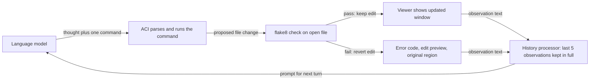
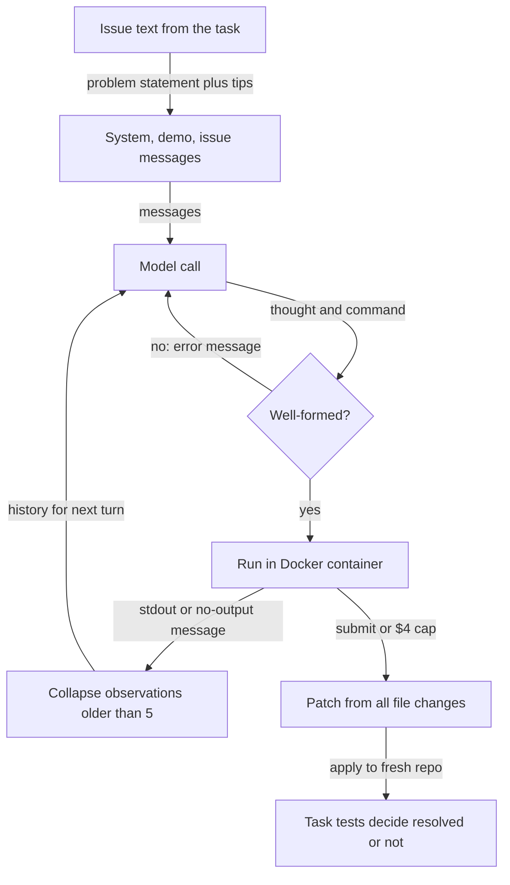

# SWE-agent: Agent-Computer Interfaces Enable Automated Software Engineering

> John Yang, Carlos E. Jimenez, Alexander Wettig, Kilian Lieret, Shunyu Yao, Karthik Narasimhan, Ofir Press (Princeton), 2024. arXiv v3, 11 Nov 2024 - [abstract](https://arxiv.org/abs/2405.15793) - [local PDF](../../papers/2405.15793.pdf)
>
> Table and figure numbers follow arXiv v3. The authors' in-text pointers are sometimes off by one table (noted where it matters), so check numbering against your copy.

## Read this first

**The claim in one sentence.** If you hold the language model fixed and redesign only the commands it can type and the text it gets back (the agent-computer interface, or ACI), it fixes far more real GitHub issues than when it is given a plain Linux shell.

**Who it is for.** Anyone deciding how to wire a model to tools, for code or for assistants that search and edit business documents. The key idea: what a tool prints back is part of the model's "user interface".

**Afterwards you can:** trace one episode command by command and say what the model saw; explain every ablation with its numbers; say which of the paper's four design principles its experiments test and which are only asserted; sketch a first ACI for a non-code domain and a leave-one-out experiment for it.

**Reading time:** about 40 minutes. **Have read first:** [SWE-bench](../03-evaluation-and-code/16-swe-bench.md) (the benchmark), [ReAct](../02-building/10-react.md) (the thought-then-action loop), ideally [HumanEval](../03-evaluation-and-code/14-humaneval.md). Stage neighbours: [Toolformer](24-toolformer.md), [CodeAct](25-codeact.md).

**The thing most people get wrong.** They read "SWE-agent beats the baseline" as "agents are good at software engineering". The headline is 18.0% on a 300-issue subset: about 82 of every 100 issues still fail. The real contribution is a controlled comparison of interfaces with the model held constant, plus a catalogue of failures. The causal evidence is narrower than the four "principles" suggest.

## The paper in one worked example

Appendix D walks through four full trajectories. This guide uses the first, a successful fix for the real issue `psf__requests-2317` in SWE-bench Lite (a 300-issue subset of SWE-bench). The order of actions comes from the paper's prose. The exact arguments and file text are in the paper only as an image I could not extract, so they are marked **reconstructed**. The *shapes* of observations (search results, file windows, lint errors) are copied from Figures 6 and 10, which are real. So this example is partly stitched together, and I say so rather than pass reconstructions off as quotes.

**The issue.** In the `requests` library a request method given as bytes (`b'GET'`) was turned by a helper, `builtin_str`, into the text `"b'GET'"`, so the server returned 404. It happened on Python 3.4 but not 2.6 (Appendix D).

Each turn the model writes a short *thought* and exactly one *command*; the system returns an *observation*.

| Turn | Command (arguments reconstructed) | What the model sees back |
|---|---|---|
| 1 | `find_file sessions.py` | Matching paths. The agent picked the one under `requests/`, not a copy under `build/`. Real format (Fig. 10): `Found 2 matches for "atmosphere.py" in /pvlib__pvlib-python/pvlib:` then one path per line. |
| 2 | `open requests/sessions.py` | A window of at most 100 numbered lines, framed by `(255 more lines above)` and `(180 more lines below)` (real format, Fig. 10), plus file path and total line count (Section 3). |
| 3 | `search_file builtin_str` | `Found N matches for "builtin_str" in <path>:` then `Line 428:<source text>` then `End of matches ...` (real format). The relevant line was 428. |
| 4 | `edit 428:428 <text> end_of_edit` | The viewer re-displays the edited region (Section 3). The change: if the method is `bytes`, decode it as ASCII before `builtin_str`. |
| 5-6 | `create reproduce_issue.py`, then `edit` to fill it | The new file shown back. The script sends a request with a bytes method and prints the status code. |
| 7 | `python reproduce_issue.py` | Terminal output: a 200 OK, so the fix works. |
| 8 | `rm reproduce_issue.py` | The fixed text `Your command ran successfully and did not produce any output.` Without it models run extra commands to check what happened (Appendix C). |
| 9 | `submit` | Every file change becomes a patch (the standard text format for code changes) and the episode ends. |

Nine commands is typical: the median solved trajectory on the full benchmark is 12 turns (Appendix B.3.1). SWE-bench then applies the patch to a fresh repository and runs the project's tests; this one passed. The paper adds a caveat: the human patch reused an existing helper, `to_native_string`, which the agent's code duplicated, so it "passes" but is less maintainable.

**The same moment in a plain shell** (commands reconstructed, failure modes quoted from Figure 6 and Section 5.1):

```text
$ grep -n "builtin_str" requests/sessions.py     <- every match, grep's own format
$ sed -i '428s/.*/  if isinstance(method, bytes): method = method.decode("ascii")/' requests/sessions.py
$                                                <- no output at all
$ sed -n '420,440p' requests/sessions.py         <- an extra turn just to check
```

Figure 6 shows this on another task (`sympy__sympy-24102`): the shell agent runs `cat` on a roughly 1,079-line file, then a `sed -i` with tricky quoting that prints nothing, then, confused, writes a Python script to patch the file.

**The lint step, real (Figure 6, same sympy task).** The agent edits a dictionary `_atom_conversions` on lines 1055-1059 of `parsing/mathematica.py` with `edit 1055:1059 [Code Snippet] end_of_edit`. Its replacement leaves two stray closing braces (lines 1060-1061). Without a linter the file is silently broken. With the linter the edit is blocked and the model receives (abridged from the figure):

```text
Your proposed edit has introduced new syntax error(s).
- E999 IndentationError
How your edit would have looked...   [file viewer with the edit applied]
The original code before your edit   [file viewer of the original]
Your changes have NOT been applied. Fix your edit command & try again.
```

The model answers that its edit adds an extra brace and re-issues `edit 1055:1060 [Code Snippet] end_of_edit`, which succeeds. The rest of this guide is about why these small differences (numbered viewer, echoing edit, lint veto) matter and how much.



Notice that the model never talks to the shell directly. What it sees is shaped twice: when the command runs (window, lint message, result cap) and when history is rebuilt (old observations collapsed).

## Words you need

| Term | Plain definition | Example from the worked example |
|---|---|---|
| Agent-computer interface (ACI) | The layer between model and computer: allowed commands and their documentation, the format of what each prints back, and the rules for what history is kept. | `open`, `search_file`, `edit`, `submit` and the "Found N matches" format. |
| Trajectory | The full record of one episode: prompts, every thought, command and observation. | The nine-turn table. |
| Observation | The text the environment returns after a command; the ACI controls its format. | `Line 428:...`, or the lint error block. |
| Resolved (% Resolved, pass@1) | A task counts as resolved only if all designated tests pass after the patch is applied. % Resolved = resolved tasks / all tasks, one attempt each. | 18.00% = 54 of 300 on Lite (Table 1). |
| SWE-bench / Lite | SWE-bench: 2,294 real issues from 12 Python repositories, each with tests that must go from failing to passing. Lite: a 300-issue subset of self-contained bug fixes. | `psf__requests-2317` is a Lite instance. |
| Shell-only baseline | An agent with ordinary Linux commands (`ls`, `cat`, `grep`, `sed`, `python`), adapted from the InterCode framework. | The grep/sed sequence above. |
| RAG baseline | Retrieval-augmented generation, non-interactive: BM25 keyword ranking picks files from the issue text and the model writes a patch in one shot. | 2.67% (GPT-4 Turbo) in Table 1. |
| Linter, guardrail | A linter checks code for errors without running it (`flake8` here). A guardrail is any rule that blocks a likely mistake before it spreads. | The E999 message that vetoed the sympy edit. |
| History processor | Code that decides how much of each past turn goes into the next prompt. | Observations older than 5 turns become one-line placeholders. |
| Demonstration | One full successful trajectory from a development task, shown first so the model sees correct usage. | "w/o demo." in Table 3. |

## Tutorial 1 - Intuitive understanding

### What was broken before

A model asked to fix a real bug was usually either given a few files and asked for a patch in one go (RAG: 2.67% on Lite with GPT-4 Turbo, 4.33% with Claude 3 Opus, Table 1), or given a bare terminal. In a terminal the paper reports (Sections 1, 5.1; Appendix A.1): `cat` floods the model's context with irrelevant lines; `grep` on a common word returns hundreds of lines; `cd`/`ls`/`cat` chains burn turns; `sed` edits are silent, and multi-line edits need carefully computed line numbers and indentation. A shell agent with the same GPT-4 Turbo and a demonstration still reached 11.00% on Lite, so interaction itself helps. The paper asks how much of the rest is the interface.

### The idea

Think of handing a new colleague a bare command line versus an IDE (integrated development environment, such as VS Code). Same person, but the file tree, search panel, line numbers and red squiggles make them faster and expose mistakes sooner. The authors argue a language model is a new kind of user, needing an interface built for it (Section 2).

The analogy breaks in three places. A human skims past clutter; for a model every token costs money and attention, so clutter harms. Humans use graphical interfaces; these models read text. And a human usability test is direct, while here the only "test" is a benchmark pass rate, which is slower, noisier and costs dollars.

The four principles (Section 2): (1) actions simple and easy to understand; (2) actions compact, consolidating common operations; (3) feedback informative but concise; (4) guardrails that limit error propagation. They came from reading agent behaviour on development tasks and a small grid search, not from a controlled study of each. "Adopt, adapt or skip" says which the ablations test.

### How it works, step by step

1. **System prompt.** Describes a command line with a file viewer, documents each command (Table 4), and requires one thought and one command per reply. Notes warn about indentation and that `vi` or an interactive `python` will not work (Appendix C).
2. **Demonstration and issue.** One successful development-set trajectory, then the issue text and hand-written tips. The tips were written after reading failed development runs (Appendix C).
3. **Localize.** `find_file`, `search_dir`, `search_file` narrow a repository to a line (turns 1-3 above). Each search caps at 50 matches and otherwise asks for a narrower query (Section 3).
4. **View.** `open` shows 100 numbered lines with "more above/below" counts; `scroll_down`, `scroll_up`, `goto` move the window. `edit` uses the same line numbers, so the model does no line arithmetic.
5. **Edit.** `edit n:m` replaces lines n to m, then the viewer shows the result. Python edits are linted first and discarded if they add selected syntax errors.
6. **Test.** `create` a reproduction script and `python` it. Create, edit, python is the most common triple in solved runs (Table 8; 156 occurrences in turns 1-3).
7. **Submit or stop.** `submit` builds the patch. A $4 per-task budget ends a run and submits what exists (Section 4).
8. **Trim history.** Before each turn, observations older than the last five become a one-line note giving the number of lines removed (Figure 31). Thoughts and commands stay, so the plan survives but stale file text does not.

### What the results say

Numbers are the paper's. One point on Lite is 3 of 300 tasks.

- **Full SWE-bench (Table 1).** SWE-agent with GPT-4 Turbo resolves 12.47% (286 of 2,294) at $1.59 average cost per resolved issue; the prior best (retrieval, Claude 3 Opus) got 3.79%. Meaning: about 9 more issues fixed per 100, roughly 3.3 times the old rate. With Claude 3 Opus: 10.46% at $2.59, so the design was not tied to its original model.
- **Lite (Table 1).** 18.00% (54 of 300) with GPT-4 Turbo, 13.00% with Claude 3 Opus, against 2.67% and 4.33% for RAG. Section 5 reports a 6.7-fold gain over RAG at 8 to 13 times the cost.
- **Against a shell, same model.** Shell-only with a demonstration: 11.00%. SWE-agent: 18.00%. That is 7 points (21 more tasks of 300), a 64% relative increase (Section 5). Without a demonstration the shell scores 7.33%. The introduction's "10.7 points more than the baseline" is 18.00 minus 7.33. This guide's reading: the like-for-like gap is 7 points (both with demonstration), or 9 points with neither (16.3 from Table 3 versus 7.33).
- **HumanEvalFix (Table 2).** The model must fix a short buggy function. 87.7 / 89.7 / 87.9 pass@1 for Python / JavaScript / Java versus 57.9 / 52.4 / 57.3 for the best listed alternative. Other rows are copied from another paper's setup.
- **Variance (Table 10).** Six runs of the main setup give 17.33 to 18.67 with mean 17.94. Pass@k rises from 17.94 (k=1) to 23.89 (k=2) and 32.67 (k=6): the average is steady, but about 15 per 100 more issues are solved by at least one of six runs than by an average single run.
- **Ablations (Table 3, Lite, GPT-4 Turbo, default 18.0).** No lint: -3.0. No integrated edit: -7.7. Iterative search: -6.0 (worse than no search, -2.3). 30-line window: -3.7; whole file: -5.3. Full history: -3.0. No demonstration: -1.7. Details in Tutorial 3.

### What this does not show

- Reliability. 52.0% of unsolved Lite runs are wrong or too-narrow fixes in the right area (Section 5.2).
- That these commands are optimal. The design came from reading a small set of development trajectories.
- Transfer. Ablations ran on GPT-4 Turbo only; open models (Llama 3, DeepSeek Coder) were tried and found subpar in the agent setting (Section 4), Llama 3 partly for its 8k context.
- How much is ACI versus interaction itself. RAG to shell is 2.67 to 11.00; shell to SWE-agent is 11.00 to 18.00.
- That passing tests means a good fix. In the pylint example the agent's regex differs from the human one and may misbehave on inputs the tests do not cover (Appendix D).

### Teach-back

**1. What is an ACI, and what is it not?**

<details>
<summary>Answer</summary>

Everything between model and machine: allowed commands and documentation, the format of what each prints, and rules for the history in the next prompt. Not the model (held fixed) and not the operating system. It is more than "tools": history collapsing and error messages count.
</details>

**2. Why does `edit` take line numbers, and why does the viewer print them?**

<details>
<summary>Answer</summary>

So the model reads a number off its last observation and reuses it, without computing ranges or counting lines. Appendix A.1 calls this reducing arithmetic: one command's output is the next command's input.
</details>

**3. Why is "10.7 points" a less clean comparison than "7 points"?**

<details>
<summary>Answer</summary>

10.7 is 18.00 minus the shell's no-demonstration score (7.33), so it credits SWE-agent's demonstration while the shell's headline run (11.00) had one too. 7 points compares like with like.
</details>

**4. What is surprising about iterative search?**

<details>
<summary>Answer</summary>

One-result-at-a-time search with `next` and `prev` (12.0%) did worse than no search tool (15.7%): agents step through every match until budget or context runs out. A tool can be worse than none if its shape invites waste.
</details>

## Tutorial 2 - Practitioner understanding

### The design in concrete terms

**Commands (Table 4).** Ordinary shell remains available.

| Group | Command | Documentation shown to the model |
|---|---|---|
| Viewer | `open <path> [<line>]`; `goto <line>` | Open a file, window moves to include the line; jump to a line. |
| | `scroll_down`, `scroll_up` | Move the window 100 lines (the table text swaps "up"/"down", an apparent typo). |
| Search | `search_file <term> [<file>]`; `search_dir <term> [<dir>]`; `find_file <name> [<dir>]` | Search open file, directory text, or file names. |
| Edit | `edit <n>:<m> <text> end_of_edit`; `create <filename>` | Replace lines n to m inclusive. Warns that text is entered verbatim and Python is syntax-checked first. |
| Task | `submit` | Build patch, close shell. |

**Fixed numbers.** Window 100 lines; search cap 50 results; last 5 observations in full; budget $4; temperature 0.0; one demonstration. The window, history and temperature came from a sweep on 37 development instances (Table 5).

**The lint command (Appendix A.1).** After an edit is applied:

```text
flake8 --isolated --select=F821,F822,F831,E111,E112,E113,E999,E902 "$CURRENT_FILE"
```

F821/F822: undefined names; F831: duplicate function argument; E111/E112/E113: indentation; E999: syntax error; E902: unreadable file. No output keeps the edit; any output reverts it and the model sees the error type, how the file would have looked, and the original region. The authors say dropping any of the three parts hurt during development (no error type: misdiagnosis; no changed snippet: repeated commands; no original: reliance on stale turns). That is qualitative, not an ablation. The design assumes original code is well-formed. It also has a cost the paper admits: it forces some edits into a particular order (Figure 11 discussion).

**Prompt flow (Figure 26, Appendix C).** System message (never collapsed), demonstration, issue plus tips. Each turn returns command output, the fixed "no output" message, or a format error. Three reply formats were tried: markdown code block, JSON with `thought` and `action`, XML-style delimiters. A malformed reply followed by a valid one is deleted from history. The text says three consecutive malformed replies end the episode; Figure 26 says two or more; I could not tell which is right.

**Configuration (Appendix A.3).** An ACI is one YAML file naming prompt templates, command files (Bash or Python functions with signature and docstring, compiled into the system prompt), a response parser, a history processor and initial environment variables. Viewer state (current line) lives in shell variables shared by commands. Each task runs in its own Docker container.



Notice the tests at the bottom are outside the agent: it never sees the hidden tests, only what it ran itself.

### A minimal version

A compressed sketch of the windowed viewer, linted edit and history collapse (shapes in comments). It omits format retries, demonstration, `find_file`, `scroll_*`, `create` and the sandbox.

```python
import subprocess
WINDOW, KEEP_FULL = 100, 5
state = {"file": None, "line": 1}               # viewer state shared by commands
LINT = ["flake8", "--isolated", "--select=F821,F822,F831,E111,E112,E113,E999,E902"]

def view():                                     # -> str the model sees
    L = open(state["file"]).read().split("\n")
    lo = max(0, state["line"] - WINDOW // 2); hi = min(len(L), lo + WINDOW)
    return "\n".join([f"({lo} more lines above)"]
        + [f"{i+1}:{L[i]}" for i in range(lo, hi)] + [f"({len(L)-hi} more lines below)"])

def open_file(path, line=1):                    # open <path> [<line>]
    state.update(file=path, line=int(line)); return view()

def edit(n, m, text):                           # edit n:m <text> end_of_edit
    p = state["file"]; old = open(p).read().split("\n")
    open(p, "w").write("\n".join(old[:int(n)-1] + text.split("\n") + old[int(m):]))
    err = subprocess.run(LINT + [p], capture_output=True, text=True).stdout
    state["line"] = int(n)
    if err:                                     # veto: restore, show before and after
        after = view(); open(p, "w").write("\n".join(old))
        return ("Your proposed edit has introduced new syntax error(s).\n" + err +
                "How your edit would have looked...\n" + after +
                "\nThe original code before your edit\n" + view() +
                "\nYour changes have NOT been applied. Fix your edit command & try again.")
    return view()                               # success: echo the updated window

def collapse(h):                                # h = [(thought, cmd, obs)]
    cut = len(h) - KEEP_FULL
    return [(t, c, o if i >= cut else f"Old output omitted ({o.count(chr(10))+1} lines)")
            for i, (t, c, o) in enumerate(h)]

def episode(llm, issue, tools, budget=4.0):     # tools: name -> function(*args) -> str
    h, spent = [], 0.0
    while spent < budget:
        reply, price = llm(issue, collapse(h)); spent += price
        thought, cmd, args = parse(reply)       # parse() -> (str, str, list)
        if cmd == "submit": break
        h.append((thought, cmd, tools[cmd](*args) or
                  "Your command ran successfully and did not produce any output."))
    return subprocess.run(["git", "diff"], capture_output=True, text=True).stdout
```

### What it costs

The paper reports dollars, averaged over resolved instances only (Section 4): $1.67 (Lite) and $1.59 (full) with GPT-4 Turbo, $2.18 with Claude 3 Opus on Lite, $0.13 for RAG (Table 1). Solved runs had median cost $1.21 over 12 steps; unsolved averaged $2.52 over 21 steps (Section 5.2). Latency is not reported.

Three calculations by this guide, not the paper:

- **Per turn.** $1.21 / 12 is about $0.10; $2.52 / 21 is $0.12. At an assumed 2024 price near $10 per million input tokens that is about 10,000 input tokens per turn, plausible for a 4,000-token prefix plus recent observations.
- **Why collapsing pays.** Assume a 4,000-token prefix, 900-token observations, 150-token commands, 20 turns. Full history sums to 20 x 4,000 + 1,050 x (0+...+19) = about 280,000 input tokens (about $2.80). Last-5 collapsing with 30-token placeholders sums to about 190,000 (about $1.90), around 30% less. The paper does not report cost for its full-history ablation, but it does show 3.0 fewer points, so there is a double benefit.
- **True cost per solved issue.** The paper's average ignores spend on failures. Treating the full-benchmark means as indicative for Lite: 54 solved at $1.67 plus 246 unsolved at $2.52 is about $710, or roughly $13 per solved issue. Valid only if Lite's unsolved mean matches.

### How it fails

From Appendix B.4 (nine categories; 248 unresolved Lite trajectories labelled by GPT-4o, 87% agreement on a 15-instance hand check) and Sections 5.1-5.2.

| Symptom | Likely cause | Mitigation |
|---|---|---|
| Plausible patch, wrong or too narrow (52.0% of unresolved) | Shallow understanding; verified only against its own reproduction script | Not solved in the paper. Guide: run the existing suite, review the diff. |
| Edit loops (23.4% of unresolved) | Syntax error stacked on syntax error | Lint veto. 51.7% of full-benchmark runs still have 1+ failed edit; eventual success falls from 90.5% to 57.2% after one (Section 5.2). |
| Scrolling a huge class until budget ends (sympy-21614) | Speculative early searches | Search the obvious string first (`class Derivative`); symbol-level navigation is untested. |
| Submit without testing (django-14411) | Agent assumed it could not run the server | Tips; an "always run something" rule. Not measured. |
| Out of budget | $4 cap, long files | Authors suspect a larger cap helps little: 93.0% of resolved runs end before the cap. |
| Wrong file never opened | Search miss | File-level F1 against the human patch is 59.05% versus 45.47% for BM25 with Claude 3 Opus (B.9). |
| Bloated patches | Reproduction code left in | Agents `rm` their scripts. Median 12 added lines versus 7 for human patches (Table 11, GPT-4 Turbo, all tasks). |

### Evaluating your version

- **Metric.** Resolved rate on held-out tasks with an automatic verifier; report total spend divided by resolved count, not the paper's resolved-only average.
- **Size and noise.** At 18% on 300 tasks the binomial standard error is sqrt(0.18 x 0.82 / 300) = 2.2 points (this guide's calculation). A 3-point difference scored as two independent single runs is not safe; the paper reports no paired test. Use 300+ tasks and 3+ repeats per arm.
- **Baseline.** Always run your own raw-tool arm (generic read and search) with the same model, prompt and demonstration. The 7-point gap exists only because that arm was run.
- **Stop rule.** Call a change helpful only if the mean over 3+ repeats beats the run-to-run spread (about 0.5 points in Table 10) without cost per resolved task rising more than the gain. Stop after two consecutive changes fail.
- **Leave-one-out.** Copy Table 3: from the best configuration, swap one component at a time.

### Adopt, adapt or skip

**For a team building an assistant over private business documents: adapt the method, skip the specific tools, and adopt only the principles the measurements support.**

What the ablations support, principle by principle:

| Principle | Test in the paper | Verdict |
|---|---|---|
| 4. Guardrails | Lint on/off, -3.0 (Table 3); recovery statistics (associational) | Supported. Cleanest ablation. |
| 2. Compact actions | No integrated edit, -7.7; iterative versus summarized search, -6.0 | Supported but bundled: the edit ablation mixes line-range addressing, multi-line edits, echo and viewer integration. |
| 3. Informative but concise feedback | Window 30/100/whole file; full versus last-5 history; viewer echo inside the edit ablation | Partly supported for size and history. "Echo" is never isolated. The three-part lint message and the "no output" message are justified only by development observation. |
| 1. Simple actions, few options | None | Untested. Asserted from observation. No arm varies command simplicity or tool count. |

Also untested: tool-description wording and tips; the 50-result cap alone; any model other than GPT-4 Turbo; any non-code domain; interactions between components.

Adopt: validate writes before they land and return the error with a before/after preview; consolidate common multi-step operations into one command that echoes the new state; bound what tools return (window, result cap); do not offer a result-by-result iterator.

Adapt: a document ACI might be `find_doc`, `search_docs` (capped, with a refine message), `open_doc <id> [page]` (a window with "N more above/below"), `draft_edit` (validated against a schema or style rules, with preview) and `submit` for human review. These mirror the paper's groups, but none was tested. A silent bad write is costlier with business documents, so make the veto mandatory.

Skip: flake8, Python-specific checks and the container-per-task design as such; and any claim that a thin runtime beats a thick one. SWE-agent was never compared with planners, multi-agent systems, learned verifiers or heavy retrieval.

**The stage's through-question** (is a thin runtime around a model that picks among a few good tools the right architecture?). This is the strongest direct evidence in the stage that tool and feedback quality is a major lever: 11.00 to 18.00 for the same model. It does not show the tool count should be small, nor that thin suffices at scale, nor that the gap persists for much stronger models. Carry those open questions into [Dive into Claude Code](28-dive-into-claude-code.md), [Context as a Tool](30-context-as-a-tool.md) and the [survey](27-agentic-tool-use-survey.md).

## Tutorial 3 - Researcher understanding

### Formal setup

An episode on task x (issue plus repository) runs turns t = 1..T. s_t is environment state (files, current viewer line, shell variables). A is the command set; a_t in A is the command at turn t, with thought z_t. O(s_t, a_t) is the observation text from the ACI's output templates. H is the history processor: the prompt is p_t = H(system, demo, x, (z_1, a_1, o_1), ..., (z_{t-1}, a_{t-1}, o_{t-1})), where here H replaces o_i by a one-line placeholder when i < t - 5. The model pi, at temperature 0.0, samples (z_t, a_t) from p_t. An ACI is the triple (A, O, H) plus prompts; the paper fixes pi and varies the triple. R(x, patch) is 1 if all designated tests pass; % Resolved = 100 x mean of R over N tasks. Cost is summed call price; stop on submit, a $4 cap, or repeated format errors.

Toy instance: N = 300; default 54 resolved = 18.0%. Without lint 45 = 15.0%, a -3.0 change (9 tasks). Whole-file viewer 38 = 12.7%, -5.3 (16 tasks). Counts are derived from Table 3 percentages.

### The claims, stated precisely

1. SWE-agent with GPT-4 Turbo resolves 12.47% of SWE-bench and 18.00% of Lite at pass@1, versus a prior best of 3.8% (Table 1).
2. With GPT-4 Turbo and a demonstration, shell-only reaches 11.00% on Lite versus 18.00% (64% relative; Section 5).
3. Each departure in Table 3 lowers % Resolved on Lite with GPT-4 Turbo (values in Tutorial 1).
4. The interface gives 10.46% and 13.00% with Claude 3 Opus. Not ablated for that model.
5. Solved runs follow reproduce, localize, edit-run loops, and succeed earlier and cheaper than failures (Section 5.2). Descriptive.
6. HumanEvalFix pass@1 is 87.7 / 89.7 / 87.9 (Table 2).
7. Four principles explain this (Section 2). The authors' interpretation; only partly tested (see the table above).

### Evidence, table by table

**Table 1.** Rows: RAG (two models), shell-only (GPT-4 Turbo with and without demonstration, Lite only), SWE-agent (two models); columns: % Resolved and average cost on full and Lite. *Identifies:* the gain of interaction with the paper's ACI over one-shot retrieval and over a shell, same model. *Only associates:* why, since the shell arm differs in every component at once and was not run on the full benchmark. (Section 5's "Table 3" refers to this table.)

**Table 2.** SWE-agent 87.7 / 89.7 / 87.9 versus 57.9 / 52.4 / 57.3 for the best listed model. Other rows come from another paper and harness. The prose says 88.3% pass@1; the mean of the three is 88.4, so I could not reproduce 88.3. No repository navigation is needed, so this tests editing and checking, not search.

**Table 3.** Each cell is % Resolved on Lite with GPT-4 Turbo, one component changed. The paper does not say how many runs back each cell. *Identifies* the effect of swapping one component at the default setting, for this model and benchmark. *Does not identify* interactions or other models.

**Table 5.** 37 development instances, mean of 5 samples. GPT-4 Turbo: 15.1 at (temperature 0.0, window 100, last-5); 14.1 with full history; 10.8 and 9.2 at window 200; 12.4 and 10.8 at temperature 0.2, window 100. Claude 3 Opus is lower and flatter: best 8.1, shared by three settings. One instance is 2.7 points, so one-point gaps are noise; the 15.1 versus 9.2 gap is more credible.

**Tables 6-7.** On Lite, GPT-4 Turbo SWE-agent gets 26.32% on django (114 tasks), 10.39% on sympy (77), 0% on flask (3). Several repositories have single-digit counts, so those rows say little. No clear trend by creation year (2023: 23.33% of 30; before 2020: 17.14% of 105), which the authors read as evidence against contamination; it shows no age effect, not that the repositories were unseen.

**Table 8, Figures 7 and 22-24.** Counts of action patterns in solved runs only (create, edit, python: 156 in turns 1-3). They describe successful runs; they do not show a pattern causes success.

**Table 9, Figure 8.** GPT-4o labels 248 unresolved Lite runs: 52.0% incorrect or overly specific, 23.4% failed edit recovery. Validation used 15 hand-labelled instances (87% is 13 of 15). Also 300 minus 54 solved is 246, not 248; the paper does not explain the gap.

**Table 10.** Six runs: 17.33, 18.00, 18.00, 18.67, 17.33, 18.33, mean 17.94 (spread 0.49). Pass@k for k = 1..6: 17.94, 23.89, 27.35, 29.67, 31.33, 32.67. Large per-instance variance behind a stable mean.

**Table 13 and Section 5.2 edit statistics.** On the full benchmark with GPT-4 Turbo, 266 solved runs ended by `submit` and 20 by hitting the cost cap. From the table, 20 of 630 cost-cap endings are resolved (3.2%) against 266 of 1,589 submit endings (16.7%); the text says 3.1% and 14.3%, and I could not reproduce 14.3. The 90.5% to 57.2% recovery drop is observational: harder tasks plausibly cause both more failed edits and more failures.

### Ablations and what they isolate

Lite, GPT-4 Turbo, versus default 18.0 (3 tasks per point).

| Ablation | Result | What it changes | What it isolates, and what stays confounded |
|---|---|---|---|
| Edit without lint | 15.0 (-3.0) | Removes veto and preview; one-command edit and echo remain | Guardrail alone. Cleanest. 9 tasks. |
| No `edit` (shell `sed`, redirects) | 10.3 (-7.7) | Replaces consolidated, echoing, line-range editing | Bundles line-range addressing, multi-line edits, echo and viewer integration. Largest effect (23 tasks). |
| Iterative search instead of summarized | 12.0 (-6.0) | One hit at a time with `next`/`prev` instead of all hits plus refine hint | Bundles format, cap and interaction style; iterative also shows surrounding lines per hit. |
| No search tool | 15.7 (-2.3) | Shell `grep`/`find`/`ls` only | Summarized search adds 2.3 points. Guide's inference: 15.7 is 4.7 above shell-only (11.00), so about two thirds of the shell-to-SWE-agent gap survives without search commands and viewer, edit and history carry most of it. The paper runs no such decomposition. |
| Window 30 lines | 14.3 (-3.7) | Smaller window | More scrolling turns. |
| Whole file | 12.7 (-5.3) | Viewer prints entire file | Equivalent to `cat` flooding. Only three sizes tried; the dev sweep (Table 5) also found 200 lines worse than 100. |
| Full history | 15.0 (-3.0) | Keeps old observation text | Mixes cost, distraction and staleness; not separated. Table 5 agrees: 14.1 versus 15.1. |
| No demonstration | 16.3 (-1.7) | Removes example | Smallest; plausibly inside noise (about 5 tasks). The shell agent loses 3.67 (11.00 to 7.33), suggesting the ACI reduces dependence on examples. This guide's inference from two rows. |

All are one-at-a-time swaps from a configuration tuned on development tasks with GPT-4 Turbo, so interactions are invisible.

### Threats to validity specific to this paper

- **Design by observation.** Commands, prompts and tips came from reading development trajectories of the same kind of task used for evaluation. A development split limits direct leakage but the interface may encode SWE-bench habits (Python, issue-style text).
- **Baseline asymmetry.** RAG is cheap and non-interactive, so "6.7-fold at 8-13 times the cost" needs the cost caveat. The shell baseline was not tuned like the ACI, ran only on Lite with GPT-4 Turbo, and a shell with a few helper scripts (say a `view` script) might close part of the 7 points; not tested.
- **Small samples.** 54 successes on Lite, single-number ablation cells, a 37-task sweep, a 15-instance labeller check.
- **Cost metric.** Averaged over resolved instances only.
- **Contamination.** The models probably saw these open-source repositories; the year analysis cannot rule that out.
- **Test-based success.** Narrow fixes can pass (pylint example).
- **Model dependence.** GPT-4 Turbo is the only ablation model; Claude 3 Opus prefers different settings; everything is a 2024 snapshot.
- **No human study** despite the HCI framing: "LM-friendliness" is judged only by benchmark outcomes.

### Open problems and follow-ups

Automating ACI design instead of manual trajectory reading (Section E.3). Better verification, since 52.0% of failures are fixes the agent believed correct. Late-turn recovery: success concentrates in the first 10-20 turns and agents keep editing locally rather than rethinking (B.3.2). Other domains: web shopping, data analysis, enterprise knowledge-base search (E.3). Training on ACI-shaped trajectories to cut the need for demonstrations and tips, mentioned but not tested.

### What would change my mind

I would doubt that interface design is the main lever if (a) a shell with three or four helper scripts and no lint or history trimming closed most of the 7-point gap over six runs on the same 300 tasks; (b) the ordering vanished with a stronger model; or (c) the lint and viewer effects fell below the 0.5-point run-to-run spread when repeated. I would believe "fewer, simpler actions" matters only given an experiment the paper lacks: one capability exposed through a small versus a large command set.

## Reading map for the PDF

| Section or figure | What it contains | First pass | Answered in |
|---|---|---|---|
| Abstract, Section 1 | ACI idea, headline numbers | Read | Teach-back 3 |
| Section 2 | Four principles | Read | Adopt, adapt or skip |
| Section 3, Figures 3 and 10 | Search, viewer, editor, context | Read; study Fig. 10 | Worked example |
| Section 4, Table 1, Section 5 | Setup, main results | Read | Tutorial 1 results |
| Table 3, Section 5.1, Figures 5-6 | Ablations | Read closely | Tutorial 3 ablations |
| Section 5.2, Figures 7-8 | Behaviour, failures | Read | How it fails |
| Appendix A (Table 4, Fig. 11-13) | Commands, lint, config | Read A.1; skim A.3 | Tutorial 2 |
| Appendix B (Tables 5-13) | Sweep, repositories, patterns, variance | Skim; read B.4 | Evidence by table |
| Appendix C (Fig. 26-32) | Every prompt template | Read text | Prompt flow |
| Appendix D (Fig. 33-36) | Four full trajectories | Read | Worked example |
| Sections 6-7, Appendix E | Related work, ethics, limits | Skim E.3 | Open problems |

## Questions readers get stuck on

### Is SWE-agent a new model, or a prompt?

Neither. It is a program around an existing model with no weight changes (Section 1): a command set, output formats, a lint check, a history rule and prompts. The model's behaviour changes because its inputs and available actions change.

### Why do 12.47% and 18.00% both appear?

They are the same system on different sets. 12.47% is all 2,294 tasks (286 solved); 18.00% is the 300-task Lite subset (54 solved), which is easier. Never compare one with the other system's number on the other set.

### Why did iterative search lose to having no search tool?

It shows one match per call and models tend to walk through every match until budget or context runs out (Section 5.1). Without it they use `grep` and `ls`, wasteful but self-limited. The 15.7 to 12.0 drop concerns interaction style, not whether search helps; summarized search scored 18.0.

### Why not give the model a full IDE or a Python REPL?

The authors say current models cannot operate graphical interfaces (Section 2), and interactive programs such as `vi` or an interactive `python` do not work in their container (Appendix C). A code-as-action design is the subject of [CodeAct](25-codeact.md); the paper does not compare against it.

### Is lint just syntax checking? Why three points?

It checks only a short list of errors. It helps because one broken edit leaves a file the model cannot easily diagnose, and its next edits compound the damage. Even with lint, 23.4% of unresolved Lite runs are edit loops (B.4). The 3.0 points (9 tasks) is the saving on top of the other features.

### Why 10.7 points in the introduction and 64% in Section 5?

Different baselines. 10.7 is 18.00 minus 7.33 (shell without demonstration); 64% is (18.00 - 11.00) / 11.00 with the shell given a demonstration. The second is like-for-like.

### Is $1.67 what one fix costs?

No. It is the API cost averaged over resolved instances only (Section 4), excluding spend on failures. Under this guide's arithmetic the all-in cost per solved Lite issue is near $13, about eight times higher.

### Does "agents succeed quickly and fail slowly" justify early stopping?

It is an association: solved runs took a median 12 steps and $1.21, unsolved a mean 21 steps and $2.52, and 93.0% of solved runs ended before the cap (Section 5.2). It does not show that cutting long runs helps. It does support the authors' suspicion that a bigger budget would add little.

### Does the demonstration carry the result?

No. It teaches syntax and reply format (Appendix C); the authors doubt it teaches domain problem solving. Removing it costs 1.7 points for SWE-agent (Table 3) and 3.67 for the shell agent.

## Prerequisites you actually need

### Prerequisite 1 - The act-observe loop

A model as agent repeats: read history, write thought and action, receive an observation. Tiny example: action `find_file sessions.py`, observation two paths, next action `open` on one. Every ACI component shapes the action list or the observation text. Used in Sections 2-3. See [ReAct](../02-building/10-react.md).

### Prerequisite 2 - Tests as the definition of "fixed"

Each SWE-bench task has tests that fail before the human fix and pass after (fail-to-pass), plus existing tests that must keep passing. If 54 of 300 patches pass both groups, % Resolved is 54 / 300 = 18.0. Used in Section 4 and every results table. See [SWE-bench](../03-evaluation-and-code/16-swe-bench.md).

### Prerequisite 3 - Context, tokens and cost

Each turn the model re-reads the whole prompt and is billed for it. A prompt growing 1,000 tokens per turn costs, over 20 turns, about 1,000 x 19 x 20 / 2 = 190,000 extra input tokens, so trimming history saves money as well as space. Used in Section 3, Table 3, Appendix B.1. See [Context as a Tool](30-context-as-a-tool.md).

### Prerequisite 4 - Pass@k and sampling noise

Pass@1 is one attempt's success rate; pass@k is the chance at least one of k attempts succeeds. Table 10: six runs average 17.94% each, yet pass@6 is 32.67%. A one-or-two-point difference between single runs is weak evidence. Used in Section 5 and B.5. See [HumanEval](../03-evaluation-and-code/14-humaneval.md).

## Where this sits in the curriculum

**Before:** [SWE-bench](../03-evaluation-and-code/16-swe-bench.md), [ReAct](../02-building/10-react.md), [Toolformer](24-toolformer.md) (tool calls learned in training) and [CodeAct](25-codeact.md) (acting by writing executable code).

**Nearest papers.** Against ReAct, SWE-agent adds no reasoning pattern; its novelty is the observation side (what returns and how it is trimmed). Against CodeAct, which lets the model compose operations in code, SWE-agent prebuilds a few consolidated commands; the paper does not compare the two. Against Toolformer, nothing is trained: tool quality is a lever independent of weights.

**Next.** The [agentic tool use survey](27-agentic-tool-use-survey.md) places this among many designs; [Dive into Claude Code](28-dive-into-claude-code.md) lets you compare a production agent's tools with Table 4; [Context as a Tool](30-context-as-a-tool.md) turns history collapsing into something the model controls.

## Checkpoint

**1. Explain: which differences between the shell and SWE-agent versions of turns 3-4 correspond to principles 2, 3 and 4?**

<details>
<summary>Answer</summary>

Compactness: one `edit n:m` replaces several `sed` calls and a check. Informative feedback: the viewer re-displays the edit where `sed` printed nothing. Guardrail: the lint veto reverts a broken edit and returns the error with a preview.
</details>

**2. Compute: whole-file 12.7% versus default 18.0 on 300 tasks. How many tasks, and what is the one-run standard error at 18%?**

<details>
<summary>Answer</summary>

38 versus 54 tasks, a difference of 16. Standard error sqrt(0.18 x 0.82 / 300) = about 2.2 points, so 5.3 points is about 2.4 standard errors if the arms were independent. Paired scoring is tighter but the paper reports no paired test.
</details>

**3. Compute: roughly what does one solved Lite issue cost, given $1.67 per solved and $2.52 per unsolved run?**

<details>
<summary>Answer</summary>

54 x 1.67 = about $90; 246 x 2.52 = about $620; total about $710; divided by 54 is about $13. Assumes the reported unsolved mean applies to Lite.
</details>

**4. Critique: "Table 3 proves simple actions work better for agents."**

<details>
<summary>Answer</summary>

No ablation varies command simplicity or tool count. Table 3 varies editing, search shape, window, history and demonstration. Consolidation and feedback are partly supported; "simple and easy to understand" is untested.
</details>

**5. Critique: why can the paper not claim a thin runtime beats a thick one?**

<details>
<summary>Answer</summary>

Every arm is a thin loop. It compares a thin loop with a poor interface against one with a good interface, and against one-shot retrieval. It never tests planners, multi-agent systems, learned verifiers or heavy retrieval pipelines.
</details>

**6. Design: for an assistant over internal documents, name three ACI choices to carry over and the first experiment.**

<details>
<summary>Answer</summary>

Capped, summarized search with a "narrow your query" fallback; a windowed viewer with "N more above/below"; validated writes with preview and revert. First experiment: Table-3-style leave-one-out on 300+ tasks with 3 repeats, against a raw read-and-search arm with the same model, reporting total spend divided by resolved count.
</details>
