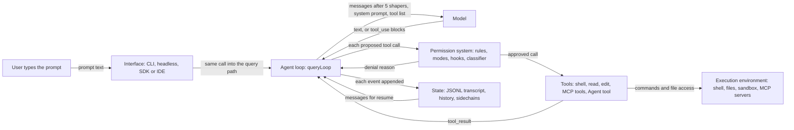
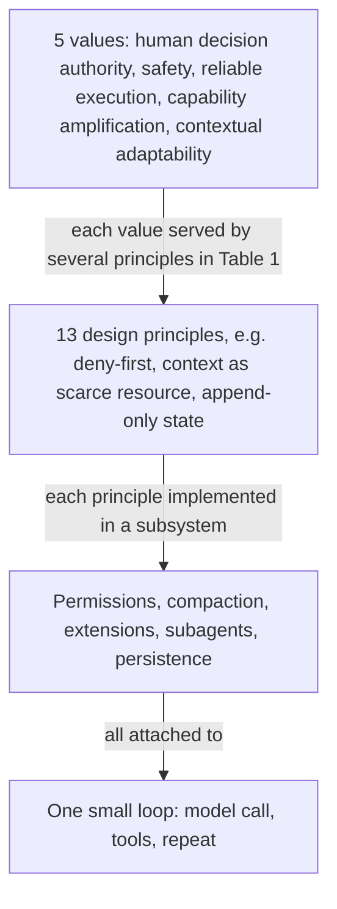

# Dive into Claude Code: The Design Space of Today's and Future AI Agent Systems

> **Paper:** Jiacheng Liu, Xiaohan Zhao, Xinyi Shang, Zhiqiang Shen (VILA Lab, Mohamed bin Zayed University of Artificial Intelligence, and University College London), 2026, cs.SE - [arXiv abstract](https://arxiv.org/abs/2604.14228) - [local PDF](../../papers/2604.14228.pdf)
>
> **Version note:** this guide follows the arXiv HTML rendering of version 3 (dated 10 Oct 2026). If your local PDF is an earlier version, section numbers may differ slightly.

## Read this first

**The claim in one sentence.** By reading the publicly available TypeScript source of Claude Code (version 2.1.88), the authors argue that the heart of the product is a small loop in which a model asks for tools and the program runs them, while most of the code is the machinery around that loop: permissions, context management, extension points, subagents and session storage.

**Framing you must keep in mind.** This is a third-party analysis by academics, not Anthropic staff. The code came from a publicly available npm package extraction (Appendix, "Evidence Base"); Anthropic publishes user documentation but no architecture document of this kind. The paper is a recent preprint, not peer reviewed, and it is not Anthropic documentation. Nothing in it was measured by running Claude Code. Its own limitations say that source code cannot confirm design intent, enabled production flags, runtime prevalence or unshipped behavior (Appendix, Limitations). "The paper says" below marks the authors' claims; "this guide infers" marks my reasoning.

**Who it is for.** Anyone deciding how to build, buy or evaluate an assistant that takes actions, and anyone answering this stage's through-question: is a thin runtime around a model that chooses among a few high-quality tools the right architecture for assistants like Claude Code or ChatGPT? This is the most direct evidence in the curriculum, and its answer is more nuanced than the question: the decision logic is thin, the runtime is not.

**Afterwards you can:** name the components and the paper's counts (7 components, 5 layers, 13 principles, 7 permission modes, 5 compaction layers, 4 extension mechanisms, 27 hook events); trace one request through them; compare Claude Code with OpenClaw and Hermes Agent; and say which claims are code-verified and which are estimate or inference.

**Reading time:** about 50 minutes. **Have read:** [ReAct](../02-building/10-react.md) (the loop the paper says Claude Code follows), [SWE-bench](../03-evaluation-and-code/16-swe-bench.md), and [Interoperability](../04-agents-and-protocols/21-interoperability.md) (the Model Context Protocol, MCP). Stage background: [Toolformer](24-toolformer.md), [CodeAct](25-codeact.md), [SWE-agent](26-swe-agent.md), [agentic tool-use survey](27-agentic-tool-use-survey.md).

**The one thing most people get wrong.** They read "the core is a simple while-loop" as "Claude Code is simple". The paper says the loop is simple and "most of the code" is elsewhere. The figure "1.6% AI decision logic, 98.4% operational infrastructure" is also not the authors' measurement: they attribute it to community analysis (Section 3.1) and repeat it as an estimate (Section 12.1).

## The paper in one worked example

The paper threads one request through Sections 3 to 9: **"Fix the failing test in auth.test.ts"** (Section 1). It names only some moments itself: the prompt enters through an interface; the model asks to run `npm test` via the shell tool and the permission system mediates it (Section 5); MCP tools, a custom skill and plugin tools are on offer (Section 6); state is packed into the context window (Section 7); exploring the authentication module is delegated to a subagent (Section 8); the session is persisted (Section 9). The file contents, test output and numbers below are **constructed by this guide**; the component handling each step and the rule it follows are from the paper.

**Setup (constructed).** A developer runs Claude Code in an interactive terminal. The project's `CLAUDE.md` says "run tests with npm test". One test fails because it expects a login token to last 3600 seconds while the code sets 360.

| # | What happens | Component (paper) | Inputs and outputs in this trace |
|---|---|---|---|
| 1 | Developer types the prompt. | Surface layer, interactive CLI (3.3). All surfaces feed one loop. | "Fix the failing test in auth.test.ts" |
| 2 | Context is assembled and the tool pool built. | `getSystemContext()` (git status), `getUserContext()` (`CLAUDE.md` hierarchy, date) (3.3, 7.1); `assembleToolPool()` strips blanket-denied tools (6.2). | Model sees system prompt, git status, "run tests with npm test" as a user message, tool list. |
| 3 | Five pre-model shapers run. | Budget reduction, snip, microcompact, context collapse, auto-compact (4.3). | Turn 1 has little to shrink; all pass through. |
| 4 | Model streams a reply with two tool requests. | `queryLoop()` calls the model (4.1); the model emits `tool_use` blocks and never touches files itself (3.1). | Read `auth.test.ts`; run `npm test`. |
| 5 | Read is concurrency-safe, shell is serialized. | `StreamingToolExecutor` (4.2). | Read may run in parallel; shell waits its turn. |
| 6 | Permission gate evaluates `npm test`. | Pre-filter, PreToolUse hook, deny-first rules, permission handler (5.2). Mode `default`: unmatched risky call asks (5.1). | Dialog; developer approves and keeps it as a rule (Figure 4, progressive trust). |
| 7 | Command runs, inside the sandbox if enabled. | `BashTool`, `shouldUseSandbox()` (5.4). | 1 failed, 41 passed, 600 lines of log. |
| 8 | Result appended; oversized log replaced by a reference. | Budget reduction (3.6, 4.3); PostToolUse hooks (5.3). | Log trimmed to reference plus failing assertion. |
| 9 | Loop continues; model delegates exploration. | Agent tool starts an isolated subagent; history goes to a sidechain file (8.1, 8.3). | Summary returns: "expiry set in src/session.ts line 41 as 360". |
| 10 | Model asks to edit `src/session.ts`. | Permission gate again; `acceptEdits` would auto-approve edits in the working directory (5.1). | Developer approves; 360 becomes 3600. |
| 11 | Model reruns `npm test` (saved rule from step 6 passes it; a deny rule would still win, 5.1), then replies with text only. | Stop condition "no tool use" (4.5); a Stop hook could force continuation (Figure 5). | 42 pass. Final message: cause was a typo in the expiry constant. |
| 12 | Everything is recorded. | Append-only JSONL transcript (9.1); `--resume` later rebuilds the conversation but not permission grants (9.2). | Prompt, calls, results, subagent summary, compaction markers. |

If a deny rule had matched at step 6, the model would receive the denial reason and try a safer alternative next iteration, instead of the run halting (Section 5.2).



Notice that the loop is one box of seven and the model box has only two arrows: it receives a prepared context and returns text or tool requests. Every effect on the outside world passes through the permission and tool boxes, which is the safety argument of Section 3.1. This is the paper's Figure 1 in my labels.

## Words you need

| Term | Plain definition | Example from the worked example |
|---|---|---|
| Harness | All program code around the model: it feeds context, runs tool requests, enforces rules. | Steps 2, 6, 7, 8, 12; only step 4 is the model. |
| Agent loop (`queryLoop()`) | Repeat: assemble context, call model, run requested tools, add results, until a text-only reply. | Steps 4 to 11, two rounds. |
| `tool_use` / `tool_result` | The model's structured request naming a tool and arguments, and the harness's structured answer. | Step 4 returns two `tool_use`; step 7 a `tool_result`. |
| Permission mode | A named setting deciding what happens to a request no rule covers; the paper counts seven. | `default`, so shell and edits ask (steps 6, 10). |
| Deny-first | Deny beats ask beats allow when several rules match, even if the allow is more specific. | "Deny all shell" defeats "allow npm test" (5.1). |
| Context window, compaction | The window is the text the model can read per call (200K tokens older models, 1M Claude 4.6 series, 3.1); compaction shrinks history to fit. | Step 8 trims the log. |
| Context shaper | One of five steps run before every model call, cheap to costly. | Budget reduction at step 8. |
| MCP | Open protocol through which outside programs offer tools to an agent. | A database-query tool in the tool list (Section 6). |
| Skill | A `SKILL.md` instruction file; only its short description sits in context until invoked. | A custom lint skill (Section 6). |
| Hook | User-defined action at a lifecycle event (27 exist); can block, rewrite or annotate. | A PreToolUse hook could rewrite `npm test` (5.2). |
| Plugin | A package bundling skills, hooks, MCP servers, agents and more. | Plugin-contributed tools (6.1). |
| Subagent | A second agent run in its own context window by the Agent tool; returns a summary. | Step 9. |
| Worktree | A second working copy of a git repository on its own branch. | Optional private place for a subagent's edits (8.2). |
| JSONL | Text file with one JSON record per line, appended as events happen. | The transcript (step 12). |

## Tutorial 1 - Intuitive understanding

### What was broken before

The starting problem is a missing map, not a failed experiment. Autocomplete tools suggested a line and stopped. A coding agent runs commands, changes files and calls outside services (Section 1), which raises questions autocomplete never faced: what stops it deleting the wrong folder, what happens when a long session overflows the model's reading capacity, how can outsiders add capabilities safely? Anthropic's documentation does not answer these at architecture level, so builders had no worked example of one production system's answers.

A concrete symptom: the paper cites Anthropic's finding that users approve about 93% of permission prompts (Section 2.1, source Hughes 2026, not checked by this guide). If people click yes nearly every time, a design relying on them reading each prompt protects little, so the system needs protections that work when the person is not paying attention.

### The idea

The analogy: a **workshop with a very capable apprentice**. The apprentice (model) decides what to do next, but cannot open any drawer; it writes requests on slips of paper. A foreman (permission system) checks each slip against house rules before anyone walks to the drawer. The workshop also keeps a notebook (transcript), a desk that fills up and gets tidied (context window), shelves of optional tools (MCP, skills, plugins), and a side room where an assistant researches something and reports back in one paragraph (subagent).

**Where the analogy breaks.** A foreman has judgment; the paper's rules are deterministic code, and one layer (the auto-mode classifier) is itself a second model call. Also, instructions in `CLAUDE.md` reach the model as ordinary conversation, so following them is probabilistic, unlike permission rules, which are enforced in code (Section 7.2). A rule painted on the wall is a request; a lock on the drawer is enforcement, and the analogy hides the difference.

The paper frames the design as answers to recurring questions: where reasoning lives, how many execution engines, the default safety posture, and the binding resource (Section 3.1).



Notice that the paper's logic runs from values down to code, so statements about why a choice was made are interpretation. Code-level statements are "Tier B" in its own evidence scheme; the value mapping rests on Anthropic documents (Tier A) and the authors' inference.

### How it works, step by step

1. **Context assembly (7.1).** Before each call the harness gathers: system prompt, environment info such as git status, the `CLAUDE.md` hierarchy, path-scoped rules, auto memory, tool metadata, conversation history, tool results, compact summaries. In the example this is how the model already knows to run `npm test`.
2. **Shrinking (4.3).** Five shapers run in order. Budget reduction replaces oversized tool outputs with references. Snip trims old history. Microcompact compresses finely, aware of the prompt cache. Context collapse shows the model a shorter projected view while full history stays stored. Auto-compact asks the model for a summary and fires only if context still exceeds the threshold after the other four. Analogy: tidy a desk by binning junk mail first, archiving old folders next, and rewriting your notes onto one page last.
3. **Model call (4.1).** The model streams text and `tool_use` blocks; no `tool_use` means the turn is done (4.5).
4. **Running tools (4.2, 5).** Read-only tools may run in parallel; state-changing ones such as shell commands run one at a time. Each call passes the permission pipeline. Analogy: airport security, where failing any one check stops you.
5. **Extending (6).** Hooks react to events, skills add instructions, MCP servers add tools, plugins package them.
6. **Delegating (8).** The Agent tool launches a subagent with its own context, like asking a colleague to email one paragraph instead of forwarding your whole inbox.
7. **Recording (9).** Events are appended to a transcript; permission grants are deliberately left out.

### What the results say

**The paper has no experiments of its own.** It does not measure accuracy, speed or cost. Its results are structural findings from code, plus numbers quoted from other studies.

*Structural findings (code, as the paper reports):*

- **7 permission modes** (5.1). Five are user-visible; `auto` exists only when a feature flag is on; `bubble` is internal to subagents. "Seven" counts type definitions, not what a user normally sees.
- **5 compaction layers** (4.3), several gated by build flags.
- **Up to 54 built-in tools**: 19 always included, 35 conditional (3.2, 6.2). A minimal mode leaves only three: shell, read and edit (6.2, Appendix). So the shipped catalog is large, though a three-tool configuration exists.
- **27 hook events**, 5 permission-related and 22 for lifecycle and orchestration (3.3); 15 have event-specific output schemas (6.1).
- **About 1,884 files and 512K lines of TypeScript** (Appendix). In Table 7 `query.ts`, holding the loop and the shapers, is 68KB; `main.tsx` (entry, mode dispatch, setup) is 804KB. No line count for the loop is given.

*Quoted from other sources (not verified by this guide):*

- 93% of permission prompts approved (Hughes 2026, 2.1, 5): of 100 prompts, about 93 get yes, so a prompt is a weak safeguard alone.
- Auto-approve rises from about 20% (under 50 sessions) to over 40% (750 sessions) (McCain et al. 2026, 2.1): experienced users let the tool act alone about twice as often.
- Sandboxing cut prompts by an estimated 84% (Dworken and Weller-Davies 2025, 12.3).
- About 27% of assisted tasks would not otherwise have been attempted (Huang et al. 2025, survey of 132 Anthropic engineers, 1): self-reported, from the vendor.
- Agent teams use about 7 times the tokens of a standard session (8.3).
- Holding the model fixed, changing only the harness moved a score by up to 18 points (Ding et al. 2026, 12.1): up to 18 more or fewer of 100 tasks completed. This is the best evidence the paper cites that the harness matters, and it is second-hand.
- "1.6% decision logic" is a community estimate (3.1).

### What this does not show

- That Claude Code beats alternatives, or that thin-loop design causes good results; no head-to-head or varied-design experiment exists.
- How the product behaves today: one snapshot (2.1.88) is analyzed, and the paper mentions a later feature (dynamic workflows, 2.1.154) beyond it (13.4).
- Which feature flags are on for ordinary users; flags such as `TRANSCRIPT_CLASSIFIER` can remove whole subsystems from a build (12.5).

### Teach-back

1. What does the model do and what does the harness do?
<details><summary>Answer</summary>The model decides what to do next and emits structured tool requests. The harness validates each, checks permissions, runs the tool and returns the result. The model never directly touches files, shell or network (3.1).</details>

2. Besides summarizing, name three ways the paper says context is conserved.
<details><summary>Answer</summary>Nested instruction files load only when files in those folders are read; some tool definitions load on demand; each tool result is size-capped; subagents return only a summary (3.6).</details>

3. Why does a deny rule beat a more specific allow rule?
<details><summary>Answer</summary>So a broad safety decision cannot be undone by a narrow convenience rule (5.1).</details>

4. Is "98.4% infrastructure" a result of the paper?
<details><summary>Answer</summary>No; it is a community estimate the paper repeats (3.1, 12.1), with no method given.</details>

5. What is lost on `--resume`, and why?
<details><summary>Answer</summary>Session-scoped permission grants: they are memory-only, not in the transcript, and deliberately not restored, to avoid carrying stale trust into a changed situation (9.2).</details>

## Tutorial 2 - Practitioner understanding

### The design in concrete terms

**Seven components (3.2, Figure 1):** user; interfaces (interactive CLI, headless `claude -p`, Agent SDK, IDE/desktop/browser); agent loop; permission system; tools; state and persistence; execution environment. **Five layers (3.3, Figure 3):** surface, core (loop and compaction), safety and action, state, backend. A class `QueryEngine` is only a conversation wrapper for non-interactive surfaces; the interactive CLI calls `query()` directly (3.4).

**Thirteen principles (Table 1):** deny-first with human escalation; graduated trust spectrum; defense in depth; externalized programmable policy; context as scarce resource; append-only durable state; minimal scaffolding, maximal operational harness; values over rules; composable multi-mechanism extensibility; reversibility-weighted risk; transparent file-based configuration and memory; isolated subagent boundaries; graceful recovery.

**Loop in nine steps (4.1):** settings resolution; state initialization (one `State` object overwritten as a whole at seven continue sites); context from the last compact boundary; five shapers; streaming model call; tool dispatch; permission gate; execution and result collection; stop check. The paper's Figure 5 pseudocode is about fifteen lines. Recovery (4.4): up to three retries on output-cap hits, one reactive compaction per turn after a prompt-too-long error, streaming fallback, fallback model. Stops (4.5): no tool use, max turns, context overflow, hook intervention, abort.

**Permissions (5).** Pipeline: pre-filtering; PreToolUse hooks (may deny, ask or rewrite input; a hook "allow" never skips later denies); deny-first rules (by tool name or input pattern such as `Bash(prefix:npm)`); a handler with four branches (coordinator, swarm worker, speculative shell classifier, interactive dialog). Separately the paper lists **seven safety layers** (3.5): pre-filtering, deny-first rules, mode constraints, auto-mode classifier, shell sandbox, non-restoration of permissions on resume, hook interception. Section 3.1 uses a four-item list (rules, hooks, classifier, sandbox), so check which list is meant.

**Seven modes (5.1).** `plan` (plan approved before execution); `default` (most operations ask); `acceptEdits` (working-directory edits and `mkdir`, `rmdir`, `touch`, `rm`, `mv`, `cp`, `sed` auto-approved); `auto` (classifier reviews); `dontAsk` (would-be prompts auto-denied); `bypassPermissions` (most prompts skipped, safety-critical checks remain); `bubble` (internal subagent escalation). The classifier is a two-stage check (fast filter, then chain-of-thought) against the transcript and a permissions template (5.3).

**Extensions (Table 2).**

| Mechanism | Adds | Context cost | Loop insertion point |
|---|---|---|---|
| MCP servers | External tools over stdio, SSE, HTTP, WebSocket | High once schemas load | `model()`, tool pool |
| Plugins | Bundles of up to ten component types | Medium | All three points |
| Skills | `SKILL.md` instructions via a meta-tool | Low until invoked | `assemble()` |
| Hooks | 27 events; four persisted types (shell, prompt, HTTP, agent verifier) | Zero by default | `execute()` |

Tool pool (6.2): up to 54 base tools, mode filter, deny filter, MCP merge, dedupe by name with built-ins winning.

**Memory (7).** Four `CLAUDE.md` levels: managed, user, project, local (gitignored); closer files load later and get more attention. Retrieval is an LLM scan of memory-file headers picking up to five files; the paper says no embeddings are used.

**Subagents (8).** Up to six built-in types (Explore, Plan, general-purpose, Claude Code Guide, Verification, statusline-setup); custom ones are Markdown files with YAML configuration. Isolation: in-process (default), worktree, remote (internal only). Only final text returns. **Persistence (9):** three channels (session transcripts, global prompt history, subagent sidechains); file-history snapshots for `--rewind-files`.

### A minimal version

This sketch is the guide's own simplification of Figure 5 and Sections 4 to 5, not Claude Code's code. It keeps the loop, deny-first rules, a result cap and one summarizing step.

```python
MAX_TOOL_CHARS = 8_000     # my choice; the paper gives no value
COMPACT_AT = 0.8           # my choice: fraction of the window

def decide(call, rules, mode):
    """Deny-first: deny > ask > allow; unmatched risky calls follow the mode."""
    if any(r.matches(call) for r in rules.deny):  return "deny"
    if any(r.matches(call) for r in rules.ask):   return "deny" if mode == "dontAsk" else "ask"
    if any(r.matches(call) for r in rules.allow): return "allow"
    if call.tool.read_only:                       return "allow"
    return {"default": "ask", "dontAsk": "deny"}.get(mode, "allow")

def shape(messages, window, count_tokens, summarize):
    messages = [m.truncated(MAX_TOOL_CHARS) if m.is_tool_result else m for m in messages]
    if count_tokens(messages) > COMPACT_AT * window:       # last resort
        messages = [summarize(messages[:-6])] + messages[-6:]
    return messages

def run(prompt, model, tools, rules, mode, ask_user, log, window, count_tokens, summarize):
    messages = [{"role": "user", "content": prompt}]
    for _ in range(40):                                    # max turns
        view = shape(messages, window, count_tokens, summarize)
        visible = [t.schema for t in tools if not any(r.matches_tool(t) for r in rules.deny)]
        reply = model(view, visible)
        messages.append(reply); log.append(reply)          # append-only
        calls = [b for b in reply.content if b.type == "tool_use"]
        if not calls:
            return reply.text                              # stop: text only
        for call in calls:
            verdict = decide(call, rules, mode)
            if verdict == "ask" and ask_user(call): verdict = "allow"
            out = tools.by_name(call.name).run(call.input) if verdict == "allow" \
                  else "DENIED: explain why so the model can try something safer"
            result = {"type": "tool_result", "tool_use_id": call.id, "content": out}
            messages.append({"role": "user", "content": [result]}); log.append(result)
    return "stopped: max turns"
```

Shapes: `reply.content` holds blocks like `{"type": "tool_use", "id": "t1", "name": "bash", "input": {"command": "npm test"}}`; the answer is `{"type": "tool_result", "tool_use_id": "t1", "content": "..."}`. Omitted relative to the paper: hooks, classifier, sandbox, parallel reads, retries and fallback models, subagents, four of the five shapers, MCP, skills, plugins.

### What it costs

The paper gives no cost model; this is the guide's illustration. *Assumptions:* the example takes 6 model calls and the context read grows 12K, 18K, 24K, 30K, 35K, 40K tokens.

- **Input read:** 12+18+24+30+35+40 = 159K tokens without caching, because each call re-reads everything. Cost follows the sum of context sizes, not the final size. Cache behavior is a design factor in the paper: microcompact is cache-aware, and a code comment records "98% cache miss" for one compaction path in a January 2026 experiment (7.3).
- **Budget reduction:** a 9K-token test log re-read on 5 later calls costs 45K extra input tokens; as a 0.5K reference it costs 2.5K, saving about 42K, or 26% of 159K.
- **Classifier:** a separate model call per reviewed request (12.3); 10 reviews are 10 extra calls.
- **Subagents:** isolation keeps noise out of the parent but agent teams cost about 7 times a standard session (8.3).

### How it fails

The paper has no error-analysis table for its own system; rows are failure modes it names or implies.

| Symptom | Likely cause | Mitigation |
|---|---|---|
| Users approve without reading | Approval fatigue, 93% (2.1, 5) | Paper: sandbox and classifier so fewer prompts; deny-first so approval is not the only safeguard |
| Deny rule skipped on a long compound command | Over 50 subcommands falls back to one generic prompt (Adversa.ai 2026; 5.4, 12.3) | Paper: layers share failure modes. Guide infers: deny compound commands beyond a size |
| Sandbox network allowlist bypassed | Suffix-match versus null-byte name-resolution mismatch (5.4 footnote, Tier C; reported range v2.0.24 to v2.1.89, no CVE) | Patch; never rely on one layer |
| Project code runs before trust is granted | Earlier releases ran MCP servers and settings variables before the trust dialog (two CVEs, 12.3) | Paper: in the snapshot, trust acceptance comes first |
| Behavior shifts after a long session | Lossy, partly invisible compaction (12.3) | Keep durable facts in `CLAUDE.md`; inspect auto-compact summaries |
| Instruction file ignored | Delivered as a user message, so probabilistic (7.2) | Put hard rules in permission rules or hooks |
| Subagent duplicates existing code | No shared global view (12.4, a prediction not a measurement) | Self-contained prompts naming existing code |
| Permissions forgotten after restart | By design (9.2) | Put recurring approvals in settings rules |

### Evaluating your version

- **Metric:** task success judged by an external verifier (tests pass, no unrelated files changed), plus prompts per task and tokens per task. The paper stresses ground truth from the environment (2.1).
- **Test set:** 30 to 50 realistic tasks; fewer cannot separate variants a few points apart (guide's rule of thumb).
- **Baselines:** no compaction; budget reduction only; one summarizing layer. The paper argues graduated layers earn their complexity (7.3) and gives no data.
- **Safety cases:** 10 adversarial tests (deny versus narrower allow; a 60-part shell command; a document telling the agent to delete files); every one must be blocked or escalated.
- **Stop rule:** stop adding layers when the next gains under a margin set in advance (say 5 points of success or 20% of tokens).

### Adopt, adapt or skip

**Recommendation for a team building an assistant over private business documents: adapt selectively.** The evidence concerns a coding agent that edits files and runs commands; a document assistant mostly reads, and its main risks are leaking private text and obeying instructions hidden in documents.

- **Adopt:** the thin loop; deny-first rules with tool pre-filtering; user-editable file-based instructions and memory; append-only transcripts; non-restoration of grants on resume. All cheap, each solves a problem you will have.
- **Adapt:** compaction (start with a result cap plus one summarizing step; add layers when measured overflow justifies it); subagents for noisy research with summary-only return; a few hook events for logging and policy.
- **Skip at first:** a 54-tool catalog, an ML approval classifier, plugin packaging, worktrees, agent teams.
- **Add what the paper lacks:** screening of documents for embedded instructions. The paper notes Hermes scans context files for injection patterns (10.1); that fits your risk better than anything in Claude Code's design.

## Tutorial 3 - Researcher understanding

### Formal setup

Notation is the guide's, to make prose checkable. M_t is the message list at iteration t; T(M) its token count; W the window (200K or 1M, 3.1); theta the threshold at which auto-compact fires (the paper gives no value). Shapers f1..f5 run in order, with f5 acting only if T still exceeds theta after f4 (4.3). The model returns blocks a_t; with no `tool_use`, stop. Otherwise each call c gets verdict v(c): deny if any deny rule matches, else ask if an ask rule matches, else allow if an allow rule matches, else the mode default (5.1, 5.2). An allowed call returns r(c) from the tool; a denial returns its reason; then M_{t+1} = M_t + a_t + r(c).

**Toy instance.** W = 1,000, theta = 800, T(M_t) = 900 including a 400-token log. Budget reduction swaps the log for a 20-token reference: T = 900 - 400 + 20 = 520 < 800, so no summary call. If the log had been 100 tokens, T = 900 - 100 + 20 = 820 > 800 and auto-compact fires, costing an extra model call. Ordering lets cheap steps often avoid the costly one.

**Why per-step reliability motivates a harness.** The paper quotes Huyen (2025): at 95% per-step accuracy a 100-step task succeeds with probability 0.95^100, about 0.006, or 0.6% (11.2). This assumes independent steps, an idealization.

### The claims, stated precisely

1. **Structural (Tier B, code-verified).** In 2.1.88 one function, `queryLoop()`, runs the turn for all interfaces (3.1), as nine steps (4.1).
2. **Proportion (Tier C, estimate).** About 1.6% of the code is "AI decision logic" (3.1, 12.1); source community analysis, no definition.
3. **Component (Tier B).** Around the loop: seven-mode permissions with an ML classifier, five-layer compaction, four extension mechanisms, subagents with isolation, append-oriented storage (Abstract; 4 to 9).
4. **Motivation (Tier A plus inference).** Five values and thirteen principles explain these choices (2); the mapping to code is the authors' framework.
5. **Comparative.** The same design questions get different answers in OpenClaw and Hermes Agent according to deployment context (10).
6. **Philosophical.** Engineering effort goes to the harness, not decision scaffolding, and harness quality may become the differentiator as models converge (12.1). Argued, with one cited result (Ding et al. 2026), untested by the authors.
7. **Concern.** The architecture offers "limited mechanisms" for long-term developer capability (2.4, 14).

### Evidence, table by table

| Item | What it is | Headline | Identifies or associates |
|---|---|---|---|
| Table 1 | 13 principles, values, design questions, sections | e.g. "Should unrecognized actions be allowed, blocked, or escalated?" | Interpretive; associates principles with code, does not show intent |
| Figures 1 to 3, 5 | Components, turn flow, layers, extension points | All surfaces converge on one loop; three injection points | Descriptive of code, Tier B; Figure 5 pseudocode is the authors' compression |
| Table 2 | Extension mechanisms | Context cost: hooks zero, skills low, plugins medium, MCP high | Ordering argued, no token counts |
| Table 3 | Six-dimension comparison (below) | Different answers per deployment | Descriptive of three snapshots; no performance claim |
| Table 6 | Value tensions with evidence | 93% approval; 50-subcommand fallback; CVEs | Mixes outside studies with secondary reports; associational |
| Tables 7 and 8 | File sizes; tool availability | `query.ts` 68KB, `main.tsx` 804KB; 3 to 54 tools | Measured from the snapshot; strongest quantitative content |

**Table 3 in condensed form.**

| Dimension | Claude Code | OpenClaw | Hermes Agent |
|---|---|---|---|
| Scope | CLI or IDE coding harness; short-lived process per session | Persistent gateway daemon (port 18789, loopback), multi-channel control plane | One Python process, role set by entry point; two SQLite files |
| Trust model | Deny-first per-action rules, hooks, optional ML classifier, 7 modes | One trusted operator per gateway; pairing and allowlists; opt-in sandbox | Per-action approval in one file; 3 modes plus an unconditional blocklist floor |
| Runtime | Async generator `queryLoop()` is the center | Embedded external runner inside gateway dispatch; per-session queues | Synchronous loop; default 90 iterations plus a budget |
| Extension | 4 mechanisms by context cost | Manifest-first plugins, 12 capability types, skills layer, MCP | 5 surfaces: plugins, skills, MCP, swappable memory and model backends |
| Memory | 4-level `CLAUDE.md`, 5-layer compaction, LLM header scan | Bootstrap files, memory files, optional hybrid vector search, "dreaming" | One summarizer with tail protection, "reference only" preamble, injection scan |
| Multi-agent | Subagents with isolated context, worktree option, summary back | Routing among isolated agents plus sub-agent delegation (depth max 5, default 1) | Child agents in a thread pool (3 concurrent, depth 1) plus a SQLite work queue |

Why they differ (10.3): the trust boundary sits in different places: between model and environment for Claude Code, at the gateway perimeter for OpenClaw, per-action across many surfaces for Hermes. The paper adds that the systems compose: OpenClaw can host Claude Code through the Agent Client Protocol (ACP). This guide infers the comparison is good architectural vocabulary but weak evidence of which design is better, since no common task was run.

### Ablations and what they isolate

There are none in the paper. The cross-system comparison isolates nothing causal because deployment, language, team and goals differ together. Nearest relevant results are cited, not reproduced: Ding et al. (2026), a harness-only change moving a score by up to 18 points; Compagna (2026), ten points or more in functional and security pass rates for one model (12.1); Trivedi and Schmitt (2026), where cleaner code left pass rate unchanged but cut tokens 7 to 8% and file revisits 34% (12.4). **Missing:** same model, same tasks, harness components removed one at a time; this guide suggests it would show which part of the 98.4% earns its place.

### Threats to validity specific to this paper

- **Third-party, not vendor:** authors read code, did not interview its authors or observe production.
- **Snapshot:** version 2.1.88 only; the paper itself flags a later coordination primitive (13.4). Expect drift.
- **Feature flags:** classifier, collapse, snip and cached microcompact are build-gated (4.3, 12.5); headline counts describe the code, not necessarily a user's build.
- **Evidence provenance:** Appendix tiers A (documentation), B (code-verified), C (reconstructed). Statements about motives are often A or C.
- **Interpretive framework:** values and principles were identified from documents and creator statements, then traced to code; no independent coder checked the mapping.
- **Moving comparison targets:** specific commits for OpenClaw and Hermes; the paper itself found Hermes documentation drifting from source (Section 10 footnote).
- **Mixed-quality citations:** blogs, vendor reports and surveys (e.g. "78% of AI failures are invisible", 12.6) sit beside academic studies; this guide checked none.
- **Preprint:** not peer reviewed; three arXiv versions.

### Open problems and follow-ups

Section 13 lists six directions: the observability-evaluation gap (silent failures), cross-session persistence, harness boundary evolution (where, when, what, with whom), horizon scaling, governance, long-term developer capability. Section 12.4 predicts that bounded context raises duplication and convention violations in agent-written code, "a directly measurable empirical question". Follow on with [harness engineering](29-harness-engineering.md), [context as a tool](30-context-as-a-tool.md) and [agentic context engineering](31-agentic-context-engineering.md).

### What would change my mind

- An ablation keeping only the loop plus deny-first permissions with unchanged task success would show the harness thicker than needed; a sharp drop (as the up-to-18-point external result hints) would justify it.
- If a later version moved orchestration or memory into model-written scripts or a hosted service (hinted by dynamic workflows and managed agents, 12.6, 13.4), the loop would no longer be the center and the picture needs redrawing.
- An explicit definition of "decision logic" with a measured figure far from 1.6% would end my use of that number.
- Evidence that catalogs of 20 or more tools degrade tool selection (see [guide 27](27-agentic-tool-use-survey.md)) would weaken "a few tools" as a description of this system, which ships up to 54 and manages them with deferred schemas (3.6, 6.2).

## Reading map for the PDF

| Section or figure | Contains | First pass | Guide answer |
|---|---|---|---|
| Abstract, 1 | Claim, running example | Read | Read this first |
| 2, Table 1 | Values, 13 principles | Skim | Tutorial 1 idea |
| 3, Figures 1 to 3 | 7 components, 5 layers, QueryEngine, 7 safety layers | Read | Tutorial 2; FAQ on QueryEngine |
| 4, Figure 2 | Loop, dispatch, shapers, recovery, stops | Read | Worked example 3 to 11; Prerequisite 2 |
| 5, Figure 4 | Modes, pipeline, classifier, sandbox | Read | Step 6; FAQ on modes and 93% |
| 6, Figure 5, Table 2 | Four extensions, tool pool | Read | FAQ on mechanisms |
| 7, Figure 6 | Context assembly, `CLAUDE.md`, compaction | Skim | Prerequisite 2; FAQ on memory |
| 8, Figure 7 | Agent tool, isolation, sidechains | Skim | Step 9; Prerequisite 5 |
| 9, Figure 8 | Transcripts, resume | Skim | Step 12; Prerequisite 4 |
| 10, Table 3 | Three-system comparison | Read table | Tutorial 3 |
| 11, Tables 4, 5 | Related work | Skip | Curriculum |
| 12, Table 6 | Philosophy, tensions, limits | Read 12.1 to 12.5 | Threats |
| 13 | Six future directions | Skim | Open problems |
| Appendix, Tables 7 to 9 | Evidence tiers, file sizes, tools | Read tiers and limitations | Threats |

## Questions readers get stuck on

### Is the loop really "just a while loop", and how big is it?

The paper's Figure 5 pseudocode is about fifteen lines, and the abstract calls it "a simple while-loop". The real function holds one state object overwritten at seven continue sites, streams as an async generator, runs five shapers before each call and has several recovery paths (4.1, 4.4). Its file, `query.ts`, is 68KB (Table 7); no line count is given. This guide infers "while-loop" is accurate for control flow and misleading as a size claim.

### Where does the 1.6% figure come from?

Section 3.1 says "community analysis of the extracted source estimates" it; 12.1 says "an estimated 1.6%". No method is given and "AI decision logic" is undefined. Treat it as colour, not as the authors' finding.

### Why seven permission modes if users see five?

Five are in the external-mode array. `auto` is added only when `TRANSCRIPT_CLASSIFIER` is active, and `bubble` appears in the type definition but in neither array, used internally to escalate a subagent's prompt to the parent terminal (5.1). A normal build may expose fewer than seven.

### If rules are deny-first, why does the paper stress 93% approval?

Deny-first decides which rule wins; it does not make people read prompts. A 93% approval rate (cited, Section 5) means "ask" gives little real protection, so the design adds layers independent of attention: pre-filtering, sandboxing, classifier review, and denies that survive looser modes (Figure 4).

### What separates a skill, a plugin, an MCP server and a hook?

Per Table 2: an MCP server adds callable tools from an outside program (high context cost); a skill adds instructions held as a short description until invoked (low); a hook runs code at lifecycle events (zero by default); a plugin is a distributable package that can bundle the others (ten component types). In the example: MCP gives the database tool, the skill gives the lint procedure, a hook could rewrite `npm test`, a plugin could ship all three.

### Why not embeddings for memory?

The paper says the system scans memory-file headers with an LLM to pick up to five files, tying this to user-editable, version-controllable files (7.2). The trade is stated: embeddings retrieve more selectively but are harder to inspect and need an index. It is a described choice, not a tested result.

### How is five-layer compaction different from "summarize when full"?

Only the fifth layer, auto-compact, summarizes, and only if the first four did not bring context under the threshold (4.3). The earlier layers remove or collapse specific things without a model call. The paper calls this lazy degradation (7.3) and admits it is harder for users to predict.

### Does a subagent see the conversation so far?

By default no: it gets an isolated context window and the delegation prompt must be self-contained; only final text and metadata return (8.1, 8.3). A fork-subagent path reusing the parent's context exists, and omitting the subagent type may route there.

### Why are permission grants not restored on resume?

The paper calls it a deliberate safety-conservative choice: restoring grants could carry stale trust into a changed context (9.2). Resuming inside a running session keeps grants; a new process with `--resume` rebuilds permissions from arguments and disk settings, and unrecognized requests fall back to deny-first prompting. The cost accepted is friction.

### Is `CLAUDE.md` enforced by the system?

No. It arrives as a user message so the model follows it probabilistically; permission rules and hooks are the deterministic layer (7.2).

### Is QueryEngine the engine of Claude Code?

No. Section 3.4 is devoted to this: `QueryEngine` wraps conversations for headless and SDK use and delegates to `query()`; the interactive CLI calls `query()` directly.

### Does this paper show Claude Code beats OpenClaw or Hermes Agent?

No. Table 3 compares design answers, not outcomes, for three systems with different jobs. The conclusion is that the same questions get different answers by deployment context and that the systems can be stacked.

### So is a thin runtime the right architecture?

The paper supports half the phrase. It supports "the model chooses among tools inside a simple loop, with no explicit planner or state graph" (Table 1, minimal scaffolding; 12.1). It does not support "thin runtime": permissions, compaction, extensions, subagents and storage are "the bulk of the implementation" (1). It does not support "a few tools" for this product: up to 54 plus MCP, though a three-tool mode exists. And it contains no experiment showing the architecture beats alternatives.

## Prerequisites you actually need

### Prerequisite 1 - The tool-use message protocol

A chat model can be given tool descriptions. Its reply may then contain a block saying "call this tool with these arguments"; the program runs it and returns a result block tied to the call's identifier.

Tiny example: reply `{"type": "tool_use", "id": "t1", "name": "bash", "input": {"command": "npm test"}}`; next message `{"type": "tool_result", "tool_use_id": "t1", "content": "1 failed, 41 passed"}`. Used in 3.1 and 4.1 (stopping means no `tool_use` block). See [ReAct](../02-building/10-react.md) and [Toolformer](24-toolformer.md).

### Prerequisite 2 - Tokens, context window and prompt caching

A token is a text chunk of roughly three to four characters. The window is the most tokens the model reads per call, and every call re-reads the whole conversation. Providers can cache an unchanged prompt beginning, so editing early text can invalidate the cache; hence the paper's "cache-aware" compression.

Tiny example: window 1,000, conversation 900; a 200-token result overflows. Shrinking the oldest 300 tokens changes the cached prefix, so the next call pays full price for everything after it. Used in 3.1, 4.3, 7.3. See [Interoperability](../04-agents-and-protocols/21-interoperability.md) for protocol background and provider documentation for caching.

### Prerequisite 3 - Rule precedence

A policy is a list of allow, ask and deny rules matching tool calls; precedence settles conflicts. Deny-first means deny beats ask beats allow regardless of specificity.

Tiny example: deny `Bash(*)` and allow `Bash(prefix:npm)`; `npm test` matches both and resolves to deny, where "most specific wins" would allow. Used in 3.5, 5.1, 5.2. Contrast with the container-isolation approach in [SWE-agent](26-swe-agent.md).

### Prerequisite 4 - Append-only logs and read-time views

An append-only log only adds records at the end; a read-time projection is a view computed when reading, leaving stored data intact.

Tiny example: log m1..m10, then a record "summarize m1..m7 as S". Reading gives [S, m8, m9, m10]; the file still holds m1..m7 for audit and rewind. The paper says the transcript is only "mostly" append-only, with explicit cleanup rewrites (9.1). Used in 4.3, 7.3, 9.

### Prerequisite 5 - Git worktrees

A worktree is an extra folder checked out from the same repository on its own branch; edits in one do not appear in the other until merged.

Tiny example: parent in `/project` on `main`; a subagent gets `/tmp/project-wt1` on branch `agent/fix-1`, so the parent's files stay untouched. The paper notes this separates workspaces without container orchestration (8.2). See `git worktree` documentation.

## Where this sits in the curriculum

**Before:** [ReAct](../02-building/10-react.md) for the loop; [SWE-bench](../03-evaluation-and-code/16-swe-bench.md) for what coding-agent benchmarks measure; [Interoperability](../04-agents-and-protocols/21-interoperability.md) for MCP; [Toolformer](24-toolformer.md), [CodeAct](25-codeact.md), [SWE-agent](26-swe-agent.md) and the [survey](27-agentic-tool-use-survey.md) for tool-use research.

**Two nearest papers.** [SWE-agent](26-swe-agent.md) is a research system with a designed agent-computer interface and measured benchmark results; this paper has no results and documents the engineering around a production loop. [CodeAct](25-codeact.md) argues the model should act by writing code, while Claude Code as described acts through named tools (a shell among them), a different bet on the action space.

**For the stage question,** the paper gives: model-chooses-tools inside a loop with no planner (supports thin decision logic); most code is around the loop (against thin runtime); up to 54 tools with a three-tool mode (against "a few"); no test of whether it is the right architecture (open).

**Next:** [harness engineering](29-harness-engineering.md) generalizes the harness idea; [context as a tool](30-context-as-a-tool.md) treats the paper's binding constraint as something the agent operates; [agentic context engineering](31-agentic-context-engineering.md) develops the accumulate-a-playbook alternative the paper cites in 11.2.

## Checkpoint

1. **Explain.** Give the paper's counts for components, layers, principles, permission modes, compaction layers, extension mechanisms, hook events and maximum built-in tools. Which depend on feature flags?
<details><summary>Answer</summary>7, 5, 13, 7, 5, 4, 27, up to 54 (19 always, 35 conditional). Flag-dependent: `auto` mode (`TRANSCRIPT_CLASSIFIER`), three compaction layers by build flags plus budget reduction by a runtime flag, and the 35 conditional tools (3.2, 5.1, 7.3).</details>

2. **Trace.** In `default` mode the model requests `rm -rf build`. Which components touch it first, and what is the likely outcome?
<details><summary>Answer</summary>Pre-filtering (only if shell is blanket-denied), PreToolUse hooks if configured, then deny-first rules. With no matching rule `default` mode asks the user; a matching deny rule refuses it and returns the reason to the model (5.1, 5.2).</details>

3. **Compute.** Window 1,000, threshold 800, messages 950 including a 500-token log that budget reduction replaces with 30 tokens. Does auto-compact fire?
<details><summary>Answer</summary>950 - 500 + 30 = 480, below 800, so no; it fires only if context still exceeds the threshold after the earlier four shapers (4.3).</details>

4. **Critique.** A post says "the paper proves 98.4% of Claude Code is infrastructure". What is wrong?
<details><summary>Answer</summary>It is a community estimate (3.1, 12.1), no method given, "decision logic" undefined; "proves" overstates a reading of source.</details>

5. **Critique.** What can you conclude about safety from 93% approval and an 84% prompt reduction?
<details><summary>Answer</summary>Little about outcomes: both describe behavior and prompt volume, from sources the paper cites, not breaches prevented. They motivate the design. The paper also documents weaknesses (50-subcommand fallback, pre-trust CVEs), so layers are not independent in practice (12.3).</details>

6. **Compare.** Where does each system put its trust boundary?
<details><summary>Answer</summary>Claude Code between model and execution environment, per action; OpenClaw at the gateway perimeter, assuming one trusted operator; Hermes per-action like Claude Code but rendered across many surfaces like OpenClaw (10.3).</details>

7. **Judge.** Answer the stage question in three sentences using only this paper.
<details><summary>Answer</summary>Sample: the model-chooses-tools loop is small and central with no planner layered on it. But the surrounding system holds the bulk of the code and carries safety, context and recovery, and the product ships up to 54 tools, so "thin runtime around a few tools" does not describe it. Whether it is the best architecture is untested here; the nearest evidence is an external result that harness changes alone moved one model's score by up to 18 points.</details>

8. **Design.** For a document-question assistant, which two mechanisms first, and which postponed?
<details><summary>Answer</summary>First: deny-first permissions with pre-filtering, and an append-only transcript (user-editable file instructions are also cheap). Postpone: classifier auto mode, plugin packaging, worktrees, agent teams (see Adopt, adapt or skip).</details>
