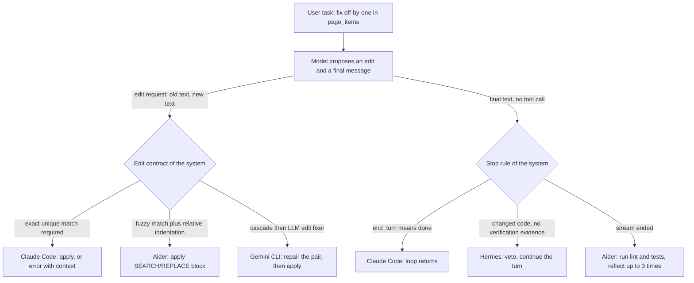
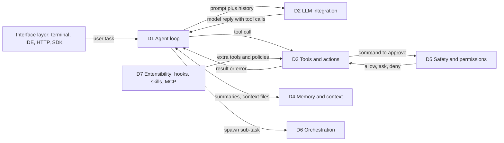

# Harness Engineering: Anatomy, Architecture, and Evolution of Coding Agents - A Source-Code Study of Eleven Systems

> Paul Barbaste, Tristan Darrigol, Germain Vu, Tom Wiltberger (Wavestone AI Lab; the lead author also lists Inclusive Brains), July 2026. arXiv abstract: [https://arxiv.org/abs/2609.00006](https://arxiv.org/abs/2609.00006). Local PDF: [2609.00006.pdf](../../papers/2609.00006.pdf).
>
> Status: the arXiv page shows "arXiv:2609.00006v1 [cs.SE] 15 Jul 2026" under a CC BY 4.0 licence and names no venue, so treat it as a preprint that has not been peer reviewed. The identifier prefix 2609 would normally suggest September 2026 while the page date is July; this guide could not explain the mismatch and does not rely on it.

## Read this first

**The claim in one sentence.** The authors read the source code of eleven coding-agent products and projects, found that all of them are built from the same seven parts around an agent loop, and argue that the loop is the small, interchangeable part while the surrounding machinery (tools, memory, safety, sub-agents, extensions, interfaces) is where the engineering mass and the competition now sit.

**Who this is for.** Anyone deciding how to build or buy an assistant that edits files and runs commands, and anyone who wants the stage's through-question answered with evidence: is a thin runtime around a model that picks among a few good tools the right architecture for assistants like Claude Code or ChatGPT? The paper's answer is mixed, and the guide separates what the paper reports from what this guide infers.

**What you will be able to do afterwards.** Define a harness; list its seven subsystems with the smallest and largest observed implementation of each; explain, for three of the eleven systems, how each decides that a task is finished and how each lets the model edit a file; say what the paper can and cannot conclude from reading code; and build a small harness with a stop guard.

**Reading time for this guide.** About 40 minutes. The paper itself is long (17 sections plus an appendix) and mostly a catalogue, so the guide tells you what to skip.

**Earlier guides to have read.** [ReAct](../02-building/10-react.md) for the think-act-observe loop that every system here implements, and [SWE-bench](../03-evaluation-and-code/16-swe-bench.md) for the benchmark whose scores the paper quotes with heavy caveats. In this stage, [SWE-agent](26-swe-agent.md), the [agentic tool-use survey](27-agentic-tool-use-survey.md) and [Dive into Claude Code](28-dive-into-claude-code.md) are the nearest neighbours.

**The one thing most people get wrong.** They read it as a benchmark ranking or as proof that minimal scaffolds are enough. It is neither. The abstract says the paper "does not benchmark or rank", and the benchmark figures it mentions are self-reported by each project, on different models and dates. What it measures is structure: which parts exist, how they are built, and how they changed over one quarter.

## The paper in one worked example

The paper analyses many features across systems. This guide follows two of them on one invented task, so every later section can point back here. The task is constructed for this guide; the behaviours attributed to each system come from the paper's own descriptions, and anything beyond that is labelled as inference.

**The task (constructed).** A repository has a function `page_items(items, page, size)` in `utils.py` that returns one item too many. The edit that fixes it changes `range(page*size, page*size+size+1)` to `range(page*size, page*size+size)`. A test file `tests/test_utils.py` exists. The user says: "Fix the off-by-one in page_items."

Two harness decisions matter on this task. First, how does the model change the file? Second, when does the loop decide it is finished?

**Part A: deciding when to stop.** Suppose the model makes the edit and then writes "Fixed the off-by-one." without ever running the tests.

| Step | Claude Code | Hermes | Aider |
|---|---|---|---|
| Model's final message | Text with no tool call; the API returns an end-of-turn signal | Text-only reply with no tool call | The completion stream finishes |
| What the harness checks | Nothing further. The paper's Table 5 lists the stop condition as `end_turn` and stuck detection as "None (manual)" | The verify-on-stop guard asks: did this turn change code files without producing fresh verification evidence? | Aider's reflection step runs lint (syntax check, compile check, flake8), test failures, and unresolved file mentions |
| Outcome on this task | The loop returns. If the tests were never run, the harness does not know | The guard rewrites the text-only reply into a continuation, so the model is pushed to run the tests before it may finish | If lint or tests fail, a `reflected_message` re-invokes the model with the errors, up to 3 times by default |
| Who decides "done" | The model | The harness, overriding the model once | The harness's own checks, up to a cap |

Sources: Table 5 and sections 6.2 and 6.3. For Mini-SWE-Agent, the simplest system, the loop in Listing 1 (section 6.2) runs `while True`, calls `step()`, and returns when the result has role "exit". The paper's Table 5 gives its stop condition as an "exit message" and its limits as a step limit, a cap on consecutive format errors, and a wall-clock limit. This guide infers, but the paper does not state, that a chatty reply with no action would count as a malformed action there.

**Part B: letting the model edit the file.** Now the model must change that one line. Table 7 (section 8.4) shows three different contracts.

1. Claude Code uses exact string replacement. The model supplies the old text and the new text; the old text must appear exactly once in the file. If it does not match, the tool returns an error with context (Table 7, "Error + context").
2. Aider picks one of 13 edit formats (SEARCH/REPLACE, udiff, diff-fenced and others) from the model's metadata. Matching is exact first, then fuzzy using the diff-match-patch library at threshold 0.95 and distance 500. A helper called RelativeIndenter rewrites indentation as relative changes so a block still matches if the model got the absolute indentation wrong (section 8.4).
3. Gemini CLI uses an old/new string tool with a cascade: exact match, then a whitespace-flexible match, then a regex fuzzy match. If all fail, an LLM "edit fixer" subcall repairs the old/new pair, which the paper calls the first in-tool LLM-assisted edit repair in the corpus.

Suppose the model's old text has the right characters but four spaces where the file has a tab. Claude Code's exact contract returns an error and the model must retry. Gemini CLI's flexible stage would plausibly match it (inference from the described cascade order). Aider's RelativeIndenter exists for exactly this class of failure.



What to notice: the two decisions are independent. The same system can be strict about edits and loose about stopping (Claude Code in the paper's tables), or the reverse. The harness, not the model, owns both decisions, and the three systems place the safeguard in different spots: inside the tool, at the exit, or after every edit.

## Words you need

| Term | Plain definition | Example from the worked example |
|---|---|---|
| Harness | Everything except the model: the runtime that couples a model to the world through a loop, tools, context management, safety controls, orchestration and extension surfaces (section 2.1) | The code that applies the one-line edit and decides whether to run tests |
| Agent = Model + Harness | The paper's one-line algebra for what an agent is (abstract, section 2.1) | Claude Code is the harness; the model it calls is the other half |
| Agent loop | The cycle that alternates a model call with executing the actions the model asked for, and owns stop conditions (Table 1) | Edit, observe the result, ask the model again, until a stop rule fires |
| Subsystem (D1 to D7) | One of seven components every studied system must take a position on: loop, LLM integration, tools, memory and context, safety, orchestration, extensibility (section 2.3) | Part A is D1, Part B is D3 |
| Stop condition | The rule that ends a run: a model signal, a counter, a judge, or a guard | Claude Code `end_turn`; Hermes's veto; Aider's reflection cap |
| Verify-on-stop guard | Hermes's check that blocks a text-only final answer if the turn changed code without fresh verification (section 6.2) | Blocks "Fixed it." when no test was run |
| Reflection loop | Re-prompting the model with lint or test output after an edit, up to a cap (section 6.3) | Aider's up to 3 reflections |
| Edit contract | The rules a file-edit tool applies: what the model must supply, how matching works, what happens on mismatch (Table 7) | Exact unique substring versus a fuzzy cascade |
| MCP, ACP, A2A | Model Context Protocol (agent to tool server), Agent Client Protocol (editor to agent), Agent-to-Agent protocol (agent to agent across vendors) (sections 12.4, 13.3) | Six systems ship ACP |

## Tutorial 1 - Intuitive understanding

### What was broken before

Before this paper, the literature on coding agents mostly reported scores, usually on SWE-bench, or described patterns in the abstract. The authors state that benchmark surveys "report scores without touching architecture", conceptual taxonomies "describe patterns without implementations", and the one concurrent source-level taxonomy (Rombaut's, covering thirteen open-source scaffolds) leaves out Claude Code and other provider-native systems (sections 1 and 3.3). A practitioner asking "why does Claude Code stop when it does?" or "why do some tools fuzzy-match edits and others do not?" had nothing to read except the code.

Here is the failure on our worked task: a model says "Fixed." and the loop ends. Some products check that claim and some do not, and a benchmark score cannot tell you which, because it only records whether the final repository state passed hidden tests.

### The idea

Think of a car. The engine is the model. Everything else is the harness: steering, brakes, fuel gauge, seatbelts, dashboard, the road map in the glovebox, the garage that services it. The paper's claim is that all eleven cars have the same seven kinds of parts, that a bare go-kart (Mini-SWE-Agent, about 100 lines) already drives, and that the production cars differ mostly in brakes, dashboards and service networks.

Where the analogy breaks: an engine is a fixed part with a known power curve, but a model changes every few months, and harness parts are tuned to a specific model. The paper shows prompts, tool sets and even edit formats being swapped per model (section 15.4). A better analogy for that part is a car whose steering must be re-calibrated at every engine swap.

The paper's seven subsystems, with the smallest and largest observed implementation of each (Table 1, section 2.3):

| Subsystem | Smallest observed | Largest observed |
|---|---|---|
| Agent loop | Mini-SWE-Agent: a linear `while` over one bash tool | OpenHands: event-sourced conversation over a persistent log with parallel action batches |
| LLM integration | Mini-SWE-Agent: one LiteLLM call, one Jinja template | Hermes: five owned transports and 29 provider profiles; Codex: server-delivered model catalog |
| Tools and actions | Mini-SWE-Agent: bash only | Claude Code: 43 typed tools with deferred loading; Codex: tool calls as V8-executed code |
| Memory and context | Mini-SWE-Agent: unbounded linear history | Codex: agent-maintained cross-session memory; Gemini CLI: graph-based context distillation |
| Safety and permissions | Mini-SWE-Agent: cost and step limits | Codex: policy rules plus LLM approval reviewer plus three-platform OS sandbox |
| Orchestration | Aider: none, single-agent by design | Claude Code: recursive composition |
| Extensibility | Mini-SWE-Agent: structural typing | Pi: everything-is-an-extension runtime; Codex: marketplace-distributed plugins |



Figure 1 of the paper draws this anatomy; the diagram above is this guide's rendering of it. Notice that the safety subsystem sits between the model's request and the tool's execution, so a stop rule or an edit contract lives in D1 or D3 but is shaped by D5 and D7.

The eleven systems, with what the paper says distinguishes each (Tables 3 and 4; "Scale" is the paper's qualitative size band, tools are the default surface):

| System | Provider, language, scale | Tools | What the paper says distinguishes it (Table 4 "signature" and Table 3 rationale) |
|---|---|---|---|
| OpenHands | OpenHands, Python, medium | 25+ | Resource-locked parallel tools; hosts rival harnesses as ACP backends; event-sourced loop |
| Aider | Community, Python, small | 13 formats | 13 polymorphic edit formats; the only ranked repository map; reflection-shaped loop; in maintenance mode |
| Claude Code | Anthropic, TypeScript, large | 43 | Deferred tool loading; prompt-cache-sharing forks; "the reference others copy"; March 2026 source snapshot |
| Codex | OpenAI, Rust, very large (1.1 M lines) | 25 to 30 | Agent-maintained cross-session memory; tool calls as V8-executed code; native three-OS sandbox |
| Gemini CLI | Google, TypeScript, very large | 35+ | Model routing as runtime scheduling; the only A2A server; native three-OS sandbox |
| Mistral Vibe | Mistral AI, Python, small | 12+ | Middleware-pipeline loop; rewind exposed over ACP |
| Mini-SWE-Agent | Princeton and Stanford, Python, tiny (5 K) | 1 | The 100-line floor: all seven subsystems, minimally |
| Hermes | Nous Research, Python, very large | 69 | Self-improving skill loop; lineage compaction; verify-on-stop guard |
| Pi | earendil-works, TypeScript, medium | 7 built, 4 default | Everything-is-an-extension core; session-tree version control; no sandbox by design |
| OpenCode | Anomaly, TypeScript, large | 17 | Client/server harness; syntax-aware command permissioning; most-starred dedicated coding agent |
| OpenClaw | Community, TypeScript, large | 109+ | Gateway delegation (no native code editing); Active-Memory sub-agent before each reply; the non-coding contrast point |

Two further surfaces cut across these: the interface layer (terminal UI, command-line flags, IDE protocol, HTTP server, SDK) and the session substrate (transcripts, persistence, resume and fork).

### How it works, step by step

The paper's method is a source-code audit, not an experiment. Each step below is shown on the worked example.

1. **Choose the systems.** Section 4.1 says the eleven were chosen "for their spread along three axes: design philosophy, maturity, and market position". The list: one flagship agent per major model vendor (Claude Code, Codex CLI, Gemini CLI, Mistral Vibe) and seven open-source projects (OpenHands, Aider, Mini-SWE-Agent, Hermes, Pi, OpenCode, OpenClaw). Omnigent is a twelfth system analysed only as a contrast point. For our task, this is why Part A can compare a vendor product, a research baseline, and an open-source system with a self-improving skill loop.
2. **Pin versions.** Table 3 gives an exact version for each system, all dated July 2026, except Claude Code, which is a source snapshot from March 2026 (a binary at version 2.1.206 existed in July). The eight systems carried over from the authors' April 2026 edition were re-pinned, and the April snapshots were kept for comparison.
3. **Define seven dimensions D1 to D7** (section 4.2) and read each system's code along them. Part A is D1 and Part B is D3.
4. **Record and compare.** Results go into tables (4 to 14) and a catalogue of 29 patterns (Tables 11 and 12). Table 5 is where the stop conditions live.

Who did the reading? The acknowledgements say the paper "was written with substantial assistance from Anthropic's Claude (via the Claude Code CLI), which was used both for the source-code analysis and for drafting the manuscript", and that the findings were "verified against the referenced codebases before being kept". So the analysis was largely done by a language model run over the code, with human authors verifying. The paper gives no description of how verification was done, no second independent reader, and no error rate. It does disclose that it corrected itself: the April edition said Aider had 14 edit formats (re-audit: 13), described Codex rules as TOML (they were Starlark), and overstated Mistral Vibe's old fuzzy matcher (it only produced diagnostics) (footnotes 5, 7 and 6). Three of the April observations were substantively revised (section 14.5).

### What the results say

The paper's results are descriptive counts, not performance numbers. Each is explained below with what it counts.

- **Eleven systems, three orders of magnitude of size** (Table 4, Observation 1). The "Scale" column is qualitative: Tiny is about 5 K lines of code, Small 20 to 40 K, Medium 80 to 110 K, Large 500 K and up, Very large 600 K and up, with Codex at 1.1 million lines of Rust. In practice the biggest and smallest differ by a factor of about 220 (1.1 M divided by 5 K), which is two and a bit orders of magnitude; the paper's phrase "three orders" is generous. The counts are not comparable across languages.
- **Loop sophistication does not predict benchmark performance** (Observation 1, with the caveat in footnote 4). Spring-2026 self-reported SWE-bench Verified figures were OpenHands 77.6 percent, Mini-SWE-Agent 74 percent or more, Claude Code 72.7 percent, Codex 69.1 percent. "77.6 percent" means that out of every 100 benchmark issues, about 78 were resolved on that project's own run. The gap between 77.6 and 74 is about 4 issues per 100, but the runs used different models and configurations, so the paper explicitly declines to draw a head-to-head conclusion (section 13.4, axis 1). What the numbers show is only that a 100-line loop is not obviously far behind a much larger one.
- **Two absences across about four million lines** (Observation 9, section 13.2). No system imports a general-purpose agentic framework such as LangChain, LangGraph, AutoGen, CrewAI or LlamaIndex in its agent runtime, and none retrieves code using vector embeddings. All use ripgrep, tree-sitter, glob and Markdown context files. Practically: out of eleven, zero used the tools that most tutorials teach first.
- **Skills beat MCP in adoption, 9 of 11 versus 8 of 11** (Observation 8, Table 10). Only Aider and Mini-SWE-Agent lack skills. The lead is one system: Pi supports skills and rejects MCP.
- **Convergence became imitation** (section 14.5). Codex copied Claude Code's hook event names almost verbatim; OpenHands reads Claude Code's plugin format; OpenCode reads Claude Code's skills directory. Codex's tree grew from 621 K to 1.12 M lines and from 89 to 126 crates in one quarter; Mistral Vibe grew 77 percent (35.6 K to 63 K lines).
- **Counts of the paper's outputs:** 13 observations, 29 patterns (17 from April plus 12 new), 18 recommendations (abstract, Tables 11 and 12, section 16).

### What this does not show

- It does not show that any architecture is better. No system was run on shared tasks (section 15.6), and the authors list a cross-system benchmark as future work.
- It does not show causation behind the convergence. Observation 10 says Anthropic's four engineering articles line up with what the vendors built, and leaves open whether that reflects shared reality, public guidance, or both. No interviews were done.
- The Claude Code results rest on a circulated source snapshot from March 2026, which the paper itself calls the "weakest link on reproducibility".
- It says nothing about answer quality, cost per task, latency or user satisfaction, and it covers closed-source tools only through announcements marked as not source-verified (Table 2).

### Teach-back

1. State the paper's definition of a harness and one thing it is not.
2. On the worked task, name three different places a safeguard against a false "done" can sit, with a system for each.
3. Why is "9 of 11 versus 8 of 11" weak evidence that skills have won?
4. Who analysed the source code, and how does that change how much you trust a single table cell?

<details>
<summary>Answers to 1 and 2</summary>

1. Everything except the model: the runtime that couples a model to the world through its loop, tools, context, safety controls, orchestration and extension surfaces. It is not an agentic framework (a library you import), not an evaluation harness (SWE-bench's runner wraps an agent, opposite direction), and not an orchestrator or meta-harness (section 2.2).
2. At the exit (Hermes's verify-on-stop guard), after every edit (Aider's lint and test reflection, up to 3 rounds), or inside the tool (an edit tool that errors on a mismatch, as in Claude Code). Claude Code has no further automatic check at the exit in Table 5.

</details>

<details>
<summary>Answers to 3 and 4</summary>

3. The sample is eleven hand-chosen systems, so one system moves the ratio by about 9 percentage points. The paper itself notes the tie of April (6 of 8) was broken only by Pi's choice.
4. A language model (Claude via the Claude Code CLI) did much of the reading, with the authors verifying. A single cell can be wrong, as the paper's own corrections show (14 versus 13 formats, TOML versus Starlark). Trust structural claims more than cell-level inventory claims, which the paper itself says decay in weeks (section 14.5).

</details>

## Tutorial 2 - Practitioner understanding

### The design in concrete terms

**The loop and its exits.** All eleven implement a variant of ReAct. The concrete shapes (Table 5, section 6.2):

| System | Loop type | Stop condition | Stuck detection |
|---|---|---|---|
| OpenHands | Event-sourced conversation | state is FINISHED | 5 scenarios (repeating pairs, repeating errors, monologue, alternating, context-error loops) |
| Aider | Generator plus reflect | stream ends, no reflection pending | max reflections (default 3) |
| Claude Code | Streaming plus batch | `end_turn` | none (manual) |
| Codex | Tokio async state machine | `end_turn` | none |
| Gemini CLI | Async generator plus scheduler | `end_turn`, or turn limit 100 | SHA-256 hashing (five identical tool calls or ten identical content chunks), then an LLM check after 30 turns |
| Mistral Vibe | Async plus middleware pipeline | `end_turn` | middleware limits (turn, price, token, compaction) |
| Mini-SWE-Agent | Linear while | exit message | step limit, format-error cap, wall clock |
| Hermes | Budgeted while plus stop-guards | text response unless verify-on-stop vetoes; 90-iteration budget | SHA-256 signatures, warn after 2 identical failures, halt after 8, but the hard stop ships disabled |
| Pi | Functional while plus steer and follow-up queues | `end_turn`, no cap | none, by design |
| OpenCode | Log-as-queue while(true) | no tool calls; steps default to infinity | three identical calls raise a permission "doom loop" ask |
| OpenClaw | Event-driven ACP | session end | rate limit |

Hermes's budget of 90 iterations refunds `execute_code` iterations and allows one final grace call for a summary; OpenCode turns a reached step cap into a message telling the model its tools are disabled.

**Tools, context, safety.** Tool counts are in the system table of Tutorial 1. Table 7 finds eight different editing strategies across eleven systems; OpenCode runs a nine-stage replacer cascade with a Levenshtein threshold of 0.65 and Hermes escalates to a whole-file write after 3 failures. Claude Code compacts inside a 13,000-token buffer below the effective window and then restores up to 5 files within 50,000 tokens; Gemini CLI compacts above 50 percent of the limit and keeps the most recent 30 percent of history verbatim (section 9.5). Native OS sandboxes exist only in Codex and Gemini CLI, with Claude Code's as an opt-in (Table 8); Hermes keeps twelve hard patterns that survive its `--yolo` flag.

### A minimal version

The sketch below is this guide's own, not the paper's Listing 3. It combines three paper ideas: an exact unique-match edit tool (Claude Code, Mistral Vibe), a step budget with a hard stop (Hermes, Mini-SWE-Agent), and a verify-on-stop guard (Hermes). Shapes: `model.complete(messages, tools)` returns `{"content": str, "tool_calls": [{"id", "name", "args"}]}`.

```python
import subprocess, pathlib

MAX_STEPS = 40

def bash(cmd):
    r = subprocess.run(cmd, shell=True, capture_output=True, text=True, timeout=120)
    return f"exit={r.returncode}\n{r.stdout[-4000:]}{r.stderr[-2000:]}"

def edit(path, old, new):
    p = pathlib.Path(path); text = p.read_text()
    n = text.count(old)
    if n != 1:                        # exact unique-match contract
        return f"ERROR: old text occurs {n} times; it must occur exactly once"
    p.write_text(text.replace(old, new, 1)); return "OK"

TOOLS = {"bash": bash, "edit": edit}

def run(model, task):
    msgs = [{"role": "system", "content": "You fix bugs in a repo using the tools."},
            {"role": "user", "content": task}]
    changed_files, verified = False, False
    for step in range(MAX_STEPS):
        reply = model.complete(msgs, tools=list(TOOLS))
        msgs.append(reply)
        calls = reply.get("tool_calls") or []
        if not calls:                  # model wants to stop
            if changed_files and not verified:      # verify-on-stop guard
                msgs.append({"role": "user",
                    "content": "You changed code but showed no passing test. Run the tests."})
                continue
            return reply["content"]
        for c in calls:
            out = TOOLS[c["name"]](**c["args"])
            if c["name"] == "edit" and out == "OK": changed_files, verified = True, False
            if c["name"] == "bash" and "pytest" in c["args"].get("cmd", "") and out.startswith("exit=0"):
                verified = True
            msgs.append({"role": "tool", "tool_call_id": c["id"], "content": out})
    return "STOPPED: step budget exhausted"
```

On the worked task the expected trace is: `edit` returns "OK"; the model replies "Fixed."; the guard injects the reminder; the model runs `pytest tests/test_utils.py`, gets `exit=0`, and its second text-only reply is accepted. The guard can loop until the step budget if tests never pass, and the substring test for verification is crude.

### What it costs

The paper gives no dollar or latency figures for any system, so this arithmetic uses stated assumptions, not paper data.

- **Linear history growth (the Mini-SWE-Agent design).** Assume 4,000 starting input tokens and 1,500 added per step. Input tokens summed over 50 calls: 50 x 4,000 + 1,500 x (49 x 50 / 2) = 200,000 + 1,837,500, about 2.0 million input tokens, even though the final context is only about 77,500 tokens. This is why the other systems add caching and compaction. The paper notes Mini-SWE-Agent relies on the model's native window (up to 1 million tokens with the Claude 4 family, section 9.2).
- **Compaction trigger.** If the effective window were 200,000 tokens (an assumption), Claude Code would compact when about 187,000 tokens are in use, since the buffer is 13,000. Gemini CLI at 50 percent would compact near 100,000 and keep 30 percent of that history, about 30,000 tokens.

### How it fails

The paper has no error analysis of runs. The table below uses failure modes the paper describes in code or prompts, plus this guide's mitigations.

| Symptom | Likely cause | Mitigation |
|---|---|---|
| Run ends with a confident but unverified "done" | Exit decided by the model only (`end_turn`) | Verify-on-stop guard, or run tests in the harness after edits (Hermes, Aider) |
| Same failing call repeated for many turns | No stuck detection or a disabled hard stop | Cheap hash counter; Hermes warns after 2 and halts after 8 but ships the halt disabled; OpenCode asks the user after 3 identical calls |
| Edit tool rejects a correct-looking change | Strict exact match and the model mis-copied whitespace | Fuzzy cascade or canonicalisation (Pi, OpenCode), or LLM repair (Gemini CLI) |
| Prompt claims a safeguard that is not there | Description overclaims | OpenCode's edit tool says it errors without a prior read, but the paper finds no read tracking in the source |
| Prompt injection through repository files | Context files trusted | Hermes scans context files and blocks on a match; Pi accepts the risk and documents it |

### Evaluating your version

The paper offers no test protocol, so this is the guide's recommendation. Use a held-out set of at least 50 tasks from your own repositories, run the same model with your harness and with a bare loop (one bash tool, a step limit) as baseline, and record three numbers per run: task passed (hidden tests), whether the final message claimed success while tests failed, and tokens used. Stop adding harness features when two consecutive additions change the pass rate by less than the noise across three reruns of the baseline.

### Adopt, adapt or skip

For a team building an assistant over private business documents, adapt the ideas, not the artefacts, because the paper is about coding agents. Adopt the seven-subsystem checklist as a design review (write down your position on each, including deliberate absence), a hard step budget, and a stop guard. Test deterministic retrieval first, but check embeddings against keyword search on your own questions, since the no-embeddings result is for code, which has paths and parse trees (this guide's caution). Adapt the exact-unique-match edit contract, threshold compaction, skills as on-demand instruction bundles, and layered permissions. Skip multi-agent machinery unless you can name a breadth-first research phase (Recommendation 12), OS sandboxing unless the assistant runs code, and ACP. Do not use the paper to justify a choice by performance, because it contains none.

## Tutorial 3 - Researcher understanding

### Formal setup

Notation, defined once. Let S be the set of studied systems, |S| = 11 (Omnigent is excluded). Let D = {D1, ..., D7} be the dimensions: loop, LLM integration, tools, memory, safety, orchestration, extensibility. For a system s in S and a feature f, a(s, f) is 1 if the paper reports the system implements f and 0 otherwise. The adoption count of f is A(f) = sum over s of a(s, f), reported as A(f)/11, or A(f)/10 for coding-first systems (OpenClaw excluded, section 4.1). A snapshot t is April 2026 or July 2026 for the eight carried-over systems. The paper's agent identity is Agent = Model + Harness, so for the paper the harness H is the complement of the model M inside the agent.

Toy numeric instance with the paper's counts: skills A = 9, MCP A = 8, ACP A = 6. As fractions of 11: 0.818, 0.727, 0.545. If Pi had adopted MCP, MCP's count would be 9 and the tie would return, which shows the sensitivity of the headline: one system equals 9.1 percentage points. For coding-first systems the paper reports MCP at 7 of 10; skills for the ten coding-first systems is 8 of 10 by this guide's own subtraction (OpenClaw has skills in Table 10).

The scaffold-capability frontier (section 15.5) is stated informally: for a fixed task distribution T, fixed model m and target success rate tau, a minimum viable scaffold is the lower envelope of complexity values whose success rate on T with m exceeds tau. The paper says it does not measure this.

### The claims, stated precisely

1. Definition: a harness is the layer wrapping a model so it can act on a repository, adopted from Macedo's definitional work and extended with a seven-subsystem decomposition (section 2.1).
2. Loop sophistication does not predict reported benchmark results, and most mass in production systems addresses safety, UX, extensibility, and increasingly clients and transport (Observation 1; roughly three-fifths of OpenCode's non-test source is client code).
3. No agent runtime in the corpus imports a general-purpose agentic framework or uses embedding retrieval for code (Observation 9). This was checked by dependency-manifest inspection and import grep, twice, three months apart, across twelve trees (footnote 8).
4. OS sandboxing is a choice rather than a consequence of scale: Hermes (642 K lines) and OpenCode (578 K) ship none (Observation 6).
5. Skills lead MCP (9 versus 8 of 11, Observation 8), and ACP ships in six systems with a third role, harness hosting (Observation 11).
6. Over one quarter, convergence became traceable imitation, patterns diffused, and policy moved from prompt prose to configuration (section 14.5).
7. The harness turned from tool to platform in the first half of 2026 (Observation 12, section 14). This is the paper's thesis and is argued from named artefacts (SDKs, marketplaces, importers, a meta-harness) more than from measurement.

### Evidence, table by table

| Table or figure | Rows and columns | Headline | Identifies or only associates |
|---|---|---|---|
| Table 1, Figure 1 | 7 subsystems by role, minimal form, maximal form | Floor to ceiling per subsystem | Descriptive; a taxonomy the authors propose |
| Table 4 | System by language, scale, tool count, sandbox, signature | Scale 5 K to 1.1 M lines; tools 1 to 109 plus | Association only; sizes are approximate |
| Table 5 | Loop type, concurrency, stuck detection, stop condition | Stop rules differ; three systems list no automatic stuck detection (Claude Code, Codex, Pi) | Descriptive, from code reading |
| Table 7 | Edit format, matching, fallback, innovation | Eight strategies; Mistral Vibe migrated between clusters | Association only; the claim that stronger models shift the optimum toward strict contracts is the authors' inference |
| Table 13 | Retrieval mechanism per system | 0 of 11 use code embeddings | The strongest negative result, bounded by what the grep could find |

Causal reading: nothing here identifies a causal effect of any design choice on outcomes. The only causal-sounding statements are inferences (model shifts explaining Mistral Vibe's move to exact matching; guidance explaining convergence, left open in Observation 10).

### Ablations and what they isolate

The paper runs no ablations of its own. The nearest substitutes are two natural comparisons. The April-to-July diff (section 14.5) is a within-system before/after, which isolates change over time but not why. The Mini-SWE-Agent versus large-system comparison isolates nothing, because model, date and configuration differ (footnote 4). The paper cites an outside ablation: Lin et al.'s Agentic Harness Engineering reaches 71.9 percent on SWE-bench Verified from a bash-only seed, and its component ablation finds tools, middleware and long-term memory carry the improvement while the system prompt alone does not (sections 3.1 and 15.5). The per-component point deltas appeared as blanks in the text this guide read, so they are not quoted; treat this as a second-hand report.

### Threats to validity specific to this paper

- **Analyst is a model.** Claude did much of the reading and drafting. The authors say they verified, and the paper discloses specific corrected errors. This guide infers that unreported errors of the same kind probably remain, since three of April's observations changed in one re-audit.
- **Possible interest conflict.** Claude Code is both a studied system and the tool used to analyse it. The paper does not discuss this; it is a flag, not a finding of bias.
- **Convenience sample.** Selected for spread and market position, including a deliberately non-coding contrast (OpenClaw). Closed-source products are mostly absent, so "all eleven systems do X" cannot be extended to the market.
- **Negative results are bounded by the search.** The framework absence rests on manifests and grep. The paper says dynamic imports, forks and transpiled builds were not traced.
- **Counting conventions.** "Three orders of magnitude" is looser than the Table 4 note supports (about 220 times). The paper also calls Mini-SWE-Agent's scaffold "100 lines" in sections 2.4 and 5, but "50-line" in Recommendation 1 and Takeaway 1, and some observation cross-references point to the wrong number (Recommendation 1 cites "Observation 5" for the loop finding, which section 5 labels Observation 1).

### Open problems and follow-ups

The authors list a cross-system benchmark under controlled conditions, interviews to test the Anthropic-guidance causation, formal verification of policy-as-code, and quarterly re-pinning to measure how fast patterns diffuse (section 17.2). This guide adds an independent re-audit of a random sample of table cells by a second reader.

### What would change my mind

For the through-question, the decisive evidence would be a matched-model, matched-task study showing that harness features (tool breadth, compaction, guards) change task success materially: large gains on long multi-file tasks would weaken the thin-loop reading, and none would support the paper's weaker claim that surroundings serve safety and UX. A failed re-audit, where a second reader disagrees with more than a small share of sampled cells, would lower confidence in every inventory table.

## Reading map for the PDF

Page numbers are not given because this guide worked from the paper's section structure; locate by section and table number.

| Section or figure | What it contains | First pass | Guide section that answers the questions it raises |
|---|---|---|---|
| Abstract, 1 | Claims, 7 contributions, thesis | Read | Read this first |
| 2.1 to 2.4 | Definition, what a harness is not, 7 subsystems (Table 1, Figure 1), minimal harness | Read closely | Words you need; Tutorial 1 |
| 5, Table 4, Observation 1 | System overview, signatures | Read | Tutorial 1 results; FAQ |
| 6, Table 5 | Loops, stop conditions, stuck detection | Read | Worked example, Tutorial 2 |
| 8, Table 7 | Tool counts, edits, deferred loading | Read 8.4 and Table 7 | Worked example Part B |
| 10, Table 8 | Safety and sandboxing | Skim; read Observation 6 | Tutorial 2 failures |
| 11, Table 9 | Multi-agent patterns | Skim | FAQ on sub-agents |
| 13, Tables 11 to 14 | 29 patterns, twin absences, protocols, trade-offs | Read 13.2 and 13.4 | Through-question |
| 14 | Platform turn, meta-harness, 90 days | Read 14.1 and 14.5 | Tutorial 3 |
| 15 | Anthropic-series validation, minimalism, threats | Read 15.2, 15.5, 15.6 | Threats to validity |
| 16, Listing 3 | 18 recommendations, 90-line harness | Read 16.1 to 16.4 and 16.9 | Minimal version |
| 17, Acknowledgements | Takeaways; AI-assistance disclosure | Read | Tutorial 1, how it works |

## Questions readers get stuck on

### Is "harness" just another word for framework or scaffold?

No on framework, almost on scaffold. A framework is a library you import into your own program; a harness is a runtime you work inside of (section 2.2). The paper says scaffold and harness are near-synonyms: scaffold names the structural code (the loop and registries), harness names the shipped product that embeds it. The paper also argues the distinction between framework and harness is dissolving, because harnesses now ship as importable SDKs and framework vendors ship harnesses (section 14.2).

### Why does the paper say loop sophistication does not predict performance when the best score belongs to the most elaborate loop?

The best spring-2026 figure it quotes (OpenHands, 77.6 percent) is indeed from the most elaborate loop, and the minimal one (Mini-SWE-Agent) reports 74 percent or more. The scores are self-reported, on different models and dates, so the paper declines to rank them (footnote 4, section 13.4). The claim is the weak one that the difference is small relative to the difference in code, not that complexity never helps.

### How were the eleven systems chosen, and could the sample be biased?

By spread along design philosophy, maturity and market position (section 4.1): all four vendor flagships, plus open-source projects chosen to cover a research baseline, a minimal-core design, the most-starred and fastest-growing projects, and a non-coding gateway. The sample is deliberate, not random, and heavily weighted to terminal tools. Closed-source products such as Cursor and Copilot are discussed only from announcements.

### Does the paper say a thin loop with a few tools is the right architecture?

Partly. For the loop, yes in the sense that every system uses a hand-written ReAct-style loop and the 100-line baseline works. For "a few tools", the evidence is mixed: Pi exposes 4 tools by default and Mini-SWE-Agent 1, but Claude Code ships 43, Hermes 69 and OpenClaw 109 plus, hidden behind deferred loading. Recommendation 3 does advise starting with only bash and adding tools in response to failures. The section on the through-question below spells out this guide's reading.

### What does "no RAG" mean here, and does it apply to my document assistant?

It means no vector-embedding retrieval over source code, in any of the eleven (Table 13). The authors' explanation is that code has structure (paths, parses, type information), changes constantly, and ships with grep. Those reasons are specific to code. Whether embeddings help for business documents is not tested in the paper, and OpenClaw, the non-coding system, does use hybrid embedding search over chat history by default.

### What is the "platform turn" and is it proven?

It is the thesis that harnesses became platforms: SDKs, marketplaces, importers between rival products, enterprise governance, hosted tiers and a meta-harness (section 14). It is argued from named artefacts, many of them visible in source, plus announcements marked as not source-verified. Treat it as a well-documented interpretation, not a measured effect.

### Why would Hermes check at the exit rather than after each edit like Aider?

The paper says the verify-on-stop guard does the reflection check once, at turn exit, "at a fraction of the cost" of a per-iteration check (sections 6.2, 6.3), with no measurement. This guide infers the saving comes from not running tests after edits that are only steps toward a finished change.

### Is Claude Code in the study the product I can use today?

Not exactly. Its cells reflect a March 2026 source snapshot, and the shipping binary had reached version 2.1.206 by July (Table 4 caption). Where this guide says Claude Code does something, it means that snapshot.

## Prerequisites you actually need

### Prerequisite 1 - The think-act-observe loop and tool calls

A language model cannot run commands. A harness lets it emit a structured request (a tool call), runs it, and feeds the result back as a new message. Tiny example: the model emits `edit(path, old, new)`; the harness returns "OK"; the model is called again with that result appended. The loop ends when the model emits no tool call. Listing 1 of the paper is the whole loop in Python. See [ReAct](../02-building/10-react.md) and [SWE-agent](26-swe-agent.md).

### Prerequisite 2 - Context windows, caching and compaction

A model reads a limited number of tokens per call. Each call re-sends the whole history, so cost grows with history. Prompt caching lets the provider reuse an unchanged prefix. Compaction summarises old turns when the window nears full. Tiny example: with a 100,000-token threshold and 30 percent kept verbatim, a 100,000-token history becomes a summary plus 30,000 tokens of recent turns. See [context as a tool](30-context-as-a-tool.md) and [agentic context engineering](31-agentic-context-engineering.md).

### Prerequisite 3 - What SWE-bench Verified scores mean

A score is the share of GitHub issues for which the agent's final patch passes hidden tests. Tiny example: 74 percent means 74 resolved per 100 issues. Scores depend on the model, the prompt and the date, so comparing two systems' published numbers without matching those is invalid. The paper uses scores only in footnote 4, Observation 1 and section 15.5. See [SWE-bench](../03-evaluation-and-code/16-swe-bench.md).

## Where this sits in the curriculum

Read first: [ReAct](../02-building/10-react.md) and [SWE-bench](../03-evaluation-and-code/16-swe-bench.md). In this stage, [SWE-agent](26-swe-agent.md) showed that the model-computer interface matters; this paper generalises that to seven subsystems across eleven shipped systems. The [agentic tool-use survey](27-agentic-tool-use-survey.md) covers research on how models use tools, while this paper looks at the code that implements it. [Dive into Claude Code](28-dive-into-claude-code.md) is the deepest single-system analysis; this paper puts Claude Code beside ten others. Read next [context as a tool](30-context-as-a-tool.md) and [agentic context engineering](31-agentic-context-engineering.md), which treat the memory and context findings here (threshold compaction, persistent memory, deferred loading) as a design object of its own.

**Through-question for this stage: is a thin runtime around a model that picks among a few high-quality tools the right architecture?** Evidence the paper reports that supports it: every loop is hand-rolled with no framework (Observation 9); the loop is described as one of several subsystems and a 100-line version exists (section 2.4); the paper's own advice is to start with a linear loop and one bash tool (Recommendations 1 and 3); and Observation 1 says loop sophistication does not predict reported benchmark results. Evidence that contradicts or complicates it: production systems are not thin. Claude Code has 43 tools, Hermes 69, OpenClaw 109 plus (Table 4); safety, extensibility, memory, orchestration and interfaces carry most of the code; and the paper's thesis is that "the competitive unit of the field is no longer the agent loop; it is the ecosystem surface around it" (Observation 12). This guide's inference: the paper supports "thin loop, heavy surroundings" and does not support "few tools" as a description of what shipped products do, although the deferred-loading pattern (hide most tools until asked) means the model often sees only a few at a time. The paper provides no evidence on whether heavy surroundings improve outcomes, only that they exist and that vendors invest in them for safety, reliability and workflow reasons.

## Checkpoint

1. Explain, using Table 5, how Claude Code, Hermes and Mini-SWE-Agent each decide a run is over.
2. Compute: Mini-SWE-Agent starts at 3,000 input tokens and adds 1,000 per step. How many input tokens in total across 20 calls?
3. Critique: "Mini-SWE-Agent reports 74 percent and Codex 69.1 percent, so the bigger harness is worse." What is wrong with this inference according to the paper?
4. List the seven subsystems and name one system that takes a deliberately minimal position on orchestration.
5. The paper reports skills at 9 of 11 and MCP at 8 of 11. State the fraction for each among the ten coding-first systems, and say what this guide adds that the paper does not state outright.
6. Explain how the paper's methodology limits what it can say about reliability, citing one self-reported correction.

<details>
<summary>Answers to 1 to 3</summary>

1. Claude Code: stop on `end_turn`, no automatic stuck detection. Hermes: a text-only response ends the turn unless verify-on-stop vetoes, within a 90-iteration budget. Mini-SWE-Agent: an "exit message" returns from the loop, with a step limit, a cap on consecutive format errors, and a wall-clock limit as backstops.
2. Sum over k = 1 to 20 of (3,000 + 1,000 x (k - 1)) = 20 x 3,000 + 1,000 x (19 x 20 / 2) = 60,000 + 190,000 = 250,000 input tokens.
3. The scores are self-reported on different models, dates and configurations, and one is unsandboxed while the other is sandboxed; the paper says it does not draw a head-to-head conclusion (section 13.4). It argues only that Codex's extra code mostly serves non-benchmark concerns.

</details>

<details>
<summary>Answers to 4 to 6</summary>

4. Loop, LLM integration, tools and actions, memory and context, safety and permissions, orchestration, extensibility. Aider has no orchestration (single-agent by design); Mini-SWE-Agent has none either, and Pi's core ships none.
5. Per the paper, MCP is 7 of 10 coding-first. Skills among coding-first is 8 of 10, which is this guide's subtraction because OpenClaw supports skills in Table 10; the paper does not state that figure.
6. A model did much of the reading with the authors verifying and no stated procedure or error rate. The paper corrected its April claims of 14 Aider edit formats (13 on re-audit), Codex rules as TOML (they were Starlark), and Mistral Vibe's fuzzy edit applying (it only produced diagnostics).

</details>
