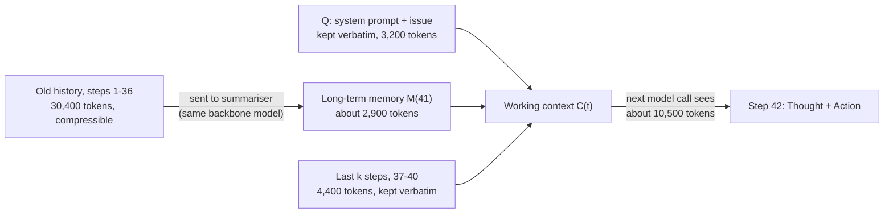

# Context as a Tool: Context Management for Long-Horizon SWE-Agents

> Shukai Liu, Jian Yang, Bo Jiang, Yizhi Li, Jinyang Guo, Xianglong Liu, Bryan Dai (Beihang University, Manchester, Ubiquant), 2025. [arXiv abstract](https://arxiv.org/abs/2512.22087) | [local PDF](../../papers/2512.22087.pdf). This is an arXiv preprint (v1, 26 Dec 2025) with no peer review that I could find; weigh the evidence accordingly. The paper calls its method CAT (written "Cat" in the text) and its trained model SWE-Compressor.

## Read this first

**The claim in one sentence.** If you give a coding agent a "condense my history" action that sits next to "run a shell command" and "edit a file", and you fine-tune the model on trajectories in which that action was inserted at sensible moments, the agent keeps its working context small (below roughly 32k-35k tokens) over hundreds of steps and solves more tasks (57.6 percent of SWE-bench Verified, with a 32-billion-parameter model) than the same model with no context management (49.8 percent in Table 2) or with a compress-when-too-long rule (53.8 percent).

**Who it is for.** Anyone deciding how an assistant should handle a conversation or work session that is longer than its context window can comfortably hold, and anyone judging whether "the model decides" is better than "the harness decides". It matters directly to the stage question: is a thin runtime around a model that chooses among a few high-quality tools the right architecture for assistants such as Claude Code or ChatGPT? This paper's answer is a qualified yes, with the twist that memory upkeep itself becomes one of the tools.

**What you will be able to do afterwards.**

- Explain "context explosion" and "semantic drift" on a trajectory with token counts.
- Draw the three-part context (fixed task, long-term memory, recent steps) and say exactly what a condense step keeps and drops.
- Read Tables 1 to 3, including two numbers that disagree between tables, and say what the ablations leave confounded.

**Reading time.** About 30 minutes. The paper has no appendix of prompts: the summary prompt, the exact memory-block format and the recent-window size k are not in the text, so this guide marks what is paper-reported and what is constructed.

**Read first.** [ReAct](../02-building/10-react.md) for the Thought-Action-Observation loop, [SWE-bench](../03-evaluation-and-code/16-swe-bench.md) for the benchmark, and [the Transformer](../01-foundations/01-transformer.md) for why a context window has a size and a cost. In this stage, [SWE-agent](26-swe-agent.md), [Dive into Claude Code](28-dive-into-claude-code.md) and [Harness engineering](29-harness-engineering.md) cover the runtime that CAT plugs into.

**The thing most people get wrong.** They read "context as a tool" as "the agent summarises when the context is full". That is the baseline the paper beats (the threshold agent). The distinctive thing is that the model is trained to call condensation at task milestones, well before the window is full, and that the summary replaces only the old middle of the context while the task statement and the last few steps stay verbatim. The second thing people get wrong is attributing the whole gain to the "tool" idea: the comparisons in the paper change the training data and the trigger together, so the tool framing and the fine-tuning are not separated (see Tutorial 3).

## The paper in one worked example

The paper gives one illustrative picture (Figure 2, "structured context condensation") but its text does not give a full trajectory with token counts, and I could not inspect the figure pixels. So the trajectory below is **constructed by this guide**. Every quantity that comes from the paper is marked "(paper)"; everything else is an invented but internally consistent illustration. The constructed numbers are calibrated against the paper's Table 1, where the average condense step took the context from 15,585 to 4,676 tokens, about 30 percent of its previous size.

**The constructed task.** A small Python library has a function `parse_duration("1h30m")` that returns 3600 seconds instead of 5400. The agent must fix it without breaking the existing tests. This mimics the shape of a SWE-bench Verified instance: an issue text, a repository, hidden tests.

**The context at step 41 under append-only ReAct.** The paper's append-only baseline keeps every message (Section 1). Suppose the model's context window is the paper's training length of 65,536 tokens (Section 3). Here is how the context grew:

| Step range | What happened | Tokens added | Context size after |
|---|---|---|---|
| Start | System prompt, tool descriptions, issue text (this is Q) | 3,200 | 3,200 |
| 1-8 | `ls`, `grep -rn parse_duration`, open `durations.py`, open `tests/test_durations.py` (long file dumps) | 9,600 | 12,800 |
| 9-18 | Hypothesis A: the regex is wrong. Edit regex, run tests, 3 failures with long tracebacks. Revert | 8,400 | 21,200 |
| 19-30 | Hypothesis B: units table is wrong. Print table, edit, run tests, different failures. Revert | 9,200 | 30,400 |
| 31-36 | Hypothesis C: the accumulator resets at each unit. Reproduce with a script, confirm | 3,200 | 33,600 |
| 37-40 | Edit `durations.py`, run the one failing test, it passes, run the full suite | 4,400 | 38,000 |

To keep the arithmetic clean, define the three pieces at step 41:

- Q (fixed segment): 3,200 tokens (system prompt plus issue).
- History from steps 1 to 36: 30,400 tokens.
- The most recent k = 4 steps (steps 37 to 40): 4,400 tokens. The paper uses a recent window of k steps but I could not find the value of k in the text; k = 4 is this guide's assumption.

3,200 + 30,400 + 4,400 = 38,000 tokens. If the agent never condenses, it would pass the 65,536-token limit after roughly 30 more steps at about 900 tokens per step (38,000 plus 30 times 900 is 65,000; the guide's step 41-70 estimate), and a plain ReAct run ends at that point (Section 3: "Once the context window is exhausted, the dialogue terminates early").

**What goes wrong at 38,000 tokens, as a constructed illustration of the two named failure modes.**

- *Context explosion* means the context grows without bound because every observation is appended. Here: 3,200 at the start, 38,000 at step 41, and the full test-suite output at step 40 alone is about 2,000 tokens that will be re-read at every later step.
- *Semantic drift* is the paper's name for the agent's working picture of the task slowly diverging from the real one when the signal is buried in noise. A concrete form: at step 44 the agent, having lost track of an early note in the middle of the context, tries Hypothesis A again (edit the regex), which it already refuted at steps 9 to 18. The paper does not measure drift with any metric; it uses the word and lists "severe semantic drift" among the reasons trajectories are rejected from training (Section 2.4).

**The condense step.** At step 41 the agent calls the context tool. The harness takes the three segments apart and sends the middle one (history, steps 1 to 36) to a summariser. The paper says the summariser uses the same backbone as the agent (Section 2.4, point 3). The summary comes back as the **Observation** of the tool call. Here is a constructed memory block of about 2,900 tokens (shortened below; the paper lists the *kinds* of content, not a template):

```text
[long-term memory M(41)]
Goal: parse_duration("1h30m") must return 5400; keep all tests in tests/test_durations.py passing.
Done: located bug in durations.py::parse_duration; confirmed with repro script /tmp/repro.py.
Tried and refuted: (A) regex change -> 3 failures (test_days, test_mixed, test_empty), reverted.
                   (B) units table change -> test_weeks fails, reverted.
Confirmed cause: accumulator `total` is reassigned (=) not incremented (+=) when a unit is parsed.
Environment facts: tests run with `pytest tests/test_durations.py -x -q`; Python 3.11; do not edit tests/.
Constraints: do not change the public signature; keep ValueError for empty input.
Open: run the full suite once more after the fix; then submit.
```

**The context at step 42 (after condensing).** C(42) is Q (3,200) + M (2,900) + the last four steps (4,400) = 10,500 tokens, plus roughly 150 tokens for the tool call itself. That is 10,500/38,000, about 28 percent of the previous size, close to the paper's measured average ratio of 30 percent (Table 1). The raw dumps of `ls`, `grep`, both test files, and two refuted edits-and-tracebacks are gone; the fact that they were tried and failed survives as two lines.



Notice that the arrow from old history to the summariser is the only lossy path. Q and the recent steps pass through untouched. The model writing the next step cannot see the raw history at all; whatever the summary left out is unrecoverable (no retrieval is described in the paper).

## Words you need

| Term | Plain definition | Example from the worked example |
|---|---|---|
| Append-only context | Every past message is kept and new ones are added at the end. The default ReAct loop. | Context growing from 3,200 to 38,000 tokens by step 41. |
| Context explosion | Context length growing until it exhausts the window or makes each step slow and expensive. | The ~2,000-token full-suite output re-read at every later step. |
| Semantic drift | The agent's effective picture of goal and progress diverging from the true state because the signal is buried or garbled. The paper uses it without a metric. | Re-trying the already-refuted regex change at step 44. |
| Structured context workspace | The paper's three-part context: Q (fixed), M(t) (condensed long-term memory), I(k)(t) (last k steps verbatim). Equation 1: C(t) = (Q, M(t), I(k)(t)). | Q is 3,200, M is 2,900, I(4) is 4,400 after the condense. |
| Condensation (context folding) | The action that replaces everything between Q and the last k steps with a newly written memory block. | The step-41 tool call. |
| Context tool | The `context` function the agent can call, alongside `execute_bash`, `str_replace_editor` and `submit` (Section 3). Its Observation is the memory block. | The call at step 41 and the memory block it returns. |
| CaT-Generator | The offline pipeline that takes ordinary ReAct trajectories and inserts condense calls into them to create training data (Section 2.4). | How a trajectory like the one above would be turned into supervised examples. |
| CaT-Instruct | The resulting 20,000-instance supervised fine-tuning set (Section 3, Table 1). | The set of trajectories SWE-Compressor learns from. |
| SWE-Compressor | The model: Qwen2.5-Coder-32B fine-tuned on CaT-Instruct. | The agent in the example. |
| Threshold-compression baseline | An agent that compresses only when context length passes a set threshold, in the same three-part layout (Section 3). | A harness rule such as "at 30,000 tokens, summarise". |
| Base-Instruct | A second 20k-instance fine-tuning set without any context-management behaviour, used to train the baselines (Section 3). | The training data for the ReAct and threshold baselines. |
| Pass@1 / solved rate | The fraction of the 500 SWE-bench Verified tasks whose final patch passes the hidden tests, with one attempt per task. | 57.6 percent means 288 of 500. |


## Tutorial 1 - Intuitive understanding

### What was broken before

Imagine a contractor fixing a fault in a large building. They keep a single notebook and write down everything: every door opened, every meter reading, every dead end. By day two the notebook is hundreds of pages. Every time they decide what to do next, they must reread all of it. Three things happen. The reading takes longer (in a model: each step costs more compute and money). Eventually the notebook will not fit in their bag (the window limit). And before that, the one crucial note - "the client said never touch the fuse box" - is on page 14 among hundreds, and the contractor starts to act as if it were not there.

That is the append-only ReAct agent. The constructed trajectory above showed it: 38,000 tokens at step 41, of which only the few hundred tokens of confirmed cause, constraints and rejected ideas matter for the next decision. The paper names the two outcomes **context explosion** (the notebook size) and **semantic drift** (the contractor's working picture sliding away from the real one). The paper also notes that earlier approaches did compress, but that they "treat context management as a passively triggered heuristic mechanism" (Section 1): a rule outside the model fires when something is too long, with no sense of whether this is a good moment.

### The idea

The analogy: the contractor now has a rule of their own. At natural breaks - "I have finished diagnosing; I am about to start repairing" - they stop, take a fresh page, and write a one-page status note: goal, what is done, what was tried and ruled out, what is true about the site, what is still open. They keep the job brief at the front, the status note, and the last few pages of raw notes. The old pages go in a drawer they never open again.

Where the analogy breaks, and it matters:

1. A contractor writes the status note about their own work with perfect knowledge of what mattered. The model writes the summary from the very history that confused it, and the summary can be wrong or omit something that turns out to matter. There is no drawer: in the paper the dropped history is not retrievable.
2. A human chooses the break by judgement built over years. The model's judgement was installed by fine-tuning on 20,000 trajectories in which a pipeline decided where breaks should be (Section 2.4), not by the model discovering when breaks help.
3. The contractor's note is free. The model's summary is a model call that costs tokens and breaks any cached prefix (see Tutorial 2).

The paper's central design choice is to make the status note an ordinary action in the agent's action list, chosen by the same mechanism as every other action (Section 2.2): "context management as a first-class tool". Whether the agent calls `str_replace_editor` or `context` is one decision.

### How it works, step by step

1. **Start.** The context is Q only: system prompt and user task. Memory M and recent steps I are empty, so C(1) = (Q, empty, empty) (Section 2.1). In the example, 3,200 tokens.
2. **Work normally.** For steps 1 to 40 the agent does ReAct: write a Thought, pick an Action (run a command, edit a file), receive an Observation. All of it is appended. Nothing special happens.
3. **Decide to condense.** At step 41 the model, looking at its context, chooses the `context` action instead of a coding action. The paper says the agent tends to do this "when a subtask has been completed", when the trajectory is "sufficiently large", or when a concise summary would help more than raw logs (Section 2.2). In the example, hypothesis C just got confirmed and fixed: a natural milestone.
4. **Split the context.** The harness cuts the context into Q (kept verbatim), the last k steps (kept verbatim) and the middle (compressible).
5. **Summarise the middle.** A model call turns the middle into a memory block covering, per the paper, completed subtasks, attempted strategies and outcomes, important environment state changes, facts that still constrain decisions, and other information likely to be useful later (Section 2.4, point 3). The block becomes the Observation of the tool call.
6. **Rebuild the context.** New context is Q + memory block + last k steps (Section 2.3). Step 42 sees 10,500 tokens instead of 38,000.
7. **Repeat.** Condensing can happen again later; the memory block is rewritten to include the previous memory plus new history. The paper's training data average 4.22 condense actions per trajectory, median 4, maximum 26 (Table 1).

```mermaid
sequenceDiagram
  participant M as Agent model
  participant H as Harness (OpenHands)
  participant S as Summariser (same backbone)
  participant E as Repository and shell
  M->>H: Thought + Action: execute_bash "pytest -x -q"
  H->>E: run command
  E-->>H: Observation (test output)
  H-->>M: append to recent steps
  M->>H: Action: context (condense)
  H->>S: history segment (steps 1-36)
  S-->>H: memory block M(41), about 2,900 tokens
  H-->>M: Observation = memory block; context rebuilt as Q + M + last k steps
  M->>H: next coding Action, now with a 10,500-token context
```

What to notice: the condense action travels through the same Thought-Action-Observation channel as a shell command. The harness is thin here: it only knows how to cut and rebuild. The decision of *when* is the model's, and the decision of *what to keep* is delegated to the summariser.

### What the results say

All results are on SWE-bench Verified, 500 real GitHub issues, "solved rate" (Pass@1) being the share of the 500 whose submitted patch passes hidden tests (Section 3). One task is 0.2 percentage points. The paper reports single runs at temperature 0 (Section 3) and no confidence intervals, so differences of one or two points are within what noise or task-order luck could give.

- **Main comparison (Table 2).** SWE-Compressor, a 32B model, solves 57.6 percent (288 of 500). The paper's ReAct baseline with the same base model and the same fine-tuning data budget (20k Base-Instruct instances) solves 49.8 percent (249), and the threshold-compression baseline solves 53.8 percent (269). So CAT beats no-management by 7.8 points, meaning that of every 100 tasks about 8 more get solved, and beats the compress-when-too-long rule by 3.8 points, about 4 more per 100 (19 more tasks of 500).
- **Against other systems (Table 2).** Among 32B models listed, the next best are FrogBoss-32B at 54.6 and SWE-Mirror-LM-32B at 52.2; Seed-OSS-36B gets 55.2. The paper says the result is comparable to much larger models, which is true for some (Qwen3-Coder-480B-A35B 69.6 and DeepSeek-V3.1 61.0 are still higher; DeepSeek-R1-0528 45.6 and Qwen3-235B-A22B 34.4 are lower). GLM-4.5-Air (12B active of 106B total) also scores exactly 57.6. The frontier systems, Claude-4.5-Sonnet at 77.2 and GPT-5.1 at 76.3, are about 20 points higher. The paper's "state-of-the-art" claim is for "agent post-training on a 32B model" and reads fairly narrowly.
- **Budget curve (Table 3, Figure 5).** With a cap of 150 steps, ReAct solves 53.2, threshold 54.2, CAT 54.8. With a cap of 500 steps, ReAct falls to 48.8, threshold falls to 53.8, and CAT rises to 57.8. In plain terms: letting the plain agent run longer made it worse (about 4 per 100 tasks fewer solved), while letting CAT run longer made it better (about 3 per 100 more). Note that Table 3's CAT number at 500 (57.8) differs from Table 2 (57.6), and Table 3's ReAct at 500 (48.8) differs from Table 2 (49.8). The paper does not explain either gap; they may be different runs or typos.
- **Context size (Figure 4, Figure 5).** The text says CAT's average context stabilises after about 100 rounds below 32k tokens (Section 4, Figure 4) and also that it remains at about 35k (Section 4 and the caption of Figure 5). These are two statements about two figures, and I could not read the plotted values. More than 40 percent of tasks are still running at 100 rounds.
- **By difficulty (Figure 6).** 194 easy, 261 medium, 45 hard tasks by estimated human time; the paper says gains are larger on medium and hard. I could not read the plotted values.
- **Token cost (Table 3).** At 150 steps CAT used 1.89M tokens, the fewest of the four methods (ReAct 1.96M, threshold 2.49M, Cat Base SFT 1.95M). At 500 steps CAT used 2.75M, versus 5.18M for threshold and 2.54M for ReAct. The paper does not say whether this is a total over all 500 tasks, an average per task, or something else, so compare ratios only. CAT used about 53 percent of the threshold agent's tokens at 500 steps while solving 4 points more.

### What this does not show

- It does not show that the *decision to call* the tool is what helps. Section 4 says the trigger is the model's, but no experiment compares a CAT-trained model whose condense calls are forced by a fixed rule against one that chooses freely.
- It does not show the method on anything but SWE-bench Verified with one base model (Qwen2.5-Coder-32B) and one scaffold (OpenHands). Nothing about other languages, chat assistants, documents, or non-coding agents.
- It does not measure semantic drift or information loss directly. No number says how often a summary dropped a fact the agent later needed.
- It does not give the summariser prompt, the memory-block format, k, or the way condense positions were chosen beyond three heuristic signal families, so a reader cannot reproduce it from the paper alone. A code or model release is not mentioned in the text I read.
- It does not establish significance. One run per setting, no seeds, no intervals.

### Teach-back

**Q1. In the constructed example, what exactly is removed at step 41 and what is retained?**

<details>
<summary>Answer</summary>
Removed: the raw text of steps 1 to 36 (30,400 tokens). Retained verbatim: Q (3,200) and the last k = 4 steps (4,400). Added: a memory block of about 2,900 tokens. New total 10,500.
</details>

**Q2. Which number in the paper shows that a longer budget can hurt the plain agent?**

<details>
<summary>Answer</summary>
Table 3: ReAct is 53.2 percent at a 150-step cap and 48.8 at 500. The authors blame append-only context filling the window (Section 4); the paper does not test the mechanism.
</details>

## Tutorial 2 - Practitioner understanding

### The design in concrete terms

**Context object.** Equation 1 gives C(t) = (Q, M(t), I(k)(t)). As a data structure:

```json
{
  "Q":   {"system_prompt": "...", "tools": ["execute_bash", "str_replace_editor", "submit", "context"], "task": "<issue text>"},
  "M":   "<memory block text, or empty>",
  "I_k": [{"thought": "...", "action": {...}, "observation": "..."}, "... last k steps ..."]
}
```

**What the memory block must contain (Section 2.3, 2.4).** Task progress, intermediate goals, adopted strategies and their outcomes, salient environment feedback, persistent constraints, completed subtasks, important environment state changes, facts that still constrain decisions, and other information likely to matter for future steps. The paper's goal is to keep information that "remains causally relevant for subsequent decisions". It does not specify a schema or length.

**The training pipeline (CaT-Generator, Section 2.4, Figure 3).**

1. *Phase I - base trajectories.* Run a standard ReAct agent on each task instance with the context tool disabled, keeping all environment interaction. The aim is natural, complete problem solving including failures. Tasks come from SWE-smith and SWE-rebench (Section 3).
2. *Phase II - refactor with injected condensation.*
   - (1) *Pick candidate positions.* Analyse each base trajectory for insertion points, using three heuristic signal families, "rather than fixed thresholds": context-expansion signals (sustained growth or falling token efficiency), structural-boundary signals (subtask done, strategy switch, milestone), and error-correction signals (a new direction after repeated failures). The paper does not say whether a person, a script or a model does this analysis; that is a gap.
   - (2) *Segment the context at each position* into Q, the last k steps, and the compressible middle. Q and recent steps are copied verbatim.
   - (3) *Generate the memory block* with a "high-capacity language model". The text also says the summariser "uses the same backbone as the reasoning model (SWE-Compressor)". These two statements sit awkwardly together (the training model does not yet exist when the data are built); this guide cannot resolve which model wrote the training summaries.
   - (4) *Stitch.* At each position insert a `context` Action whose Observation is the memory block. The original environment interactions are not changed ("minimal intrusion").
   - (5) *Rejection sampling.* Drop trajectories that failed or hit unrecoverable errors, and (step-level) those with over-frequent condensation, severe drift, or internal state inconsistency.
3. *Supervised fine-tuning.* The result is CaT-Instruct, 20k instances. A matching Base-Instruct set of 20k instances without condensation (built with the SWE-smith protocol) trains the baselines.

**Dataset statistics (Table 1).** Mean 87.4 steps per trajectory (median 77.5, max 500), mean 13,044 tokens per step (max 65,536, the training cap), 4.22 condenses per trajectory (median 4, max 26), each taking the context from 15,585 to 4,676 tokens on average (30 percent). Roughly one condense per 20 steps.

**Hyper-parameters (Section 3).** Base model Qwen2.5-Coder-32B; AdamW; weight decay 0.01; cosine schedule; warm-up ratio 0.1; peak learning rate 5e-5; up to three epochs; context length 65,536. Batch size, k and the summariser prompt are not given.

### A minimal version

This sketch is the guide's, not the paper's code. It shows the harness side only (the model is assumed to be one that calls `context` sensibly, e.g. through a prompt or fine-tuning).

```python
K = 4  # recent steps kept verbatim (paper: k, value not stated in text)

class Workspace:
    def __init__(self, system_prompt: str, task: str):
        self.Q = [{"role": "system", "content": system_prompt},
                  {"role": "user",   "content": task}]
        self.M = ""            # long-term memory block (empty at C(1))
        self.steps = []        # list of (assistant_msg, tool_msg) pairs

    def messages(self):
        mem = [{"role": "user", "content": f"[memory]\n{self.M}"}] if self.M else []
        recent = [m for pair in self.steps for m in pair]
        return self.Q + mem + recent   # C(t) = (Q, M, history that still sits here)

    def condense(self, summarise):
        old, keep = self.steps[:-K], self.steps[-K:]
        if not old:
            return "nothing to condense"       # avoid empty/low-gain calls
        prior = self.M
        self.M = summarise(prior_memory=prior, steps=old)  # model call: returns text
        self.steps = keep
        return self.M                          # becomes the Observation of the tool call

def run(model, tools, ws, max_steps=500):
    for _ in range(max_steps):
        reply = model(ws.messages())           # Thought + one Action
        name, args = reply.action
        if name == "context":
            obs = ws.condense(summarise=lambda **kw: model.summarise(**kw))
        elif name == "submit":
            return args
        else:
            obs = tools[name](**args)
        ws.steps.append((reply.message, {"role": "tool", "content": obs}))


```

Shapes: `messages()` returns the list sent to the model; `condense` takes the prior memory and old steps and returns text; Q is never touched. A fixed-rule safety net (condense when the context passes a token threshold) is not in the paper but is the sensible production hybrid.

### What it costs

Worked arithmetic, assumptions stated: about 900 tokens added per step (the constructed example's average), input re-read on each model call, no prompt-prefix caching, and a price expressed in token-reads only.

- *Append-only for 70 steps.* Context at step t is about 3,200 + 900t. Sum over 70 steps = 70 x 3,200 + 900 x (70 x 71 / 2) = 224,000 + 2,236,500 = about 2.46M input tokens, and the run is near the 65,536 limit by the end.
- *Condense around step 40 and again around step 80 for a 100-step run.* Context cycles between about 10.5k and 38k, mean about 24k, so about 2.4M input tokens over 100 steps. Add two summariser calls of about 38k input and about 3k output each, about 82k tokens. The run is longer than the append-only run could have been (100 vs 70 steps) at similar total cost, and the cost per step stays flat.
- *Caching.* A condense rewrites the middle of the context, so any provider-side prompt cache of the earlier prefix is lost once per condense. On providers that discount cached input heavily, condensing too often can cost more than it saves. The paper does not discuss caching; this is a guide observation.
### How it fails

| Symptom | Likely cause | Mitigation |
|---|---|---|
| Agent retries a refuted idea after a condense | Summary dropped "tried and failed" lines (this is the memory-block category "attempted strategies and outcomes") | Make failed attempts a mandatory section; test with a probe that checks the block lists known dead ends |
| Agent loses a constraint such as "do not edit tests" | Constraint lived only in a mid-history message, not in Q | Put hard constraints in Q or the "persistent constraints" section; the paper keeps Q uncompressed for this reason |
| Condense called every few steps with little saving | Model learned a high-frequency habit, or no gain threshold | The paper's rejection sampling removes "excessively frequent" calls with "minimal information gain"; add a minimum-gain guard |
| Summary states a wrong fact confidently | The summariser hallucinated or overgeneralised from a long noisy history | Verify key facts against the environment before acting; keep the last k steps verbatim; spot-check blocks |
| Context still explodes | Model never calls the tool (a learned policy can be ignored) | Fixed-rule safety net as in the sketch; the paper has no such fallback and does not report how often the tool is skipped |
| Cost rises instead of falls | Cache invalidation, summariser too large | Condense less often, measure cached versus uncached input tokens |

The paper has no error analysis section; the first three rows map to its named failure modes and to the rejection criteria, the rest come from this guide's reasoning about the design.

### Evaluating your version

- *Metric.* Task success on your own held-out tasks, plus mean and 95th percentile context tokens per step, plus total input tokens per solved task.
- *Test set.* At least 100 tasks with automatic checks. SWE-bench Verified's 500 gives a standard error of about 2.2 points for a solve rate near 50 percent (square root of 0.5 x 0.5 / 500), so a 3.8-point difference is under two standard errors on a single run; plan several runs if you can.
- *Baselines.* (a) Append-only with the same model and budget. (b) Threshold compression with the same layout, summariser and k. (c) Your tool-triggered version. The comparison of (c) against (b) is the one that tests the paper's central idea; keep model, data and summariser identical between them, which the paper does not.
- *Stop rule.* Stop when (c) beats (b) on success by at least 2 standard errors across 3 runs, or when (c) costs more input tokens per solved task than (b). Otherwise ship the simpler rule.

### Adopt, adapt or skip

For a team building an assistant over private business documents, the recommendation is **adapt, not adopt**. Adopt-wholesale is wrong because the training recipe needs about 20k successful trajectories with verifiable pass/fail, which a document assistant rarely has, and because open document work (answering from files, drafting) has no test-suite signal for rejection sampling. Skip-entirely is wrong because the structural idea transfers without any training: keep a fixed task statement, keep a rewritable notes block, keep the last few turns raw, and give the model an explicit "checkpoint my notes" action plus a hard-rule fallback at a token threshold. Do this first with a prompted frontier model, measure drift (does the notes block still list constraints and dead ends?), and only consider fine-tuning if the prompted version underperforms.

## Tutorial 3 - Researcher understanding

### Formal setup

Notation, defined once. A trajectory has steps t = 1..T. At each step the agent emits R(t) = (Thought, Action) and receives an Observation. The working context at step t is C(t) = (Q, M(t), I(k)(t)) (Equation 1), where:

- Q is the non-compressible part: system prompt and key user objectives.
- M(t) is the memory block (a string); M(1) is empty.
- I(k)(t) is the complete record of the most recent k ReAct interactions.

Base trajectories are T_base = {(C_base(1), R_base(1)), ..., (C_base(T), R_base(T))} (Equation 2), generated with the context tool disabled. The retrofitted trajectory T_retro inserts, at each position a_i in A = {a_1..a_m}, an Action `context` whose Observation is M(a_i). The paper's Equation for the final trajectory writes T = {(C(1), R(1)), ..., (C(T), R(T))}, where T is the number of steps to finish.

The paper's token-usage statistic (Equation 3) is A(t) = (1 / |T(t)|) x sum over j in T(t) of TokenCount(C_t^(j)), where T(t) is the set of trajectories still running at round t, i.e. whose length exceeds t.

*Numeric toy.* Let there be three trajectories: lengths 50, 120, 300, with context at round 100 equal to (n/a, 20k, 28k). At t = 100 only the second and third are alive: |T(100)| = 2 and A(100) = (20k + 28k)/2 = 24k. At t = 200 only the third survives, A(200) = its context alone. Two consequences: A(t) is a conditional mean over survivors, and survivors are the *longer, harder, still-unsolved* tasks. So a flat A(t) curve past round 100 is partly a statement about a shrinking, selected population, not just about compression working. (Guide inference; the paper reports the figure but does not discuss survivorship.)

### The claims, stated precisely

1. A three-segment context with a model-invoked fold action keeps average context below about 32k-35k tokens up to 500 steps with a 65,536-token training length (Section 4; Figures 4, 5).
2. On SWE-bench Verified (N=500), SWE-Compressor (Qwen2.5-Coder-32B plus CaT-Instruct) reaches 57.6 percent Pass@1, versus 49.8 for ReAct and 53.8 for threshold compression under the same base model and a 20k-instance fine-tuning budget (Table 2, Section 3).
3. ReAct accuracy saturates near 60 rounds and then declines; CAT keeps improving up to 500 rounds (Section 4, Figure 5a; Table 3 gives endpoints at 150 and 500).
4. Gains are larger on medium and hard strata than easy (Section 4, Figure 6).
5. "The comparison between Cat and its Base SFT variant isolates the effect of CaT-Generator" (Section 4): the authors read the 55.0 versus 57.8 at 500 steps (Table 3) as the contribution of the condensation data.

Claim 2's phrase "under the same fine-tuning data budget" is true in count (20k) but not in content: the two training sets differ in whether they include condense actions, which is the treatment.

### Evidence, table by table

**Table 1 - CaT-Instruct statistics.** Rows: trajectory length, tokens per step, condense actions per trajectory, compression before/after/ratio. Columns: average, median, max. Headline: 87.4 mean steps, 4.22 condenses per trajectory, 15,585 to 4,676 tokens (30 percent). *Identifies:* describes the training data only. It associates nothing causally. Note that max step length 500 and max tokens 65,536 equal the cap values, so tails are truncated by the caps.

**Table 2 - SWE-bench Verified Pass@1.** Rows: closed 100B+ models with OpenHands (e.g., Claude-4.5-Sonnet 77.2, GPT-5.1 76.3), open ReAct-agent models grouped by size, then three rows labelled Summary Agent / Threshold-Compression Agent / Folding Agent (Ours) at 32B, OpenHands: 49.8, 53.8, 57.6. Notes. (a) The first of those three is labelled "ReAct Agent" in the Model column under the group "Summary Agent", which makes its identity ambiguous; the text calls the baseline ReAct. (b) Other systems' numbers are quoted from other sources with different scaffolds and training sets, so cross-row comparisons are associative. (c) *Identifies:* only the three bottom rows share model, scaffold and fine-tuning budget; even there the training data differ across rows.

**Table 3 - budgets and tokens.** Rows: ReAct, Threshold-Compression, Cat (Base SFT), Cat, each at 150 and 500 steps; columns: tokens, Pass (percent). Numbers: ReAct 1.96M/53.2 and 2.54M/48.8; Threshold 2.49M/54.2 and 5.18M/53.8; Cat (Base SFT) 1.95M/53.0 and 5.07M/55.0; Cat 1.89M/54.8 and 2.75M/57.8. *Identifies:* effect of the step budget within a method (a within-method contrast, though each is one run). *Does not identify:* which part of CAT drives the effect. Unexplained: Cat (Base SFT) is not defined in the text beyond "its Base SFT variant"; my reading is that it is the CAT scaffold run with a model fine-tuned on Base-Instruct rather than CaT-Instruct, but the paper does not say whether that model was prompted to use the context tool.

**Figures 4 to 6.** Figure 4 plots A(t) and surviving trajectories (stable below 32k after about 100 rounds; over 40 percent alive at 100); it has no append-only curve, so it associates compactness with the method without isolating it. Figure 5 compares ReAct and CAT across budgets (ReAct peaks near 60 rounds; CAT rises to 500; CAT context about 35k) and is the better evidence. Figure 6 splits 194 / 261 / 45 tasks by human time and claims larger gains on medium and hard; I could not read the values, and with 45 hard tasks one task is 2.2 points.

### Ablations and what they isolate

The paper has no ablation table. The comparisons that play that role are these.

| Comparison | What changes | What it isolates | What stays confounded |
|---|---|---|---|
| Cat vs ReAct (Table 3) | Context management and its training data | Combined effect of tool, three-part layout and CaT-Instruct fine-tuning vs plain SFT | Cannot separate any of the three |
| Cat vs Threshold-Compression (Table 2, 3) | Trigger (model-chosen vs length rule) and training set (CaT-Instruct vs Base-Instruct) | The bundle "learned trigger and tool-aware training" | The trigger and the training data move together; threshold agent never saw a memory block in training |
| Cat vs Cat (Base SFT) (Table 3) | Fine-tuning data (CaT-Instruct vs Base-Instruct) with CAT scaffold fixed | Value of CaT-Generator data given the scaffold | Whether the Base SFT model used the tool at all, and how |
| 150 vs 500 steps (Table 3) | Step cap | Effect of extra interaction per method | Single runs, and whatever the harness does at the cap |

What is missing: a CAT-style model forced onto a fixed schedule, a variant with different k, one without verbatim Q, summary-quality checks, and repeated runs.

Why a model that must decide when to condense can be worse or better than a fixed rule. *Better:* the rule fires at the wrong moment in the middle of a subtask (summarising a half-finished debugging thread loses exactly the state needed), while a milestone-based call lands at boundaries, where the summary is easiest to write and least likely to lose detail; the paper's three signal families (expansion, structural boundary, error correction) formalise this. A rule also can't skip: a model can decline to condense on an easy task. *Worse:* the decision is one more thing that can go wrong. The model may under-call (never condense and explode anyway), over-call (the paper filters such trajectories because the behaviour appears), or call at moments where an attention-heavy mid-reasoning state is lost. A fixed rule is predictable and testable and works for any model without training. The honest reading of the paper's data is that CAT's bundle beat the threshold bundle by 3.8 points; whether the timing policy contributed any of that is not tested. A hybrid (learned or prompted milestone calls with a hard token backstop) is the design this evidence is most compatible with.

### Threats to validity specific to this paper

- *Bundled treatment.* Discussed above: trigger, training data and tool framing change together.
- *Single run per cell, temperature 0.* A 1-point difference is 5 tasks; the standard error at 500 tasks near 50 percent is about 2.2 points. The 3.8-point gap over the threshold agent is real-looking but not tested for significance; the 55.0 versus 57.8 gap over Base SFT (2.8 points) is under one standard error of the difference (about 3.1 points).
- *Inconsistent numbers.* 57.6 (Table 2) versus 57.8 (Table 3) for CAT; 49.8 versus 48.8 for ReAct at 500 steps. Both are about one task-percent off and unexplained.
- *Survivorship in Figure 4.* A(t) averages over still-running trajectories only (Equation 3).
- *Preprint status.* Not peer reviewed; no code or prompt appendix in the text I read.
### Open problems and follow-ups

- Separating timing from training: force-schedule versus learned-schedule at fixed training data.
- Can the trigger be learned by reinforcement learning against task reward instead of heuristics-injected supervision? The paper's positions come from heuristic analysis, not from outcomes. Later work in this stage, [Agentic Context Engineering](31-agentic-context-engineering.md), approaches the same maintenance problem by evolving a playbook rather than compressing a trajectory.
- Non-coding domains where success is not a binary test result, and where wrong summaries are harder to detect.
### What would change my mind

I would revise toward "the tool framing matters" if an experiment held the training data and summariser fixed and showed that a model-chosen trigger beats a fixed-interval trigger by a margin exceeding run-to-run noise on at least three seeds. I would revise toward "it is mostly the fine-tuning" if a Base-Instruct model prompted to use a context tool, or a threshold agent trained on CaT-Instruct-style data, closes most of the gap to 57.6. And I would weigh the paper far more heavily if a code and model release let others reproduce 57.6 with confidence intervals.

## Reading map for the PDF

| Section or figure | What it contains | First pass | Guide section that answers its questions |
|---|---|---|---|
| Abstract, Section 1 | Problem, claim, contributions, Figure 1 overview | Read | Read this first; Tutorial 1 |
| Figure 2 | Picture of a condensation | Read (the only worked picture) | The paper in one worked example |
| Section 2.1 | Three-segment workspace, Equation 1 | Read | Words you need; Formal setup |
| Section 2.2 | Context management as a tool, when the agent calls it | Read | Tutorial 1 step 3; Ablations |
| Section 2.3 | What the memory contains | Read | Design in concrete terms |
| Section 2.4, Figure 3 | CaT-Generator, five stages, rejection sampling | Read carefully | Design in concrete terms |
| Table 1 | Statistics of CaT-Instruct | Read | What it costs; Evidence |
| Table 2 | Main comparison | Read, but check the three bottom rows only | What the results say; Evidence |
| Section 3 | Data, model, hyper-parameters, baselines | Read | Design in concrete terms; Threats |
| Section 5, Appendix A | Related work | Skip | Where this sits in the curriculum |

## Questions readers get stuck on

### Is this just summarising the conversation when it gets long?

No, in three ways. First, the summary replaces only the middle: the system prompt, user task and the last k steps stay verbatim (Section 2.1). Second, the trigger is a model decision at a milestone rather than a length alarm (Section 2.2). Third, the model is fine-tuned on data where condensation was inserted into trajectories (Section 2.4). Plain summarise-when-long is exactly the threshold baseline, which scored 53.8 against CAT's 57.6.

### Where does the model get the idea of when to condense?

From the training data. CaT-Generator picks insertion points offline using heuristic signals (context growth, structural boundaries, recovery after repeated failure) and the model learns to imitate those placements in 20k trajectories (Section 2.4). The paper says the agent "tends to" call the tool at those moments (Section 2.2); it does not report statistics on how closely learned timing matches injected timing.

### What is semantic drift, and how did they measure it?

The paper uses it for the agent's working picture of the task diverging from reality in a long noisy context. It does not give a metric. The only operational use is as a reason to reject training trajectories (Section 2.4). Treat it as a hypothesis, not a measured quantity.

### Why does ReAct get worse with more steps (Table 3: 53.2 to 48.8)?

The authors say append-only context fills the window and later interactions "hinder further reasoning" (Section 4). The mechanism is plausible but the paper does not test it. Since early steps at temperature 0 should be identical across caps, the lower score must come from the tasks that run past 150 steps; a possible cause I suspect, not tested, is that cap handling preserves a good patch at 150 that later wandering ruins.

### Does CAT's 57.6 mean it beats Claude or GPT on SWE-bench?

No. In Table 2 the same OpenHands scaffold gives Claude-4.5-Sonnet 77.2 and GPT-5.1 76.3, about 20 points higher. The paper's claim is state of the art among agent post-training on a 32B model, and the 32B row sits alongside a 12B-active/106B-total mixture-of-experts model at the same 57.6.

### Why is CAT's token count lower than the threshold agent's but higher than ReAct's at 500 steps?

ReAct (2.54M) stops early when the window is exhausted (Section 3), so it does less work. The threshold agent (5.18M) keeps going with long contexts; CAT (2.75M) keeps going with short ones. The unit is unstated, so use ratios.

### Why keep the last k steps verbatim?

Recent steps hold exact error text and line numbers that the next action needs (Section 2.1); a summary would be lossy exactly there. The value of k is not in the text.

### Is the agent's context tool like the tools in Claude Code?

Structurally yes: a function the model may call in its loop. Production runtimes more commonly compact on a threshold or user command (see [Dive into Claude Code](28-dive-into-claude-code.md)); this paper is evidence for letting the model co-own that decision, from one benchmark and a preprint.

## Prerequisites you actually need

### Prerequisite 1 - The ReAct loop and what "context" is in it

An agent alternates Thought, Action, Observation, and each model call receives the entire list of past messages. That list is the context. Tiny example: a 3,200-token task and ten steps of 900 tokens each give a 12,200-token input on the eleventh call. The paper's append-only baseline and its Equation 1 both assume this loop (Sections 1, 2). See [ReAct](../02-building/10-react.md).

### Prerequisite 2 - Context window and why length costs money

A model attends to at most its window (the paper trains at 65,536 tokens, Section 3). Cost grows with the number of tokens re-read at each call, and attention's work grows faster than linearly in length. Tiny example: a 38,000-token context re-read for 100 steps is 3.8M input tokens; at 10,500 tokens it is 1.05M, about 28 percent. The paper's Table 3 token column and Figure 5b rest on this. See [the Transformer](../01-foundations/01-transformer.md).

### Prerequisite 3 - SWE-bench Verified and Pass@1

SWE-bench gives a repository snapshot and a GitHub issue; the agent submits a patch; hidden tests decide success. The Verified split has 500 human-checked tasks, and Pass@1 is the share solved on one try, so 57.6 percent is 288 tasks. A single task is worth 0.2 points. Used in every table and figure; see [SWE-bench](../03-evaluation-and-code/16-swe-bench.md).

## Where this sits in the curriculum

**Before this.** [ReAct](../02-building/10-react.md) for the loop, [SWE-bench](../03-evaluation-and-code/16-swe-bench.md) for the benchmark, [SWE-agent](26-swe-agent.md) for the interface of file and shell tools that CAT inherits (via OpenHands), and [Harness engineering](29-harness-engineering.md) for the view that much of an agent's quality sits in the runtime around the model.

**Nearest two papers.** [SWE-agent](26-swe-agent.md) argues the interface (tools and output formats) is a large lever and keeps context short mostly by designing short outputs. [Dive into Claude Code](28-dive-into-claude-code.md) describes a production runtime where compaction is a harness feature; CAT asks whether the model should own it, and it changes the model as well as the scaffold, which makes its comparisons harder to read.

**Stage question.** CAT adds one memory-upkeep tool to a thin loop, which supports that architecture; it needed supervised training data, and a hard-rule fallback is still wise.

**Next.** [Agentic Context Engineering](31-agentic-context-engineering.md), which treats context as an evolving, curated playbook rather than a compressed trajectory, and so asks what to keep across tasks, not only within one.

## Checkpoint

1. **Compute.** In the constructed example, Q = 3,200, history = 30,400, recent = 4,400, memory = 2,900. What fraction of the pre-condense context remains, and how does it compare to the paper's average?

<details>
<summary>Answer</summary>
After: 3,200 + 2,900 + 4,400 = 10,500. Before: 38,000. Ratio = 10,500/38,000 = about 27.6 percent. The paper's average (Table 1) is 4,676/15,585 = 30 percent, so the example is slightly more aggressive than average.
</details>

2. **Compute.** SWE-Compressor scores 57.6 and the threshold agent 53.8 on 500 tasks. How many more tasks is that, and is it clearly outside noise?

<details>
<summary>Answer</summary>
288 versus 269: 19 tasks. The standard error of each proportion near 55 percent on 500 tasks is about 2.2 points, so the standard error of the difference between two independent runs is about 3.1 points (paired runs on the same tasks would be tighter). 3.8 points is about 1.2 of those, so it is suggestive, not clear-cut, on a single run.
</details>

3. **Critique.** A colleague says "Table 2 proves a model-chosen trigger beats a threshold trigger". What is wrong with that?

<details>
<summary>Answer</summary>
The two agents differ in trigger and in training data (CaT-Instruct, with condense examples, versus Base-Instruct, without). No experiment gives the threshold agent condense-aware training or forces CAT onto a fixed schedule, so the trigger effect cannot be separated. There is also one run per cell with no intervals.
</details>

4. **Design.** You are building an assistant that works for hours across many documents. Sketch the minimal version of CAT you would try first and one measurement that would tell you whether to stop.

<details>
<summary>Answer</summary>
Fixed task block, rewritable notes block with mandatory sections (goal, done, tried and refuted, facts, constraints, open items), last four to six turns raw, a prompted "checkpoint notes" action, and a hard token-threshold fallback. Measure drift with a probe after each checkpoint (does the model still list the constraints and dead ends?) and compare task success and input tokens per solved task against a threshold-only version. Stop if the tool-triggered version does not beat the threshold version by more than run-to-run noise.
</details>
