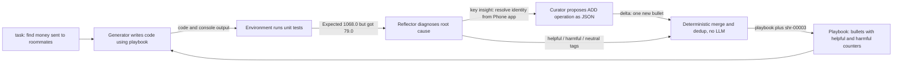
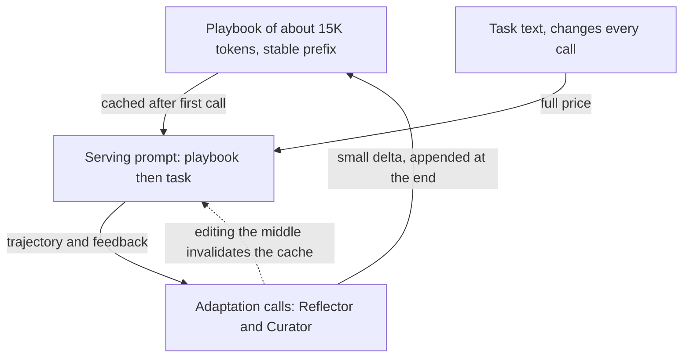

# Agentic Context Engineering: Evolving Contexts for Self-Improving Language Models

> **Paper:** Zhang, Hu, Upasani, Ma, Hong, Kamanuru, Rainton, Wu, Ji, Li, Thakker, Zou, Olukotun (SambaNova Systems, Stanford University, UC Berkeley), 2025 - arXiv:2510.04618 ("ACE") - [abstract](https://arxiv.org/abs/2510.04618) - [local PDF](../../papers/2510.04618.pdf)
>
> **Venue status:** first submitted 6 Oct 2025; the version used for this guide is v3 (29 Mar 2026). The arXiv listing's comment field says "ICLR 2026", and the v3 acknowledgements thank anonymous reviewers and an area chair, so it appears to have been peer reviewed; the paper text itself prints no venue. Every number below was checked against the arXiv v3 rendering of the paper and its figures. If your local PDF is an earlier version, some numbers may differ.

## Read this first

**The claim in one sentence.** If you let a language model keep a long, itemised notebook of strategies and mistakes (a "playbook"), and update that notebook by adding small edits instead of rewriting it, the same frozen model solves noticeably more agent and finance tasks, with no weight updates.

**Who this is for.** Anyone deciding whether context, instructions and memory can replace fine-tuning or a bigger model for an assistant that works over private business documents and tools. It is the most direct piece of evidence in this curriculum for that bet, and also a good place to learn exactly where the evidence stops.

**What you will be able to do afterwards.** Explain the three roles (Generator, Reflector, Curator) and the bullet data structure; trace one failed task through the loop and write the playbook edit by hand; say which of the paper's numbers show what (and which are only associations); build a 60-line version; and list the conditions under which you should not expect the reported gains.

**Reading time.** About 45 minutes for the guide; the paper itself is 32 pages including prompts.

**Have read first.** [ReAct](../02-building/10-react.md) (the agent loop that ACE wraps), [RAG](../02-building/06-rag.md) (context as retrieved evidence), [GPT-3](../01-foundations/03-gpt3.md) (in-context learning, the reason a prompt can change behaviour), and [LoRA](../02-building/09-lora.md) (the weight-editing alternative that ACE is contrasted with). Within this stage, [Dive into Claude Code](28-dive-into-claude-code.md), [Harness engineering](29-harness-engineering.md) and [Context as a tool](30-context-as-a-tool.md) are the neighbouring guides.

**The one thing most people get wrong.** They read "+10.6% on agents" as ACE making a model 10.6 percent better at everything. It is an average, in points, of ACE against selected baselines on one benchmark family, using a 671-billion-parameter model whose Reflector had access to ground-truth answers or unit-test results. The headline that matters more for builders is hiding in the tables: when the feedback signal is weak, the same method can make a model worse than not adapting at all.

## The paper in one worked example

The paper contains no single logged run from start to finish. It does contain, in its appendix prompts, a small worked case that the authors use to teach the Reflector and Curator how to behave (Figures 10 and 11, the AppWorld prompts), plus a snapshot of a finished playbook (Figure 3). This guide stitches those pieces into one trace. **The task and the error numbers come from the prompt examples; the "before" playbook and the exact item numbers are constructed by this guide** and marked as such. The item format comes from the paper (Figure 3 for section names and identifiers, the FiNER Curator prompt in Figure 14 for the counter line).

**The setting.** AppWorld is a benchmark where an agent writes Python code in a console to operate fake apps (a phone contact book, Venmo-style payments, a music app) through their programming interfaces (APIs). Success is decided by hidden unit tests. ACE wraps the standard ReAct agent that AppWorld ships with.

**The task (Figure 11, Example 1):** "Find money sent to roommates since Jan 1 this year".

**Step 0 - the playbook before (constructed).** The playbook is a list of bullets, each with an identifier, two counters and a sentence of advice, grouped into sections. Section names in Figure 3 are "Strategies and hard rules", "Useful code snippets and templates" and "Troubleshooting and pitfalls". Suppose a young playbook holds:

```text
[section: strategies_and_hard_rules]
[shr-00001] helpful=3 harmful=0 :: Always read the API specification (show_api_doc) before calling an API.
[shr-00002] helpful=1 harmful=0 :: Loop over every page_index; many APIs return results in pages.
[section: troubleshooting_and_pitfalls]
[ts-00001]  helpful=2 harmful=0 :: If login fails, try phone number instead of email as username.
```

**Step 1 - Generate.** The Generator prompt (Figure 9) places the playbook between the markers PLAYBOOK_BEGIN and PLAYBOOK_END, followed by a three-shot example and numbered key instructions (for example "always look at API specifications before calling an API" and "call apis.supervisor.complete_task()" when done). The model then works in a multi-step code console: it writes a chunk of code, the environment runs it and returns output, and it writes the next chunk. In the prompt's example the generated code tries to find roommates by scanning Venmo transaction descriptions for keywords such as "rent" and "utilities".

**Step 2 - Execute and observe.** The environment returns an error, and the test report says the total is wrong. Figure 10 gives the numbers: "AssertionError: Expected 1068.0 but got 79.0", and "FAILED - Wrong total amount calculated due to incorrect roommate identification". This is the feedback signal. Everything downstream depends on its quality.

**Step 3 - Reflect.** The Reflector receives the ground-truth reference code, the unit-test report, the playbook, and the trajectory. It returns JSON with five fields, shown in the Figure 10 example: `reasoning`, `error_identification`, `root_cause_analysis`, `correct_approach`, `key_insight`. The key insight there is: always resolve identities from the correct source app (the Phone app for relationships) and never rely on transaction descriptions. The Reflector prompt also tells it to tag each bullet the Generator saw as helpful, harmful or neutral. In this failed attempt no existing bullet addressed identity, so the useful finding is a missing bullet, not a mis-tagged one.

**Step 4 - Curate.** The Curator receives the current playbook and the reflection and must output only what is missing, as JSON (Figure 11, Example 1):

```json
{"reasoning": "...a fundamental principle that should be captured in the playbook...",
 "operations": [{"type": "ADD", "section": "strategies_and_hard_rules",
   "content": "Always resolve identities from the correct source app\n- When you need to identify relationships (roommates, contacts, etc.), always use the Phone app's contact, and never try other heuristics from transaction descriptions ..."}]}
```

**Step 5 - Merge (no language model involved).** Ordinary code assigns the next free identifier and zeroed counters, then appends. The Curator prompt says explicitly that it should not write the identifier itself, "the bullet_id will be added by the system". The playbook after:

```text
[section: strategies_and_hard_rules]
[shr-00001] helpful=3 harmful=0 :: Always read the API specification ...        (unchanged)
[shr-00002] helpful=1 harmful=0 :: Loop over every page_index ...                (unchanged)
[shr-00003] helpful=0 harmful=0 :: Always resolve identities from the correct source app ... Phone app contacts ...   (NEW)
[section: troubleshooting_and_pitfalls]
[ts-00001]  helpful=2 harmful=0 :: If login fails, try phone number ...          (unchanged)
```

**Step 6 - Later use.** On the next relevant task the Generator sees shr-00003, and if it follows it and passes the tests, the Reflector tags it helpful and the counter becomes 1. Figure 3 shows what a mature version of this lesson looks like after many tasks: item shr-00009 reads, in the paper's words, to resolve identities from the phone contacts, use proper datetime range comparisons rather than string matching, and verify both relationship and time criteria before processing. The paper does not say whether shr-00009 is the same item as the one above, rewritten in place, or a separate later item; this guide infers it shows how the same kind of lesson accumulates detail.

**The contrast case (Figure 2).** If instead an LLM rewrote the whole notebook at each step, the paper reports that at adaptation step 60 the context held 18,282 tokens and scored 66.7 accuracy, and at step 61 it held 122 tokens and scored 57.1, below the 63.7 the agent scores with no context at all. Section "Words you need" defines the terms used here; the rest of the guide refers back to this trace as "the roommates example".



Notice that the language model is used three times (Generator, Reflector, Curator) but the edit to the notebook is applied by plain code, and that the Reflector's tags travel to the merge step, not only the new lessons.

## Words you need

| Term | Plain definition | Example from the roommates trace |
|---|---|---|
| Context adaptation | Improving a model's behaviour by changing its input (instructions, strategies, evidence) rather than its weights; also called context engineering (Section 2.1). | The playbook is pasted into the prompt; the weights never change. |
| Playbook | The paper's name for an evolving context: a long, structured list of strategies, rules, snippets and pitfalls, kept comprehensive rather than short (Section 1). | The sectioned list in Step 0. |
| Bullet | One playbook item: metadata (a unique identifier, a helpful counter, a harmful counter) plus content (one small reusable lesson) (Section 3.1). | `[shr-00003] helpful=0 harmful=0 :: Always resolve identities ...` |
| Generator, Reflector, Curator | The three roles: attempt the task using the playbook; diagnose the trajectory against feedback; turn the diagnosis into new bullets (Section 3). | Writes the failing code; finds the Phone-app root cause; emits one `ADD`. |
| Delta | A small set of candidate bullets proposed for the playbook instead of a new full playbook (Section 3.1). | The single new bullet shr-00003. |
| Grow-and-refine | Append new bullets under new identifiers, update existing ones in place (counters), and remove near-duplicates using semantic embeddings, after each delta or lazily when the window is full (Section 3.2). | A near-copy of shr-00003 next week is merged, not stacked. |
| Brevity bias | The tendency of prompt optimisers to converge on short, generic instructions and drop domain detail (Section 2.2). | "Be careful with identities" replacing the Phone app rule. |
| Context collapse | An LLM asked to rewrite its whole accumulated context compresses it into a much shorter, less informative one (Section 2.2, Figure 2). | 18,282 tokens down to 122 in one step. |
| Offline and online adaptation | Offline: build the playbook on the training split, freeze, then test. Online: process the test stream, predicting first and then updating (Section 4.1). | Online: the playbook changes between consecutive test tasks. |
| TGC and SGC | AppWorld's Task Goal Completion (share of individual tasks whose tests all pass) and Scenario Goal Completion (share of scenarios where every task passes). Definitions come from the AppWorld benchmark, not this paper's text. | A passing roommates run raises TGC for that task. |
| GT labels | Whether ground-truth answers are available to the Reflector during adaptation (the table column "GT Labels"). | Figure 10 gives the Reflector reference code. |

## Tutorial 1 - Intuitive understanding

### What was broken before

Imagine an assistant that works for you every day. Each time it makes a mistake you could write a note to its future self. There are two ways to keep notes badly.

The first is to compress. After every mistake you rewrite your whole notebook into a tidy one-page summary. Early on that is fine. But a summary keeps the general ("be careful with contacts") and loses the specific ("the Phone app is the only reliable source of who is a roommate, and filter transactions by that person's email or phone number"). The paper calls the pressure toward short generic prompts **brevity bias** and cites another group's observation that prompt optimisers kept producing near-identical instructions such as "Create unit tests to ensure methods behave as expected" (Section 2.2). The authors also point out that GEPA, a strong prior prompt optimiser, advertises brevity as a strength.

The second bad way is worse and is the paper's showpiece failure. If you ask a language model to rewrite the whole notebook each time, then once the notebook is big the model may squash it. The paper measured this with an existing method, Dynamic Cheatsheet, on AppWorld (Figure 2 and Section 2.2): at step 60 the notebook had 18,282 tokens and the agent scored 66.7; at step 61 it had 122 tokens and scored 57.1. The agent with no notebook scored 63.7. The notebook went from helping (+3.0 points) to hurting (-6.6 points) in one step, and about 99.3 percent of its content vanished (18,282 to 122 tokens; the percentage is this guide's arithmetic). The authors say the issue is not specific to that method but a risk of any end-to-end LLM rewrite. Figure 2 also shows a smaller drop around step 20 (read off the plot, roughly from 10,800 to 6,600 tokens; not stated in the text).

### The idea

Analogy: a mechanic's logbook. A good workshop does not rewrite its manual after every job. A junior writes up what went wrong, a senior decides whether it is already covered, and the clerk files one new numbered card in the right drawer. Cards that keep saving time get ticks; cards that mislead get crosses. The manual only grows by cards and is tidied now and then by checking for duplicates.

Mapping: the junior who writes up the failure is the **Reflector**; the senior who decides what is new is the **Curator**; the mechanic doing the job from the manual is the **Generator**; the numbered cards are **bullets**; the ticks and crosses are the **helpful and harmful counters**; the clerk is the non-LLM merge code.

Where the analogy breaks. A human senior has stable judgement; the paper's Curator is the same language model as the Generator in the main experiments, so it can be wrong in the same ways. The cards are not looked up by the mechanic: in the paper's main runs the whole playbook is pasted into the prompt every time (the paper says the itemised design enables fine-grained retrieval, but its evaluation prompt, Figure 9, shows a single `{{ playbook }}` placeholder). And the paper's ticks and crosses are produced by a model reading a trace, not by observing real outcomes, so they carry the same noise as the Reflector's judgement.

### How it works, step by step

1. **Generate.** The Generator gets the task and the whole playbook and attempts it. In the roommates example it writes code that guesses roommates from Venmo descriptions. It also notes which playbook bullets it relied on or found misleading.
2. **Execute.** The environment runs the code and reports back. Here: expected 1068.0, got 79.0, test FAILED. Without such a signal, the next steps have little to work with.
3. **Reflect.** The Reflector reads the trace, the error, and (when available) the reference answer, and writes a diagnosis: the root cause was using an unreliable source for relationships; the correct approach is to use the Phone app contacts first. It can repeat this step up to a configured number of rounds (the paper sets the maximum to 5 in its experiments, Section 4.2).
4. **Curate.** The Curator compares the diagnosis with the existing playbook and outputs only the missing pieces as `ADD` operations in a named section.
5. **Merge.** Code, not a model, gives each new bullet an identifier, appends it, increments counters on existing bullets, and removes near-duplicates by comparing semantic embeddings (numerical fingerprints of meaning). This step can run after each delta or lazily, only when the context would overflow.
6. **Repeat.** In offline mode this runs over a training set, possibly several passes (epochs); in online mode it runs on the test stream, adapting after each prediction.

### What the results say

All numbers use the paper's default model, DeepSeek-V3.1 (671 billion parameters, non-thinking mode, Section 4.2), unless stated. AppWorld cells are percentages of tasks (TGC) or scenarios (SGC) passed; "average" is the mean of the four columns.

**Baseline.** Plain ReAct scores 63.7 / 42.9 on test-normal (TGC / SGC), 41.5 / 21.6 on test-challenge, average 42.4 (Table 1).

**ACE offline with ground-truth labels** scores 76.2 / 64.3 / 57.3 / 39.6, average 59.4: 17.0 points above plain ReAct (Table 1). In plain terms, about 17 more items out of every 100 pass. On test-normal SGC the jump is 21.4 points (42.9 to 64.3). ICL (training examples stuffed into the prompt) averages 46.0 (+3.6) and GEPA 46.4 (+4.0), so fixed demonstrations or one optimised prompt gave a few points where the playbook gave about 17. Online, Dynamic Cheatsheet reaches 51.9 (+9.5) and ACE online 59.5 (+17.1).

**Without ground-truth labels** offline ACE still averages 57.2 (+14.8), about 2.2 below the labelled run. The paper attributes this to signals the environment gives for free, such as whether code ran.

**Finance (Table 2).** FiNER labels each token of a financial-filing document with one of 139 types; Formula is numeric reasoning over financial concepts; both use XBRL, a tagging format for business reports. Base: 70.7 and 67.5, average 69.1. ACE offline with labels: 78.3 and 85.5, average 81.9 (+12.8); Formula rises 18.0, meaning roughly 18 more questions right per 100. GEPA averages 72.5 (+3.4).

**The headline numbers.** The abstract's "+10.6% on agents and +8.6% on finance" are averages of ACE's margin over selected baselines, in points. The finance figure reproduces from Table 2 (10.9 offline, 6.2 online, mean 8.55); the agent figure does not fully reproduce from Table 1 (see the stuck questions).

**The leaderboard claim.** On the AppWorld leaderboard captured 20 Sep 2025 (Figure 5), the top entry IBM CUGA (GPT-4.1) scored 73.2 / 62.5 on test-normal and 57.6 / 48.2 on test-challenge, about 60.3 average. Offline ACE with the open model averaged 59.4, a near tie; online ACE scored 66.0 TGC and 48.9 SGC on test-challenge, 8.4 and 0.7 above CUGA. The authors footnote that this is a rough reference, not a controlled comparison.

**Cost (Table 4).** Adapting on AppWorld, GEPA took 53,898 seconds and 1,434 rollouts; ACE 9,517 seconds and 357 (82.3 percent less time, 75.1 percent fewer rollouts). On FiNER online, Dynamic Cheatsheet took 65,104 seconds and $17.70 of tokens; ACE 5,503 seconds and $2.90.

### What this does not show

- It does not show that ACE helps a small model. Every main experiment uses a model of 70 billion parameters or more, and the one 70B model tested (Llama-3.3-70B-Instruct, FiNER only) gained just 1.1 to 2.4 points (Table 9).
- It does not show that ACE works without a trustworthy signal. In Table 2, with no labels, online ACE on FiNER scored 67.3, which is 3.4 below the base model's 70.7. The paper says this itself.
- It does not show a pure effect of the Reflector. Its ablation (Table 3) shows the Reflector and multi-epoch training add only a couple of average points on top of an already large gain.
- It does not report repeated runs or error bars; with differences of 1 to 3 points, many comparisons cannot be separated from noise.
- It does not test long-running production use: the adaptation sets are benchmark-sized (for example 90 AppWorld training queries, Table 12), not months of real usage.

### Teach-back

1. Why does asking an LLM to rewrite its whole notebook go wrong, and what does ACE do differently?

<details>
<summary>Answer</summary>

A rewrite makes the model regenerate everything, and models tend to shorten long inputs, so detail is lost silently (18,282 tokens became 122 in one step). ACE never regenerates the notebook: the Curator only proposes additions and ordinary code merges them.

</details>

2. In the roommates example, which role found the root cause, which decided it was new, and which step assigned the identifier?

<details>
<summary>Answer</summary>

The Reflector found the root cause (identity from the wrong source), the Curator decided it was missing, and the non-LLM merge code assigned the identifier and zeroed the counters.

</details>

3. Why is "ACE works without labels" true for AppWorld but only partly true for FiNER?

<details>
<summary>Answer</summary>

AppWorld gives a dependable signal: code passes tests or does not. On FiNER without labels the Reflector must guess whether an answer was right; offline ACE gained 0.4 points and online ACE lost 3.4 (Table 2).

</details>

4. A colleague says "ACE beat the best production agent". What do you reply?

<details>
<summary>Answer</summary>

Only partly. The authors call it a rough reference. The tie is on the 59.4 offline average (CUGA about 60.3); the clear lead is on one split (test-challenge) with the online variant, while CUGA's test-normal scores (73.2, 62.5) beat online ACE's (69.6, 53.6). And the model is a 671B open model, not a small one.

</details>

## Tutorial 2 - Practitioner understanding

### The design in concrete terms

**Data structure.** The playbook is a list of bullets grouped into named sections. Figure 3 shows three AppWorld sections with identifier prefixes: `shr-` (strategies and hard rules), `code-` (code snippets and templates, with the snippet embedded in the bullet) and `ts-` (troubleshooting and pitfalls). The FiNER Curator prompt (Figure 14) shows a section `formulas_and_calculations` and the rendered line `[ctx-00263] helpful=1 harmful=0 :: <content>`. Metadata is an identifier plus helpful and harmful counters; content is one small unit such as a strategy, a domain concept or a failure mode (Section 3.1).

**Roles.** The same model plays all three roles in the main results, "to isolate the benefit of context construction itself" (Section 4.2), so no stronger Reflector secretly teaches a weaker Generator.

| Role | Input | Output | Notable instructions |
|---|---|---|---|
| Generator (Fig. 9) | Playbook between PLAYBOOK_BEGIN and PLAYBOOK_END, three-shot example, task | Code steps in a console | Read API specs before calling; one chunk of code per step; loop over every page; call the completion function |
| Reflector (Fig. 10) | Reference code, unit-test report, playbook, trajectory | JSON: reasoning, error identification, root cause, correct approach, key insight; a helpful, harmful or neutral tag per bullet used | Look for wrong source of truth, bad filters, formatting, missing authentication |
| Curator (Figs. 11, 14) | Task, playbook, trajectory, reflection (FiNER version adds token budget and playbook statistics) | JSON `{reasoning, operations:[{type:"ADD", section, content}]}` | Add only what is missing; never regenerate the playbook; quality over quantity |

**Hyperparameters.** Batch size 1 (one delta per sample); at most 5 Reflector rounds; at most 5 offline epochs (Section 4.2). Sensitivity (Tables 19 to 21): reflection rounds 1, 3, 5, 10 give AppWorld test-normal averages 61.3, 65.8, 67.6, 65.2 (base 53.3); de-duplication thresholds 50, 70, 90 percent give FiNER 77.0, 73.9, 78.6; pruning triggers 10K, 50K, 100K tokens give 78.6, 78.4, 78.3 (base 70.7). The embedding model is not named.

**Left unspecified.** How tags become counter increments, how pruning ranks bullets, and what exactly "no incremental update" meant in Table 18. The released code (github.com/ace-agent/ace) is the place to check.

### A minimal version

A sketch of about 50 lines. `llm(prompt) -> str` is your model call; `embed(text) -> list[float]` any embedding function; `run_task(task, playbook_text) -> (trace, feedback)` runs your agent and returns a transcript plus an execution signal (test report, error text or label).

```python
import json, math
from dataclasses import dataclass

@dataclass
class Bullet:
    id: str; section: str; text: str; helpful: int = 0; harmful: int = 0
    def render(self): return f"[{self.id}] helpful={self.helpful} harmful={self.harmful} :: {self.text}"

class Playbook:
    PREFIX = {"strategies_and_hard_rules": "shr", "code_snippets": "code", "troubleshooting": "ts"}
    def __init__(self, embed, dedup=0.9, max_tokens=50_000):
        self.items, self.embed, self.dedup, self.max_tokens = [], embed, dedup, max_tokens
    def render(self):
        return "\n".join(f"[section: {s}]\n" + "\n".join(b.render() for b in self.items if b.section == s)
                         for s in self.PREFIX)
    def add(self, section, text):                        # deterministic merge, no LLM
        v = self.embed(text)
        for b in self.items:
            if cosine(self.embed(b.text), v) >= self.dedup:
                b.helpful += 1; return                   # duplicate: reinforce, do not stack
        n = 1 + sum(b.section == section for b in self.items)
        self.items.append(Bullet(f"{self.PREFIX[section]}-{n:05d}", section, text))
    def tag(self, tags):                                 # {"shr-00003": "helpful", ...}
        for b in self.items:
            b.helpful += tags.get(b.id) == "helpful"; b.harmful += tags.get(b.id) == "harmful"
    def prune_if_needed(self):                           # lazy refinement
        while self.items and len(self.render()) / 4 > self.max_tokens:
            self.items.remove(max(self.items, key=lambda b: b.harmful - b.helpful))

def cosine(a, b):
    dot = sum(x * y for x, y in zip(a, b))
    return dot / (math.sqrt(sum(x * x for x in a)) * math.sqrt(sum(y * y for y in b)))

def ace_step(task, pb, llm, run_task, rounds=5):
    trace, feedback = run_task(task, pb.render())                    # Generate + Execute
    reflection = ""
    for _ in range(rounds):                                          # Reflect, iteratively
        reflection = llm(REFLECTOR_PROMPT.format(playbook=pb.render(), trace=trace,
                         feedback=feedback, previous=reflection))    # JSON text
    pb.tag(json.loads(reflection).get("bullet_tags", {}))
    delta = json.loads(llm(CURATOR_PROMPT.format(playbook=pb.render(), reflection=reflection)))
    for op in delta["operations"]:                                   # Curate, then Merge
        if op["type"] == "ADD": pb.add(op["section"], op["content"])
    pb.prune_if_needed()
```

`REFLECTOR_PROMPT` and `CURATOR_PROMPT` are your adaptations of Figures 10 and 11. The Curator must return `{"reasoning": str, "operations": [{"type": "ADD", "section": str, "content": str}]}`; the code lets only `ADD` through, matching the single operation in the paper's FiNER prompt. Wrap `json.loads` in a retry, since a malformed reply otherwise silently skips a learning step. The pruning rule and the tag-to-counter mapping are choices made in this sketch, not quotes from the paper.

### What it costs

**Adaptation (Table 12, AppWorld offline, 1 epoch, 1 reflection round, 90 training queries).** GEPA used 204,076,096 input and 1,870,188 output tokens; ACE used 39,250,925 and 307,128 (80.8 and 83.6 percent lower). Of ACE's input, 31.0M is the Generator, 4.7M the Reflector and 3.6M the Curator, so about 79 percent is the task itself and the self-improvement layer adds roughly a fifth (this guide's arithmetic). ACE actually used more rollouts there (2,075 against 1,455), while Table 4(a) reports 357 against 1,434 under the main configuration; the paper does not reconcile the two.

**Serving (Tables 14 and 15).** ACE used 58.6M evaluation input tokens against GEPA's 27.0M (+117.4 percent). Average input per rollout rose from 11,298 (base) to 24,912, so this guide infers the playbook adds about 13,600 tokens per call. Output per rollout barely moved (115.0 against 101.8).

**Caching.** In a separate GPT-5.1 study, 91.8 percent of ACE's input tokens came from cache, cutting billed input cost by 82.6 percent versus full price (Section 4.7). Back-calculating, cached tokens were billed at about a tenth of full price (inference).

**Worked example (assumptions are this guide's).** A 15,000-token playbook, 1,000 queries a month, $0.50 per million input tokens: 15M tokens, $7.50 uncached. With the paper's cache pattern: 15M x (0.082 + 0.918 x 0.1) = 2.6M effective tokens, about $1.30. The playbook is cheap to carry; the real costs are latency and the Reflector and Curator calls per task (Table 13 shows average inputs near 29,000 tokens each).

**Latency.** Adaptation latency fell 82.3 percent (AppWorld offline versus GEPA, about 15.0 h to 2.6 h) and 91.5 percent (FiNER online versus Dynamic Cheatsheet, about 18.1 h to 1.5 h), averaging 86.9 percent.



The diagram makes one design point: keep the playbook a stable prefix and batch its updates, otherwise the cache saving in the paper disappears.

### How it fails

| Symptom | Likely cause | Mitigation |
|---|---|---|
| Accuracy falls below the unadapted base | Weak or absent feedback; spurious lessons enter (Table 2: online FiNER without labels 67.3 against 70.7) | Adapt only where an objective check exists; hold out a test set before adopting |
| Playbook shrinks suddenly | A step rewrites the whole context (Figure 2) | Allow only additive operations; never let a model emit the full playbook |
| Playbook grows without improving | Near-duplicates; no pruning | De-duplicate by embedding; prune over a token budget (10K to 100K triggers were stable, Table 21) |
| A bad lesson keeps being applied | A wrong diagnosis; counters never turn against it | Filter on harmful counts; periodic review; the paper suggests contradiction detection and pruning (A.4) |
| Unstable adaptation | Too many or too few reflection rounds | Start at 3 to 5; 1 under-extracts and 10 can degrade (Table 19) |
| Gains much smaller than the paper's | Weaker backbone gives noisier reflections (Llama-3.3-70B: +1.1 to +2.4, Table 9) | Use the strongest Reflector you can afford; Table 16 shows only modest Reflector effects on FiNER |
| No gain on simple tasks | Task needs concise instructions (the paper names HotPotQA and Game of 24, Section 5) | Skip ACE |

### Evaluating your version

- **Metric.** The outcome your business cares about, measured by an automatic check where possible (a test, a reconciliation, an exact-match field). AppWorld's "all checks pass" is a good model.
- **Test set.** At least 100 held-out tasks never used in adaptation. The paper evaluates on 160 AppWorld queries (Table 14) and reports no confidence intervals; at that size differences of 1 to 3 points are hard to separate from noise (this guide's judgement). With 100 tasks a 17-point jump is detectable and a 2-point jump is not.
- **Baselines.** No playbook; your best hand-written prompt; a few-shot prompt of training examples (the paper's ICL); ACE with labels; ACE with only your production signal. The gap between the last two tells you whether you can deploy without labels.
- **Stop rule.** Stop when the playbook reaches its token budget, or when three consecutive batches of 20 tasks fail to improve the held-out score by more than the noise measured by running the baseline twice. Freeze and re-test before deploying a playbook, and version every playbook so a bad one can be reverted.

### Adopt, adapt or skip

**Adapt.** For an assistant over private business documents, take the data structure and the discipline, not the whole pipeline: a versioned, itemised list of rules and domain facts as learned memory; a model that proposes additions only as small deltas; deterministic merging; helpful and harmful counts; and a human or automatic check before a bullet becomes permanent. This is cheap, auditable, and consistent with getting good performance from open or smaller models through context rather than retraining.

**Do not adopt the claim that the loop self-improves without supervision.** The large unsupervised gains came from environments with crisp pass or fail signals. Document work (reconciling invoices, classifying transactions, extracting fields) often has partial signals, so build the signal first (known-answer checks, reviewer corrections stored as labels) and add the Reflector afterwards. The paper's remark that readable contexts allow selective unlearning is a design argument, not an experiment.

**Skip** the full loop where a one-page instruction already saturates performance, for models far below 70B parameters until you have measured it, and for regulated outputs whose learned lessons cannot be audited before use.

## Tutorial 3 - Researcher understanding

### Formal setup

Let a task stream be x_1, ..., x_T. A fixed model M is given a context C_t (the playbook, a set of bullets) and produces a trajectory tau_t from x_t; the environment or a label supplies feedback f_t. The Reflector produces insights I_t from (C_t, tau_t, f_t), repeated up to r rounds; the Curator produces a delta D_t from (C_t, I_t); and C_{t+1} = Merge(C_t, D_t), where Merge appends bullets with new identifiers, updates counters and removes embedding-near-duplicates. The notation is this guide's formalisation of Sections 3.1 and 3.2; the paper does not use it. The rewrite baseline is C_{t+1} = M(C_t, I_t), one generation that must reproduce all of C_t. Collapse is |C_{t+1}| much smaller than |C_t| together with a performance drop. A bullet is a tuple (id, section, text, h, k) with h and k the helpful and harmful counts.

**Toy instance.** C_t has 40 bullets of about 60 tokens, so about 2,400 tokens. A rewrite must output 2,400 tokens plus a lesson; if it returns 120, 95 percent of the content is gone. The ACE Curator outputs one 60-token bullet and the merge appends it (2,460 tokens), leaving the 40 earlier bullets untouched by construction.

Offline adaptation trains on a labelled split and evaluates held-out tasks with pass@1 (one attempt per task); online adaptation predicts before updating on the shuffled test stream, with the same order for every method (Section 4.1).

### The claims, stated precisely

1. **Collapse exists for LLM-rewrite memories:** one case, Dynamic Cheatsheet on AppWorld, 18,282 to 122 tokens in a step, accuracy 66.7 to 57.1 against an unadapted 63.7 (Figure 2). A single run, not a measured frequency.
2. **Structured incremental updates beat the baselines on AppWorld and finance with DeepSeek-V3.1** (Tables 1 and 2): +17.0 offline and +17.1 online over plain ReAct, and several points over ICL, GEPA and Dynamic Cheatsheet.
3. **ACE can work without ground-truth labels where execution feedback is informative** (Table 1: 57.2 against 59.4) **and can degrade without reliable signals** (Table 2).
4. **Components contribute** (Tables 3 and 18); incremental updates are the largest measured one.
5. **Adaptation is cheaper than GEPA and Dynamic Cheatsheet** (Table 4, Tables 12 and 13).
6. **The effect holds across four model families,** smaller on the weakest (Appendix A.1), and is fairly robust to Reflector quality and hyperparameters (A.4, A.6).

### Evidence, table by table

**Figure 2 (collapse).** Context tokens against adaptation steps (0 to about 80). 18,282 tokens and accuracy 66.7 at step 60; 122 tokens and 57.1 at step 61; baseline 63.7. Identifies that a rewrite can destroy a context in one step (an existence proof for one method and run); associates only the claim that this is general. A smaller drop appears near step 20 (read off the plot, roughly 10,800 to 6,600 tokens).

**Table 1 (AppWorld).** Rows: ReAct; offline ICL, GEPA, ACE with and without labels; online Dynamic Cheatsheet and ACE. Averages: 42.4; 46.0; 46.4; 59.4 and 57.2; 51.9; 59.5. Identifies, with same-model and same-order controls, that the whole method beats the listed baselines here; it does not isolate components. Online ACE is marked as using no labels, but Table 3 shows that row is "ACE + offline warmup", and the paper does not say whether the warmup used labels. Without warmup the online average is 56.1.

**Table 2 (finance).** Adds MIPROv2 (a Bayesian prompt optimiser from DSPy). Base 70.7 / 67.5 / 69.1; ACE offline with labels 78.3 / 85.5 / 81.9; without labels 71.1 / 83.0 / 77.1; online with labels 76.7 / 76.5 / 76.6; online without labels 67.3 / 78.5 / 72.9; Dynamic Cheatsheet online without labels 68.3 / 62.5 / 65.4. Identifies label dependence per task: Formula gains survive without labels (+15.5 offline) while FiNER's vanish (+0.4) or reverse (-3.4 online). The paper does not explain this; this guide speculates that Formula answers have a checkable numeric structure, untested.

**Tables 5 to 9 (other models).** GPT-OSS-120B on AppWorld: base 34.6, ACE offline 40.5 with labels and 39.4 without, online 42.2; Dynamic Cheatsheet 33.1. GPT-5.1 (test-normal only): base 54.2; ACE offline 60.2 and 61.3 without labels; online 65.8. Finance, GPT-OSS-120B: base 69.1, ACE 81.2 offline, 77.8 online, Dynamic Cheatsheet 60.9. Finance, GPT-5.1: base 73.3, ACE 82.8 offline, 77.4 without labels. Llama-3.3-70B-Instruct (FiNER only): base 62.5; ACE 64.9, 64.2 without labels, 63.6 online; GEPA 59.41 and Dynamic Cheatsheet 59.0, both below base. Identifies that the effect is not tied to one model; the weakest model gained least.

**Tables 10 and 11.** DDXPlus (medical diagnosis): base 75.2, ACE 90.2 (+15.0), GEPA 76.4. BIRD-SQL (text-to-SQL, judged by GPT-4o-mini): base 47.8, ACE 52.9 (+5.1), GEPA 52.2; GEPA is better on Moderate (51.9 against 50.7) and Challenging (57.2 against 56.6). Offline only, 1,000 sampled training examples, no label-free runs.

**Tables 4 and 12 to 15 (cost).** Covered in Tutorial 2. They identify cost under the authors' configurations only ("heavy" GEPA settings; the cache study ran on a different model).

### Ablations and what they isolate

- **Table 3.** Holds the delta-update structure fixed and removes the Reflector's refinement and multi-epoch training. The ablated variant still has a Curator and bullets, so it already captures most of the gain (55.1 of 59.4 average, 12.7 of the 17.0 points).
- **Table 18.** Isolates itemised delta merging against an unspecified alternative (presumably a full regenerate step; an inference), on one split and one run.
- **Table 16 (FiNER, offline).** Reflector GPT-OSS-120B gives 76.6 (+5.9), DeepSeek-V3.1 78.3 (+7.6), GPT-5.1 78.5 (+7.8), with Generator and Curator fixed. A much weaker Reflector keeps about three-quarters of the gain; a much stronger one adds 0.2.
- **Table 17 (harmful Reflector).** Injecting a harmful insight every X steps: X=1 gives 66.7 (4.0 below base), X=5 76.1, X=10 77.0, X=25 77.8, X=50 and 100 78.2, none 78.3. It tests tolerance to scheduled adversarial noise, not realistic subtle errors.
- **Tables 19 to 21.** Non-monotonic: the 70 percent dedup threshold gives 73.9 against 77.0 and 78.6 at 50 and 90, a dip of up to 4.7 points that the text calls "mild".

### Threats to validity specific to this paper

- **No variance estimates.** One number per cell; no seeds or intervals. Internal evidence of run-to-run spread: the 5-round row of Table 19 gives test-normal 72.6 / 62.5, while Table 1 gives 76.2 / 64.3 for a nominally similar configuration (the paper does not say whether epochs differ).
- **Labels blurred.** The AppWorld Reflector prompt (Figure 10) takes reference code and a unit-test report. The paper does not state exactly what the "no labels" runs drop, so "no ground truth" may still include a test report that acts as a verifier.
- **Online mode learns from the test stream.** That is fine for a system that learns on the job, but it is not comparable with held-out results, and the leaderboard comparison mixes the two.
- **Arithmetic inconsistencies.** The prose gives margins of 12.3 and 11.9 over ICL and GEPA where Table 1 gives 13.4 and 13.0; the 10.6 headline reproduces only with the prose values. The rollout counts in Tables 4(a) and 12 differ.
- **Baseline tuning.** GEPA ran in "heavy" mode with a 57-query validation split on AppWorld; ACE used no validation set; ICL filled the window with as many training examples as fit. Per-method tuning effort is not reported.
- **Scale and scope.** Main model: 671B mixture-of-experts; others 70B, 120B and GPT-5.1; nothing below 70B. Every benchmark has a verifier or exact-match labels, the best case for a Reflector.
- **Benchmark-specific content.** Figure 3 bullets about songs, artists and phone contacts encode AppWorld idiosyncrasies; that is the purpose, but they would not transfer (a reading of Figure 3, not a result).
- **Status.** The arXiv comment says ICLR 2026, so the work was reviewed, but it rests on single-run tables.

### Open problems and follow-ups

1. How much of the gain survives when the feedback is a noisy outcome signal (say 70 percent accurate) rather than a unit test? A dose-response curve would turn the paper's qualitative warning into a number.
2. Does a small Generator with a large Reflector work? Table 16 varies only the Reflector, with a 671B Generator.
3. How does the playbook behave at 50,000 to 100,000 tokens? The whole playbook is always inserted; selective retrieval of bullets, which the design allows, is not evaluated.
4. Are the counters calibrated? A bullet's helpful and harmful counts could be audited by ablating that bullet.
5. Can a playbook be distilled into a LoRA adapter, or complement one? The paper frames ACE as an alternative to fine-tuning.
6. A playbook that learns from interaction can learn from adversarial input; Table 17 touches this only through scheduled, instructed corruption.

### What would change my mind

- A hand-written playbook of equal length, with no Reflector or Curator, matching ACE on AppWorld would make "long, specific context" the explanation, not the loop.
- Repeated runs showing seed-to-seed spread as large as ACE's few-point margin over GEPA would weaken the baseline comparisons, though not the 17-point gap over plain ReAct.
- A replication on a sub-30B open model with a same-size Reflector: near-zero gains would bound the claim to large models; 10 points or more would strongly support the repository's thesis.
- A label-free finance-style task where ACE reliably improves would contradict the paper's own caution.
- A full-rewrite prompt saying "preserve all details" that avoids collapse would shift credit from architecture to prompt discipline.

## Reading map for the PDF

| Section or figure | What it contains | First pass | Guide section that answers the questions it raises |
|---|---|---|---|
| Abstract, Section 1 (Figure 1) | Claims, the two named failure modes, headline +10.6 and +8.6 | Read | Read this first; Tutorial 1 results |
| Section 2.2, Figure 2 | Brevity bias; context collapse with 18,282 to 122 tokens | Read | Tutorial 1, "What was broken before" |
| Section 3, Figures 3 and 4 | Three roles, workflow, a finished playbook | Read | Worked example; Tutorial 2 design |
| Sections 3.1 and 3.2 | Bullet structure, delta updates, grow-and-refine | Read | Tutorial 2, "The design in concrete terms" |
| Sections 4.1 and 4.2 | Datasets, metrics, baselines, same-model rule | Read | Tutorial 3, formal setup |
| Table 1, Section 4.3 | AppWorld results and the leaderboard claim | Read | Tutorial 1 results; Tutorial 3 evidence |
| Table 2, Section 4.4 | Finance results and label dependence | Read | Tutorial 3 evidence; stuck questions |
| Section 4.6, Table 3 | Ablation | Read | Tutorial 3 ablations |
| Section 4.7, Table 4 | Cost and speed | Skim | Tutorial 2, "What it costs" |
| Section 5 | Discussion and limitations | Read | Tutorial 1, "What this does not show" |
| Appendix A (Tables 5 to 21) | Other models, domains, cost breakdown, robustness, hyperparameters | Skim; read A.4 and Table 9 | Tutorial 3 evidence and ablations |
| Appendices B, C, D | Related work, ACE versus GEPA and Dynamic Cheatsheet, leaderboard snapshot | Skip first pass | Where this sits in the curriculum |
| Appendix F (Figures 6 to 14) | The prompts, including the worked-example cases | Read Figures 9 to 11 | Worked example; Tutorial 2 role table |

## Questions readers get stuck on

### Is ACE training the model?

No. The model's weights are never changed; the only thing that changes is a text document (the playbook) that is inserted into the prompt. The paper positions this as an alternative to fine-tuning methods such as LoRA (Section 5), noting contexts are cheaper to update and readable by humans. The costs move: instead of training compute you pay for longer prompts and the extra Reflector and Curator calls.

### Why is the same model used as Generator, Reflector and Curator?

It is a fairness control. If a stronger model wrote the lessons, any gain could be a stronger model teaching a weaker one rather than context construction doing the work (Section 4.2). The cost is that the Reflector is only as good as the Generator's own understanding, which is why the paper's limitation section says ACE relies on a reasonably strong Reflector. Table 16 separately shows a weaker or stronger Reflector changes the FiNER gain by -1.7 and +0.2 points.

### What does "GT labels: no" actually remove?

The column marks whether the Reflector can compare against ground truth during adaptation. On AppWorld, the Reflector prompt (Figure 10) includes reference code and a unit-test report; the "no" rows rely on "signals naturally available during execution" such as code success or failure (Section 4.3). The paper does not spell out exactly what is withheld, so treat "no labels" as "no reference answers", not "no feedback at all". The finance tables show what happens when the feedback is truly thin: FiNER gains vanish.

### Why do the abstract numbers (+10.6, +8.6) not match any single table cell?

They are averages of margins over baselines, mixing offline and online settings. For finance: offline margin over ICL, MIPROv2 and GEPA averages 10.9, online margin over Dynamic Cheatsheet averages 6.2, and (10.9 + 6.2) / 2 = 8.55, rounded to 8.6. For agents the paper writes 12.3, 11.9 and 7.6, whose mean is 10.6, but Table 1 gives margins of 13.4 and 13.0 for the offline pair (59.4 against 46.0 and 46.4); the discrepancy is unexplained in the text.

### Is "context collapse" a problem with all long contexts?

No. It is specifically a problem when a model is asked to regenerate the whole context in one go. A very long context that is only appended to does not collapse by this mechanism. The paper's evidence for collapse is one run of one method (Dynamic Cheatsheet on AppWorld) that dropped from 18,282 to 122 tokens; it generalises the risk by argument, not by measuring how often it happens.


### Why not just put all training examples in the prompt (ICL)?

The paper does: that is its ICL baseline. It gained 3.6 average points on AppWorld (46.0 against 42.4) and 0.5 on finance (69.6 against 69.1). The authors read this as raw demonstrations being less useful than distilled lessons, but they never test a hand-written equivalent of ACE's bullets, so structure and curation are not separated from the lessons simply being more targeted.

### Does the leaderboard result mean an open model now beats production agents?

It means a system with an open model reached a similar average to the top entry and exceeded it on one split. The authors caution that CUGA is a rough contextual reference rather than a baseline (footnote in Section 4.3), that its internals differ, and that the ranking is a September 2025 snapshot (Figure 5). CUGA's test-normal scores (73.2 / 62.5) are higher than online ACE's (69.6 / 53.6). And the model is a 671-billion-parameter mixture-of-experts model, so "smaller" is relative to GPT-4.1, not to anything you would run on a laptop.


### Why would a longer context not cost much more?

Because many serving systems reuse the cached internal state for a repeated prompt prefix. The paper measured 91.8 percent of input tokens served from cache on GPT-5.1, an 82.6 percent reduction in billed input cost (Section 4.7). That only holds when the playbook is a stable prefix; if you update it after every task and place it early in the prompt, the cache is invalidated each time. Putting task-specific text after the playbook and batching playbook updates keeps the prefix stable (this is a guide recommendation, not a paper result).

## Prerequisites you actually need

### Prerequisite 1 - Context window, tokens and prompt caching

A token is a chunk of text (roughly three-quarters of an English word). A model reads a limited number of tokens at once (its context window) and providers charge per token. If the beginning of a prompt is identical to an earlier call, many providers serve that prefix from a cache at a fraction of the price. Worked numbers: a 15,000-token playbook plus a 500-token task is 15,500 input tokens; if 15,000 are cached and cached tokens cost 10 percent, the bill is 15,000 x 0.1 + 500 = 2,000 token-equivalents, about 13 percent of full price. The paper uses this in Section 4.7 and Tables 14 and 15. Reference: [GPT-3](../01-foundations/03-gpt3.md) for why a prompt can steer a model at all.


### Prerequisite 2 - Offline versus online adaptation, and train versus test splits

Offline means learn on a training split, freeze, and then evaluate on unseen tasks. Online means evaluate on a stream, learning after each answer. Toy example: with 100 test tasks, an offline playbook is built on separate training tasks and never changes while those 100 are scored; an online playbook is updated after task 1, then used for task 2, and so on, so later tasks benefit from earlier ones and early tasks do not. Table 1 uses both, and their numbers are not directly comparable; Section 4.1 defines the protocol.

### Prerequisite 3 - Embedding similarity for de-duplication

An embedding turns text into a list of numbers so that similar meanings give similar lists. Cosine similarity compares two lists on a scale of -1 to 1. Toy example: vectors (1, 0) and (0.9, 0.436) have cosine 0.9, so a 0.9 threshold treats them as duplicates; (1, 0) and (0.5, 0.866) have cosine 0.5, so they are kept separate. The paper's de-duplication threshold experiment (Table 20) tests 50, 70 and 90 percent, and does not say which embedding model is used. Any standard sentence-embedding library gives you a version of this.

### Prerequisite 4 - Points, percent and relative percent

A change from 42.9 to 64.3 is 21.4 percentage points; as a relative change it is 21.4 / 42.9, about 50 percent. The paper uses "%" for both: the abstract's +10.6% is an average of point differences, while the "-11.7% TGC" in Appendix C.2 is a relative drop (8.9 points on 76.2). Always check which one a "%" refers to, because a 4-point gain on a base of 63.7 is a different story from a 4-point gain on a base of 21.6. Appendix C.2 and the abstract are where this matters.

## Where this sits in the curriculum

**Read before:** [ReAct](../02-building/10-react.md) for the loop ACE wraps, [RAG](../02-building/06-rag.md), [GPT-3](../01-foundations/03-gpt3.md) and [LoRA](../02-building/09-lora.md).

**Versus the nearest papers.** Against ReAct: ReAct fixes a prompt and shows an agent can interleave thinking and acting; ACE keeps ReAct as is and asks how the prompt itself can improve with experience. Against RAG: RAG fetches external documents at query time; ACE's playbook is internal experience distilled from the model's own attempts, pasted in whole in the main runs rather than retrieved. Against LoRA: LoRA stores what it learns in trained weight matrices; ACE stores it as readable text that can be audited, edited and deleted, at the price of prompt length and dependence on the Reflector's judgement.

**For the stage's through-question** (is a thin runtime around one model with a few good tools the right architecture?), ACE shows the thin part can still learn if the learning lives in an inspectable context. The evidence also constrains the answer: the benefit depends on a high-quality feedback signal and a strong model, so the runtime needs the verification discipline in [Harness engineering](29-harness-engineering.md), and the placement, caching and pruning of the playbook is the territory of [Context as a tool](30-context-as-a-tool.md) and [Dive into Claude Code](28-dive-into-claude-code.md).

**For the repository's wider goal** (strong results from open or smaller models through context, instructions and memory), this is the most direct evidence in the curriculum, with a precise boundary: gains are demonstrated on open models of 70B parameters and above, mostly a 671B one, and shrink on the weakest model tested.

**Read next:** [Context as a tool](30-context-as-a-tool.md), then the Dynamic Cheatsheet and GEPA papers the authors compare against.

## Checkpoint

1. **Explain.** What changes between step 60 and step 61 in Figure 2, and why does ACE's design prevent the same event?

<details>
<summary>Answer</summary>

At step 60 the notebook was 18,282 tokens and the agent scored 66.7; at step 61, after an LLM rewrote it, it was 122 tokens and the score was 57.1, below the 63.7 with no notebook. ACE lets the Curator emit only new bullets that code appends, so earlier bullets are never regenerated and can vanish only through explicit de-duplication or pruning.

</details>

2. **Compute.** Offline ACE averages 59.4 on AppWorld and ReAct 42.4. By how many points, and what relative percentage, is ACE better? What is the mean margin over ICL (46.0) and GEPA (46.4)?

<details>
<summary>Answer</summary>

59.4 - 42.4 = 17.0 points; 17.0 / 42.4 = 40.1 percent relative. Margins over ICL and GEPA are 13.4 and 13.0, mean 13.2; the paper's prose says 12.3 and 11.9, which do not match its table.

</details>

3. **Critique.** The abstract says ACE adapts "without labeled supervision". Using Table 2, write two sentences on where that holds and where it does not.

<details>
<summary>Answer</summary>

It holds on AppWorld, where execution results exist: offline ACE without labels averages 57.2 versus 59.4 with labels. It fails on FiNER: offline gain without labels is 0.4 (71.1 against 70.7) and online ACE loses 3.4 (67.3), and the table caption itself says adaptation depends critically on feedback quality.

</details>

4. **Compute.** A 15,000-token playbook, 2,000 queries a month, $0.50 per million input tokens, 91.8 percent of tokens cached at a tenth of the price. What is the monthly playbook-token bill with and without caching?

<details>
<summary>Answer</summary>

Without caching: 15,000 x 2,000 = 30M tokens, $15.00. With caching: 30M x (0.082 + 0.918 x 0.1) = 30M x 0.1738, about 5.2M effective tokens, about $2.61, matching the paper's roughly 82.6 percent saving.

</details>

5. **Critique.** Table 3's "without Reflector or multi-epoch" row averages 55.1 against 59.4 for full ACE. What does this say about the claim that a dedicated Reflector is a key innovation?

<details>
<summary>Answer</summary>

Removing both costs 4.3 points, but 12.7 of the 17.0-point gain over ReAct survives without them, so most of the gain comes from the bullet structure with incremental updates and the Curator. The row also removes multi-epoch training at the same time, so the Reflector alone is not isolated. The effect is real but secondary.

</details>
