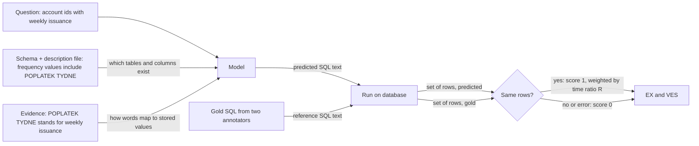
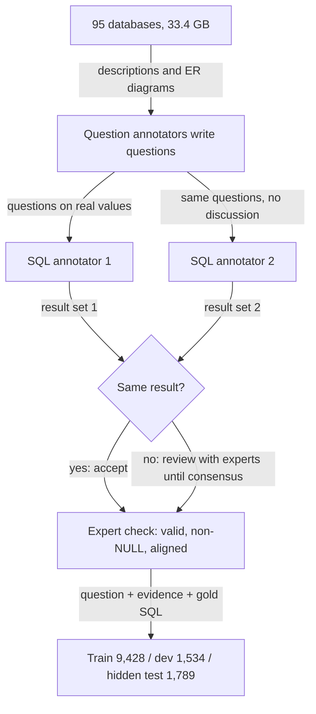

# Can LLM Already Serve as A Database Interface? A BIg Bench for Large-Scale Database Grounded Text-to-SQLs (BIRD)

> **Paper:** Li, Hui, Qu, Yang, Li, Li, Wang, Qin, Geng, Huo, Zhou, Ma, Li, Chang, Huang, Cheng and Li (University of Hong Kong, Alibaba DAMO Academy and others), 2023 - [arXiv abstract](https://arxiv.org/abs/2305.03111) - [local PDF](../../papers/2305.03111.pdf)
>
> **Short name:** BIRD (BIg Bench for LaRge-scale Database grounded text-to-SQL). The arXiv abstract page lists the comment "NeurIPS 2023" (a peer-reviewed venue) and versions v1 (4 May 2023) to v3 (15 Nov 2023). **Rendering followed:** the arXiv HTML of v3; section and table numbers follow it, including its Table 4, which sits in Appendix B.1. Figures 1 and 2 were read as images; Figures 3 to 7 and 9 to 11 were not inspected, so numbers from them appear only where the text repeats them.

## Read this first

**The claim in one sentence.** Language models that look excellent on the older Spider benchmark (tiny, tidy databases) fall far short when databases are large, values are messy, questions need a business definition missing from the schema, and speed matters: the best plain model reached 54.89% correct against 92.96% for trained human annotators.

**Who this is for.** Anyone deciding how an agent should get answers from company analytics data. BIRD is the foundation of this stage: it fixes the task (question, schema and a hint in; SQL out), the score (does the query return the right rows) and the gap (models versus people).

**Afterwards you will be able to** trace one BIRD example from question to score; compute execution accuracy and the efficiency-weighted score by hand; see why the benchmark's "evidence" sentences are the ancestor of a semantic layer; read a leaderboard number without over-trusting it; and write a small scorer that treats different queries as equally right.

**Reading time.** About 50 minutes. **Have read first:** [HumanEval](../03-evaluation-and-code/14-humaneval.md) and [SWE-bench](../03-evaluation-and-code/16-swe-bench.md) (both grade by running the output, as BIRD does) and [Chain-of-thought](../02-building/07-chain-of-thought.md) (one baseline adds "Let's think step by step"). See also the [glossary](../../references/glossary.md) and [math bridge](../../references/math-bridge.md).

**Database vocabulary in sixty seconds.** A *database* is an organised store of data. A *table* is one grid in it, such as accounts; a *row* is one record; a *column* is one named field. The *schema* lists tables, columns and types. A *primary key* uniquely names each row; a *foreign key* points at another table's primary key. *SQL* (Structured Query Language) asks a database questions; a *query* is one request. A *JOIN* glues rows from two tables by a key. *Aggregation* collapses rows into one number (COUNT, SUM, AVG); *GROUP BY* does it per group. A *SQL dialect* is a vendor's flavour (SQLite, PostgreSQL, BigQuery, Snowflake). A *data warehouse* is a database built for analysis, usually large. A *semantic layer* is a curated set of business definitions ("active customer", "net revenue") between users and raw tables. *Text-to-SQL* turns a plain-language question into SQL.

**The one thing most people get wrong.** They read 54.89% as "GPT-4 gets half of real business questions right". It is the share of 1,789 hidden-test questions where the model, *given a human-written hint sentence for every question*, returned the same rows as the reference query on 15 SQLite databases. Without the hint the same model scored 34.88%. The number is a ruler for comparing systems on one fixed task, not a forecast of business accuracy.

## The paper in one worked example

This guide uses the examples in Figure 1 and the database description in Figure 2(c), because together they show all three BIRD challenges. Data the paper does not print is labelled "constructed by this guide".

### Part A - the "weekly issuance" question (Figure 1 middle, Figure 2c)

**Question** (paraphrased from Figure 1): list the account ids of customers who chose the weekly issuance statement (the periodic account report a bank issues). The column recording how often is `frequency`.

**The trap.** A fluent English reader would write `WHERE frequency = 'weekly'`. The word "weekly" is not stored. Figure 2(c) lists `frequency` as Text with values spelled POPLATEK MESICNE, POPLATEK TYDNE and POPLATEK PO OBRATU (each followed by an explanation cut off in the image).

**The external knowledge evidence** (Figure 1): 'POPLATEK TYDNE' stands for weekly issuance. An expert writes one such sentence per question.

**The reference ("gold") SQL**, as Figure 1 shows it:

```sql
SELECT account_id FROM account WHERE account.frequency = 'POPLATEK TYDNE';
```

**Inputs in the paper's notation (Section 2, Equation 1).** Question Q, database D (columns C and tables T) and evidence K go in; a model with parameters theta produces SQL Y. In words: Y = f(Q, D, K given theta).

**Step by step.**

1. The model reads Q, the schema (a table `account` with `account_id`, `district_id`, `frequency`, `date`, per Figure 2c) and K.
2. Without K it guesses how "weekly issuance" is stored, typically `frequency = 'weekly'`, which matches no rows.
3. With K it gets the literal string and writes an exact match.
4. The evaluator runs gold and predicted SQL on the same database and compares the two sets of rows (Section 5, Equation 2). Equal sets score 1; anything else, including an error, scores 0.

**Constructed by this guide:** say `account` has six rows and ids 2 and 4 have frequency POPLATEK TYDNE. Gold returns {2, 4}. The guess returns {} and scores 0; the hinted query returns {2, 4} and scores 1. A query `WHERE district_id = 3` could also return {2, 4} if the rows lined up, and would score 1 for the wrong reason; the minimal version runs that case.

### Part B - "eligible for loans" (Figure 1 middle, second bubble)

Question: how many accounts are eligible for loans in New York City? Evidence: loan eligibility requires account type "OWNER". The figure's answer is `SELECT COUNT(*) FROM account WHERE account.type = 'OWNER' AND city = 'NY';`. The knowledge is a business rule, and 'NY' is the database's spelling of New York City. Its `account` table has `type` and `city` columns that Figure 2c lacks, so the figures are schematic.

### Part C - the dirty salary column (Figure 1 left)

Question: what is the average salary of the worst-performing managers? Salaries are stored as text such as US$57,500.00, US$19,500.00 and US$69,000.00 (the figure's three rows). The figure's SQL uses `SUBSTR(T1.salary, 4)` (drop the first three characters, "US$"), `REPLACE(..., ',', '')` (delete commas) and `CAST(... AS REAL)` (text to decimal), then `AVG`, joining employee to position and filtering performance 'Poor' and title 'Manager'. One value: "US$57,500.00" becomes "57,500.00", then "57500.00", then 57500.0. If those three rows were the only matches (constructed by this guide), the average is (57,500 + 19,500 + 69,000) / 3 = 48,666.67.

### Part D - the same answer, 5.6 times faster (Figure 1 right, Section 5)

Two SQL texts answer one NBA-coach question. The "normal semantic parser" query runs in **22.4 s**; the "efficient" one in **4.0 s**. The first filters with `coachID IN (subquery)`, the second with `EXISTS (...)`. As read from the image, the question says "more than 2 NBA teams" while both queries test `>= 2`; treat that as a likely slip in the figure. The paper does not say which is gold, so the arithmetic below assumes (this guide's choice) the slow one is gold.

**VES for this question.** R = square root of E(gold) / E(pred), E being run time (Equation 4). R = sqrt(22.4 / 4.0) = sqrt(5.6) = 2.37: the question adds 2.37, not 1. Reversed roles give sqrt(4.0 / 22.4) = 0.42. A wrong answer adds 0 whatever its speed. The plain time saving is (22.4 - 4.0) / 22.4 = 82.1% (this guide's arithmetic).



Notice that the *text* of the two queries is never compared; only the rows returned and, for VES, the run time.

## Words you need

| Term | Plain definition | Example from the worked example |
|---|---|---|
| Text-to-SQL | Turning a question into a SQL query a database can run | The weekly question becomes `SELECT account_id ...` |
| Gold SQL | Reference query written by annotators and checked by experts | `frequency = 'POPLATEK TYDNE'` in Part A |
| External knowledge evidence | One hint sentence per question mapping words to values, formulas or rules | "'POPLATEK TYDNE' stands for weekly issuance" |
| Database description file | Per-database sheet of full column names, descriptions, types and value meanings | Figure 2(c): `frequency`, Text |
| Dirty or noisy values | Stored values not in the form a query needs | Salaries stored as "US$57,500.00" |
| Schema linking | Choosing which tables and columns a question refers to | Linking "weekly issuance" to `account.frequency` |
| Execution accuracy (EX) | Share of questions whose predicted SQL returns the gold rows | Part A: {2, 4} equals {2, 4}, score 1 |
| Valid efficiency score (VES) | EX where each correct query is weighted by its speed against gold, under a square root | Part D: weight 2.37 |
| Double-blind annotation | Two annotators write SQL independently; matching results accepted, mismatches go to experts | Figure 2(b) |
| In-context learning (ICL) | Using a frozen model through its prompt, no training | GPT-4 and Claude-2 baselines |
| Fine-tuning (FT) | Updating model weights on the training set | The T5 baselines |

## Tutorial 1 - Intuitive understanding

### What was broken before

The standard test was Spider. Table 1 compares: Spider has 10,181 examples over 200 databases averaging 5.1 tables and about 2 thousand rows; BIRD has 12,751 examples over 95 databases averaging 7.3 tables and about 549 thousand rows. Spider-sized databases fit in a prompt, values are tidy and questions name columns directly. The authors report (Introduction) that the top Spider execution accuracy had risen from 53.5% to 85.3% in three years, which led to the title question.

Part A is the failure: a model fluent at schema-level parsing writes a clean query with the wrong value. In a real warehouse values are codes and legacy spellings, and the answer depends on knowing them. Big databases also cannot be shown to the model in full (Introduction).

### The idea

**Analogy.** Hire an analyst fluent in SQL who has never seen your database. Spider asks whether they can query a small, labelled spreadsheet. BIRD asks whether they can answer real questions on half a million rows per table where "weekly" is POPLATEK TYDNE, salaries are text, "eligible for loans" is a rule nobody wrote in the schema, and the boss notices a 22-second query.

**Where the analogy breaks.** A human can explore the database and ask what "eligible" means. BIRD baselines get one shot (Section 6.4 mentions a "Chat With Database" mode only as a direction), and the hint is free and always correct. Real hints are missing, stale or disputed. BIRD also counts only returned rows, so a query right for the wrong reason scores as right.

### How it works, step by step

1. **Collect real databases (Section 3.2).** 32% from Kaggle, 48% from the CTU Prague Relational Learning Repository, 20% built by the authors from open tables with synthesised schemas and constraints. In total 95: 69 train, 11 dev, 15 hidden test (69 + 11 + 15 = 95). Total 33.4 GB across 37 domains; the largest, Donor, is 4.5 GB (Section 4).
2. **Write description files (Section 3.3).** Full names and value meanings (Figure 2c); this is where POPLATEK TYDNE is recorded.
3. **Write questions (Appendix B.2).** Eleven native English speakers passed an entrance test (10 questions on each of 3 databases, three expert votes, at least 8 valid per database).
4. **Two SQL annotators answer independently (Section 3.4, Figure 2b).** Matching result sets are accepted; mismatches go to experts. The authors argue two skilled people rarely make the same wrong result on large data. The more efficient equivalent SQL becomes gold.
5. **Experts check each pair (Section 3.4).** The SQL must run and return a non-NULL result, and text, evidence and SQL must align; if a result was NULL, experts altered the question's conditions until it returned something.
6. **Score (Section 5)** with EX (correctness) and VES (correctness weighted by speed), in two settings (Section 6.5): "w/o knowledge" and "w/ knowledge" (evidence concatenated with question and schema).



Notice that agreement between the SQL writers is a *result* match, the same notion the final score uses.

### What the results say

Numbers are execution accuracy (EX) in percent on the hidden test set with knowledge (Table 2) unless stated; "x" means that of every 100 questions about x had the correct rows.

- **Humans: 92.96**, or 72.37 without evidence. The abstract quotes the first.
- **GPT-4 (`gpt-4-32k`, zero-shot): 54.89**, from 34.88 without evidence. The hint is worth 20.01 points, 20 more correct per 100, a 57% relative increase.
- **Claude-2 (`claude-2.0`): 49.02** (34.60 without). **ChatGPT (`gpt-3.5-turbo`): 39.30** (26.77). **ChatGPT with chain-of-thought: 40.08**. **Codex (`code-davinci-002`): 36.47**. **PaLM-2 (`text-bison-001`): 33.04**.
- **GPT-4 + DIN-SQL: 55.90** (dev 50.72). DIN-SQL is a prompting recipe from Spider adding value sampling, few-shot examples and self-correction (Section 6.2). Its test gain over plain GPT-4 is 1.01 points.
- **Fine-tuned T5 (Text-to-Text Transfer Transformer):** Base 12.89, Large 20.94, 3B 24.05, trained on the 9,428 training examples.
- **Gap to humans:** 92.96 - 54.89 = 38.07 points with evidence; 72.37 - 34.88 = 37.49 without.
- **Spider versus BIRD (Section 6.3, Figure 6):** the same models score much worse on BIRD; the text does not repeat the plotted values, so this guide does not quote them.

**Efficiency (Table 3, VES, test, with knowledge).** GPT-4 60.77, ChatGPT 51.40, ChatGPT with chain-of-thought 56.56, Claude-2 55.77, human 90.27. VES can exceed EX because a query faster than gold counts for more than 1 (GPT-4: 60.77 against 54.89). Section 6.4 adds two small experiments: on 10 dev questions ChatGPT already got right, expert rewrites by rule saved 77.75% of run time on average, and configuring indexes saved up to 87.3%. The index experiment is described very briefly.

**Where models fail (Section 6.6; 500 sampled ChatGPT errors).** Wrong schema linking 41.6%, misunderstanding database content 40.8%, misunderstanding the evidence 17.6% (sum 100.0, so one label per error). About 4 in 10 failures pick wrong tables or columns, 4 in 10 invent or misremember database content, and 2 in 10 mishandle the hint, for example pasting the formula `DIVIDE(SUM(spent), COUNT(spent))` as if it were SQL.

### What this does not show

- That models would score 54.89% on your questions: BIRD's databases are public datasets averaging 7.3 tables; a warehouse can have hundreds.
- Anything about open-weight large language models: the only open models are fine-tuned T5 up to 3 billion parameters.
- Safety, permissions, ambiguity, multi-turn dialogue or dialects beyond SQLite.
- That evidence sentences can be produced automatically; every question gets a perfect human hint.
- Repeatability: no intervals or repeated runs are reported.

### Teach-back

**1. In Part A, why does the model fail without the evidence, and what does the failure look like?**

<details>
<summary>Answer</summary>

"Weekly" is not stored; the value is POPLATEK TYDNE. The model writes a valid query with a plausible wrong value that runs without error and returns zero rows. That silent wrongness is what execution accuracy catches and an unattended agent would miss.
</details>

**2. Correct rows, but the query is three times slower than gold. What do EX and VES give?**

<details>
<summary>Answer</summary>

EX gives 1. VES gives R = sqrt(1/3), about 0.58. Wrong rows would give 0 on both.
</details>

**3. Which human number (92.96 or 72.37) should a company compare with?**

<details>
<summary>Answer</summary>

92.96 is with the evidence and 72.37 without (Table 2). If your analysts work from the raw schema alone, 72.37 is the reference; if the agent has curated hints, 92.96. The abstract quotes only the first.
</details>

**4. Name the three error categories and which one a semantic layer mainly attacks.**

<details>
<summary>Answer</summary>

Wrong schema linking (41.6%), misunderstanding database content (40.8%), misunderstanding evidence (17.6%). A semantic layer shrinks and names what the model sees, so it helps the first two and supplies the evidence for the third; this mapping is the guide's inference, not an experiment.
</details>

## Tutorial 2 - Practitioner understanding

### The design in concrete terms

**One benchmark record**, constructed by this guide from Section 2 and the datasheet (the paper prints no file format):

```json
{ "db": "financial",
  "question": "List the account ids of accounts that chose weekly issuance statements.",
  "evidence": "'POPLATEK TYDNE' stands for weekly issuance.",
  "gold_sql": "SELECT account_id FROM account WHERE frequency = 'POPLATEK TYDNE'" }
```

The datasheet (Appendix A.2) lists 12,751 questions, 12,751 evidence sentences, 95 databases, 95 folders of description CSVs and 12,751 gold SQLs. Splits are 9,428 train, 1,534 dev and 1,789 hidden test, which sum to 12,751. Train and dev databases are public; the 15 test databases were curated "using actual tabular data" so models have not seen them (Appendix A.2, a response to contamination concerns).

**Difficulty labels (Appendix B.1).** Four 1-to-3 ratings (question understanding, knowledge reasoning, data complexity, SQL complexity) yield simple (30%), moderate (60%) and challenging (10%).

**Question types (Section 4).** Fundamental types: match-based 83.9%, ranking 20.3%, comparison 16.7%, counting 30.4%, aggregation 15.7%. Reasoning types (needing external knowledge): domain knowledge 23.6%, numeric computing 24.5%, synonym 7.2%, value illustration 70.1%. These sum to 167.0 and 125.4, so a question can carry several labels (inference). Value illustration means a phrase-to-value mapping, such as "center" being `pos = C` in the professional basketball database.

**Baselines (Section 6.1, Appendix B.4).**

| Item | Setting reported |
|---|---|
| Fine-tuned | T5 Base, Large, 3B; question plus serialised schema in; max input 1024, max output 512, batch 32; Adafactor, linearly decayed learning rate 5e-5; one A100 80GB; seed 1 |
| Prompted | Codex, ChatGPT, GPT-4, Claude-2, PaLM-2; zero-shot "programming-based prompts" (CREATE-TABLE style, cited from another paper); Azure OpenAI API; temperature 0 |
| ChatGPT | Extra 1-shot pseudo example because outputs carried unexpected explanations (Figure 9 shows the prompt; not inspected) |
| Chain-of-thought | The sentence "Let's think step by step." before the SQL |
| Knowledge fusion | Evidence concatenated with question and schema; a better method is left as future work |

The paper does not say how many example rows per table appear in the prompt, whether every table is always included, or how oversized schemas are handled beyond T5's 1024-token cap.

**Metric details (Appendix B.7, B.8).** Rows are compared as a set, so order and duplicates are ignored, because annotators disagreed about DISTINCT. The authors flag false positives for order-sensitive questions and say explicit-order questions are under 1% of BIRD. VES times each query 100 times on one CPU, drops outliers beyond mean plus or minus 3 standard deviations, and averages; E is bounded between a tiny epsilon and 30 seconds. The standard deviation of VES over 10 trials is 0.043 (dev) and 0.025 (test), unit unstated.

### A minimal version

BIRD is a benchmark, so the minimal version is a scorer. It builds a toy SQLite database (**constructed by this guide**: six `account` rows plus 200,000 padding rows so timing is measurable, and an index on `frequency`), runs gold and candidate queries, compares row *sets* as Appendix B.7 describes and applies the square-root time ratio.

```python
import sqlite3, time, statistics, math

db = sqlite3.connect(":memory:")
db.execute("CREATE TABLE account(account_id INTEGER PRIMARY KEY, city TEXT, type TEXT, frequency TEXT, district_id INTEGER)")
db.executemany("INSERT INTO account VALUES (?,?,?,?,?)", [
    (1, "NY", "OWNER", "POPLATEK MESICNE", 1), (2, "NY", "OWNER", "POPLATEK TYDNE", 3),
    (3, "LA", "DISPONENT", "POPLATEK MESICNE", 2), (4, "NY", "OWNER", "POPLATEK TYDNE", 3),
    (5, "SF", "DISPONENT", "POPLATEK PO OBRATU", 2), (6, "LA", "OWNER", "POPLATEK MESICNE", 1)])
db.executemany("INSERT INTO account VALUES (?,?,?,?,?)",   # 200,000 padding rows so timing is measurable
    [(1000 + i, "LA", "DISPONENT", "POPLATEK MESICNE", 2) for i in range(200000)])
db.execute("CREATE INDEX idx_freq ON account(frequency)")

def rows(sql):
    try:
        return set(db.execute(sql).fetchall())    # a set: row order and duplicates ignored
    except sqlite3.Error as e:
        return None                               # an error never matches

def seconds(sql, reps=30):
    ts = []
    for _ in range(reps):
        t = time.perf_counter(); db.execute(sql).fetchall(); ts.append(time.perf_counter() - t)
    m, s = statistics.mean(ts), statistics.pstdev(ts)
    return statistics.mean([x for x in ts if abs(x - m) <= 3 * s] or ts)   # drop 3-sigma outliers

GOLD = "SELECT account_id FROM account WHERE frequency = 'POPLATEK TYDNE'"
CASES = [
  ("same rows, different shape", GOLD, "SELECT DISTINCT account_id FROM account WHERE frequency IN ('POPLATEK TYDNE') ORDER BY account_id DESC"),
  ("different logic, still right", GOLD, "SELECT account_id FROM account WHERE frequency LIKE '%TYDNE'"),
  ("ignores the evidence string", GOLD, "SELECT account_id FROM account WHERE frequency = 'weekly issuance'"),
  ("right rows by luck", GOLD, "SELECT account_id FROM account WHERE district_id = 3"),
  ("count: forgot OWNER, equal by luck", "SELECT COUNT(*) FROM account WHERE type='OWNER' AND city='NY'", "SELECT COUNT(*) FROM account WHERE city='NY'"),
  ("count: forgot city (wrong)", "SELECT COUNT(*) FROM account WHERE type='OWNER' AND city='NY'", "SELECT COUNT(*) FROM account WHERE type='OWNER'"),
  ("MySQL YEAR() in SQLite", GOLD, "SELECT account_id FROM account WHERE YEAR('2020-01-01') = 2020"),
]
ex = ves = 0.0
for name, gold, pred in CASES:
    ok = rows(pred) is not None and rows(pred) == rows(gold)
    r = math.sqrt(seconds(gold) / seconds(pred)) if ok else 0.0   # R = sqrt(E(gold)/E(pred)), 0 if invalid
    ex += ok; ves += r
    print(f"{'PASS' if ok else 'FAIL'}  R={r:5.2f}  {name}")
print(f"EX = {ex:.0f}/{len(CASES)} = {100*ex/len(CASES):.1f}%   VES = {100*ves/len(CASES):.1f}%")
```

**Real output from running it on this laptop (constructed toy data; timing ratios vary between runs, and a second run printed VES 29.6% where the first printed 28.5%):**

```text
PASS  R= 0.97  same rows, different shape
PASS  R= 0.01  different logic, still right
FAIL  R= 0.00  ignores the evidence string
PASS  R= 0.02  right rows by luck
PASS  R= 1.00  count: forgot OWNER, equal by luck
FAIL  R= 0.00  count: forgot city (wrong)
FAIL  R= 0.00  MySQL YEAR() in SQLite
EX = 4/7 = 57.1%   VES = 28.5%
```

**Reading the run.**

- Line 1: `DISTINCT`, `IN` and `ORDER BY ... DESC` look nothing like gold but return {2, 4}. Both are right; R is near 1 because both use the index.
- Line 2: `LIKE '%TYDNE'` is also right and passes EX, but a leading wildcard cannot use the index, so it scans 200,006 rows. R of 0.01 means thousands of times slower (the plain time ratio is 1 / R squared), so it adds almost nothing to VES: equally correct, very different cost.
- Line 3: the evidence was ignored, no rows returned. Line 4: `district_id = 3` is a wrong rule that matches only because the toy rows were built so weekly accounts share district 3. It passes, a *false positive*. Line 5: counting New York accounts without OWNER passes because every New York account here is an owner.
- Line 6 fails (4, not 3). Line 7 fails with `no such function: YEAR`, the dialect slip the paper reports in Section 6.6 (`Year()` where SQLite needs `STRFTIME()`).

### What it costs

**Building BIRD (reported).** 97,654 USD, split 10% recruiting interns, 80% developing the benchmark, 10% refining it (Appendix A.1). Pay was 0.6 USD per validated question and 1 USD per SQL; about 1,340 SQLs were confirmed per week; collection ran September 2022 to March 2023 (Appendices A.3, B.2). Crowd pay alone, this guide's arithmetic: 12,751 x 0.6 = 7,650.6 USD plus two SQL writers at 1 USD = 25,502 USD, about 33,153 USD, roughly a third of the total; the rest is experts, tooling and management (not broken down).

**A mini-benchmark for your warehouse (constructed).** Assume 200 questions, two analysts per question at 15 minutes per SQL, and 20 minutes of expert review on 30% disagreement. Authoring: 200 x 2 x 0.25 = 100 hours; review: 200 x 0.3 x (20 / 60) = 20 hours; about 120 hours, three working weeks for one analyst. Your disagreement rate also measures how ambiguous your business definitions are.

**Running an evaluation (constructed).** With 1,500 input and 150 output tokens per question over BIRD's 1,534 dev questions: 1,534 x 1,650 = 2.53 million tokens. Self-hosted, that is hours of GPU time; hosted, price it at your provider's current rates. Temperature 0 means one run per question.

### How it fails

| Symptom | Likely cause | Mitigation | Source |
|---|---|---|---|
| Zero or wrong rows | Wrong table or column (schema linking) | Show only relevant tables; add column descriptions | 41.6% of ChatGPT errors (Section 6.6) |
| Invented table such as `lap_records` | Model misremembers structure, worse on large databases | Put the real schema in the prompt; check every identifier against the catalog | 40.8% (Section 6.6, Figure 11) |
| Hint formula copied instead of SQL | Evidence treated as code | Translate definitions into the dialect in the semantic layer | 17.6% (Section 6.6) |
| `no such function`, wrong date function | Dialect mismatch | Name the dialect; test on the real engine | Section 6.6; toy run |
| Wrong averages, cast errors | Numbers stored as text with symbols | Clean in a view or semantic layer | Figure 1 left; no rate reported |
| Right rows, slow query | Poor subquery or join form | Time limit; rewrite rules; check the plan | 77.75% and 87.3% savings (Section 6.4) |
| Scorer says right, answer wrong | Set comparison; luck | Several data states; order-sensitive check for ranked questions | Appendix B.7; toy run |
| Answers differ on repeated asks | Ambiguous question (does "different" mean DISTINCT?) | Clarify, or state the interpretation | Appendix B.7 |

### Evaluating your version

- **Metric.** Execution accuracy on result sets with the same set convention; add VES only once accuracy is stable.
- **Test set.** At least 200 of your own questions, gold SQL from two independent authors, and a business-meaning note each. This guide's sampling arithmetic: at 50% true accuracy, 200 questions give a 95% interval of about plus or minus 7 points (1.96 x sqrt(0.25 / 200) = 0.069); BIRD's 1,534 dev questions give about plus or minus 2.5. Differences smaller than the interval are noise.
- **Baseline.** Run with hints removed (BIRD's w/o knowledge) and with hints; the difference measures what your semantic layer is worth. Keep a trained analyst's score on a sample as the human reference (BIRD: 72.37 and 92.96).
- **Stop rule.** Decide in advance, for example: release to internal users only if accuracy is at least 85% with a lower bound above 80%, and no failure category exceeds a set share. If two prompt variants differ by less than the interval, stop tuning.

### Adopt, adapt or skip

**Adopt** the evaluation recipe: grade by executing SQL and comparing rows; gold from two independent authors with mismatches reconciled; report with and without hints. Adopt the finding that definitions in the input matter: +20.01 points for GPT-4 and +12.88 for fine-tuned T5-3B (Table 2, test). Adopt a time limit on every generated query.

**Adapt** the evidence sentence into a maintained semantic layer: governed metric definitions, value dictionaries (POPLATEK TYDNE means weekly) and join rules, retrieved per question. In BIRD, experts corrected evidence until gold SQL was derivable (Section 3.4), so 54.89% is optimistic for any system that must find its own hints.

**Skip** using the BIRD score to pick a production model. The paper tests no open-weight large language model, no dialect but SQLite, no clarification and no permissions, and its model list (GPT-4, Claude-2, ChatGPT) is 2023 history; the *shape* of the problem survives, not the absolute numbers.

**What a team letting an agent query a warehouse must still build, because the paper gives no evidence for it:** a semantic layer; an evaluation set from its own warehouse and questions; access control (read-only role, row and column permissions, cost and time caps, logging); dialect testing for its engine (the paper lists PostgreSQL and MySQL as future work, Section 8); and a way for the agent to ask or decline. For how these fit together see [the data-access pattern](../../../agents/data-access/README.md).

## Tutorial 3 - Researcher understanding

### Formal setup

**Task (Section 2, Equation 1).** Y = f(Q, D, K | theta): Q a question, D = <C, T> the database (columns, tables), K the evidence string, theta the parameters (frozen for prompted models), Y a SQL query.

**Execution accuracy (Equations 2 and 3).** With V_n the result set of the n-th gold SQL and V-hat_n that of the predicted SQL, EX = (sum over n of indicator(V_n, V-hat_n)) / N, the indicator being 1 if equal and 0 otherwise. Appendix B.7 says equal means equal as sets.

**VES (Equation 4).** VES = (sum over n of indicator(V_n, V-hat_n) x R_n) / N with R_n = sqrt(E(Y_n) / E(Y-hat_n)), E the run time averaged over 100 runs after dropping outliers (Appendix B.8).

**Toy instance (constructed).** N = 4. Q1 correct, gold 2.0 s, prediction 0.5 s: R = 2. Q2 correct, 1.0 s each: R = 1. Q3 correct, gold 1.0 s, prediction 4.0 s: R = 0.5. Q4 wrong rows. EX = 3/4 = 75%; VES = (2 + 1 + 0.5 + 0) / 4 = 87.5%. A prediction four times faster earns 2, not 4; the authors say the root damps abnormally fast or slow outliers (Section 5).

**Property.** VES is not capped at 1 per question, so it can exceed EX; Appendix B.8's prose on R is garbled, Equation 4 is not.

### The claims, stated precisely

1. BIRD has 12,751 pairs on 95 databases totalling 33.4 GB in 37 domains (Abstract, Section 3.2, Appendix A.2), 69/11/15 databases for train/dev/test and 9,428/1,534/1,789 examples.
2. On the same models BIRD is harder than Spider (Section 6.3, Figure 6; values not in text).
3. Evidence raises every model's EX (Table 2) and VES (Table 3); the authors read this as database values and knowledge mattering (Section 6.5).
4. The best model is far below humans: 54.89 against 92.96, or 55.90 with DIN-SQL.
5. Run time fell 77.75% on average through rule-based rewriting (10 examples) and up to 87.3% through indexes (Section 6.4).
6. ChatGPT errors split 41.6 / 40.8 / 17.6 over 500 samples (Section 6.6).

### Evidence, table by table

**Table 1.** Rows: WikiSQL (80,654 examples; 26,521 databases; 1 table and 17 rows per database), Spider (10,181; 200; 5.1; 2K), KaggleDBQA (272; 8; 2.3; 280K), BIRD (12,751; 95; 7.3; 549K). The check-mark columns did not survive in the HTML and were not verified. BIRD has about 274 times Spider's rows per database; an association between datasets, not an experiment.

**Table 2 (EX).** Rows are models; columns are dev and test, each without and with knowledge. GPT-4 test 34.88 to 54.89; Claude-2 34.60 to 49.02; human 72.37 to 92.96 (no dev entries). With-minus-without is a controlled comparison (same model and questions, one input changed), so it identifies the effect of the hint *as written by the benchmark's experts*; it does not identify the gain from a retrieved or generated hint. Dev and test move together (GPT-4 dev 30.90 to 46.35).

**Table 3 (VES).** GPT-4 test 40.20 to 60.77; human 70.36 to 90.27. Section 6.4's "higher EX tends to give higher VES" is an association across rows with exceptions: ChatGPT with chain-of-thought (VES 56.56) beats Claude-2 (55.77) although Claude-2 leads in EX (49.02 against 40.08). Codex's test VES with knowledge (41.60) exceeds its EX (36.47).

**Table 4 (ChatGPT by difficulty; Appendix B.1, cited as "Table B.1" in the text).** Test EX with knowledge: simple 49.21, moderate 31.89, challenging 20.70, total 39.30; without: 35.41, 19.46, 12.28, total 26.77. Weighting by the stated 30/60/10 mix does not reproduce the totals: dev (without knowledge) gives 0.3 x 31.08 + 0.6 x 13.29 + 0.1 x 12.08 = 18.5, not 24.05; test gives 23.5, not 26.77. So the dev and test mixes must differ from 30/60/10 (inference); per-split counts are not given.

**Error analysis (Section 6.6, Figure 11).** An association from one model's sampled errors; it gives neither the cost of each type nor other models' mixes.

**Efficiency experiments (Section 6.4).** Ten dev questions ChatGPT already answered correctly, optimised by specialists: anecdote-sized. The 87.3% index figure has no stated sample size.

### Ablations and what they isolate

- **With versus without evidence** isolates the value of a perfect human hint; every row gains, from +5.22 (T5-Base dev) to +20.01 (GPT-4 test).
- **Chain-of-thought (ChatGPT).** Without hints it helps slightly (dev 24.05 to 25.88; test 26.77 to 28.95); with hints it is mixed (dev 37.22 to 36.64; test 39.30 to 40.08). The authors speculate that internal multi-step reasoning is "not compatible" with external evidence (Section 6.5); no experiment tests this.
- **T5 size.** Dev with knowledge: 11.54, 19.75, 23.34 (Base, Large, 3B); no scaling law is claimed.
- **Fine-tuned versus prompted.** T5-3B (24.05) trails the weakest prompted model (PaLM-2, 33.04), but size, pre-training and prompting are confounded.
- **DIN-SQL** bundles value sampling, few-shot examples and self-correction without ablating them, so +1.01 (test) and +4.37 (dev) cannot be assigned to any part.

### Threats to validity specific to this paper

- **Possible pre-training exposure** of train and dev databases (public sources); the authors respond only by curating the 15 test databases. Leakage is not measured.
- **Oracle-quality hints.** Evidence is corrected until gold SQL is derivable (Section 3.4), so the with-knowledge column behaves like an upper bound for hint-supplying systems (inference).
- **Non-empty answers only.** Experts altered conditions until results were non-NULL, so "no rows" and "cannot be answered" are under-tested.
- **Lenient grading.** Sets ignore duplicates and order (Appendix B.7); the authors quantify only the order issue (under 1%), not duplicate or luck cases.
- **Annotation quality.** The datasheet says it is "virtually impossible" for a complex dataset to be free of errors and invites reports (Appendix A.2). Any later community critique of BIRD annotation errors is outside this paper and outside what this guide fetched, so it is not assessed.
- **Human baseline (Appendix B.9).** Humans are the SQL annotators on an unassisted first pass over the final two of ten batches (the test split), after eight batches of expert correction; they saw the evidence; time limits are not described. Eight of ten batches suggests about 80% for train plus dev, but 9,428 + 1,534 is 86% of 12,751, so batches were probably unequal (inference).
- **Single runs.** A gap like 49.02 against 54.89 exceeds the sampling interval on 1,789 questions (about plus or minus 2.3 points at 50%); DIN-SQL's 1.01-point test gain is well inside it.
- **SQLite only**, which the authors note makes query-plan access hard (Section 8).
- **One error analysis, one model**, chosen as "prevalent and cost-efficient" (Section 6.6).

**Inconsistencies and unverifiable items found (flagged, not corrected).**

1. The abstract frames GPT-4 at 54.89% as best, yet Table 2's GPT-4 + DIN-SQL row is 55.90 and Section 6.2 calls it the new state of the art.
2. The abstract's human 92.96% is the with-evidence figure; 72.37 appears only in Table 2.
3. Table 4 is cited as "Table B.1" in Appendix B.1 and as "Table 4" in Section 6.5.
4. The 30/60/10 difficulty mix does not reproduce Table 4's totals.
5. Section 3.4 records evidence "if utilized", while Appendix A.2 counts 12,751 evidence sentences for 12,751 questions.
6. Appendix B.8's description of R compares the prediction with itself.
7. In Figure 1 (right), as read from the image, "more than 2" pairs with `>= 2`; Figures 1 and 2 show different `account` columns.
8. The VES standard deviations (0.043, 0.025) have no unit.
9. The paper gives no count of example rows per table or schema-size handling for prompts.
10. Table 1's check-mark columns were not verified; Figure 6's values are not in the text.

### Open problems and follow-ups

- Large schemas, other dialects and enterprise warehouse questions: [Spider 2.0](./34-spider-2.md).
- Ambiguity and asking back: [BIRD-Interact](./38-bird-interact.md).
- Generating or retrieving the hint automatically (future work, Section 6.5 and Appendix B.4).
- Training on execution feedback and flexible pipelines: [ReFoRCE](./35-reforce.md), [FlexSQL](./36-flexsql.md), [Arctic-Text2SQL-R1](./37-arctic-text2sql-r1.md); the wider field is in the [survey](./33-text2sql-survey.md).
- Security of model-written SQL: [prompt-to-SQL injection](./39-prompt-to-sql-injection.md).

### What would change my mind

- A fresh-warehouse replication where BIRD accuracy tracks warehouse accuracy within a few points would soften the "ruler, not forecast" caution.
- Independent audits finding many gold queries wrong or ambiguous would force a re-reading of the 92.96% human number; this paper cannot answer that.
- Automatically generated evidence at near-oracle quality would make the with-knowledge column the realistic setting.
- Systematic divergence between the 15 hidden-test and the 11 public dev databases, tied to pre-training exposure, would validate the contamination worry.

## Reading map for the PDF

| Section or figure | What it contains | First pass | Guide section that answers its questions |
|---|---|---|---|
| Abstract, 1, Figure 1 | Three challenges, headline numbers | Read | The paper in one worked example |
| 2 | Equation 1 | Read | Formal setup |
| 3, Figure 2 | Sources, description files, evidence, double-blind annotation | Read | How it works, step by step |
| 4, Table 1, Figures 3 and 4 | Sizes, question types, SQL statistics | Skim | The design in concrete terms |
| 5 | EX and VES equations | Read | Formal setup |
| 6.1 to 6.3, Table 2 | Baselines, EX, Spider comparison | Read | What the results say |
| 6.4, Table 3 | Efficiency | Read | What it costs |
| 6.5, 6.6, Figure 7 | Evidence analysis, error analysis | Read | How it fails |
| 7, 8, 9 | Related work, limits, conclusion | Skim 8, skip the rest | Threats to validity |
| Appendix A | Splits, cost, licence (CC BY-NC 4.0) | Skim | What it costs |
| Appendix B.4 to B.9 | Hyper-parameters, errors, metric details, human baseline | Read B.4, B.7, B.8, B.9 | A minimal version |

## Questions readers get stuck on

### What exactly does "execution accuracy" count, and why is the SQL text never compared?

For each question the evaluator runs gold and predicted queries on the same database and checks whether the returned row sets are equal (Equations 2 and 3, sets per Appendix B.7). Different strings can be equally right, so text comparison would fail correct answers. The price is that a wrong query can pass by returning the same rows by accident, as the toy run shows.

### Why does the abstract say humans get 92.96% when another cell says 72.37%?

Both are in Table 2 (test): 92.96 with the evidence sentence, 72.37 without. Models are reported in both settings too, so the like-for-like gaps for GPT-4 are 54.89 against 92.96 and 34.88 against 72.37.

### Isn't handing the model the evidence sentence cheating?

It is a design choice: the benchmark tests whether a model can *use* database knowledge once supplied, since nothing lets it guess that POPLATEK TYDNE means weekly. The w/o knowledge column is reported as well. In a product the sentence must come from a person or a semantic layer, and BIRD does not measure how well a system finds it.

### How can VES be higher than EX?

Each correct query adds R = sqrt(gold time / predicted time), above 1 whenever the prediction is faster than the reference. GPT-4 on test has EX 54.89 and VES 60.77. A model with lower EX can even beat another on VES if its correct answers are much faster, as ChatGPT with chain-of-thought (VES 56.56) does against Claude-2 (55.77).

### What are "dirty or noisy values", and where does the paper measure them?

Values stored in a form a query must first clean, like "US$57,500.00" (Figure 1), which must be stripped and cast before averaging. The paper treats them as one of three challenges and illustrates them, but reports no separate score for dirty-value questions; Figure 7 is the closest breakdown and the text does not isolate them.

### Why was a hidden test set built from newly curated databases?

Some researchers suspect strong scores come from pre-training exposure to public data, so the 15 test databases were built from actual tabular data and are not public (Appendix A.2); a hidden set also stops tuning against test questions. The cost is that test failures cannot be inspected, and leakage on the public dev databases is not measured.

### Why not just use Spider?

Spider's databases are small and clean (about 2 thousand rows each, Table 1), with no evidence sentences and no speed measurement. The authors argue that models near 85% on Spider still struggle on BIRD, so Spider's ranking would miss deployment problems. BIRD's databases are still modest, so it is a step toward realism, not the finish line.

### Is 54.89% still the number to beat?

No. It is a 2023 zero-shot GPT-4 snapshot. The leaderboard named in the abstract (bird-bench.github.io) is updated over time, but this guide did not fetch it and reports no later numbers. Use the paper for the measurement method and failure shapes.

### Why did DIN-SQL beat plain GPT-4 by 4.37 points on dev but 1.01 on test?

The paper does not say (Table 2). This guide speculates: different database mixes, a Spider-tuned recipe, or noise. With 1,534 dev and 1,789 test questions and no repeated runs, a difference near 1 point cannot be told from chance.

### Why SQLite, and does that matter for BigQuery or Snowflake?

SQLite is a small file-based database friendly to researchers (Section 8). It differs from warehouse engines in function names, date handling, quoting and cost behaviour, so working SQLite SQL can fail elsewhere; the paper's `Year()` versus `STRFTIME()` slip is a small case. PostgreSQL and MySQL versions are future work; BigQuery and Snowflake are not mentioned.

## Prerequisites you actually need

### Prerequisite 1 - Reading a SQL query

A query chooses columns (SELECT), a table (FROM), a filter (WHERE), optionally groups (GROUP BY), orders (ORDER BY), aggregates (COUNT, AVG) and joins tables on a key (JOIN ... ON).

Tiny example on `account(account_id, city, type)` with rows (1, NY, OWNER), (2, NY, DISPONENT), (3, LA, OWNER): `SELECT COUNT(*) FROM account WHERE type = 'OWNER' AND city = 'NY'` returns 1. `SELECT city, COUNT(*) FROM account GROUP BY city` returns (NY, 2) and (LA, 1).

Used in: every Figure 1 example. Reference: any SQL tutorial; the [glossary](../../references/glossary.md).

### Prerequisite 2 - Comparing result sets, not query text

Two queries are equivalent on a database if they return the same collection of rows; treating output as a set ignores order and duplicates.

Tiny example: [(2), (4)] and [(4), (2), (4)] differ as lists but are equal as the set {2, 4}. If order mattered, this would wrongly accept a wrong order.

Used in: Equations 2 and 3, Appendix B.7. Reference: execution-based grading in [HumanEval](../03-evaluation-and-code/14-humaneval.md) and [SWE-bench](../03-evaluation-and-code/16-swe-bench.md), where tests play the database's role.

### Prerequisite 3 - A score as an average of indicators, and a ratio under a square root

EX averages 1s and 0s over N questions. VES replaces the 1 with the speed ratio R for correct answers; the square root shrinks big ratios and lifts small ones toward 1.

Tiny example: ratio 4 gives 2; ratio 0.25 gives 0.5; ratio 100 gives 10.

Used in: Equation 4, Table 3. Reference: [math bridge](../../references/math-bridge.md).

### Prerequisite 4 - Prompting a frozen model versus fine-tuning

In-context learning puts instructions or examples in the prompt of an unchanged model; fine-tuning changes weights on training examples. BIRD compares both.

Tiny example: GPT-4 with a prompt is in-context; T5-3B trained on 9,428 BIRD examples is fine-tuned.

Used in: Section 6.1, Table 2. Reference: [LoRA](../02-building/09-lora.md) and [Chain-of-thought](../02-building/07-chain-of-thought.md).

## Where this sits in the curriculum

**Read before:** [HumanEval](../03-evaluation-and-code/14-humaneval.md) and [SWE-bench](../03-evaluation-and-code/16-swe-bench.md) for execution-based grading, and [CodeAct](../06-agent-systems/25-codeact.md) or [SWE-agent](../06-agent-systems/26-swe-agent.md) for agents that act by running code and reading the result, which is the shape later data agents take with SQL.

**Compared with its nearest papers.** HumanEval and SWE-bench grade program behaviour on tests the authors wrote; BIRD grades returned rows against a reference query, with an incomplete input (the hint) and a timed output. Compared with the [survey](./33-text2sql-survey.md), which maps methods, BIRD is one measuring instrument. Compared with [Spider 2.0](./34-spider-2.md), which the stage plan places next for enterprise scale, BIRD's databases fit on a laptop and run in SQLite.

**Next.** The [survey](./33-text2sql-survey.md) for how the field organises schema linking, prompting and fine-tuning; [Spider 2.0](./34-spider-2.md) for what changes at enterprise scale; then the method papers ([ReFoRCE](./35-reforce.md), [FlexSQL](./36-flexsql.md), [Arctic-Text2SQL-R1](./37-arctic-text2sql-r1.md)), [BIRD-Interact](./38-bird-interact.md) and [prompt-to-SQL injection](./39-prompt-to-sql-injection.md). The stage's pattern is in [the data-access pattern](../../../agents/data-access/README.md).

## Checkpoint

**1. (Explain)** Why can two different queries both count as correct, and what wrong query still passes?

<details>
<summary>Answer</summary>

EX compares returned rows, so any query returning the same set passes. A wrong query returning the same rows by coincidence on the test data also passes, and sets ignore order and duplicates.
</details>

**2. (Compute)** Gold takes 9 s, prediction 1 s, rows match. What is R and the contribution to VES? With wrong rows?

<details>
<summary>Answer</summary>

R = sqrt(9 / 1) = 3, so 3 goes into the VES numerator (and 1 into EX). With wrong rows, 0 in both.
</details>

**3. (Compute)** GPT-4 test EX is 34.88 without and 54.89 with evidence. Absolute gain, relative gain, gap to human with evidence?

<details>
<summary>Answer</summary>

20.01 points; 20.01 / 34.88 = 57.4%; 92.96 - 54.89 = 38.07 points.
</details>

**4. (Critique)** A vendor says "we score 60% on BIRD, so we will answer 60% of your finance questions." Give three reasons this fails.

<details>
<summary>Answer</summary>

BIRD supplies a human hint per question; its databases average 7.3 tables in SQLite while warehouses differ in scale, dialect and definitions; and the score is one run with lenient grading that says nothing about permissions, ambiguity or correct empty answers. Contamination and dated models are further reasons.
</details>

**5. (Explain)** What of BIRD's evidence maps to a semantic layer, and what remains after you build one?

<details>
<summary>Answer</summary>

Formulas, synonyms, value dictionaries and rules map to governed definitions (this guide's mapping). Still needed: picking the right definition for an ambiguous question, access control, cost limits, dialect handling, evaluation on your own questions and drift monitoring.
</details>

**6. (Compute)** Why does the `LIKE '%TYDNE'` query have R near 0.01 though it is correct?

<details>
<summary>Answer</summary>

It cannot use the index on `frequency`, so it scans all 200,006 rows while gold uses the index. R is a square root of the time ratio, so R = 0.01 means thousands of times slower. It still counts for EX but adds almost nothing to VES.
</details>
