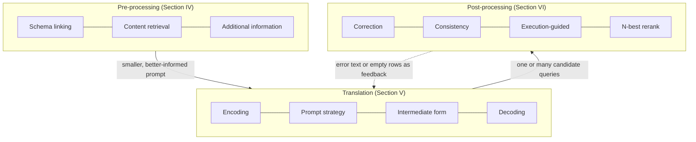

# A Survey of Text-to-SQL in the Era of LLMs: Where are we, and where are we going?

> **Paper:** Liu, Shen, Li, Ma, Jiang, Zhang, Fan, Li, Tang and Luo (Hong Kong University of Science and Technology (Guangzhou), Renmin University of China and Tsinghua University), first posted 2024 - [arXiv abstract](https://arxiv.org/abs/2408.05109) - [local PDF](../../papers/2408.05109.pdf)
>
> **Short name:** the Text-to-SQL survey. **Rendering followed:** the arXiv HTML rendering, version 7 (the page header reads "v7 [cs.DB] 25 Aug 2026"); section numbers (Roman numerals), figure numbers and table numbers below follow that rendering. The arXiv abstract page is reported to list the work as published in the IEEE Transactions on Knowledge and Data Engineering (TKDE) in July 2025; this guide did not open that page, so treat the venue as relayed, not verified. The local PDF may be an earlier version and was not readable here, so section numbers may differ if you open it. This is a **survey**: it runs no experiments of its own, and almost every number in it is borrowed from other papers or computed from public datasets.

## Read this first

**The claim in one sentence.** Text-to-SQL (turning a plain-language business question into a database query, also called NL2SQL, "natural language to SQL") moved from rules to neural networks to small pretrained models to large language models (LLMs), and modern systems can be organised as three stages (pre-processing, translation, post-processing) built from about a dozen swappable modules, with a rule of thumb for choosing them.

**Who this is for.** A founder or engineer deciding how an assistant should get answers from a company's analytics database, who wants a map before the benchmark and system papers that follow in this stage. It is a map, not a leaderboard: it names the families of method and what each costs, but almost never says how much accuracy you gain.

**Afterwards you will be able to** name every module the survey defines and say what it adds to a real question; read its dataset table (Table II) and metrics (Section VIII-A) critically; shortlist modules for open or smaller models without retraining; and say what the survey cannot tell you (no vendor-product evaluation, no enterprise or agentic benchmarks, almost no accuracy numbers).

**Reading time.** About 45 minutes. The survey is long (about 130,000 characters including references); only Sections III, IV, VI, VII-B, VIII and IX repay a close read.

**Have read first:** [Chain-of-thought prompting](../02-building/07-chain-of-thought.md), [LoRA](../02-building/09-lora.md) (what the fine-tuning you cannot do would cost), [ReAct](../02-building/10-react.md) (the loop behind execution-guided repair) and [SWE-bench](../03-evaluation-and-code/16-swe-bench.md) (an executable check for code). Next in this stage: [BIRD](./32-bird.md), [Spider 2.0](./34-spider-2.md), [BIRD-Interact](./38-bird-interact.md); the stage pattern is in [data-access](../../../agents/data-access/README.md).

**The one thing most people get wrong.** They read the stages as a recipe that was shown to work. It is a classification. Table I ticks which modules 40 published systems use; it does not say adding a module helps, and the text gives a measured effect for only one module (self-consistency in DAIL-SQL, "0.4%", Section VI-B, no baseline stated). Section IX's guidance is the authors' judgement, not a result.

## The paper in one worked example

Two examples are used throughout: a real one from the paper, to show the task and why it is hard, and a constructed one (labelled as such) to walk every module.

### Database words in sixty seconds

A **database** stores facts in **tables**, like spreadsheet tabs. Each **row** is one record (one order); each **column** is one attribute (the order date). The **schema** is the list of tables, their columns and how tables link. A **primary key** is a column whose value identifies a row uniquely (`customer_id` in a customers table); a **foreign key** is a column in another table that points back to that identifier (`customer_id` inside an orders table). A **JOIN** combines rows from two tables by matching such keys. **GROUP BY** collects rows into groups (all orders per customer); an **aggregation** such as SUM, COUNT or AVG squeezes each group into one number. A **query** is a request written in SQL (Structured Query Language). One tiny example, over the constructed tables defined below:

```sql
SELECT c.name, SUM(o.amount)            -- what to return
FROM customers c JOIN orders o           -- which tables, linked by key
  ON o.customer_id = c.customer_id
GROUP BY c.name;                         -- one total per customer
```

A **SQL dialect** is a vendor's variant of SQL (BigQuery and Snowflake differ in date functions, quoting and more). A **data warehouse** is a large analytics database, usually in such a dialect, that gathers data from many systems. A **semantic layer** is a maintained catalogue that defines business terms ("revenue", "active customer") once, as formulas over tables, so that nobody has to guess them. The survey uses none of the last three terms in its method taxonomy; that absence matters later.

### Part A - the survey's own example (Section II-B, Figure 2)

The survey walks a database administrator (DBA) through this request: find the names of all customers who checked out books on exactly 3 different genres on Labor Day in 2023. It splits the human workflow into three steps, and these three steps are the origin of its module list.

1. **Understanding the question (Step 1).** The DBA pulls out entities and attributes (names, customers, books, genres), a temporal context (Labor Day in 2023) and a condition (exactly 3 different genres).
2. **Finding the relevant tables, columns and cell values (Step 2).** The DBA picks the Customer and Book tables, then hits two traps the paper names. "Genres" could mean a `LiteraryGenre` column or a `SubjectGenre` column. "Labor Day in 2023" is September 4th in the US but May 1st in China, so the answer depends on knowledge that is in neither the question nor the schema.
3. **Writing the SQL (Step 3).** Even after linking the two tables, the DBA must choose between a natural join and a subquery, and there are several valid queries because of the genre ambiguity.

The survey maps Step 2 to schema linking, database content retrieval and additional information acquisition, and Step 3 to "translation". Step 1 has no module (this guide checked Figure 5 and Section III: only pre-processing, translation and post-processing). Anyone hoping for a named "clarify the question" stage will find only the ambiguity discussion in II-C and the AmbiQT benchmark in VII-A.

### Part B - a constructed example, walked through every stage

**Constructed by this guide; not from the paper.** Every number below was produced by the script in "A minimal version" (Tutorial 2), run on this toy data.

Tables: `customers(customer_id, name, region)`, `orders(order_id, customer_id, order_date, amount, status)` and a distractor `support_tickets(ticket_id, customer_id, topic)`. Four customers (Asha, Ben, Chitra, Dev), six orders. Regions are stored in capitals: `SOUTH` or `NORTH`. One order is `cancelled`.

**Question:** "Which South-region customers spent more than 1000 in March 2025, and how much?"

| Stage and module (survey section) | What it adds on this question | Method families the survey lists for that module |
|---|---|---|
| Pre-processing: schema linking (IV-A) | Keeps `customers` and `orders`, drops `support_tickets`; the prompt is a third shorter | string matching, neural rankers, LLM prompts (C3-SQL, MAC-SQL, CHESS) |
| Pre-processing: database content retrieval (IV-B) | The user said "South"; the stored value is `SOUTH`, so a WHERE clause using the user's word returns nothing. Retrieval finds `SOUTH` | string matching (BRIDGE), neural encoders, indexes (CHESS, CodeS) |
| Pre-processing: additional information (IV-C) | Supplies the business rules "spent means paid orders only" and "March means 1 March to 31 March"; plus similar solved examples | sample-based (DIN-SQL few-shot, BIRD evidence), retrieval-based (PET-SQL, REGROUP, ReBoost) |
| Translation: prompt strategy (V-C) | Asks the model to reason step by step or in sub-questions: filter region, filter month, filter status, sum per customer, keep totals above 1000 | chain-of-thought (CHESS, ACT-SQL), decomposition (MAC-SQL, DEA-SQL, TKK) |
| Translation: decoding (V-B) | Picks the actual tokens: greedy (one best token at a time), beam search (keeps several partial answers), constrained (rejects tokens that break SQL grammar) | greedy (GPT-style APIs), beam (RESDSQL), constrained (PICARD) |
| Post-processing: correction, execution-guided, consistency (VI-A to VI-C) | The first draft uses `'South'`, returns zero rows, and the empty result triggers a retry with `SOUTH`. Five sampled drafts are run and the majority result wins | correction (DIN-SQL), execution-guided (CHESS, CodeS), consistency (DAIL-SQL, PET-SQL, FinSQL) |

**Real outputs of the constructed run.** Linked tables: `customers`, `orders`. Value found for "South": `SOUTH`. First draft returns no rows. Repaired query returns `[('Asha', 1200.0)]`, the gold answer (700 + 500 in March). Ben is excluded (900 in paid March orders; his 400 order is cancelled), Dev because his 1,500 order is dated 27 February, Chitra because of region. Five candidates voted 3 to 1 to 1 for the correct result; the dissenters forgot the paid filter (Ben at 1,300) or kept the wrong casing (empty).

```mermaid
flowchart LR
  Q["Question plus the whole schema"] -->|"keep relevant tables and columns"| SL["Schema linking"]
  SL -->|"stored value SOUTH, not South"| CR["Content retrieval"]
  CR -->|"rules and similar examples"| AI["Additional information"]
  AI -->|"prompt with chosen schema, values, hints"| TR["Translation: encode, prompt, decode"]
  TR -->|"candidate SQL"| PP["Post-processing"]
  PP -->|"run it: empty or error means retry"| TR
  PP -->|"vote or rerank survivors"| OUT["Final SQL then result"]
```



What to notice: the loop from post-processing back to translation is where execution feedback enters, and it is the only place the system touches the live database before answering. Everything on the left of translation is about making the prompt smaller and better informed; everything on the right is about not trusting a single sample.

## Words you need

| Term | Plain definition | Example from the worked example |
|---|---|---|
| Text-to-SQL / NL2SQL | Task: given a question (nl) and a database (db), produce a query (sql) that runs and returns what the asker meant (Definition 1, Section II-A) | The March-spending question becomes a JOIN with GROUP BY |
| Schema linking | Picking which tables and columns matter for this question (Section IV-A) | Keep `customers` and `orders`, drop `support_tickets` |
| Database content retrieval | Finding the stored cell values that a WHERE clause needs (Section IV-B) | User says South, database holds SOUTH |
| Additional information acquisition | Bringing in outside knowledge: business rules, formulas, solved examples (Section IV-C) | "Spent" means paid orders only |
| Encoding / decoding strategy | Encoding turns question plus schema into the model's internal form; decoding turns that form back into SQL tokens (Sections V-A, V-B) | Greedy picks the single likeliest next token each step |
| Task-specific prompt strategy | Prompt designs for the task: chain-of-thought and decomposition (Section V-C) | Solve region, month, status, sum as separate steps |
| Correction, consistency, execution-guided, N-best reranking | The four post-processing modules (Section VI): fix errors, vote across samples, use the run result as feedback, reorder top candidates | Empty result triggers a retry; three of five samples agree |
| Execution Accuracy (EX) | Share of questions whose predicted query returns the same result set as the gold query (Section VIII-A) | A rewritten query with BETWEEN swapped for a half-open date range still scores correct |
| String-Match (SM), Component-Match (CM), Exact-Match (EM), Query Variance Testing (QVT) | Compare query text (SM), single clauses (CM), all clauses (EM), or the rate of right SQL across rewordings of one question (QVT) (Section VIII-A) | The rewritten date-range query scores wrong under SM; QVT would test other wordings of the March question |
| Intermediate representation (IR) | A simpler SQL-like form the model writes first, then converted to SQL (Section V-D) | A form without JOIN or GROUP BY that a converter expands |
| Valid Efficiency Score (VES) | EX that also rewards queries as fast as the gold query (Section VIII-A, from BIRD) | A correct but 4 times slower query scores 0.5 |

## Tutorial 1 - Intuitive understanding

### What was broken before

Before language models a Text-to-SQL system was a hand-built translator. Section II-D describes four eras (Figure 3(b)). Rule-based systems understood words only and handled single-table queries. Neural networks (sequence-to-sequence, graph networks) reached multi-table queries but were capped by model size and scarce training pairs. Pretrained language models (PLMs, such as BERT and T5) "resolve approximately 80%" of Spider cases but fall to "about 50%" on its extra-hard cases and struggle with complex schemas. This guide adds what the survey leaves implicit: a model never shown your schema must be trained on thousands of question-and-SQL pairs for it, and you do not have them. LLMs were hoped to replace that training with prompts.

The failure you can see in the worked example: a model reads "South", writes `region = 'South'`, and returns an empty table while sounding confident. The survey's challenge list (II-C) names this "large and dirty database values" and three more families: uncertain questions (lexical and syntactic ambiguity, under-specification such as the two Labor Days), complex databases (hundreds of tables, domain-specific designs), and translation (one question, many valid queries; free text versus strict syntax).

### The idea

The organising idea: treat a hard translation job as a careful analyst would: understand the question, look up the right tables and values, write the query, then check it. The authors turn the DBA's three steps into modules arranged as three stages (Section III, Figure 5).

**Analogy.** A new analyst gets a question and a data dictionary. They skim for the three relevant tables, check how "South" is spelled, ask what finance means by "spent", write the query, run it, notice an empty result and fix it. The survey catalogues the tools for each of those moments.

**Where it breaks.** A human learns your company; a prompt-based system does not remember that `SOUTH` was capitalised last week. A human asks when unsure; the survey's pipeline has no "ask back" module, the hole [BIRD-Interact](./38-bird-interact.md) addresses. A human is accountable and trained to be read-only; the survey never discusses permissions, so nothing in the map stops a generated query reading a table the asker should not see.

### How it works, step by step

Each step is shown on the constructed question from the worked example; the module-by-module options and the survey's trade-off notes are tabulated in Tutorial 2.

1. **Schema linking (IV-A).** Keep only the tables and columns that matter. The survey says LLM input-length limits make this "even more critical". In the toy case a keyword overlap keeps two tables and drops one.
2. **Database content retrieval (IV-B).** The WHERE clause needs a literal value and users do not know how it is stored; "South" finds `SOUTH`.
3. **Additional information (IV-C).** Add solved examples and business rules; BIRD ships a hint string called evidence with each question, and the survey notes several systems use it.
4. **Translation (Section V).** Encode the question and schema (for LLM systems, usually just pasted text), choose a prompt strategy (chain-of-thought or decomposition), optionally write an intermediate representation, then decode.
5. **Post-processing (Section VI).** Fix, vote, execute, rerank. The survey's caveat for each is cost, not accuracy.



What to notice: modules inside a stage are options, not a fixed sequence (the lines inside each box mean "optional neighbours"). Table I shows real systems pick a subset, so treat the survey as a menu.

### What the results say

A survey has few results of its own. These are all the quantitative claims bearing on method choice.

- **PLM-era ceiling, Section II-D 3.** About 80% of Spider cases resolved, about 50% on extra-hard ones. The paper does not say whether that is execution or exact match, and the two claims cite different references ([45] and [46]). Out of every 100 ordinary Spider-style questions, roughly 80 right, but only about 50 of every 100 hardest ones. How this carries to your warehouse is not stated; Table II below shows Spider is far smaller than real schemas.
- **Self-consistency gain, Section VI-B.** DAIL-SQL with self-consistency scores "0.4%" higher than without; no benchmark, backbone or baseline is given and it is unclear whether this means points or relative change. If points, about 4 more correct per 1,000 questions, for several times the generation cost (this guide's inference), which is within single-run noise.
- **Resource consumption, Table III (Spider).** Per query: RESDSQL (a PLM) 1.91 seconds, no API tokens; RESDSQL with NatSQL (a simplified SQL-like representation) 1.97 seconds; ZeroNet 377 tokens, 3.72 seconds; DIN-SQL 3,579 tokens, 10.34 seconds. This guide computes DIN-SQL as about 5.4 times slower than RESDSQL (10.34 / 1.91) and about 9.5 times the tokens of ZeroNet (3,579 / 377). No accuracy, hardware or token definition is listed, so it shows cost differs by an order of magnitude, not that the cheaper system is as good.
- **Error shares, Figure 1(d) and Section VIII-C.** Applied to DIN-SQL's Spider errors, the authors' two-level taxonomy leaves only 1.8% in "Others". One system on one benchmark; per-category shares sit in a figure this guide could not read, so none are quoted.
- **Dataset complexity, Table II.** Spider averages 1.83 tables per query and 5.13 tables per database; BIRD 2.07 and 7.64; Spider2-Lite 6.53 and 23.71. A query touching 6.5 tables is a different job from one touching under 2.

### What this does not show

- It does not show that any module helps. Table I records usage, not effect.
- It reports no accuracy for systems such as CHESS, DAIL-SQL or CodeS. When you see accuracy elsewhere, check benchmark, split, metric, backbone model and whether gold hints (BIRD's evidence) were given; numbers differing on any of these are not comparable. The survey does not warn of this directly; the nearest statement is in Section VIII-B (standard metrics alone cannot fully assess robustness).
- It evaluates no commercial product, although the introduction says database vendors increasingly offer Text-to-SQL.
- It predates the enterprise and agent benchmarks; it lists Spider2-Lite in Table II but reports no results on it. See [Spider 2.0](./34-spider-2.md) and [BIRD-Interact](./38-bird-interact.md).

### Teach-back

**1. Name the three stages and one module in each, using the South-region question.**

<details><summary>Answer</summary>
Pre-processing: schema linking keeps customers and orders; content retrieval maps "South" to SOUTH. Translation: prompt and decoding strategies write the SQL. Post-processing: execution-guided repair retries on an empty result; consistency votes among drafts.
</details>

**2. Why can two different SQL strings both be correct, and which metric treats them as equal?**

<details><summary>Answer</summary>
Several queries can express one intent (Section II-A). Execution Accuracy compares result sets, so both pass; String-Match compares text, so one fails.
</details>

**3. What does Table III show, and what can you not conclude?**

<details><summary>Answer</summary>
Latency and API tokens for four Spider systems, from 1.91 seconds with no tokens to 10.34 seconds and 3,579 tokens. It lists no accuracy, so it cannot say the cheap system is as accurate or the dear one worth it.
</details>

## Tutorial 2 - Practitioner understanding

### The design in concrete terms

**What you are shopping for.** Table I lists 40 systems across 13 columns (fine-tuned or not, the three pre-processing modules, backbone, encoding, intermediate representation, prompt strategy, decoding, four post-processing modules). This guide tallied it as rendered (every row parsed to the same 15 fields): 22 of 40 are decoder-only (the GPT-style family), and only 5 of those 22 are fine-tuned (ROUTE, SFT CodeS, FinSQL, DTS-SQL, PET-SQL), so 17 run on prompting alone, the group relevant to you. Of the 22, 19 use schema linking, 8 content retrieval, 17 additional information, and 17 at least one of correction, consistency or execution-guided repair; only one (MetaSQL) uses N-best reranking. These are this guide's counts, not the survey's.

**Module inventory with the survey's own trade-off notes.**

| Module | Options the survey names | The survey's stated trade-off |
|---|---|---|
| Schema linking (IV-A) | string match, neural ranker, LLM prompt | LLM linking cannot handle schemas larger than its context; neural linking needs training data |
| Content retrieval (IV-B) | string match, neural encoder, index | An index speeds lookups but needs rebuilding as data changes |
| Additional information (IV-C) | few-shot examples, retrieved examples, domain knowledge | Retrieval adds tokens and compute; most work uses domain text, little uses structured knowledge |
| Decoding (V-B) | greedy, beam, constraint-aware incremental | Greedy: early errors propagate; beam: more memory; constrained: per-token overhead but syntactic guarantee |
| Prompt strategy (V-C) | chain-of-thought, decomposition | Longer outputs and latency; decomposition raises compute and complexity |
| Correction (VI-A) | self-correction prompts (DIN-SQL), predicate matching (ZeroNL2SQL) | Mostly fixes syntax errors and "often overlooks" semantic ones |
| Consistency (VI-B) | self-consistency, clustering (FinSQL), cross-model voting (PET-SQL) | "Significantly" higher inference cost |
| Execution-guided (VI-C) | feed run results back (CHESS), take first executable candidate (CodeS) | Slow on large databases |

**The prompt function.** Section II-D writes in-context Text-to-SQL as F_LLM(P | nl, db, k) giving sql, where P builds text from the question, schema and extra knowledge k. The survey gives no template; the prompts live in the cited systems. A plausible shape (this guide's illustration): instruction, linked schema fragments, matched values, hints, retrieved examples, question.

**The survey's decision aids (Section IX, Figure 11, whose diagram is not in the text rendering).** Roadmap (IX-A): privacy-sensitive data points to open-source LLMs run locally, because closed models use external APIs. Data volume then picks the method: extensive data, pre-training; "hundreds to thousands" of question-and-SQL pairs, fine-tuning; few, few-shot prompting; none, zero-shot. Closed models allow only inference-stage optimisation. Decision flow (IX-B), two scenarios only: large schemas call for schema linking (saves tokens, adds time); if queries can run, use execution-guided strategies (filters non-executable SQL, adds time). The thresholds are stated without evidence.

### A minimal version

For a survey, a "minimal version" is a worksheet-plus-harness: a small program that performs four of the survey's modules on toy data so you can see what each does, plus the scorer that Section VIII-A defines. It is constructed by this guide; the schema and data are toy. It runs in the standard library with `sqlite3` and prints the numbers quoted in the worked example.

```python
import sqlite3, re, collections
db = sqlite3.connect(":memory:")
db.executescript("""
CREATE TABLE customers(customer_id INTEGER PRIMARY KEY, name TEXT, region TEXT);
CREATE TABLE orders(order_id INTEGER PRIMARY KEY, customer_id INTEGER REFERENCES customers,
                    order_date TEXT, amount REAL, status TEXT);
CREATE TABLE support_tickets(ticket_id INTEGER PRIMARY KEY, customer_id INTEGER, topic TEXT);
INSERT INTO customers VALUES (1,'Asha','SOUTH'),(2,'Ben','SOUTH'),(3,'Chitra','NORTH'),(4,'Dev','SOUTH');
INSERT INTO orders VALUES (1,1,'2025-03-02',700,'paid'),(2,1,'2025-03-20',500,'paid'),
 (3,2,'2025-03-05',900,'paid'),(4,2,'2025-03-06',400,'cancelled'),
 (5,3,'2025-03-07',2000,'paid'),(6,4,'2025-02-27',1500,'paid');
INSERT INTO support_tickets VALUES (1,1,'refund'),(2,3,'delivery');
""")
QUESTION = "Which South-region customers spent more than 1000 in March 2025, and how much?"
GOLD = """SELECT c.name, SUM(o.amount) FROM customers c JOIN orders o ON o.customer_id=c.customer_id
WHERE c.region='SOUTH' AND o.status='paid' AND o.order_date BETWEEN '2025-03-01' AND '2025-03-31'
GROUP BY c.name HAVING SUM(o.amount)>1000"""
def run(sql): return sorted(db.execute(sql).fetchall())
def link_schema(question):                       # IV-A1: string-matching schema linking
    words = set(re.findall(r"[a-z]+", question.lower()))
    stems = {"customers": {"customer", "customers"}, "orders": {"spent", "order", "orders", "amount"},
             "support_tickets": {"ticket", "tickets", "support"}}
    return [t for t, s in stems.items() if words & s]
def retrieve_value(column_sql, word):            # IV-B1: content retrieval by string matching
    for (v,) in db.execute(column_sql):
        if v.lower() == word.lower(): return v
def read_only(sql):                              # not in the survey: a guard you must add
    return sql.strip().lower().startswith("select") and ";" not in sql.strip().rstrip(";")
def ex_correct(pred, gold): return run(pred) == run(gold)   # VIII-A: Execution Accuracy, one item
print("linked tables:", link_schema(QUESTION))
print("value for 'South':", retrieve_value("SELECT DISTINCT region FROM customers", "South"))
draft = GOLD.replace("'SOUTH'", "'South'")
print("draft rows:", run(draft), "-> empty, so retry with retrieved value")   # VI-C execution-guided
fixed = draft.replace("'South'", "'SOUTH'")
print("fixed rows:", run(fixed), "EX vs gold:", ex_correct(fixed, GOLD))
cands = [GOLD, GOLD, GOLD.replace("AND o.status='paid' ", ""), GOLD, draft]
votes = collections.Counter(str(run(c)) for c in cands if read_only(c))      # VI-B consistency
print("vote:", votes.most_common())
print("DROP passes guard:", read_only("DROP TABLE orders"))
alt = """SELECT name, total FROM (SELECT c.name AS name, SUM(o.amount) AS total FROM orders o
JOIN customers c USING(customer_id) WHERE c.region='SOUTH' AND o.status='paid'
AND o.order_date >= '2025-03-01' AND o.order_date < '2025-04-01' GROUP BY c.name) WHERE total > 1000"""
print("alt: EX", ex_correct(alt, GOLD), "string match", alt.split() == GOLD.split())
```

**Real output of this script (constructed toy data):**

```
linked tables: ['customers', 'orders']
value for 'South': SOUTH
draft rows: [] -> empty, so retry with retrieved value
fixed rows: [('Asha', 1200.0)] EX vs gold: True
vote: [("[('Asha', 1200.0)]", 3), ("[('Asha', 1200.0), ('Ben', 1300.0)]", 1), ('[]', 1)]
DROP passes guard: False
alt: EX True string match False
```

Read the output as follows. The vote compares *execution results*, as PET-SQL does (Section VI-B), not query text. The `alt` line is Section VIII-A in miniature: a different query with the same answer passes EX and fails SM. The guard line is outside the survey, which has no module for it; a real guard needs a database role with read-only permission and row-level restrictions, not string checks.

### What it costs

The survey gives one cost table (Table III). Arithmetic with its numbers plus labelled assumptions of this guide:

- **Tokens.** DIN-SQL uses 3,579 API tokens per SQL (Table III). At an assumed 2,000 questions a day that is 7.16 million tokens a day; at an assumed placeholder price of 1 dollar per million, about 7 dollars a day, roughly 215 a month. With a local open model the cost is hardware time instead.
- **Latency.** 10.34 seconds per SQL (Table III) is tolerable for an interactive question; five sequential self-consistency samples would be roughly 50 seconds (this guide's estimate, assuming no parallelism), which is not.
- **Schema size.** Constructed: 300 tables at 30 columns and about 10 tokens per column is 90,000 tokens, beyond the 8,000 to 32,000 context of many small open models (typical figure, check yours). Linking down to 10 tables gives 3,000, so linking is a gate, not an optimisation, in warehouses.


### How it fails

The survey's error discussion is in Section VIII-C (a taxonomy and one application) and in per-module caveats. The table below blends those with failures this guide can show on the toy example, marked.

| Symptom | Likely cause | Mitigation |
|---|---|---|
| Query runs, returns zero rows | Value spelled differently from the question (toy: South versus SOUTH); the survey's "dirty values" (Section II-C) | Content retrieval (IV-B); empty result as a retry signal (VI-C) |
| Query runs, answer is plausible but wrong | Wrong business rule (toy: counted a cancelled order; Ben at 1,300) or wrong join; the survey says correction methods "often overlook" semantic errors (VI-A) | Supply definitions (IV-C); consistency vote cannot catch a mistake that all samples share |
| Prompt fails or truncates | Schema larger than the context window (IV-A caveat) | Schema linking; tiered retrieval |
| Right table, wrong column (genre example) | Ambiguous attribute names (Section II-B, "LiteraryGenre" versus "SubjectGenre") | Column descriptions, a semantic layer; ask the user (not in the survey) |
| Question needs data in two databases | Open-domain case (Section X) | Not solved; limit scope to one governed warehouse |

### Evaluating your version

Metric: Execution Accuracy on your own questions (definition as in Section VIII-A), plus per-clause match so you can see whether failures concentrate in WHERE values (retrieval) or JOINs (linking). Score subsets by SQL characteristic, as NL2SQL360 does (Section VIII-B).

Test set: at least 100 real business questions with checked gold SQL and answers. At 100 questions the 95% confidence interval near 70% accuracy is about plus or minus 9 points (binomial arithmetic, this guide's calculation); 300 questions gives about plus or minus 5.

Baseline: the full schema pasted into one prompt, no modules. Add one module at a time (linking, content retrieval, business rules, execution retry) and keep it only if it beats the previous step by more than the interval. Stop when the latest addition changes accuracy by less than the interval, or cost per question exceeds budget. The survey cannot supply these deltas; you must measure them.

### Adopt, adapt or skip

**Adopt** the survey as an index and checklist. Its module list is a compact vocabulary for what a data-access agent needs, and Section VIII's metrics (EX, VES, QVT) and two-level error labelling (where, then why) are reusable in your evaluation.

**Adapt** its decision flow, which is written for researchers. For a team letting business users query an analytics warehouse with open or smaller models and no retraining, the supportable reading is: zero-shot or few-shot prompting (IX-A); schema linking because warehouses are large (IX-B Scenario 1); execution-guided retry because you can run queries (Scenario 2); content retrieval because real values are dirty (II-C); business definitions as additional information (IV-C). What you must still build, beyond the survey: a **semantic layer**, an **evaluation set** from your own questions, and **access control** (read-only roles, row and column permissions, cost limits, timeouts, audit log). See [prompt-to-SQL injection](./39-prompt-to-sql-injection.md) for why that layer cannot be the prompt.

**Skip** the encoder and graph-encoding material (V-A, PLM-era rows) unless you will train a model.

## Tutorial 3 - Researcher understanding

### Formal setup

**Notation (Sections II-A, II-D, VIII-A).** nl: a natural-language question. db: a database (schema plus content). k: additional knowledge. sql: a query. P: the prompt function that turns (nl, db, k) into text. F_LLM(P | nl, db, k) gives sql: the in-context formulation. LLM* = F_fine-tune(F_pre-train(LLM, D_p), D_f): the training formulation, where D_p is a broad pre-training corpus and D_f a Text-to-SQL fine-tuning set. N: dataset size; Y_i: gold query; Ŷ_i: predicted query; V_i, V̂_i: their execution result sets; 1(·): 1 if the condition holds, else 0.

**Metrics.** EX = (sum over i of 1(V_i = V̂_i)) / N. SM replaces result sets with query strings. CM for clause C compares one clause; EM requires all clauses to match. VES = (sum of 1(V_i = V̂_i) times R_i) / N with R_i = sqrt(E(Y_i) / E(Ŷ_i)), E being time or memory. QVT = (1/N) times the sum over i of the fraction of the m_i rewordings of query i that return Y_i.

**Numeric toy instance (constructed).** N = 4 questions. EX: predictions 1, 2 and 3 return the gold result set, 4 does not, so EX = 3/4 = 0.75. VES: say prediction 1 takes 8 seconds against a gold 2 seconds, so R = sqrt(2/8) = 0.5; predictions 2 and 3 take the same time as gold, R = 1 each; prediction 4 is wrong, 0. VES = (0.5 + 1 + 1 + 0) / 4 = 0.625. QVT: query 1 has 3 rewordings with 2 returning the gold SQL (2/3) and query 2 has 2 rewordings with 2 correct (1): QVT = (0.667 + 1)/2 = 0.833. Note two details of the formula as printed: R is not capped, so a prediction faster than gold exceeds 1 and can raise VES above EX (this guide's observation; whether BIRD's official scorer caps it was not checked), and QVT compares *SQL strings* (F(Q_ij) = Y_i), not result sets, so it inherits string-match penalties.

### The claims, stated precisely

1. **Taxonomy (II-D, III).** LLM-era systems decompose into pre-processing, translation and post-processing, with the modules of Figure 5 and Table I. Evidence: 40 systems classified. Descriptive.
2. **Challenges (II-C).** Four groups: uncertain question, complex database and dirty content, translation, technical (cost, efficiency, SQL efficiency, scarce data, trustworthiness). No measurement.
3. **Benchmark gap (VII-B).** Datasets "typically feature fewer SELECT keywords", suggesting too little nesting and set logic, and scalar functions and mathematical computation need attention. Evidence: Table II averages. Real workloads are asserted to be harder; no query log is shown.
4. **Evaluation (VIII).** Multi-angle evaluation is needed; NL2SQL360 and MT-TEQL supply it.
5. **Error taxonomy (VIII-C, Figure 1(d)).** The two-level taxonomy is comprehensive because 1.8% of one system's errors are "Others". Authors' own labelling.
6. **Guidance (IX).** Privacy and data volume choose the model and optimisation; linking suits large schemas; execution guidance suits runnable environments. Argument only.
7. **Open problems (X).** Open-domain queries, cost, trust, interactive tools, adaptive data synthesis.

### Evidence, table by table

**Table I.** 40 systems from 2020 to 2025 by 13 design columns. It identifies nothing causally; it shows which choices co-occur. Rows from 2020 to 2022 are fine-tuned encoder-based systems with graph or constrained decoding; later rows are almost all decoder-only and prompt-based with post-processing. Internal check: Section VI-C says CodeS produces four candidates by beam search, yet Table I lists its decoding as Greedy Search (flagged, not fixed).

**Table II.** Datasets from ATIS to Spider2-Lite, computed with NL2SQL360 (VII-B): redundancy (questions, unique SQLs), database complexity, and query complexity (average tables, SELECTs, aggregates, scalar functions, math per query). Headline rows as printed:

| Dataset | Questions | DBs | Tables | Tables/DB | Cols/table | Records/DB | Tables/query | SELECTs | Aggregates |
|---|---|---|---|---|---|---|---|---|---|
| Spider | 11,840 | 206 | 1,056 | 5.13 | 5.01 | 8,980 | 1.83 | 1.17 | 0.54 |
| BIRD | 10,962 | 80 | 611 | 7.64 | 7.14 | 4,585,335 | 2.07 | 1.09 | 0.61 |
| Spider2-Lite | 527 | 264 | 6,259 | 23.71 | 35.61 | not given | 6.53 | 5.10 | 3.57 |

BIRD has about 510 times Spider's records per database (4,585,335 / 8,980, this guide's division) with similarly sized queries; Spider2-Lite has far fewer questions but 35.61 columns per table against 5.01 and over three aggregates per query. Recomputation: 1,056 / 206 gives 5.13 and 6,259 / 264 gives 23.71 (match); 11,840 / 6,448 gives 1.84 (printed 1.8). Unverified here: Spider2-Lite's 527 questions (see [Spider 2.0](./34-spider-2.md) for that benchmark's own count). Table II describes SQL shape, not business ambiguity, and many rows are translations or perturbations of Spider that share its databases, so the count of datasets overstates independent evidence.

**Table III.** Four rows, two cost columns. It associates method family with cost only; source, hardware and token definition are not given, and "ZeroNet" carries the same reference [44] as ZeroNL2SQL in Table I (naming inconsistency, flagged).

**Figures 1(d), 3 and 11.** Figure 1(d) applies the error taxonomy to DIN-SQL on Spider only. Figure 3 gives five difficulty levels, the fifth a vision for "the next five years". Figure 11's diagram was unreadable here; treat IX's prose as expert opinion.

### Ablations and what they isolate

None; the survey runs no ablation and its one effect size (the "0.4%") is borrowed. Table I could be read observationally, but the 5 fine-tuned decoder-only rows versus the 17 prompt-only rows differ in year, backbone and benchmark at once, so no causal reading is possible. That is the largest gap relative to the title's question "where are we": no common-benchmark comparison.

### Threats to validity specific to this paper

- **Selection.** Inclusion criteria for the 40 systems are not stated; Table I includes 2025 systems, so this version was revised well after the 2024 posting.
- **Abstract versus body.** The abstract promises "collection of training data, data synthesis due to training data scarcity". The text offers the benchmark survey (VII), a short synthetic-dataset paragraph and an open problem on adaptive synthesis (X); collection methods are thin.
- **Unanchored numbers.** "About 80%" and "about 50%" have no stated metric; "0.4%" has no baseline.
- **Date slip.** Section II-D 3 places BERT and T5 both in 2018; BERT is 2018, T5 2019 to 2020 (this guide's recollection, not checked).
- **Metric wording.** Section VIII-A calls identical result sets from semantically different queries "false negatives"; a wrong query scored correct is more usually a false positive. The survey does not mention the opposite risk, a right query scored wrong through ordering or float formatting.
- **Coverage gaps for practice.** Nothing on SQL dialects, enterprise-scale schemas (one Table II row), permissions or injection, interactive agents, or product evaluation.

### Open problems and follow-ups

The survey's list (X): open-domain Text-to-SQL with six sub-challenges (database retrieval, heterogeneous schemas, answer aggregation, domain adaptation, scalability, evaluation); cost-effective methods (PLM plus LLM combinations, complexity routing as in EllieSQL); interpretability; debugging tools for semantic errors; interactive tools for queries over 50 lines; adaptive training-data synthesis. Follow-ups in this stage: [BIRD](./32-bird.md), [Spider 2.0](./34-spider-2.md), [BIRD-Interact](./38-bird-interact.md), [ReFoRCE](./35-reforce.md), [FlexSQL](./36-flexsql.md), [Arctic-Text2SQL-R1](./37-arctic-text2sql-r1.md) and, for security, [prompt-to-SQL injection](./39-prompt-to-sql-injection.md).

### What would change my mind

A controlled study adding each module to a fixed open model on an enterprise benchmark and finding consistent gains (Table I would become a recipe); a later version with a common-benchmark leaderboard showing prompt-only open-model systems matching fine-tuned ones (the no-retrain limit would cost little); or a measured threshold behind "hundreds to thousands of pairs".

## Reading map for the PDF

| Section or figure | What it contains | First pass | Guide answer |
|---|---|---|---|
| I, Figure 1 | Lifecycle: model, data, evaluation, error analysis | Read | Read this first |
| II-A to II-C, Figure 2 | Task, DBA workflow, challenges C1 to C4 | Read | Worked example Part A; How it fails |
| II-D, Figures 3 and 4 | Four eras, difficulty levels, prompt and fine-tune formulas | Skim | Formal setup |
| III, Figure 5, Table I | Three stages; 40-system comparison | Read, then use Table I as lookup | Tutorial 2; Tutorial 3 |
| IV Pre-processing | Linking, content retrieval, extra information | Read | How it works |
| V Translation | Encoding, decoding, prompts, intermediate forms | V-C and V-D read; rest skim | Module inventory |
| VI Post-processing | Correction, consistency, execution, rerank | Read | A minimal version |
| VII, Figure 10, Table II | Benchmarks and statistics | Read Table II and VII-B | Evidence |
| VIII Metrics, toolkits, errors | EX, SM, CM, EM, VES, QVT; NL2SQL360; taxonomy | Read closely | Formal setup |
| IX, Figure 11 | Roadmap and decision flow | Read | Adopt, adapt or skip |
| X, Table III | Open problems, cost table | Read | What it costs |
| References | About 160 entries | Skip | Search index for system names |

## Questions readers get stuck on

### Where does "question understanding" go? It is not a stage.

It is Step 1 of the human workflow (II-B) but has no module. For LLM systems it happens inside translation, helped by prompts and extra information. If you need an explicit step (detecting that "Labor Day" depends on region and asking), you must add it; the survey names ambiguity as a challenge and AmbiQT as a benchmark but offers no method.

### What is the difference between schema linking and database content retrieval?

Linking decides which tables and columns enter the prompt; retrieval decides which stored values do. In the toy case linking drops `support_tickets` and retrieval finds that "South" is stored as `SOUTH`. A tiny schema with dirty values needs only retrieval; a huge clean schema needs only linking.

### Which method families does the survey split into: prompting versus fine-tuning?

Two at the top (II-D): in-context learning (you write the prompt) and pre-train or fine-tune (you change the model). Table I's "Finetuning" column marks which systems train; this guide counts 5 of 22 decoder-only systems as fine-tuned. The pipeline modules cut across both: schema linking can be a trained ranker or an LLM prompt.

### What does execution accuracy measure, and why is it not enough?

A question counts as correct when the predicted query returns the same result set as the gold query (VIII-A). Equivalent queries pass. Its blind spots: different questions can share a result set (the survey calls this a false negative; this guide would call it a wrong query scored correct), speed is ignored (VES covers it), rewording robustness is ignored (QVT), and a wrong gold label passes silently.

### Can I compare systems from the survey's tables?

No. It is a taxonomy, not a leaderboard: Table II describes datasets, Table III costs, and the only accuracy-like statements are the 80 and 50 percent for PLMs on Spider and the 0.4% gain. For comparisons go to the primary papers and match benchmark, split, metric, gold hints and backbone.

### Which approach does it recommend if I can only run open or smaller models and cannot retrain?

Only in outline. IX-A says privacy-sensitive settings should use open-source models locally, and with no training data use zero-shot or few-shot prompting. It says nothing about how small a model can be, and the prompt pipelines it names were built on closed models, as the text states (DIN-SQL with Codex or GPT-4, C3-SQL with GPT-3.5, CHESS and DAIL-SQL with GPT-4). Whether they hold on a small open model is unmeasured here.

### What is a SQL dialect, and why does the survey not discuss it?

A dialect is a vendor's SQL variant; date arithmetic differs between BigQuery and Snowflake. The survey's word search shows no "dialect" (this guide checked), and its benchmarks are mostly academic. That is a real limitation for warehouses; [Spider 2.0](./34-spider-2.md) tackles it.

### Why not simply fine-tune a small model?

You can if you have hundreds to thousands of verified question and SQL pairs (IX-A's range), but those pairs are the expensive part and a model tuned to one schema generalises poorly to the next (II-C). The cheaper order is prompts plus modules, then an evaluation set, then tuning; see [ReFoRCE](./35-reforce.md) and [Arctic-Text2SQL-R1](./37-arctic-text2sql-r1.md).

### Does a vote across samples count as a safety check?

No. It reduces random error, not systematic error: if every sample misreads "spent", the vote is unanimous and wrong. The survey notes one model gives limited diversity (VI-B), which is why PET-SQL votes across models.

## Prerequisites you actually need

### Prerequisite 1 - Reading a SQL query

SELECT chooses columns, FROM names tables, JOIN links them on matching keys, WHERE filters rows, GROUP BY makes groups, HAVING filters groups, aggregates (SUM, COUNT, AVG) reduce a group to a number. Example: orders 700 and 500 for Asha, 900 for Ben; `SELECT name, SUM(amount) ... GROUP BY name HAVING SUM(amount) > 1000` gives Asha 1,200 and drops Ben at 900. WHERE filters before grouping, HAVING after. Used in Figure 2 and in Section V-D 1 (SemQL drops FROM, JOIN, ON and GROUP BY). No guide here teaches it; any SQL tutorial covers it in an hour.

### Prerequisite 2 - Execution accuracy versus text matching

Score by results, not text. Gold returns {(Asha, 1200)}; prediction A is a differently written query with the same set; B returns {(Asha, 1200), (Ben, 1300)}. EX: A = 1, B = 0. String match: A = 0. With 4 questions and 3 passing, EX = 0.75. Weakness: two different questions returning the same rows (for example both empty) cannot be told apart. Used in Section VIII-A. Same idea for code: [SWE-bench](../03-evaluation-and-code/16-swe-bench.md).

### Prerequisite 3 - Greedy, beam and constrained decoding

A model writes a query one token at a time. Greedy takes the likeliest next token; beam search keeps several partial answers. Example: "SELECT" has probability 0.6 and "WITH" 0.4; the best continuation after SELECT is 0.3, after WITH 0.9. Greedy follows SELECT (0.6 x 0.3 = 0.18); a beam of width 2 finds WITH (0.4 x 0.9 = 0.36). Constrained decoding blocks tokens that break SQL grammar. Used in Section V-B. Background: [the transformer guide](../01-foundations/01-transformer.md).

### Prerequisite 4 - Self-consistency by voting

Sample several answers and keep the most common: results A, A, A, B, empty gives A 3 of 5. It helps only if errors are random. In Text-to-SQL the survey votes on execution results (PET-SQL, VI-B). Cost grows linearly with samples. Origin of the idea: [Chain-of-thought](../02-building/07-chain-of-thought.md).

### Prerequisite 5 - Why large schemas need linking (token budget)

A prompt holds a limited number of tokens. 300 tables x 30 columns x 10 tokens is 90,000 tokens; a question needing 3 tables needs about 900. Linking is how a big warehouse fits at all. Used in Section IV-A. Selection by similarity is explained in [RAG](../02-building/06-rag.md); see also the [glossary](../../references/glossary.md) and [math bridge](../../references/math-bridge.md).

## Where this sits in the curriculum

**Read before:** [ReAct](../02-building/10-react.md) (act and observe, the loop execution-guided repair uses) and [CodeAct](../06-agent-systems/25-codeact.md) (running code and reading results beats guessing).

**Nearest papers.** [BIRD](./32-bird.md) is a benchmark with dirty, large databases and evidence strings; this survey gives it a Table II row and the VES metric, but BIRD is where to learn how questions are built and scored. [Spider 2.0](./34-spider-2.md) measures enterprise workflows with dialects and thousands of tables; this survey lists its Lite variant and none of its lessons. Neither is a survey, so they give measured numbers where this gives a map.

**For a team letting an agent query a warehouse for business users.** Adopt the module vocabulary and metric definitions; use the decision flow as a checklist; do not read Table I as evidence that modules work. The evidence cannot tell you how an open or small model performs on your schema, how to handle dialects, how to resolve ambiguous business terms, or how to keep a query inside a user's permissions. You still build the semantic layer, evaluation set and access control; the stage pattern is in [data-access](../../../agents/data-access/README.md), with tool-design lessons in [SWE-agent](../06-agent-systems/26-swe-agent.md) and [interoperability](../04-agents-and-protocols/21-interoperability.md). The survey evaluates no vendor product, so it cannot choose between them.

**Read next:** [BIRD](./32-bird.md), then [Spider 2.0](./34-spider-2.md) for the gap to an enterprise warehouse, then [BIRD-Interact](./38-bird-interact.md) for under-specified questions.

## Checkpoint

1. **Explain** why Table I, ticking modules for 40 systems, cannot say whether schema linking helps.

<details><summary>Answer</summary>
It records choices, not accuracy changes. Systems differ in backbone, year and benchmark at once, so any module's effect is confounded; a controlled ablation on a fixed model is needed.
</details>

2. **Compute** EX and VES: 5 questions, 4 correct; one correct query is 4 times slower than gold, three match gold speed. Use R = square root of the time ratio.

<details><summary>Answer</summary>
EX = 4/5 = 0.8. Slow query R = sqrt(1/4) = 0.5; the other three R = 1; the wrong one 0. VES = (0.5 + 3 + 0) / 5 = 0.7.
</details>

3. **Critique** the "0.4%" self-consistency gain: what three things must you know before acting on it?

<details><summary>Answer</summary>
Points or relative change; the benchmark, split and backbone; the number of samples and the added cost. Also whether 0.4 on a few hundred questions exceeds run-to-run noise.
</details>

4. **Apply:** local open model, no labelled pairs. Which modules first, and what must you add that the survey omits?

<details><summary>Answer</summary>
Zero-shot or few-shot prompting, schema linking if large, content retrieval, business definitions, execution-guided retry, a small vote if latency allows. Add a semantic layer, your own 100-question evaluation set, read-only and row-level access control, timeouts and cost limits, and a clarification step.
</details>

5. **Explain** why "about 80% on Spider" does not predict your warehouse.

<details><summary>Answer</summary>
Spider databases average 5.13 tables and queries 1.83 tables (Table II); Spider2-Lite databases average 23.71 tables and queries 6.53. Real warehouses add dialects, undocumented business rules and ambiguity, and the 80% figure has no stated metric.
</details>

6. **Spot** two inconsistencies in the survey.

<details><summary>Answer</summary>
Table I lists CodeS decoding as greedy while Section VI-C says beam search with four candidates; Table III says ZeroNet where Table I says ZeroNL2SQL (same reference [44]). Also BERT and T5 are both dated 2018 in Section II-D 3.
</details>
