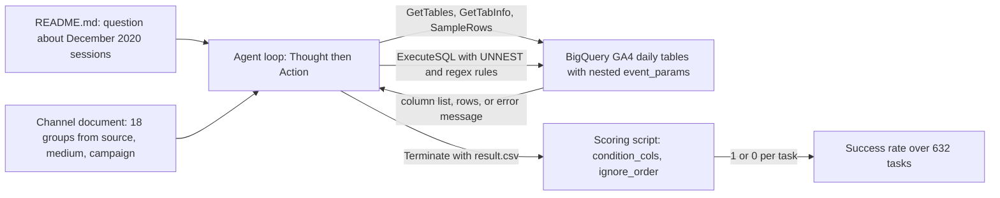
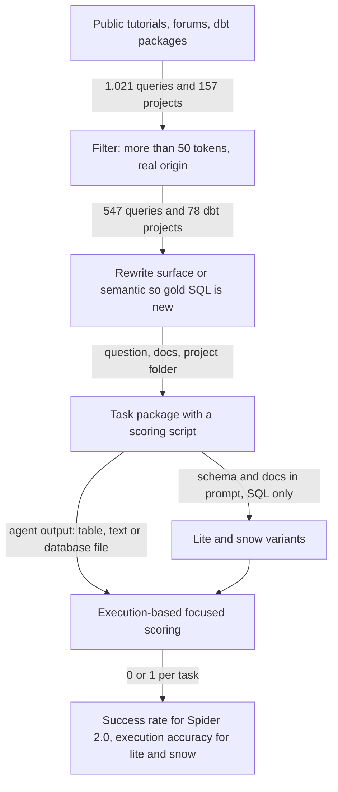

# Spider 2.0: Evaluating Language Models on Real-World Enterprise Text-to-SQL Workflows

> **Paper:** Lei, Chen, Ye, Cao, Shin, Su, Suo, Gao, Hu, Yin, Zhong, Xiong, Sun, Liu, Wang and Yu (University of Hong Kong, Salesforce Research, Google DeepMind, Sea AI Lab, Google Cloud AI Research, University of Waterloo), first posted 12 November 2024, revised 17 March 2025. The arXiv page lists the comment "ICLR 2025 Oral" (International Conference on Learning Representations), so this is a peer-reviewed benchmark paper; this guide did not check the conference proceedings. [arXiv abstract](https://arxiv.org/abs/2411.07763) - [local PDF](../../papers/2411.07763.pdf)
>
> **Version followed.** This guide follows arXiv **v2** (17 March 2025), read through its HTML rendering. Section, table and figure numbers are v2's. Version v1 (12 November 2024) reports a different headline (17.0 percent, not 21.3 percent) and numbers its tables differently, so the abstract you see today, the PDF you downloaded earlier and the public leaderboard may disagree with this guide. The "Versions" note near the end of Tutorial 3 lists exactly what changed between v1 and v2. The live leaderboard was not consulted, and the local PDF could not be rendered here, so which version it holds was not checked.

## Read this first

**The claim in one sentence.** When language-model agents are asked to do what analysts do in real companies (read a huge warehouse schema, read documentation, write long queries in the right SQL dialect, sometimes edit a whole project of query files), they succeed on about one task in five at best, while the same family of models scores about 87 to 91 out of 100 on the older Spider 1.0 benchmark.

**Who this is for.** Founders and engineers deciding whether an AI agent may answer business questions from a company's analytics data warehouse (a large reporting database, such as BigQuery or Snowflake), and anyone judging a vendor's "95 percent accuracy on text-to-SQL".

**Afterwards you will be able to** trace one realistic warehouse task; say what each variant (Spider 2.0, Spider 2.0-lite, Spider 2.0-snow) measures; explain scoring by result comparison; explain each headline number with its caveats; and turn the lessons into a checklist for your own evaluation set.

**Reading time.** About 40 minutes; 15 for the worked example and Tutorial 1.

**Have read first.** [BIRD](./32-bird.md) (the previous academic benchmark, a "big bench for large-scale databases"), the [text-to-SQL survey](./33-text2sql-survey.md), [ReAct](../02-building/10-react.md) (the think-act-observe loop the paper's agent uses) and [SWE-bench](../03-evaluation-and-code/16-swe-bench.md) (another benchmark scored by running things, not by comparing text). The stage pattern this paper feeds is in [data-access](../../../agents/data-access/README.md). For vocabulary, see the [glossary](../../references/glossary.md).

**The one thing most people get wrong.** The abstract's sentence "21.3% versus 91.2% on Spider 1.0 and 73.0% on BIRD" reads like one model on three exams. It is not. The 21.3 percent is an agent (o1-preview, an OpenAI reasoning model, in the authors' own loop) on the hardest setting; the 91.2 and 73.0 percent are best-known results of other systems on easier benchmarks. The like-for-like comparison inside the paper is a single method (DAIL-SQL, a prompting pipeline, with GPT-4o) scoring 86.6 percent on Spider 1.0 and 5.68 percent on Spider 2.0-lite (Table 4). The paper's text and tables also disagree in several places (collected in Tutorial 3).

## The paper in one worked example

The paper prints no complete trace for one task, but gives the ingredients: question, reference plan and document (Table 12, Figure 14), the starting folder (Appendix B.5), the tool list (Table 18) and real trace fragments from sibling tasks (Figures 26 and 29). This guide assembles them; anything marked **constructed** is this guide's invention.

### The task (Table 12, "Google analytics traffic session examples")

**The question the agent receives:** "Provide the number of sessions and percentage breakdown by channel for December 2020."

A **session** is one visit to a website; a **channel** is a marketing bucket such as Organic Search or Paid Social. The data is the public Google Analytics 4 (GA4) sample e-commerce dataset in BigQuery, Google's cloud warehouse. The paper reports (Appendix B.3) that GA4 exports one table per day, named `events_YYYYMMDD`, and that many columns are nested records, meaning one cell holds a list of key-value pairs such as `event_params`.

### What a Spider 1.0 style task looks like (constructed by this guide)

For contrast: one small database of about 27 columns (Table 2: 27.1 on average), a question such as "How many singers are from France?", and one query as the answer, `SELECT COUNT(*) FROM singer WHERE country = 'France'` (Spider 1.0 queries average 18.5 tokens). The schema is in the prompt; there is no documentation, dialect trap or second step.

### The Spider 2.0 version, step by step

**Step 0 - what is in the agent's folder (Appendix B.5).** The paper lists the working directory for this task: `README.md` (the task text), `query.py` (a helper that sends SQL to BigQuery and saves a CSV), `BASIC_SQLs` (example queries on the same dataset), `bigquery_credential.json`, and some CSV files with answers for other months. The authors say they supply `202011.csv` and `202101.csv` as "demonstration answers" so the agent can first query November 2020 and check its logic against a known result; they add that this is optional, not a requirement. (The appendix listing has oddities, noted in Tutorial 3.) The reference plan also tells us the agent needs the channel-grouping document (Figure 14), an HTML table that divides traffic into 18 channel groups using the fields source, medium and campaign.

**Step 1 - look around.** The system prompt (Appendix C.7) tells the agent to run `ls` first and to read any markdown files. It reads the README and the channel document. Constructed: it learns that "Paid Social" depends on the source being one of a list of sites and the medium being "cp", "ppc" or starting with "paid". The reference plan quotes exactly this rule for badoo, facebook, fb, instagram, linkedin, pinterest, tiktok, twitter and whatsapp.

**Step 2 - read the schema.** The agent calls its `GetTables` action on the dataset (which returns table names and column definitions) and `GetTabInfo` on one daily table. The real `query.py` example shows the shape of the table name the agent ends up using: a wildcard over daily tables with a `_TABLE_SUFFIX` filter for 20201201 to 20201231.

**Step 3 - first query fails (constructed, modelled on a real trace).** In Figure 26 (a patents task) the agent's query fails with the message "No matching signature for function DATE Argument types: INT64", reads the error, recognises that dates are stored as integers in YYYYMMDD form, and rewrites the query with a parsing function.

**Step 4 - extract one row per session.** Per the reference plan, the agent unnests the event parameters to get each visit's source, medium and campaign, keyed by user and session identifier.

**Step 5 - classify and count.** The agent writes conditional logic (mostly regular expressions) that assigns each session to one of the channel groups, counts sessions per channel and divides by the total for the percentage.

**Step 6 - save and stop.** It writes `result.csv` and calls the `Terminate` action. The paper reports (Appendix C.1) a 30-step cap and an average of 9.0 steps on correctly solved tasks (minimum 6, maximum 17).

**Step 7 - scoring (Appendix A).** A hand-written script checks only the columns the annotator marked (`condition_cols`) and, if `ignore_order` is true, ignores row order. Here that would presumably be channel, sessions and percentage (the paper does not print this task's setting; Figure 7 shows the mechanism on another task, checking columns 0 and 5). Extra columns still pass; a wrong count in one channel fails.

The three variants (Sections 2.1 and B.6):

| Variant | What the model receives | What it outputs | Source |
|---|---|---|---|
| Spider 2.0 | question, project folder, database access, docs; natural, shorter wording | final answer (text, table or database file) | Section 2.1 |
| Spider 2.0-lite | question with explicit details, pre-extracted schema, docs | one SQL query | Sections 2.1, B.6 |
| Spider 2.0-snow | same as lite, all databases moved to Snowflake | one SQL query | Section 2.1 |



What to notice: the model never sees a ready-made schema in the prompt. Everything it knows about the warehouse arrives as observations from tools, and the score depends only on the saved table, not on how the agent got there.

## Words you need

**Database words, in one minute.** A *database* stores data in *tables*; a table has *columns* (named fields such as `country`) and *rows* (one record each). The *schema* is the list of tables and columns. A *primary key* is a column that identifies each row (such as `singer_id`); a *foreign key* is a column that points at another table's primary key. A *query* is a request written in SQL (Structured Query Language). A *JOIN* combines rows from two tables where keys match; *GROUP BY* collects rows into buckets; an *aggregation* (COUNT, SUM, AVG) turns each bucket into one number. Tiny example, on a table `sessions(session_id, medium, month)`:

```sql
SELECT medium, COUNT(*) AS n FROM sessions WHERE month = '2020-12' GROUP BY medium;
```

This returns one row per medium with the number of December sessions. In BigQuery the date test might instead use `DATE(...)` or a `_TABLE_SUFFIX` filter; such differences are the *dialect* problem.

| Term | Plain definition | Example from the worked example |
|---|---|---|
| Data warehouse | A database built for reporting over large history, often in the cloud | BigQuery holding GA4 daily tables |
| SQL dialect | The vendor-specific functions and syntax around standard SQL | BigQuery's `_TABLE_SUFFIX` wildcard tables; Snowflake and DuckDB use other functions |
| Nested column | A cell that holds a list or record, flattened with `UNNEST` | `event_params`, a list of key-value pairs per event |
| Schema linking | Choosing which tables and columns a question refers to | Finding source, medium and campaign inside nested parameters |
| Execution accuracy (EX) | A prediction is right if running it returns the same result as the reference query | Compare result tables, not SQL text |
| Success rate (SR) | Share of tasks an agent completes, judged by a task-specific script | 21.36 percent = 135 of 632 tasks (Table 5) |
| Spider 2.0-lite and -snow | SQL-only variants with schema and docs pre-supplied, hosted on mixed systems (lite) or only Snowflake (snow) | The same 547 questions, different hosting (Table 2, Section 2.2) |
| Spider-Agent | The authors' ReAct-style baseline loop with database-specific actions | Actions in Table 18: BASH, ExecuteSQL, GetTables and others |
| dbt project | A folder of SQL model files plus YAML configuration that builds tables in order (dbt: "data build tool") | Salesforce transformation package with missing models (Appendix B.2) |
| External document | Written business or dialect rules the SQL must follow | The 18-group channel table (Figure 14) |

A **semantic layer** (curated business definitions and approved metrics between the warehouse and the questioner) does not appear in the paper. Its closest analogue is the external document: written rules the agent must turn into SQL, where models did badly (Table 7).

## Tutorial 1 - Intuitive understanding

### What was broken before

Earlier benchmarks asked a model to write one query for a small, tidy database. Spider 1.0 databases average 27.1 columns, BIRD (a benchmark of larger, messier databases) 54.2, and the ground-truth queries average 18.5 and 30.9 tokens (Table 2). The Spider 2.0 databases average 743.5 columns (812.1 for the Snowflake variant, 803.6 for lite), and queries average 148.3 tokens, about eight times Spider 1.0 and almost five times BIRD. Table 2 also reports the average number of special functions per query: 0.0 for Spider 1.0, 0.4 for BIRD and 7.1 for Spider 2.0.

Why that matters: a model that scores 87 out of 100 when handed 27 column names may never have practised choosing among 800, finding fields buried in nested records, or learning that a company defines "Paid Social" in a document. High old scores said little about enterprise readiness; that is the paper's motivation.

### The idea

**Analogy.** Spider 1.0 is a driving test on an empty car park. Spider 2.0 drops you in an unfamiliar city with a foreign-language map and the company's routing manual: you must read the map (schema), the manual (documents) and the local road rules (dialect), and try several routes (multi-step queries).

**Where the analogy breaks.** A driving examiner has opinions; here the examiner is a script comparing the output table with a reference table. That is cheap and objective, but it can pass answers that contain the right columns for the wrong reason, and fail right answers shaped differently (see Tutorial 2).

### How it works, step by step

1. **Collect real databases.** Eight computer-science annotators gathered databases with more than 200 columns or nested schemas: 74 BigQuery, 54 Snowflake, 30 SQLite, 40 DuckDB, 10 PostgreSQL and 5 ClickHouse, 213 in all (Section 2.2). In the worked example, the GA4 dataset.
2. **Collect real queries.** They gathered 1,021 complex SQL queries and 157 data-transformation projects from tutorials, forums and open-source packages, then kept 547 queries (over 50 whitespace tokens) and 78 dbt projects.
3. **Rewrite to avoid memorisation.** Every query was rewritten: 84.2 percent got surface rewrites (changed parameters or answer format), 42 percent got semantic rewrites (changed meaning), per Section 2.2. In the worked example, "one channel" was replaced by a per-channel breakdown (Table 1 and Table 12).
4. **Attach context and write the question**: documents, dialect function docs (Table 17), project code, answer-format files; natural wording for Spider 2.0, explicit wording for lite and snow (Appendix B.6).
5. **Write a scorer** that returns 0 or 1, and have at least three annotators review each task. Section 2.2 reports that 45 percent of examples had errors found by the first validators and 5 percent after the second round.
6. **Run agents and parsers** and score them.



What to notice: the pipeline produces one task package that is used two ways, as an open-ended agent task (Spider 2.0) and as a closed prompt-to-SQL task (lite, snow).

### What the results say

All numbers below are from the v2 tables. Each is a percentage of tasks scored 1.

- **Best agent on the full benchmark: 21.36 percent (Table 5), reported in the abstract as 21.3 percent.** The system is Spider-Agent with o1-preview. Out of every 100 tasks, about 21 are completed correctly and 79 are not. This equals 135 of 632 tasks (this guide's arithmetic). The abstract drops the last digit rather than rounding (21.36 rounds to 21.4).
- **Other models in the same loop (Table 5):** Claude-3.5-Sonnet 14.87, GPT-4o 12.34, GPT-4 9.86, Qwen2.5-72B 6.17, DeepSeek-V2.5 5.22, Gemini-Pro-1.5 2.53, Llama-3.1-405B 2.21. The best open model is Qwen2.5-72B at 6.17 percent: for every 100 tasks, about 15 fewer solved than o1-preview.
- **Other frameworks with GPT-4o (Table 5):** AutoEval 5.70, Reflexion 7.28, CodeR 7.91, against Spider-Agent's 12.34: the purpose-built database loop gets 4 to 7 points more.
- **Text-to-SQL pipelines on Spider 2.0-lite (Table 4):** DIN-SQL + GPT-4o 1.46, DAIL-SQL + GPT-4o 5.68, CHESS + GPT-4o 3.84, and CodeS-15B (a fine-tuned open model) 0.73. On Spider 1.0 the same four score 85.3, 86.6, 87.2 and 85.4, and on BIRD 55.9, 57.4, 66.7 and 59.3. The best of them drops from 86.6 to 5.68: out of 100 questions, about 81 fewer are answered.
- **Spider-Agent on lite and snow (Table 3):** o1-preview 23.22 and 23.77, o3-mini 23.40 and 19.20, GPT-4o 13.16 and 12.98, DeepSeek-V3 8.78 and 8.78. Longer queries are solved less often: o1-preview on lite solves 33.59 percent of easy, 23.58 medium and 15.03 hard tasks.

The authors headline this block with the claim that existing models are "still far from being expert" on these workflows; that is their framing, and the numbers above are the evidence for it.

### What this does not show

- It does not show that **models cannot do enterprise SQL**; it shows that these loops and prompts, with models from late 2024 and early 2025, solved a minority of tasks chosen to be hard.
- It does not show how often **real business questions** are this hard: tasks come from tutorials and forums and every query had more than 50 tokens. A typical dashboard question is shorter.
- It does not test **access control, safety, cost limits or ambiguity handling**. Lite and snow questions were written to be unambiguous, and Spider 2.0 questions are made natural by adding answer-format files rather than by leaving the meaning open (Section 2.2, step 4).
- It does not give open models a fair chance: the open models tested are 2024 releases used as-is, and the paper trains no agent on this data.

### Teach-back

1. Why does the paper say Spider 2.0-lite is "not easier" than Spider 2.0 even though it supplies schema and documents?

<details>
<summary>Answer</summary>

Section 1 argues the text-to-SQL setting offers less information, for example no execution feedback. That is argued, not isolated by an experiment on identical tasks (see Tutorial 3).

</details>

2. What does 21.36 percent on 632 tasks mean in tasks?

<details>
<summary>Answer</summary>

About 135 solved and about 497 not solved.

</details>

3. Name three things in the worked example that no Spider 1.0 task requires.

<details>
<summary>Answer</summary>

Reading a document with 18 channel definitions, flattening a nested record, querying daily-sharded tables through a BigQuery wildcard, and planning several queries.

</details>

4. Why can an answer with extra columns still be scored correct?

<details>
<summary>Answer</summary>

The scorer only checks that every selected reference column appears among the predicted columns (Appendix A, Equations 1 and 2).

</details>

## Tutorial 2 - Practitioner understanding

### The design in concrete terms

**Task package (Figure 1, Appendix B.5).** Each Spider 2.0 task is a folder: a README with the question, a query helper and credentials (or a local DuckDB file), reference documents, optionally answer-format files, and for 78 dbt tasks a full project (YAML model definitions, markdown descriptions, SQL model files). In a dbt task the annotators delete the SQL for one to three data flows of a working project; the agent must rebuild them, run `dbt run` and leave the right tables in the database (Appendix B.2, Figures 10 and 11). Answers come in three shapes (Figure 4): a string or number (162 tasks, 25.63 percent), a table (392, 62.03 percent) or a database file (78, 12.34 percent).

**Spider-Agent actions (Table 18, Appendix C.1).**

| Action | What it does |
|---|---|
| BASH | Run a non-interactive shell command (list files, read files, run dbt) |
| CreateFile, EditFile | Write a new file or overwrite one |
| ExecuteSQL | Run SQL on BigQuery or Snowflake; print rows or save to CSV |
| GetTables | List all tables and their definitions in a dataset |
| GetTabInfo | Column details for one table |
| SampleRows | Sample rows from a table and save as JSON |
| FAIL, Terminate | Declare the task infeasible, or finished |

**Loop settings.** The paper reports a cap of 30 steps, an automatic stop if the same output appears three times in a row or any action runs past 120 seconds, a temperature of 1.0 with top-p 0.9 (a cut-off on how many likely words the model samples from), and truncation from the start of the input when it exceeds the context limit (Appendix C.1). Section 3.1 says temperature 0.0; the two statements conflict unless they refer to different systems. The system prompt (Appendix C.7) uses the ReAct format ("Thought:" then "Action:") and tells the agent to list files and read markdown first, study the schema, expect several queries, revisit errors, check the result file is not empty, and for dbt run `dbt run` and compare against the YAML.

**Text-to-SQL baselines (Appendix C.2).** For lite, every method got sampled cell values in markdown, external knowledge and dialect notes in its prompt. Value linking (looking up entity strings in the data) was switched off for BigQuery because retrieving values from a terabyte-scale warehouse was too costly, the authors say. GPT-4o with a 128,000-token context was the base model; CHESS used GPT-3.5-turbo for column filtering.

**Dialect documents (Table 17).** The authors crawled function documentation totalling 1,039 pages and 2,025 functions across six systems, for example 390 functions for BigQuery and 719 for Snowflake (the columns add up).

### A minimal version

The smallest useful piece is a scoring harness: the paper's "focused" check (every reference column must appear in the output, order optional) next to a strict check, on a toy in-memory database. Everything below is constructed by this guide.

```python
import sqlite3
def run(db, sql):
    cur = db.execute(sql); rows = cur.fetchall()
    return [tuple(r[i] for r in rows) for i in range(len(cur.description))]  # columns as vectors
def norm(col, ignore_order, nd=4):
    vals = [round(v, nd) if isinstance(v, float) else v for v in col]
    return tuple(sorted(vals, key=repr)) if ignore_order else tuple(vals)
def focused_match(gold, pred, condition_cols=None, ignore_order=True):
    idx = condition_cols if condition_cols is not None else range(len(gold))
    have = {norm(c, ignore_order) for c in pred}
    return all(norm(gold[i], ignore_order) in have for i in idx)
def strict_match(gold, pred, ignore_order=True):
    f = lambda cols: sorted((norm(c, ignore_order) for c in cols), key=repr)
    return f(gold) == f(pred)
db = sqlite3.connect(":memory:")
db.executescript("""CREATE TABLE sessions(session_id INT, source TEXT, medium TEXT, month TEXT);
INSERT INTO sessions VALUES (1,'google','organic','2020-12'),(2,'google','organic','2020-12'),
 (3,'facebook','paid_social','2020-12'),(4,'(direct)','(none)','2020-12'),(5,'google','cpc','2020-12'),
 (6,'(direct)','(none)','2020-12'),(7,'google','organic','2020-11'),(8,'facebook','cpp','2020-12'),
 (9,'(direct)','(none)','2020-12'),(10,'google','organic','2020-12');""")
CH = """CASE WHEN medium='organic' THEN 'Organic Search' WHEN medium IN ('cpc','ppc') THEN 'Paid Search'
 WHEN source IN ('facebook','instagram') AND (medium IN ('cp','ppc','cpp') OR medium LIKE 'paid%') THEN 'Paid Social'
 WHEN source='(direct)' THEN 'Direct' ELSE 'Other' END"""
PCT = "ROUND(100.0*COUNT(*)/SUM(COUNT(*)) OVER (),2)"
gold_sql = f"SELECT {CH} AS channel, COUNT(*) AS sessions, {PCT} AS pct FROM sessions WHERE month='2020-12' GROUP BY 1"
cands = {
 "A same result, different SQL text": f"WITH s AS (SELECT {CH} AS c FROM sessions WHERE month='2020-12') SELECT c, COUNT(*), ROUND(COUNT(*)*100.0/(SELECT COUNT(*) FROM s),2) FROM s GROUP BY c ORDER BY 2 DESC",
 "B extra column": f"SELECT {CH}, COUNT(*), {PCT}, 1 AS note FROM sessions WHERE month='2020-12' GROUP BY 1",
 "C forgot the month filter": f"SELECT {CH}, COUNT(*), {PCT} FROM sessions GROUP BY 1",
 "D wrong rule (one channel for all)": "SELECT 'Other', COUNT(*), 100.0 FROM sessions WHERE month='2020-12'",
 "E dump raw rows": "SELECT * FROM sessions WHERE month='2020-12'",
 "F channel names only": f"SELECT DISTINCT {CH} FROM sessions WHERE month='2020-12'"}
g = run(db, gold_sql)
for name, sql in cands.items():
    p = run(db, sql)
    print(f"{name:36} focused={focused_match(g,p)!s:5} strict={strict_match(g,p)!s:5} same_text={sql.split()==gold_sql.split()}")
```

Real output of running it (labelled constructed toy data; the gold table is Direct 3 sessions and 33.33 percent, Organic Search 3 and 33.33, Paid Search 1 and 11.11, Paid Social 2 and 22.22):

```text
A same result, different SQL text    focused=True  strict=True  same_text=False
B extra column                       focused=True  strict=False same_text=False
C forgot the month filter            focused=False strict=False same_text=False
D wrong rule (one channel for all)   focused=False strict=False same_text=False
E dump raw rows                      focused=False strict=False same_text=False
F channel names only                 focused=False strict=False same_text=False
```

Candidate A passes despite different text, which is why string matching is the wrong test. Candidate B shows the authors' trade: lenient to extra columns. Candidate E, dumping raw rows, fails, which fits the authors' argument that aggregated gold values are hard to hit by accident (it does not prove no cheat exists). Candidate C shows a missing filter is caught.

### What it costs

The paper reports average API cost per task (Table 20, Appendix C.5): Spider-Agent with o1-preview $0.75, with GPT-4-Turbo $0.58 (Table 5 names the model GPT-4; the paper does not say whether they are the same), with GPT-4o $0.32; DIN-SQL + GPT-4o $0.14, DAIL-SQL + GPT-4o $0.09, DAIL-SQL + o1-preview $0.32, CHESS + GPT-4o $0.43, and CodeS-15B $0.00 (it runs locally, so hardware is not counted). Those are 2024 prices.

Worked arithmetic by this guide: a full pass over 632 tasks with the o1-preview agent costs about 632 x 0.75 = $474; with GPT-4o about $202; DAIL-SQL + GPT-4o over the 547 lite tasks about 547 x 0.09 = $49. Per task solved: 0.75 / 0.2136 = $3.51 for the o1-preview agent, 0.32 / 0.1234 = $2.59 for the GPT-4o agent, 0.09 / 0.0568 = $1.58 for DAIL-SQL + GPT-4o, 0.43 / 0.0384 = $11.20 for CHESS + GPT-4o. The cheap single-shot pipeline is cheaper per success on lite, but the agent solves nearly four times as many tasks (21.36 against 5.68 percent, Table 5 against Table 4, different task sets).

Latency and tokens are not reported. Constructed estimate: with 800 columns at about 15 tokens each, the schema is about 12,000 tokens; an agent taking 9 steps that re-sends a history of 12,000 to 25,000 tokens per step reads roughly 110,000 to 225,000 input tokens per question. BigQuery also bills bytes scanned, which the paper does not price.

### How it fails

| Symptom | Likely cause | Mitigation (guide's suggestion unless noted) |
|---|---|---|
| Wrong multi-step logic (17.7 percent of errors, "intricate query planning", Section 4.2) | Needs nested queries or common table expressions (CTEs, named sub-queries) | Check intermediate tables; keep reference plans in your eval set |
| Wrong column picked (16.6 percent) or wrong table (10.1 percent) | 800 columns, daily-sharded tables, wildcard syntax unused | Curated views with few columns; table and column descriptions; schema-selection step |
| Dialect function misused (10.3 percent); calculation formula wrong (7.5 percent) | `DATE_TRUNC`, `ST_DISTANCE`, `NTILE`, `CORR` used with the wrong meaning (Figure 6) | Approved metric definitions in a semantic layer; test on dialect-specific cases |
| JOIN errors (8.3 percent) | BigQuery tables often declare no foreign keys, so keys must be guessed | Publish the join map; declare keys |
| Document read but rules mis-translated into SQL (Figure 29, Table 7: 11.54 percent with documents versus 26.64 without) | Page-type rules (URL segments, a plus sign) reduced to a loose regex | Turn written rules into tested functions or views |
| Nested fields misread (Table 6: 10.34 versus 27.38 percent) | Record and array columns hide meaning (Figure 30) | Flatten into plain views |
| Fixed category list ignored (Figure 28) | The agent invented labels instead of reading `mrr.md` | Enumerations in the schema description, validated at output |

### Evaluating your version

Metric: result-based success rate per task, as in Appendix A. Baselines: the same model without exploration tools, and a human analyst on the same tasks. Stop rule: do not release to business users until the lower end of a 95 percent interval exceeds your threshold in every stratum you promise to cover, and zero tasks in the safety stratum (writes, cross-tenant reads) fail.

With the standard error sqrt(p(1-p)/n) (Prerequisite 5), the paper's 632 tasks at 21.36 percent give about plus or minus 3.2 points at 95 percent, the 78 dbt tasks plus or minus 7.4, a 100-question internal set at 80 percent plus or minus 7.8, and 300 questions plus or minus 4.5. The paper reports no intervals or repeated runs.

**What the benchmark teaches about building your own set** (this guide's translation):

1. Compare result tables on a frozen snapshot, never SQL text. The paper notes some benchmark tables update daily (Section 2.3); freeze yours.
2. Score the columns that matter and say which (`condition_cols`), with a row-order rule and a numeric precision (the paper's default is 4 decimals).
3. Include the documents the agent needs and the questions that need them, because that is where it fell to 11.54 percent.
4. Stratify by what drives difficulty: query length, nesting, partitioned tables, multiple schemas, dialect (the paper's Figure 4 has these counts) and report per stratum, not one average.
5. Expect your first-draft gold queries to be wrong: 45 percent of the paper's tasks had errors at first review, 5 percent after two rounds, with at least three reviewers each. Budget for that.
6. Red-team the scorer with known-wrong and known-right outputs, as the authors did.
7. Log steps, cost and error category per task (Section 4.2's categories are a reusable taxonomy).
8. Add what the paper lacks: ambiguous questions where the right behaviour is to ask, permission-denied cases, and cost-limit cases.

### Adopt, adapt or skip

**Recommendation for a team letting an agent query an analytics warehouse for business users.**

- **Adopt** the evaluation method: execution-based, column-focused comparison, stratified by difficulty features, with task packages that include documents, and the error taxonomy.
- **Adapt** the agent loop: an exploration step before writing SQL (list tables, inspect columns, sample rows), error feedback, a step cap, repeated-output detection and per-action timeouts are cheap and the evidence supports them (Table 5: Spider-Agent beats three other frameworks with the same model; see Tutorial 3 on exploration). Add what the paper omits: read-only credentials, query-cost caps, row-level access control, and logging.
- **Skip** treating Spider 2.0 scores as a forecast for your warehouse, and skip using it as your acceptance test. The data is public (Google Analytics sample, public weather and bike data), the questions are rewritten tutorial tasks, and the paper has no semantic layer, no permissions and no ambiguity handling.
- **What the evidence cannot tell you.** It does not say whether a smaller open model, given a curated semantic layer, could reach a safe accuracy. The paper's open models score 2 to 9 percent in the raw setting (Tables 3 and 5). This guide infers: do not give an open model raw schema access; shrink the problem first (few views, defined metrics) until it resembles Spider 1.0.
- **What you must still build.** A semantic layer with approved metric definitions; an evaluation set from your own questions; access control and read-only enforcement (see [Prompt-to-SQL injection](./39-prompt-to-sql-injection.md)); ambiguity handling (see [BIRD-Interact](./38-bird-interact.md)); and a training or tuning plan if you use small models (see [ReFoRCE](./35-reforce.md), [FlexSQL](./36-flexsql.md) and [Arctic-Text2SQL-R1](./37-arctic-text2sql-r1.md)).

## Tutorial 3 - Researcher understanding

### Formal setup

Agent setting (Section 2.1). A question Q, a database interface I and a codebase C (project files, configuration, documents). The agent edits C and calls I for k rounds, getting observations O_t = execute(C, I, Q); the final observation is the answer, A = O_k. A script maps (A, reference) to s in {0, 1}. Success rate SR = (1/N) times the sum of s over N tasks.

Text-to-SQL setting. A schema D, a question Q and documents E go into a parser f with parameters theta, producing one query S = f(Q, D, E | theta). Execution accuracy (Appendix A, Equations 1 and 2) is EX = (1/N) times the sum over tasks of an indicator that is 1 when every column vector v_i of the gold result v appears among the columns of the predicted result, and 0 when some gold column is missing.

Toy instance (constructed). The gold result has three columns (channel, sessions, pct). A prediction with four columns, where the extra one is a constant, contains all three: indicator 1. A prediction with only channel and sessions lacks pct: indicator 0. If 135 of 632 tasks score 1, SR = 135/632 = 0.2136.

### The claims, stated precisely

1. Benchmark composition: 632 tasks from 213 databases; 547 SQL tasks plus 78 dbt projects is 625, so 7 tasks are not accounted for (Sections 2.2, 2.3). Source: the paper reports it; this guide recomputed the sum.
2. The best agent solves 21.36 percent (Table 5). Strength: single configuration per row, no intervals.
3. Text-to-SQL pipelines on lite reach at most 5.68 percent with GPT-4o (Table 4), 12.60 percent with o1-preview in an ablation (Table 9). The introduction quotes 5.7 percent as the score of the most advanced parser, which the paper's own Table 9 exceeds.
4. Difficulty arises from schema size, dialects, planning, documents and project context (Sections 4.1 and 4.2). Strength: associational. Subset comparisons in Tables 6 to 8 do not hold other task features fixed.
5. Dialect documentation and few-shot examples help little (Tables 9 and 10).

### Evidence, table by table

- **Table 2** (statistics). Rows are benchmarks; columns are examples, databases, columns per database, tokens and functions per query, and flags for knowledge, dialect and project level. Headline in Tutorial 1. Descriptive only; the paper marks BIRD and Spider 1.0 function counts as dev-set values.
- **Table 3** (Spider-Agent on lite and snow, by difficulty). Rows are models, columns are Easy, Medium, Hard, Overall on each variant. Guide's recomputation: o1-preview's lite overall of 23.22 percent equals 127 of 547 if the splits are 128, 246 and 173 (43/128, 58/246, 26/173 all reproduce the printed figures), and snow equals 130 of 547. Associates model with success; models also differ in cost and design.
- **Table 4** (text-to-SQL baselines). The flattened header is ambiguous; this guide reads each row as Spider 1.0, BIRD, one snow figure, then Easy, Medium, Hard, Overall on lite (the text confirms snow at 2.20 for DAIL-SQL + GPT-4o). The abstract's 91.2 and 73.0 appear in no table.
- **Table 5** (SR on Spider 2.0). Rows are framework and model pairs; the four GPT-4o rows are the closest thing to a controlled test of loop design.
- **Tables 6, 7, 8** (subsets: nested columns, external documents, dbt). Subset percentages: 10.34 versus 27.38, 11.54 versus 26.64, 12.82 versus 23.22. Percent-of-total cells do not sum to 100 (68.04 plus 18.51 is 86.55, which equals 547 of 632). These are subset comparisons within one run; nested, document and dbt tasks may overlap and differ in other ways.
- **Table 19** (by dialect): Spider 2.0 row 17.0 percent, BigQuery 24.07, Snowflake 7.14, SQLite 20.74, DuckDB 17.69, PostgreSQL 12.82, ClickHouse 57.14 (7 tasks). These match v1, not v2's 21.36; do not mix them with Table 5. The paired experiment of 180 questions hosted on both systems gives 12.78 versus 6.6 percent, the cleanest dialect evidence, but it too comes from v1-era runs.
- **Tables 9 and 10, Table 20, Figure 5.** See the ablations and the cost section. Figure 5 (error shares over 300 sampled errors) is an image; only the percentages in the prose could be read.

### Ablations and what they isolate

- **Oracle function documentation (Table 9).** Isolates knowledge of function syntax. GPT-4o: 5.85 with versus 5.68 without (+0.17). o1-preview: 9.51 with versus 12.60 without (a drop of 3.09), which contradicts the text's "slight improvement"; either the columns are swapped or oracle documents hurt. The text points at Table 10 for this result. If the numbers are right, syntax knowledge is not the bottleneck; matching intent is (Figure 6a).
- **Few-shot demonstrations (Table 10).** 0, 1 and 3 shots: 5.68, 6.40, 6.76. Hand-picked examples, no train/dev split. The authors speculate that simple pre-training data and huge schema prompts limit gains.
- **Joins (Appendix C.4, Figure 20).** No clear link between join count and success; the authors speculate all tasks are already complex. The figure was not machine-readable.
- **Agent versus pipeline.** Not an ablation in the paper, but a guide inference: DAIL-SQL + o1-preview scores 12.60 on lite (Table 9) while Spider-Agent + o1-preview scores 23.22 (Table 3); with GPT-4o, 5.68 versus 13.16. About 10.6 and 7.5 points higher with exploration and execution feedback. Prompts and inputs differ between the two, so this is suggestive, not clean.
- **Snowflake versus mixed hosting.** Table 3 shows lite and snow nearly equal for the agent (23.22 versus 23.77), while Table 4 shows snow lower for pipelines (2.20 versus 5.68) and Table 19 shows Snowflake tasks hardest. Guide inference: execution feedback lets the agent repair dialect errors that a one-shot pipeline cannot; Table 19 is v1-era and may not reflect the snow cleanup.

### Threats to validity specific to this paper

- **Lenient scoring.** Extra columns pass. The authors red-team the scorer and argue false positives are rare (Appendix A); no human audit rate is published.
- **Apples to oranges in the headline.** An agent's success rate on the hardest variant is set against other systems' best results on other benchmarks.
- **No variance information.** One run per cell, temperature 1.0 for the agent, no intervals; 78 dbt tasks give about plus or minus 7 points.
- **Confounded models.** o1-preview is a reasoning model that costs more per task; comparing it with non-reasoning models mixes model and compute.
- **Selection for difficulty, public sources.** Every query had at least 50 tokens and came from public tutorials; some tables update daily; the authors rewrote the SQL but the data is public.
- **Missing enterprise dimensions.** No permissions, ambiguity, cost accounting, concurrent users or semantic layer.

**Internal inconsistencies found (v2).** (1) The introduction points to Table 2 for 21.3 percent; it is Table 5 (21.36). (2) The introduction's "average of 812 columns" is the snow figure; Spider 2.0 is 743.5 (Table 2). (3) Section 4.2 gives 27.6 percent for schema-linking errors, but 16.6 plus 10.1 is 26.7; it also says lite databases average "over 755" columns against Table 2's 803.6. (4) Section 4.3 cites Table 10 for the oracle-function result; it is Table 9, whose o1-preview row runs the wrong way. (5) Section 2.2 says 10.76 percent need dbt; the dbt share is 12.34 percent and 10.76 percent is DuckDB. (6) 85.98 percent versus 75.00 percent for dialect-function use. (7) 547 plus 78 is 625, not 632; Table 8's non-dbt row (23.22 percent) equals a 547-task figure although 87.65 percent of 632 is 554; and 127 plus 10 is 137, not the 135 that 21.36 percent needs. (8) Table 7's text says 11 correct examples, but 11.54 percent of 82 is not 11 (v1 said 9 and 10.98 percent); Table 6's 10.34 percent is not a whole number of 117 tasks. (9) Table 19's 17.0 percent headline is v1's; Figure 21 cites 286 solved trajectories against 135 solved tasks; the text gives 17 steps as the maximum for solved tasks while Figure 27's solved dbt trace has 20. (10) Temperature 0.0 (Section 3.1) versus 1.0 (Appendix C.1). (11) Appendix B.5 marks `202012.csv` as the predefined answer file for a December task, and its sample `202011.csv` shows item columns, so it appears copied from another task.

**Versions.** v1 (12 November 2024) reported Spider-Agent + o1-preview 17.01 percent (abstract: 17.0), GPT-4o 10.13, Claude-3.5-Sonnet 9.02, GPT-4 8.86, and subset rows of 19.67 (non-dbt), 10.98 versus 20.65 (documents) and 14.53 versus 20.46 (nested). v2 (17 March 2025) reports 21.36, 12.34, 14.87, 9.86 and recomputed subset rows. v1's 17.01 is not 108/632 = 17.09 either (guide's check). Tie any quoted number to a version.

### Open problems and follow-ups

Tuning small open models on warehouse tasks ([ReFoRCE](./35-reforce.md), [Arctic-Text2SQL-R1](./37-arctic-text2sql-r1.md)); schema linking over hundreds of columns without value linking; asking when a question is ambiguous ([BIRD-Interact](./38-bird-interact.md)); safe execution ([Prompt-to-SQL injection](./39-prompt-to-sql-injection.md)); scorers that check semantics, not only columns; and overfitting to this benchmark's rewrite style.

### What would change my mind

That 21 percent says much about production would need results on questions sampled from real user logs with a semantic layer, a published false-positive rate for the scorer, repeated runs with intervals, and an ablation holding prompts fixed while toggling execution feedback. That open models cannot do this would need the suite run with a tuned open model in the same loop.

## Reading map for the PDF

| Section or figure | What it contains | First pass | Guide section |
|---|---|---|---|
| Abstract, Section 1, Figure 1 | Claim, variants, overview | Read | Read this first |
| Section 2.1, Figure 2 | Task definition | Read | Tutorial 3 formal setup |
| Section 2.2, Table 1 | Annotation pipeline, rewrite types | Read | Tutorial 1 step by step |
| Section 2.3, Table 2, Figures 3-4 | Dataset statistics | Read Table 2, skim the rest | Evidence table by table |
| Sections 3.1-3.2, Tables 3-5 | Setup and main results | Read | What the results say |
| Section 4.1, Tables 6-8 | Task-type analyses | Read | How it fails |
| Section 4.2, Figures 5-6 | Error analysis | Read | How it fails |
| Appendix A, Table 11, Figure 7 | Scoring scripts | Read | A minimal version |
| Appendix B.1-B.6, Tables 12-16 | Annotation examples, dbt, documents, folders, question styles | Skim; read B.5, B.6 | Worked example |
| Appendix C.1, C.7 | Spider-Agent and prompts | Read | Design in concrete terms |
| Appendix C.4-C.6 | Dialect, cost, case studies | Skim | What it costs |

## Questions readers get stuck on

### Why does the abstract say 21.3 percent when the table says 21.36?

The abstract truncates the number instead of rounding (rounded, it would be 21.4 percent). Table 5 gives 21.36 percent, which equals 135 solved tasks out of 632. Against v1's 17.01 percent the improvement between versions is about 4 points, not a rounding artefact.

### Is it fair to compare 21.3 percent to 91.2 percent and 73.0 percent?

Not directly. The 21.3 percent is an agent's success rate on all 632 tasks. The 91.2 and 73.0 are best reported results from other systems on Spider 1.0 and BIRD, quoted without a table. The like-for-like numbers are in Table 4: DAIL-SQL + GPT-4o scores 86.6 on Spider 1.0, 57.4 on BIRD and 5.68 on lite. The direction of the finding stands; the size of the abstract's gap is rhetorical.

### Does the scorer check the SQL or the answer?

The answer. For lite and snow the predicted query is run and its result table is compared with the reference result: every reference column must appear in the output, and row order can be ignored (Appendix A). For Spider 2.0 the scripts handle strings (with numeric tolerance), tables and whole database files (Table 11). 

### Why can an answer with extra columns pass? Isn't that cheating?

Questions often do not say which columns to return, so demanding an exact table would punish correct answers. The authors accept extra columns and argue that heavily aggregated gold values rarely produce false passes. They give no measured false-positive rate, and wrong extra columns could still mislead a human reader.

### Why does the agent do better than text-to-SQL pipelines on the same questions?

The paper does not isolate the reason. This guide's reading of Tables 3, 4 and 9: the agent can look at the real schema, sample rows, see error messages and retry, while the pipeline writes one query from a prompt. With o1-preview the gap on lite is about 10 points (12.60 versus 23.22), though prompts differ.

### Why not just give the model the whole schema in its prompt?

Lite already does this: at around 800 columns the schema is long (about 12,000 tokens on this guide's assumption), models with 128,000-token contexts were used, and the best pipeline scored 5.68 percent. Schema size is one factor; nesting, dialects and documents are others, and extra function documentation and few-shot examples barely help.

### Does Snowflake really score worse than BigQuery?

In the per-dialect table (Table 19, v1-era numbers) Snowflake is 7.14 percent against BigQuery's 24.07, and a paired test of 180 questions gives 6.6 versus 12.78 percent. But Table 3 shows near-equal results for lite and snow in v2. Treat dialect difficulty as real but not precisely measured.

### Does this tell me if my agent is safe to point at our warehouse?

No: the paper has no permission, cost-cap, ambiguity or attack tests. Use it for the accuracy test and add the rest yourself.

## Prerequisites you actually need

### Prerequisite 1 - Execution accuracy versus string match

Two queries can look different and return the same table. Execution accuracy runs both and compares results. Tiny example: `SELECT COUNT(*) FROM t WHERE a > 1` and `SELECT COUNT(a) FROM t WHERE a > 1` both return 3 on a table with a = 1, 2, 3, 4, so they match, while string match calls them different. Used in Section 3.1 and Appendix A. See [BIRD](./32-bird.md) and the [text-to-SQL survey](./33-text2sql-survey.md).

### Prerequisite 2 - Schema size and linking

A model must choose columns by name from the schema in its prompt or from tool output. With 27 candidate columns the right one is 1 in 27 before reasoning; with 800 it is 1 in 800, and names such as `event_params.value.string_value` carry little meaning. Used in Table 2 and the schema-linking errors of Section 4.2.

### Prerequisite 3 - Dialects and nested data

The same idea is written differently per system: counting distinct days might use `COUNT(DISTINCT d)` everywhere, but extracting a field from a nested list needs `UNNEST` in BigQuery and other syntax elsewhere. A nested column stores a list in one cell: `event_params = [(key "page_location", value "/a"), (key "ga_session_id", value 7)]`. Used in Appendix B.3, Table 6 and Figure 30.

### Prerequisite 4 - The agent loop

A ReAct-style agent repeats thought, action, observation until it stops, with a step cap. If 9 steps are used and each action takes 20 seconds on average, a task takes about 3 minutes of tool time plus model time. Used in Appendix C.1 and C.7. See [ReAct](../02-building/10-react.md) and [SWE-agent](../06-agent-systems/26-swe-agent.md).

### Prerequisite 5 - Uncertainty on a success rate

If a system succeeds with probability p on each of n tasks, the standard error is sqrt(p(1-p)/n). At p = 0.2136 and n = 632 it is 0.0163, so plus or minus 3.2 points at 95 percent. Used when reading Tables 3 to 8; the paper reports none.

## Where this sits in the curriculum

Read [BIRD](./32-bird.md) and the [text-to-SQL survey](./33-text2sql-survey.md) first for the academic setting this paper argues is too easy. The nearest papers are BIRD, which adds big, dirty databases but keeps a one-query format, and [SWE-bench](../03-evaluation-and-code/16-swe-bench.md), which also scores agents by executing the result in a realistic project. Next read [ReFoRCE](./35-reforce.md) for a method built for this benchmark, [BIRD-Interact](./38-bird-interact.md) for ambiguity and [Prompt-to-SQL injection](./39-prompt-to-sql-injection.md) for safe access. The stage pattern is in [data-access](../../../agents/data-access/README.md); for loop design see [SWE-agent](../06-agent-systems/26-swe-agent.md) and [Harness engineering](../06-agent-systems/29-harness-engineering.md).

## Checkpoint

1. Explain why "21.3 versus 91.2 and 73.0" is not a controlled comparison and name the controlled one. 
2. Compute the number of tasks solved at 21.36 percent of 632, and a 95 percent interval half-width.
3. A prediction returns the right channel and sessions but also an extra column. Does it pass the focused check and the strict check?
4. Which three task features lowered success most in Tables 6 to 8, with the two percentages for each?
5. Critique: name two internal inconsistencies in the paper and say whether each changes a conclusion.
6. List four requirements for your own evaluation set drawn from this benchmark, and one the paper does not cover.

<details>
<summary>Answers</summary>

1. The numerator and denominator differ in system, metric and benchmark. The controlled one is Table 4: DAIL-SQL + GPT-4o, 86.6 (Spider 1.0), 57.4 (BIRD), 5.68 (lite).
2. About 135 tasks; half-width about 3.2 points (1.96 x 1.63).
3. It passes the focused check and fails a strict full-table check, as candidate B in the toy run showed.
4. Nested columns 10.34 versus 27.38; documents 11.54 versus 26.64; dbt 12.82 versus 23.22.
5. Examples: the 27.6 versus 16.6 + 10.1 gap (small, does not change the conclusion); the Table 9 o1-preview row against the text (could change the oracle-documentation conclusion).
6. Frozen result comparison; documents included; stratified reporting; multi-reviewer gold; and, not covered, permission and ambiguity cases.

</details>
