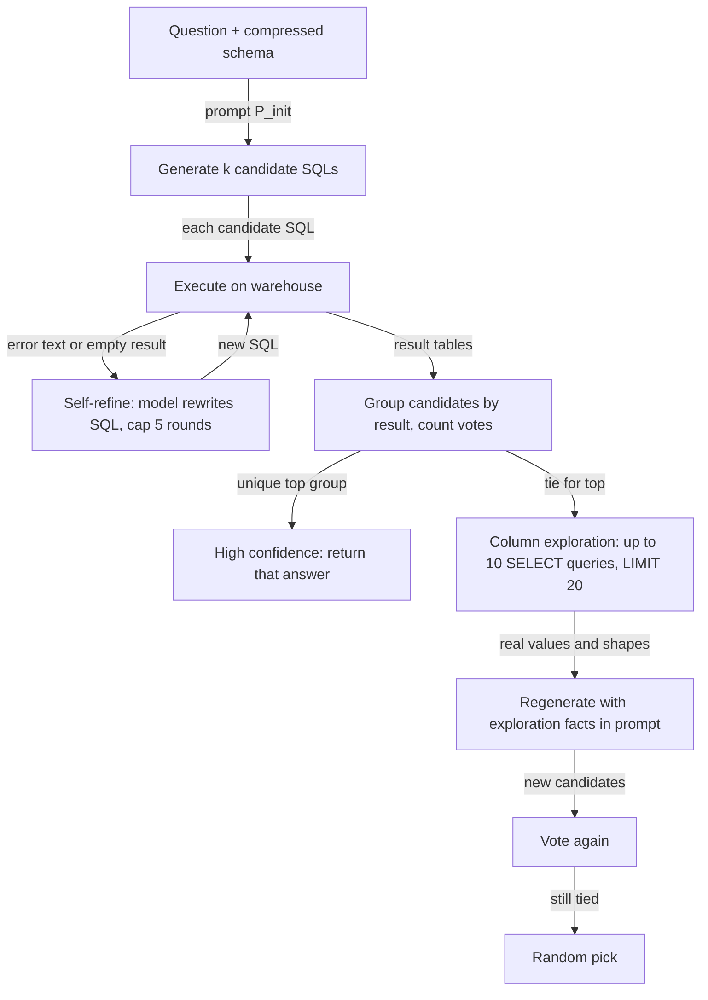

# ReFoRCE: A Text-to-SQL Agent with Self-Refinement, Consensus Enforcement, and Column Exploration

> **Paper:** Deng, Ramachandran, Xu, Hu, Yao, Datta and Zhang (University of California San Diego and Snowflake AI Research), 2025 - [arXiv abstract](https://arxiv.org/abs/2502.00675) - [local PDF](../../papers/2502.00675.pdf)
>
> **Status and version:** a preprint. The arXiv abstract page shows no venue, and nothing in the text says it was peer reviewed. This guide follows the arXiv HTML rendering of **v5 (3 June 2025)**; section, table, figure and listing numbers follow that version. This guide did not read earlier versions, so numbers quoted from them may differ.
>
> **Short name:** ReFoRCE, read as "reinforce". It stands for Self-**Re**finement agent with Consensus En**FoRC**ement and Column **E**xploration.

## Read this first

**The claim in one sentence.** For questions over very large company-style databases, a fixed pipeline of four stages (shrink the schema until it fits, let the model fix its own SQL from error messages, ask the model for several answers and keep the one most of them agree on, and let it run small exploratory queries to look at the real data when the vote is tied) answers more questions correctly than a free-roaming step-by-step agent using the same model, and does so with far fewer model calls.

**Who this is for.** Anyone deciding how an assistant should turn a business user's question into a query on an analytics warehouse, and wanting a pipeline with measured costs.

**Afterwards you will be able to** trace the four stages on the paper's own failing-then-succeeding example; say what the headline scores 35.83 and 36.56 count; compute a question's cost in calls and tokens from the cost tables; spot where tables and prose disagree; and decide what to copy for your own warehouse agent.

**Reading time.** About 50 minutes.

**Have read first:** [ReAct](../02-building/10-react.md) (the think-act-observe loop the baseline agent uses), [Chain-of-thought](../02-building/07-chain-of-thought.md) (the idea behind sampling several answers and voting), [HumanEval](../03-evaluation-and-code/14-humaneval.md) (pass at k scoring), and [CodeAct](../06-agent-systems/25-codeact.md) (code as the action, error messages as feedback). The benchmark is introduced in [Spider 2.0](./34-spider-2.md); skim [BIRD](./32-bird.md) and the [text-to-SQL survey](./33-text2sql-survey.md) for the older setting.

**The one thing most people get wrong.** The headline is not "an agent that explores databases". The exploration stage only runs on the roughly one question in five where the vote is tied (the paper's cost table has 100 of 547 questions going through it), and turning it on for every question slightly *lowers* accuracy (Table 3). What carries most of the result is unglamorous: shrinking the schema so it fits, and voting. Also, the score is "the right answer comes out", measured by running SQL against fixed data; nothing in the paper tests safety, access control, or what happens when the question itself is ambiguous.

## The paper in one worked example

The paper has one full trace, in Appendix D (Listings 2 and 3). It is a hard question on a Snowflake database built from OpenStreetMap (OSM, a public map dataset). The guide uses it throughout. All SQL snippets below are paraphrased from the listings; the error messages and numbers are the paper's.

**Before the trace, one tiny SQL example for readers new to SQL.** A *database* holds *tables*; a table is a grid where each *row* is one record and each *column* is one named field. This query adds up one column over the rows that pass a filter:

```sql
SELECT SUM(amount) FROM orders WHERE region = 'north' AND status = 'completed';
```

A *query* is a request like that; it returns a result table. A *SQL dialect* is a vendor's version of the language: Snowflake, BigQuery and SQLite accept different functions and reject different constructs. A *data warehouse* is a large analytics database (Snowflake and BigQuery are warehouses; SQLite is a small file database).

**The question (Listing 2).** "How many different pairs of roads classified as motorway, trunk, primary, secondary, or residential in California overlap each other without sharing nodes and do not have a bridge tag, where these roads are tagged with highway, analyzed through planet ways?" The data lives in a table called PLANET_WAYS (one row per road segment, called a "way") whose column `all_tags` is a *nested* column: a list of key-value pairs such as key "highway", value "primary" stored inside one cell. A second table, STATES, holds state outlines.

### Step 1 - Without column exploration (Listing 2)

| Step | What the model sees | What it runs | What comes back | What changes |
|---|---|---|---|---|
| 1a | The question plus the (compressed) schema; no sample of real tag values | A long query that flattens `all_tags` twice (once to keep highway classes, once to drop bridges), builds road pairs, and tests "no shared node" with another flatten inside `NOT EXISTS` | Snowflake error 000002 (0A000): lateral table function called with an outer join or join predicate is unsupported | The model rewrites the query |
| 1b | The failing SQL and the error text | A rewrite that moves node flattening into a helper table, still using `LATERAL TABLE(FLATTEN(...))` | Error 001003 (42000): syntax error, unexpected 'TABLE' and '(' at line 35 | Another rewrite |
| 1c | Both errors | A third rewrite using `LATERAL FLATTEN(...)` | Error 002031 (42601): "Unsupported subquery type cannot be evaluated" | The loop reaches its cap: the paper prints "Max iteration reached, break" |

The paper's diagnosis: the model "lacks sufficient visibility" into how the tags are stored, so errors about Snowflake's rules cannot be fixed by guessing. This guide adds one observation: all three errors are about *dialect*, not about the business meaning, so a model that has never seen the data cannot tell which repair is right.

### Step 2 - With column exploration (Listing 3)

The model is told (Figure 4, the paper's prompt) to write up to ten different SELECT-only queries, from simple to complex, each with a `--Description:` comment and `LIMIT 20`, and not to query the schema. What it wrote, in order (descriptions paraphrased):

| Exploratory query | What it asks | What came back (paper) | What it teaches the model |
|---|---|---|---|
| 1 | Peek at ways that have a tag whose key contains "highway" | Ids such as 386266471 with `all_tags` shown as a list of key/value objects | The nested shape: a list of objects with "key" and "value" |
| 2 | List distinct highway values (limit 20) | 20 values including motorway, primary, residential, footway, cycleway, "yes" | The class names exist as plain strings; many other classes exist too |
| 3 | Show every tag of one way (the minimum id) | Way 4366743 with keys bicycle, destination, highway, lanes, oneway | Tags are one row per key after flattening |
| 4 and 5 | California's row from STATES; ways that intersect it with a target highway class | A binary geometry blob; ids such as 173040551 labelled primary | Geometry is stored as bytes and needs `TO_GEOGRAPHY` for spatial tests |
| 6 | The same, but with no bridge tag, using `NOT EXISTS` over a flatten | Error 002031 again | The same unsupported-subquery wall as Step 1 |

**The repair that mattered.** For query 6 the model's first correction (two non-nested `EXISTS` subqueries) failed with the same error 002031. Its second correction replaced the subqueries by one pass: flatten the tags once, `GROUP BY` the way id (a *GROUP BY* collapses rows that share a value into one row per group, so a *HAVING* test can look at the whole group), and test with conditional maxima such as `MAX(IFF(key = 'bridge', 1, 0)) = 0`. That returned 20 ids. The paper's algorithm (Algorithm 1) then applies "similar error refine" to the queries not yet run: the lesson from the failed query 6 is carried into queries 7 to 10.

| Exploratory query | Result printed in the paper |
|---|---|
| 7 - count California ways with a target class and no bridge tag | 15,429 ways |
| 8 - sample of overlapping pairs among them | 20 id pairs, e.g. (10392115, 10394223) |
| 9 - overlapping pairs with zero shared node ids | a sample of 14 id pairs |
| 10 - count of such pairs | 13 |

**Final answer.** With those facts in the prompt, the model writes a clean final query (the same grouped pattern, with `CASE` instead of `IFF`), and the self-refinement loop runs it: result 13. The paper calls this a success. It does not say whether 13 equals the gold (reference) answer, so "success" here means "executed and consistent with the exploration", an unverified reading.



**What to notice.** Two loops: a cheap inner one (execute, read the error, rewrite) that every candidate runs, and an outer escalation only a tied vote triggers. The random pick is the last resort (equation 7).

```mermaid
flowchart LR
    Q2["California road-pairs question"] -->|"3 rewrites, 3 Snowflake errors"| F["Self-refine hits the cap, unsolved"]
    F -->|"low confidence"| E1["Queries 1-5: shape of all_tags, class names, bytes geometry"]
    E1 -->|"learned structure"| E2["Query 6 fails with 002031, fixed by GROUP BY + HAVING MAX"]
    E2 -->|"error pattern passed to later queries"| E3["Queries 7-10: 15,429 ways, sample pairs, count = 13"]
    E3 -->|"facts in prompt"| A["Final query returns 13"]
```



**What to notice.** Exploration supplies information *from the data*, not the schema: value spellings, nesting shape, and which SQL pattern the warehouse accepts.

## Words you need

| Term | Plain definition | Example from the worked example |
|---|---|---|
| Text-to-SQL | Turning a natural-language question into a SQL query | The road-pairs question becomes a grouped Snowflake query |
| Schema | The list of tables, their columns and column types | PLANET_WAYS has columns id, geometry, nodes, all_tags |
| DDL (Data Definition Language) | The text that declares a table's columns; the form in which schemas are given to the model | The paper says each GA360 table's DDL file is over 150 KB |
| Execution accuracy (EX) | Percentage of questions whose returned result matches the reference result when both are run | 35.83 means 196 of 547 questions (this guide's arithmetic) |
| EX@8 (Pass@8) | Percentage of questions where at least one of the top eight candidates is right; an upper bound on what a perfect picker could reach | o3 on Snow: EX 35.83, EX@8 39.85 |
| Database information compression | Stage (a): merge look-alike tables, then drop unrelated tables with a model, so the prompt fits | Table names GA_SESSIONS_20160801 to GA_SESSIONS_20170801 collapse to one full table plus names |
| Schema linking | Choosing which tables and columns a question needs; here a per-table Y/N model call (Appendix A) | Dropping unrelated tables |
| Nested column | A cell holding a list instead of one plain value | `all_tags` |
| Self-refinement | Run the SQL, read the error or empty result, ask the model to rewrite, repeat up to a cap | Step 1a to 1c |
| Consensus enforcement | Sample several candidates, group them by outcome, accept only a unique top group | Votes of 3, 2, 2, 1 give a unique winner; 2, 2, 1 does not |
| Column exploration | Model-written, cheap SELECT queries (LIMIT 20) that look at real values and nested shapes before the final query | Queries 1 to 10 in Step 2 |

## Tutorial 1 - Intuitive understanding

### What was broken before

Two things, both shown by the paper's setting. First, **old benchmarks were small.** The paper's introduction says earlier text-to-SQL work was tested on schemas of about 50 columns per database, one dialect (SQLite) and SQL of about 30 tokens, where models score over 90% (Spider 1.0) and over 70% (BIRD). On Spider 2.0 the databases average about 800 columns, SQL averages about 150 tokens, and three dialects appear.

Second, **a free-roaming agent wanders.** The baseline, Spider-Agent, is a ReAct loop: the model chooses an action (run SQL, run a terminal command), looks at the result, chooses again. It made about 11 model calls per question per vote (Table 1) and scored 10.05 (GPT-4o) to 24.31 (o3) on Snow. The authors say such agents "fail to follow instructions, overlook critical schema elements" in long contexts; that is their framing, not a trace-level analysis.

**A visible failure** is Step 1 above: three rewrites, three errors, no progress.

### The idea

**Analogy.** A new analyst is handed a question and a 77 MB data dictionary. A sensible analyst first strikes out irrelevant tables, then drafts the query, runs it, fixes errors, asks two colleagues to do the same independently, and checks whether all three get the same number. If the three disagree, the analyst stops theorising and runs a few small look-ups ("what values are in this column? what does one row look like?") before trying again. ReFoRCE is that routine written as a program.

**Where the analogy breaks.** (1) The "colleagues" are the same model sampled at temperature 1.0, so their agreement is not independent: they share the model's blind spots, and they can agree on a wrong answer. (2) The analyst knows when a question is vague and asks you; ReFoRCE never asks. A tie goes to more exploration and finally to a random pick.

### How it works, step by step

Steps 1 to 5 map onto the worked example; the first four run in order, and the fifth is a fallback.

1. **Compress the database description (Section 3.2.1).** With sample rows and column descriptions, one Spider 2.0 schema prompt can reach 77 MB, about 20 million tokens (a *token* is roughly a word fragment; models read and bill in tokens). Tables whose names share a prefix or suffix (daily tables such as GA_SESSIONS_20160801) are merged: one representative keeps full detail, the rest appear as bare names. The paper reports one database's DDL falling from over 50 MB to under 2 MB, "more than 96%" smaller. If the prompt is still over 50,000 tokens, the model judges each table alone (Appendix A prompt: Y or N, plus related columns).
2. **Generate and self-refine (Section 3.2.2).** Run the SQL; on an error or empty result, give the model the message and ask for a rewrite, up to five rounds (the cap in Table 6). Step 1 of the example used its rounds without success.
3. **Do this k times and vote.** Candidates are grouped by what they produce; a unique top group wins; a tie defers the question.
4. **Explore columns, only for deferred questions (Section 3.2.3).** Up to ten harmless look-up queries; an error in one triggers a repair also applied to the queries not yet run; results go back in the prompt and generation runs again.
5. **Random pick (equation 7)** among still-tied candidates.

### What the results say

**Headline (Table 1, o3 model).** ReFoRCE scores EX 35.83 on Spider 2.0-Snow and 36.56 on Spider 2.0-Lite. Each benchmark has 547 questions, so this is about 196 and 200 questions right. The same model in the baseline agent scores 24.31 and 24.86. The gap is 11.52 and 11.70 points: out of every 100 questions, about 11 or 12 more are answered correctly than by the baseline with the same underlying model. With GPT-4o the gaps are 10.79 and 8.96 points; with o4-mini they are 7.86 and 8.59. (All gaps are this guide's subtraction of Table 1 entries.)

**What the two benchmarks are.** *Snow* is 547 questions all in the Snowflake dialect; *Lite* is 547 questions in BigQuery, Snowflake and SQLite (Section 4.1).

**The upper bound.** EX@8 for o3 is 39.85 and 42.05: a perfect picker among the eight candidates would add about 4.0 and 5.5 points (roughly 22 and 30 questions). The picker leaves some correct answers on the table, but not many.

**Cost.** 3.52 model calls and 3.89 database calls per question per candidate, about 18.73K tokens per call (Tables 1 and 7); 1.69 calls and 15.44K tokens without exploration (Table 6); about 11 calls and 8K tokens per call for Spider-Agent (Section 4.2). See "What it costs".

**Ablation (Table 3, o3).** Removing the schema compression is the largest drop (-3.65 on Snow, -3.48 on Lite): about 20 questions of 547 (this guide's arithmetic) fail outright because the prompt does not fit. Removing column exploration costs 2.56 (Snow) and 2.37 (Lite) points. Removing majority voting costs 2.01 and 1.83. Removing the random-pick fallback costs 0.73 and 1.28.

**Small models (Table 2).** On the 135 SQLite questions of Lite, Qwen2.5-7B-Instruct alone scores 5.19 (voting) and the 7-billion-parameter Arctic-Text2SQL-R1 model scores 14.81. Placed in the hybrid rows (ReFoRCE + o3 + the small model), they reach 25.93 and 28.89: gains of about 20.7 and 14.1 points. The paper says the small model does only SQL generation and the workflow does the rest; since the rows are labelled o3, this guide infers o3 runs those other stages.

### What this does not show

- Gains on easy, small-schema data: the authors say generalisation to BIRD is "limited" (Section 5.1) and give no number.
- A small model running the *whole* pipeline: Table 2's hybrid rows carry the label o3, and the paper does not itemise which stages o3 ran.
- How often the system is confidently wrong. Accuracy is reported; the rate of unique-top votes on wrong results is not.
- Anything about ambiguity, permissions, dirty values you must clean first, or warehouse bills.

### Teach-back

1. Why does a tie in the vote lead to *more exploration* and not to taking the first answer?
2. On the road-pairs question, what did exploration provide that more self-refinement rounds could not?
3. A colleague says "ReFoRCE lets a 7B open model score 28.89 on SQLite". What is missing from that sentence?
4. Why does removing majority voting leave EX@8 unchanged in Table 3?

<details>
<summary>Answers 1 and 2</summary>

1. A tie means the samples disagree, a sign the model lacks facts, not luck. Exploration supplies real values so the next candidates can converge; random choice is the last fallback (equation 7).
2. It showed how `all_tags` is stored, which highway names exist, and a grouped pattern Snowflake accepts. Self-refinement saw only error text, never data, so it cycled through unsupported constructs.
</details>

<details>
<summary>Answers 3 and 4</summary>

3. The sentence omits that the row is labelled ReFoRCE + o3; the paper says the small model only generates SQL, and this guide infers o3 runs the other stages. Alone, the 7B models alone score 5.19 (Qwen) and 14.81 (Arctic) under majority voting, and 7B models with only the OpenSearchSQL extraction parts reach 7.40 and 14.07.
4. EX@8 asks whether any of eight candidates is right. Voting changes which candidate is returned, not which exist, so EX@8 stays 39.85 and 42.05 in both the "w/o Random Selection" and "w/o Majority Voting" rows.
</details>

## Tutorial 2 - Practitioner understanding

### The design in concrete terms

**Inputs (Section 3.1).** For the self-contained Snow and Lite tasks, the parser takes a database schema D, a question Q and auxiliary documentation E (text that comes with the benchmark; the schema-linking prompt calls it "External knowledge"). The first prompt is `P_init = compress(D) + E + Q` (equation 1).

**Compression details (Section 3.2.1 and Appendix A).**

| Parameter or rule | Value reported |
|---|---|
| Table grouping | Merge tables with similar name prefixes or suffixes; keep one in full, others by name |
| Trigger for table-level linking | Prompt still over 50K tokens after grouping |
| Linking prompt | One call per table; JSON with "think", "answer" (Y or N only), "columns" |
| Recall after linking, long-context set (63 Lite, 57 Snow questions) | 86.24 (Lite), 85.32 (Snow); precision 40.81 and 30.24 |
| Questions with every needed table kept | 532 of 547 (Lite), 540 of 547 (Snow) |

Reading Table 5: after linking, the system keeps the needed tables about 86% of the time on the long-context subset, at the cost of keeping 2 to 3 irrelevant tables for each relevant one (precision 30 to 41%). Over all questions, 15 (Lite) and 7 (Snow) lost at least one needed table. The authors accept the trade-off; this guide notes the lost-table questions are likely unsolvable by construction.

**Generation and voting.** Temperature 1.0 for all models except one greedy GPT-4o baseline (temperature 0). k candidates per question (equation 2). The text does not state k in the sections this guide read; "EX@8" and the "top-k" language imply 8, and Table 1 writes costs as multiples of `v`, the number of votes. This guide assumes v is 8 and labels every such number as an assumption.

**What is voted on.** Equations 2 to 4 do not say whether a candidate `y` is SQL text or its executed result; the prose says "candidate results". This guide treats votes as on executed results (an inference; see the FAQ).

**Selection rule.** High confidence means exactly one candidate has the most votes (equation 5); a tie is low confidence (equation 6). This is a plurality: votes of 3, 2, 2, 1 across eight candidates count as high confidence.

**Column exploration prompt (Figure 4, Listing 1).** Per dialect (Snowflake, BigQuery, SQLite) the prompt carries style hints: how to quote names, use fuzzy string matching first ("Do not directly match strings if you are not convinced"), view a nested column whole before extracting keys, and avoid time-conversion functions "unless you are certain" of the format. It asks for at most ten different SELECT queries, each with `LIMIT 20` and a `--Description:` comment, using only given tables. Algorithm 1 gives a failed query a bounded correction loop (`max_try`), and a successful correction triggers `similar_error_refine` on the queries not yet run.

**Format restriction.** The brief behind this guide named a "format restriction" stage. v5 has no such stage; the nearest items are the dialect hints and the JSON-only linking output.

**Spider 2.0's scorer (Section 4.1)** is more lenient than BIRD's: extra returned columns are accepted when the question does not say which to return, so read scores as "the right values appeared".

### A minimal version

Below is consensus enforcement alone, on constructed toy data (not the paper's). It builds a small `orders` table, executes candidate SQL strings, drops those that error, groups the rest by result, and applies the paper's rule: a unique top group is high confidence, a tie is deferred. It uses only the Python standard library and `sqlite3`.

```python
import sqlite3
from collections import Counter, defaultdict

db = sqlite3.connect("file:toy?mode=memory&cache=shared", uri=True)
db.executescript("""
CREATE TABLE orders(id INTEGER PRIMARY KEY, region TEXT, status TEXT, amount REAL);
INSERT INTO orders VALUES (1,'north','completed',100),(2,'north','completed',50),
 (3,'north','refunded',70),(4,'south','completed',200),(5,'north','pending',30),
 (6,'South','completed',10);""")

def run(sql):
    try:
        return tuple(sorted(db.execute(sql).fetchall()))
    except sqlite3.Error as e:
        return ("ERROR", type(e).__name__)

def consensus(candidates):
    groups = defaultdict(list)
    for sql in candidates:
        res = run(sql)
        if res[:1] == ("ERROR",):
            continue                      # self-refinement would repair these; here we drop them
        groups[res].append(sql)
    votes = Counter({r: len(s) for r, s in groups.items()})
    ranked = votes.most_common()
    top = ranked[0][1]
    tied = [r for r, n in ranked if n == top]
    status = "HIGH" if len(tied) == 1 else "LOW (defer to column exploration)"
    return status, ranked, groups
```

The full file (with a driver for three question sets) was run; the candidate lists are described here. Q1 has five candidates for "total completed revenue, north": three phrasings of the right query, one forgetting the status filter, one naming a missing column. Q2 asks for "south" and has four disagreeing candidates. Q3 has eight candidates with a plurality of three. Real output:

```text
Q1 -> HIGH   (3 votes: 150.0 | 1 vote: 250.0; the bad-column candidate was dropped)
Q2 -> LOW    (four groups of 1 vote: 150.0, 210.0, 200.0, 250.0)
Q3 -> HIGH   (3 votes: 150.0 | 2: 250.0 | 2: 360.0 | 1: 6)
```

**What the toy shows.** (1) Differently written queries with the same result merge into one vote, which is why voting on results beats voting on text. (2) In Q2 the `region` column holds both 'south' and 'South', so 200 and 210 are both defensible; the query `SELECT DISTINCT region FROM orders` is exactly the kind of column-exploration step that exposes the dirty spelling. (3) Q3 is high confidence at only 3 of 8 votes. The rule cannot tell a right plurality from a wrong one.

**What this toy omits.** Real model sampling at temperature 1.0; self-refinement; the deferral loop; result canonicalisation (rounding, row order, extra columns); and a read-only guard. The paper's prompt asks for SELECT only but describes no enforcement, so a real build needs a read-only database role.

### What it costs

The paper gives calls and tokens, not dollars or wall-clock time. Appendix B reports per-question averages from 547 questions.

**Cost tables (Tables 6 and 7, per candidate).**

| Stage group | Questions | LLM calls each | DB calls each | Tokens per call |
|---|---|---|---|---|
| No self-refinement | 407 | 1 | 1 | 15K |
| Little self-refinement | 90 | 3 | 3 | 16K |
| Empty results (cap of 5 reached) | 50 | 5 | 5 | 18K |
| With column exploration | 100 | 10 | 12 | 18K |
| Weighted average, with exploration | 547 | 3.52 | 3.89 | 18.73K |
| Weighted average, without exploration (Table 6) | 547 | 1.69 | 1.69 | 15.44K |

**Check of the averages (this guide's arithmetic).** With exploration, (407 x 1 + 90 x 3 + 50 x 5 + 100 x 10) / 547 = 1,927 / 547 = 3.52 calls, which matches. Database calls: (407 + 270 + 250 + 1,200) / 547 = 3.89, a match. Tokens: (407 x 15 + 90 x 16 + 50 x 18 + 100 x 18) / 547 = 18.73K, a match. Without exploration: 927 / 547 = 1.69 calls and 15.44K tokens, a match. **But the rows count 407 + 90 + 50 + 100 = 647 questions while the divisor is 547.** The 100 exploration questions seem to be an add-on to the 547, not a subset (or their earlier calls are double counted). The appendix prose then says "all 647 examples" in one place, 547 in the table's own total. See the inconsistency list.

**Per-question totals (constructed).** Assume v = 8 (an inference from EX@8; the paper does not state v in the text this guide read).

| Setting | Calls per candidate | Calls per question at v = 8 | Tokens per question at v = 8 |
|---|---|---|---|
| ReFoRCE, no exploration | 1.69 | about 13.5 | 1.69 x 15.44K x 8 = about 209K |
| ReFoRCE, with exploration | 3.52 | about 28.2 | 3.52 x 18.73K x 8 = about 527K |
| Spider-Agent (Table 1) | 11 | 88 | 11 x 8K x 8 = 704K |

Table 1's note says reasoning tokens for o3 and o4-mini are excluded from Spider-Agent's counts, so real o3 spend exceeds these figures. Table 1 lists 19K tokens per call for GPT-4o and 23K for o4-mini and o3 under ReFoRCE, while Table 7 says 18.73K; the paper does not say why.

**Money and latency.** Neither is reported. At a hypothetical $2 per million tokens, 527K tokens is about $1.05 per question (constructed; the paper does not say whether its counts include output). Candidates can run in parallel (Section 4.2), but exploration is a sequential chain, so this guide infers latency is set by the slowest chain. Warehouse runtime and bytes scanned are never reported; on pay-per-scan systems `LIMIT 20` does not necessarily limit bytes scanned (general knowledge).

**Versus a single-shot NL2SQL function.** A single-shot function is one call returning one SQL string, with no execution and no check. ReFoRCE repeats that call v times inside execution, error feedback, voting and a fallback loop: about 14 to 28 calls per question at v = 8 (assumption) against 1. In exchange it can tell when it is unsure (a tie), which one call cannot.

### How it fails

The paper has only one error analysis, the Step 1 / Step 2 case study, so rows labelled "paper" are grounded in it and the rest are this guide's inference.

| Symptom | Likely cause | Mitigation | Source |
|---|---|---|---|
| Repeated dialect errors, loop exhausted | Model has not seen data shape; error text names a rule, not the fix | Column exploration; dialect hints in the prompt | Paper, Appendix D |
| Prompt too long, no answer | Schema over the context window | Table grouping, then table-level linking | Paper, Table 3 |
| Needed table dropped by linking | Table-level linker rejects a relevant table (15 Lite and 7 Snow questions) | Column-level linking, retrieval of values (the authors name these as future work) | Paper, Appendix A and Section 4.3 |
| Confident wrong answer | Plurality of samples share one misreading; the vote has no truth check | Evaluation set, human spot checks, ask for confirmation on high-stakes questions | Guide inference |
| Random pick returned | Tie persisted after exploration | Return "not sure" and a clarifying question instead of a guess | Guide inference; paper uses random_select |
| Wrong filter value (case, spelling, synonyms) | Direct string matching on dirty data | Exploration of `DISTINCT` values; fuzzy matching hints | Paper, Listing 1 hints; toy Q2 |
| Query is correct but the business meaning is wrong ("revenue" means net of refunds?) | No semantic layer; documentation E is the only channel | Define metrics once and let the agent call them | Guide inference; the paper does not address it |

### Evaluating your version

- **Metric.** Execution accuracy on your own questions (the scorer idea from [Spider 2.0](./34-spider-2.md)), plus the share of *high-confidence* answers that are wrong. The paper does not report the second number, and business users feel it most.
- **Test set.** At least 100 to 200 real questions with hand-checked reference results. On 547 questions one question is 0.18 points; on 150 it is 0.67, so a 5-point gap is about 8 questions. The paper reports one run per setting, so repeat yours.
- **Baselines.** Your single-shot function; the same model with execution feedback only; the full pipeline.
- **Stop rule (this guide's).** Keep a stage only if it moves at least 10 questions on your set; keep the no-exploration configuration as the default, since Table 3 shows it loses only 2.56 and 2.37 points at about half the calls.

### Adopt, adapt or skip

For a team letting an agent query an analytics warehouse for business users (see the [data-access pattern document](../../../agents/data-access/README.md)):

**Adopt.** Execute-and-repair loops with a hard cap (the paper uses five). Result-level voting where a tie means "do not trust this yet". Compression of the schema description before it reaches the model (the largest ablation effect). Read-only, row-limited exploration queries that look at values first; Appendix C's prompt is a good start.

**Adapt.** Replace "random pick" with a clarifying question or an "unverified" flag; for business users a coin flip is the worst outcome. Replace the benchmark's documentation E with a *semantic layer* (governed definitions of metrics such as "revenue" and of join paths) that the agent consults first. Enforce read-only access with a restricted database role, not only prompt text.

**Skip or defer.** The 50K-token threshold (your schema and model differ), leaderboard-specific tuning, and any claim that a small model alone can run the pipeline.

**What the evidence cannot tell you.** Whether this beats a simpler pipeline on your schema; behaviour on ambiguous business questions; cost on your warehouse; whether an open model can run the stages o3 probably ran here (the paper itself says it relies on proprietary reasoning models, Section 5.1). **What you must still build:** the semantic layer, your own evaluation set, access control and audit logging (Appendix E recommends them but builds none), and a clarification path. Follow-ups on the open-model question: [Arctic-Text2SQL-R1](./37-arctic-text2sql-r1.md) and [FlexSQL](./36-flexsql.md).

## Tutorial 3 - Researcher understanding

### Formal setup

Notation follows Section 3 and is defined once here. **Q**: question. **D**: schema. **E**: auxiliary documentation. **S = f(Q, D, E | theta)**: the SQL a parser with parameters theta produces (Section 3.1). **P_init = compress(D) + E + Q** (equation 1). **R(x) = {y_1, ..., y_k}** (equation 2): the k self-refined candidates for example x. **v(y_i)** (equation 3): how many candidates equal y_i. **X_high** (equation 5): examples with a unique top-count candidate. **X_low** (equation 6): examples where two different candidates share the top count. **X_final** (equation 7) = X_high, plus column_explore(X_low), plus random_select(whatever is left). EX is at most EX@k always, because EX@k counts a question if any of k candidates is right.

**Numeric toy instance (constructed).** With k = 8, counts (3, 2, 2, 1): the maximum 3 occurs once, so x is in X_high. Counts (3, 3, 2) or (4, 4) or (1,1,1,1,1,1,1,1) put x in X_low. Equation 4 as printed compares a maximum with a maximum over the other candidates; read for one fixed y_i it says "y_i is the strict winner".

### The claims, stated precisely

1. With o3, ReFoRCE reaches EX 35.83 (Snow) and 36.56 (Lite), against 24.31 and 24.86 for Spider-Agent; the ordering holds for GPT-4o and o4-mini (Table 1).
2. ReFoRCE uses fewer model calls (3.52 v against 11 v) but more database calls (3.89 v against 3 v) than Spider-Agent (Table 1).
3. Column exploration is worth about 2.4 to 2.6 EX points and costs about twice the calls (Tables 3, 6, 7).
4. Schema compression is the largest ablation effect (Table 3).
5. Gold table hints barely move EX (+0.37) but move EX@8; gold schema (columns too) helps EX on subsets (+8.26 Snow, +3.13 Lite, Table 4).
6. Small models improve when used only as the SQL generator inside the pipeline in rows labelled with o3 (Table 2).
7. The authors speculate (Section 4.3) that strong reasoning models infer relevant tables themselves.

### Evidence, table by table

**Table 1 - Main comparison.** Rows: Spider-Agent and ReFoRCE, each with GPT-4o, o4-mini, o3; columns: Snow and Lite EX and EX@8, calls, tokens. Headline: ReFoRCE o3 35.83 / 39.85 / 36.56 / 42.05. *Identifies:* a same-model comparison of two systems; the gap bundles prompt, tooling and sampling. *Does not identify:* which component produced it (Table 3). Spider-Agent's `11 v` calls imply it is voted too, but the paper does not say how.

**Table 2 - Small models on 135 SQLite questions.** Rows: ReFoRCE with each proprietary model; two 7B models alone; with OpenSearchSQL's extraction parts; hybrids. Headline: ReFoRCE + o3 + Arctic-Text2SQL-R1-7B scores 28.89 (voting), 29.63 (greedy), EX@8 36.30. *Identifies:* hybrids beat the same small model alone. *Does not identify* how much of a hybrid score is the small model: ReFoRCE + o3 alone gets 38.52, higher than either hybrid. One question is 0.74 points here.

**Table 3 - Ablation, o3.** See next subsection.

**Table 4 - Gold schema, subsets.** Rows: ReFoRCE (subset), with gold schema. Subsets are 121 (Snow) and 256 (Lite) questions that have public gold SQL, so the baselines (39.67 and 50.00) are not the 35.83 and 36.56 of the full set. The caption says the difficulty differs. *Identifies:* a causal effect of giving column-level truth to the same pipeline on those questions. *Does not identify:* the same effect on the unseen questions.

**Tables 5 to 7 (Appendices A and B)** are reported above and recompute, with the cost-table divisor caveat. **Figures 2 and 5** (prompt sizes before and after compression; a leaderboard screenshot dated 22 May 2025) are images this guide could not read; no values are taken from them.

### Ablations and what they isolate

| Row (Table 3, o3) | Snow EX | Lite EX | Delta EX Snow / Lite | Delta EX@8 Snow / Lite | What it isolates |
|---|---|---|---|---|---|
| Full | 35.83 | 36.56 | 0 | 0 | reference |
| w/o column exploration | 33.27 | 34.19 | -2.56 / -2.37 | -2.19 / -4.76 | value of the escalation stage |
| w/o random selection | 35.10 | 35.28 | -0.73 / -1.28 | -0.00 / -0.00 | tie-break by random choice versus leaving ties unanswered (the paper does not state what happens to unresolved ties) |
| w/o majority voting | 33.82 | 34.73 | -2.01 / -1.83 | -0.00 / -0.00 | choosing by vote versus an unstated alternative |
| w/o DB info compression | 32.18 | 33.09 | -3.65 / -3.48 | -3.65 / -3.48 | prompts that do not fit fail |
| Column exploration only | 34.27 | 35.10 | -1.46 (see note) / -1.46 | +5.75 (see note) / +4.93 | exploring on every question, not just ties |
| w/ gold table | 36.20 | 36.93 | +0.37 / +0.37 | +6.95 / +4.93 | what perfect table-level linking is worth |

**Arithmetic note (inconsistency).** In the exploration-only row, Snow EX is 34.27 against 35.83, a gap of 1.56, and Snow EX@8 is 45.16 against 39.85, a gap of 5.31. The table and prose print -1.46 and +5.75, which do not recompute; the Lite deltas (-1.46, +4.93) do. Also the Lite EX@8 of 46.98 is identical in this row and in the gold-table row, a coincidence worth checking in the PDF.

**In questions, not points.** One question is 100 / 547 = 0.183 points, so (this guide's arithmetic): compression is worth about 20 questions on Snow and 19 on Lite; exploration about 14 and 13; voting about 11 and 10; random selection about 4 and 7; and gold tables about 2 questions in EX. Gaps of 0.37 are two questions, and the paper reports one run each, so treat the gold-table EX gain as indistinguishable from zero.

**Reading the pattern.** "Column exploration only" gives the highest non-oracle EX@8 (45.16 on Snow) and a lower EX than the full system. This guide's reading, matching the authors' (Sections 3.2.3 and 4.3): exploring everywhere gives more varied candidates, good for pass-at-8 and bad for agreement, so the two-stage design uses exploration only where the cheap path has failed. The compression row lowers EX and EX@8 by the same amount, consistent with affected questions simply producing no output, which is the authors' explanation.

### Threats to validity specific to this paper

1. **Single runs at temperature 1.0, no variance.** Differences below about 1 point are two to four questions; no seeds or intervals are reported.
2. **Preprint, one benchmark family.** Generalisation to BIRD is described as limited, with no number given. The pipeline may encode Spider 2.0 quirks, such as lenient column scoring.
3. **Baseline comparability.** Spider-Agent runs in Docker with the benchmark's own harness; ReFoRCE is a different code path.
4. **Proprietary dependence and hidden tokens.** The headline uses o3; reasoning tokens for o3 and o4-mini are excluded from Spider-Agent's token counts (Table 1 caption).
5. **Possible leakage.** The paper does not discuss overlap between public questions and training data. This is a generic risk, not a finding.
6. **Gold subsets.** Table 4's subsets are 22% (121 of 547) and 47% (256 of 547) of the questions, with different difficulty by the caption.
7. **Cost accounting.** The cost table rows do not add to its total (see the FAQ).
8. **"Success" unverified.** The case study does not report agreement with the reference answer.

### Open problems and follow-ups

- Column-level linking and value retrieval, which the authors name as missing (Sections 4.3 and 5.1).
- Abstaining or asking a clarifying question instead of the random fallback ([BIRD-Interact](./38-bird-interact.md)).
- Calibration: does vote share predict correctness? Cited (Section 2), not measured.
- Training a small model for the pipeline's roles ([Arctic-Text2SQL-R1](./37-arctic-text2sql-r1.md)).
- Safety of agents that run model-written SQL ([prompt-to-SQL injection](./39-prompt-to-sql-injection.md)).

### What would change my mind

- Repeated seeds showing the roughly 2-point component effects in Table 3 vanish.
- A trace analysis showing many unique-top votes are wrong, which would undercut "high confidence".
- Spider-Agent given the same hints, cap and sampling matching ReFoRCE, which would put the gain in the content, not the structure.
- A 7B model at every stage matching the o3 hybrids, which would change the open-model conclusion.

## Reading map for the PDF

| Section or figure | What it contains | First pass | Guide section |
|---|---|---|---|
| Abstract, Section 1 | Claims and headline numbers | Read | Read this first |
| Sections 3.1 to 3.2.3 | Setup, compression, voting, equations 1 to 7 | Read | Formal setup, minimal version |
| Appendix A, Table 5 | Linking prompt and recall | Skim | Tutorial 2 design table |
| Section 4, Tables 1 to 4 | Data, results, ablations | Read | Evidence, table by table |
| Appendix B, Tables 6 and 7 | Cost breakdown | Read, then recompute | What it costs |
| Appendix C, Figure 4, Listing 1 | Exploration prompts and Algorithm 1 | Read | Design in concrete terms |
| Appendix D, Listings 2 and 3 | Failing and succeeding trace | Read prose, skim SQL | Worked example |
| Section 5, Appendix E | Limits, broader impact | Read | Threats to validity |
| Figures 2 and 5 | Images | Skip | Not verifiable here |

## Questions readers get stuck on

### What is the difference between EX and EX@8?

EX is the share of questions where the one answer finally returned is correct. EX@8 is the share where at least one of eight candidates is correct, whichever was returned. EX@8 is a ceiling for EX: 39.85 against 35.83 for o3 on Snow. The gap is what a better picker could still recover.

### Is the vote on SQL text or on results?

The paper does not say precisely; equations 2 to 4 compare candidates without naming the type. Prose calls them "candidate results", and exact text equality would almost never match for 150-token queries, so results is the sensible reading. The toy script votes on results.

### Why does a tie trigger exploration and not a bigger vote?

A tie means the samples disagree, usually because the model lacks facts about the data. More samples from the same uninformed model repeat the disagreement. Exploration changes the input, so the next samples can differ usefully.

### How can 3 of 8 votes count as "high confidence"?

Equation 5 only needs a unique maximum: a plurality, not a majority. "High confidence" is the authors' label; the paper does not measure whether vote share predicts correctness, so read it as "no tie".

### Where does the 96% compression figure come from, and does it apply to my warehouse?

It is the paper's example of one database called GA360: daily tables from GA_SESSIONS_20160801 to GA_SESSIONS_20170801, each DDL over 150 KB, over 50 MB in total, under 2 MB after grouping. The saving comes from a year of look-alike tables, so it applies only if your warehouse has date-sharded tables.

### Why is 3.52 calls not the real cost per question?

It is per candidate. Table 1 writes 3.52 v, with v the number of voting candidates. If v is 8 (an assumption), a question costs about 28 calls. The sentence near Table 1 saying this is the cost "when voting is not performed" reads oddly next to the v.

### Why do the cost tables not add up to 547?

Table 7's rows count 407 + 90 + 50 + 100 = 647 questions, its total row says 547, and the prose says "647". The 3.52 average recomputes only when all 100 exploration questions are added on top of the 547 and the sum is divided by 547. Whether earlier calls on those 100 are double counted is not stated, so treat the cost as approximate.

### Why not just use a ReAct agent?

The authors argue free-form agents are unreliable and costly on long contexts, so they fix the order: compress, generate, vote, explore. The model still reads feedback and rewrites, but the program owns the control flow. With o3, EX is about 11 to 12 points higher (Table 1).

### Could I use a 7B open model instead of o3?

Not on this evidence. Alone, 7B models score 5.19 (Qwen2.5-7B-Instruct) and 14.81 (Arctic-Text2SQL-R1-7B); inside the pipeline with o3 they reach 25.93 and 28.89. The authors say the approach "relies on the internal reasoning capabilities of proprietary models such as o3".

### Does it handle ambiguous questions, or make queries safe to run?

Neither. A tie leads to exploration and then a random pick, with no clarifying question. The exploration prompt says SELECT only, but that is an instruction, not an enforced restriction, and permissions are not discussed. Appendix E recommends access controls, human validation and logging, without implementing them.

## Prerequisites you actually need

### Prerequisite 1 - Execution accuracy and pass at k

Execution accuracy runs the predicted and reference queries and compares returned values, not SQL text. Pass at k asks whether any of k attempts is correct. **Example:** 10 questions, 4 candidates each; the returned answer is right on 3, and some candidate is right on 5. EX = 30%, EX@4 = 50%. **Used in** Section 4.1 and every table. **Read:** [HumanEval](../03-evaluation-and-code/14-humaneval.md); [Spider 2.0](./34-spider-2.md).

### Prerequisite 2 - Plurality versus majority voting

Sampling at nonzero temperature gives different outputs; counting the most frequent is self-consistency. A majority exceeds half; a plurality is the largest group. **Example:** eight samples with 3, 2, 2, 1 votes: the 3-vote answer is the plurality (37.5%), not a majority; 3 and 3 is a tie. **Used in** Section 3.2.2, equations 3 to 6. (Cost averages in Tables 6 and 7 are plain weighted averages: 90 questions at 3 calls and 10 at 10 average 3.70.) **Read:** [Chain-of-thought](../02-building/07-chain-of-thought.md).

### Prerequisite 3 - Schemas, DDL and context windows

A model reads a limited number of tokens at once (its *context window*), so a long schema cannot be given whole. **Example:** 366 daily tables at 150 KB each is 54,900 KB, about 55 MB; keeping one in full and 365 as names leaves about 150 KB plus names. **Used in** Section 3.2.1. **Read:** [RAG](../02-building/06-rag.md).

### Prerequisite 4 - Nested columns and flattening

A nested column stores a list in one cell; filtering on an inner key requires flattening to one row per element. **Example:** a cell holds `[{highway: primary}, {lanes: 2}]`; flattened it becomes two rows, so a `COUNT(*)` after flattening counts 2 where the table had 1 row. **Used in** Appendix C and D (`LATERAL FLATTEN`). **Read:** the [glossary](../../references/glossary.md).

## Where this sits in the curriculum

**Have read before:** [ReAct](../02-building/10-react.md), [CodeAct](../06-agent-systems/25-codeact.md) and the stage's benchmark guides [BIRD](./32-bird.md) and [Spider 2.0](./34-spider-2.md). The [text-to-SQL survey](./33-text2sql-survey.md) places the pipeline stages (linking, generation, correction, selection) in the wider literature.

**How it differs from the two nearest papers.** [Spider 2.0](./34-spider-2.md) *defines* the benchmark and its baseline agent; ReFoRCE is a *method* that replaces the free-roaming loop with a fixed pipeline (the paper claims the top leaderboard score, from a screenshot dated 22 May 2025 that this guide could not read). [CodeAct](../06-agent-systems/25-codeact.md) argues for code actions with execution feedback; ReFoRCE keeps the feedback but fixes the control flow and adds voting.

**What to read next.** The stage pattern is in the [data-access pattern document](../../../agents/data-access/README.md). [FlexSQL](./36-flexsql.md) and [Arctic-Text2SQL-R1](./37-arctic-text2sql-r1.md) test whether smaller or tuned models can fill the roles ReFoRCE gives to o3. [BIRD-Interact](./38-bird-interact.md) addresses the missing piece here, ambiguity and clarification, and [prompt-to-SQL injection](./39-prompt-to-sql-injection.md) addresses what an attacker can do through a text-to-SQL agent.

## Checkpoint

1. Explain in two sentences why Step 1 of the worked example fails and Step 2 succeeds.
2. Compute: 100 questions are tied, each of which costs 10 LLM calls; 407 cost 1, 90 cost 3, 50 cost 5. Verify the weighted average 3.52 over 547 questions, and say what is odd about the counts.
3. A team reports EX 40.0 and EX@8 50.0. What does the gap mean, and what single change could move EX toward EX@8?
4. Critique: "ReFoRCE shows open models can query enterprise warehouses." Name what the evidence supports and what it does not.
5. Compute the number of questions behind a 3.65-point drop on a 547-question set, and say why a 0.37-point change should not be reported as a finding.
6. Write the vote groups for counts (4, 2, 2) over eight candidates; is the question high or low confidence, and what does the paper do next in each case?

<details>
<summary>Answers</summary>

1. Step 1 repeatedly rewrote a query using nested flattening that Snowflake rejects, with only error text as feedback, until the cap. Step 2 first ran small queries that revealed how `all_tags` is stored and found a grouped conditional-maximum pattern the dialect accepts, then wrote the final query with those facts in the prompt.
2. (407 + 270 + 250 + 1,000) / 547 = 1,927 / 547 = 3.52. The counts 407 + 90 + 50 + 100 add to 647, not 547, so the 100 exploration questions appear to be counted on top of the 547 (or an earlier stage is double counted); the paper's prose also says 647 once.
3. It means that for 10 questions in every 100, a correct candidate existed but was not returned. A better selector (better voting rule, an execution-based verifier, a human check) would recover some of it; adding more candidates would only raise EX@8.
4. Supported: a 7B model placed inside the pipeline gets 25.93 to 28.89 on 135 SQLite questions. Not supported: o3 is in the row and probably runs the other stages; the 7B models alone score 5.19 and 14.81; the questions are one dialect; there is no access-control or ambiguity test.
</details>

<details>
<summary>Answers 5 and 6</summary>

5. 3.65 / 100 x 547 = 20 questions. 0.37 points is 2 questions on a single run with sampling at temperature 1.0; it is within what a rerun could change.
6. Groups with votes 4, 2 and 2: the 4-vote group is a unique top, so the question is high confidence and its answer is returned. If counts were (3, 3, 2) it would be low confidence, go to column exploration, and take a random pick only if still unresolved.
</details>
