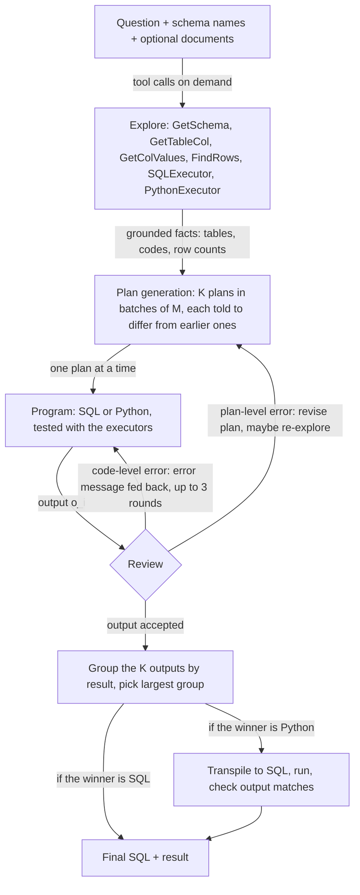
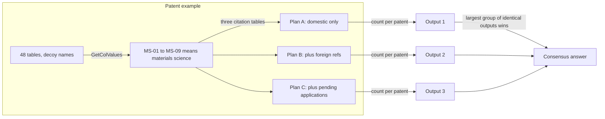

# FlexSQL: Flexible Exploration and Execution Make Better Text-to-SQL Agents

> **Paper:** Pham, He, Nie, Xu, Rafiei, Wang, Ye and Chen (University of Alberta, Simon Fraser University, University of Waterloo, Snowflake, Princeton, New York University, Alberta Machine Intelligence Institute), 2026. The arXiv abstract page says "Published at COLM 2026"; this guide read only the arXiv text and cannot vouch for the review process. [arXiv abstract](https://arxiv.org/abs/2605.02815) - [local PDF](../../papers/2605.02815.pdf)
>
> **Short name:** FlexSQL. **Version followed:** the arXiv HTML rendering of v2 (revised 11 August 2026; v1 was submitted 4 May 2026). Section, table and figure numbers in this guide follow that rendering. Figures are images that the text extraction could not read, so this guide uses only their captions and the paper's prose about them. This is a 2026 paper; treat the numbers as one group's reported results, not as independently replicated.

## Read this first

**The claim in one sentence.** A text-to-SQL agent (a program that turns a business question in English into a database query and runs it) answers hard warehouse questions more often when it can look things up in the database at any moment, writes several different plans for one question, implements each in SQL or Python, and can fall back from a code bug to a rewritten plan, than when it follows a fixed "pick tables, write query, repair syntax" pipeline.

**Who this is for.** A founder or engineer deciding what tools to hand an AI agent for querying company analytics data, especially with open or smaller models. The paper's tool set is a copyable answer to "what should the data-access surface look like", and its gaps are as instructive as its results.

**Afterwards you will be able to** trace one question through the six tools and three stages, say what "flexible exploration" and "flexible execution" mean, read each results table without being misled by the 65.4% headline, explain what the ablations isolate, and run a small read-only tool surface (executed for this guide).

**Reading time.** About 50 minutes. **Have read first:** [ReAct](../02-building/10-react.md) (the think-act-observe loop) and [SWE-agent](../06-agent-systems/26-swe-agent.md) (why tool shape matters). Useful alongside: [CodeAct](../06-agent-systems/25-codeact.md), [Spider 2.0](./34-spider-2.md) (the benchmark used), [ReFoRCE](./35-reforce.md) (the strongest baseline) and the [Text-to-SQL survey](./33-text2sql-survey.md).

**The one thing most people get wrong.** The 65.4% on the abstract page is not a single-attempt score. It is a majority vote over 16 attempts (Table 2); the same model's single-attempt score is 55.15% (Table 1). Also, the title credits flexible exploration and flexible execution, but the ablations switch off Python, diversity and repair, never the exploration tools themselves (Tutorial 3).

## The paper in one worked example

The paper's own running example (Section 2, Figure 1) is used throughout. The question is quoted from the paper: "Find patents filed in Q1 2014 in materials science, and count how many earlier patents each one cites." The database it describes is an intellectual-property database with 48 tables. The paper does not say this database or question comes from the Spider 2.0 benchmark, so this guide treats it as an illustration written by the authors. Figure 1 is an image: the table and tool names below come from the text of Section 2, and every row count, value or output that the text does not state is marked as constructed by this guide.

### Step 0 - What the agent is given

At the start the agent receives only three things (Section 3): the user question, any external knowledge documents, and a list of schema names. A **schema** here is a named folder inside a database that groups related tables. Everything else (table names, column definitions, data values) has to be fetched by tool calls.

### Step 1 - Two hidden problems in the question

The paper names two problems (Section 2). First, "materials science" is not a table or column name anywhere; it is encoded as codes in a column called `field_code` in a table `TECH_CLASS`, which sits among 48 tables with plausible decoys named `CLASS_HIERARCHY`, `CLASS_SUBFIELD` and `FIELD_SECTION`. The paper says the right filter, `field_code IN ('MS-01', ..., 'MS-09')`, can only be found by looking at data values, not at schema metadata. Second, "earlier patents each one cites" can be read three ways, and the database has three citation-related tables: `CITATION_RECORD`, `FOREIGN_REFS` and `APP_REFS`.

### Step 2 - The exploration trace (real tool names, constructed return values)

The paper describes this sequence in prose. The tool arguments shown are this guide's reconstruction of what such calls look like, and the returned values in the right column are constructed except where marked.

| Turn | Tool call | What the paper says happens | Output |
|---|---|---|---|
| 1 | `GetSchema(...)` | lists all 48 tables; `TECH_CLASS` is picked as a candidate | table names (not shown in the paper's text) |
| 2 | `GetTableCol("TECH_CLASS")` | returns column names, data types and a few sample values | constructed: `field_code TEXT`, samples such as `MS-01` |
| 3 | `GetColValues("field_code", "TECH_CLASS")` | discovers that values `MS-01` through `MS-09` are materials science | the codes MS-01 to MS-09 (stated in the paper) |
| 4 | `SQLExecutor("SELECT COUNT(*) FROM FILING_INFO WHERE <Q1 2014>")` | a verification query: do the date filter's row counts look reasonable? | a count; the paper gives no value |

Notice that the agent wrote no final query until it had checked two facts against the data: which codes mean materials science, and that the date filter returns a plausible number of rows.

### Step 3 - Three plans for the ambiguous phrase

The agent then writes several plans, each a short natural-language strategy (Section 4.1). The paper names three:

- **Plan A:** use only `CITATION_RECORD`, filtered on `cited_date`.
- **Plan B:** additionally include `FOREIGN_REFS`.
- **Plan C:** further add `APP_REFS`.

Each plan may be implemented in SQL or in Python. The paper's example of a Python-friendly plan is one that iterates over each patent's citations and filters per patent, "more naturally expressed as a Python loop than as a multi-way self-join" (Section 2).

### Step 4 - Run, check, vote

Each plan becomes a program and is run. A code-level error (syntax, wrong aggregation, wrong column) regenerates the program with the error message, up to three rounds; a plan-level error (wrong tables, missing join, wrong interpretation) returns to Step 3, possibly with new exploration. All programs are then grouped by execution output whatever their language, and the largest group wins. The paper's expected outcome here: all plans agree on which patents to retrieve but give different citation counts, and "majority voting over execution outputs selects the most supported interpretation." A Python winner is translated into SQL, run, and checked for the same output.

### Step 5 - What the two baselines did wrong (as the paper describes them)

One baseline missed `TECH_CLASS` and returned all Q1 2014 patents. A second found it but unioned all three citation tables and "overcounting by an order of magnitude"; every one of its candidates made the same structural choice, "leaving no room for voting to recover". That is the case for diversity: voting only helps when candidates differ in the right way.



Notice the two return arrows from review: a code-level error goes back one step, a plan-level error goes back two, to planning, where the tools are available again. That second arrow is the "backtracking" in the abstract.



Notice that the plans share the grounded fact on the left and differ only in interpretation. Voting compares result tables, not SQL text, so a Python plan and a SQL plan can support each other.

## Words you need

| Term | Plain definition | In the worked example |
|---|---|---|
| Text-to-SQL | Turning a question in plain language into a SQL query (SQL, Structured Query Language, is the standard language for asking a relational database for rows) | the patent question becomes a query over `TECH_CLASS` and a citation table |
| Schema (hierarchy) | In warehouses such as Snowflake, a database holds schemas, a schema holds tables, a table holds columns | the agent starts with only schema names and drills down |
| Flexible exploration | The paper's phrase for letting the agent call schema and data lookup tools at any point in its reasoning, not only once at the start | turns 1 to 4 of the trace |
| Flexible execution | Letting each plan be implemented as SQL or Python, with code run during development, and allowing a failure to send the agent back to planning | the Python loop for per-patent citation filtering |
| Plan | A natural-language strategy: which tables, joins and filters to use | Plan A, B, C |
| Diversity-enforced sampling | Generating plans in batches, each prompted to differ from those already produced (the paper uses "verbalized sampling", Zhang et al. 2025, which it cites) | B differs from A by adding `FOREIGN_REFS` |
| Repair / plan backtracking | Repair regenerates a program using the error message (up to R = 3 rounds); backtracking returns to plan generation | a wrong-aggregation error versus a wrong-table error |
| Majority@K and Pass@K | Run K attempts. Majority@K groups them by execution result and takes the largest group; Pass@K counts success if any attempt is right (an optimistic ceiling). Both compared with the gold answer | Majority@8, Majority@16 and Pass@8 in Tables 1 and 2 |
| Execution accuracy | A query counts as right if running it returns the reference ("gold") result, whatever the SQL text | every score in Section 5 |
| Schema linking | Choosing which tables the question needs; precision is the share of chosen tables that were needed, recall the share of needed tables that were chosen (choosing {A, B, C, D} when {A, B} are needed gives precision 0.5, recall 1.0) | choosing `TECH_CLASS` over decoys; Table 4 |
| Transpilation | Mechanically rewriting a Python solution as SQL, with rules (Appendix F) and an output check | the winning Python plan becomes final SQL |
| Spider2-Snow / Spider2-SQLite | Two slices of the Spider 2.0 benchmark: 544 questions on Snowflake warehouses and 135 questions on small SQLite databases | the settings of Table 1 |

## Tutorial 1 - Intuitive understanding

### What was broken before

Most earlier systems the paper discusses work like an assembly line (Sections 1 and 6): read the database description once, choose tables, write a query, and consult the database again only to check that it runs. The paper's complaint: downstream repair "can catch syntax errors, but it cannot recover when the model chose the wrong tables or misunderstood a column's meaning in the first place" (Section 1).

Picture an analyst handed a printed list of table names, who must pick three tables in the first minute and may afterwards only ask whether the query errors. Choosing `CLASS_HIERARCHY` instead of `TECH_CLASS` yields a clean-looking wrong answer. The two baseline failures above are exactly this. A further problem the paper stresses: the candidates from a fixed pipeline often share the same wrong choice, so voting does not help.

### The idea

FlexSQL behaves like a careful analyst with database access and a notebook: open the table list, look at sample rows, ask which distinct codes exist in a column, run a quick count to see whether a filter looks sane, and write down two or three readings of the question. Each reading is worked out separately, in SQL or Python, and the final numbers are compared. A typo is fixed in place; a wrong approach sends the analyst back to look around again.

Where the analogy breaks. A human would ask the requester which citations they mean. FlexSQL never asks; it guesses several meanings and lets agreement decide, which is not the same as resolving the ambiguity: a wrong majority reading is returned with confidence. A human also does not repeat the whole job sixteen times.

### How it works, step by step

The paper's own Sections 3 and 4 give the order; each step is shown on the worked example above.

1. **Start with almost nothing:** question, documents, schema names; empty columns dropped and date-suffixed twin tables grouped first (Appendix A).
2. **Route** to relevant schemas with `GetSchema` and `GetTableCol` (Section 4.1).
3. **Plan K ways**, in batches of M, each batch told to differ; a review sends a plan back if, say, a table does not exist.
4. **Implement** each plan in SQL or Python, testing pieces with the executors.
5. **Review, repair, backtrack:** code errors regenerate the program (up to 3 rounds); plan errors return to step 3.
6. **Vote across languages** and return SQL; a Python winner is transpiled and must reproduce the same output.

### What the results say

All numbers are from the paper; "points" means percentage points.

**Headline (Table 2, Spider2-Snow, 544 questions).** With gpt-oss-120b, Majority@16 is 65.44%. Two leaderboard entries from other systems score 63.80% (DSR-SQL with DeepSeek-R1) and 62.89% (ReFoRCE with gpt-o3). Of 544 questions, FlexSQL with 16 attempts is right on about 356 (this guide computes 65.44% of 544), against about 347 and 342. With 8 attempts the same model reaches 59.74% (about 325), below both. So "beats larger models" holds only at the 16-attempt budget, and the paper does not say how many attempts the leaderboard entries used.

**Controlled comparison (Table 1).** Same model, "identical sampling and repair budgets and equal access to database tools" (Section 5). On Spider2-Snow with gpt-oss-120b, single-attempt accuracy (Pass@1) is 55.15% for FlexSQL, 44.12% for ReFoRCE and 33.27% for DSR-SQL. The 11.03-point gap over ReFoRCE means about 11 more of every 100 questions answered correctly on a first attempt. On Spider2-SQLite (135 questions) it is 57.78% versus 48.15% and 45.19%, a 9.63-point lead.

**Vote versus ceiling (Table 1, 120b, Snow).** Majority@8 is 59.74% (baselines 50.37% and 48.90%); Pass@8 is 78.68% (63.24% and 62.32%). The 19-point gap between Pass@8 and Majority@8 means that for roughly 19 of every 100 questions some attempt was right but the vote did not pick it. A deployed system gets the Majority number.

**Smaller model.** With gpt-oss-20b, FlexSQL gets 43.20% Pass@1 on Snow against 44.12% for ReFoRCE with the larger 120b model (comparable, slightly lower), and 50.37% on SQLite, above both 120b baselines (48.15% and 45.19%).

**Schema linking (Table 4, Snow).** Table-level precision, recall and F1: 95.46, 95.06 and 95.26 for FlexSQL (best of 8 plans); 87.26, 89.13 and 88.19 using the first plan only; 71.22 F1 for CHESS with gpt-oss-120b. A precision of 95% means about 5 in 100 chosen tables were unnecessary.

**Claude Code (Table 7).** Claude Sonnet 4.6 at medium thinking effort, one answer per question: 57.7% Pass@1 with a single query tool, 66.0% with FlexSQL's tools and instructions added as skills. That is 8.3 points (about 8 more of 100 questions), or 14.4% relative (this guide computes 66.0 / 57.7 - 1; the abstract says "over 10% relative"). Average time per question rose from 216.5 to 288.5 seconds, a third longer.

### What this does not show

- Anything about private, messy company warehouses: dirty values, undocumented business definitions and access rules are not studied.
- The value of the exploration tools alone: no ablation removes them, and the Claude Code test bundles tools with instructions.
- Any open model other than gpt-oss (two sizes of one family), plus Claude Sonnet 4.6 in the last experiment.
- Cost in tokens or money (latency only for Claude Code).
- Security: no read-only enforcement, row-level access or prompt injection is discussed, although the agent runs model-written Python with database access.

### Teach-back

1. How does FlexSQL's use of the database differ from a "retrieve schema, generate SQL, repair" pipeline?
<details><summary>Answer</summary>The pipeline consults the database in fixed stages. FlexSQL lets the agent call lookup and execution tools at any point, including during planning, so facts such as which codes mean materials science are found in the data rather than guessed.</details>

2. Table 2 says 65.44% and Table 1 says 55.15% for the same model on the same benchmark. Reconcile them.
<details><summary>Answer</summary>55.15% is Pass@1: one attempt. 65.44% is Majority@16: sixteen attempts grouped by output, largest group taken. Majority@8 in Table 1 is 59.74%. More attempts plus voting raise accuracy at a multiple of the cost.</details>

## Tutorial 2 - Practitioner understanding

### The design in concrete terms

**Inputs and outputs (Section 4).** Given a question q, a database D with schemas S_1 to S_n and optional documents K, the system returns a final SQL query a* and its execution result o*. For databases with no schema layer (such as SQLite) the agent goes from the database straight to tables (footnote, Section 3).

**The six tools (Section 3).**

| Tool | Arguments | Returns | What it buys |
|---|---|---|---|
| `GetSchema` | schema name | table names in that schema | narrowing a warehouse with dozens of schemas |
| `GetTableCol` | fully qualified table name | column names, types, a few sample values | judging relevance and join keys |
| `GetColValues` | column name, table name | distinct values in the column | finding that "chemistry" corresponds to codes C05 to C13 (paper's example) |
| `FindRows` | term, column name, table name, additional columns | rows whose column matches the term, optionally with other columns | checking a value exists before filtering on it |
| `SQLExecutor` | SQL text | result set or error message | testing subqueries and intermediate results |
| `PythonExecutor` | program | output of a stateful sandbox with database access | multi-step transformation, then verification |

Table 9 calls the second tool `GetColumns`; this guide treats it as `GetTableCol` (an inconsistency in the paper).

**Reported settings.** Repair rounds R = 3 (Section 4.2). K is 8 in most experiments, 16 for the headline row, and up to 64 in Figure 3; batch size M is not given in the text this guide read. The gpt-oss models run locally under vLLM (a model-serving library) on at most four Nvidia L40S graphics cards, with "reasoning_effort" set to "high" and temperature 1.0 (Appendix G). Transpilation tries gpt-oss-20b first and gpt-oss-120b on failures (Section 5.2), guided by six hand-written rules (Appendix F, mostly about Snowflake VARIANT columns, quoting and regex semantics).

**Not in the text this guide read:** the prompts, the review step's decision rule (a model judgement or a program check), vote tie-breaking, the limit on backtracking, any timeout or row cap, and how Pass@1 is averaged. A code release is linked (https://github.com/StringNLPLAB/FlexSQL); this guide did not read it.

**Tool use (Table 9).** For 120b on Snow, 114,907 calls: this guide computes `SQLExecutor` 38.6%, `GetTableCol` 23.8%, `PythonExecutor` 23.5%, `FindRows` 8.2%, `GetColValues` 5.7%, `GetSchema` 0.2% (only 144 questions need more than one schema, the paper notes).

### A minimal version

Before plans and voting, you need a **safe tool surface**: tools an agent can call that cannot change data, cannot run forever and cannot flood the model's context. This is a small version over `sqlite3` with four tools, run while writing this guide. The database is constructed by this guide (four tiny tables named after the paper's example; no value is from the paper). The safety layers are this guide's design; the paper does not say how its executors are constrained.

```python
import sqlite3, time

class ReadOnlyDB:
    def __init__(self, path, row_cap=5, timeout_s=2.0):
        self.con = sqlite3.connect(f"file:{path}?mode=ro", uri=True)  # read-only at the file level
        self.con.set_authorizer(self._auth)                            # and at the SQL level
        self.row_cap, self.timeout_s = row_cap, timeout_s
    @staticmethod
    def _auth(action, arg1, *_):
        ok = (sqlite3.SQLITE_SELECT, sqlite3.SQLITE_READ, sqlite3.SQLITE_FUNCTION, sqlite3.SQLITE_RECURSIVE)
        if action == sqlite3.SQLITE_PRAGMA: return sqlite3.SQLITE_OK if arg1 == "table_info" else sqlite3.SQLITE_DENY
        return sqlite3.SQLITE_OK if action in ok else sqlite3.SQLITE_DENY
    def _q(self, sql):
        deadline = time.monotonic() + self.timeout_s
        self.con.set_progress_handler(lambda: 1 if time.monotonic() > deadline else 0, 1000)
        cur = self.con.execute(sql)
        rows = cur.fetchmany(self.row_cap + 1)   # one extra row tells us we truncated
        return [d[0] for d in cur.description], rows
    # tools: each returns a plain dict and never raises, so the model sees errors as text
    def list_tables(self):
        return {"tables": [r[0] for r in self.con.execute("SELECT name FROM sqlite_master WHERE type='table' ORDER BY name")]}
    def describe_table(self, table):
        if table not in self.list_tables()["tables"]: return {"error": f"unknown table {table!r}"}
        cols = [(r[1], r[2]) for r in self.con.execute(f'PRAGMA table_info("{table}")')]
        _, rows = self._q(f'SELECT * FROM "{table}" LIMIT 3')
        return {"columns": cols, "sample_rows": rows}
    def column_values(self, table, column):
        if table not in self.list_tables()["tables"]: return {"error": f"unknown table {table!r}"}
        try: _, rows = self._q(f'SELECT DISTINCT "{column}" FROM "{table}" ORDER BY 1')
        except sqlite3.Error as e: return {"error": str(e)}
        return {"values": [r[0] for r in rows[:self.row_cap]], "truncated": len(rows) > self.row_cap}
    def run_query(self, sql):
        try: cols, rows = self._q(sql)
        except sqlite3.Error as e: return {"error": str(e)}
        return {"columns": cols, "rows": rows[:self.row_cap], "truncated": len(rows) > self.row_cap}
```

A hand-written script stands in for the model and makes ten calls. Toy data (constructed): codes `MS-01`, `MS-03`, `CH-02`, `MS-01` for patents 1 to 4; patents 1 to 3 filed in Q1; four domestic citation rows and three foreign ones. Real output, timing removed:

```text
[1] list tables      -> {"tables": ["citation_record", "filing_info", "foreign_refs", "tech_class"]}
[2] describe tech_class -> {"columns": [["patent_id", "INTEGER"], ["field_code", "TEXT"]], "sample_rows": [[1, "MS-01"], [2, "MS-03"], [3, "CH-02"]]}
[3] values of field_code -> {"values": ["CH-02", "MS-01", "MS-03"], "truncated": false}
[4] COUNT(*) of Q1 filings -> {"columns": ["COUNT(*)"], "rows": [[3]], "truncated": false}
[5] Plan A, domestic citations -> {"columns": ["patent_id", "n"], "rows": [[1, 2], [2, 1]], "truncated": false}
[6] Plan B, plus foreign refs  -> {"columns": ["patent_id", "n"], "rows": [[1, 4], [2, 2]], "truncated": false}
[7] DELETE FROM tech_class     -> {"error": "not authorized"}
[8] CREATE TABLE x AS SELECT 1 -> {"error": "not authorized"}
[9] unbounded recursive query (0.5 s timeout) -> {"error": "interrupted"}
[10] cross join, 16 rows exist -> {"columns": [...5 columns...], "rows": [5 rows], "truncated": true}
```

Calls 1 to 4 are exploration. Calls 5 and 6 are two plans: they agree on which patents (1 and 2) and differ on counts (2 and 1 versus 4 and 2), the pattern the paper describes. Two outputs make a tie; the paper does not say how ties break. Calls 7 to 10 show the guard rails: read-only mode plus the authorizer reject writes, the progress handler stops the runaway query, and the cap returns five rows plus a flag.

A real deployment must add: per-user table and column permissions (the authorizer allows reading any column), masking of sensitive values in sample rows and distinct values (these tools show real data to the model by design), and a spend cap for warehouses billed by data scanned (a timeout is not one). See [the stage's data-access pattern](../../../agents/data-access/README.md).

### What it costs

The paper reports no token or dollar cost; it gives tool-call counts (Table 9), one latency pair (Table 7) and the hardware (Appendix G). The rest is this guide's estimate under stated assumptions.

**Calls per attempt.** Assuming every Pass@8 experiment ran 8 attempts per question: 120b on Snow 114,907 / (544 x 8) = 26.4 calls; 20b on Snow 86,038 / 4,352 = 19.8; 120b on SQLite 24,789 / 1,080 = 23.0; 20b on SQLite 37,293 / 1,080 = 34.5. The 20b model on SQLite leans on Python: 24,303 `PythonExecutor` calls against 9,194 for 120b.

**Input tokens (assumed numbers).** Suppose the prompt starts at 2,000 tokens, each call adds 1,200 tokens of result, and nothing is cached. A 26-call attempt reads 26 x 2,000 + 1,200 x (26 x 27 / 2) = 473,200 input tokens; eight attempts is about 3.8 million per question and sixteen about 7.6 million. At an illustrative $0.15 per million input tokens that is $0.57 and $1.14 per question, before output, review, repair and transpiler calls. Cost scales with attempts times calls, and context grows with each call, so output truncation and prefix caching are the main levers.

**Latency.** Only Table 7 reports it: 288.5 versus 216.5 seconds per question inside Claude Code. A multi-minute agent suits "what drove churn last quarter" better than a chat answer expected in seconds.

### How it fails

| Symptom | Likely cause | Mitigation | Grounding |
|---|---|---|---|
| Plausible but wrong table's data | Wrong table among near-synonyms | Sample rows, distinct values, plan backtracking | Section 2; Table 3 |
| All attempts agree and are wrong | Same structural reading in every candidate | Diversity-enforced planning; ask the user (not in the paper) | Section 2; Table 3 |
| Correct attempt exists but is outvoted | Wrong group is larger | Better selection than voting (open) | Table 1: Pass@8 78.68 versus Majority@8 59.74 |
| Python answer will not become SQL | Format-specific parsing, or stateful recurrence translated as a cumulative sum | Return the Python result, or restrict to SQL-expressible plans | Appendix C; Table 6 (3 of 93 failed) |
| Wrong results on semi-structured columns | Snowflake VARIANT paths and regex semantics | Explicit transpilation rules | Appendix F |
| Slow and expensive | Many calls and attempts | Cap K and calls, trim output | Table 7; Table 9 |

### Evaluating your version

**Metric.** Execution accuracy against vetted reference results (compare result tables after sorting and column alignment); Pass@1 as the primary number, Majority@K only if you will ship K attempts.

**Test set.** The paper uses 544 and 135 questions (Section 5). For a private warehouse write 50 to 100 real questions with reviewed reference queries, including ambiguous ones with two accepted answers. On 100 questions a 95% interval around 55% is about plus or minus 10 points (1.96 x sqrt(0.55 x 0.45 / 100) is 0.097; this guide's normal approximation), so a 3-point gain proves nothing.

**Baseline.** The same model with one `run_query` tool and no lookup tools, the baseline of Section 5.3.

**Stop rule.** Add one capability at a time (lookup tools, plan diversity, Python, voting) and keep it only if it beats the noise (more than about 5 points on 100 questions) or cuts cost at equal accuracy; stop when time per question exceeds what users accept.

### Adopt, adapt or skip

For a team letting an agent answer business questions from an analytics warehouse:

- **Adopt the tool surface.** Four lookup tools plus a query tool is cheap and concrete. The best evidence is the Claude Code result (Table 7) and schema linking (Table 4), with the caveats in Tutorial 3. Make every tool read-only, row-capped, time-limited and permission-checked; the paper does not describe any of this.
- **Adapt the sampling.** Several plans plus a vote pay off only if you can afford K runs; report Pass@1 and Majority@K separately. For many business questions, showing the user the two or three readings may beat voting (this guide's view; the paper does not test it).
- **Adapt Python carefully.** It gave the largest ablation drop on SQLite (Table 3) but was the only route for 7.1% of solved Snow questions with 120b (Table 5), and it needs a sandbox with database access, a bigger attack surface than SQL. Start SQL-only.
- **Build what the paper does not supply:** a semantic layer (curated metric definitions such as "active customer"), your own evaluation set, and access control.
- **Open models.** The paper supports "20B open model in this harness is about as good as 120B in two other harnesses" and "120B with 16 attempts reaches 65.44%". It says nothing on other open models, fine-tuning or cost. See [Arctic-Text2SQL-R1](./37-arctic-text2sql-r1.md) for the training route.

## Tutorial 3 - Researcher understanding

### Formal setup

Notation (Section 4): q is the question, D the database with schemas S_1 to S_n, K the optional documents (this guide writes "the K plans" for the plan count, which the paper also calls K), S_rel the schemas kept by routing, p_1 to p_K the plans, a_i the program for plan i and o_i its output. The consensus class A* is the largest group of equal outputs; the answer is a SQL query a* whose result o* matches it.

Toy instance (constructed): eight attempts give outputs X, X, X, Y, Y, Z, W, V and the gold answer is Y. Pass@8 counts the question solved (Y appears). Majority@8 picks X and fails. If Pass@1 is the average over attempts it is 2/8 = 25% (the paper does not say whether Pass@1 is an average or the first sample). The vote can miss a correct minority answer, the Table 1 pattern in miniature.

Micro accuracy is described as fractional credit "1/N for N gold answers"; the aggregation is not given.

### The claims, stated precisely

1. **C1 (Table 2):** gpt-oss-120b in FlexSQL scores 65.44% Majority@16 on Spider2-Snow, above leaderboard-reported 63.80% (DSR-SQL, DeepSeek-R1) and 62.89% (ReFoRCE, gpt-o3).
2. **C2 (Table 1):** under a shared model and budget FlexSQL beats ReFoRCE and DSR-SQL on every metric. This guide compared all 16 cells (2 models x 2 datasets x 4 metrics): FlexSQL's number is highest in each.
3. **C3:** gpt-oss-20b in FlexSQL surpasses or is comparable to 120b in the baseline harnesses.
4. **C4 (Figure 3):** FlexSQL keeps a Pass@K lead over ReFoRCE from K = 8 to 64 (read from prose; the plot was not readable).
5. **C5 (Table 3):** bilingual generation, diverse planning and repair each add Majority@8 on Spider2-SQLite.
6. **C6 (Table 4):** on-demand exploration gives higher table-level precision with comparable recall.
7. **C7 (Table 7):** the paradigm helps a general-purpose coding agent, 57.7 to 66.0 Pass@1.
8. **C8 (Table 6):** 90 of 93 Python-only majority answers transpile correctly.

### Evidence, table by table

**Table 1.** Rows are metrics, columns method by dataset, two blocks for the two models. All values are whole numbers of questions (55.15% of 544 is 300; 57.78% of 135 is 78). It compares systems under the authors' own runs with one model and settings, the paper's cleanest comparison; it cannot say which component helps.

**Table 2.** One Majority@K per method and model. It associates only: models differ and the baselines' K is not stated.

**Table 4.** Precision, recall, F1. The CHESS row uses gpt-oss-120b like FlexSQL (95.26 versus 71.22 F1; no footnote, so presumably run by the authors). The ReFoRCE row with o4, o3 and o4 mini comes from that project's GitHub release, and the DeepSeek-V3 rows from Hao et al. (2025), so those comparisons cross models. ReFoRCE's recall of 99.73 with precision 66.83 shows keep-everything behaviour. The "best of 8" row uses an oracle over plans; the first-plan row (88.19 F1) is the honest single-attempt figure.

**Tables 5 and 8.** Share of solved questions solved only by Python, only by SQL, or both. For 120b on Snow 7.1%, 48.8%, 44.1%; on SQLite 27.6%, 25.3%, 47.1%. These reconcile with Table 6: 7.1% of the 325 Snow questions solved at Majority@8 is about 23 (Table 6 says 22 of 23), and 27.6% of 87 SQLite questions is about 24 (23 of 24); the 20b rows give 15 and 17, and with 14 from the pass@16 row the total is 93. That supports Table 5 being Majority@8 as its caption says; Table 8's caption ("Pass@1 major vote groups") shows the same numbers.

**Table 6.** 81 of 93 by gpt-oss-20b alone, 90 of 93 after the second pass. "Accuracy" probably means the SQL reproduces the consensus output, not the gold answer (this guide's inference).

**Table 7.** 57.7 versus 66.0 Pass@1; 216.5 versus 288.5 seconds. One answer per question on 544 questions: 314 versus 359 solved (this guide's conversion), a gap of 45 against a standard error near 2.1 points per condition. It identifies the effect of the whole bundle (tools, instructions, skill packaging), not of exploration alone.

### Ablations and what they isolate

Table 3 removes components on Spider2-SQLite (135 questions; one question is 0.74 points). Question counts are this guide's conversion.

| Variant | 120b Majority@8 | questions lost | 20b Majority@8 | questions lost |
|---|---|---|---|---|
| Full system | 64.44 | 0 | 54.07 | 0 |
| w/o Python (SQL only) | 52.59 | 16 | 42.22 | 16 |
| w/o diverse planning | 55.56 | 12 | 49.63 | 6 |
| w/o plan backtracking | 61.48 | 4 | 52.59 | 2 |
| w/o all repair | 57.04 | 10 | 51.85 | 3 |

"w/o Python" isolates allowing Python (and cross-language voting); it is the largest effect. "w/o diverse planning" replaces batched differ-from-previous prompting with independent plans, so it isolates the diversity prompt, not planning. "w/o plan backtracking" removes only the review-to-planning arrow; "w/o all repair" removes code repair and backtracking (Section 5.2 prose; the row label is ambiguous), so the 120b difference between them (61.48 versus 57.04) is attributable to code repair, about 6 questions. The 20b backtracking and repair effects (2 and 3 questions) are within single-run noise; the paper reports no repeats.

Not isolated: the exploration tools. No row removes the lookup tools or supplies the full schema, and all ablations run on SQLite (average 14.4 tables), not on warehouse-scale schemas where the exploration argument is strongest. Python was the only route for 7.1% of solved Snow questions but 27.6% on SQLite (Table 5), so the largest ablation is measured where Python matters most.

Without diversity the 120b Pass@8 rises from 78.52 to 83.70 (106 to 113 questions). The authors read this as an exploration-exploitation trade-off; this guide notes noisier plans could produce the same pattern.

### Threats to validity specific to this paper

- **Mixed headline.** Table 2 compares K = 16 with leaderboard scores of unstated budget; the controlled Table 1 stops at K = 8.
- **No exploration ablation.** One half of the title has direct ablations, the other indirect evidence (Tables 4 and 7).
- **Table 4 crosses models and sources.**
- **Single runs.** No seeds or intervals; on 135 questions differences under about 4 points could flip on a re-run (this guide's estimate).
- **Scope.** Closed-source leaderboard entries are excluded for unclear budgets (Appendix H); only two open baselines existed (Section 5).
- **Result-based scoring.** A query returning the right rows for the wrong reason passes; the paper cites SpotIt (a paper on evaluating text-to-SQL evaluation) only in its ambiguity sentence and does not quantify this.
- **Claude Code experiment.** One run per question, bundled tools and instructions, a single-tool baseline.
- **Enterprise gaps.** Only Snowflake and SQLite appear (no BigQuery); no dirty-value, business-definition, access-control or cost study.

### Open problems and follow-ups

1. Ask the user when plans disagree structurally ([BIRD-Interact](./38-bird-interact.md)).
2. Selecting among candidates better than plain voting, given the Pass@8 versus Majority@8 gap.
3. Removing each lookup tool, and a full-schema-in-prompt baseline, on Spider2-Snow.
4. Accuracy per dollar or GPU-hour at fixed token budgets.
5. Safety of model-written Python and of sample values shown to the model ([prompt-to-SQL injection](./39-prompt-to-sql-injection.md)).
6. Training small models for this loop ([Arctic-Text2SQL-R1](./37-arctic-text2sql-r1.md)).

### What would change my mind

- A Snow ablation removing the four lookup tools with under 2 points lost would weaken the exploration half of the title.
- Several-seed reruns of Tables 1 and 3 showing variance above about 3 points would make most ablation differences unreadable.
- A same-budget comparison with the leaderboard entries placing FlexSQL lower would reduce the headline to "scales well with attempts".
- A replication on a private warehouse with business-defined metrics showing similar gains would raise confidence beyond benchmark fit.

### Inconsistencies and unverifiable items found while reading

| Where | What | This guide's handling |
|---|---|---|
| Section 1 versus Table 2 | Introduction says "65.44% Majority@8"; Table 2 and Section 5.1 give 65.44 for K = 16 and 59.74 for K = 8 | followed the table and Section 5.1 |
| Abstract | "65.4% score" with no Majority@K or K stated | reported as 65.44% Majority@16 |
| Section 5.2 | Prose points to "Table 4" for the ablation; the ablation is labelled Table 3 (Table 4 is schema linking) | used Table 3 |
| Section 5.2 | "Python exclusively solves up to 27.6% of queries": the figure is a share of solved questions (Table 5 caption), not of all queries | stated as share of solved questions |
| Tables 5 and 8 | Same numbers, but captions say "Majority@8 groups" and "Pass@1 major vote groups" | reconciled with Table 6 arithmetic, which supports Majority@8 |
| Section 5 baselines | DSR-SQL is cited as "Deng et al., 2025", the same citation as ReFoRCE; Table 4's footnote cites Hao et al. (2025) | guide infers Hao et al. is DSR-SQL |
| Table 3 | 20b "w/o all repair" Pass@8 of 75.37 is not a whole number of questions out of 135 | reported as printed, flagged |
| Section 5, metrics | micro accuracy defined as fractional credit "1/N for N gold answers" for recovering "any valid solution"; the aggregation is not specified | reported as defined, not reinterpreted |
| Section 5.3 versus abstract | text says 8.3 absolute; abstract says "over 10% relative" | this guide computed 14.4% relative |
| Tables 6 and Section 4.2 | "Accuracy" of transpilation and the handling of the 3 failures are not defined | inferred as output match with the consensus |
| Not in the text | prompts, M, review mechanism, tie-breaking, how Pass@1 is averaged, K for baseline leaderboard scores, whether the Section 2 database is real | listed as unknown |

## Reading map for the PDF

| Section or figure | What it contains | First pass | Guide section |
|---|---|---|---|
| Abstract, Section 1 | Claim, headline, contributions | read | Read this first |
| Section 2, Figure 1 | Motivating example (figure is an image) | read | Worked example |
| Section 3, Figure 2, Section 4 | Six tools, three stages, repair, backtracking, voting | read | Tutorial 1 and 2 design |
| Section 5 setup | Datasets, baselines, metrics | read | Words you need; Prerequisite 2 |
| Tables 1, 2, Figure 3 | Main results, leaderboard, scaling | read | What the results say; Evidence |
| Table 3, Section 5.2 | Ablations on SQLite | read | Ablations and what they isolate |
| Tables 4 to 6 | Schema linking, language breakdown, transpilation | skim | Evidence, table by table |
| Section 5.3, Table 7 | Claude Code experiment | read | Adopt, adapt or skip |
| Section 6 | Related work | skip | Where this sits |
| Appendices A, B, E to G | Preprocessing, breakdown, tool counts, rules, serving | skim | The design; What it costs |
| Appendices C, D, H | Transpilation failures, Python examples, scope | read | Prerequisite 3; Threats |

## Questions readers get stuck on

#### What exactly is "flexible exploration"?

The agent can call lookup tools (`GetSchema`, `GetTableCol`, `GetColValues`, `FindRows`) at any point in its reasoning, starting with only schema names (Section 3). The flexibility is in when and how often it looks, not in any training: the paper evaluates prompted gpt-oss models and Claude, and mentions no fine-tuning.

#### What exactly is "flexible execution"?

Three things: each plan can be implemented in SQL or Python; the agent can run code with `SQLExecutor` and `PythonExecutor` while still developing; and errors can send it back to the code (repair) or to the plan (backtracking). Voting then compares outputs across languages. The paper does not discuss database writes.

#### How is this different from ReFoRCE and the other pipelines?

In this paper's account the baselines retrieve or include schema up front and use execution mainly to validate or repair; ReFoRCE and DSR-SQL "include all candidate tables and fall back to independent table filtering on overflow" (Section 5.2). FlexSQL retrieves on demand and can revise the plan. See [ReFoRCE](./35-reforce.md) for that system on its own terms.

#### Is 65.4% the accuracy of the open model?

It is gpt-oss-120b's Majority@16 on Spider2-Snow (Table 2): sixteen attempts and a vote. Its single-attempt score is 55.15% (Table 1). A deployment that runs one attempt gets the lower number.

#### Does this show small open models are good enough for company data?

It shows that on a public benchmark gpt-oss-20b in FlexSQL reaches 43.20% Pass@1 on Snow and 50.37% on SQLite, comparable to or above gpt-oss-120b in two other harnesses. It does not test other open models, private schemas, fine-tuning or cost, and 43% single-attempt accuracy means over half of first answers are wrong. That is a prototype number, not a production one.

#### Why Python? Why not write better SQL?

Removing Python costs the most of any component (64.44 to 52.59 on SQLite, 120b; Table 3). The appendices argue loops and libraries are well represented in training data and some tasks are recurrences, like the clamped running balance of Appendix C. On Snowflake, Python-only solved questions were 7.1% of solved ones (Table 5), and Python was not ablated there.

#### Why not give the model the whole schema in the prompt?

That can work for small databases (Spider2-SQLite averages 14.4 tables). The paper says nearly 10% of the 152 Snowflake databases in Spider 2.0 exceed 100 tables and the largest have 60,000 to 72,000 columns (Section 1). It does not run a whole-schema-in-prompt baseline; Table 4 compares against methods that keep all candidate tables.

#### What does the vote compare, and why is Pass@8 so much higher than Majority@8?

The vote compares execution outputs, not SQL text (Section 4.2). Pass@8 asks whether any attempt is right; Majority@8 whether the largest identical-output group is right. For 120b on Snow that is 78.68 versus 59.74, so for about 19 of 100 questions a correct answer existed but was outvoted. Pass@K is an upper bound.

#### Does it handle ambiguity the way a person would, by asking?

No. It produces several readings and votes. There is no clarifying-question step, so if the majority reading is not what the requester meant, nobody is told other readings existed.

## Prerequisites you actually need

### Prerequisite 1 - Tables, schemas, SQL JOIN and GROUP BY

A **database** holds **tables**; a table has **columns** and **rows** (each row a record). A **primary key** column uniquely identifies rows; a **foreign key** column points at another table's key. A **JOIN** matches rows across tables, and **GROUP BY** with an aggregation like `COUNT` collapses rows into per-group totals. In a warehouse such as Snowflake or BigQuery, tables are further grouped into **schemas**; different warehouses speak slightly different **SQL dialects**.

Tiny example (constructed): `SELECT t.patent_id, COUNT(c.cited_id) FROM tech_class t LEFT JOIN citation_record c USING(patent_id) GROUP BY t.patent_id` gives one row per patent with its citation count, such as (1, 2) and (2, 1).

Used in: Sections 2 and 3, Appendix C. See the [glossary](../../references/glossary.md) and [Text-to-SQL survey](./33-text2sql-survey.md).

### Prerequisite 2 - Execution accuracy, Pass@K and Majority@K

Execution accuracy runs the query and compares the result to a reference result. Pass@K counts success if any of K attempts is right; Majority@K counts it if the largest group of identical results is right. See [HumanEval](../03-evaluation-and-code/14-humaneval.md) for pass@k and [chain of thought](../02-building/07-chain-of-thought.md) for the idea of sampling many answers and voting.

Tiny example (constructed): 8 attempts on 4 questions. Question 1: results X,X,X,X,Y,Y,Z,Z with gold X. Question 2: A,A,B,B,B,C,C,D with gold A. Question 3: all outputs wrong. Question 4: P,P,P,P,P,P,P,P with gold P. Pass@8 is 3 of 4 = 75%. Majority@8 is 2 of 4 = 50% (Question 2's largest group is B).

Used in: Section 5 metrics, Tables 1 to 3.

### Prerequisite 3 - Running state versus cumulative sum (the Appendix C example)

A cumulative sum adds all earlier values. A clamped balance applies max(previous + amount, 0) at each step, so a negative day resets the state. The paper's example: daily amounts [+5, -8, +3]. The cumulative sum gives [5, -3, 0]; the clamped recurrence gives [5, 0, 3]. This guide ran both in `sqlite3`: the window sum `SUM(amt) OVER (ORDER BY d)` returned 5, -3, 0, and a recursive query implementing the clamp returned 5, 0, 3.

Used in: Appendix C (local300), the reason Python helps and the reason transpiling Python back to SQL can fail (Table 6 failures).

## Where this sits in the curriculum

**Read before:** [ReAct](../02-building/10-react.md), [CodeAct](../06-agent-systems/25-codeact.md), [SWE-agent](../06-agent-systems/26-swe-agent.md), and in this stage [Spider 2.0](./34-spider-2.md) and the [Text-to-SQL survey](./33-text2sql-survey.md). The stage question, how an agent gets accurate, safe answers from an analytics warehouse, is developed in [the data-access pattern](../../../agents/data-access/README.md).

**Nearest papers.** Against [ReFoRCE](./35-reforce.md): from this paper's point of view ReFoRCE is a fixed-stage pipeline, while FlexSQL moves lookups into the agent loop and adds plan-level backtracking; the ReFoRCE guide gives that system's own account. Against [CodeAct](../06-agent-systems/25-codeact.md): both let code be the action, but FlexSQL keeps a small named tool set and lets SQL and Python plans vote against each other. Against [Arctic-Text2SQL-R1](./37-arctic-text2sql-r1.md): that route improves a small model by training, FlexSQL a prompted model by harness design and sampling.

**Read next.** [Arctic-Text2SQL-R1](./37-arctic-text2sql-r1.md), then [BIRD-Interact](./38-bird-interact.md) for evaluation that includes asking the user, then [prompt-to-SQL injection](./39-prompt-to-sql-injection.md) for what can go wrong when an agent that reads data values can also act on them.

## Checkpoint

1. **Compute.** Majority@16 of 65.44% on 544 questions is about how many questions, and how many more than the 63.80% entry?
<details><summary>Answer</summary>65.44% of 544 = 356; 63.80% is about 347, so about 9 more questions (1.64 points). At K = 8 (59.74%, about 325) the system is below it.</details>

2. **Critique.** Why can you not conclude from Table 3 that the exploration tools matter?
<details><summary>Answer</summary>Table 3 ablates Python, diverse planning, backtracking and repair, all on Spider2-SQLite. No row removes the lookup tools or hands over the full schema, so the exploration claim rests on Table 4 (mixed models and sources) and Table 7 (bundled harness).</details>

3. **Compute.** For 120b on Snow, Pass@8 is 78.68 and Majority@8 is 59.74. How many of 544 questions had a correct attempt that was not chosen?
<details><summary>Answer</summary>428 minus 325 = about 103 questions (this guide's conversion); a correct majority group contains a correct attempt, so all 325 are inside the 428.</details>

4. **Adapt.** Which three guard rails does the minimal version add that the paper does not describe?
<details><summary>Answer</summary>A read-only connection plus SQL authorizer, a timeout that interrupts runaway queries, and a row cap with a truncation flag. A real deployment also needs per-user permissions, masking of sensitive sample values and a spend cap.</details>

5. **Critique.** The Claude Code result is 57.7 to 66.0 Pass@1 with a third more latency. What must you know before adopting it?
<details><summary>Answer</summary>Whether it survives on your schema, its run-to-run variance, the token cost of the extra exploration, whether the baseline was well configured, and which part (tools, instructions or skill packaging) causes the gain.</details>

