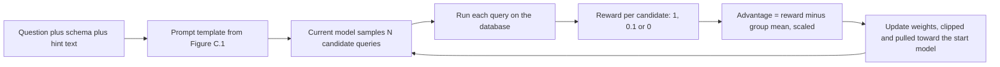
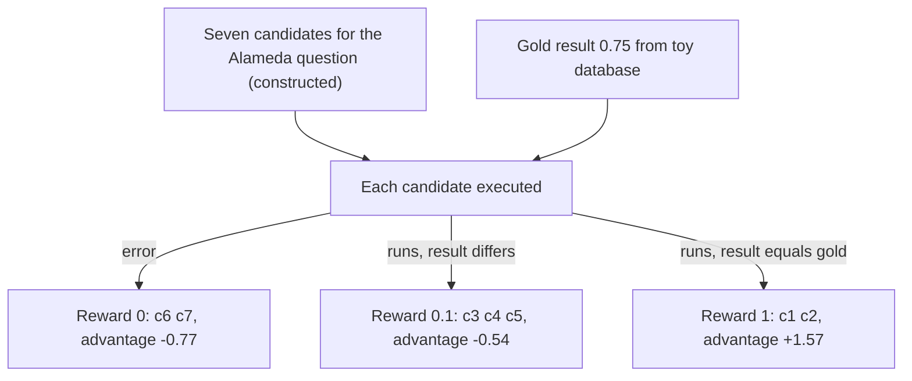

# Arctic-Text2SQL-R1: Simple Rewards, Strong Reasoning in Text-to-SQL

> **Paper:** Yao, Sun, Borchmann, Nuti, Shen, Deng, Zhai, Zhang, Li and He (Snowflake AI Research, University of Maryland, University of California San Diego), 2025, revised January 2026 - [arXiv abstract](https://arxiv.org/abs/2505.20315) - [local PDF](../../papers/2505.20315.pdf)
>
> **Status:** an arXiv preprint; no venue appears on the abstract page or in the text (a web search hinted at a 2026 venue, unverified). Treat it as not peer reviewed.
>
> **Version followed:** arXiv v2 (12 January 2026), via its HTML rendering; section, table and figure numbers follow it. Table cells were cross-checked against prose and recomputed averages because the PDF could not be rendered here.
>
> **Conflict of interest:** the authors work at a data-warehouse vendor (Snowflake), which also releases the models, and the main "70B-class" system the paper matches comes from an overlapping group of authors.

## Read this first

**The claim in one sentence.** If you keep training an already SQL-skilled open model by trial and error, scoring each attempted query only by whether it runs (small reward) and whether its result matches the reference result (large reward), you get 7, 14 and 32 billion parameter models that beat much larger general models on standard question-to-SQL tests, under a single greedy attempt.

**Who this is for.** A founder or engineer deciding how an AI agent should get answers from a company's analytics warehouse, ideally with open or smaller models. This is the stage's open-model training paper.

**Afterwards you will be able to** state the exact reward (1, 0.1 or 0); explain what the loop does with a group of sampled queries; list the data filters and which helped; say which 70B-class systems the 7B model beats, on which benchmark and by how much; and decide whether to use the released models, borrow only the reward as an evaluation method, or skip training.

**Reading time.** About 50 minutes.

**Have read first:** [InstructGPT](../02-building/08-instructgpt.md) (reinforcement learning from human feedback, the contrast case: a learned model of human preference supplies the score), [LoRA](../02-building/09-lora.md) (a cheaper fine-tuning method this paper does not use), [chain-of-thought](../02-building/07-chain-of-thought.md). Neighbours in this stage: [BIRD](./32-bird.md), [the text-to-SQL survey](./33-text2sql-survey.md), [Spider 2.0](./34-spider-2.md), [ReFoRCE](./35-reforce.md). Stage pattern: [data-access](../../../agents/data-access/README.md). Reference pages: [glossary](../../references/glossary.md), [math bridge](../../references/math-bridge.md).

**The one thing most people get wrong.** The "simple reward" is not the whole recipe, and the paper gives no controlled test of the reward alone. Its own ablations (Tables 4 to 6) show that the starting model, the data filtering and the prompt move scores as much as anything. "A good open SQL model, careful data and a checkable reward reach the top of a public leaderboard" is what the tables support; "execution-only rewards beat fancy rewards" is more than they show.

## The paper in one worked example

### A ten-second SQL primer

A **database** stores facts in **tables**. A table is a grid: each **row** is one record (a school), each **column** one attribute (county, enrolment). The **schema** lists tables, columns and types. A **primary key** uniquely identifies a row; a **foreign key** in another table points at it. A **query** is a request in **SQL** (Structured Query Language). A **JOIN** glues rows from two tables whose keys match; an **aggregation** such as MAX collapses many rows into one value; **GROUP BY** does that once per group. A **SQL dialect** is a vendor's flavour of the language (SQLite, BigQuery, Snowflake differ). A **data warehouse** is a large database built for analytics. A **semantic layer** is a maintained catalogue of business definitions ("revenue", "active customer") telling a query-writer which columns and formulas to use. **Schema linking** is working out which tables and columns a question means. **Execution accuracy** (EX) is the share of questions whose predicted query returns the same result as the reference query.

```sql
SELECT MAX(enrollment) FROM schools WHERE county = 'Alameda';
```

This asks for the largest enrolment among schools in Alameda county; one number comes back.

### Part A - a real response from the paper (Appendix D, Figure D.1)

The paper shows three unfiltered outputs of its 32B model (not cherry-picked, so the SQL may be wrong). The model receives the Figure C.1 prompt: a system line, the engine (SQLite), the schema, a **question with the benchmark's hint text** (BIRD calls it "evidence"), instructions to output only what is asked, and a format with a reasoning block (at most 4K tokens) and an answer block (at most 1K tokens).

**Question (Figure D.1).** The hint defines the rate as the free-meal count for kindergarten to year 12 divided by enrolment for the same group; the question asks for the highest such rate among schools in Alameda County.

**Response, summarised.** The model names the goal, picks the table `frpm` (which holds both columns), notes that county is in a second table `schools`, and joins on `CDSCode`. Its final query (Figure D.1, quoted):

```sql
SELECT MAX(f.`Free Meal Count (K-12)` / f.`Enrollment (K-12)`) AS HighestEligibleFreeRate
FROM frpm AS f
JOIN schools AS s ON f.CDSCode = s.CDSCode
WHERE s.County = 'Alameda';
```

Notice two things. The business definition of the rate arrived inside the question; in a company warehouse the semantic layer must supply it. And nothing in the pipeline judges the reasoning text: only the final query is run.

### Part B - how it would be scored (constructed by this guide)

The paper does not publish the rows or the gold query for this question. This guide builds a toy database with the same table and column names and **invented numbers**: S1, S2, S3 are in Alameda, S4 in Fresno. Free count over enrolment is 120/200 = 0.60 (S1), 45/60 = 0.75 (S2), 30/100 = 0.30 (S3), 95/100 = 0.95 (S4, a Fresno trap). The gold query returns 0.75. Seven invented candidates, run by the script in "A minimal version" (real output):

| Candidate | What it does | Executes? | Result | Reward (paper's definition) |
|---|---|---|---|---|
| c1 | the Figure D.1 query | yes | 0.75 | 1 |
| c2 | ORDER BY descending, LIMIT 1 | yes | 0.75 | 1 |
| c3 | forgets the county filter | yes | 0.95 | 0.1 |
| c4 | AVG instead of MAX | yes | 0.55 | 0.1 |
| c5 | also returns the school code | yes | two columns | 0.1 |
| c6 | misspells a column | no | error | 0 |
| c7 | unbalanced parenthesis | no | syntax error | 0 |

The rewards 1, 1, 0.1, 0.1, 0.1, 0, 0 have mean 0.3286 and standard deviation 0.4267. In standard GRPO (Group Relative Policy Optimization, from DeepSeekMath, the paper's reference 37; this paper does not write the advantage formula) a candidate's **advantage** is its reward minus the group mean, divided by the group's standard deviation: c1 and c2 get +1.57, c3 to c5 get -0.54, c6 and c7 get -0.77. Training makes c1-like outputs likelier and c6-like outputs less likely. Note that c1 and c2 are different SQL with the same reward: the reward is about results, not wording.



Notice that the loop has no human, no learned scoring model and no second language model: the database is the judge, so quality depends entirely on the gold results being right.



Three outcomes, not seven. The 0.1 separates "ran but wrong" from "did not run", which matters when most attempts in a group are wrong. That role is this guide's inference; the paper says only that the 0.1 keeps models from being unduly penalised for minor structural errors.

## Words you need

| Term | Plain definition | Example from the worked example |
|---|---|---|
| Text2SQL (also NL2SQL) | Turning a plain-language question into a SQL query for a given database. | The Alameda question becomes the query in Part A. |
| Rollout | One sampled attempt by the model at a question; the paper samples 16 per question in training (Section 4). | c1 to c7 are seven rollouts. |
| Reward | The number the loop assigns to a rollout: 1, 0.1 or 0 (Section 3). | c1 earns 1; c3 earns 0.1; c7 earns 0. |
| Advantage | How much better a rollout scored than its group's average, scaled by the group's spread. | c1: +1.57 against a mean of 0.329. |
| GRPO | Group Relative Policy Optimization: reinforcement learning that compares a question's rollouts with each other, needing no separate scoring network. PPO (Proximal Policy Optimization) is the older method that does. | The seven candidates are one group. |
| Online versus batch RL | Online: rollouts come from the model as it is now. Batch: collected in advance and reused. The paper does not define them precisely (Tutorial 3). | Table 5 compares the two. |
| SFT | Supervised fine-tuning: training on question and correct-query pairs. | OmniSQL, the starting model, is an SFT model. |
| Majority voting | Sample several queries, run them, keep the result most agree on; the paper uses 8 samples (Section 6). | c1 and c2 agree on 0.75 and outvote the rest. |

## Tutorial 1 - Intuitive understanding

### What was broken before

Models trained only by copying reference queries (supervised fine-tuning) learn the surface of SQL but are never rewarded for a right answer; the paper says such training often fails to promote the reasoning steps complex queries need (Section 1). Earlier trial-and-error attempts piled up partial scores: Table 2 lists six reward parts for Reasoning-SQL (execution, syntax, n-gram overlap, an LLM judge, schema, format), four for SQL-R1, and a precision-and-recall mixture for Think2SQL. The authors say mixtures invite gaming and that fine-grained rewards made models "lazy", settling for small immediate rewards (Section 4.2; no numbers given).

### The idea

Think of a driving instructor who ignores how the student holds the wheel and checks only whether the car arrives, with a small bonus for starting the engine. Here the destination is the reference result and "the engine starts" is "the query runs". This is reinforcement learning with a **verifiable reward**: a program checks the outcome without human judgement. The phrase is common in the wider literature; the paper says "execution-based reward" and cites math and logic work doing the same (Section 3). In [InstructGPT](../02-building/08-instructgpt.md) a model trained on human rankings supplies the score and can be flattered; here running the query supplies it. The paper does not mention [LoRA](../02-building/09-lora.md) adapters, so presumably all weights are updated (inference).

**Where the analogy breaks.** A query can return the right rows for the wrong reason and earn full marks, and a query right under another reading of an ambiguous question earns nothing: the reward measures agreement with one reference result, not business correctness.

### How it works, step by step

1. **Pick a starting model.** The final models start from OmniSQL, a supervised SQL model (Section 5; Table 5 shows it beating a plain Qwen2.5-Coder-32B-Instruct start). That the 7B and 14B start from OmniSQL-7B and OmniSQL-14B is this guide's reading of Section 5 and Table 9.
2. **Prepare questions.** Filtered BIRD-training, Spider-training and Spider-dev, plus filtered synthetic questions (Table 3: 8,017 + 6,972 + 985 + 11,811 = 27,785, this guide's sum).
3. **Sample a group:** 16 candidates per question at temperature 0.8 (Section 4).
4. **Run and score:** 1, 0.1 or 0 (Section 3), as in Part B.
5. **Compare within the group** and update so above-average candidates become likelier. A clip range of 0.2 stops one update moving the model too far; a penalty weighted 0.001 keeps it near the start (Section 4).
6. **Repeat with fresh samples** from the updated model (the paper's "online" setting).
7. **At test time** take one greedy answer, optionally with value retrieval (looking up real cell values, such as the exact spelling `'Alameda'`, and adding them to the prompt) and 8-way voting (Section 6).

### What the results say

All figures are execution accuracy: of every 100 questions, how many predicted queries returned the reference result. One greedy attempt unless noted (Section 5.2).

**Leaderboard (Table 1; Section 5.1; Appendix E screenshot of 22 May 2025).** On the hidden test set of BIRD (see [BIRD](./32-bird.md)), the 32B model scores 71.8 (text: 71.83), the 14B 70.0, the 7B 68.5. The previous best listed single model, XiYan-32B, has 69.0: 2.8 points higher, about 3 more questions right per 100. The footnote notes BIRD does not say whether greedy generation is required, so other entries may have used more effort.

**Six benchmarks (Table 7).** BIRD-dev (1,534 questions), Spider-test (2,147), Spider2.0-SQLite (135), Spider-DK (535), EHRSQL (1,008), ScienceBenchmark (299) (Table 3). Spider is an older cross-domain set; Spider-DK needs domain knowledge; EHRSQL is hospital records; ScienceBenchmark is scientific databases; Spider2.0-SQLite is the SQLite part of [Spider 2.0](./34-spider-2.md). The average is a plain mean of six.

| Model (Table 7) | BIRD-dev | Spider-test | Spider2.0-SQLite | Spider-DK | EHRSQL | ScienceBench | Average |
|---|---|---|---|---|---|---|---|
| Arctic-Text2SQL-R1-7B | 68.9 | 88.8 | 15.6 | 81.5 | 36.7 | 51.8 | 57.2 |
| Arctic-Text2SQL-R1-32B | 70.5 | 88.7 | 16.3 | 80.6 | 40.1 | 60.9 | 59.5 |
| OmniSQL-32B | 64.5 | 87.6 | 14.8 | 76.1 | 42.4 | 57.2 | 57.1 |
| GPT-4o | 61.9 | 83.2 | 17.0 | 72.9 | 44.9 | 55.5 | 55.9 |
| Llama-3.1-70B-Instruct | 65.1 | 84.3 | 7.4 | 75.1 | 37.4 | 55.2 | 54.1 |
| Qwen2.5-72B-Instruct | 60.3 | 84.0 | 11.9 | 76.4 | 35.0 | 52.8 | 53.4 |

The 32B average is 3.6 points above GPT-4o and 2.4 above OmniSQL-32B, the closest open competitor.

**"The 7B model outperforms prior 70B-class systems": what it means.** The abstract says "outperforms"; Section 5.1 says the 7B "matches" ExCoT-70B with ten times fewer parameters; the conclusion says "matches or outperforms". The numbers:

- **Which systems.** ExCoT-70B (Arctic-ExCoT-70B in Table 1, ExDPO-70B in Table 7), reference 53 by Zhai, Xu, He and Yao, so partly the same authors; also the general models Llama-3.1-70B-Instruct, Qwen2.5-72B-Instruct and Command-A-111B.
- **BIRD test (Table 1).** 7B 68.5 against ExCoT-70B 68.5: a tie. Against Command-A-111B (65.7) it is 2.8 higher.
- **BIRD dev (Tables 1 and 7).** 7B 68.9 against ExCoT-70B 68.5: 0.4 points, about 6 questions in 1,534, inside random variation (Prerequisite 4). Against Llama-3.1-70B-Instruct (65.1) the gap is 3.8; against Qwen2.5-72B-Instruct (60.3), 8.6.
- **Spider-test (Table 7).** 7B 88.8 against ExDPO-70B 86.6.
- **Setting.** One greedy attempt, SQLite, the authors' prompt for models they re-ran; ExCoT's figures are copied from its paper (Table 7 caption).

So: the 7B equals the best 70B system by the same group on BIRD and is clearly above general 70B models run with a SQL-tuned prompt. It is not a broad win over every 70B system.

**What the prompt alone does.** Section 4.3 reports Llama-3.1-70B-Instruct moving from 57.4 on BIRD-dev (prompt of the earlier ExCoT paper) to 65.1 with the OmniSQL prompt: 7.7 points, about 8 more right per 100, with no training. That exceeds most gaps between systems in Table 7, so a small-versus-large comparison depends on how well the large model was prompted. The authors say they did not search prompts for general models (Appendix G).

**Inference extras (unnumbered table in Section 5.2, cited as "Table 5.2" in Section 6).** Value retrieval raises BIRD-dev from 70.1 to 70.5 (14B) and 70.5 to 70.9 (32B); 8-way voting gives 70.6 and 71.2; both give 70.8 and 71.5. One point is one more question per 100, at eight times the generation.

### What this does not show

- **No real warehouse.** All benchmarks are small to medium and the prompt names SQLite (Figure C.1). Snowflake, BigQuery and other dialects are neither trained nor tested. Spider2.0-SQLite, closest to enterprise difficulty, is where all models score lowest (0 to 17 per 100, Table 7) and has only 135 questions.
- **No isolated reward test.** See Tutorial 3, "Ablations".
- **No safety, access-control or ambiguity analysis:** nothing on read-only access, permissions, injection or underspecified questions.
- **Not best at everything.** On EHRSQL the 32B (40.1) is below OmniSQL-32B (42.4), GPT-4-Turbo (43.1), DeepSeek-V3 (43.2) and GPT-4o (44.9); on Spider2.0-SQLite it is at 16.3 against GPT-4o's 17.0. Section 5.2's "across all parameter scales and benchmarks" does not match Table 7.

### Teach-back

1. State the three reward values and what earns each.
2. Why is result matching a better judge than query-text matching?
3. Why do c1 and c2 get the same reward?
4. What does the 7B do against ExCoT-70B on BIRD test and dev?
5. What happened when unfiltered synthetic data was added?

<details>
<summary>Answers</summary>

1. 1 if the result matches the reference exactly; 0.1 if the SQL is valid and runs but the result differs; 0 otherwise (Section 3).
2. Many different queries are correct and many look-alikes are wrong; result matching accepts all correct forms and rejects look-alikes.
3. Both return the same rows as the gold query; the reward ignores wording.
4. A tie on test (68.5 each, Table 1); 0.4 higher on dev (68.9 against 68.5), about 6 questions, within noise.
5. Scores dipped slightly (14B-Instruct: BIRD-dev 64.9 to 64.6, Spider-test 86.8 to 86.4); after model-based filtering they rose (66.5 and 88.3). Table 4.
</details>

## Tutorial 2 - Practitioner understanding

### The design in concrete terms

**Reward (Section 3).**

| Outcome of running the candidate | Reward |
|---|---|
| Result exactly aligns with the reference, "using the strictest available criteria (e.g. BIRD benchmark guidelines)" | 1 |
| Syntactically correct and executable, result differs | 0.1 |
| Anything else | 0 |

Not specified: what happens to a response missing the answer tags; the timeout at reward time (the five-second limit in Section 4.1 filters training questions); whether row order matters. This guide assumes BIRD-style comparison (the official scorer compares result sets; that detail is outside this paper).

**Algorithm and settings (Sections 3, 4).** GRPO with a clipped ratio and a KL (Kullback-Leibler divergence, how far the new output distribution has drifted from the reference) penalty. Stated: temperature 0.8, "total batch size of 256 (16 rollouts each)" (ambiguous: 256 questions or 256 samples), update batch 128 per step, KL weight 0.001, clip 0.2. Rollout counts 16, 24 and 32 gave no significant difference. Not stated: learning rate, epochs for final models (3 only for the Reasoning-SQL comparison), step count, optimiser. Section 4 says "see Section 3 for hyperparameter details", but Section 3 holds none of these.

**Data (Section 4.1, Appendices A and B, Table 3).**

| Source | What was done | Size |
|---|---|---|
| BIRD training | Dropped questions whose reference query returns empty or runs over five seconds (about 1,400 removed) | 8,017 of 9,428 |
| Spider training and dev | Same filter (about 1,700 removed) | 6,972 and 985 of 8,659 and 1,034 |
| Gretel-Synth | Public synthetic questions with schemas but no rows. GPT-4o wrote 5 INSERT rows per table (up to 8 attempts) until the reference query returned rows; same-domain distractor tables added; kept queries over 160 characters that run | unfiltered size not given |
| Gretel-Synth-Filtered | Keep a question only if the paper's best Qwen2.5-Coder-32B-Instruct-trained model solves it at least once in 10 samples at temperature 1.0 | 11,811 |

A proprietary model (GPT-4o) built part of the training data; the paper does not discuss terms of use. The second filter needs an already trained model, so the recipe is a chain: OmniSQL supervised training, a first RL model used as filter, then the final RL model (this guide's reading of Sections 4.1 and 5).

**Models (Table 7).** Arctic-Text2SQL-R1 at 7B, 14B and 32B on the Qwen2.5-Coder series (Section 4) via OmniSQL (Section 5), released on Hugging Face with training code in the ArcticTraining repository (links in the abstract). The licence is not stated in the paper; read the model card.

### A minimal version

A toy of the paper's reward, not of its training. It builds an invented database (constructed data), runs candidate queries with a work limit, applies the three-valued reward, then computes group advantages. Python standard library only, 52 lines. **Training itself was not run here;** GRPO needs a GPU cluster (Appendix F) and was out of scope on this machine.

```python
import sqlite3, statistics
from collections import Counter

db = sqlite3.connect(":memory:")
db.executescript("""
CREATE TABLE schools (CDSCode TEXT PRIMARY KEY, County TEXT);
CREATE TABLE frpm (CDSCode TEXT, "Free Meal Count (K-12)" REAL, "Enrollment (K-12)" REAL);
INSERT INTO schools VALUES ('S1','Alameda'),('S2','Alameda'),('S3','Alameda'),('S4','Fresno');
INSERT INTO frpm VALUES ('S1',120,200),('S2',45,60),('S3',30,100),('S4',95,100);""")

def run(sql, max_steps=200):
    """Return (ok, rows). ok=False on any syntax/runtime error or on too much work."""
    steps = [0]
    def guard():
        steps[0] += 1
        return 1 if steps[0] > max_steps else 0   # nonzero aborts the query
    db.set_progress_handler(guard, 1000)
    try:
        return True, db.execute(sql).fetchall()
    except sqlite3.Error:
        return False, None
    finally:
        db.set_progress_handler(None, 0)

def reward(sql, gold_rows):
    ok, rows = run(sql)
    if not ok: return 0.0                                # does not parse or does not run
    if Counter(rows) == Counter(gold_rows): return 1.0   # same rows, order ignored
    return 0.1                                           # runs, wrong answer

J = "FROM frpm f JOIN schools s ON f.CDSCode=s.CDSCode"
R = 'f."Free Meal Count (K-12)"/f."Enrollment (K-12)"'
W = "WHERE s.County='Alameda'"
_, gold = run(f"SELECT MAX({R}) {J} {W}")
print("gold result:", gold)
cands = {  # seven constructed candidates (worked example, Part B)
 "c1 MAX+JOIN (Fig D.1 style)": f"SELECT MAX({R}) AS r {J} {W}",
 "c2 ORDER BY LIMIT 1":         f"SELECT {R} {J} {W} ORDER BY 1 DESC LIMIT 1",
 "c3 forgot WHERE":             f"SELECT MAX({R}) {J}",
 "c4 AVG not MAX":              f"SELECT AVG({R}) {J} {W}",
 "c5 extra column":             f"SELECT s.CDSCode, MAX({R}) {J} {W}",
 "c6 bad column name":          f'SELECT MAX(f."Free Meal Count (K-12)"/f."Enrolment (K-12)") {J} {W}',
 "c7 syntax error":             "SELECT MAX(x FROM frpm",
}
rs = {}
for name, sql in cands.items():
    ok, rows = run(sql)
    rs[name] = reward(sql, gold)
    print(f"{name:28} executes={ok!s:5} rows={rows} reward={rs[name]}")
vals = list(rs.values()); mu, sd = statistics.mean(vals), statistics.pstdev(vals)
print(f"group mean={mu:.4f} std={sd:.4f}")
for n, r in rs.items(): print(f"{n:28} advantage={(r-mu)/sd:+.2f}")
```

<details>
<summary>Real output of that run (constructed toy data, nothing from the paper's databases)</summary>

```text
gold result: [(0.75,)]
c1 MAX+JOIN (Fig D.1 style)  executes=True  rows=[(0.75,)] reward=1.0
c2 ORDER BY LIMIT 1          executes=True  rows=[(0.75,)] reward=1.0
c3 forgot WHERE              executes=True  rows=[(0.95,)] reward=0.1
c4 AVG not MAX               executes=True  rows=[(0.5499999999999999,)] reward=0.1
c5 extra column              executes=True  rows=[('S2', 0.75)] reward=0.1
c6 bad column name           executes=False rows=None reward=0.0
c7 syntax error              executes=False rows=None reward=0.0
group mean=0.3286 std=0.4267
c1 MAX+JOIN (Fig D.1 style)  advantage=+1.57
c2 ORDER BY LIMIT 1          advantage=+1.57
c3 forgot WHERE              advantage=-0.54
c4 AVG not MAX               advantage=-0.54
c5 extra column              advantage=-0.54
c6 bad column name           advantage=-0.77
c7 syntax error              advantage=-0.77
```
</details>

The three cases are visible: reward 0 (c6, c7 do not run), 0.1 (c3 to c5 run but are wrong), 1 (c1, c2 match). Note that 0.5499999999999999 shows exact matching on averages is brittle, so round in a real scorer; the multiset comparison is stricter than a set; the work limit stands in for a timeout. A real system also needs a read-only connection, which the paper never mentions.

### What it costs

The paper's compute fact (Appendix F): "All experiments" ran on "8 H100-80GB nodes (a total of 64 H100-80GB GPUs)", with training "from a few hours for the 7B model to up to 2.5 days for the final 32B model experiments". No dollar figure, token count or GPU-hours. This guide's arithmetic:

- **Training, 32B upper bound.** 64 GPUs times 60 hours is 3,840 GPU-hours; at an assumed 2 to 4 dollars per H100-hour (not from the paper), roughly 7,700 to 15,400 dollars. The 2.5 days may be one run or the longest of several; ablations and the filtering model add more.
- **Rollouts per pass.** 27,785 questions times 16 rollouts is 444,560 answers, at most about 2.2 billion tokens at the full 5K budget; the number of passes is not stated.
- **Serving.** 16-bit weights take about 2 bytes per parameter: roughly 14 GB (7B), 28 GB (14B), 64 GB (32B). One greedy answer is up to about 5,000 tokens; at an assumed 40 tokens per second that is up to about 2 minutes worst case. Eight-way voting multiplies generation by 8 for about 1 point. The paper reports no latency.

### How it fails

The paper has no error-analysis table; rows mix its observations with this guide's inferences (marked).

| Symptom | Likely cause | Mitigation |
|---|---|---|
| Good on one benchmark, poor on new databases | Narrow training: BIRD-only averaged 54.3 against 55.7 for mixed data (Table 6) | Train and test on several sources; keep a held-out set from your own warehouse |
| Synthetic data lowers accuracy | Unfiltered synthetic questions (Table 4: 64.9 to 64.6) | Filter by solvability (one correct in ten) |
| Empty gold result rewards wrong answers (this guide) | Any empty-returning prediction matches | Drop empty-gold questions, as the paper does |
| Large gap between prompts | Prompt sensitivity (57.4 to 65.1, Section 4.3) | Fix and version the prompt |
| Rate comes back as 0 (this guide) | SQLite truncates integer division | Cast to real |

### Evaluating your version

The transferable thing is the scoring method. Protocol (this guide's recommendation):

- **Metric.** Execution match against reference results, with the 0 / 0.1 / 1 split so runtime failures show separately from wrong answers.
- **Test set.** At least 100 questions written by the people who will ask them, with analyst-reviewed reference queries. At 100 questions a score near 70 has a 95 percent margin of about plus or minus 9 points (Prerequisite 4).
- **Baseline.** Your current approach with the same prompt and schema (for example a hosted model) and one open model before any training.
- **Stop rule.** Call a candidate better only if it wins by at least 5 points and regresses on no question category you marked critical; stop tuning when two successive changes each move the score by under 2 points.
- **What the metric hides.** Right business definition, query efficiency, and whether the user may see the rows.

### Adopt, adapt or skip

**Adopt, with testing:** the released 7B or 14B model as one candidate SQL-writing component if your engine is SQLite-like, after checking the licence. A 7B model fits one 16 GB-class GPU in 16-bit form. Keep the Figure C.1 prompt format. Your dialect and schema size differ from everything tested.

**Adapt:** the reward as an evaluation and selection tool, which needs no GPUs: (a) score any model on your questions by execution match; (b) pick among several candidates by execution results, as the paper's voting does (+1 point on BIRD-dev); (c) refuse to show a result unless the query ran read-only; (d) collect questions where a model is only sometimes right, which are the most useful for rewriting your semantic layer or later training.

**Skip, for now:** training your own model. The compute is 64 H100 GPUs for up to 2.5 days at 32B, the filter needs a first trained model, the reward needs verified reference answers (what a small team lacks), and nothing shows transfer to another dialect or business-defined metrics.

**What a team letting an agent query a warehouse for business users must still build** (none is in this paper): a semantic layer supplying the definition sentence that BIRD hints supply here; an evaluation set from your own questions; read-only, row-limited, role-scoped credentials; cost and timeout guards; and defences against malicious text arriving through data or user input (see [prompt-to-SQL injection](./39-prompt-to-sql-injection.md)). The [data-access pattern](../../../agents/data-access/README.md) shows how these fit around a SQL writer. For an agent that explores and repairs queries without training, see [ReFoRCE](./35-reforce.md).

## Tutorial 3 - Researcher understanding

### Formal setup

Notation is the paper's (Section 3) unless marked.

- Q: a question with its schema (and hint). o_1..o_N: N sampled outputs (rollouts); N = 16 in training.
- pi_theta: the model with parameters theta; pi_theta_old: the same model before this update; pi_ref: the supervised starting checkpoint.
- r_i = pi_theta(o_i given Q) / pi_theta_old(o_i given Q): the likelihood ratio.
- A_i: the advantage, not defined in the paper. This guide uses the standard group form: A_i = (R_i - mean of R) / std of R, with R_i the reward of output i (reward R is 1, 0.1 or 0).
- epsilon = 0.2 (clip range); beta = 0.001 (weight on the KL penalty D_KL(pi_theta || pi_ref)).

The paper's objective: J(theta) = E[ (1/N) sum_i min( r_i A_i , clip(r_i, 1 - epsilon, 1 + epsilon) ) ] - beta D_KL(pi_theta || pi_ref). **Inconsistency:** as printed, the clip term is not multiplied by A_i; the standard objective is min(r_i A_i, clip(r_i, 1 - epsilon, 1 + epsilon) A_i). The printed form is probably a typesetting slip, but the paper's code is not shown here to confirm.

<details>
<summary>Numeric toy instance (constructed): the worked example's seven rewards</summary>

Mean 0.3286, standard deviation 0.4267, so c1 has A = (1 - 0.3286)/0.4267 = +1.57. If the update makes c1 10 percent likelier, r = 1.10, inside the clip range [0.8, 1.2], and the term is 1.10 times 1.57 = 1.73. If it made c1 30 percent likelier, r = 1.30, the clip caps the term at 1.2 times 1.57 = 1.88, and there is no incentive to move further in that step. For c7 (A = -0.77), cutting its probability by 30 percent gives r = 0.70; the min of 0.70 times -0.77 = -0.54 and 0.8 times -0.77 = -0.62 is -0.62, so pushing below 0.8 stops paying.
</details>

Two structural facts follow (this guide's inference). A group whose rollouts all earn the same reward has zero standard deviation and yields no signal in the standard form (implementations add a small constant), so always-solved and never-solved questions teach little; the paper's "at least one of ten correct" filter removes the second kind. And the 0.1 term supplies signal in groups where every rollout is wrong but some run.

### The claims, stated precisely

1. (Abstract, Section 1) A reward of execution correctness plus syntax validity suffices for state-of-the-art execution accuracy. Evidence: comparison of final numbers with other systems, not a controlled reward ablation.
2. (Section 5.1, Table 1) Under single-model greedy evaluation, the 32B scored 71.83 on BIRD test, 2.8 above XiYan-32B, first on the leaderboard of 22 May 2025 (Appendix E).
3. (Section 5.2, Table 7) Best six-benchmark average in each size bracket: 57.2, 59.0, 59.5.
4. (Abstract; Section 5.1) The 7B "outperforms prior 70B-class systems" (abstract) or "matches" ExCoT-70B (Section 5.1); the precise reading is in Tutorial 1.
5. (Section 4, Tables 4 to 6) Filtering helps while unfiltered synthetic data and augmentation do not; GRPO beats PPO; a stronger start, online training and the OmniSQL prompt each help; mixed training beats BIRD-only by 1.4 average points.
6. (Section 6, Tables 8 and 9) Under comparable settings the recipe beats Reasoning-SQL, SQL-R1 and Think2SQL.

### Evidence, table by table

**Table 1 (BIRD single-model leaderboard).** Rows: model and rank; columns: dev and test accuracy. Headline: test 71.8 / 70.0 / 68.5 (32B / 14B / 7B). Associates only: a leaderboard position on one date. **Flags:** ranks jump from Top-6 to Top-8; a 14B score of 70.0 is described as "surpass[ing] the 70% milestone" (Sections 1 and 5.1); "a first among open models" cannot be checked, since Table 1 lists Infly-RL-SQL-32B at 70.6 without saying whether it is open; Section 5.1 points to "Table 2" for these numbers when the table is Table 1.

**Table 4 (training data), BIRD-dev / Spider-test.** 14B-Instruct: BIRD+Spider 64.9 / 86.8; plus unfiltered synthetic 64.6 / 86.4; plus filtered synthetic 66.5 / 88.3. 32B-Instruct with filtered synthetic: 64.9 / 87.7; plus unfiltered BIRD augmentation 62.5 / 86.1; plus filtered augmentation 64.9 / 86.8. Associates: one run each, no seeds. There is no 32B row without synthetic data, so its benefit at 32B is unmeasured, and the 14B beating the 32B on the same data (66.5 against 64.9) is unexplained, hinting at noise of the size of the claimed effects.

**Table 5 (training strategy), BIRD-dev / Spider-test.** 32B-Instruct GRPO 64.9 / 87.7; PPO 63.0 / 85.7; base model 64.4 / 87.3; QwQ-32B 55.2 / 79.3; batch RL 64.9 / 87.7; online RL 66.6 / not given (starred: checkpoint lost); OmniSQL-32B online 67.9 / 88.2; with the modified OmniSQL prompt 70.5 / 88.7. **Flags:** two pairs of rows appear twice with identical numbers in the HTML text I read (online with Qwen; OmniSQL online 67.9 and 88.2 once under the label "Self-defined Prompt Template"), possibly a rendering artefact, so check the PDF. The prose gives a base-versus-instruct gap of "about 0.4 EX" (table: 0.5 and 0.4) and says QwQ-32B's "initial accuracy trailed ... by over 10 points"; the table shows post-RL accuracy (9.7 behind on BIRD-dev), not initial.

**Table 6 (diversity, OmniSQL-7B start).** BIRD-only: 67.6 / 87.8 / 8.9 / 76.3 / 34.9 / 50.5, average 54.3. Mixed: 67.7 / 88.2 / 11.9 / 79.1 / 35.5 / 51.8, average 55.7 (both recompute). BIRD-dev moves by 0.1; the 1.4 comes from Spider2.0-SQLite (+3.0, which is 4 questions of 135: 8.9 and 11.9 are 12 and 16 questions) and Spider-DK (+2.8).

**Table 7 (main results).** About 35 models grouped by size. Remaining Arctic row: 14B 70.1 / 89.4 / 16.3 / 79.4 / 40.7 / 58.2, average 59.0. I recomputed the Arctic and most comparison averages: they match to rounding, except DeepSeek-V3. Its six cells (63.2, 85.5, 14.8, 72.9, 43.2, 56.2) average 55.97, about 56.0, while the table and Section 5.2 print 55.6; the ranking is unaffected. The paper notes Spider2.0 was re-run and SQL-specific numbers are copied. SQL-R1-7B and Think2SQL-7B have only a BIRD-dev entry (SQL-R1's uses voting), so Section 5.2's claim that the 7B "closely rival[s], or surpass[es], closed-source models such as SQL-R1-7B" cannot be tested on the average. Associates: ranking under one prompt and one greedy attempt (the single most likely answer, no sampling).

**Table 8 (against Reasoning-SQL).** Arctic, Qwen2.5-Coder-14B-Instruct, BIRD-training only, 3 epochs: BIRD-dev 66.49, Spider-test 87.20, Spider-DK 75.10; Reasoning-SQL 64.21, 81.43, 73.03. Differences 2.28, 5.77, 2.07 recompute. The methods differ "primarily" in filtering and reward, so the comparison is bundled. The text names the base "Qwen-2.5-14B-Instruct"; the table says Qwen2.5-Coder-14B-Inst. Reasoning-SQL's numbers are copied.

**Table 9 (against SQL-R1 and Think2SQL), greedy/voting.** Qwen2.5-Coder-7B-Instruct start without SFT: Arctic 63.9 / 64.8 on BIRD-dev; SQL-R1 voting 63.1 (59.2 after a 200K-sample SFT). OmniSQL-7B start: Arctic 67.6 / 69.4; SQL-R1 voting 66.6. On Spider-test voting, Arctic 88.6 against SQL-R1's 88.7: "best or near-best", not a sweep.

### Ablations and what they isolate

| Ablation | Changed | Isolates | Size | Confounds |
|---|---|---|---|---|
| Filtering (Table 4) | empty or slow gold queries dropped; synthetic data filtered by solvability | data quality | +1.6 BIRD-dev, +1.5 Spider-test (14B) | one run; 14B beats 32B unexplained |
| Augmentation (Table 4) | LLM-written extra questions | diversity | 0 to -2.4 | explanation speculative |
| Algorithm (Table 5) | GRPO or PPO | method | +1.9 / +2.0 | PPO "may benefit from further hyperparameter tuning" |
| Start model (Table 5) | base, instruct, QwQ, OmniSQL | initialisation | OmniSQL 67.9 against Qwen 66.6 online | rows differ in more than the start |
| Online or batch (Table 5) | continual versus fixed collection | training regime | 66.6 against 64.9 (+1.7) | starred row, no Spider figure, terms undefined |
| Prompt (Table 5) | self-defined or modified OmniSQL | prompt | +2.6 / +0.5 | prompt changes thinking, schema format together |
| Data mix (Table 6) | BIRD-only or mixed | generalisation | +1.4 average | two small benchmarks drive it |
| Rollouts, reward variants (Section 4.2) | 16/24/32; "various reward designs" | reward, exploration | "none produced significant improvement" | **no numbers reported** |

The last row matters most for the title. Nowhere does the paper report accuracy for the same model, data and prompt under the simple reward, a syntax-only reward and a multi-part reward. The simple reward is supported indirectly (Tables 8 and 9, where data and training length also differ) and by the authors' report of "lazy" behaviour with finer rewards. The role of the 0.1 itself is untested. On **online versus offline**, Section 4 gives a total batch of 256 and an update batch of 128, which suggests a sampled batch may be reused across two updates; that is this guide's inference, since the paper does not say how its batch baseline was built, so treat +1.7 as suggestive.

### Threats to validity specific to this paper

- **Vendor authorship and self-comparison.** The authors compare against their own earlier ExCoT, and competitors' numbers are copied from their papers with unknown prompts and decoding. Independent re-runs would be valuable.
- **Small test sets, no intervals.** One Spider2.0-SQLite question is 0.74 points: the 14B and 32B at 16.3 (22 questions) differ from the 7B at 15.6 (21) by exactly one. No seeds or intervals are given, and differences of 1 to 2 points in Tables 4 and 5 fall within plausible run-to-run variation.
- **Selection on dev data.** Early model selection used BIRD-dev and Spider-test (Section 4), so those scores are mildly optimistic; hidden BIRD test numbers are less exposed.
- **One model family, one dialect.** Appendix G says other families are untested; all databases are SQLite.
- **Reward tied to reference quality.** Wrong or ambiguous references reward wrong answers; Section 4.1 examines only empty ones.

### Open problems and follow-ups

- A controlled reward ablation with equal data, prompt and start model.
- Enterprise dialects and thousand-table catalogues ([Spider 2.0](./34-spider-2.md)); rewarding clarification of underspecified questions ([BIRD-Interact](./38-bird-interact.md)).
- "Right for the right reason" (execution match accepts coincidences), and use inside agent systems, which Section 6 mentions without testing.

### What would change my mind

I would weaken the central claim if a controlled run with identical data, prompt and start showed a result-only reward is no better than a multi-part one, or if independent re-runs did not reproduce the Table 7 averages within about 1 point. I would strengthen it if the 7B held up on a few hundred questions from a real warehouse in a non-SQLite dialect, with definitions from a semantic layer rather than hints.

## Reading map for the PDF

| Section or figure | What it contains | First pass | Guide section |
|---|---|---|---|
| Abstract, Sections 1 and 2 (Tables 1 to 3) | claims, leaderboard, other rewards, datasets | Read | Tutorial 1; Tutorial 3 Table 1 flags |
| Section 3 | the reward and the GRPO objective | Read | Worked example; Tutorial 3 formal setup |
| Section 4.1 (Table 4) | data filtering, failed augmentation | Read | Tutorial 2 data; Tutorial 3 ablations |
| Section 4.2 (Table 5) | GRPO or PPO, start, online, prompt | Read | Tutorial 3 Table 5 flags |
| Section 4.3 (Table 6) | prompt sensitivity, diverse evaluation | Read | Tutorial 1 prompt effect |
| Section 5 (Table 7) | main results, the 7B claim | Read | Tutorial 1 "7B versus 70B" |
| Section 6 (Tables 8, 9, unnumbered table and figure) | voting, response length, other RL systems | Skim | Tutorial 3 Tables 8 and 9 |
| Appendices A to D | synthetic-data pipeline, augmentation prompts, the prompt, three model outputs | Read C and D | Worked example; Tutorial 2 data |
| Appendices E, F, G | leaderboard screenshot, compute, limitations | Read F and G | Tutorial 2 costs; Tutorial 3 threats |

## Questions readers get stuck on

### What is "reinforcement learning with a verifiable reward" in plain words?

You let a model attempt a task many times, score each attempt with a program, and change the model so high-scoring attempts become likelier. Here the program runs the SQL and compares results. It differs from [InstructGPT](../02-building/08-instructgpt.md), where a model trained on human rankings supplies the score and can be flattered, and from plain fine-tuning, where the model never learns from its own wrong attempts.

### What exactly is the "simple reward"?

Three values (Section 3): 1 for a result that exactly aligns with the reference, 0.1 for valid SQL that runs but differs, 0 otherwise. Table 2 labels it "EX, syntax", against four to six parts in earlier systems; no format reward is described.

### Which 70B-class systems does the 7B beat, and by how much?

On BIRD test it ties ExCoT-70B (68.5 each, Table 1). On BIRD dev it is 0.4 above ExCoT-70B (68.9 against 68.5) and 3.8 above Llama-3.1-70B-Instruct (65.1) (Tables 1 and 7); it is also ahead of Qwen2.5-72B-Instruct (60.3) and Command-A-111B (63.5 dev, 65.7 test). The general models used the authors' prompt without per-model tuning. The abstract's "outperforms" is stronger than the body's "matches".

### What is the conflict of interest?

Snowflake sells a data platform, employs most authors and releases the model; the main 70B-class rival is the same group's earlier ExCoT system, with numbers taken from that paper. None of this shows error, but replicate on your own questions before relying on it.

### What is GRPO, and why not the older PPO?

GRPO samples a group of answers per question and scores each against the group average, so no separate value network is trained. The paper reports GRPO above PPO (BIRD-dev 64.9 against 63.0, Table 5) but notes PPO was not fully tuned. Section 3's printed objective omits the advantage from the clipped term.

### Why throw away questions whose reference query returns nothing?

If the reference result is empty, any wrong query that also returns nothing earns full reward. The paper says such examples give "spurious or uninformative rewards" (Section 4.1).

### What does "online RL" mean here, and how big is its effect?

The paper says the model "continually interacts with the environment", against a batch variant. In Table 5 batch RL scores 64.9 and online 66.6 on BIRD-dev (+1.7), but the online row is starred as limited by a lost checkpoint and has no Spider figure. Treat it as a direction, not a measured size.

### Does this tell me how to build an agent over our warehouse?

Only the SQL-writing step. The paper does not cover choosing among thousands of tables, business definitions, permissions, cost controls, ambiguity or safety, and it trained on SQLite benchmarks. Use it to choose and evaluate a SQL generator, and build the rest with the [data-access pattern](../../../agents/data-access/README.md).

### Why not just call a frontier model?

For many teams that is the right default. The 32B average (59.5) is only 3.6 points above GPT-4o (55.9), and GPT-4o beats it on EHRSQL and Spider2.0-SQLite. Open models matter when data cannot leave your network, volume makes per-token pricing costly, or you must fine-tune; the paper cannot say whether that holds for you.

## Prerequisites you actually need

### Prerequisite 1 - Execution accuracy and result comparison

Two queries are equal if they return the same data when run, whatever their wording. Gold returns rows 3 and 5; a prediction returning 5 then 3 matches ignoring order; 3, 3, 5 matches as a set but not as a multiset. The paper says only "strictest available criteria". Used in Section 3 and every results table. See [BIRD](./32-bird.md) and [SWE-bench](../03-evaluation-and-code/16-swe-bench.md).

### Prerequisite 2 - Reward, group advantage and a policy update

A policy is the model's habit of choosing outputs. Five attempts earning 1, 0, 0, 0.1, 0.1 have mean 0.24 and standard deviation about 0.38; the winner's advantage is (1 - 0.24)/0.38 = +2.0. The update raises probabilities of positive-advantage attempts and lowers the rest; five equal rewards give zero advantage and no learning. Used in Section 3; Tutorial 3 has the full instance. See the [math bridge](../../references/math-bridge.md).

### Prerequisite 3 - Clipping and the KL penalty

Two brakes on large updates. Clip: an output made 1.5 times likelier counts only up to 1.2 when epsilon is 0.2. KL penalty: a small cost for drifting from the start model. Used in Sections 3 and 4.

### Prerequisite 4 - How much a benchmark difference means

For n questions and accuracy p, one standard error is the square root of p(1-p)/n. BIRD-dev: p = 0.70, n = 1,534 gives 0.0117, a 95 percent margin of about plus or minus 2.3 points, so a 0.4-point gap is under a fifth of it. Spider2.0-SQLite: p = 0.156, n = 135 gives about 0.031, a margin near plus or minus 6 points, and one question is 0.74 points. Systems answering the same questions have somewhat narrower paired margins, not enough to rescue 0.4. Used for every 1 to 3 point difference in Tables 4, 5, 7 and 8. See [MMLU](../03-evaluation-and-code/11-mmlu.md) for benchmark-reading habits.

## Where this sits in the curriculum

**Before this one.** [BIRD](./32-bird.md) defines the benchmark and the execution metric; [the survey](./33-text2sql-survey.md) places model-based, prompt-based and agent-based approaches; [Spider 2.0](./34-spider-2.md) shows how much harder enterprise databases are; [ReFoRCE](./35-reforce.md) is an agent from an overlapping group. Earlier stages: [InstructGPT](../02-building/08-instructgpt.md), [LoRA](../02-building/09-lora.md), [chain-of-thought](../02-building/07-chain-of-thought.md).

**Versus the two nearest papers.** ReFoRCE improves answers with an agent loop at inference time and no training; this paper moves the effort into the weights so one pass suffices. [FlexSQL](./36-flexsql.md) is the other neighbour; see its guide. The shared lesson: execution feedback is the cheapest reliable signal here, used at inference there and at training here.

**Next.** [BIRD-Interact](./38-bird-interact.md) tests what this paper ignores: multi-turn interaction and ambiguity. [Prompt-to-SQL injection](./39-prompt-to-sql-injection.md) covers the hole that opens when a model's SQL is executed on real data.

## Checkpoint

1. **Explain.** State the reward and what each of its three values pushes the model toward.
2. **Compute.** Four candidates earn 1, 0.1, 0.1, 0. Find the mean, population standard deviation and first candidate's advantage.
3. **Critique.** Write the precise sentence the tables support about the 7B against 70B-class systems.
4. **Compute.** DeepSeek-V3's Table 7 cells are 63.2, 85.5, 14.8, 72.9, 43.2, 56.2. What average results, and what is printed?
5. **Critique.** Name two things the paper does not test that you need before showing a model like this to business users.
6. **Decide.** You have 120 reviewed questions and no GPUs. What do you take from this paper?

<details>
<summary>Answers</summary>

1. 1 for a matching result pushes toward correct answers; 0.1 for valid, runnable SQL pushes away from syntax failure and gives signal when all attempts are wrong; 0 for the rest. Nothing rewards explanation quality or style.
2. Mean 0.3; deviations 0.7, -0.2, -0.2, -0.3; squares sum to 0.66; divided by 4 is 0.165; square root 0.406. Advantage 0.7/0.406 = +1.72.
3. It ties ExCoT-70B on BIRD test (68.5 each), is 0.4 higher on dev (within noise), and is clearly above general 70B models such as Llama-3.1-70B-Instruct (65.1) under the authors' prompt; all greedy, on SQLite.
4. 335.8 divided by 6 is 55.97, about 56.0; the paper prints 55.6. The ranking is unaffected.
5. Any two: large schemas and other dialects; ambiguous questions; access control and read-only execution; injection resistance; business definitions without hint text; latency and cost at your volume.
6. Build the execution-match scorer with the 0 / 0.1 / 1 split on your 120 questions and compare a hosted model with the released 7B and 14B under one fixed prompt. Skip training. At 120 questions the margin is about plus or minus 8 points, so only large differences count.
</details>
