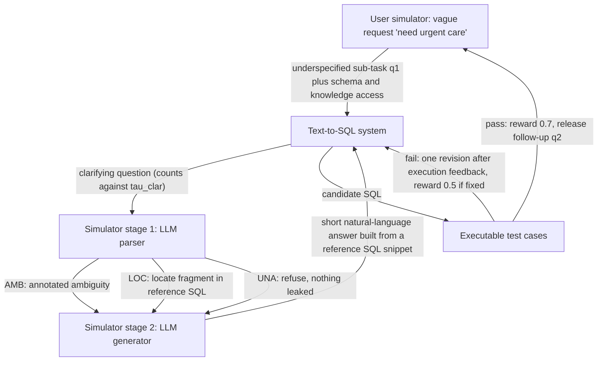
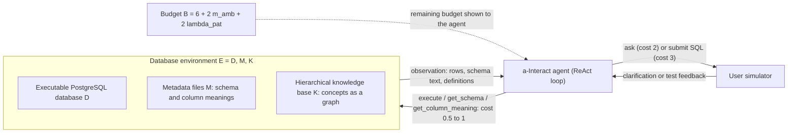

# BIRD-INTERACT: Re-imagining Text-to-SQL Evaluation for Large Language Models via Lens of Dynamic Interactions

> **Paper:** Huo, Xu, Li and 21 co-authors (The University of Hong Kong, the BIRD Team, and Google Cloud), submitted October 2025, arXiv version 3 dated 24 March 2026. The arXiv abstract page lists it as "ICLR 2026 Oral" (International Conference on Learning Representations) - [arXiv abstract](https://arxiv.org/abs/2510.05318) - [local PDF](../../papers/2510.05318.pdf)
>
> **Short name:** Bird-Interact (the benchmark), c-Interact and a-Interact (its two settings). **Rendering followed:** the arXiv HTML rendering of version 3. Section, table and appendix numbers follow it. The HTML text does not expose the content of images, so Figures 1, 2, 3, 5, 6 and 19-26 (the task overview, the prompts and several result plots) were not readable by this guide; where a number lives only in a figure, the guide says so. It was accepted as a conference oral (a peer-review signal), but this guide did not compare versions 1 to 3.

## Read this first

**The claim in one sentence.** Real questions to a database are under-specified, so a text-to-SQL system should be tested on whether it asks the right clarifying questions, looks things up in a knowledge base, recovers from errors and handles a follow-up that depends on changes it just made; on a new benchmark built this way, the strongest model tested (GPT-5, OpenAI) completes only 8.67% of tasks end to end in a scripted conversation (c-Interact) and 17.00% in an agent setting (a-Interact).

**Who this is for.** Founders and engineers who want an agent to answer business questions from an analytics warehouse and need to decide how the agent should behave when the question is vague. It is the stage's paper about ambiguity, interaction and write access.

**Afterwards you will be able to** describe the two settings and their scoring; explain the simulated user and how it was checked; recompute the reward from the formulas; say which evidence bears on your deployment; and write a small detector that decides when an agent should ask, state an assumption, or stop.

**Reading time.** About 50 minutes. **Have read first:** [ReAct](../02-building/10-react.md) (the think-act-observe loop that a-Interact uses), [HumanEval](../03-evaluation-and-code/14-humaneval.md) (scoring code by running tests), and [BIRD](./32-bird.md) (the single-turn benchmark this team built earlier). Skim [the survey](./33-text2sql-survey.md) and [Spider 2.0](./34-spider-2.md), the enterprise-scale single-turn benchmark this paper compares itself against.

**The one thing most people get wrong.** The 8.67% and 17.00% are not "how often GPT-5 answers a business question wrongly". They count tasks in which BOTH a deliberately ambiguous first request AND a follow-up that depends on the first answer pass executable tests, against a simulated user who answers from a hidden reference query. The first request alone is solved far more often (14.50% and 29.17% for GPT-5, Table 2). Also, the user is a program, and 600 of the paper's tasks are not a sample of anyone's real workload.

## The paper in one worked example

The paper's own example is Figure 1, an image whose content the HTML text does not expose. What is readable: the task needs the system to resolve the vague term "urgent care" (Section 1); the knowledge base links "urgent care" to a score called AVS, which depends on facts called IF and CPI (Section 3.1, Figure 2); the query "need urgent care" is first clarified as "ranked by AVS", and because the AVS entry is masked the system must return to the user (Appendix H.3); and Appendix G prints the executable test. This guide traces that task and fills the unreadable parts with material labelled **[constructed]**. **[paper]** marks what is in the HTML text.

### Part A - the urgent-care task, step by step

**Database and knowledge base.** **[paper]** A PostgreSQL database in the style of LiveSQLBench (the earlier single-turn benchmark from the same team that this paper extends, Section 3.1), with a **hierarchical knowledge base** (HKB): a directed graph of business concepts in which one definition uses others. The chain is urgent care, then AVS, then IF and CPI. **Knowledge chain breaking** deletes a middle node (AVS). **[constructed]** Toy table `artifact(id, name, if_score, cpi)`: (101, Ancient Scroll, 8.0, 6.4), (102, Bronze Vase, 7.5, 6.2), (103, Stone Tablet, 7.0, 6.0), (104, Clay Lamp, 5.0, 4.0). The hidden definition: AVS is the average of IF and CPI.

**Sub-task 1, the ambiguous request.** **[constructed wording]** "I need urgent care for my collection. Make something that ranks the items." **[paper]** The test (Appendix G) first executes the system's SQL, then calls a function named `rank_urgent_care()`, so the right answer creates that function. This is a data-management (DM) task, not a read-only report.

**Clarification (c-Interact).** **[paper]** The system gets `tau_clar = m_amb + lambda_pat` clarification turns: the number of annotated ambiguities plus the user's patience, which is 3 by default (Sections 4.1, 5). Two ambiguities plus patience 3 allows 5 questions. **[constructed dialogue]**

1. "What does urgent care mean here?" The simulator's first stage labels this a question about an annotated ambiguity (`AMB()`); the second stage answers from the hidden snippet: "Rank by AVS."
2. "How is AVS defined?" The knowledge-base entry is masked, so this goes to the user: `AMB()` again, answer "the average of IF and CPI."
3. "Should the ranking cover every item?" No annotation anticipated this, so the simulator chooses `LOC()` (locate): it finds the relevant fragment of the hidden SQL and answers "Only the top three." Had the system asked "Can you show me the SQL?", the choice would be `UNA()` (unanswerable) and the simulator would refuse.

**The SQL step. [constructed]** `CREATE FUNCTION rank_urgent_care() ... ORDER BY avs DESC LIMIT 3`, with `avs` equal to `ROUND((if_score + cpi) / 2, 2)`. **[paper]** The test then runs `SELECT * FROM rank_urgent_care()` and requires exactly (101, 'Ancient Scroll', 7.20), (102, 'Bronze Vase', 6.85), (103, 'Stone Tablet', 6.50). The guide checked with sqlite3 that the toy table gives averages 7.20, 6.85, 6.50 and 4.50 for the fourth row, which the limit cuts; the toy values were chosen to reproduce the paper's expected rows.

**The score.** **[paper formula, constructed episode]** A clean first pass earns 0.7. The follow-up is then released. **[constructed]** "From that ranking, list only items whose name contains 'Scroll'." It is a **state-dependent** follow-up (Table 8): it relies on an object the first sub-task created. A clean pass earns 0.3, so the task scores 1.0. If the first query failed and the single permitted revision (after execution feedback) passed, sub-task 1 earns 0.5 instead of 0.7.

**Without asking. [paper, Section 4.1]** A system that never asks must guess what "urgent" means and fail the test; "failure in the initial priority sub-task immediately terminates the entire session", so the follow-up is never reached.



Notice that the simulator never shows the reference SQL: each system question is first converted to one of three symbolic actions, and the harness, not the simulator, runs the test.



The second diagram is the agent setting: the user is one of nine priced tools.

### Part B - recomputing one headline row (Table 2)

For GPT-5 in c-Interact the paper reports priority 14.50 (+0.67), follow-ups 8.67 (+0.33), reward 12.58, where "(+n)" is the part earned through the one debugging attempt. With the Appendix F.2 weights: 0.7 x (14.50 - 0.67) + 0.5 x 0.67 + 0.3 x (8.67 - 0.33) + 0.2 x 0.33 = 9.681 + 0.335 + 2.502 + 0.066 = 12.584, which rounds to the published 12.58. In counts of the 600 tasks, **this guide infers** GPT-5 solved the priority request in 87 tasks and both sub-tasks in 52.

## Words you need

| Term | Plain definition | Example from the worked example |
|---|---|---|
| Text-to-SQL | Turning a plain-language request into a database query in SQL (Structured Query Language) | "Rank the items by urgent care" becomes a `CREATE FUNCTION` statement |
| Ambiguity | A request that has more than one reasonable reading, so the right query cannot be written without more information | "Urgent care" could mean many rankings |
| Clarification source | The piece of the hidden reference SQL that settles one ambiguity, used by the simulator to answer | The snippet "rank by AVS" |
| Hierarchical knowledge base (HKB) | A set of business definitions stored as a directed graph, where a node can depend on other nodes | Urgent care depends on AVS, which depends on IF and CPI |
| Knowledge chain breaking | Removing a middle node of a definition chain so the system must ask about it | The masked AVS entry |
| User simulator | A program, driven by a language model, that plays the user: it presents tasks, answers questions and reports test feedback | The component that says "AVS is the average of IF and CPI" |
| c-Interact | The conversational setting: a fixed protocol of clarification turns, then SQL, then at most one revision | The five-question budget above |
| a-Interact | The agentic setting: the model chooses among nine priced actions inside a total budget | Probing the schema for 1, asking for 2, submitting for 3 |
| BI and DM tasks | Business-intelligence (read-only analysis) versus data-management (insert, update, delete, create or alter) | The urgent-care task is DM; "average score by region" would be BI |
| Schema, key and dialect | The list of tables and columns; a primary key identifies a row, a foreign key points at another table's row; a dialect is one database product's flavor of SQL (PostgreSQL here) | `artifact(id, name, if_score, cpi)` with `id` as primary key |
| Semantic layer | A company-maintained dictionary of certified metric definitions over the raw tables, which this paper's knowledge base resembles | "AVS is the average of IF and CPI" |
| Success rate (SR) | Share of tasks whose sub-task passes all tests; cumulative for follow-ups | 8.67% = both sub-tasks passed |
| Normalized reward | A score from 0 to 100 that gives 70% weight to the first sub-task and 30% to the follow-up, with a discount for needing a debugging attempt | 12.58 for GPT-5 in c-Interact |

## Tutorial 1 - Intuitive understanding

### What was broken before

Picture a new analyst told "show me recent orders, top customers" by a manager who has left for the day. A good analyst asks what counts as recent and top by what. A careless one picks a reading and sends back a confident table. Most text-to-SQL benchmarks test the careless analyst: the question is complete, the system writes one query, and the result is checked against a stored reference.

The paper names two gaps (Section 1). Benchmarks that include conversation (it cites CoSQL, SParC and CHASE) usually replay a **static transcript**, so no model is rewarded for a better question or punished for a worse one. And almost all are **read-only**, while real databases are also changed: rows inserted, records updated, tables and functions created. "From that table, list only the engineers" only makes sense after something created the table.

A concrete failure from the error analysis (Appendix M): a task averages about four ambiguities (3.89 on the full set, Table 1), yet systems asked for clarification about once per task, and over 80% of 50 sampled failures came from incomplete ambiguity resolution, not syntax.

### The idea

Think of an exam where the examiner stays in the room. The candidate may ask questions, each costs time, the examiner answers only from the answer sheet and will not hand it over, and the second question is released only after the first is solved. Bird-Interact is that: an executable database, a browsable knowledge base, and a simulated user whose answers come from a hidden reference query.

The analogy breaks in three places. The simulator is a language model, so its replies must be constrained to three symbolic actions. A real manager often has no answer sheet, which the paper admits (Appendix D). And a real person's patience is not a fixed integer, though the benchmark makes it the parameter lambda.

### How it works, step by step

1. **Start from solved single-turn tasks** in LiveSQLBench, which ships a database, column descriptions, a knowledge base and executable tests, and supports data-changing statements (Section 3.1).
2. **Inject ambiguity.** Twelve expert annotators remove information so the task cannot be solved without asking: they blur the user's meaning (the age threshold for "elderly"), delete a knowledge entry, or delete a middle entry of a chain. A third kind reuses noise already in the data, such as NULLs in key fields (Section 3.2). Each removal is paired with the SQL snippet that would fix it (Appendix H.1). The task must be unsolvable without it and exactly reconstructable with it.
3. **Add a dependent follow-up**, sometimes relying on a table the first sub-task created (Table 8).
4. **Run the interaction** in one of two settings (Section 4).
5. **Score** with tests: result comparison for reads, database-state checks for writes (Appendix G).
6. **Check the simulator** on 2,100 labelled questions and against humans on 100 tasks (Section 6).

### What the results say

All main numbers are in Table 2 (full set, 600 tasks, seven models, one run each at temperature 0). "End to end" means the cumulative follow-up column, where both sub-tasks passed.

| Model | c-Interact priority | c-Interact end to end | c-Interact reward | a-Interact priority | a-Interact end to end | a-Interact reward |
|---|---|---|---|---|---|---|
| GPT-5 | 14.50 | 8.67 | 12.58 | 29.17 | 17.00 | 25.52 |
| Claude-Sonnet-4 | 22.33 | 14.17 | 18.35 | 27.83 | 12.67 | 23.28 |
| Gemini-2.5-Pro | 25.00 | 16.33 | 20.92 | 20.33 | 10.33 | 17.33 |
| O3-Mini | 24.00 | 15.83 | 20.27 | 19.83 | 8.50 | 16.43 |
| Claude-Sonnet-3.7 | 18.00 | 8.33 | 13.87 | 21.00 | 9.17 | 17.45 |
| Deepseek-Chat-V3.1 | 18.50 | 8.50 | 15.15 | 17.17 | 4.83 | 13.47 |
| Qwen-3-Coder-480B | 22.00 | 10.83 | 17.75 | 13.33 | 4.17 | 10.58 |

- **GPT-5's 8.67% against 17.00%.** Of every 100 tasks, about 9 are fully completed in the scripted conversation and about 17 in the agent setting, roughly double. The authors call interaction mode decisive (Section 5.1) and hypothesize, untested, that training data and architecture explain it. The gap is measured; the cause is not.
- **Rank reversal.** GPT-5 has the lowest priority success in c-Interact (14.50) and the highest in a-Interact (29.17). Gemini-2.5-Pro leads c-Interact (25.00; 16.33 end to end) but is fourth of seven in a-Interact priority (20.33). One number per model hides large differences by interaction design.
- **Follow-ups are harder.** For GPT-5 in a-Interact, 29.17 of 100 pass the first request but 17.00 pass both, so about 12 of every 100 are lost at the follow-up. The authors suspect longer concatenated context (Section 5.1); that is speculation.
- **BI is harder than DM.** GPT-5 in a-Interact solves 15.61% of BI priority requests and 58.42% of DM ones, roughly 3.7 times as many. The authors say DM follows standard patterns while BI needs domain-specific logic. This guide notes BI is scored by comparing result sets and DM by hand-written postcondition scripts (Appendix G), so the rates are not on identical ground.

Three analyses give the paper's explanations:

- **Memory grafting (Figure 5, no numbers in text).** Given the clarification histories of Qwen-3-Coder or O3-Mini before writing SQL, GPT-5 "improves significantly", which the authors read as weak communication, not weak SQL (Section 5.2).
- **Interaction test-time scaling (Figure 4, no numbers in text).** More allowed turns (patience 0, 3, 5, 7) raise performance; the text names Claude-Sonnet-3.7 as clearly scaling and defines an "ITS law": a model obeys it if, given enough turns, it matches or beats the idealized single-turn task in which nothing is ambiguous.
- **Action mix.** In a-Interact the models spend 60.87% of actions on `submit` and `ask`, the two costliest, rather than cheap schema and knowledge lookups. The best two, GPT-5 and Claude-Sonnet-4, mix both; O3-Mini spends 91% of its budget on user calls (Appendix J.3).

### What this does not show

It does not show how a model handles a real person: the user is a program answering from the correct SQL. It does not show performance on a warehouse the size of Spider 2.0's (Table 5: 91.4 columns per database for the full set against 743.5), on BigQuery or Snowflake (PostgreSQL only, Appendix I.1), or with permissions and cost limits. It does not test small or local models, and each model ran once with no intervals, so gaps of a point or two are not rankings.

### Teach-back

**1. What are the two settings, and what does the model control in each?**

<details>
<summary>Answer</summary>

c-Interact follows a script: a limited number of clarification questions, then SQL, then at most one revision, then the follow-up. a-Interact gives the model nine priced actions (run SQL, three schema lookups, three knowledge lookups, ask, submit) and a total budget; the model chooses what to do and when to stop.
</details>

**2. Why does the simulator turn each question into `AMB()`, `LOC()` or `UNA()` before replying?**

<details>
<summary>Answer</summary>

A plain language-model simulator that sees the reference SQL tends to leak it or wander from the task (Section 3.3). Choosing from a small set first, and writing the reply only from the matching snippet, bounds its behavior: annotated ambiguities get the annotated answer, other reasonable questions get a located fragment, requests for the answer itself are refused.
</details>

**3. Why did the authors blame GPT-5's c-Interact result on communication?**

<details>
<summary>Answer</summary>

Because giving the same SQL writer other models' clarification histories raised its success. This guide adds that those histories also contain the simulator's answers, so the result shows information was missing, not which questions would have been best.
</details>

## Tutorial 2 - Practitioner understanding

### The design in concrete terms

**Environment.** Each task runs in a freshly started PostgreSQL 14 Docker container, so state changes cannot leak between tasks (Reproducibility Statement). The environment is E = {D, M, K}: the database D, metadata files M (schema and column meanings) and the knowledge base K (Section 2). The full set has 22 databases averaging 91.4 columns; the lite set has 18 averaging 126.9 (Table 5). Lite is described as "simplified", yet has more columns per database; the guide could not resolve this from the text.

**Task counts (Table 1).** Full: 600 tasks (410 business-intelligence, 190 data-management), 3.89 ambiguities per task, 252.21 tokens per reference SQL, 13.64 interactions per task. Lite: 300 tasks (195 and 105), 5.16 ambiguities, 361.52 tokens per SQL, 13.04 interactions. The abstract says the full set "unfolds up to 11,796 dynamic interactions". Neither 13.64 x 600 = 8,184 nor 13.04 x 300 + 13.64 x 600 = 12,096 reproduces it. Table 4 gives average turns of 7.83 (full) and 7.46 (lite) under a definition the text does not spell out, and 365.14 tokens per SQL for lite where Table 1 gives 361.52.

**Annotation (Appendices C and Q).** Twelve of 33 candidates passed a 90% qualification; ten experts accepted 97.3% of 300 sampled data points.

**Ambiguity taxonomy (Appendix H.4, Tables 6 and 7).** Intent-level, six types: lexical ("bills": invoices or legislation), syntactic, semantic ("recent"), schema linking ("status": which column?), query intent ("top": by what?), knowledge linking. Implementation-level, seven types, marked only when the reference SQL contains the construct: rounding, non-default join, DISTINCT, ORDER BY without LIMIT, NULL handling, ranking ties, divide-by-zero. Follow-ups have six types (Table 8); Section 3.2 says "5-category", a mismatch.

**The simulator (Section 3.3, Appendix N).** Stage 1: a language model acts as a semantic parser and maps the system's question to `AMB()`, `LOC()` or `UNA()`. For `LOC()`, the reference SQL is parsed into an abstract syntax tree (a nested outline of the query's parts), flattened into nodes, and a language model matches the question to a node ("how many" to `COUNT()`). Stage 2: a second call writes the reply from the chosen snippet. Cost: $0.03 per task. The prompts are Figures 24 and 25 and were not readable.

**Budgets (Section 4).** c-Interact: `tau_clar = m_amb + lambda_pat` clarification turns, one revision per sub-task after execution feedback. a-Interact: `B = 6 + 2 m_amb + 2 lambda_pat`, so 16 units for two ambiguities and patience 3. The agent sees its remaining budget. The nine actions (Appendix J, Table 9):

| Action | Cost |
|---|---|
| `execute` (run SQL), `get_schema`, `get_all_column_meanings`, `get_all_knowledge_definitions` | 1 each |
| `get_column_meaning`, `get_all_external_knowledge_names`, `get_knowledge_definition` | 0.5 each |
| `ask` (question to the user) | 2 |
| `submit` (SQL to the user, who runs tests and replies) | 3 |

**Scoring (Appendices F and G).** c-Interact reward: sub-task 1 earns 0.7 (clean), 0.5 (after debugging) or 0; sub-task 2 earns 0.3, 0.2 or 0. a-Interact reward: 1.0 for both, 0.7 for the first only, else 0. For read-only tasks the test strips comments, `DISTINCT` and `ROUND` from both queries and compares execution results (a "soft exact match"). For data-management tasks, hand-written scripts assert postconditions, such as the created function returning the expected rows. **This guide notes** that rounding and DISTINCT are two of the benchmark's own implementation-level ambiguities, yet the default test erases them before comparing.

### A minimal version

A team's practical echo of this paper is a step that decides, before writing SQL, whether a question has several plausible meanings that change the answer. The script below uses only the Python standard library and sqlite3, on **constructed toy data** (five fake orders). It implements three ideas: a term dictionary standing in for a semantic layer, a data-aware check (ask only if the candidate definitions give different numbers on today's data), and a write-intent stop.

```python
import sqlite3, re
db = sqlite3.connect(":memory:")
db.executescript("""
CREATE TABLE orders(order_id INT PRIMARY KEY, order_date TEXT, status TEXT,
                    gross_amount REAL, discount REAL, refunded REAL);
INSERT INTO orders VALUES
 (1,'2026-10-03','paid',   1000, 100,   0),
 (2,'2026-10-09','paid',   2000,   0, 500),
 (3,'2026-10-15','cancelled',800,  0,   0),
 (4,'2026-10-21','paid',   1500, 150,   0),
 (5,'2026-09-30','paid',    700,   0,   0);""")
# Semantic-layer stand-in: each business term maps to candidate SQL expressions.
TERMS = {
  "revenue": {"gross revenue": "SUM(gross_amount)",
              "net revenue (after discount and refunds)": "SUM(gross_amount - discount - refunded)"},
  "orders":  {"order count": "COUNT(*)"},
}
BASE = "SELECT {e} FROM orders WHERE order_date LIKE ? AND status <> 'cancelled'"
def run(expr, month): return db.execute(BASE.format(e=expr), (month + "%",)).fetchone()[0]
def check(question):
    q = question.lower()
    month = "2026-09" if "september" in q else "2026-10"
    if re.match(r"\s*(delete|update|insert|drop|alter)\b", q):
        return {"action": "refuse_or_confirm", "why": "write intent: needs explicit approval"}
    for term, cands in TERMS.items():
        if term in q:
            results = {name: run(e, month) for name, e in cands.items()}
            if len(cands) == 1:
                return {"action": "answer", "term": term, "results": results}
            if len(set(results.values())) == 1:
                return {"action": "answer_with_assumption", "term": term, "results": results}
            return {"action": "ask", "term": term, "options": list(cands), "results": results}
    return {"action": "ask", "why": "no term matched: ask what to measure"}
for qn in ["What was our revenue in October?", "How many orders in October?",
           "What was our revenue in September?", "Delete cancelled orders", "Show me margin"]:
    print(qn, "->", check(qn))
r = check("What was our revenue in October?")
print("Clarification asked:", "Do you mean " + " or ".join(r["options"]) + "?")
print("User picks option 2 ->", r["results"][r["options"][1]])
```

Real output from running it (`python3 -I`, in-memory database):

```text
What was our revenue in October? -> {'action': 'ask', 'term': 'revenue', 'options': ['gross revenue', 'net revenue (after discount and refunds)'], 'results': {'gross revenue': 4500.0, 'net revenue (after discount and refunds)': 3750.0}}
How many orders in October? -> {'action': 'answer', 'term': 'orders', 'results': {'order count': 3}}
What was our revenue in September? -> {'action': 'answer_with_assumption', 'term': 'revenue', 'results': {'gross revenue': 700.0, 'net revenue (after discount and refunds)': 700.0}}
Delete cancelled orders -> {'action': 'refuse_or_confirm', 'why': 'write intent: needs explicit approval'}
Show me margin -> {'action': 'ask', 'why': 'no term matched: ask what to measure'}
Clarification asked: Do you mean gross revenue or net revenue (after discount and refunds)?
User picks option 2 -> 3750.0
```

October "revenue" gives two different SQL results, 4,500 (gross, orders 1, 2 and 4) and 3,750 (net: 900 + 1,500 + 1,350), so the detector asks. September has one clean order and both definitions give 700, so it answers and states the assumption. "Orders" has one certified definition. "Delete" is held, and "margin" has no definition, so it asks. This is the paper's query-intent and schema-linking ambiguity (Table 6) in miniature. The gross-versus-net choice behaves like the implementation-level types in Table 7: same intent, different numbers.

The sketch leaves out finding terms in free text and writing the SQL. Its data-aware check cannot see an ambiguity that gives the same number today and a different one next month.

### What it costs

Per-task averages are from Table 2 (GPT-5: $0.08 in c-Interact, $0.24 in a-Interact; Claude-Sonnet-4 in a-Interact: $0.51). Over 600 tasks, one run each, that is about $48, $144 and $306 (guide arithmetic; the prices behind the averages are not stated). The simulator adds about $0.03 per task if not already included.

Budget arithmetic for an a-Interact-style agent with a 16-unit budget: `get_schema` 1 + `get_knowledge_definition` 0.5 + two `ask` 4 + `execute` 1 + `submit` 3 = 9.5 units, leaving 6.5. An agent that executes five times (5), asks twice (4) and submits twice (6) spends 15. The paper's observation that models over-use `execute` and `submit` matches the second shape (Section 5.2). In effect the price list says a user's time costs two to three database calls; real patience was not measured, and lambda = 3 is an assumption.

### How it fails

| Symptom | Likely cause | Mitigation | Grounding |
|---|---|---|---|
| Plausible numbers, wrong definition | About one question asked against about four ambiguities | Make ambiguity detection an explicit step; require a stated assumption | Appendix M |
| Follow-up fails after a correct first answer | Changed state or context lost | Persist created objects; re-read state first | Table 2 |
| Repeated `execute` or constant `submit`, little learned | Trial and error preferred to lookups (O3-Mini: 55% of actions were `submit`) | Cap repeats; price user actions; cheap lookups first | Section 5.2, Appendix J.3 |
| Wrong rounding, join or NULL policy | Implementation-level ambiguity left unasked | Confirm or state the policy | Table 7 |
| Data changed by mistake | Write access where reads were intended | Read-only role; approval before any write | This guide's addition; permissions are not tested |

### Evaluating your version

Report first-request success and end-to-end success separately, plus questions asked per task against ambiguities per task; the paper's roughly 1 versus 4 is the useful diagnostic. Start with 50 to 100 real questions your analysts found ambiguous, each paired with the clarification the asker gave and an executable check. With 100 tasks, a measured 20% has a 95% interval of roughly 12% to 28% (guide arithmetic, normal approximation), so do not claim gains of a few points.

Baselines: the same model with the detector off, and the same tasks fully specified (Figure 4's "idealized single-turn" line, the ceiling interaction should approach). Stop rule: ship when, over three runs, clarification beats the baseline by more than run-to-run spread and questions per task stay within your chosen patience.

### Adopt, adapt or skip

**Adopt.** Treat ambiguity as a scored outcome: three honest moves (ask, answer with a visible assumption, refuse), and record which one the agent chose. Use Tables 6 and 7 to classify your own bad answers. Price the actions.

**Adapt.** Rebuild the simulator from past analyst conversations (question, the clarification the analyst gave, final SQL), because new real questions have no hidden reference query; keep the three-action structure, which blocks leakage.

When to ask, refuse or show assumptions (**this guide infers** these rules from the paper's evidence and the toy detector):

- **Ask** when candidate readings give different results on today's data and the choice is a business definition the user owns: gross or net revenue, what "active" means, the window for "recent", what "top" ranks by. Offer the readings with their results in one question, as the strong dialogues in Appendix P do ("Should it be based on specific columns like ... or a combination?").
- **Show an assumption and answer** when readings agree on today's data, when the choice is implementation-level and low stakes (rounding, ties, ordering, NULL policy), or when the user's question budget is nearly spent. State it in one line with the SQL and a one-click switch.
- **Refuse or hand off** when the request changes data without approval, needs data the user's role may not read, has no definition anyone can supply, or asks the agent to reveal schema or internals. The paper's `UNA()` rule is the simulator's version, and Table 11 shows plain prompts do it badly (32.6% to 77.3% accuracy on unanswerable questions).

**What the evidence cannot tell you.** How real users react to questions; permissions, row-level security, cost limits, or the BigQuery and Snowflake dialects; small or local models (the open models are very large); correctness under your company's definitions.

**What you must still build.** A semantic layer with certified metric definitions, which removes the knowledge-ambiguity category and shrinks the rest; an evaluation set of your own ambiguous questions with recorded clarifications; and access control and write approval enforced in the database role, not in the prompt. The stage pattern [data-access patterns](../../../agents/data-access/README.md) covers how these fit together. **Skip** the hope that a larger frontier model removes the problem: the best models here still lose most tasks, and the error analysis points at under-asking, not SQL skill.

## Tutorial 3 - Researcher understanding

### Formal setup

A text-to-SQL system S (parameters theta) and a user simulator U (parameters gamma) operate over E = {D, M, K}: database, schema metadata, external knowledge. A task is a pair of sub-tasks Q = {q_1, q_2}. At turn t of sub-task i (Equation 1): u_i^t = U(h_i^{t-1}, q_i, E) and s_i^t = S(h_i^{t-1}, u_i^t, E), and the history h_i^t appends the pair (u_i^t, s_i^t) to the prompt. Each sub-task has a reference SQL sigma_i* and executable tests T_i; a prediction passes if it passes all tests. SR_j (Equation 2) is the share of N tasks whose sub-task j passes. The normalized reward R is the mean per-task reward times 100.

**Numeric toy instance (constructed).** With m_amb = 2 and lambda_pat = 3, tau_clar = 5 and B = 16. Take four tasks with rewards 1.0, 0.5, 0 and 0.9 (clean double pass; debugged first pass only; failure; clean first pass with debugged follow-up). SR_1 = 3/4 = 75%, the cumulative end-to-end rate is 2/4 = 50%, and R = (1.0 + 0.5 + 0 + 0.9) / 4 x 100 = 60.0. Table 2's cumulative follow-up column is the second quantity.

### The claims, stated precisely

1. 600 (full) and 300 (lite) tasks exist, each with an ambiguous first sub-task and a state-dependent follow-up, covering create, read, update and delete (Section 3.4).
2. A two-stage simulator is more robust than a single-prompt one and agrees better with humans at model level (Section 6).
3. The best of seven models completes 8.67% (c-Interact) and 17.00% (a-Interact) of full-set tasks end to end (Table 2).
4. GPT-5's c-Interact weakness is communication, supported by memory grafting (Section 5.2).
5. Performance rises with allowed turns (abstract: "multiple models"; text names Claude-Sonnet-3.7).
6. Over 80% of 50 sampled failures come from incomplete ambiguity resolution (Appendix M).

The "first benchmark to jointly stress" claim (Appendix E.1) is a literature claim, untested.

### Evidence, table by table

**Table 1 (statistics).** Identifies dataset size and composition, not model behavior. Cross-check: the c-Interact BI and DM percentages in Table 2 recompute with 411 BI and 189 DM tasks (GPT-5's 9.49% is 39/411, 25.40% is 48/189), not Table 1's 410 and 190, while the a-Interact percentages recompute with 410 and 190 (15.61% is 64/410). The guide cannot say which is right.

**Table 2 (full set).** It identifies that tested models fall far short and that rank order depends on setting; it cannot identify why. Each cell is one run at temperature 0 with no interval, so gaps of about two points are not interpretable. The guide recomputed reward for six rows from the success columns and each matched within 0.01.

**Table 10 (lite).** Seven other models; c-Interact priority runs from 20.33 (DeepSeek-V3) to 37.33 (O3-Mini), a-Interact from 21.00 to 34.00 (Claude-Sonnet-3.7). Only Claude-Sonnet-3.7 and O3-Mini appear in both tables, and both score higher on lite in c-Interact (18.00 to 32.00; 24.00 to 37.33) despite more ambiguities per task; the authors credit simplified databases.

**Figures 4 and 5.** Patience sweep (0, 3, 5, 7) and memory grafting. The numbers are not in the text. The sweep associates more turns with higher success without separating more information from more retries. Grafting is the paper's only intervention and holds the SQL writer fixed, but the grafted histories contain the answers.

**Appendix J.3.** Over seven systems, the share of `submit` correlates with priority success at Pearson r about 0.41 and the share of `execute` at about -0.52; seven points make this weak evidence (guide inference).

**Table 3 and Figure 6 (simulator validation).** Correlation between human-user success and simulator success across systems on 100 sampled tasks: GPT-4o function-driven 0.84 (p = 0.02), Gemini-2.0-Flash function-driven 0.79 (p = 0.03), GPT-4o baseline 0.61 (p = 0.14), Gemini-2.0-Flash baseline 0.54 (p = 0.21). **This guide infers** n = 7 (one point per system model), since 0.84 over seven points gives p near 0.02, so it validates agreement in model ranking, not per-task answers.

**Table 11 (UserSim-Guard).** 2,100 questions in three categories and three phrasing styles (concise, normal, verbose), judged by Qwen3-235B-A22B-Instruct-2507, counting a reply correct only if two judges accept it. Accuracy on unanswerable questions, baseline to function-driven: Gemini-2.0-Flash 40.3 to 87.3, GPT-4o 77.3 to 97.3, Claude-Haiku-4.5 32.6 to 95.4. On AMB and LOC the gains are small (for Gemini-2.0-Flash 89.6 to 94.9 and 89.3 to 93.6), and the reliability bar (90% and 80%) is the authors' own.

### Ablations and what they isolate

There is no ablation of the benchmark (for example, without the knowledge base or the follow-up). The contrasts that exist: simulator design isolates behavior on unanswerable questions and agreement with humans in ranking; memory grafting isolates clarification content for one writer; the patience sweep varies turns on fixed tasks; and the "(+n)" debugging gains, from +0.67 (GPT-5) to +6.67 (Claude-Sonnet-4) overall priority, show the single revision matters very unequally. Missing: the same systems with human users on all tasks.

### Threats to validity specific to this paper

- **The simulated user is not a real one.** It holds the reference SQL (Appendix D), so it answers with precision no real user has; the authors note real users "may only have vague initial goals without an answer".
- **Validation is model-level**, on seven points.
- **Single run, temperature 0, no intervals.**
- **Injected ambiguity.** The 3.89 and 5.16 ambiguities per task are design parameters, not measured rates, and the check that each is "necessary and recoverable" is by annotators.
- **Lenient scoring on BI.** The soft match strips `DISTINCT` and `ROUND` (Appendix G.1), so a system that guessed those two may still pass; headline success could be mildly inflated. **This guide infers** this; the paper does not quantify it.
- **One dialect, modest schemas.** PostgreSQL only; 91.4 and 126.9 columns per database against 743.5 for Spider 2.0 (Table 5).
- **Lineage and versions.** Tasks derive from a public benchmark (training exposure untested), and the Table 11 caption says "updated evaluation results"; cite the version.

**Internal inconsistencies found by this guide:**

1. Table 1 counts (410/190) versus c-Interact percentages in Table 2 (recompute with 411/189).
2. Abstract's "up to 11,796 dynamic interactions" versus Table 1 (600 x 13.64 = 8,184).
3. Lite tokens per SQL: 361.52 (Table 1) versus 365.14 (Table 4); "interactions" 13.64 against "turns" 7.83 for full.
4. Follow-up taxonomy: 5 categories (Section 3.2) versus six (Table 8).
5. Section 6 names one judge model but calls them "independent evaluators"; Appendix O.2 says two backbones and names three; Table 3 shows two.
6. A Fleiss' kappa of 0.93 is called "substantial"; the common label is "almost perfect", and Fleiss' kappa for a two-annotator design is unusual. A labelling oddity, not necessarily an error.
7. Appendix J.3 says "agentic c-Interact" where a-Interact is meant.
8. The abstract says test-time scaling holds for multiple models; the text names one, and the rest is in an unreadable figure.

### Open problems and follow-ups

A simulator trained from real transcripts, including users with no answer (Section 8 proposes a post-trained local one); a "free mode" without budget pressure (Section 8); training for asking; unambiguous tasks mixed in to penalize over-asking, since here every task is ambiguous; other dialects, permissions and a company's own semantic layer.

### What would change my mind

Per-task agreement between real analysts and the simulator on 100 tasks would show the simulator is a fair stand-in. The same model ranking on unmodified real ambiguous questions would show the findings are not benchmark habits. An error analysis beyond 50 failures, with two annotators, would firm up the under-asking diagnosis. A control that gives the clarified facts in one up-front prompt would separate "needed the information" from "needed to ask well".

## Reading map for the PDF

| Section or figure | What it contains | First pass | Answered in |
|---|---|---|---|
| Abstract, Section 1, Figure 1 | Claim and the urgent-care task | Read | Worked example |
| Section 2 | Notation, SR and reward | Read | Formal setup; Prerequisite 3 |
| Sections 3.1-3.3, Figure 2 | Base benchmark, ambiguity injection, simulator | Read | Tutorial 1; Tutorial 2 |
| Section 3.4, Table 1 | Data statistics | Skim | Tutorial 2; inconsistencies |
| Section 4, Figure 3 | The two settings and budgets | Read | Tutorial 2 |
| Section 5, Table 2, Figures 4-5 | Results, grafting, scaling, actions | Read | Tutorial 1 results |
| Section 6, Table 3, Figure 6 | Simulator validation | Read | Tutorial 3 evidence |
| Sections 7-9, Appendices A-E | Related work, future work, annotators, comparisons | Skim Section 8 and Tables 4-5 | Open problems |
| Appendices F-G | Reward formulas, test scripts | Read | Worked example Part B |
| Appendix H, Tables 6-8 | Ambiguity and follow-up taxonomies | Read | Tutorial 2; Adopt, adapt or skip |
| Appendices I-M | Setup, nine actions, lite results, error analysis | Read I-J, skim the rest | Tutorial 2; How it fails |
| Appendices N-Q, Table 11 | Simulator internals, UserSim-Guard, examples, data quality | Skim | Tutorial 3 |
| Appendix R, Figures 19-26 | Prompts (images) | Read in the PDF | Not covered; unreadable here |

## Questions readers get stuck on

### Is the 8.67% a per-question accuracy?

No. It is the share of the 600 tasks in which both sub-tasks passed (Table 2's cumulative follow-up column). The first sub-task alone passes 14.50% of the time. In c-Interact a failed first sub-task ends the task, so the follow-up is never attempted.

### Why is the simulator given the answer? Is that not cheating?

It is a deliberate trade-off (Appendix D). Reproducible evaluation needs each clarification to have one correct source, so the simulator holds the reference SQL, and the three-action structure limits what it reveals. The cost is realism, because a real user rarely knows the exact definition they want.

### What do AMB, LOC and UNA do?

`AMB()` answers a question about an annotated ambiguity with the annotated snippet. `LOC()` answers a reasonable unannotated question, such as a formatting preference, by locating a fragment of the reference SQL. `UNA()` declines requests like "show me the correct SQL", so the benchmark cannot be solved by asking for the answer.

### What is memory grafting, and does it prove communication is the problem?

GPT-5 saw the question-and-answer histories of two better models before writing SQL, and its success rose. It proves less than it sounds: the histories also contain the answers, so information was the bottleneck, but not which questions would find it.

### How do I know the simulator is good?

Two checks, both indirect. On 2,100 labelled questions, the function-driven simulator is much better at refusing unanswerable ones (97.3% against 77.3% for the same backbone, Table 11). Across seven system models, its success rates correlate 0.84 with human users' (Table 3). Neither shows how a real analyst would answer your agent.

### Why not let the model guess the likeliest meaning and skip asking?

Guessing is the main failure the error analysis found: about four ambiguities and one question per task (Appendix M). It is fine when the readings agree on your data (the toy detector's September case) and wrong when they diverge (October).

### Why does Spider 2.0 not already cover this?

Per this paper's Table 4, Spider 2.0 is single-turn with no dynamic user, no changing database state and no injected ambiguity, though it has much larger schemas and several database systems (Table 5). This guide has not checked that against Spider 2.0's own paper; see [Spider 2.0](./34-spider-2.md).

### Does a high score mean an agent is safe for business users?

No. The benchmark does not test permissions, data exposure, destructive writes outside its sandbox, or cost limits on a shared warehouse. A malicious request that makes an agent write harmful SQL is the subject of [prompt-to-SQL injection](./39-prompt-to-sql-injection.md).

## Prerequisites you actually need

### Prerequisite 1 - SQL reads versus writes

A **database** stores data in **tables** (rows and columns); **SQL** is the language for asking it questions. A read, `SELECT name FROM artifact WHERE cpi > 6`, returns rows and changes nothing. A write (`INSERT`, `UPDATE`, `DELETE`, `ALTER TABLE`, `CREATE FUNCTION`) changes state. A **JOIN** combines tables by a shared key; `GROUP BY` with `AVG` or `COUNT` summarizes rows into groups.

Tiny example: on the toy table in the worked example, that SELECT returns 2 rows, 101 (6.4) and 102 (6.2); row 103 is exactly 6.0 and fails the test.

Used in: Section 1 and Table 1 (BI versus DM), Appendix G. Reference: [BIRD](./32-bird.md) and [the text-to-SQL survey](./33-text2sql-survey.md).

### Prerequisite 2 - Scoring by executing tests

For read-only SQL, run the predicted and reference queries and compare result sets. For a state-changing statement, run it and check the database, for example that the created function returns the expected rows.

Tiny example: a reference returns {(101, 7.20), (102, 6.85)}. A prediction returning the same rows in reverse order passes if order is declared irrelevant (`order:false`); one returning only {(101, 7.2)} fails for the missing row.

Used in: Section 2, Appendix G. Reference: [HumanEval](../03-evaluation-and-code/14-humaneval.md) for tests as correctness, [BIRD](./32-bird.md) for execution accuracy.

### Prerequisite 3 - Success rate versus weighted reward

A success rate counts passes. A weighted reward gives different amounts for different outcomes, then averages. Here the first request is worth 0.7 and the follow-up 0.3, and debugging costs 0.2 (0.7 to 0.5; 0.3 to 0.2).

Tiny example: task A passes sub-task 1 cleanly and sub-task 2 after debugging, 0.7 + 0.2 = 0.9; task B fails sub-task 1 and scores 0. Success rate for sub-task 1 is 1/2 = 50%; normalized reward is (0.9 + 0) / 2 x 100 = 45.

Used in: Table 2, Appendix F; the worked example Part B.

### Prerequisite 4 - A language model playing a role, and correlation

A model acting as simulator or judge is itself imperfect, so it is checked against human labels, by accuracy or by correlation between outcomes.

Tiny example: if human success rates for seven systems are 10, 20, 30, 40, 50, 60, 70 and a simulator gives 12, 18, 33, 38, 55, 58, 72, the Pearson correlation is 0.99 (computed by this guide) although no value matches. A high correlation across seven systems says nothing about whether the simulator answers like a person on one task.

Used in: Section 6, Table 3. Reference: [the glossary](../../references/glossary.md) and [the maths bridge](../../references/math-bridge.md). For the agent loop behind a-Interact see [ReAct](../02-building/10-react.md).

## Where this sits in the curriculum

**Before:** [BIRD](./32-bird.md) for single-turn execution accuracy, [ReAct](../02-building/10-react.md) for the loop, [the survey](./33-text2sql-survey.md) for the map of methods.

**Nearest papers.** [Spider 2.0](./34-spider-2.md) tests enterprise-scale warehouses and several dialects but in one turn with no user; Bird-Interact has one dialect and moderate schemas (Table 5) but adds the user, ambiguity and state change. [CodeAct](../06-agent-systems/25-codeact.md) also has an agent acting and reading feedback, but its feedback is interpreter output; here `submit` returns test feedback, which is closer, while `ask` is new.

**Next.** [ReFoRCE](./35-reforce.md) and [FlexSQL](./36-flexsql.md) try to get single-turn SQL right at scale; [Arctic-Text2SQL-R1](./37-arctic-text2sql-r1.md) trains SQL writing with execution reward; [prompt-to-SQL injection](./39-prompt-to-sql-injection.md) covers the safety layer an asking-and-writing agent needs. [Data-access patterns](../../../agents/data-access/README.md) turns these into a design.

**Through-line.** Accuracy depends on resolving ambiguity, which takes questions and lookups that models under-use. Safety, access control and small-model viability are not addressed.

## Checkpoint

**1. Explain.** Name the three simulator actions and what each protects against.

<details>
<summary>Answer</summary>

`AMB()` gives the annotated clarification, keeping the interaction consistent. `LOC()` answers reasonable unannotated questions from a located fragment of the reference SQL without inventing facts. `UNA()` refuses requests for the answer or hidden structure, preventing leakage.
</details>

**2. Compute.** A task has 3 annotated ambiguities and patience 3. What are the c-Interact clarification budget and the a-Interact budget?

<details>
<summary>Answer</summary>

`tau_clar = 3 + 3 = 6` turns. `B = 6 + 2 x 3 + 2 x 3 = 18` units; asking about all three ambiguities costs 6 of them (2 per `ask`).
</details>

**3. Compute.** In c-Interact a model passes sub-task 1 cleanly in 20% of tasks and after debugging in 5%, and sub-task 2 cleanly in 10% and after debugging in 2% (shares of all tasks). What is the normalized reward?

<details>
<summary>Answer</summary>

0.7 x 20 + 0.5 x 5 + 0.3 x 10 + 0.2 x 2 = 14 + 2.5 + 3 + 0.4 = 19.9.
</details>

**4. Critique.** What does Table 3 show, and what does it not?

<details>
<summary>Answer</summary>

Across seven system models, success under the function-driven simulator ranks like success under humans (0.79 and 0.84, against 0.54 and 0.61 for plain prompts). It does not show that answers match a human's on a task, that the humans were representative, or that real users would answer without a reference solution.
</details>

**5. Critique.** Name one alternative reading of the memory-grafting result.

<details>
<summary>Answer</summary>

The grafted history contains the clarified facts, so GPT-5 may simply benefit from having the missing information, which any history would supply. Grafting question lists without answers, or histories of different quality, would test communication more directly.
</details>

**6. Apply.** A user asks your agent for "top customers last quarter". What should it do?

<details>
<summary>Answer</summary>

"Top" is a query-intent ambiguity and "quarter" may be a calendar or fiscal one. Run the candidate definitions; if the lists differ, ask one question offering the readings; if they agree, answer and state the assumption. A request to modify customer records instead should be held for approval.
</details>
