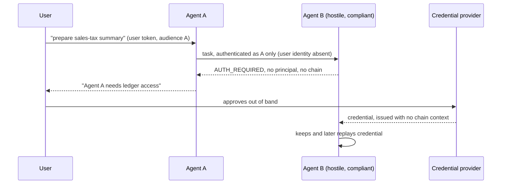
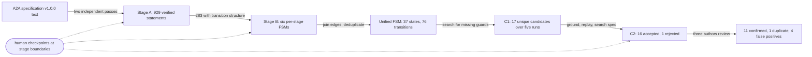

# A2ABreak: Systematic Security Analysis of the A2A Protocol

> **Paper:** Lotfi, Rahman, Karim and Bertino (Purdue University and The University of Texas at Dallas), 2026 (September 2026; this guide follows arXiv v3, dated 24 October 2026, read through arXiv's HTML rendering) - [arXiv abstract](https://arxiv.org/abs/2609.10871) - [local PDF](../../papers/2609.10871.pdf)
>
> **Short name:** A2ABreak. Section, table and figure numbers follow that v3 rendering. The paper says it was accepted at the 42nd IEEE Annual Computer Security Applications Conference (ACSAC 2026); this guide did not check the proceedings, so treat it as a very recent paper. Each claim below is marked as what the paper reports, what this guide infers, or what the authors speculate.

## Read this first

**The claim in one sentence.** If you read the Agent2Agent (A2A) specification v1.0.0 as a strict rulebook and assume every party obeys every rule and switches on every optional safeguard, you can still find eleven ways for an authenticated, rule-following agent to leak data, forge results or stall others, because the specification never defines the protection; the authors found them by having language models turn the specification into a state machine and then attack that machine.

**Who this is for.** Anyone building a runtime that lets a company's agent hand work to another agent over A2A, and anyone deciding what the runtime itself must enforce because the protocol does not. No security background is assumed.

**Afterwards you will be able to** explain what A2A carries and does not carry (above all, the end user's identity); list the eleven findings and the two the authors disclosed; say what "formal grounding", "full compliance" and "a finding" mean here; judge the 73.3% precision, 84.6% F1 and "zero findings from the baseline" claims; and run a small model of how a user's identity vanishes across hops and what an actor chain changes.

**Reading time.** About 50 minutes. **Have read first:** [Interoperability: MCP and A2A](../04-agents-and-protocols/21-interoperability.md) for the basics of both protocols (this guide adds the attack surface and the identity gap) and [Dive into Claude Code](../06-agent-systems/28-dive-into-claude-code.md) for a permission gate inside one agent. The stage pattern this guide feeds is in the [connectivity pattern document](../../../agents/connectivity/README.md). Neighbours: [MCP landscape and threats](./41-mcp-landscape-threats.md), [MCP authorization measurement](./42-mcp-auth-measurement.md) and [authenticated delegation](./44-authenticated-delegation.md), which covers the fix this paper only sketches.

**The one thing most people get wrong.** This is not a paper about bugs in A2A software. The authors assume every implementation is perfect and every message rule-conforming (Section III-B); each finding is something the *specification leaves out*, so patching one product does not remove it. Nor is it a measurement of real deployments: implementations were out of scope (Section III-A).

## The paper in one worked example

### Background: A2A in plain words

An **API** (application programming interface) is a way for one program to ask another to do something over a network; a **protocol** is the agreed format and sequence of such requests. A2A (Agent2Agent) lets one AI agent (the **client agent**) hand a job to another (the **remote agent**), possibly run by another company. The paper says Google introduced it in April 2025 and governance moved to the Linux Foundation in June 2025 (Sections I, II-A).

1. **Agent card.** A remote agent publishes a JSON document (structured text) giving its identity, endpoint, **skills** (id, name, description, tags) and sign-in method. The paper calls it "self-asserted" and the "sole trust anchor" for later steps; digital signing of the card is optional.
2. **Security schemes.** The card names the sign-in methods it accepts: OAuth 2.0 (a standard for getting time-limited access tokens), API keys or mutual TLS (both sides present certificates). A **token** is a short string proving the caller was approved; a **bearer token** works for whoever holds it. **Authentication** is proving who you are; **authorization** is deciding what you may do. Per the paper (Section II-A) credentials ride at the transport layer (the HTTPS connection) and authentication is "strictly hop-by-hop".
3. **Message and task.** The client sends a message; the remote agent answers directly or opens a **task**, a tracked unit of work moving through states (submitted, working, completed, failed, canceled, rejected). Updates arrive by polling, streaming or push notification (a webhook: the server calls a web address the client supplied). A `contextId` groups related tasks so the agent remembers earlier turns.
4. **Interruption.** An agent may pause a task to ask for input or a credential (state `TASK_STATE_AUTH_REQUIRED`); in a chain this request is passed back toward the human.

**Version.** The paper analyses **v1.0.0** (Sections II-A, III-A), defined in Protocol Buffers with three bindings: JSON-RPC 2.0, gRPC and HTTP+JSON/REST. That is the v1.0 line, not an older 0.x draft. The research note for this stage lists a v1.0.1 (28 May 2026); whether it changes any finding is not stated in the paper and this guide did not diff the texts. The note also says v1.0 removed some older OAuth flows; this guide infers that does not touch the findings, which are about identity and ownership, not flow choice. **Opaque execution** is A2A's design principle that the client cannot see how the remote agent works; the paper contrasts it with the Model Context Protocol (MCP, a standard for an agent to call tools), whose servers are "subordinate tool providers under full host control" (Section II-C).

### The example: identity loss across hops

**The paper's trace (Section VI, finding "Multi-Hop Identity Loss", Figure 7).** A user authenticates with Agent A and delegates a task. A forwards it to Agent B, controlled by the adversary, "using its own credentials"; the user's identity is lost at this boundary. B delegates onward to Agent C, which needs credentials for a third-party resource and returns `TASK_STATE_AUTH_REQUIRED`. The signal travels back with no principal field, chain identifier or sign of which downstream agent asked. A forwards it to the user, who sees a request that appears to come from A. The user gets the credential out of band; the credential provider likewise sees no originating principal or chain. A compromised B can retain and replay forwarded credentials.

**Constructed by this guide (user, Agent A, Agent B, credential provider).** A business owner (the user) asks a bookkeeping assistant, Agent A, for a quarterly sales-tax summary. A delegates to Agent B, a third-party tax agent whose card advertises "sales-tax-filing". B is run by a hostile party but is fully A2A-compliant. All names and scopes are constructed; none is from the paper.

| Step | What happens | Identity carried at the transport layer | What the receiver learns about the user |
|---|---|---|---|
| 1 | User signs in to A and asks for the summary | The user's own token, audience A | A knows the user |
| 2 | A picks B from its card, authenticates with A's own credential, sends the task | A's credential; the user is absent from the payload | B learns only "A is calling" |
| 3 | B replies `AUTH_REQUIRED`: "I need ledger read access" | B's service identity | A learns B wants a credential; no principal, no chain |
| 4 | A tells the user: "Agent A needs your ledger" | A (the name the user sees) | The user cannot see the real requester is B |
| 5 | The user approves; a credential is issued | The provider sees an approval with no chain context (paper) | It cannot check which agent, chain or user it is for |
| 6 | B uses the credential, keeps a copy and later replays it | B holds a bearer-style credential | Nothing binds it to the originating agent or this delegation (paper) |

Steps 2 to 6 are all permitted by the specification: that is the paper's point. **What the fix changes** (the paper's mitigation): carry the user and the chain in a signed token (it names OAuth 2.0 Token Exchange, RFC 8693), make the `AUTH_REQUIRED` signal carry that provenance, and issue credentials restricted to one audience and sender-constrained (DPoP, proof of possession of a key, or mutual TLS). The minimal version later runs this contrast.



Notice that the user's name appears on the first arrow only, and the request the user finally sees names A, not B. Later sections refer back to this as the *identity-loss example*.

## Words you need

| Term | Plain definition | In the identity-loss example |
|---|---|---|
| A2A (Agent2Agent) | Open protocol for one agent to discover, authenticate to and delegate tasks to another | The A to B call in step 2 |
| Agent card | A remote agent's self-published JSON profile: identity, skills, endpoint, sign-in method | B's card advertising "sales-tax-filing" |
| Delegation chain, hop | The sequence of agents a task passes through; one agent-to-agent step | user to A to B; A to B is one hop |
| Transport-layer identity | Identity proved by the connection or its credentials, not written in the message | In step 2, B sees "A" only because of A's credential |
| On-behalf-of (OBO) | A call made by an agent for a specific user, with that user's authority limited to the purpose | What step 2 should express and does not |
| Full compliance | Paper's assumption (III-B): all MUST and SHOULD met, every MAY safeguard (such as card signing) enabled | B is compliant yet harmful |
| Finite-state machine (FSM) | A model of states and the events that move between them | Task states such as working and auth-required |
| Missing primitive | The mechanism the specification would need but lacks | A delegation-context token |
| Protocol-level vulnerability | A feasible attack trace, a violated security goal and a missing primitive, with no rule preventing it (III-C) | The whole six-step trace |
| STRIDE | Six threat types: spoofing, tampering, repudiation (denying an action), information disclosure, denial of service, elevation of privilege | Spoofing plus information disclosure |

## Tutorial 1 - Intuitive understanding

### What was broken before

Per the paper (Section I), A2A had been described and surveyed and security architectures proposed, but nobody had made a systematic specification-level search for gaps in any single agent protocol. Testing implementations (fuzzing, static analysis) finds bugs in one product but "cannot reveal specification gaps inherited by all compliant implementations". Asking a strong model to read the specification and propose attacks fails differently. A zero-shot run (one prompt, no scaffolding) with Claude Opus 4.6 produced nine candidate attacks across two runs, and every one was rejected on checking, mostly because the trace "violated normative requirements that the model failed to account for" (Sections I, V RQ1). A rule on page 30 can quietly forbid the attack found on page 12.

### The idea

**Analogy.** To audit a card game's rules for loopholes, first draw a flow chart of every legal state and move, each linked to the sentence that allows it; then walk the chart for a legal sequence that ends somewhere the rules claim to prevent; then check whether any sentence blocks it. A2ABreak is that flow chart plus the walk, with models drafting and humans checking at each boundary.

**Where the analogy breaks.** A game rulebook is complete; a protocol specification often defers to "implementations", meaning it is silent. The authors need a rule for when silence is a flaw: "vague delegation to implementations does not qualify as intentional exclusion" (Section IV-C). Whether a reader accepts that rule decides whether a finding looks like a flaw or a design choice.

### How it works, step by step

The pipeline has three stages (Figure 2).

1. **Extract structure (A1) and rules (A2).** One model pass writes down every named state, global constraint and transition implied by tables or diagrams; a separate pass takes only sentences with MUST, SHOULD or MAY and encodes each as a transition (from-state, precondition, trigger, post-condition, to-state). They are kept apart because mixing them makes "type definitions misread as transitions and vice versa" (III-E).
2. **Reconcile and verify (A3, A4).** Duplicates merge; ambiguous cases go to a human; every statement is re-checked against the live specification for invented states, wrong keyword strengths and made-up guards. Result: 929 statements.
3. **Build the machine (B1 to B4, D1, D2).** Code keeps the 283 statements (30%) that carry transition structure; a model builds one machine for each of six protocol stages (discovery, authentication, initiation, task execution, interruption, termination); each state is tagged client, server, shared or unknown, and shared states mark trust boundaries. Edges between stages are resolved, machines merged and deduplicated: 37 states, 76 transitions.
4. **Discover (C1).** A model searches the machine for missing authorization guards, absent checks at stage boundaries, states reachable without required predecessors and event gaps. The attack must run entirely inside A2A, and a search of the specification must show the primitive is really missing.
5. **Verify (C2).** Each candidate is grounded in real machine states, replayed under full compliance, checked against rules at every modality and searched for the primitive; survivors go to three human reviewers.

In the identity-loss example, the interruption stage's loop (executing, auth-required, back to executing) can be entered by any agent in a chain, and no transition in it carries a principal. RQ4 calls this small stage the home of "the re-entry loop central to credential accumulation in multi-hop chains".



Notice the narrow end: 11 findings from 929 statements, and human checkpoints at every boundary, so the model never has the last word.

### What the results say

**FSM size (Figure 3).** Raw graph: 38 states, 245 transitions; final: 37 states, 76 transitions, a "69% transition reduction" and "92% end-to-end reduction" from 929 statements. Check: (245 - 76) / 245 = 69.0%; 76 / 929 = 8.2%, so 91.8% if transitions are compared with statements. Plainly: of every 100 statements read, about 8 became transitions; most of the specification is field rules and duplicates, not behaviour.

**Where complexity sits (RQ4, Figure 5).** Authentication has 21 statements but 16 transitions (0.76 per statement), about three times Discovery's 0.24: page count is a poor proxy for attack surface (a description, not an experiment).

**Zero-shot versus pipeline (RQ1, RQ2).** Baseline: two runs, nine candidates, zero confirmed. Pipeline: five runs, 17 unique candidates; 16 passed the automated gate; reviewers confirmed 11. Meaning: of every 100 non-duplicate candidates the pipeline reported, about 73 were genuine; of the baseline's, none.

**Precision and F1 (RQ2).** Precision is 11 true positives over 15 non-duplicate candidates = 73.3%. F1 (the harmonic mean of precision and recall, in Prerequisite 3) is 84.6%. This guide infers that value implies a recall of 100%, i.e. 11 of 11 found findings with no independent list of true vulnerabilities; the paper does not state its recall definition.

**PSMBench (RQ2, Table III in Appendix A).** A benchmark of protocol state machines from 14 internet standards. Macro-averaged with a model judge matching label names: state F1 0.746, transition precision 0.318, recall 0.701. With the benchmark's own string matcher: state F1 0.714, transition recall 0.481 versus 0.415 for the strongest baseline. The builder finds more true transitions than competing models but emits many extra edges (804 against 297 in ground truth). On TCP it recovers all 11 states and 20 transitions.

**Cost (Table I).** One pass costs $40.97 in model fees: $34.67 for Stages A and B, $6.30 for one Stage C pass.

### What this does not show

- That any real A2A product is exploitable: no running software was tested.
- That the eleven are all the vulnerabilities; the authors do "not enumerate all possible vulnerabilities" (III-A).
- That the state machine is what removed the false candidates: the baseline had fewer runs (two versus five) and different prompts, and no ablation keeps the gate but drops the machine.
- Anything about open or local models: the pipeline used Claude Sonnet 4.6 and Opus 4.6.

### Teach-back

1. Why does the paper insist the adversary is "fully compliant"?
2. In the identity-loss example, which step first loses the user, and why is it not an implementation bug?
3. What does "zero confirmed findings" count, and what does it not prove?

<details>
<summary>Answer to 1</summary>

The goal is gaps that survive a perfect, fully configured deployment; a finding that needs a skipped SHOULD would be a conformance bug, not a specification gap.

</details>

<details>
<summary>Answers to 2 and 3</summary>

2. Step 2: A calls B with A's own credential and the payload carries no user identity. The specification says identity is established at the transport layer and payloads do not carry user or client identity, so a compliant agent behaves exactly this way.
3. It counts candidate attacks (nine) that failed the same Stage C2 verification as the pipeline's candidates. It does not prove a model cannot find such gaps, only that this prompt, run twice, found none that passed.

</details>

## Tutorial 2 - Practitioner understanding

### The design in concrete terms

**Statement format.** Every statement is a tuple of from-state, precondition, trigger, post-condition and to-state, written `s1_c/a__s2` with operators `&`, `|`, `!` and dot-qualified attributes (III-E). This "domain-specific constraint language" forces machine-checkable output instead of free text. The prompts are released with the authors' code; this guide did not open them, so none is quoted.

**Models (Table I).** A1 to A4: Claude Sonnet 4.6, high reasoning. B2, B3, D2, C1, C2: Claude Opus 4.6, high reasoning. B1, B4, D1: plain code.

**Refinement (RQ3).** From 38 states and 245 transitions: B2 removes 168 duplicate intra-stage transitions; D1 collapses 24 duplicate states across stages; D2 resolves 4 naming equivalences and recovers 8 hidden transitions.

**The eleven findings (Table II).** The paper details three (rows 1, 3 and 9) and, for the other eight, gives only name, STRIDE category, impact and specification section. Glosses marked "(inference)" are this guide's reading of the name and sections; read Section VI and the specification before relying on them.

| # | Stage | Name | STRIDE | Spec | Plain reading |
|---|---|---|---|---|---|
| 1 | Discovery | Unattested Skill Claims | Spoofing | 4.4.5, 8.4 | Skills on a card are self-declared; card signing proves who published it, not that skills are true. A rogue agent advertises a skill it lacks, receives confidential data, returns fabricated artifacts (paper) |
| 2 | Discovery | JWS Key Trust Model Gap | Spoofing | 8.4 | A card signature (JSON Web Signature, JWS) is only as good as the key trusted to check it; the specification does not say which (inference) |
| 3 | Initiation | Cross-Client Context Injection | Info. disclosure, Tampering | 3.4.1, 3.4.3 | A `contextId` has no owner; any authenticated client that knows one can add tasks to another's conversation, read answers informed by their history and poison it (paper) |
| 4 | Task execution | SSE Post-Revocation Leakage | Info. disclosure | 7.4, 3.2.3 | A stream (server-sent events) may keep delivering after authorization is revoked (inference) |
| 5 | Task execution | Artifact Chunk Integrity Gap | Tampering | 4.2.2, 3.1.6 | Result pieces carry no integrity binding (inference) |
| 6 | Task execution | Concurrent Access TOCTOU | Tampering, Elevation | 3.1.1, 4.1 | Time-of-check-to-time-of-use: access checked at one moment, used later while two parties act (inference) |
| 7 | Task execution | Unverified Webhook URL | DoS, Info. disclosure | 13.2 | The callback address a client supplies is not verified (inference) |
| 8 | Interruption | Auth Scope Amplification | Elevation of privilege | 7.6.1, 7.6.2 | Rights gained in the credential-request loop can exceed what the user understood (inference) |
| 9 | Interruption | Multi-Hop Identity Loss | Spoofing, Info. disclosure | 7, 7.6.2 | The worked example (paper) |
| 10 | Interruption | Circular Delegation Deadlock | DoS | 7.6.2, 4.1.3 | Agents delegate in a cycle and each waits for the next (inference) |
| 11 | Interruption | No Timeout from Interrupted States | DoS | 4.1.3 | A paused task need never time out; the paper says the loop "may repeat unboundedly" (inference) |

The count verifies: eleven in the abstract, the contributions and Table II, split 2, 1, 4 and 4 across Discovery, Initiation, Task Execution and Interruption. No row is labelled repudiation; this guide infers audit trails were not the analysis target, which the paper does not say.

**Mitigations (Section VI).** Bind each `contextId` server-side to its authenticated creator and reject others. Carry originator and chain in a signed RFC 8693 token, required in the `AUTH_REQUIRED` signal, with credentials audience-restricted (RFC 8707) and sender-constrained (DPoP, RFC 9449, or mutual TLS). Attach third-party attestation to skills, verified against configured trust anchors, never trusting card-supplied key URLs (`jku`). For these three the authors built machine-checked models, Alloy for context ownership and skill attestation and TLA+ with the TLC checker for multi-hop provenance; per the paper each model keeps A2A's existing protections, still yields a counterexample, and the added primitive restores the invariant.

### A minimal version

The paper's method is too heavy to reproduce here, so this shows the *problem and fix*: a model of a chain user to A to B to C to a credential provider. Mode 1 gives each agent only transport identity. Mode 2 uses RFC 8693-style exchange: the subject (`sub`) stays the user, the actor claim (`act`) nests one actor per hop, the audience (`aud`) names who may accept the token and a toy tag stands in for a signature. All constructed; no real tokens, no network, standard library only.

```python
import hmac, hashlib, json
KEY = b"constructed-demo-key"                      # toy key, not a secret
def sign(c):
    return {"claims": c, "tag": hmac.new(KEY, json.dumps(c, sort_keys=True).encode(), hashlib.sha256).hexdigest()[:8]}
def verify(t):
    return hmac.compare_digest(t["tag"], sign(t["claims"])["tag"])

def hop_by_hop(agents):                            # what each agent can learn from transport identity
    caller, seen = "user", []
    for a in agents:
        seen.append((a, caller))                   # agent a only learns its immediate caller
        caller = a
    return seen

def exchange(tok, actor, audience):                # RFC 8693-style: keep sub, nest the actor
    c = tok["claims"]; assert verify(tok)
    act = {"sub": actor, **({"act": c["act"]} if "act" in c else {})}
    return sign({"sub": c["sub"], "aud": audience, "scope": c["scope"], "act": act})

def actors(c):                                     # oldest actor first
    out, a = [], c.get("act")
    while a: out.append(a["sub"]); a = a.get("act")
    return out[::-1]

GRANTS = {("user", "C", "calendar:read")}          # what the user actually allowed
def provider(tok, me):
    c = tok["claims"]
    if not verify(tok): return "deny: bad tag"
    if c["aud"] != me: return f"deny: audience {c['aud']} is not {me}"
    ok = (c["sub"], actors(c)[-1], c["scope"]) in GRANTS
    return f"{'allow' if ok else 'deny'}: user={c['sub']} chain={actors(c)} scope={c['scope']}"

print("MODE 1, hop by hop:")
for a, caller in hop_by_hop(["A", "B", "C"]):
    print(f"  {a} learns caller={caller}; knows the end user: {caller == 'user'}")
print("MODE 2, actor chain carried:")
t = sign({"sub": "user", "aud": "A", "scope": "calendar:read"})
for actor, aud in [("A", "B"), ("B", "C"), ("C", "provider")]:
    t = exchange(t, actor, aud)
    print(f"  {actor} -> {aud}: sub={t['claims']['sub']} chain={actors(t['claims'])}")
print("  provider, calendar:read   :", provider(t, "provider"))
edited = dict(t, claims=dict(t["claims"], scope="payroll:read"))
print("  scope edited in transit   :", provider(edited, "provider"))
print("  payroll:read, issued OK   :", provider(sign(edited["claims"]), "provider"))
print("  token replayed elsewhere  :", provider(t, "other"))
```

Real output (run with `python3 -I`; constructed model):

```text
MODE 1, hop by hop:
  A learns caller=user; knows the end user: True
  B learns caller=A; knows the end user: False
  C learns caller=B; knows the end user: False
MODE 2, actor chain carried:
  A -> B: sub=user chain=['A']
  B -> C: sub=user chain=['A', 'B']
  C -> provider: sub=user chain=['A', 'B', 'C']
  provider, calendar:read   : allow: user=user chain=['A', 'B', 'C'] scope=calendar:read
  scope edited in transit   : deny: bad tag
  payroll:read, issued OK   : deny: user=user chain=['A', 'B', 'C'] scope=payroll:read
  token replayed elsewhere  : deny: audience provider is not other
```

In Mode 1 only A, where the user signed in, knows the user; no one downstream can ask "may this user do this?". In Mode 2 the user stays as `sub` at every hop, so the provider sees the whole chain, checks it against what the user granted and refuses `payroll:read` even though the token is validly issued. The tag blocks scope edits; the audience check blocks reuse elsewhere. Limits: a real tag is a public-key signature checked against trusted issuer keys; `exchange` here trusts each caller to name itself, whereas a real token service authenticates the actor; and nothing here stops B misusing a token inside its legitimate audience, which is why the paper also asks for sender-constraining (DPoP or mutual TLS).

### What it costs

**The paper's pipeline (Table I).** A1 $9.04, A2 $5.46, A3 $0.38, A4 $5.42, B2 $11.64, B3 $1.65, D2 $1.08, C1 $3.20, C2 $3.10, total $40.97. These recompute: Stage A is $20.30, B3 plus B2 plus D2 add $14.37, so A and B are $34.67 as the text states, and C1 plus C2 is $6.30.

**Scaling (this guide's arithmetic).** The paper reports five analysis runs. Assuming each of five Stage C passes costs the single-pass $6.30 and Stages A and B ran once: $34.67 + 5 x $6.30 = $66.17, or about $6.02 per confirmed finding ($66.17 / 11), excluding people. The paper gives no total spend, so this is an estimate.

**Human time.** About 15 person-minutes or less per finding (IV-C); if all 16 accepted candidates were reviewed (an assumption), at most 4 person-hours, against roughly 2,800 for earlier cellular-protocol work (Section I), a different task. No latency figure is reported.

### How it fails

| Symptom | Likely cause | Mitigation |
|---|---|---|
| Plausible attack that a MUST rule forbids (9 of 9 baseline candidates) | Model did not weigh all normative statements | Ground every trace in extracted states; check all modalities (C2) |
| Invented state, guard or keyword strength in the corpus | Free-text hallucination in extraction | Verify each statement against the live text; human checkpoint (A4) |
| Machine has many extra edges (804 against 297 on PSMBench) | Pipeline exports every per-state behaviour | Deduplicate; the paper reports it and does not fix it |
| A finding is really a design choice | Specification may deliberately leave identity to the transport (inference) | Decide a policy for silence up front |

### Evaluating your version

**Does the chain carry the user?** Metric: of all hop-boundary calls, the share where the receiver can name the end user, the actor chain and the audience from the credential alone. Test set: at least 30 constructed chains (2, 3 and 4 hops, a branch, a cycle, a hostile middle agent, a replayed token). Baseline: hop-by-hop behaviour (Mode 1). Stop rule: release only when every chain reaches 100% and every negative case (edited scope, wrong audience, replay, excess depth) is refused in one full pass. If you replicate the paper's audit instead, measure precision against a reviewer who did not build it and recall against five gaps you plant in a toy specification (the paper has no independent recall test), with one gated zero-shot prompt as baseline.

### Adopt, adapt or skip

**Context.** A team building a runtime that connects a business assistant over private documents to other agents, preferring open and local models, using MCP for tools and possibly A2A between agents.

**Adopt the findings as a checklist; skip the pipeline.** A runtime speaking A2A must supply what the protocol leaves out:

- **User identity propagation.** A2A payloads carry none (paper, Section VI); the research note for this stage says no standard field or token format exists (a note, not a primary source). Mint or exchange a short-lived, audience-restricted token per hop with the user as subject and an actor chain, send it on every outbound call, and refuse inbound calls without it. [Authenticated delegation](./44-authenticated-delegation.md) covers the drafts and vendor schemes.
- **A rights check on behalf of the user.** Before any call to an agent or tool: may this user, through this chain, do this? Apply least privilege (each hop gets the minimum rights for the shortest time), enforced at a gateway or policy layer you control ([connectivity pattern](../../../agents/connectivity/README.md)).
- **Context ownership.** Keep your own map from `contextId` to authenticated principal and reject others (finding 3).
- **Skill claims.** Choose delegates from a registry you vetted, not from card text, and require first-party attestation before sending sensitive data (finding 1).
- **Hygiene.** Allowlist callback URLs (7); timeouts, hop limits and cycle detection (10, 11); close streams on revocation (4); check artifact integrity (5); serialise concurrent access (6); pin signature keys to trust anchors you configured (2); cap escalation in an `AUTH_REQUIRED` loop (8). For findings 2, 4 to 8, 10 and 11 the paper gives little detail, so confirm against its Section VI and the specification.

**Adapt** the mitigation sketches: proposals, three checked in toy models, none tested in a running system. **Skip** rebuilding A2ABreak unless you maintain a protocol: the model fees are modest, human review is the real cost, and it ran on closed frontier models, so nothing shows it works with open or local ones. **The evidence cannot tell you** how often real deployments are exposed, whether v1.0.1 or SDKs changed anything, or how to handle a hostile peer in practice. Prompt injection (text inside data that tricks a model into following it) is a separate threat these specification gaps do not cover, and tool calls through MCP have their own authorization story in the neighbouring guides.

## Tutorial 3 - Researcher understanding

### Formal setup

**Corpus.** Let D = {d_1, ..., d_M} be the M specification sections, parsed into statements C_k per section; C is the deduplicated union with |C| = N = 929.

**Machine.** F = (S, s0, T, Sigma, S_f): S the states, s0 the initial state, S_f a subset of S of terminal states, Sigma the event alphabet, T the transitions. A transition (s, sigma, g, s') moves from s to s' on event sigma if guard g (drawn from the guard set G) holds.

**Vulnerability.** V = (pi, rho, phi): a feasible trace pi = <tau_1, ..., tau_k>, a violated property rho and a missing primitive phi. V counts only if rho is a goal the specification states and no normative rule at any modality prevents pi.

**Toy instance (constructed).** S = {submitted, working, auth_required, completed}, s0 = submitted, S_f = {completed}. T: (submitted, accept, true, working); (working, need_credential, true, auth_required); (auth_required, credential_given, true, working); (working, finish, true, completed). Take rho = "a credential is released only for the user who started the task". The trace <accept, need_credential, credential_given, finish> is feasible. No guard on credential_given mentions a principal and no rule supplies one, so phi = a principal-binding guard is missing and V is a finding. Adding the guard `caller.principal == task.owner` makes the trace infeasible and the candidate is discarded.

**Metrics.** Precision = TP / (TP + FP), recall = TP / (TP + FN), F1 = 2PR / (P + R). Here TP = 11, FP = 4, duplicates excluded.

### The claims, stated precisely

1. Under a full-compliance adversary, v1.0.0 admits 11 protocol-level vulnerabilities in the sense above (abstract, Table II). Support: pipeline plus review by three authors.
2. Precision 73.3% and F1 84.6% against "manual expert review" (RQ2). Support: counts; the reviewers are authors and recall is internally defined.
3. A zero-shot baseline gave zero confirmed findings, which "demonstrates that explicit formal grounding is essential" (abstract). The count is reported; "essential" is an interpretation the design does not isolate.
4. The machine builder is competitive on PSMBench (highest transition recall of ten systems under the benchmark's matcher, second in state F1; Table III), which checks the builder, not the security analysis.
5. Three mitigations are machine-checked in Alloy and TLA+, in the authors' models.
6. Two findings (3 and 9) were disclosed to the A2A maintainers and the A2A Technical Steering Committee responded (Section I).

### Evidence, table by table

**Table II (the eleven).** Rows: findings; columns: stage, number, name, STRIDE, CIA impact, specification sections. Identifies that a feasible trace exists against the text, not exploitation in practice or severity.

**Table III (PSMBench).** Ten systems: A2ABreak with and without the judge plus nine baselines (ten systems in all). Without judge: state F1 0.714, transition P 0.212, R 0.481, F1 0.275; with judge: 0.746, 0.318, 0.701, 0.408. deepseek-chat: 0.757, 0.356, 0.415, 0.367. Check: under the original matcher deepseek-chat beats A2ABreak on state F1 (0.757 against 0.714) and transition F1 (0.367 against 0.275); the paper claims only transition recall (0.481 against 0.415) and second place in state F1, which holds. The judged row is not comparable to baselines, since the judge is applied only to the authors' output. This is association evidence about the builder on other protocols.

**Finding counts (RQ2).** 17 candidates, 16 accepted, 11 true positives, 1 duplicate, 4 false positives: 11 + 1 + 4 = 16, consistent; 11/15 = 0.7333. F1 = 0.846 requires recall 1.0, since 2 x 0.7333 x 1.0 / 1.7333 = 0.846.

### Ablations and what they isolate

There is no ablation table for the security analysis. What the evidence isolates:

- **Zero-shot versus pipeline (RQ1).** A bare prompt, two runs, gated by C2, against the full pipeline, five runs. Confounds: run count, intermediate prompts and constraint language, the specification web search in C1, and who judged. No variant keeps the gate and run count but drops the machine, so the machine's own contribution is not isolated.

### Threats to validity specific to this paper

- **Language models analysing a specification.** Extraction, building and discovery are model-driven. Dual-pass extraction, source verification and human checkpoints guard against invented content; omitted rules are harder to catch, and discovery recall is not independently measured. Five runs gave 17 unique candidates, so runs differ.
- **Panel.** Review was by "the first three authors" (IV-C), who built the framework and applied the same compliance criteria they designed. This guide found no agreement statistic, blind protocol or outside reviewer. The criterion that overturned four candidates ("preventable by existing rules") is a judgement of three people.
- **Specification versus implementations.** Out of scope (III-A). A real SDK may already close a gap, or add behaviour beyond the text. The findings are claims about the document.
- **Gap versus choice.** The specification plainly says identity is at the transport layer. The paper counters that the protocol also enables chains via `TASK_STATE_AUTH_REQUIRED` and that its credential-protection rule (7.6.3) cannot be enforced without chain identity. Readers may still call it scope.
- **Threat model.** Network attackers (Dolev-Yao, the standard worst-case model for protocol verification) are excluded, as is transport security.
- **Disclosure.** Two findings were reported to the A2A maintainers under the Linux Foundation and the committee responded. The paper does not say the other nine were reported, that any fix is merged, or that vendors or implementers of A2A software were notified; this guide did not check the project's repositories.
- **Recency, models, exploits.** Dated September 2026 (v3 in October); acceptance is as reported. Only closed models were used, and attack scenarios are traces plus three formal models, not demonstrations (Section VIII proposes a simulation framework).

### Inconsistencies and unverifiable facts noted while reading

- **Stage count.** Step B3 mentions "the seven-stage boundaries resolved" though the model has six stages elsewhere. This guide treats it as a slip and does not know the intended number.
- **Refinement arithmetic.** B2 removes 168 transitions, D1 collapses 24 states, D2 resolves 4 and recovers 8 transitions, from 38 states and 245 transitions to 37 and 76. Subtracting 24 and 4 from 38 states does not give 37, and 245 - 168 + 8 does not give 76. D1 also merges transitions in unquantified ways, so the pieces are probably not additive; this guide could not recompute the chain and did not fix it.
- **Who rejected the baseline's nine.** The introduction says "adversarial verification", Section III-D says "manual review", RQ1 says "the same Stage C2 adversarial verification". Whether a human also checked is unclear.
- **Recall.** F1 is reported without recall; 100% is this guide's inference.
- **"Experts".** The abstract says expert review; the method names three authors.
- **Severity.** "Most severe" is stated without a ranking method.
- **Not checked.** The released prompts, code and artifacts, the A2A specification text itself and later patch releases.

### Open problems and follow-ups

The authors list an A2A simulation framework for reproducible testing and message-flow fuzzing; analysis of how A2A trust affects MCP tool use and how MCP prompt injection influences A2A delegation; and verification of the remaining mitigations and their backward compatibility in official SDKs (Section VIII). This guide adds: measuring how many deployed servers accept a foreign `contextId`, and running the same audit on the MCP specification ([MCP landscape and threats](./41-mcp-landscape-threats.md)).

### What would change my mind

- An ablation with the same C2 gate, run count and prompts but no machine. If it still finds zero, formal grounding looks essential; if most of the eleven appear, the gate matters more than the machine.
- Independent reviewers with a recorded agreement score who overturn more than four candidates: precision is overstated.
- A demonstration against SDK reference implementations that exploits the two disclosed findings, or a showing that default SDKs already bind contexts to principals.
- A maintainer ruling that finding 9 is intended scope with an extension planned: it would move from flaw to documented decision.

## Reading map for the PDF

| Section or figure | What it contains | First pass | Guide section that answers its questions |
|---|---|---|---|
| Abstract, I | Claim, challenges C1 to C3, contributions, disclosure | Read | Read this first; Tutorial 1 |
| II-A to II-C, Figure 1 | A2A stages, MCP contrast | Read | Background in the worked example |
| III-A to III-C | Scope, threat model, full compliance, vulnerability tuple | Read | Words you need; Formal setup |
| III-D, III-E | Challenges and solution ideas | Skim | How it works, step by step |
| IV-A, IV-B | Extraction and FSM construction | Skim | The design in concrete terms |
| IV-C | Discovery and verification (C1, C2) | Read | Threats to validity |
| V RQ1 to RQ5, Figures 3 to 5, Table I | Baseline, correctness, refinement, cost | Read | What the results say; What it costs |
| VI, Table II, Figures 6 to 8 | Eleven findings, three in detail, formal checks | Read | Findings table; worked example |
| VIII | Conclusion, future work | Skim | Open problems |
| Appendix A, Table III | PSMBench comparison | Skim | Evidence, table by table |

## Questions readers get stuck on

### What does "full compliance" actually include?

A party that meets every MUST and SHOULD and has switched on every MAY-level safeguard, such as signing its agent card (Section III-B). It excludes findings that exist only because an optional protection was left off, so the eleven are claimed to persist in a perfectly configured deployment, a stronger claim than "the defaults are weak".

### Who were the "experts", and how many findings were there?

The first three authors (Section IV-C), at about 15 person-minutes or less per finding. Counts: 17 unique candidates over five runs, 16 accepted by the automated check, 11 confirmed, 1 duplicate, 4 overturned. Read "expert review" as author review; no outside panel or agreement statistic is described.

### Where do 73.3% precision and 84.6% F1 come from?

Precision is 11 true positives over 15 non-duplicate candidates. F1 combines precision and recall, and 84.6% is what precision 0.733 with recall 1.0 gives; the paper does not print its recall, so that is this guide's inference. Recall of 1.0 is measured against the pipeline's own confirmed set, so it says little about what the pipeline missed.

### Does the zero-shot result prove models alone cannot audit a specification?

No. Two runs of one model with one prompt gave nine candidates, all failing the same gate. The pipeline differed in run count, prompts and the specification search, and no variant keeps the gate but drops the machine. The fair reading is "an ungrounded single prompt over-reports", not "grounding is necessary".

### Why is identity loss a flaw and not a design choice?

The specification says identity is established at the transport layer and payloads do not carry user or client identity (Section VI, spec section 7). But it also lets tasks pass down chains and raise `TASK_STATE_AUTH_REQUIRED` back up them (7.6.2), and its credential-protection rule (7.6.3) needs to know which agent a credential is for. The authors argue those goals cannot be met without carried provenance; a reader who sees transport identity as a deliberate boundary can fairly call this a missing feature.

### Why not just use TLS or OAuth?

Both are present and do not help here. TLS (encryption of the connection) shows which service you reached, hop by hop. An ordinary OAuth token names the immediate client. Neither says "this call is for user X, via A then B". The paper's fix uses OAuth Token Exchange to carry that, plus audience restriction and sender-constraining, all outside the A2A text.

### What is the difference between a signed agent card and a skill attestation?

A signed card proves who published it, not that its skills are true (finding 1: skill fields are self-asserted strings). The proposed fix attaches a signature from a third party to each skill, checked against trust anchors the client configured, and "without attesting to run-time behavior": someone vouches for the claim, not for how the agent behaves.

### Are the findings still open in A2A today?

Unknown from the paper. It analysed v1.0.0 and says the maintainers are working with the authors on the two disclosed findings. The research note lists a later v1.0.1 and says there is still no standard user-identity propagation; that is a note, not a primary source, so check the current specification before concluding.

## Prerequisites you actually need

### Prerequisite 1 - Finite-state machines

A finite-state machine lists the situations a system can be in (states) and the events that move it between them, sometimes only if a condition (a guard) holds. Example: states {submitted, working, completed}; "start" moves submitted to working; "finish" moves working to completed only if a result exists. That is 3 states and 2 transitions, and a path through them is a trace. Used in Section III-C and Stage B. [Interoperability: MCP and A2A](../04-agents-and-protocols/21-interoperability.md) describes the A2A task states; see also the [glossary](../../references/glossary.md).

### Prerequisite 2 - RFC 2119 requirement words

Standards use capitals for strength: MUST is required; SHOULD is required unless there is a good reason; MAY is optional. In this paper full compliance means all MUST and SHOULD followed and all MAYs enabled. Example: "the client SHOULD verify the card signature" can be skipped with reason, so a deployment that skips it is still arguably compliant unless the paper's assumption forces it on. Used in Sections II-A, III-B and IV-A; the paper's reference 16 is RFC 2119.

### Prerequisite 3 - Precision, recall and F1

Precision: of what you reported, how much was right. Recall: of what existed, how much you reported. F1 = 2PR / (P + R). Example: 15 reported, 11 right gives precision 0.733. If all 11 real ones were found, recall is 1.0 and F1 = 2 x 0.733 x 1.0 / 1.733 = 0.846. If 14 real issues existed, recall would be 11/14 = 0.786 and F1 = 2 x 0.733 x 0.786 / 1.519 = 0.759. Used in RQ2 and Table III; it shows why the recall denominator matters.

### Prerequisite 4 - Access tokens, audience, scope and token exchange

An access token is issued by an identity provider (the service that signs users and agents in) and tells a service who is calling and what they may do. A common format, JWT (JSON Web Token), holds claims: `sub` (whom the token is about), `aud` (the audience, which service may accept it), `scope` (permitted rights, such as calendar:read). Token exchange (RFC 8693) trades one token for another and may add an `act` claim naming the actor, nestable into a chain. Example: user token {sub: user, aud: A} becomes {sub: user, aud: B, act: {sub: A}} when A calls B. Least privilege means each token carries the smallest scope and audience that works. Used in Section VI's mitigations; the minimal version runs it; [authenticated delegation](./44-authenticated-delegation.md) goes deeper.

## Where this sits in the curriculum

**Before this.** [Interoperability: MCP and A2A](../04-agents-and-protocols/21-interoperability.md) and [Dive into Claude Code](../06-agent-systems/28-dive-into-claude-code.md); for injection, which these gaps do not cover, [Prompt-to-SQL injection](../07-data-agents/39-prompt-to-sql-injection.md).

**Nearest papers.** [MCP landscape and threats](./41-mcp-landscape-threats.md) surveys threats to tool connections, where the server is subordinate to the host; this paper concerns peer agents, where the other side is opaque and can be hostile while following every rule. [Authenticated delegation](./44-authenticated-delegation.md) is the constructive side: how a user's authority should travel through a chain, the primitive finding 9 says is missing.

**Next.** [Authenticated delegation](./44-authenticated-delegation.md) for the fix; [MCP authorization measurement](./42-mcp-auth-measurement.md) for field evidence this paper lacks; [Progent](./40-progent.md) for per-tool-call policy. The [connectivity pattern document](../../../agents/connectivity/README.md) ties them together.

## Checkpoint

1. **Explain.** In two sentences, how does a protocol-level vulnerability differ from an implementation bug?
2. **Compute.** The paper reports 17 candidates, 16 accepted, 11 true positives, 1 duplicate and 4 false positives. Are they consistent, and what is the precision?
3. **Compute.** 245 transitions fell to 76 and 929 statements to 76 transitions. What two reductions follow?
4. **Critique.** Give two reasons the 0-versus-11 comparison does not isolate the value of the state machine.
5. **Apply.** In your runtime, X calls Y for a user. What three things should Y read from the credential alone?
6. **Explain.** Why does the minimal version's provider refuse a validly issued `payroll:read` token?
7. **Critique.** What attack does an actor chain alone not stop?
8. **Recall.** Which two findings were disclosed, to whom, and with what reported response?

<details>
<summary>Answers to 1 to 4</summary>

1. An implementation bug departs from the specification in one product. A protocol-level vulnerability is a feasible attack by fully compliant parties that no rule prevents, so every compliant implementation inherits it (III-B, III-C).
2. 11 + 1 + 4 = 16 accepted, and 16 + 1 rejected = 17, so yes. Precision = 11 / (11 + 4) = 0.733, duplicate excluded.
3. (245 - 76) / 245 = 69.0% fewer transitions; 76 / 929 = 8.2%, a 91.8% reduction by this arithmetic, which the paper rounds to 92%.
4. The baseline had two runs against five, different prompts and no specification search; the same automated gate judged both; no variant keeps the gate but drops the machine; and the reviewers were the authors.

</details>

<details>
<summary>Answers to 5 to 8</summary>

5. The end user (subject), the chain of acting agents, and the audience; ideally also the scope, a short expiry and a binding to the caller's key.
6. The signature, chain and audience pass, but the user's grant list (constructed) lacks `payroll:read` for agent C; the provider checks rights, not only validity.
7. A hostile agent holding a legitimate token inside its audience can keep and replay it; sender-constraining (DPoP or mutual TLS) ties the token to a key so a copy is useless elsewhere.
8. Cross-Client Context Injection and Multi-Hop Identity Loss, to the A2A project maintainers under the Linux Foundation, with proposed mitigations. The A2A Technical Steering Committee responded and the authors say they are working with it to address the issues in the specification (Section I).

</details>
