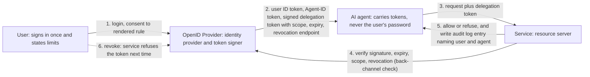
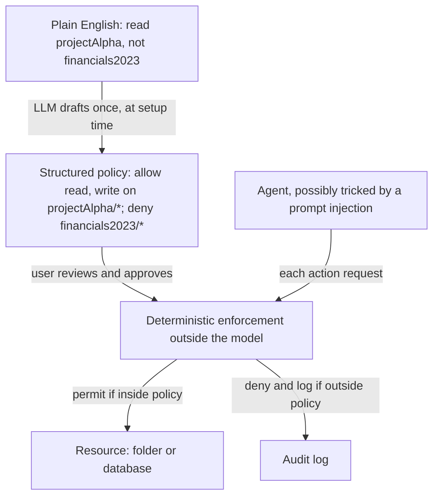

# Authenticated Delegation and Authorized AI Agents

> **Paper:** South, Marro, Hardjono, Mahari, Whitney, Greenwood, Chan and Pentland (MIT, Oxford, Harvard Law School, UC Berkeley, the Centre for the Governance of AI, Stanford), January 2025 - [arXiv abstract](https://arxiv.org/abs/2501.09674) - [local PDF](../../papers/2501.09674.pdf)
>
> **Version followed:** arXiv v1 (16 January 2025), read through the arXiv HTML rendering. Section and figure numbers below follow it. The abstract page names no venue; the HTML carries a leftover "Keywords: Machine Learning, ICML" line from a conference template, which this guide does not treat as evidence of peer review. **Treat it as a 2025 preprint, not a peer-reviewed result.** The paper has no tables and four figures.


## Read this first

**The claim in one sentence.** When a person lets an AI agent act for them, the service on the other end should be able to check, from a signed credential, that the caller is an AI agent, which human it works for, and exactly what it may do and until when; the authors propose building that check on OAuth 2.0 and OpenID Connect, with a new "delegation token", and propose turning plain-English permissions into machine-enforced rules that the user approves.

**What kind of paper this is.** A design and position paper: no experiment, implementation, measurement or benchmark. Its value is naming the problem, choosing which standards to extend, and stating what is unsolved. This guide says so wherever a reader might expect evidence.

**Who this is for.** Founders and engineers building an agent runtime that calls tools and other agents for business users, and non-engineers who want to know what "the agent is allowed to do this" means technically. **Afterwards you will be able to** explain the three tokens and two kinds of scoping, trace a delegation from user to service to revocation, map the ideas onto OAuth standards (the guide's inference), run a 45-line toy verifier, and say what to adopt and what to still design.

**Reading time.** About 50 minutes for the guide, 25 minutes for the paper (it is short and mostly prose). **Have read first:** [Interoperability protocols](../04-agents-and-protocols/21-interoperability.md) for the basics of MCP (Model Context Protocol) and A2A (Agent2Agent), and [Dive into Claude Code](../06-agent-systems/28-dive-into-claude-code.md) for a permission gate inside one agent. Useful context: [prompt-to-SQL injection](../07-data-agents/39-prompt-to-sql-injection.md), which shows why a model's own judgement cannot be the only barrier. The stage's pattern document is [agents/connectivity](../../../agents/connectivity/README.md); a shared glossary is at [glossary](../../references/glossary.md).

**The one thing most people get wrong.** The paper is not a protocol specification and defines no token format. Section 3.3 describes three tokens in prose, section 3.4 ("Scope Limitations on Delegation") is two sentences long, and section 4.4 defers "intermediate validation checks and the evaluation of robustness of LLM translation" to future work. Expect an argument for what a protocol should contain, and why the language model must not be the enforcer, not something to implement from the PDF.

## The paper in one worked example

The paper has no single end-to-end example, so this section has two parts. Part A is real material from the paper (section 4.4 and its Figure 1). Part B is constructed by this guide, to show how the paper's ideas would look on a task a business user would plausibly give an agent. Every number in Part B is invented by this guide for illustration; none comes from the paper.

### Part A - the paper's own pieces

**A1. The permission translation example (section 4.4).** (1) A user writes, in plain English: allow the agent to read and write the directories about "projectAlpha", but give it no access to the folders with financial data. (2) A language model translates this into a policy, in a universal permission language such as XACML (eXtensible Access Control Markup Language, an XML policy standard) or in the resource's own language such as SQL (Structured Query Language) access policies. Here, the paper says, the model "enumerates" the projectAlpha resources while explicitly denying "financials2023". (3) The user reviews, corrects and finalises the policy. The model is used once, at setup, to draft a rule; an ordinary non-AI system enforces it afterwards. The paper's stated payoff: "even if an LLM or another AI agent is tricked or misaligned, its ability to execute harmful actions is constrained by the underlying resource permissions".

**A2. The inter-agent example (4.4.1).** Alice, a project management agent, forwards the user's financial data request and her authorisations to Bob, an accounting agent. Bob replies with a structured reading, for example read-only access to the "transactions2025" dataset, columns total amount and vendor name, which the user or Alice approves and which is logged.

**A3. The three tokens (3.3, Figure 1).** The user's ID token (the ordinary OpenID Connect login token); an Agent-ID token (identity of the agent instance, an OAuth 2.0 "Native Client"); and a Delegation Token, signed by the human delegator, that "should specify validity conditions, such as expiration time or revocation endpoints".

**A4. The paper's own travel illustration (2.1.1).** For a flight purchase the paper rejects pasting card details into the context window and asking the model to "follow at budget"; the agent should instead be authorised "on specific booking services, where credit cards are stored securely, and where explicit spending limits can be enforced". No token contents are given; Part B fills that gap.

### Part B - constructed by this guide: "book the cheapest flight under 500 and charge the company card"

All identifiers, amounts and times are invented. Asha, an employee at a small company, uses a travel agent runtime. The user (principal, the human the work is done for) is `user:asha`; the agent instance is `agent:travel-1`; the identity provider (the service that logs people in and signs tokens) is `idp.example`; the services are `svc:flights` and `svc:cards`.

1. **Asha states the task and limits in words**, and the runtime shows a rendered rule: search and book flights on svc:flights, one card charge on svc:cards of at most 500 dollars, valid 10 minutes.
2. **Asha approves; the provider signs two narrow tokens.** One has audience `svc:flights` and scopes `flights:search`, `flights:book`. The other has audience `svc:cards`, scope `card:charge`, limit 500. Both name Asha as subject and the agent as actor, with an expiry and a token id.
3. **The agent calls each service with its own token.** The flight service accepts and the agent books a 480 dollar fare. The card service accepts a charge of 480 and logs "agent:travel-1 acting for user:asha, token t-002".
4. **Refusals.** A charge of 520 exceeds the limit. The flight token shown to the card service was addressed elsewhere. Another agent presenting the card token is not the named actor. After 10 minutes everything is expired.
5. **Ending.** Asha or the company revokes the card token early and the card service refuses it on the next call. "A minimal version" runs these cases.



Notice that the agent never holds the user's own login, only a narrow, expiring credential.



Notice that the language model appears only on the left, at drafting time. The path from the agent to the resource goes through a rule check that does not read the agent's text.


## Words you need

| Term | Plain definition | Example from the worked example |
|---|---|---|
| Authenticated delegation | The paper's term: instructing an AI system so that a third party can verify (a) it is an AI agent, (b) it acts for a specific human, (c) it has permission for specific actions (section 2). | Asha's agent proves all three to svc:cards. |
| Authentication, authorization, auditability | The paper's trio (section 1): who an entity is; what that identity may do; whether all parties can inspect that claims were not altered. | Signature check, scope check, log entry. |
| ID token | An OpenID Connect token carrying information about the human user, signed by the OpenID Provider (OP). | The login result for Asha. |
| Agent-ID token | The paper's token for the agent instance, issued as an OAuth 2.0 Native Client, optionally with documentation, capabilities and limitations metadata (section 3.3). | The record that agent:travel-1 is a text-only travel agent. |
| Delegation token | The paper's new token: signed by the delegator, referencing the user ID token and the Agent-ID token, with scope and validity conditions (section 3.3). | The 500-dollar card token. |
| Resource scoping vs task scoping | Resource scoping limits which resources the agent may touch; task scoping limits which jobs it may perform (section 4). | "Only svc:cards" versus "only book flights". |
| Verifiable Credential (VC) | A W3C (World Wide Web Consortium) standard for signed claims that a holder can present without calling the issuer each time (section 3.5). | The alternative way to carry the same delegation. |


## Tutorial 1 - Intuitive understanding

### What was broken before

Picture an agent that must pay for a flight. The paper (section 2.1) names three bad ways to give it that power.

1. **Put the secret in the prompt.** Paste the card number and say "do not spend over 500". The paper's objection is that this "relies upon the underlying reliability of the AI system to not take unexpected actions or be vulnerable to attacks or jailbreaks". A prompt is advice, not a lock.
2. **Log in as the user.** The service cannot tell a person from an agent and sees no limits. In the telemedicine example (2.1.2) a text-only agent logs in with basic credentials, the portal "assumes full physician capabilities", and the agent diagnoses without seeing a video assessment; a caveat line is overlooked. Had the limitation travelled in an authenticated credential, the portal could have flagged the recording for human review.
3. **Block it from outside.** The deployer filters sites or actions. The paper says this is coarse and "doesn't communicate these limitations to the service the agent is interacting with".

A second failure appears between agents (2.1.3): without mutual authentication a malicious agent could pose as the hospital and file fraudulent claims, or the insurer could reject valid claims for fear the sender is fake.

### The idea

**Analogy: a signed, dated letter of authority carried by a courier.** A courier arrives at a bank to move money. The bank does not accept "my boss sent me". It checks a letter that is signed by the boss, names the courier, lists what the courier may do and for how much, expires, and says where to call to ask whether it has been cancelled. The delegation token is that letter. The Agent-ID token is the courier's registered identity. The user's ID token is the boss's verified identity.

**Where the analogy breaks.**

- A courier can be asked what an instruction means. A language model reads text and can be talked out of it, so the paper insists the real limits live in a rule system outside the model (section 4.4).
- A letter is read once; an agent makes thousands of calls in minutes, so a mistake repeats at machine speed.
- A courier is one person. An agent is a model plus prompt plus runtime that can be copied, so Appendix A.3 discusses "instance spoofing": an attacker attaches a legitimate identity to their own unauthorised instance.
- Bank staff understand the letter. A web service needs the limits in machine-readable form, which is why section 4 is about translating plain English into rules.

### How it works, step by step

Following the flight task (Part B) and the paper's Figure 3:

1. **The human authenticates to the OpenID Provider** (Figure 3, steps 1 and 2). Asha logs in once; no new login method is described.
2. **The human registers the agent** (step 3). "Registration could be done automatically in the background when an agent is created through a vendor." The paper says existing OAuth client registration "can be customized" for this.
3. **The human issues a delegation token** (step 4): references to the other two tokens, scope limits, expiry, revocation endpoint, optional audit URLs.
4. **The agent presents the credentials to a service.** The paper's baseline is the full OpenID Connect flow where the service checks with the provider. Presenting tokens directly without it is possible but "sacrifices key security guarantees, particularly those related to token freshness and verification" (section 5.1).
5. **The service verifies and enforces.** Appendix C's four scenarios (web browsing, API data manager, SSH, agent-to-agent) share one pattern: credential issued, out-of-scope actions blocked, logs tied to the agent identity.
6. **Between agents** (A.1, Figure 4), each presents a Verifiable Credential and each side verifies through its own, federated provider.

**Where limits come from (section 4).** The paper separates task scoping (which jobs) from resource scoping (which things) and judges three ways of stating limits:

- *Structured permission languages* (XACML, ODRL): reliable and auditable, good for resources, "less flexible for task scoping", long and environment-specific (4.1).
- *Authentication flows*, asking the user at the risky moment: no need to foresee every case, but "prompt fatigue" where the user "simply grants permissions without a proper review" (4.2).
- *Natural language*: friendly and nuanced, but "sensitive data" shifts with context, so it is "not reliable enough to be used as standalone policy mechanisms" (4.3).

The recommended hybrid (4.4): enforce resource scoping with structured permissions; let a model translate the user's words into them; have the user approve; keep natural-language task limits as guidance.

### What the results say

**There are no results.** No experiment, measurement, benchmark, user study or implementation is reported; the only figures are four diagrams. Everything is argument or proposal. What the paper offers, and how much it weighs:

The paper offers five constructed harm scenarios (2.1), four one-paragraph use cases (Appendix C), an appeal to the "battle-tested" record of OAuth 2.0 and OpenID Connect (3), a legal argument (5.5) and a threat list summarised from Chan et al. (2024b) with claims of what OpenID Connect "could" prevent (A.3). None is evidence that the design works.

If you ask "how much better is this than nothing", the paper cannot say. The quantities that matter, how often a translated policy is wrong and how often a user approves a bad rule, are named as open in section 5.2 and not measured.

### What this does not show

- That anyone has built it: no reference implementation or pilot.
- That model translation of English into policy is accurate. It cites two other works (a PostgreSQL restriction generator and a retrieval-based JSON policy generator) and runs nothing.
- That users review carefully. The paper concedes "human verification is not infallible" (5.2).
- That three tokens beat alternatives (Verifiable Credentials and GNAP, the Grant Negotiation and Authorization Protocol, are named as possibly lighter in 5.1), or that services will accept such credentials.

### Teach-back

1. Why is "do not spend more than 500" in a prompt not enough?
2. What are the three tokens, and which is new?
3. Why is the language model used at setup time, not enforcement time?

<details>
<summary>Answers</summary>

1. A prompt depends on the model behaving, and models can be attacked or can misjudge; the limit must be checked by the service where the card is held.
</details>

<details>
<summary>Answers 2 to 4</summary>

2. User ID token (existing OpenID Connect), Agent-ID token (the agent instance, an OAuth Native Client), and the Delegation Token (new: signed by the delegator, referencing the other two, carrying scope and validity).
3. A draft rule can be reviewed by a human and then enforced by code that does not read the agent's text, so an injected instruction cannot change enforcement.
</details>


## Tutorial 2 - Practitioner understanding

### The design in concrete terms

The paper specifies little, and says so. Everything concrete:

| Artefact (section 3.3) | Issuer and signer | Contents named | Verifier |
|---|---|---|---|
| User ID token | The OpenID Provider | Information about the human, as in everyday login | Services trusting the provider |
| Agent-ID token | OAuth 2.0 Native Client ("the owner of the AI Agent controls all keying material") | Unique identifier; optionally documentation, capabilities, limitations | Services, via the provider |
| Delegation token | "Issued and signed by the human delegator" | References to the other two; summarised goal; scope; expiry; revocation endpoints; audit URLs | Services trusting the provider |

*Identifiers, federation, UMA.* Appendix A.2 separates local identifiers (unique in one provider's domain) from global ones (possibly a W3C Decentralized Identifier) and suggests reusing OAuth's `client_id` locally. Its example "UUIDv2" (Universally Unique Identifier) is odd, since version 2 is a rare variant; the authors probably meant a random version. In Figure 4 (A.1), OP1 validates agent A2 by talking to OP2. Section 3.1 suggests User-Managed Access (UMA), an OAuth extension for setting policy once across many resource servers, to cover a user's several agents. *Not specified:* claim names, signature algorithm, revocation protocol, scope vocabulary (section 6 lists it as future work), approval interface, and the translating prompt.

**A mapping to standards a runtime would use today (this guide's inference, not the paper's).** The paper names none of the standards below. Per the stage research note, RFC 8693 (OAuth 2.0 Token Exchange) lets a service swap one token for another, with a `subject_token` for the party on whose behalf the call is made and an optional `actor_token` for the delegate; the result can carry an `act` claim, and the RFC separates delegation (the delegate keeps its own identity) from impersonation. RFC 8707 (Resource Indicators) adds a `resource` parameter so a token is issued for a named target, which yields audience restriction.

| Paper concept | Standard-shaped counterpart (inference) | Fit |
|---|---|---|
| User ID token | OpenID Connect ID token, or `sub` of the access token | High |
| Agent-ID token | Registered OAuth client; its `client_id` appears as the actor | Medium: richer metadata has no standard slot |
| Delegation token | RFC 8693 exchanged token, `sub` = user, `act.sub` = agent | Medium: the paper has the user sign; OAuth has the authorization server sign |
| Scope limits | OAuth `scope` plus per-tool or per-argument checks in a gateway | Medium: scope strings do not carry amounts |

**Where MCP and A2A fit (inference).** The paper cites MCP at its November 2024 announcement and says it enables "only system communication and optionally access controls" (2.2). Per the stage research note, the current MCP revision (2026-07-28) defines an OAuth authorization profile with audience validation and forbids forwarding tokens a server did not issue, so that complaint is partly out of date. The paper predates A2A (now v1.0), which the note says leaves end-user identity and delegated authority outside its payload: the gap this paper aims at.

### A minimal version

A tiny delegation-token verifier, run with `python3 -I`, standard library only, constructed dictionary tokens, no network. **It is a toy for understanding and not a security design.** It uses one shared secret (a real system needs asymmetric signatures and key rotation), does not authenticate the caller (it simply takes `presenter` as given), has no replay protection beyond a token id, no clock-skew handling, and keeps revocation in a memory set.

```python
import hmac, hashlib, json

KEY = b"toy-shared-secret"            # toy: real systems use asymmetric signatures
TRUSTED_ISSUERS = {"idp.example"}
REVOKED = set()                       # jti values the issuer has revoked

def sign(claims):
    body = json.dumps(claims, sort_keys=True, separators=(",", ":"))
    return {"claims": claims, "sig": hmac.new(KEY, body.encode(), hashlib.sha256).hexdigest()}

def verify(token, *, service, presenter, action, amount, now):
    c = token["claims"]
    body = json.dumps(c, sort_keys=True, separators=(",", ":"))
    good = hmac.new(KEY, body.encode(), hashlib.sha256).hexdigest()
    if not hmac.compare_digest(good, token["sig"]): return "reject: bad signature"
    if c["iss"] not in TRUSTED_ISSUERS:             return "reject: unknown issuer"
    if c["aud"] != service:                         return "reject: wrong audience"
    if now >= c["exp"]:                             return "reject: expired"
    if c["jti"] in REVOKED:                         return "reject: revoked"
    if c["act"]["sub"] != presenter:                return "reject: presenter is not the named actor"
    if action not in c["scope"]:                    return "reject: scope missing " + action
    cap = c.get("limits", {}).get("max_amount_usd")
    if cap is not None and amount > cap:            return f"reject: {amount} over limit {cap}"
    return f"accept: {c['act']['sub']} acting for {c['sub']}"

def issue(aud, scope, exp, jti, limits=None):
    return sign({"iss": "idp.example", "sub": "user:asha", "act": {"sub": "agent:travel-1"},
                 "aud": aud, "scope": scope, "exp": exp, "jti": jti, "limits": limits or {}})

NOW = 1000
flight = issue("svc:flights", ["flights:search", "flights:book"], 1600, "t-001")
card = issue("svc:cards", ["card:charge"], 1300, "t-002", {"max_amount_usd": 500})
run = lambda label, t, **kw: print(f"{label:34s}", verify(t, now=kw.pop("now", NOW), **kw))

run("1 book flight (good)", flight, service="svc:flights", presenter="agent:travel-1", action="flights:book", amount=0)
run("2 charge 480 (good)", card, service="svc:cards", presenter="agent:travel-1", action="card:charge", amount=480)
run("3 charge 520 (over limit)", card, service="svc:cards", presenter="agent:travel-1", action="card:charge", amount=520)
run("4 flight token sent to cards", flight, service="svc:cards", presenter="agent:travel-1", action="card:charge", amount=10)
run("5 other agent replays token", card, service="svc:cards", presenter="agent:rogue-9", action="card:charge", amount=10)
run("6 cards token, flight action", card, service="svc:cards", presenter="agent:travel-1", action="flights:book", amount=0)
run("7 after expiry (now=1301)", card, service="svc:cards", presenter="agent:travel-1", action="card:charge", amount=10, now=1301)
forged = json.loads(json.dumps(card)); forged["claims"]["limits"]["max_amount_usd"] = 5000
run("8 forged limit 5000", forged, service="svc:cards", presenter="agent:travel-1", action="card:charge", amount=900)
REVOKED.add("t-002")
run("9 same token after revocation", card, service="svc:cards", presenter="agent:travel-1", action="card:charge", amount=480)
```

Real output (constructed tokens; times are plain integers standing in for seconds):

```text
1 book flight (good)               accept: agent:travel-1 acting for user:asha
2 charge 480 (good)                accept: agent:travel-1 acting for user:asha
3 charge 520 (over limit)          reject: 520 over limit 500
4 flight token sent to cards       reject: wrong audience
5 other agent replays token        reject: presenter is not the named actor
6 cards token, flight action       reject: scope missing flights:book
7 after expiry (now=1301)          reject: expired
8 forged limit 5000                reject: bad signature
9 same token after revocation      reject: revoked
```

Notice that each rejection matches a failure the paper worries about: case 3 the spending limit of 2.1.1; case 4 tokens "meant for other instances" (A.3); case 5 a stand-in for instance spoofing; case 8 tampering; case 9 the revocation endpoint of 3.3. Signature is checked first because nothing in a token can be trusted before it verifies. A real version needs proof that the caller really is `agent:travel-1` (a key bound to the token), published and rotated keys, a shared revocation store with a stated delay, logging, and the translation step. Case 3 also exposes a gap: a numeric limit is a claim the service must understand, and the paper offers no vocabulary.

### What it costs

All numbers are this guide's assumptions; the paper has none.

- **Verification.** Assume 1 ms for one signature check, plus a 50 ms round trip if the service also asks the provider (the full OpenID path). An agent making 40 calls pays 40 x 1 = 40 ms locally, or 40 x 51 = 2.04 s with a provider call each time; caching the revocation answer for 30 seconds (assumed) cuts provider calls to about one per half-minute.
- **Sign-in overhead.** Section 5.1 names "multiple sign-in flows" as the main usability cost: 5 services at 10 seconds each is 50 seconds, against about 10 for one combined approval.
- **Policy translation.** Assume 300 prompt tokens and 150 output tokens on a local model at 20 tokens per second: 150 / 20 = 7.5 s of generation, no marginal money. Human review dominates: at 30 seconds per rule and 20 rules a week, 10 minutes a week. Section 4.2's prompt-fatigue warning is what happens at 200 rules.

### How it fails

The paper has no error analysis; the table mixes its named limitations (cited) with failures this guide infers.

| Symptom | Likely cause | Mitigation | Source |
|---|---|---|---|
| Approved rule grants more than meant | Translation error the user missed | Show the rule in plain words and as a diff against a safe default; deny by default | Paper, 5.2 |
| Injection makes the agent request a broader rule | Injected text reaches the translating model | Separate the translator from content the agent reads; approvals on a channel the agent cannot write | Paper, 5.2 |
| User approves without reading | Too many prompts | Group approvals; prompt only for new or high-risk actions; short lifetimes | Paper, 4.2 |
| Token works at the wrong service | No audience check | Audience-restricted tokens (toy case 4) | Paper A.3; guide |
| Token works after cancellation | No freshness check | Short lifetimes plus revocation check (toy case 9) | Paper 3.3, 5.1; guide |
| Chain of agents widens rights | Each hop issues a broad token | Narrow at every hop; carry the original subject | Guide, from 4.4.1 |

### Evaluating your version

The paper gives no metric. This guide suggests:

1. **Enforcement tests.** One must-pass and one must-fail request per scope, audience, limit and expiry (the toy's nine cases are a template). Any failure blocks release.
2. **Translation accuracy.** At least 100 plain-English permission statements with human-written correct policies, 30 or more deliberately ambiguous ("my financial files"). Report over-grant rate (the draft permits what the human policy forbids) and under-grant rate separately; over-grants are the dangerous ones. Baseline: a checklist the user ticks.
3. **Stop rule.** With zero over-grants in n independent cases, an approximate 95 percent upper bound on the true rate is 3 / n (Prerequisite 4): 1.5 percent at n = 200. That is not zero, so keep human approval.
4. **Review behaviour and injection.** With 10 or more staff, seed 20 percent of approvals with a subtle over-grant and count catches; if fewer than about 80 percent are caught, change the presentation. Also put injection text in documents the agent reads and confirm it cannot change a stored policy.

### Adopt, adapt or skip

**Recommendation for a team building a runtime for business customers on open or local models: adapt, and use the paper as a requirements list, not a specification.**

*Adopt:* limits enforced outside the model by deterministic checks (4.4); credentials that name the human, the agent instance and the limits, with expiry and a way to cancel (3.3); short-lived, audience-restricted tokens per service; human approval of a rendered structured rule, not of the original sentence.

*Adapt:* implement delegation as OAuth token exchange with an actor claim rather than a fourth token type (inference; test it against your provider's real behaviour). Use the model only to draft policies, on a prompt that never sees untrusted content. Across agent hops, pass structured limits, not only prose: the Alice and Bob example (4.4.1) has the receiver re-read natural-language limits, and a second model's reading adds another place to be wrong (inference).

*The evidence cannot tell you* whether users approve sensibly, whether drafted policies are accurate enough, how many services will honour such credentials, or how revocation behaves under load. *You must still build* a scope vocabulary with amounts and argument limits, token issuance and exchange, a revocation store, enforcement at a gateway or in the service, audit logs of user, agent, token id and decision, a readable policy rendering, and the caller authentication the toy skips. For MCP and A2A calls see [agents/connectivity](../../../agents/connectivity/README.md).

*Skip for now:* Verifiable Credentials federation (A.1) until a customer needs cross-organisation agent verification without a shared provider.

## Tutorial 3 - Researcher understanding

### Formal setup

The paper uses no notation. These symbols are this guide's, introduced to state claims precisely.

- U a human user, A an agent instance, S a service, P an OpenID Provider.
- A **grant** g = (U, A, R, L, T): R the permitted (resource, action) pairs, L limits such as a maximum amount, T a validity interval.
- A **request** q = (A', S, r, a, m, t): presenting agent A', target service S, resource r, action a, magnitude m, time t.
- A token carries a grant, an audience, and P's signature.
- **Acceptance:** S accepts q when the signature is valid, the audience is S, t is in T, the token is not revoked, A' = A, (r, a) is in R, and m is within L.
- **Soundness (desired):** if S accepts q then U would have authorised (r, a, m) at time t.
- **No over-grant:** a translator f from text d to a grant gives R(f(d)) inside what a reasonable reading of d permits. Under-grant is tolerated.

Numeric toy (constructed): R = {(flights, book), (flights, search)}, L = {max 500}, T = [1000, 1600), audience flights. The request (travel-1, cards, card, charge, 480, 1100) fails the audience clause although all others pass: toy case 4.

### The claims, stated precisely

1. **C1 (motivation).** Prompts, blocking and shared credentials are one-sided and weakly verifiable; verifiable delegation matters for accountability, multi-agent trust, human-only spaces and contextual integrity (section 2). Type: argument with constructed examples.
2. **C2 (design).** Three tokens anchored at an OpenID Provider, built by extending OAuth 2.0 and OpenID Connect, can carry user identity, agent identity and delegation (section 3, Figures 1 and 3). Type: proposal.
3. **C3 (scoping).** Structured resource rules are the dependable foundation; natural language is a front end; a model translates and a human approves (4.4). Type: argued recommendation ("we argue").
4. **C4 (inter-agent).** The approach extends across agents, the receiver restating the limits it will apply (4.4.1). Type: one example.
5. **C5 (feasibility).** It is compatible with existing infrastructure and works for vendor-hosted and self-hosted systems (abstract, 5.3). Type: assertion, untested. The abstract's "immediate deployment" is the authors' expectation that the parts exist; nothing shows a deployment.
6. **C6 (legal).** Verifiable delegation reduces reliance on apparent authority (5.5). Type: legal argument.

### Evidence, table by table

The paper has no tables. Figure by figure:

| Item | What it shows | Identifies | Note |
|---|---|---|---|
| Figure 3 | OP, UMA authorization server, agents as resource servers; steps 1 to 4 | A process sketch | Caption says the user "issues" the delegation token |
| Figure 4 | Federation of OP1, OP2, issuers IS1, IS2; steps 1 to 6 | A process sketch | Step order versus A.1 prose is unclear (below) |
| Appendix A.3 | Threats from Chan et al. (2024b): tampering, ID spoofing, instance spoofing; features that "could" counter more | Association by argument | Mixes a cited threat model with the authors' claims |

Nothing is identified causally: there is no intervention and no comparison.

**Inconsistencies and oddities, flagged and not corrected.**

1. The conclusion says the use cases illustrate "areas like automated negotiations and web service interactions". Appendix C has web browsing, an API manager, SSH and agent collaboration; negotiation appears only in the introduction's citation.
2. Section 3.3 says the delegation token is "issued and signed by the human delegator" yet verifiable "by any service that trusts the OP", and Figure 3 says verification runs through the provider. How a human holds or uses a signing key is not stated.
3. Section 3.4 is two sentences and calls scoping "a unique and interesting challenge". The abstract's "framework for translating ... natural language permissions into auditable access control configurations" is carried by prose in 4.4, which defers validation and evaluation.
4. Section 3.1 says a merchant would input the ID token "to the relevant token-validation endpoint at the OP". In standard OpenID Connect an ID token is normally checked locally by its signature, and more user data comes from a separate endpoint using an access token. This guide does not resolve it; it affects the round-trip arithmetic.
5. Section 5.1 says "the paper highlights" in the third person, a sign that sections came from separate drafts. A.2 gives "UUIDv2" as an example identifier (see above).
6. The HTML shows "Keywords: Machine Learning, ICML" while the abstract page names no venue; the venue is unconfirmed.
7. A.1 prose has A2 authenticate with its own Agent-ID token before verification, but Figure 4's caption lists "A2's credential presentation" last as step 6, so the sequence is unclear.

### Ablations and what they isolate

There are none. The design alternatives the authors discuss work as thought experiments:

| Alternative | Paper's verdict |
|---|---|
| OpenID Connect versus W3C Verifiable Credentials (3.5, 5.1) | Hybrids "often prove the most pragmatic" |
| Structured rules versus natural language versus authentication flows (4.1 to 4.3) | Structured resource scoping as the foundation |
| Schema validation (B.1), controlled natural languages (B.2), direct token presentation (5.1), GNAP (5.1) | Each has trade-offs; "further exploration" needed |

These separate where trust sits (provider or holder) and where precision sits (rule language or prose). None is isolated empirically.

### Threats to validity specific to this paper

- **Every claim is untested.** Specific ways it could fail: the extension may not interoperate with existing providers, services may refuse unfamiliar claims, approvals may be rubber-stamped.
- **Borrowed confidence in translation.** The two cited works target specific formats; accuracy across arbitrary services is not shown, and 5.2 says checking a long generated policy gets harder as it grows.
- **"Scope" is overloaded.** It means both OAuth scope strings and rich constraints such as spending limits (Appendix C.1). Strings are coarse; limits need a vocabulary the paper does not define.
- **Trust concentration.** Section 5.1 notes a provider can "track and correlate" interactions; it is also a single point of failure, which the paper does not treat as an availability risk.
- **Legal scope.** Section 5.5 is commentary on U.S. doctrines, a British Columbia tribunal decision and the EU AI Act, not an analysis for any jurisdiction.

### Open problems and follow-ups

The authors list standardised scope definitions, privacy-preserving delegation and provider tooling (section 6), plus translation reliability, injection against the translator, drift and third-party enforcement (5.2). This guide adds: a measured study of bad approvals with and without rendered diffs; a scope vocabulary for amounts and argument limits; narrowing across multi-hop chains; revocation latency under traffic; binding a token to the calling agent. Related guides, described only by title (not read for this guide): [Progent](./40-progent.md), [MCP landscape and threats](./41-mcp-landscape-threats.md), [MCP authentication measurement](./42-mcp-auth-measurement.md), [A2A attacks](./43-a2abreak.md), [CaMeL](./45-camel-prompt-injection-by-design.md), [AARM](./46-aarm.md), [AgentDojo](./47-agentdojo.md).

### What would change my mind

- **Toward the three-token design:** a reference implementation interoperating with two unrelated providers and services, with measured revocation behaviour.
- **Toward trusting translation:** zero over-grants in 300 or more ambiguous statements, and users catching seeded errors at a high rate.
- **Against the framework:** services that will not verify agent credentials, or rubber-stamped approvals.
- **Against the OpenID base, or for something simpler:** holder-presented credentials with equal freshness at lower latency, or plain OAuth token exchange with actor claims plus a gateway policy engine covering the same needs.

## Reading map for the PDF

| Section or figure | What it contains | First pass | Answered in this guide by |
|---|---|---|---|
| Abstract, 1 Introduction | Claim, the three concepts (authentication, authorization, auditability), the three contributions | Read | Read this first; Words you need |
| 2.1 to 2.1.5 | Five motivating functions with constructed examples | Skim (read 2.1.1 and 2.1.2) | Tutorial 1, What was broken before |
| 3.1 to 3.3, Figure 3 | OAuth, OpenID Connect, UMA; the three tokens | Read carefully | Tutorial 2, The design in concrete terms |
| 3.4 | Two sentences on scope | Read (it is short) | Tutorial 3, inconsistencies item 3 |
| 3.5 | Verifiable credentials as an alternative | Skim | Tutorial 3, Ablations |
| 4.1 to 4.3 | Structured languages, authentication flows, natural language | Read | Tutorial 1, How it works |
| 4.4, 4.4.1 | Hybrid approach; Alice and Bob | Read carefully | Worked example Part A |
| 5.1 to 5.4 | Problems with OIDC, limits of language scoping, vendors, robots.txt | Read | How it fails; Threats to validity; FAQ |
| 5.5 | Legal grounding | Skim | Threats to validity |
| Appendix A.1 to A.3, Figure 4 | Federation, identifiers, threat model | Read A.3, skim the rest | Tutorial 2; Tutorial 3 |
| Appendix C | Four use-case sketches | Skim | Tutorial 1, What the results say |


## Questions readers get stuck on

### What is the difference between authentication, authorization and auditability, and which one does the paper care about most?

Authentication answers "who is this", authorization answers "what may they do", and auditability answers "can everyone later check that nothing was altered" (section 1). The paper tries to cover all three but spends most effort on authorization, because delegation is about passing limited rights from a person to an agent. A service that only authenticates the agent knows a name but not the limits.

### Is a "delegation token" a standard thing I can use?

No; it is the authors' proposal (3.3). The closest standard is OAuth token exchange (RFC 8693), which can yield an access token naming the user as subject and the agent as actor. That mapping is this guide's inference; the paper never mentions the RFC.

### Why does the paper say natural-language permissions are unreliable, and what does it propose instead?

Plain words like "sensitive data" or "private emails" mean different things in different contexts, and conflicting instructions are resolved unpredictably (section 4.3). Worse, a model can be talked into different behaviour by injected text. The paper proposes enforcing limits as structured resource rules, with the model only drafting them and the human approving them.

### Does the paper show that a model can translate English into a correct policy?

No. It cites two other works that generate PostgreSQL restrictions and JSON policies and leaves the "evaluation of robustness of LLM translation" to future work (4.4). Section 5.2 lists the risks: ambiguity, reviewer error and injection against the translator. Measure accuracy yourself.

### The paper says tokens are signed by the human. How does a person sign something?

The paper does not say. In ordinary OAuth the authorization server signs after the user consents, and the user holds no private key. A runtime would most likely follow that convention and have the identity provider sign; the toy verifier does so. Letting a person sign directly would need a user-held key or wallet, which the paper mentions only through its Verifiable Credentials alternative.

### Why not just use OAuth scopes as they are?

You often can, for coarse limits such as "may read the calendar". The paper's concern (2.1.1) is the richer case: spending limits, agent properties, separate work and personal contexts, and agent-to-agent calls. Scope strings do not carry amounts or the agent's limitations, so this guide's inference is to add a policy layer at the service or gateway rather than a new token format.

### How does this relate to MCP and A2A today?

The paper discusses only early MCP and does not discuss A2A, which came later. This guide's reading of the stage research note is that the current MCP revision includes an OAuth profile with audience checks, while A2A leaves end-user identity outside its payload. The paper's problem statement therefore fits the A2A gap closely. For a fuller picture see [interoperability](../04-agents-and-protocols/21-interoperability.md).

### What does the robots.txt section mean?

Websites use a robots.txt file to tell crawlers what they may fetch. The paper suggests a new user-agent name ("AgentBot") that routes agents to a route such as `/AgentInterface/` where credentials are shared (5.4), while noting robots.txt is "a guide, not a rule". It is a discovery hint, not access control; the tokens do the control.

## Prerequisites you actually need

### Prerequisite 1 - OAuth roles, tokens, scope and audience

OAuth 2.0 lets one service act on a user's data held by another without the user giving away a password. The party wanting access is the client; the service holding the data is the resource server; the service issuing tokens is the authorization server (in OpenID Connect, the OpenID Provider). A bearer token works for whoever holds it, which is why theft matters. Scope names what a token may do; audience names the service it is addressed to.

Tiny example (constructed): a calendar app asks to read Asha's flights from an airline. It receives a token with scope `itinerary:read`, audience `svc:airline`, valid 1 hour. Presented to a different service, it should fail the audience check.

Used in the paper: section 3.1 (the airline calendar example is the paper's own) and Appendix A.2 (`client_id`). See [Interoperability protocols](../04-agents-and-protocols/21-interoperability.md) for how MCP uses this model.

### Prerequisite 2 - Signatures, HMAC and the shape of a token

A digital signature lets anyone with the right key check that a message came from the key's owner and was not changed. HMAC (Hash-based Message Authentication Code) is the simplest form: both sides share a secret and compute a keyed fingerprint. A JWT (JSON Web Token) is a signed JSON document with claims such as `iss` (issuer), `sub` (subject), `aud` (audience), `exp` (expiry).

Tiny example (constructed): `{"limit":500}` with secret `k` gives fingerprint F; if an attacker changes it to `{"limit":5000}`, the receiver recomputes F', sees it differs, and rejects it (toy case 8).

Used in the paper: section 3.3 ("digitally signed by the user to prevent forgeries"); Appendix A.3 (tampering). Reference: RFC 7519 for JWT. In real systems use asymmetric keys, so verifiers do not hold the signing secret.

### Prerequisite 3 - Resource scoping with deny rules

Deny by default, with explicit allows, and an explicit deny that beats any allow. Tiny example (the paper's, section 4.4): allow read and write on `projectAlpha/*`, deny `financials2023/*`. Reading `projectAlpha/plan.txt` is permitted; `financials2023/q1.csv` is refused; `hr/salaries.csv` matches no allow, so it is refused too, and the user never had to list every folder to forbid. Used in the paper: sections 4.1 and 4.4. Reference: XACML and ODRL, the formal languages the paper names.

### Prerequisite 4 - Counting failures to bound a rate (the rule of three)

If you test n independent cases and see zero failures, the true failure rate is not proven zero; a rough 95 percent upper bound is 3 divided by n. Tiny example (constructed): 100 ambiguous permission statements with zero over-grants give 3 / 100 = 3 percent; 300 give 1 percent. At that rate a few hundred agent tasks a week still produce wrong rules several times a quarter, so human approval stays. Used in this guide's "Evaluating your version", not in the paper, which has no evaluation. See the [math bridge](../../references/math-bridge.md).

## Where this sits in the curriculum

**Read before:** [interoperability](../04-agents-and-protocols/21-interoperability.md) and [Dive into Claude Code](../06-agent-systems/28-dive-into-claude-code.md).

**How it differs from the nearest papers.** Judged only by their titles (this guide did not read them): [Progent](./40-progent.md) concerns privilege control for agents at the level of tool calls, the enforcement side of what this paper calls scope, while this paper carries who-authorised-what across a service boundary; [MCP authentication measurement](./42-mcp-auth-measurement.md) concerns how real MCP deployments handle authentication, which this paper supplies vocabulary for judging. Its design stance, that the model drafts rules once and deterministic code enforces them, echoes [CaMeL](./45-camel-prompt-injection-by-design.md) and the lesson of [prompt-to-SQL injection](../07-data-agents/39-prompt-to-sql-injection.md): model-readable text must not decide what is permitted.

**Read next.** [MCP landscape and threats](./41-mcp-landscape-threats.md) for the attack surface a credential must survive; [A2A attacks](./43-a2abreak.md) for the agent-to-agent side; [AgentDojo](./47-agentdojo.md) for measuring attack resistance. Then return to [agents/connectivity](../../../agents/connectivity/README.md) and decide which tokens your runtime issues.

## Checkpoint

1. **Explain.** Name the three tokens and say which one the paper introduces. What does it reference, and who signs it?
2. **Explain.** Why is natural language acceptable as an interface for permissions but not as the enforcement mechanism?
3. **Compute.** The toy card token has a limit of 500 and expires at 1300. At time 1200 an agent with the right token asks for a charge of 500, and another asks for 501. What does the verifier do? What if the first is retried at 1300?
4. **Compute.** A translator has zero over-grants in 150 test statements. What is the approximate 95 percent upper bound on its over-grant rate, and can human approval be dropped?
5. **Critique.** The abstract says the framework "facilitates immediate deployment". What supports that, and what does not?
6. **Critique.** The paper says the human delegator signs the delegation token. Name one practical difficulty and how OAuth normally handles it.
<details>
<summary>Answers</summary>

1. User ID token (OpenID Connect), Agent-ID token (the agent instance), Delegation Token (new; references the other two, carries scope and validity, signed by the human delegator, 3.3).
2. People state limits naturally and a model can draft the rule, but words are ambiguous and a model can be misled by injected text (4.3, 5.2). So the model drafts, the person approves, and a deterministic checker enforces.
3. At 1200 the charge of 500 is accepted (500 is not greater than 500), and 501 is rejected as over the limit. At 1300 the first retry fails as expired, because the check is now >= exp.
4. 3 / 150 = 2 percent. That would still allow about 2 wrong rules in 100 on the high side, so keep the human approval step; the measured zero is not proof of zero.
</details>


<details>
<summary>Answers 5 and 6</summary>

5. Supporting: it reuses widely deployed protocols. Not supporting: no implementation, pilot or measurement, and the scope vocabulary and token formats are undefined; "immediate" is the authors' expectation.
6. People do not normally hold signing keys. In OAuth the authorization server signs after the user consents, so the approval is consent and the signature is the provider's.
</details>
