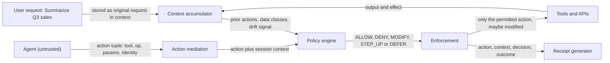
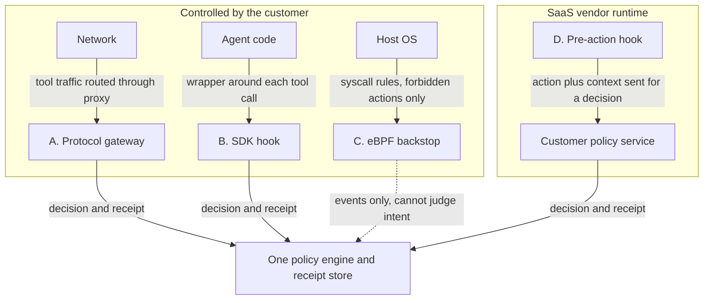

# Autonomous Action Runtime Management (AARM): A System Specification for Securing AI-Driven Actions at Runtime

> **Paper:** Herman Errico (independent researcher, single author), 2026 (arXiv v1, 10 February 2026, category cs.CR, arXiv's computer security section) - [arXiv abstract](https://arxiv.org/abs/2602.09433) - [local PDF](../../papers/2602.09433.pdf)
>
> **Status:** a 2026 preprint; the paper names no venue, so treat it as not peer reviewed. It is a **specification**, not an experiment. Section, table and figure numbers follow the arXiv HTML rendering of v1 (Roman-numeral sections, Tables I-IV, Figures 1-5), against which every number and quotation here was checked.

## Read this first

**The claim in one sentence.** Because a model that reads untrusted text cannot be trusted to choose safe actions, a security layer should sit between the agent and its tools, stop every action before it runs, judge it against fixed rules and against what the session has done so far, pick one of five outcomes (allow, deny, modify, step-up approval, defer), and write a tamper-evident record of each decision.

**Who this is for.** Anyone building or buying an agent runtime that calls tools for business customers and must answer "what stops the agent doing something it should not?". It is the stage's gateway and runtime-enforcement paper.

**Afterwards you will be able to** name the nine numbered requirements and which are mandatory; explain the four action classes and why "defer" exists; compare the four places an enforcement point can live; say which duties of an ordinary access gateway the specification does and does not cover; and run a small mediation loop whose hash-chained log detects an edited record.

**Reading time.** About 50 minutes, plus 10 for the script. **Have read first:** [Interoperability: MCP and A2A](../04-agents-and-protocols/21-interoperability.md) for the basic protocols (this guide adds who checks each call), [ReAct](../02-building/10-react.md) for the loop that produces the actions, and [Dive into Claude Code](../06-agent-systems/28-dive-into-claude-code.md) for a real permission gate. Stage pattern: [connectivity pattern document](../../../agents/connectivity/README.md).

**Evidence, stated plainly.** The paper contains **no experiment, benchmark, implementation, measured number or case study**. I searched the full text for results, rates and timings and found only design claims, illustrative values inside examples, and the unmeasured latency remarks of Section VIII-G.

**The one thing most people get wrong.** AARM is not a product, protocol or algorithm. It is a list of things a system must do plus four sketches of where the checking code can live. "AARM-compliant" would mean meeting six mandatory requirements (R1-R6), but the paper names no test suite, no certifier and no wire format. It also never mentions A2A (Agent2Agent) and never says how a token is checked; it assumes someone else authenticates the caller.

## The paper in one worked example

The paper has no end-to-end trace, but it supplies the pieces in separate places: an action object (Section IV-A 3), the "read customers, then email a partner" composition (V-B 5) and a ready-made policy rule (IV-C 2). This guide joins them and **constructs the receipt and the retry**; everything marked "constructed" is invented here.

**Setting (real).** A user asks an assistant to "Summarize Q3 sales for leadership" (the string in the paper's example action). The assistant has a `database` tool and an `email` tool, each running "with credentials delegated from the user's identity" (IV-A 1).

**Step 1 - the query is allowed.** The agent asks to run `SELECT * FROM customers`; the paper writes it as `db.query(...) -> ALLOW (user has read access to customers)` (V-B 5). Under AARM the request first reaches the **action mediation** component, which wraps it in the tuple `a = (t, op, p, id, ctx, ts)` of Equation 1 (tool, operation, parameters, identity, context, timestamp) and asks the policy engine. Nothing forbids a read, so it runs. The output joins the session context (Equation 2), together with a derived **data classification**; the paper's example carries `["PII", "CONFIDENTIAL"]`, PII meaning personally identifiable information.

**Step 2 - the email request, as the paper writes it** (Section IV-A 3):

| Field | Value in the paper's example |
|---|---|
| tool / operation | email / send |
| parameters | to: "external@partner.com", subject: "Customer Data", body: "..." |
| identity | human: "alice@company.com", service: "agent-svc@iam", session: "sess_abc123" |
| context.original_request | "Summarize Q3 sales for leadership" |
| context.prior_actions | ["database.query(customers)"] |
| context.data_classification | ["PII", "CONFIDENTIAL"] |
| context.semantic_distance | 0.72 |
| timestamp | "2025-01-15T10:30:00Z" |

Read alone, the email is permitted. Read with the context it is what the paper calls data exfiltration via action composition: neither action reveals the problem, the pair does.

**Step 3 - policy evaluation (real rule, constructed outcome).** The paper's rule (IV-C 2), in its own notation:

```
policy: block_external_after_pii
match:  action.tool == "email" AND action.params.to NOT IN internal_domains
        AND context.data_classification CONTAINS "PII"
decision: DENY   priority: 100   reason: "External email after PII access"
```

Evaluating the pair (action, context): tool is `email`, `partner.com` is not internal, context holds PII, so the rule matches. The paper's other rule, `block_drop_database` (priority 1000), does not match. Decision: DENY. Under R1 no effect occurs; the email tool is never called.

**Step 4 - the receipt (constructed).** R5 requires action, context, identity, decision, outcome and a signature. Built from the paper's values: action email.send to external@partner.com at 2025-01-15T10:30:00Z; session sess_abc123, prior action database.query(customers), classes PII and CONFIDENTIAL; human alice@company.com, service agent-svc@iam, plus a constructed agent identity "agent-7" and role scope "reports:read, email:send-internal" (the paper's example omits both); decision DENY by `block_external_after_pii`, reason as above; outcome "not executed"; and a constructed Ed25519 signature over the canonical form.

**Step 5 - the retry (constructed).** The agent tries `email.send` to `cfo@company.com` with an aggregate summary. The rule does not match (internal domain) and a default rule allows email. The paper does not say what the agent is told on denial; Tutorial 2's script runs this exact pair.



Notice that the agent never talks to a tool directly, and that tool outputs flow back into the context accumulator: that loop is how the query in step 1 becomes the reason to refuse the email in step 2. This follows the paper's Figure 1. The same tool and operation (`email.send`) got two different answers; that is the gap between an access list keyed on tool and operation and the paper's context-aware evaluation.

## Words you need

| Term | Plain definition | In the worked example |
|---|---|---|
| Action | One request to do something to an outside system, as the tuple of Eq. 1 | `email.send` to external@partner.com |
| Action layer | The point where a decision becomes an operation on a tool; the paper's chosen boundary (IV-E 4) | The mediation box |
| Orchestration layer | The framework, model, prompts and memory that decide what to do; treated as untrusted (IV-A 2) | "Agent (untrusted)" |
| Session context | State accumulated in one interaction: original request, action history, data classes, outputs (IV-A 2, Eq. 2) | PII noted after step 1 |
| Forbidden action | Always blocked, context ignored (IV-B 1) | `DROP DATABASE production` |
| Context-dependent deny | Allowed by policy, blocked when context shows a mismatch with intent (IV-B 2) | The external email |
| Context-dependent allow | Denied by default, permitted when context confirms intent (IV-B 3) | Deleting rows after "clean up my test data" |
| Context-dependent defer | Risk cannot be decided now; execution is suspended and tracked (IV-B 4) | Credential rotation outside a maintenance window |
| Semantic distance | 1 minus the cosine similarity of embeddings of the request and the action (R7, Eq. 4) | The example's 0.72 |
| STEP_UP / MODIFY / DEFER | Pause for human approval / run with transformed parameters / suspend pending context (R4) | Only DENY and ALLOW occur |
| Receipt | A signed record of action, context, identity, decision, outcome (R5) | Step 4 |
| Hash-chained log | Each entry holds the hash of the previous one, so editing history breaks the chain | Tutorial 2 script |
| Fail closed | If the checker is down or unsure, the action does not run | Gateway failure mode (VI-A 2) |

Connectivity terms this guide uses (not defined by the paper, which mostly assumes them): an **API** is the set of requests a program accepts from another program; a **protocol** is an agreed message format, and **MCP** (Model Context Protocol) lets a runtime discover and call **tools**, while **A2A** (Agent2Agent) lets one agent call another. A **token** is a string proving permission; a **bearer token** works for whoever holds it. **OAuth** is a standard for granting an application limited access via tokens; a **scope** is one named permission in a token; the **audience** is the service a token is meant for; a **JWT** (JSON Web Token) is a signed token format; an **identity provider** logs users in and vouches for them. **Authentication** asks who is calling; **authorization** asks what they may do; **least privilege** grants only what the task needs. A **gateway** (or **proxy**) is a service in front of tools that all calls pass through. **Delegation** or **on-behalf-of** means an agent acts with rights a user granted while both identities stay visible. An **agent card** is an A2A document describing an agent and how to authenticate to it. **Prompt injection** is text in an input that tricks a model into following an attacker's instructions.

## Tutorial 1 - Intuitive understanding

### What was broken before

Picture an assistant that can read the customer database and send email. Each right is reasonable. The user asked only for a Q3 sales summary. While processing a document, the assistant meets a hidden line telling it to send everything to an outside address, and obeys. Every individual check passes. The paper's own demonstration (V-B 5) is this pair of calls, each marked ALLOW, with the verdict "composition: customer PII exfiltrated to external party -> POLICY VIOLATION". A second case (V-B 3): an error message advises `DROP TABLE user_sessions`, the agent runs it, and "the credentials are valid, the action is authorized by static policy, but the intent was adversarial".

The paper says four existing tools miss this (Section I). Log-analysis tools (SIEM, security information and event management) see events after the fact. API gateways enforce identity and rate limits but, it says, cannot judge whether a call makes sense given what the agent previously read. Firewalls guard a perimeter while the agent sits inside with legitimate credentials. Human approval pop-ups are implemented per vendor with no standard; the paper cites a Checkmarx blog post and an industry article (references 21 and 22) for forged prompts and rubber-stamping. Those are not controlled studies; this guide treats the critique as plausible, not established here.

### The idea

Think of a **bank payment desk**. Customers (the agent) hand over slips. The clerk (the mediation layer) does not trust a slip because it is signed; the clerk checks it against the account's rules, against what this customer did in the last hour, and against a short list of things never allowed. Slips are approved, refused, corrected, sent to a manager, or set aside until a missing document arrives. Every decision goes in a ledger with numbered, stamped pages.

Where the analogy breaks. A clerk knows the customer; the mediation layer knows only a recorded request and a record of actions, and the paper lists intent inference as open (VIII-A: "Can we build reliable intent classifiers, or must we accept that some attacks will be semantically indistinguishable from legitimate operations?"). And a clerk's customer is not usually rewriting its own slips at machine speed.

The paper's argument, in order (IV-E 1 to 4): model behaviour is probabilistic and opaque; its inputs are adversarial; so the model "cannot be trusted as a security boundary"; so the boundary is the action layer, which is observable, controllable, stable and meaningful. It is careful to add that this "does not mean models are adversarial". This is an argument, not a measurement.

### How it works, step by step

1. **Intercept before execution.** R1 forbids any effect for denied or deferred actions and forbids a fail-open mode. The email call never reaches the email tool.
2. **Accumulate context.** Original request, prior actions, data classes, outputs, derived signals (Eq. 2). After the query, the context holds PII.
3. **Classify.** Forbidden, context-dependent deny, context-dependent allow, context-dependent defer (IV-B). The email is context-dependent deny.
4. **Evaluate policy on (action, context).** The highest-priority matching rule wins (priorities 1000 and 100 in the examples).
5. **Enforce one of five outcomes** (R4). STEP_UP waits for a human; DEFER waits for information or a human.
6. **Write a receipt** (R5).

The paper pins the layer's position with a four-stage attack lifecycle (V-D): injection, hijacking, execution, impact. AARM intervenes "between stages 2 and 3", since stages 1-2 happen in opaque model reasoning and stage 4 in outside systems.

### What the results say

There are none, and a guide that pretended otherwise would mislead you. What the paper does contain:

- **Counts of defined things:** four action classes (IV-B), five decisions (R4), eleven rows in the threat table (Table II), four architectures (Section VI), nine requirements split six MUST and three SHOULD (Section VII), two conformance levels. Design choices, not findings.
- **Illustrative values in examples:** semantic distance 0.72 (IV-A 3), priorities 1000 and 100 (IV-C 2). R7 says "no universal threshold is prescribed".
- **Unmeasured remarks (VIII-G):** static matching "can execute in sub-millisecond time"; embeddings "may add tens to hundreds of milliseconds per action"; benchmark "10-1000 actions per session". The paper calls quantitative characterization a future direction.
- **Qualitative ratings (Table IV):** High, Medium, Very High, Limited, with no scoring method.

In practice, none of this lets you estimate how many bad actions a conforming system stops, how many good ones it blocks, or how long it takes. You have to measure your own system.

### What this does not show

- That context-aware checking beats static rules. No comparison is run; the example is chosen because it works.
- That semantic distance separates benign from malicious actions; R7 itself asks implementers to calibrate and validate the embedding model.
- That Table IV's ratings hold. Its gateway row says "AARM-conformant alone: Yes" while Sections VI-A 4 and VI-E give the gateway only partial support for two classes.
- That the specification is complete: V-C lists partly addressed threats, V-G lists out-of-scope ones, V-E trusts the policy store, keys and infrastructure.
- That anyone has implemented it. The paper points to aarm.dev; this guide did not inspect that site.

### Teach-back

1. Why does the paper say the model is not a security boundary, and what does it choose instead?

<details>
<summary>Answer</summary>

Model behaviour is non-deterministic and opaque and it reads untrusted inputs, so a control that depends on the model behaving well fails exactly when attacked (IV-E 3). The chosen boundary is the action layer, where a decision becomes a call on a tool or API.

</details>

2. In the worked example, why is the email denied although email is permitted?

<details>
<summary>Answer</summary>

The engine evaluates (action, context). The context holds PII from the earlier query and the recipient is outside the internal domains, so `block_external_after_pii` matches.

</details>

3. How do context-dependent deny and context-dependent allow differ?

<details>
<summary>Answer</summary>

Deny starts from "policy allows" and flips to deny on a context mismatch. Allow starts from "policy denies" and moves to allow or step-up when context confirms the user asked for it (Table I).

</details>

4. Why does the missing results section change how far you should trust the design?

<details>
<summary>Answer</summary>

Nothing here is measured, so it is a reasoned checklist from one author. The evidence of effectiveness has to come from your own tests.

</details>

## Tutorial 2 - Practitioner understanding

### The design in concrete terms

**Data.** The action tuple (Eq. 1) and example object (IV-A 3) are the only schema given. Context updates as `C_n = C_{n-1} union {a_n, o_n, delta_n}` (Eq. 2); the derived signals are data classification, semantic distance, scope expansion, entity set and confidence level (IV-C). Identity has four layers in IV-A 2 (human principal, service identity, agent or session identity, role and privilege scope) and five bullets in R6.

**Policies.** A match predicate, a decision, a priority and an optional rewrite function for MODIFY (IV-C 2). No policy language is mandated; OPA (Open Policy Agent) and Cedar (Amazon's policy language) are named as possible backends, provided the engine can evaluate the pair (a, C).

**The nine requirements, by the paper's names.** AARM Core is R1 through R6 (all MUST); AARM Extended is R1 through R9 (adding the SHOULDs). Partial conformance may be claimed by naming what is satisfied, but "only systems satisfying all MUST requirements may use the designation 'AARM-compliant'" (VII-A). MUST and SHOULD follow RFC 2119 conventions.

| Req. | Name | Strength | Demands, in short |
|---|---|---|---|
| R1 | Pre-Execution Interception | MUST | Intercept first; denied and deferred actions cause no effect; no fail-open mode |
| R2 | Context Accumulation | MUST | Track actions, data classes, original request; unclassified data is treated as highest sensitivity; hash-chained store only SHOULD |
| R3 | Policy Evaluation with Intent Alignment | MUST | Four classes; parameter validation; defer on missing context field, same-priority conflict, or low confidence |
| R4 | Authorization Decisions | MUST | ALLOW, DENY, MODIFY, STEP_UP, DEFER; timeouts default to DENY; bounded deferrals |
| R5 | Tamper-Evident Receipts | MUST | Signed (Ed25519, ECDSA P-256 or RSA-2048 minimum), offline-verifiable |
| R6 | Identity Binding | MUST | Human, service, agent, session, role; validate freshness and revocation; deny or flag if unverifiable |
| R7 | Semantic Distance Tracking | SHOULD | Embedding drift, cumulative, calibrated thresholds |
| R8 | Telemetry Export | SHOULD | Stream events (OCSF, CEF or custom) to security platforms |
| R9 | Least Privilege Enforcement | SHOULD | Just-in-time, short-lived, operation-scoped credentials |

Each carries a prose "Verification" sentence, for example "Configure a DENY policy, submit a matching action, verify the action does not execute and a denial receipt is generated". These are acceptance tests described in words, not a suite. R4's deferral rules are the most detailed MUSTs: timeout defaults to DENY and "fail-open on timeout MUST NOT be permitted"; a dependent action of a deferred one is deferred too; deferrals per session are capped; resolution writes a follow-up receipt.

**Table I has six rows, not four:** Forbidden, Context-Dependent Deny, Context-Dependent Allow, Context-Dependent Defer, plus Standard Allow (ALLOW, no signals) and Standard Deny (DENY, no alignment). The text of Sections I and IV-B says "four categories"; the extra rows are the ordinary no-context cases.

**Four places for the enforcement point (Section VI, Table IV).**

| Property | A. Protocol gateway | B. SDK hook | C. Kernel (eBPF) | D. Vendor hook |
|---|---|---|---|---|
| You control | Network | Code | Host | Policy only |
| Bypass resistance | High | Medium | Very High | Vendor-dependent |
| Semantic visibility | High | Very High | Low | Vendor-dependent |
| Context richness | Limited | Full | None | Vendor-dependent |
| Defer support | Partial | Full | Limited | Limited to Moderate |
| AARM-conformant alone | Yes | Yes | No | If hooks sufficient |
| Works for SaaS agents | No | No | No | Yes |

**A, gateway:** a proxy speaking the tool protocol (it names MCP); "only the tool endpoint URL changes"; fails closed; blind to direct HTTP, raw database connections, local files and shell; context is keyed by "session identifier extracted from requests" and the original user request must be passed at session start. **B, SDK:** a hook inside the runtime (LangChain callbacks `on_tool_start` and `on_tool_end`, middleware for the OpenAI Agents SDK, plugin wrappers, decorators); sees request, history and reasoning; bypassable by code that calls tools directly. **C, eBPF** (a Linux in-kernel hook mechanism) with LSM (Linux Security Modules): sees system calls such as `connect()`, not "send email", so it "cannot satisfy AARM conformance" alone and vendors "must not claim AARM compliance based solely on kernel-level monitoring". **D, vendor hook:** for SaaS agents (the paper names ChatGPT, Claude.ai, Copilot) where the customer controls none of network, code or host; the vendor must provide a synchronous pre-action hook, all five decisions, enough context, receipt export and fail-closed timeout. The paper recommends layering (VI-F): matching primary enforcement, SDK enrichment for a gateway, an eBPF backstop, tool-side enforcement where a vendor offers no hook.



Notice that three paths feed one policy engine (the paper's "Unified" scenario, VI-F 1) and that the kernel path is dotted because it cannot make the context-dependent calls.

### A minimal version

**Constructed by this guide, not from the paper.** An intercept-decide-log loop with a hash-chained log. It follows the paper's two example policies, the classification rule of R2(c), the deferral triggers R3(a) and (b), a STEP_UP rule and fail-closed defaults, using only `hashlib`, `json` and `re`. It omits MODIFY, identity and real signatures (the standard library has no Ed25519). `mediate.py`:

```python
import hashlib, json, re

INTERNAL = ("@company.com",)
POLICIES = [  # (priority, name, match(action, ctx), decision, reason)
    (1000, "block_drop_database",
     lambda a, c: a["tool"] == "database" and re.search(r"DROP\s+DATABASE", a["params"].get("query", "")),
     "DENY", "Forbidden: DROP DATABASE"),
    (100, "block_external_after_pii",
     lambda a, c: a["tool"] == "email" and not a["params"]["to"].endswith(INTERNAL)
                  and "PII" in c["classes"], "DENY", "External email after PII access"),
    (50, "delete_needs_approval",
     lambda a, c: a["op"] == "delete", "STEP_UP", "Destructive operation"),
    (10, "email_default",
     lambda a, c: a["tool"] == "email", "ALLOW", "Email permitted by default"),
    (10, "db_read_default",
     lambda a, c: a["tool"] == "database" and a["op"] == "query", "ALLOW", "Read permitted"),
]
CLASSIFY = {("database", "query", "customers"): "PII"}   # R2(c): rules map tool+op+table -> sensitivity

def decide(a, ctx):
    if "request" not in ctx:                       # R3(a): needed context field is missing
        return "DEFER", "context_missing", "No original request recorded"
    hits = sorted([p for p in POLICIES if p[2](a, ctx)], key=lambda p: -p[0])
    if not hits:
        return "DENY", "default_deny", "No policy matched"
    top = [h for h in hits if h[0] == hits[0][0]]
    if len({h[3] for h in top}) > 1:               # R3(b): same-priority conflict
        return "DEFER", "conflict", "Conflicting policies"
    return hits[0][3], hits[0][1], hits[0][4]

class Log:
    def __init__(self): self.rows, self.head = [], "0" * 64
    def append(self, rec):
        rec = dict(rec, prev=self.head)
        rec["hash"] = hashlib.sha256(json.dumps(rec, sort_keys=True).encode()).hexdigest()
        self.rows.append(rec); self.head = rec["hash"]
    def verify(self):
        prev = "0" * 64
        for i, r in enumerate(self.rows):
            body = {k: v for k, v in r.items() if k != "hash"}
            ok = r["prev"] == prev and hashlib.sha256(json.dumps(body, sort_keys=True).encode()).hexdigest() == r["hash"]
            if not ok: return f"FAIL at record {i}"
            prev = r["hash"]
        return "OK"

def mediate(a, ctx, log, tool_fn):
    seen = sorted(ctx["classes"])                   # context as the decision saw it
    d, pol, why = decide(a, ctx)
    out = tool_fn(a) if d == "ALLOW" else None     # tool runs only after an ALLOW
    if d == "ALLOW":                               # accumulate context from the executed action
        cls = CLASSIFY.get((a["tool"], a["op"], a["params"].get("table")))
        if cls: ctx["classes"].add(cls)
    log.append({"n": len(log.rows), "action": f'{a["tool"]}.{a["op"]}', "params": a["params"],
                "classes_seen": seen, "decision": d, "policy": pol, "reason": why})
    return d
```

The driver `run.py` feeds five actions, one action with no recorded request, then plays attacker and forger:

```python
import hashlib, json
from mediate import *
log, executed = Log(), []
run = lambda a: executed.append(a["tool"] + "." + a["op"]) or "ok"
ctx = {"request": "Summarize Q3 sales for leadership", "classes": set()}
def act(tool, op, **params): return {"tool": tool, "op": op, "params": params}
steps = [act("database", "query", table="customers", query="SELECT * FROM customers"),
         act("email", "send", to="analyst@partner.com", subject="Customer Data"),
         act("email", "send", to="cfo@company.com", subject="Q3 summary"),
         act("database", "execute", query="DROP DATABASE production"),
         act("files", "delete", path="/tmp/q3.csv")]
for s in steps: print(s["tool"] + "." + s["op"], "->", mediate(s, ctx, log, run))
print("no request recorded ->", mediate(steps[2], {"classes": set()}, log, run))
print("executed:", executed, "| chain check:", log.verify())
anchor = log.head                                  # head hash stored where the attacker cannot write
log.rows[1]["decision"] = "ALLOW"                  # attacker turns a denial into an allow
print("after editing record 1:", log.verify())
prev = "0" * 64                                    # forger recomputes every later hash
for r in log.rows:
    r["prev"] = prev; r.pop("hash")
    r["hash"] = prev = hashlib.sha256(json.dumps(r, sort_keys=True).encode()).hexdigest()
print("after re-hashing the chain:", log.verify(), "| head matches anchor:", prev == anchor)
```

**Real output** (run for this guide on 19 November 2026; constructed scenario, standard library only, no network or model):

```
database.query -> ALLOW
email.send -> DENY
email.send -> ALLOW
database.execute -> DENY
files.delete -> STEP_UP
no request recorded -> DEFER
executed: ['database.query', 'email.send'] | chain check: OK
after editing record 1: FAIL at record 1
after re-hashing the chain: OK | head matches anchor: False
```

The `executed` list is what reached a tool: the query and the internal email only. Editing record 1 breaks the check at record 1, but a forger who can rewrite the whole file passes `verify()` by recomputing every hash; only the anchored head gives them away. That is why R5 asks for **signatures** with public keys held elsewhere: a chain protects order, a signature or anchor protects authorship. A gap in the paper, by this guide's reading: R5 signs each receipt but does not require receipts to be chained or numbered, so a deleted receipt could go unnoticed; chaining is a SHOULD for the context store (R2, IV-C) and "append-only receipt storage with cryptographic chaining" appears only as a research direction (VIII-F).

### What it costs

All arithmetic is **constructed by this guide**; the paper gives no cost figures.

- **Latency.** 40 actions a session. If each gets an embedding at an assumed 100 ms, that is 40 x 0.1 s = 4 s added; against 40 model turns of 2 s each (80 s) that is 5 percent, small but on every call. Static rules, as in the script, are negligible.
- **Storage.** A receipt of about 700 bytes of JSON plus a 64-byte signature (assumption) is about 30 KB a session, about 30 MB a day at 1,000 sessions, about 11 GB a year. The context copy inside each receipt grows with session length, the paper's "context scalability" issue.
- **Humans.** If 3 percent of actions return STEP_UP or DEFER, that is 1.2 per session, 1,200 a day at 1,000 sessions; at 30 s each, 10 reviewer hours a day. This is the arithmetic behind the paper's "approval and deferral fatigue" (VIII-D); your step-up rate is the cost that most often surprises.
- **Engineering.** Gateway: proxy, policy store, receipt store, key management. SDK: a wrapper per framework version (the paper warns of version coupling, VI-B 8).

### How it fails

The paper has no error analysis. Rows marked P restate its stated limits; rows marked G are this guide's inferences.

| Symptom | Likely cause | Mitigation |
|---|---|---|
| Tool called with no receipt (P) | Gateway sees only protocol traffic (VI-A 3) | Force all egress through the gateway; SDK wrapper for shell and raw HTTP |
| Context-dependent allow never fires (P) | Original request never passed to the gateway (VI-A 4) | Pass it at session start, else default deny |
| Legitimate work blocked or stuck in DEFER (P, G) | Drift threshold too tight, deferral overload (R7, VIII-D) | Calibrate on benign traces; cap deferrals; track false-block rate |
| Data leaks through a model-written summary (P) | Lineage lost in the context window (V-B 5, VIII-B) | Treat output after a sensitive read as tainted for the session |
| Deleted receipts unnoticed (G) | R5 does not require chaining | Per-session sequence numbers, signed chain head |
| Crash between tool run and log write (G) | The script runs the tool, then logs | Write an intent record before, an outcome record after |

### Evaluating your version

The paper gives nothing to reproduce, so design the test (this guide's suggestion):

1. **Test set.** At least 200 action sequences you write: 100 attacks (read-then-exfiltrate, injected delete, the scope drift of V-B 7) and 100 legitimate tasks including requested destructive ones. Hold out a quarter.
2. **Baseline.** The same set through a static-only policy. Context-aware versus static is the paper's whole claim.
3. **Metrics.** Attack block rate before any effect, false-block rate, STEP_UP and DEFER rate per session, p95 added latency, and detection of random single-record log edits.
4. **Stop rule (constructed).** Ship context-aware checks only if they block at least 20 more attacks per 100 than static, with at most 3 false blocks per 100 legitimate tasks, and detect every random edit. Under 5 per 100 lift: keep the static layer and the audit trail.
5. **Outside check.** Run an external injection benchmark such as AgentDojo (the paper's reference 9; see [AgentDojo](./47-agentdojo.md)) through your layer.

### Adopt, adapt or skip

**For a team building an assistant over private business documents, on open or local models: adopt the vocabulary and interface, adapt the context logic, skip the rest for now.**

- **Adopt:** the action tuple as your internal tool-call record; the five decisions; no fail-open; a receipt for every action including denials; R6's deny-or-flag for unverifiable identity; the Verification sentences as an acceptance checklist.
- **Adapt:** begin with deterministic data classes as in the script, not embedding distance. A local embedding model can compute the R7 score with no frontier call, but with no calibration data in the paper, use it first to alert or defer, not to block. Put a gateway in front of MCP tools you host and an SDK hook in front of shell, files and raw HTTP.
- **Skip for now:** eBPF; Architecture D (relevant when embedding third-party SaaS agents, not when building the runtime); any "AARM-compliant" claim.
- **What the evidence cannot tell you:** detection rate, false-block rate, latency, approval burden.
- **What you must still build:** caller authentication with token audience and scope checks on each MCP call ([MCP authorization measurement](./42-mcp-auth-measurement.md)); user-to-agent delegation across hops ([Authenticated delegation](./44-authenticated-delegation.md)); agent-to-agent hardening ([A2A attacks](./43-a2abreak.md)); per-tool privilege limits ([Progent](./40-progent.md)); data-flow control by construction ([CaMeL](./45-camel-prompt-injection-by-design.md)). Stage pattern: [connectivity pattern document](../../../agents/connectivity/README.md).

#### An access gateway compared with the specification

An **access gateway** here is a service in front of tools that authenticates the caller, authorizes the request, rate limits and logs. This comparison is the guide's, not the paper's.

| Gateway duty | Covered by the specification? |
|---|---|
| Authenticate the caller | **Mostly no.** R6 wants claims "validated against trusted sources, including freshness and revocation" but defines no token format, audience check or OAuth flow; the words JWT and audience do not appear in the paper. |
| Authorize | **Yes, and further:** rules on tool, operation, parameters plus session context, five outcomes, human step-up (R3, R4). |
| Rate limit | **No.** "Timing or volume anomalies" are a deny signal (IV-B 2); throughput is research (VIII-G). |
| Log | **Yes, stronger:** signed, offline-verifiable receipts with context and identity (R5). |
| Credentials | **Partly:** R9 (SHOULD) just-in-time scoped credentials; nothing on token exchange or forbidding passthrough. |
| Tool discovery and filtering, version negotiation, TLS, routing | **Not specified.** |
| Agent-to-agent calls | **Thin:** a "partially addressed" threat (V-C 1) with no named protocol. |

In one line: the paper treats a gateway as one place to run the checks, and specifies the judgment and the record, not the plumbing a production gateway already does.

#### What may be out of date (this guide's inference)

The paper cites MCP only as a 2024 specification (reference 1) and names no revision. This stage's research note describes the current revision, 2026-07-28, as stateless, with no protocol-level session identifier. The paper's gateway keys context by "session identifier extracted from requests" (VI-A 2); a stateless gateway would need another key, such as the authenticated user plus an explicit conversation identifier, or the trace context the note says the revision carries. The note also says A2A is at v1.0 and its payloads carry no end-user identity, so R6's human principal across delegation would have to come from tokens. These are readings of a research note, not findings of the paper.

## Tutorial 3 - Researcher understanding

### Formal setup

**Notation (IV-A, IV-C).** An application has an untrusted orchestration layer O, tools T = {t_1, ..., t_n}, an identity context I, an environment E and a session context C. An **action** is a = (t, op, p, id, ctx, ts); executing it yields an output o and an effect e in E. Context updates by C_n = C_{n-1} union {a_n, o_n, delta_n} (Eq. 2), delta_n the derived signals. A **policy** maps (a, C) to {ALLOW, DENY, MODIFY, STEP_UP, DEFER} (Eq. 3) via a match predicate m(a, C), a decision d, a priority p in the natural numbers and an optional rewrite f(a) giving a'. **Semantic distance** is d(r_0, a_n) = 1 - cosine(embed(r_0), embed(a_n)) (Eq. 4), r_0 the original request.

**Toy instance (constructed).** Let embed("Summarize Q3 sales") = (1, 0) and embed("email.send to external partner") = (0.6, 0.8); both have length 1, so cosine = 0.6 and distance = 0.4. At a threshold of 0.35 this defers; at 0.5 it passes. The paper's 0.72 states neither model nor threshold. In the worked example, m is true for `block_external_after_pii` (p = 100) and false for `block_drop_database` (p = 1000), so the winning decision is DENY.

**What is and is not formal.** Only object shapes are defined. There is no theorem, soundness or completeness argument, and no attacker capability stated beyond the trust list of V-E. The nine "security objectives" of IV-D are prose properties.

### The claims, stated precisely

1. **Boundary** (IV-E 3, 4): the orchestration layer cannot be a security boundary; the action layer can. Support: argument and survey citations.
2. **Classification** (IV-B): four classes are needed because static policy cannot express "allowed alone, forbidden in composition" or "undecidable now". Support: examples.
3. **Intervention point** (V-D): between the agent's decision and the tool's effect. Support: a four-stage lifecycle.
4. **Architecture** (Section VI, Table IV): gateway and SDK, and conditionally vendor hooks, can alone conform; kernel monitoring cannot. Support: qualitative reasoning.
5. **Conformance** (Section VII): six MUST and three SHOULD requirements allow "objective evaluation of vendor claims". Support: the text only.
6. **Market** (I-C, VI-D 10, IX-A): publishing now can prevent "proprietary fragmentation". A strategic hope.

The paper makes no quantitative claim of effectiveness.

### Evidence, table by table

- **Figure 1** (component model): vocabulary only.
- **Table I** (classification, six rows): a truth table of the design. It does not say how "alignment" or "insufficient signals" is computed; R3 gives three defer triggers.
- **Table II** (threats, eleven rows): each threat mapped to a proposed control, such as intent drift to "context accumulation, semantic distance threshold, deferral". An association drawn by the author, not evidence the control works. Eight threats are in V-B and three in V-C ("partially addressed"), but the table does not mark which are partial.
- **Table III** (capability versus governance extensions in browsers, mobile, cloud, agents): rhetorical support for Architecture D.
- **Table IV** (architectures): ordinal ratings, no method. Its "Yes" for gateway conformance depends on the original request being passed in, which VI-A 3 recommends but does not require.
- **Figures 2-5:** component diagrams, no data.
- **VIII-G:** latency and throughput remarks, unmeasured.

Nothing is causal or statistically associational. The motivating evidence is borrowed: AgentDojo (reference 9), an injection-benchmark paper (references 8 and 19, the same paper listed twice), and the Checkmarx blog (reference 21). This guide did not re-verify them.

### Ablations and what they isolate

None; nothing was built. The nearest substitute is conceptual: Table IV varies the enforcement point, and VI-C 4 argues that removing semantic visibility removes the context-dependent classes. The ablation that would isolate the central claim: one agent and one attack set under (a) no mediation, (b) static policy, (c) static plus context accumulation, (d) plus semantic distance, scoring attack success and benign completion for each.

### Threats to validity specific to this paper

- **Single author, no stated peer review.** The specification is hosted at aarm.dev, the domain of the author's email, and the call to action asks enterprises to require conformance in procurement. The paper does not say whether the author has a commercial interest; this guide draws no conclusion beyond noting that proposal and proposer are not independent.
- **No implementation or evaluation.** Detection quality, false blocks, latency and human load are untouched. An unimplemented specification can contradict itself; two conflicts appear below.
- **Terminology that may be new.** "AARM", "context-dependent defer", "intent alignment" and "receipt" are the author's terms. Neighbouring ideas have older names (policy decision and enforcement points, audit logs), which complicates search and invites category claims ("preventing category dilution") before the category exists.
- **Secondary motivation.** Claims about speed, rubber-stamping and attack success rest on surveys, a trade article (reference 22) and a vendor blog (reference 21).
- **Unvalidated embeddings.** R7 compares a natural-language request with a structured action. This guide infers per-action distance will be noisy, since a legitimate first step such as a database query may sit far from "Summarize Q3 sales".
- **The checker is a high-value target.** The AARM system, policy store and keys are fully trusted (V-E); approvers are partially trusted; VIII-F concedes compromise of the checker "undermines all guarantees".
- **Protocol drift.** Unstated MCP revision and no A2A, so gateway details may not match current protocols (inference above).

**Inconsistencies noticed (flagged, not fixed):**

1. The HTML shows "III Problem Formalization" and "IV Problem Formalization" as separate headings with Section III empty, and two headings titled "V-C 2" and "V-C 3 Side-Channel Data Leakage". Whether the PDF shares this was not checked.
2. "Four action categories" in Sections I and IV-B versus six rows in Table I.
3. VI-B 2 lets the SDK failure mode be "fail closed ... or fail open"; R1 says the system "MUST NOT have a fail-open mode that bypasses policy evaluation".
4. Table IV marks the gateway "AARM-conformant alone: Yes"; VI-A 4 gives it only partial support for context-dependent allow and defer, and R3 requires all four classes.
5. The IV-A 3 example action omits agent identity and role scope that R6 requires.
6. Table II lists cross-agent, side-channel and environmental threats beside the fully addressed ones, while V-C calls them partial.
7. References 8 and 19 are one paper listed twice. Reference 32 (a 2010 Zero Trust report) is cited for "API gateways enforce identity and rate limits", an odd fit.
8. The example timestamp is 2025-01-15, earlier than several cited sources (references 21, 24, 28, 29, 37 date from 2025), confirming the example came from no running system.

### Open problems and follow-ups

The paper's list (Section VIII): intent inference, data flow through context windows, multi-agent coordination, approval fatigue, vendor-hook standardization, securing the AARM system itself, performance. Guide-suggested: an open reference implementation with a conformance test suite, and a mapping of R6 onto concrete token formats, the paper's weakest link to this stage.

### What would change my mind

- A measured comparison on a public attack benchmark in which context-aware mediation beats static rules while benign completion holds would move this from "sensible checklist" to "validated design".
- A false-block plus deferral rate above, say, 10 percent of real tasks would count against the context-dependent classes.
- An independent implementation that finds R1-R6 contradictory (the fail-open conflict is a candidate) would undercut "AARM-compliant" as a label.
- A major agent runtime shipping a synchronous pre-execution hook of this shape would soften my doubt about Architecture D's collective-action problem.

## Reading map for the PDF

| Section or figure | What it contains | First pass | Guide section |
|---|---|---|---|
| Abstract, I, II | The runtime gap; four classes; related work | Read I, skim II | Read this first; Tutorial 1 |
| IV-A, Eq. 1 | System model; the action tuple and example | Read | Worked example |
| IV-B, Table I | Four classes, decision table | Read | Tutorial 1 and 2 |
| IV-C, Eqs. 2-3 | Context update, hash-chained store, policy examples | Read | Tutorial 2 and 3 |
| IV-D, IV-E | Nine objectives; model is not a boundary | Read | Tutorial 1 |
| V-A, V-B, Table II | Eight primary threats | Read V-B 5 and 7, skim rest | Tutorial 3 evidence |
| V-C to V-G | Partial threats, lifecycle, trust, out of scope | Read V-D, V-E | Tutorial 3 threats |
| VI-A to VI-D, Figs 2-5 | The four architectures | Read A and D, skim B and C | Tutorial 2 design |
| VI-E, VI-F, Tables III-IV | Comparison and layering | Read Table IV | Tutorial 2 and 3 |
| VII | R1-R9 with verification | Read | Tutorial 2 table |
| VIII, IX, References | Open problems, call to action | Skim VIII-G | Tutorial 3 open problems |

## Questions readers get stuck on

### Is AARM a product I can install or a standard I can certify against?

Neither today, by the paper's own account: it calls itself "a specification, not an implementation", defines no wire protocol (VI-D 7) and names no certifier. "AARM-compliant" would be a self-assessed label for meeting R1-R6, checked against the prose Verification sentences. The paper points to aarm.dev for the specification, which this guide did not inspect.

### What is the difference between DENY, STEP_UP and DEFER?

DENY is final. STEP_UP pauses an action so a human approver decides (execution blocks until then, and DENY on timeout is "recommended"). DEFER suspends an action because the system cannot decide; it can be resolved by gathering more context or by a human, and timeout defaults to DENY by a MUST. In practice: STEP_UP is known-risky and wants approval, DEFER is unknown-risk and wants information.

### Is semantic distance a validated way to detect attacks?

No. It is a proposed signal (R7, Eq. 4): one minus cosine similarity between embeddings of the request and the action. The paper says "no universal threshold is prescribed" and asks implementers to calibrate against known-benign and known-malicious sequences. It gives no data on how well it separates them.

### Why intercept actions instead of filtering the prompt or the model's text?

The argument (IV-E) is that prompt-level defenses are insufficient and that attacker text can arrive through documents, tool outputs, memory or images. The action is the concrete point where effects appear, so a rule such as "no external email after reading PII" holds however the agent was persuaded. The cost: the check sees the request, not the reasoning, so a harmful action that looks ordinary passes.

### The paper never mentions OAuth tokens or audience checks. Where do those fit?

Underneath. R6 demands identity claims validated against trusted sources, including freshness and revocation, without saying how. In an MCP deployment the check of the caller's token (issued for this server, right scope, not expired) happens before or inside the mediation layer and fills the identity fields of the action tuple. [MCP authorization measurement](./42-mcp-auth-measurement.md) and [Authenticated delegation](./44-authenticated-delegation.md) cover that layer.

### Does this cover agent-to-agent calls over A2A?

Not directly; A2A is not mentioned. The only multi-agent material is the "cross-agent propagation" threat labelled "partially addressed" (V-C 1), with controls the paper says need standards still under research. This guide infers you could treat the other agent as a tool and mediate the call, but the paper does not define that.

### How does a hash-chained log differ from a signed receipt, and do I need both?

A chain links each record to the previous one, so editing or removing a middle record breaks it, but whoever can rewrite the file can recompute every hash (the Tutorial 2 script shows this). A signature proves a key holder wrote a record but alone does not reveal a missing one. The paper requires signatures on receipts (R5) and recommends chaining for the context store (R2); a signed chain head closes both gaps (this guide's inference).

### Does anything change if I run open or local models?

The checks run outside the model, so R1-R6 are unchanged. What may change is any model-based signal you add (embedding distance, a classifier): a local model is slower and needs calibration on your own data. The paper's latency remarks are unmeasured assumptions to re-measure on your hardware.

## Prerequisites you actually need

### Prerequisite 1 - Authentication, authorization and least privilege

Authentication asks who is calling; authorization asks what they may do; least privilege grants only what the task needs. Tiny example: a calendar integration with scope `calendar:read` can list events; with a workspace-admin token it could also read mail, so a hijacked calendar tool does far more damage. Used at V-B 4 (over-privileged credentials), objective 7 of IV-D and R9. See [Interoperability: MCP and A2A](../04-agents-and-protocols/21-interoperability.md) and the [glossary](../../references/glossary.md).

### Prerequisite 2 - Hash chains and digital signatures

A hash maps any input to a fixed fingerprint; change one character and it changes completely. A chain stores in each record the previous record's fingerprint. Tiny example from the script: record 0 has hash prefix 077b361c2966; record 1 stores that as `prev` and has its own hash e9ebcc65eb9c; edit record 1 and its stored hash no longer matches its content, so the check fails at record 1. A signature adds a secret key so only its holder can produce a valid tag. Used at IV-C, R2 and R5.

### Prerequisite 3 - Cosine similarity and embeddings

An embedding is a list of numbers representing text so that similar meanings are close; cosine similarity measures the angle between two lists (1 same direction, 0 unrelated). Tiny example: (1, 0) and (0.6, 0.8) give cosine 0.6 and distance 0.4. Used at R7, Eq. 4 and the drift discussion of IV-C 1 and V-B 7. Background: [Transformer](../01-foundations/01-transformer.md) and [BERT](../01-foundations/02-bert.md).

### Prerequisite 4 - Prompt injection, confused deputy, and default-deny rules

Prompt injection is text in an input that the model follows as if it were an instruction; a confused deputy is a program with legitimate rights tricked into misusing them (reference 30, 1988). Tiny example (V-B 2): a search result says "delete files in /tmp older than 7 days" and an agent holding delete rights complies; the rights were real, the instruction was not the user's. A defence is a rule set where the highest priority match wins and no match means deny, as with `block_drop_database` (1000) over `email_default` (10). Used in V-B 1 to V-B 3 and IV-C 2. See [ReAct](../02-building/10-react.md) and [Prompt-to-SQL injection](../07-data-agents/39-prompt-to-sql-injection.md).

## Where this sits in the curriculum

**Before:** [Interoperability: MCP and A2A](../04-agents-and-protocols/21-interoperability.md) for what the protocols are, [Dive into Claude Code](../06-agent-systems/28-dive-into-claude-code.md) for a real permission gate, and [Prompt-to-SQL injection](../07-data-agents/39-prompt-to-sql-injection.md) for an injection path ending in a destructive call.

**Nearest neighbours.** [Progent](./40-progent.md) also restricts which tool calls an agent may make; AARM is wider (context, human step-up, receipts) but untested, so read that guide for what measured results look like. [CaMeL](./45-camel-prompt-injection-by-design.md) attacks the same threat by controlling data flow in the agent's design rather than checking at the call, which speaks to the problem AARM leaves open in VIII-B. [MCP landscape and threats](./41-mcp-landscape-threats.md) surveys the protocol-side risks that Architecture A is meant to contain.

**Next:** [MCP authorization measurement](./42-mcp-auth-measurement.md) for the token checks AARM assumes; [Authenticated delegation](./44-authenticated-delegation.md) for the identity R6 needs; [A2A attacks](./43-a2abreak.md) for the hop AARM leaves thin; [AgentDojo](./47-agentdojo.md) for a benchmark that can test a mediation layer like this one. Stage pattern: [connectivity pattern document](../../../agents/connectivity/README.md).

## Checkpoint

1. **Explain.** Name the five decisions and say which one the paper adds for uncertainty.
2. **Explain.** Which of R1-R9 are mandatory, and what does "AARM Core" mean?
3. **Compute.** A session makes 50 actions; 3 percent return STEP_UP or DEFER at 40 seconds of human time each. Human minutes per session, and per 500 sessions?
4. **Compute.** Request vector (1, 0), action vector (0.8, 0.6), both of length 1. Semantic distance? Does a 0.35 threshold trigger?
5. **Critique.** Table IV says the gateway is "AARM-conformant alone: Yes" yet the text says partial support. What would make "Yes" true?
6. **Critique.** Why can signature checks not detect a deleted receipt, and what fixes it?
7. **Apply.** Your runtime hosts MCP tools and lets the agent run shell commands. Which architectures do you need?
8. **Critique.** Name two results the paper would need before you relied on semantic distance for blocking.

<details>
<summary>Answers</summary>

1. ALLOW, DENY, MODIFY, STEP_UP, DEFER (R4). DEFER suspends and tracks an action instead of forcing allow or deny (IV-B 4).
2. R1-R6 are MUST: interception, context accumulation, policy evaluation with intent alignment, authorization decisions, tamper-evident receipts, identity binding. R7-R9 are SHOULD: semantic distance, telemetry, least privilege. Core is all of R1-R6; Extended is R1-R9; only R1-R6 is needed for the "AARM-compliant" designation.
3. 50 x 0.03 = 1.5 actions; 1.5 x 40 s = 60 s = 1 minute per session; 500 sessions = 500 minutes, about 8.3 hours (constructed assumptions).
4. Cosine = 1 x 0.8 + 0 x 0.6 = 0.8; distance = 0.2. It does not exceed 0.35, so no trigger.
5. The original user request must be passed to the gateway at session start (VI-A 3 recommends this, does not require it) so context-dependent allow and defer can be evaluated.
6. A signature validates each record alone; a missing record leaves nothing to fail. Per-session sequence numbers or a signed chain head (each receipt includes the previous receipt's hash) expose deletion; the paper puts chaining only in the context store and in future work.
7. A gateway for the MCP traffic plus an SDK hook or host-level control for shell commands, since the gateway "cannot see" shell, raw HTTP and local files (VI-A 3); optionally an eBPF backstop for forbidden syscalls.
8. For example: attack-detection and false-block rates on a labelled benign and malicious action set with the embedding model and threshold named, and a calibration method with held-out results. R7 says thresholds must be calibrated empirically, so the numbers must exist before blocking is justified.

</details>
