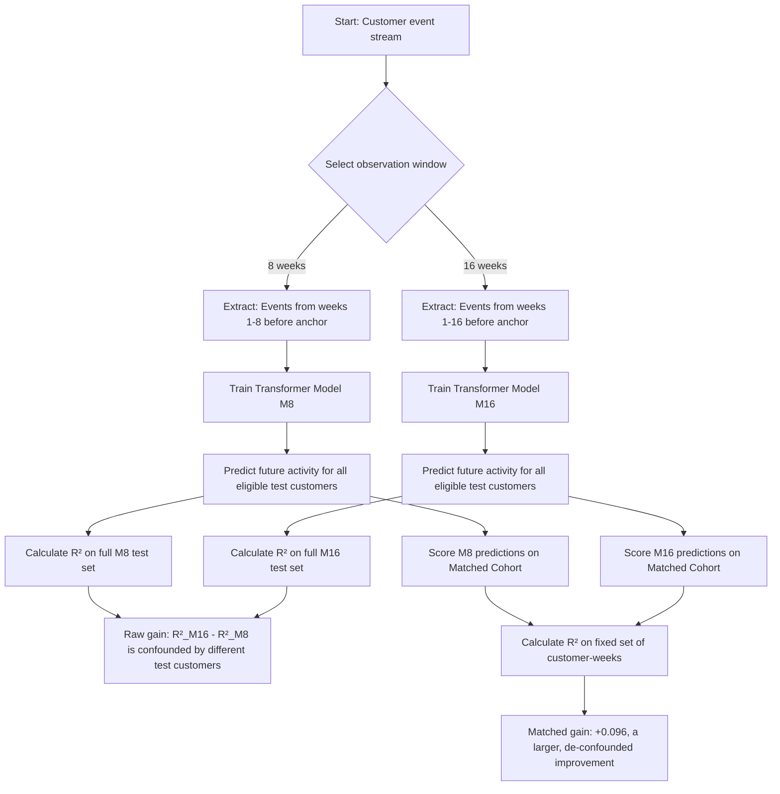
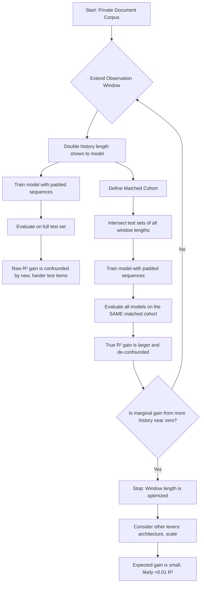

# The Window Lever: Longer Observation Windows Outweigh the Observed Effects of Data, Capacity, and Architecture in Customer Behavior Forecasting

> **Paper:** Tara Sowrirajan, Yanqiao Wang - [arXiv abstract](https://arxiv.org/abs/2611.26521) - [local PDF](../papers/2611.26521.pdf)
> **Friday - Small-business applications and human productivity** - published 2026-11-19 - selection score 8.8 (keyword relevance and recency; not a quality verdict)
>
> **DRAFT - written by an open model from the paper's extracted text.** Structure is machine-checked; numbers are NOT. Check every figure against the PDF before relying on it, and prefer rewriting this guide with the authoring spec if it matters.

## Read this first

The paper claims that, for forecasting customer behavior, giving a model a longer history of past events improves accuracy far more than giving it more training data, a larger model, or a different model architecture. This guide is for a practitioner or researcher who wants to understand the paper’s core mechanism and evidence without reading the original. After reading, you will be able to explain the paper’s central finding in one sentence, trace a concrete example of how the main lever works, and identify the key confound the authors could not resolve. Estimated reading time is 12 minutes. The one thing most people get wrong is assuming that a longer observation window simply gives the model more information; in this design, it also changes which calendar months the model sees and which customers are eligible to be scored, and the paper cannot fully separate these effects. Venue not stated in the extracted text.

## The paper in one worked example

This example traces the paper’s central intervention: doubling the observation window from 8 to 16 weeks for a transformer model, and measuring how the accuracy of its customer activity forecast changes. The task is to predict a customer’s total activity over the 364 days following a specific “anchor” week. The model sees M weeks of event history before that anchor. The primary metric is log-space R², which measures how much of the variance in the log-transformed future activity is explained by the model’s prediction. A higher R² means a better fit.

Consider the transformer model trained with the Huber objective at the 1M population tier. The paper reports that at an 8-week window, this model achieves a log-space R² of 0.4776 on the full test split (3-seed mean). When the window is doubled to 16 weeks, with all other settings held constant, the R² rises to 0.5508. The raw gain, as the paper reports, is “+0.070–0.107 log-space R² in every family at 1M.” For this specific transformer, the gain is +0.0732.

However, this raw comparison is misleading because a longer window changes who is eligible to be in the test set. Customers who were inactive in the 8 weeks before the anchor but active in the 16 weeks before it can now be scored. To fix this, the paper uses a “matched cohort.” This means they take the set of (customer, target week) pairs that are present in the test sets of *both* the 8-week and 16-week extracts. They then score the 8-week model and the 16-week model on this identical set of rows. On this matched cohort, the gain is even larger: “the matched ∆(M16−M8) is +0.096, against +0.075 on the full set.” This shows that the raw comparison actually understates the true improvement for a fixed population.

The mechanism behind this gain can be traced step-by-step for a single customer. Imagine a customer whose target week is 2025-03-24. The model must forecast their total activity from 2025-03-24 to 2026-03-23. With an 8-week window, the model sees the customer’s event history from roughly 2025-01-27 to 2025-03-23. With a 16-week window, it sees history from roughly 2025-12-02 to 2025-03-23. The model processes this sequence of events, applies a rotary positional encoding to track event order, and passes it through a 2-layer transformer. The output is a single predicted value for the log of 1 plus the future activity. The paper’s weekly-aggregate ridge probe, a simpler linear model, shows that each added week of history contributes a diminishing amount of new predictive power. The marginal gain of the 22nd to 24th week is only “+0.0001 R²,” indicating the curve has nearly saturated.


What to notice: The diagram shows that the raw comparison between windows is confounded by a change in the test set composition, while the matched cohort evaluation isolates the true effect of the longer history by scoring both models on the exact same customer-weeks.

The paper also investigates *where* the gain comes from by decomposing the weekly information curve by customer activity. For the most active 10% of customers, the benefit of more history saturates very quickly, with a “half-saturation point of 3.9 weeks.” In contrast, for the least active half of customers, the curve shows “no detectable bend within 16 weeks and is still climbing at the window edge.” This means the longer window is disproportionately helpful for predicting the future behavior of currently less active customers. The paper’s practical advice is therefore to allocate more feature weeks to less active customers, as they are the ones for whom a short window provides the least information.

## Words you need

| Term | Plain definition | Example from the worked example |
|---|---|---|---|
| Observation window | The number of weeks of past event history a model sees before the week it forecasts from. | Doubling from 8 to 16 weeks. |
| Log-space R² | A measure of how well the model's prediction explains the variance in the log-transformed future activity; higher is better. | The transformer at 8 weeks achieves 0.4776; at 16 weeks it reaches 0.5508. |
| Matched cohort | A fixed set of (customer, target week) pairs present in the test sets of every window being compared, so the same rows are scored for each window. | The matched ∆(M16−M8) is +0.096, against +0.075 on the full set. |
| Anchor week | The specific week a forecast is made from; the model predicts activity for the 364 days after this week. | The paper uses three anchor weeks: 2025-02-24, 2025-03-24, 2025-04-21. |
| Weekly-aggregate ridge probe | A simple linear model that uses only two summary features per past week (log activity total and event count) to predict future activity. | The probe shows the marginal gain of the 22nd to 24th week is only +0.0001 R². |
| Half-saturation point | The number of weeks at which a customer activity decile reaches half of its fitted asymptotic gain from longer history. | For the top activity decile, the half-saturation point is 3.9 weeks. |
| Rotary positional encoding (RoPE) | A method that encodes the order of events in a sequence by applying rotations to the model's internal representations, without adding extra position tokens. | The base transformer uses integer-position RoPE. |
| MS-RoPE | A multi-scale variant of RoPE that constrains the rotary frequencies to bands aligned with physical time (hours, days, weeks, years). | MS-RoPE gained 0.021 in log-space R² over the base RoPE implementation. |

## Tutorial 1 - Intuitive understanding

### What was broken before

Before this paper, a team building a model to forecast customer behavior would typically try to improve accuracy by gathering more training data, using a larger model, or switching to a newer, more sophisticated architecture. The paper reports that, in their experiments, these standard levers moved the accuracy metric by very little. For example, going from a training population tier labeled 1M to one labeled 10M changed the log-space R² of sequence models by at most 0.006 (the paper reports, Table 6). Doubling the model's width or depth moved the metric by at most 0.005 (the paper reports, §2.1). The paper reports that five different sequence architectures, including a transformer and an LSTM, all landed within a narrow band of about 0.005 of each other at a 16-week window (the paper reports, §2.7). A practitioner following conventional wisdom would invest effort in these directions and see almost no return, hitting what the paper calls a "ceiling at eight weeks" (the paper reports, §2.1).

### The idea

Think of a detective trying to predict what a person will do next year. The detective can look at a short diary of the person's last two months, or a longer diary covering the last four months. The paper's central idea is that simply reading the longer diary improves the prediction far more than giving the detective a bigger brain (a larger model), training them on many more people's diaries (more data), or changing their investigative method (a different architecture). The longer diary is especially helpful for understanding people who don't write in it very often. For a very active person who writes every day, a few weeks of entries already give a clear picture; the detective's understanding saturates quickly. For a quiet person who writes only occasionally, the extra months are crucial because the short diary might be nearly empty.

Where the analogy breaks: In the paper's setup, giving the detective a longer diary also changes *which months* the diary covers. Because all predictions are made from dates in February, March, or April, a 16-week diary reaches back into November and December (the holiday season), while an 8-week diary does not. The paper cannot fully separate the benefit of "more history" from the benefit of "seeing the holiday season." This guide infers that the detective might be getting better not just from more pages, but from seeing pages that cover a particularly informative time of year.

### How it works, step by step

This guide traces the steps using the worked example of a customer whose target week is 2025-03-24.

**Step 1: Define the prediction task.**
The goal is to forecast a customer's total activity over the 364 days following an anchor week. For the example customer, the model must predict activity from 2025-03-24 to 2026-03-23. The paper reports the target is transformed as log(1 + y) and the primary metric is log-space R² (§4.2).

**Step 2: Extract the event history.**
The model is given M weeks of the customer's event history ending just before the anchor week. With an 8-week window, the model sees events from roughly 2025-01-27 to 2025-03-23. With a 16-week window, it sees events from roughly 2024-12-02 to 2025-03-23. This guide infers that the 16-week window includes the end-of-year holiday period, which the 8-week window misses.

**Step 3: Process the sequence.**
The model takes the sequence of events, applies a rotary positional encoding to track the order of events, and passes it through a 2-layer transformer. The paper reports the transformer has a width of 128 and uses causal masking (§E.2). The output is a single number: the predicted value of log(1 + future activity).

**Step 4: Train the model.**
The model is trained to minimize a composite loss on a training set of customers. The paper reports the loss includes a term on the aggregate prediction and an auxiliary per-event term (§E.1). This guide infers the model learns to weigh recent and distant past events to best predict the future total.

**Step 5: Evaluate on the test set.**
The trained model's predictions are compared against the true future activity for a held-out set of customers. The paper reports that the raw R² on the full test split rises from 0.4776 at 8 weeks to 0.5508 at 16 weeks for the transformer with the Huber objective (Table 2).

**Step 6: Correct for the changing test set.**
A longer window admits customers who were inactive in the last 8 weeks but active in the last 16. To isolate the effect of more history, the paper scores both the 8-week and 16-week models on the exact same set of customer-weeks—the matched cohort. The paper reports the matched gain is +0.096, which is larger than the raw gain of +0.075 (§2.3). This guide infers that the raw comparison was actually understating the true benefit of a longer history for a fixed group of customers.

### What the results say

The paper reports the following key numerical results. Each is a change in log-space R², which measures the fraction of variance in the log of future activity that the model explains.

- **Window vs. architecture:** Doubling the observation window from 8 to 16 weeks adds +0.070 to +0.107 in log-space R² across every model family tested at the 1M population tier (the paper reports, §1). In contrast, the spread across five different sequence architectures at a 16-week window is at most 0.0052 (the paper reports, §2.7). This means the choice of window length is roughly 15 to 20 times more impactful than the choice of model architecture. This guide infers that a team should prioritize getting more history over picking a fancier model.

- **Window vs. scale:** Moving from the 1M to the 10M population tier changes the transformer's R² by at most 0.006 (the paper reports, Table 6). The window gain of +0.073 is over 12 times larger. This means training on ten times as many customers buys a tiny fraction of what doubling the history length buys. This guide infers that, in this regime, data volume is a much weaker lever than data history.

- **Matched cohort correction:** On the full test set, the 8-to-16-week gain for the transformer is +0.075. On the matched cohort, which scores both models on the identical set of customers, the gain is +0.096 (the paper reports, §2.3). The raw comparison understates the true gain by about 28%. This means that a longer window helps not just by scoring more people, but by giving a much better prediction for the same people.

- **Activity-dependent saturation:** For the most active 10% of customers, the benefit of more history saturates quickly, with a half-saturation point of 3.9 weeks (the paper reports, §2.6). For the least active half of customers, the curve shows no detectable bend within 16 weeks and is still climbing. This means that a short window is adequate for highly active customers, but it starves less active customers of the context they need. This guide infers that a system with a fixed short window is systematically failing on the customers who are hardest to predict.

### What this does not show

**Limits stated by the authors:**
- The paper states that window length and calendar coverage are not separated in the main experimental design. All test anchor weeks fall in an eight-week band (February to April), so lengthening the window always adds specific calendar months, including the holiday season. The paper reports that an anchor-varying control designed to separate these effects was void under its own pre-registered criterion (§6).
- The paper states that the observed effects of scale, capacity, and architecture are bounded but unresolved at the precision of the experiments. The three-seed detection floor of 0.0059 sits above the architecture band and within a factor of 1.2 of the scale and capacity bounds. The paper explicitly does not claim equivalence among settings on these axes (§6).
- The paper states that the primary evidence comes from one proprietary platform, one target horizon (364 days), and one export era. The external replication on a public dataset recovers the direction of the window gain but with absolute accuracy levels near zero (§2.12).

**Limits this guide infers:**
- The paper's recommendation to allocate more feature weeks to less active customers is bounded to the first 24 weeks. The paper reports that past 24 weeks, the pooled weekly probe is flat, and residual gains in every activity decile are small (§2.5). This guide infers that the allocation strategy does not justify storing unlimited history; about six months appears sufficient on the test calendar.
- The paper's transformer uses a fixed cap of 750 events per customer. This guide infers that for the most active customers, a longer window in calendar weeks may not add new events if the cap is already saturated, which would attenuate the measured benefit of longer windows for that group.

### Teach-back

**Question 1:** A colleague says, "We should switch from our LSTM to a transformer to get a big accuracy boost on our customer forecasting task." Based on this paper, what would you tell them?

<details><summary>Answer</summary>
The paper reports that at a 16-week window, five different sequence architectures (including a transformer and an LSTM) all land within about 0.005 of each other in log-space R² (§2.7). The paper also reports that doubling the observation window from 8 to 16 weeks adds +0.070 to +0.107. The architecture choice is an order of magnitude smaller than the window choice. You would tell your colleague that lengthening the observation window is likely to give a much larger gain than switching architectures.
</details>

**Question 2:** The paper reports a raw 8-to-16-week gain of +0.075 and a matched-cohort gain of +0.096. Why are these numbers different, and which one should you trust more?

<details><summary>Answer</summary>
The raw gain is computed on the full test set, where the 8-week and 16-week models are scored on different sets of customers. A 16-week window admits customers who were inactive in the last 8 weeks but active in the last 16. The matched-cohort gain scores both models on the exact same set of customer-weeks, removing the effect of this changing test population. The paper reports the matched gain is larger (+0.096 vs. +0.075), meaning the raw comparison understates the true benefit of more history for a fixed population (§2.3). You should trust the matched-cohort gain as the de-confounded measure of what a longer window does for the same customers.
</details>

**Question 3:** For which customers does a longer observation window help the most, and why?

<details><summary>Answer</summary>
The paper reports that a longer window helps the most for less active customers. The paper reports that for the top 10% most active customers, the half-saturation point is 3.9 weeks, meaning they get most of the benefit very quickly. For the least active half of customers, the curve shows no detectable bend within 16 weeks and is still climbing (§2.6). This guide infers that less active customers have very few events in a short window, so the model has almost no information to work with. A longer window gives the model enough history to detect their infrequent patterns.
</details>

**Question 4:** The paper says the window gain is confounded with calendar coverage. What does this mean in plain terms?

<details><summary>Answer</summary>
All test predictions in the paper are made from dates in February, March, or April. When you extend the observation window from 8 to 16 weeks, you are not just adding "more history" in general; you are specifically adding the months of November, December, and January, which include the holiday shopping season. The paper cannot tell whether the model improves because it has more weeks of data, or because it can now see what the customer did during the holidays. The paper reports that an experiment designed to separate these two explanations failed its own pre-registered validity check (§6).
</details>

**Question 5:** A manager asks, "How much history should we store for our model?" Based on the paper's saturation analysis, what is a data-driven answer?

<details><summary>Answer</summary>
The paper reports that a weekly-aggregate ridge probe saturates at 22 to 24 weeks on the test calendar, with the marginal gain of the 22nd to 24th week being only +0.0001 R² (§2.4). The paper also reports that a 32-week extension found the pooled probe was flat, with a gain of −0.0004 (§2.5). This suggests that about five to six months of history captures nearly all the predictive value available to this probe on this calendar. However, this guide infers that the saturation point may shift with the calendar, and the paper's result is not shown to persist on holiday-free anchors (§A). A team should run their own ridge probe on their own data to find the saturation point for their specific task and calendar.

## Tutorial 2 - Practitioner understanding
### The design in concrete terms
The core task is a regression: predict a single real number, the log of 1 plus a customer’s total activity over the next 364 days. The input is a sequence of events from the M weeks before a specific “anchor” week. The paper’s primary model is a 2-layer causal transformer with a hidden dimension of 128 and 4 attention heads (491,248 total parameters, the paper reports in Table 14). The training objective is a composite loss: 30% weight on an auxiliary per-event pinball loss and 70% weight on the main aggregate loss, which is swept among Huber (delta=1), Mean Squared Error (MSE), and pinball (tau=0.5). The paper reports (Table 13) that the model uses a fixed learning rate of 5e-4 with the AdamW optimizer, a batch size of 8192, and trains for 20 epochs.

The input to the model is a fixed-size tensor of the 750 most recent events, right-padded with zeros. Each event is represented by six categorical fields (which are constant in the main runs, the paper notes in §E.9), two numeric fields, and two time channels (day-of-week and week-index, which are identically zero). These are concatenated and projected to the model dimension of 128. Positional information is provided by Rotary Positional Encoding (RoPE) applied to the queries and keys within the causal attention layers. The output is a single scalar prediction, formed by a gated residual connection over a linear baseline prediction of the input-window activity total. The paper’s matched-cohort evaluation framework is a key design element: to compare models trained on different observation windows, predictions are scored only on the set of (customer, target week) pairs that exist in the test sets of *all* windows being compared. This fixes the test population and the R² denominator, isolating the effect of the longer history.

### A minimal version
This pseudocode sketches the core logic of the paper’s weekly-aggregate ridge probe, the linear model used to measure the saturation curve. It was not executed.

```python
import numpy as np
from sklearn.linear_model import RidgeCV
from sklearn.preprocessing import StandardScaler

# --- Simulated Input Shapes ---
# train_events: list of (customer_id, anchor_week, week_offset, activity_sum, event_count)
# test_events: same format, for the matched cohort
# target: array of shape (n_customers,) with log(1 + future_activity)

def build_weekly_features(events, max_weeks):
    """Aggregate events into per-week features for each customer."""
    # events: assumes sorted by customer and week_offset
    n_customers = len(set(e[0] for e in events))
    features = np.zeros((n_customers, max_weeks * 2))
    for i, (cust, anchor, w, act_sum, ev_cnt) in enumerate(events):
        if w < max_weeks:
            features[i, 2*w]   = np.log1p(max(0, act_sum)) # Feature 1: log activity
            features[i, 2*w+1] = ev_cnt                    # Feature 2: event count
    return features

# --- Configuration ---
MAX_WEEKS = 24
alphas = np.logspace(-3, 3, 25) # Ridge penalty grid

# --- Training ---
# Build features for the full training history
X_train = build_weekly_features(train_events, MAX_WEEKS)
y_train = target[train_indices]

# Fit a separate ridge model for each window length k
models = {}
for k in [8, 12, 16, 24]:
    # Select only the first k weeks of features
    X_k = X_train[:, :2*k]
    scaler = StandardScaler().fit(X_k)
    model = RidgeCV(alphas=alphas, store_cv_values=True).fit(scaler.transform(X_k), y_train)
    models[k] = (scaler, model)

# --- Evaluation on Matched Cohort ---
# The same (customer, anchor) rows are used for every window
X_test = build_weekly_features(test_events, MAX_WEEKS)
y_test = target[test_indices]
y_mean = np.mean(y_test)
ss_total = np.sum((y_test - y_mean)**2)

for k, (scaler, model) in models.items():
    X_k_test = scaler.transform(X_test[:, :2*k])
    y_pred = model.predict(X_k_test)
    ss_res = np.sum((y_test - y_pred)**2)
    r2 = 1 - (ss_res / ss_total)
    print(f"Window {k} weeks: R² = {r2:.4f}")
```

### What it costs
The paper does not report wall-clock time or monetary cost. This guide infers costs from the stated compute resources and model architecture.

- **Assumption 1: Training compute.** The paper reports (§4.4) that main-grid transformer training runs used four nodes, each with eight V100 GPUs (32 GPUs total). The paper reports a fixed 20-epoch budget with 488.3 optimizer steps per epoch at the 1M tier, giving roughly 9,766 steps per run.
- **Assumption 2: Inference compute.** A single evaluation job runs on one V100 GPU, the paper reports (§4.4). The test set size at the 1M tier is roughly 480,000 rows.
- **Assumption 3: Token equivalence.** The model processes sequences of 750 events. A rough estimate of FLOPs per sequence can be derived from the transformer architecture (d_model=128, 2 layers), but the paper provides no direct FLOP count.
- **Assumption 4: Cost per GPU-hour.** A typical cloud cost for a V100 GPU is approximately $2.50 USD per hour. This is an external assumption for illustration.
- **Worked arithmetic for training cost (illustrative):** A single 1M-tier transformer run takes roughly 9,766 steps. If one step takes an estimated 0.5 seconds on 32 GPUs (this guide infers a plausible duration), the total run time is about 1.36 hours. The cost would be 32 GPUs * 1.36 hours * $2.50/GPU-hour = $108.80. The paper’s grid includes hundreds of such runs across windows, seeds, objectives, and tiers, making the total project cost substantial but not stated in the extracted text.
- **Cost of the window lever:** The paper explicitly states that extending the observation window from 8 to 16 weeks costs no additional training compute because the input tensor is padded to a fixed length of 750 events. The per-step FLOPs are identical across all windows. This makes the window lever the only intervention with a zero marginal compute cost.

### How it fails
The paper’s error analysis focuses on the confound between window length and calendar coverage, and the failure of a registered prediction. This table is grounded in those analyses.

| Symptom | Likely cause | Mitigation |
|---|---|---|
| The raw R² gain from a longer window is smaller than the true gain for a fixed set of customers. | A longer window admits colder, less active customers into the test set, which inflates the R² denominator (target variance) and masks the error reduction. The paper reports this effect in §2.3. | Use a matched cohort for evaluation. Score all models on the exact same set of (customer, target week) pairs to hold the test population and R² denominator constant. |
| The R² gain from extending the window from 24 to 32 weeks is near zero or negative. | The weekly-aggregate ridge probe shows the information curve saturates at 22-24 weeks on the test calendar. The paper reports a flat pooled gain of -0.0004 for this extension in §2.5. | Do not extend the observation window past the saturation point (roughly 6 months) for the pooled model. Allocate the feature budget to more history for less active customers instead. |
| A model trained with a physical-time positional encoding (MS-RoPE) performs worse than one with a standard RoPE encoding. | The gain from MS-RoPE is recipe-specific. The paper reports in §2.12 that its sign reverses when the model is retrained and scored on a raw, un-logged target with winsorization. | Only adopt a physical-time encoding after scoring it in the exact target space and metric you will use in production. Do not assume a gain in log-space R² will transfer. |
| A registered prediction about the model's behavior fails. | The prediction was an extrapolation of a fitted mixture model that did not hold. The paper reports that the fully blind prediction of a +0.014 gain from 24 to 32 weeks was falsified by the observed flat result in §4.5. | Register quantitative predictions with falsifiers before running the deciding experiment. A failed prediction strengthens the remaining claims by showing the analysis was not retrofitted. |

### Evaluating your version
- **Test set size:** The paper reports a test split of approximately 480,000 rows at the 1M population tier. A matched cohort for comparing 8, 12, and 16-week windows contains 407,338 rows, the paper reports in §4.3.
- **Baseline:** The paper’s primary baseline is the same model architecture trained with an 8-week observation window. The paper reports a 3-seed mean log-space R² of 0.4776 for the Huber transformer at this window in §2.1. A stronger tabular baseline is a gradient-boosted tree model (LightGBM) trained on six hand-crafted aggregate features, which the paper reports achieves a matched R² of 0.5867 at 16 weeks in Table 11.
- **Stop rule:** The paper’s saturation analysis provides a natural stop rule. The marginal gain of adding more history diminishes. The paper reports that the weekly-aggregate ridge probe’s marginal gain for weeks 22-24 is only +0.0001 R², indicating the curve has nearly saturated. Stop lengthening the window when the per-week gain on a held-out set falls below a pre-defined threshold, such as 0.001 R², or when a matched-cohort evaluation shows no statistically significant improvement.

### Adopt, adapt or skip
**Recommendation: Adopt the core lever, adapt the evaluation, and skip the model-side interventions for now.**

For a team building an assistant over private business documents using open or smaller models, the paper’s central finding is directly transferable: **the length of history you show the model is likely the most powerful and cost-effective lever you can pull.** The paper’s evidence that this outweighs model architecture changes or data scaling is strong within its domain.

- **Adopt:** Make the observation window the first axis you tune. Start by doubling it from your current default. The paper shows this is a near-zero-cost intervention because sequence lengths can be padded, and it provides large, consistent gains across all model families tested. Use a linear probe (like ridge regression on weekly aggregates) to quickly and cheaply estimate the saturation point for your task, as the paper does in §2.4.
- **Adapt:** You must implement a matched-cohort evaluation framework. The paper demonstrates that naive comparisons of different window lengths are biased because the set of eligible documents or customers changes. To measure the true effect of a longer history, you must score your models on a fixed set of test items that are present in the test sets of all window lengths you are comparing.
- **Skip (for now):** Do not prioritize chasing small gains from newer model architectures, larger models, or significantly more training data. The paper reports that these levers produced effects an order of magnitude smaller than the window lever (bounded by ≤0.007 log-space R²) and were often unresolved from noise. The paper also shows that a physical-time positional encoding (MS-RoPE) provided a gain, but its sign reversed under a different training recipe, making it a risky investment without careful in-domain validation.


What to notice: The workflow separates the cheap, high-impact lever (lengthening the window) from the expensive, low-impact levers (changing architecture or scale). The critical path is through the matched cohort evaluation, which is necessary to measure the true effect of the window without bias from a changing test population.

## Tutorial 3 - Researcher understanding
### Formal setup
The paper studies forecasting a customer’s total activity over the 364 days following a specific “anchor” week. The input is M weeks of event history before that anchor. The target is log(1 + max(0, y))-transformed, and the primary metric is log-space R². The core comparison varies the observation window M ∈ {8, 12, 16, 24} weeks while holding fixed the model family, population tier (nominal 1M, 5M, 10M sampling-bucket ranges), training objective, and evaluation protocol. A matched-cohort evaluation scores models trained at different windows on the exact same set of (customer, target week) pairs, removing the confound that longer windows admit different test customers. The paper also sweeps model family (eight families, from a single-feature linear model to a transformer), capacity (width and depth), and training objective (Huber, MSE, pinball). The training recipe is held fixed within each family but not across families (the paper reports, Table 13). The transformer base recipe is width d128, 2 layers, 20 epochs, and rotary positional encoding over event order. The paper internally registered four falsifiable commitments with pre-specified falsifiers before their deciding evaluations ran.

A numeric toy instance (constructed by this guide): Consider a single customer whose target week is 2025-03-24. The model must forecast their total activity from 2025-03-24 to 2026-03-23. With an 8-week window, the model sees event history from roughly 2025-01-27 to 2025-03-23. With a 16-week window, it sees history from roughly 2024-12-02 to 2025-03-23. The model processes this sequence, applies rotary positional encoding, and outputs a single predicted value for the log of 1 plus future activity. The paper reports that for the transformer with the Huber objective at the 1M tier, the 3-seed mean log-space R² is 0.4776 at M8 and 0.5508 at M16. The raw gain is +0.0732. On the matched cohort, which holds the same customer-weeks at both windows, the gain is +0.096 (seed 42), showing the raw comparison understates the true improvement for a fixed population.

### The claims, stated precisely
1. The observation window is the largest lever measured. Doubling the window from 8 to 16 weeks adds a raw +0.070–0.107 log-space R² in every model family at the 1M tier. The paper reports this gain replicates across all three population tiers and holds on five public datasets for ridge and the paper’s transformer.
2. Observed effects of population scale, model capacity, and architecture are an order of magnitude smaller than the window effect. On 3-seed means, these three axes move the sequence families by ≤ 0.007 log-space R² (architecture at matched objective, 16 weeks, clocks as built). The paper claims only a large contrast in observed effect size relative to the window intervention, not equivalence among settings on these axes.
3. Matched-cohort evaluation shows that raw window comparisons understate the gain. The matched ∆(M16−M8) is +0.096, against +0.075 on the full set (Huber, seed 42). The paper reports this pattern holds at both 1M and 10M and replicates at three seeds.
4. The pooled weekly information curve saturates at 22–24 weeks on the test calendar. The marginal gain of the 22nd to 24th week is +0.0001 R². An internally registered 32-week extension falsified a mixture-model prediction of further gain: the observed ∆(24→32) was −0.0004 against a predicted +0.014.
5. The saturation bend moves with customer activity. The top activity decile has a half-saturation point of 3.9 weeks, while the bottom half of the cohort shows no detectable bend within 16 weeks. The paper claims that history is worth allocating inversely to activity within the first few months.
6. Window length and calendar coverage are not separated on the test anchors. All test anchors fall in one ≈8-week band, so lengthening the window also shifts which calendar months the input covers. An anchor-varying control designed to separate these was void under its own pre-registered criterion in all six settings tested.

### Evidence, table by table
Table 1 (the paper reports): This table scores the four internally registered commitments. Commitment (i), a matched ∆(M16−M8) ≥ +0.05 threshold, is a hit with observed +0.096. Commitment (ii), a saturation-form prediction for R² at 24 weeks, is a hit with observed 0.4296 against a saturating prediction of 0.4345. Commitment (iii), a mixture-tail prediction of +0.014 gain from 24 to 32 weeks, is a miss with observed −0.0004. Commitment (iv), a deep-model bend prediction, is a hit with observed +0.011 against a saturating prediction of +0.012. The table identifies what was already known at each commit time, so the commitments are not equally blind. Only commitment (iii) was fully blind. This table identifies causal claims only for the pre-registered predictions themselves; the outcomes are measured associations between the predictions and the observed values under the stated qualifications.

Table 2 (the paper reports): This table gives the transformer’s window ladder at the 1M tier. Rows are training objectives (Huber, MSE, pinball) and columns are windows M8, M12, M16, M24. The headline numbers: under Huber, 3-seed mean R² is 0.4776 at M8 and 0.5508 at M16, a gain of +0.0731. The M24 column is reported with the caveat that its full-set R² is denominator-inflated by cohort composition (full-set zero-fraction 11.9% vs. 4.8% matched). The table also reports matched-cohort rows. This table identifies the window gain as an association between window length and R², not a causal effect of history alone, because window length and calendar coverage are confounded.

Figure 2 (the paper reports): This figure plots log-space R² on the matched cohort against input window M for multiple families. The y-axis is log-space R², the x-axis is input window in weeks. Every family climbs +0.086 to +0.104 from M8 to M16. At any fixed window, the spread across the plotted sequence architectures under a matched aggregate loss is an order of magnitude smaller than that climb. The figure identifies the window as the dominant lever across families, but the association is not causal because the matched cohort conditions on customers active in the 8 weeks before the target week.

Figure 4 (the paper reports): This figure compares full-test-split versus matched-cohort window deltas at 1M and 10M for the transformer under Huber. The bars show that at both scales the matched delta exceeds the full-set delta for every window contrast (e.g., ∆(M16−M8) +0.094 matched vs. +0.075 full at 10M). The paper reports this identifies that cohort composition makes raw deltas understate the window effect. The matched delta removes the compositional confound on the test side, but training cohorts still grow with the window.

Table 5 (the paper reports): This table gives the window lever in every baseline family at 1M. Rows are model families (GRU, LSTM, time-biased attention, decay-gated recurrent, GBM, ridge, single-feature linear) and the column is ∆(M16−M8) log-space R² on the full test split. The headline numbers range from +0.070 (time-biased attention) to +0.107 (single-feature linear). The two continuous-time rows ran with an inter-event interval of identically zero, so their time mechanisms contributed nothing. This table identifies the window gain as robust across families but does not separate history from calendar coverage or training eligibility.

### Ablations and what they isolate
The matched-cohort evaluation isolates the effect of longer history on a fixed test population. By scoring models trained at different windows on the identical set of (customer, target week) pairs, it removes the confound that longer windows admit colder, less active customers into the test set. The paper reports that matching enlarges the 8-to-16-week gain (matched +0.096 vs. full +0.075 at 1M), showing that the raw comparison understates the gain for a fixed population. This ablation does not isolate history from calendar coverage, because the matched cohort shares the same three test anchor weeks as the full set.

The weekly-aggregate ridge probe isolates the marginal information contributed by each added week of history. By fitting a separate ridge regression for each k from 1 to 24 weeks, using two features per week (log activity and event count), it measures how R² grows as more weeks are added. The paper reports the marginal gain of the 22nd to 24th week is +0.0001 R², indicating saturation. This probe is uncapped, so the saturation it measures is not an artifact of the 750-event input truncation cap used for the transformer.

The per-decile activity decomposition isolates how the window gain varies with customer activity level. By refitting the weekly ridge probe within each activity decile of the matched cohort, it shows that the half-saturation point moves monotonically with activity: 3.9 weeks for the top decile, rising past 16 weeks for the bottom half. This isolates heterogeneity in how much history different customers need, but it does not establish a mixture law.

The monotone-map screen of §2.9 isolates how much of the objective gap is placement on the scale versus knowledge the model lacks. By fitting an isotonic regression on validation predictions and applying it to test predictions, it closes 89.9–94.1% of the gap between objectives. The paper reports this shows most of the gap is monotone but not affine, and 61–63 percentage points of the closure come from the non-linear part of the map. This isolates the part of the objective gap that a purely ordering-based score cannot see.

### Threats to validity specific to this paper
The most critical threat is the confounding of window length with calendar coverage. All test anchors fall in one ≈8-week band (2025-02-24, 2025-03-24, 2025-04-21). Lengthening the window extends it backward into particular calendar months. The 16-week window first reaches the prior November at the earliest anchor; the latest anchor reaches it only at 24 weeks. The paper explicitly states that window length and calendar coverage are not separated in this design. An anchor-varying control designed to separate them was void under its own pre-registered criterion: the per-anchor R² spread at M8 exceeded the permitted 0.010 threshold by 3.7–6.2× in all six settings tested. The paper reports every per-anchor figure from this control only as a record of what failed and by how much, and does not interpret any of them as a calendar measurement.

A second threat is the checkpoint-selection asymmetry. The transformer ladder runs selected their epoch on original-scale validation error, while all reported R² values are in log space. The paper reports that re-selecting checkpoints in log space moves validation scores by +0.002 to +0.009, and the top of that range exceeds the ≤ 0.007 band quoted for scale, capacity, and architecture. The paper states this shift does not cancel out of the capacity contrast. The recurrent and continuous-time baselines select no epoch and keep their final one, so the cross-family architecture band inherits this asymmetry.

A third threat is the learning-rate schedule mismatch across population tiers. The same cosine period is used at every tier, but the number of optimizer steps grows with the training set. At 1M, training covers a tenth of the period; at 10M it covers the whole period and overruns it. The paper reports that the 10M runs end at a learning rate far below the 1M runs’ near-peak rate, so the ≤ 0.006 scale bound compares two different optimization regimes.

A fourth threat is the training-extract mismatch in the 32-week transformer test. The 24-week and 32-week checkpoints were trained on different extracts. The paper reports that on the ridge sub-ladder, the M32 training extract and the cohort mask together shifted levels by an offset of about −0.033. A transformer-side offset of that size would put the true within-cohort gain near the log-linear prediction rather than the saturating one. The paper states this mismatch does not affect the pooled-probe verdict of commitment (iii), which comes from a single extract.

A fifth threat is the internal and self-attested nature of the registrations. The four commitments were registered internally, with no third-party timestamp. The paper prints SHA-256 digests so a record can be checked as unchanged if later disclosed, but readers cannot check the records now.

An inconsistency flagged: the paper reports that the ≤ 0.0052 architecture band holds at seed 42 on the full test split with clocks as built, but extending the four baseline families to three seeds breaks this bound. The three-seed spread is 0.0059, wider than the band. The paper states the band does not hold at three seeds.

### Open problems and follow-ups
The paper identifies that separating window length from calendar coverage requires a calendar-balanced re-extraction with anchor variation. On the current end-anchored export, this separation is not possible for the transformer runs. A follow-up study could extract data with start-anchored windows or with anchors spread across the calendar year to disentangle the history effect from seasonal coverage.

The paper leaves open whether the saturation bend persists on holiday-free anchors. The weekly-aggregate ridge probe shows diminishing returns on both holiday-free and test-calendar anchors when refit on training-period anchors, but the sharp 22–24-week bend is not shown to persist on holiday-free ones. A follow-up could extend the training-period anchor analysis to more anchors and to the transformer.

The paper does not measure the combined training-extract offset on the transformer for the 24-to-32-week contrast. Measuring this offset would resolve whether the deep-model gain follows the saturating or log-linear prediction. The paper reports that a within-extract truncation control corroborates the gain without sharpening the estimate.

The paper’s capacity probe is unresolved at three seeds against its own 0.016 equivalence margin. A follow-up with more seeds or a different capacity scaling strategy could resolve whether capacity effects are truly small or merely undetected.

The paper tests no compute-optimal configuration. Capacity is probed only at 1M, and scale is varied at fixed capacity. A follow-up could jointly scale data and capacity to find whether the window lever remains dominant in a compute-optimal regime.

### What would change my mind
Evidence that the window gain disappears when calendar coverage is controlled would change the central claim. If a calendar-balanced re-extraction showed that the 8-to-16-week gain vanishes or reverses when the added weeks cover the same calendar months as the base window, the paper’s conclusion that the window is the largest lever would be invalidated. The paper’s own anchor-varying control was void, so this evidence does not yet exist.

Evidence that the three bounded axes (scale, capacity, architecture) produce gains comparable to the window when properly tuned would change the order-of-magnitude claim. If a compute-optimal scaling study found that jointly scaling data and capacity yields gains of +0.05 or more in log-space R², the window would no longer be the dominant lever. The paper’s capacity probe used a fixed recipe inherited from the small model, and a five-configuration retune did not resolve the gap.

Evidence that the saturation bend is an artifact of the test calendar would change the allocation claim. If the sharp 22–24-week bend disappeared when measured on holiday-free anchors with the transformer, the advice to lengthen the window to the probe’s saturation point would not generalize beyond the test calendar. The paper reports the bend persists on test-calendar anchors scored on all held-out customers but is not shown to persist on holiday-free ones.

Evidence that the per-decile ordering reverses under a different activity measure would change the allocation result. If activity measured over a different horizon or with a different metric produced a different ordering of half-saturation points, the claim that history is worth allocating inversely to activity would be measure-specific rather than a property of the customers.

## Reading map for the PDF

| Section or figure | What it contains | Read / skim / skip on a first pass | Where this guide answers the questions it raises |
|---|---|---|---|
| Abstract | One-paragraph summary of the central finding: longer observation windows outweigh data, capacity, and architecture. States the raw gain (+0.070–0.107 log-space R²) and the matched-cohort result. | Read | The worked example traces the abstract’s numbers step by step. |
| 1 Introduction | Full statement of the claim, the confound (calendar coverage), the registered predictions and their outcomes (Table 1), and the contributions list. | Read | The worked example and the "Questions readers get stuck on" section unpack the confound and the registered commitments. |
| Figure 1 | Bar chart comparing the window gain (+0.111 M8→M24) against the observed effects of population scale (0.0025) and model capacity (0.006). | Read | The worked example explains why the raw M24 endpoint carries a composition caveat. |
| 2 Results (opening) | Defines the setup: canonical cohorts, target (364-day log(1+y)), primary metric (log-space R²), transformer base recipe, and the vocabulary of extracts, runs, ladders, and instruments. | Read | The worked example defines log-space R² and the anchor week. |
| 2.1 The ceiling at eight weeks | At M8, architecture, capacity, and population tier move R² very little. The training objective moves it most (~0.04), but still less than the window gain. | Skim | The "Questions" section addresses why the objective gap is not just definitional. |
| 2.2 The observation window is the largest lever we measured | Doubling the window from 8 to 16 weeks raises R² by +0.070–0.107 in every family at 1M. The gain is monotone and an order of magnitude above seed dispersion. | Read | The worked example quantifies this gain for the transformer. |
| 2.3 Matched cohorts: the raw delta understates the gain | Longer windows admit colder customers, inflating the R² denominator. Scoring every window on the same customer-weeks shows the raw 8-to-16-week delta understates the gain (matched +0.096 vs. full +0.075). | Read | The worked example’s Mermaid diagram and text trace the matched-cohort logic. |
| Figure 2 | Line plot showing every model family’s R² climbs with window length on the matched cohort. The spread across architectures is an order of magnitude smaller than the window climb. | Read | The "Questions" section explains why the curves differ in objective and what "matched cohort" means. |
| Figure 4 | Bar chart comparing full-test-split vs. matched-cohort window deltas at 1M and 10M. The matched delta exceeds the full-set delta for every contrast. | Read | The worked example gives the specific numbers behind this figure. |
| 2.4 Where the gain comes from: a weekly information curve | A cheap ridge probe on weekly aggregates shows the pooled curve saturates at 22–24 weeks on the test calendar. The marginal week is worth +0.0001 R² by k=22–24. | Read | The "Questions" section explains what the ridge probe is and why it is used. |
| 2.5 The saturation law and its falsification | The saturating form’s 24-week prediction was a hit; the mixture model’s 32-week prediction was falsified (observed −0.0004 vs. predicted +0.014). The transformer’s 24→32 gain lands on the saturating prediction. | Read | The "Questions" section details the registered commitments and what "falsified" means here. |
| 2.6 Where the history goes: the bend moves with activity | The top activity decile saturates with a half-saturation point of 3.9 weeks; the bottom half shows no detectable bend within 16 weeks. Advice: allocate feature weeks inversely to activity. | Read | The worked example states this allocation result in plain terms. |
| 2.7 The window lever in every family | All eight families gain from a longer window. The sequence-family spread at M16 is ≤0.0052 (seed 42). The ridge is the exception to the scale bound. | Skim | The "Questions" section addresses why architecture effects are small but not zero. |
| 2.8 The objective gap | Under a matched MSE objective, the transformer, GRU, and LSTM land within ~0.0025 of each other at M16 (3-seed). The objective gap is the largest factor that reorders the leaderboard. | Skim | The "Questions" section explains the objective-matched comparison rule. |
| 2.9 Most of the objective gap is monotone but not affine | A monotone map fit on validation closes 89.9–94.1% of the gap between objectives, while the best affine correction closes only 28.6–30.7%. | Skip | Not covered in this guide part. |
| 2.10 Time representation | MS-RoPE, a multi-scale rotary positional encoding, gains +0.021 over the integer-position RoPE. The gain is recipe-specific and reverses sign under a raw-target recipe. | Skim | The "Questions" section explains what MS-RoPE is and why its gain reverses. |
| 2.11 Tabular baselines | The transformer beats both GBM and ridge at matched objective. Adding MS-RoPE widens the lead. | Skip | Not covered in this guide part. |
| 2.12 External validity on a second population | On the Taobao public dataset, R² rises with window length for both ridge and transformer. The MS-RoPE gain reverses sign under a raw-target recipe. | Skim | The "Questions" section addresses why the external check matters and what it does not show. |
| 3 Related work | Situates the paper against context-length work, customer-base modeling, matched evaluation, and registration. | Skip | Not covered in this guide part. |
| 4 Data and methods | Details on cohorts, extracts, splits, the target, evaluation, matched-cohort protocol, reproducibility, and internal registration. | Skim for §4.3 (matched cohorts) and §4.5 (registration) | The worked example defines the matched cohort. The "Questions" section explains the registration. |
| 5 Discussion | Practical advice: lengthen the window first, then match objective to metric, then consider physical-time encoding. | Read | The "Questions" section distills the actionable takeaways. |
| 6 Limitations | The window-length/calendar-coverage confound is not resolved on the test anchors. The three bounded axes (scale, capacity, architecture) are unresolved at the precision of these experiments. | Read | The "Questions" section addresses the confound and what "unresolved" means. |
| 7 Conclusion | Restates the central claim and the practical recommendation. | Skim | The "Read this first" section gives the one-sentence summary. |

## Questions readers get stuck on

### What exactly is the "window" and why does lengthening it help?

The window is the number of weeks of a customer’s past event history that the model sees before the "anchor" week it forecasts from. The paper reports that doubling the window from 8 to 16 weeks raises log-space R² by +0.070 to +0.107 across all model families tested (Table 5). A longer window gives the model more past behavior to condition on, which is especially helpful for less active customers whose short history contains few events. The paper’s weekly-aggregate ridge probe shows that each added week of history contributes a diminishing amount of new predictive power, with the marginal gain of the 22nd to 24th week being only +0.0001 R².

### What is log-space R² and why is it used instead of regular R²?

Log-space R² is the coefficient of determination computed on the log-transformed target, log(1+ max(0, y)), where y is the total customer activity over the 364 days after the anchor. The paper uses this metric because the raw target is heavy-tailed: a few extreme customers dominate the squared error, and the metric swings from seed to seed. In log space, the influence of these outliers is reduced, making comparisons across seeds and configurations more stable. The paper states that "original-scale scores can then reorder models even when the fit on most customers is unchanged" (§4.2).

### What is a "matched cohort" and why does it matter?

A matched cohort is a fixed set of (customer, target week) pairs that are present in the test sets of every window being compared. The paper reports that longer windows admit "colder," less active customers into the test set, which changes the R² denominator and confounds the raw comparison. By scoring every window’s model on the exact same rows, the matched cohort removes this composition bias. The paper finds that the matched ∆(M16−M8) is +0.096, against +0.075 on the full set, meaning the raw comparison actually understates the true improvement for a fixed population (Figure 4).

### Why can’t the paper separate the effect of a longer window from the effect of seeing different calendar months?

Every test forecast is made from one of three anchor weeks, all falling inside a single ≈8-week band (2025-02-24 to 2025-04-21). Because the input window is end-anchored, lengthening it can only extend it backward into particular calendar months. The paper states that "only at the earliest anchor does an 8-week window cross the turn of the year," and a 16-week window is the shortest that reaches the prior November (§1). The paper ran an anchor-varying control to try to separate these effects, but it was void under its own pre-registered criterion because the baseline R² spread across anchors already exceeded the permitted threshold by 3.7–6.2×. The paper therefore reports "a robust positive association with longer windows" but does "not identify the magnitude of a calendar-independent history effect" (§1).

### What is the weekly-aggregate ridge probe and why is it used instead of the transformer for the saturation analysis?

The weekly-aggregate ridge probe is a simple linear model fit on two features per week of history: the log of one plus that week’s activity total, and the count of that week’s events. The paper uses it because it is cheap to fit, requires no random seed, and its nested structure (a k-week fit contains every shorter fit) makes it ideal for measuring the marginal value of each added week. The probe’s curve shows that the pooled information saturates at 22–24 weeks on the test calendar, with the marginal week worth only +0.0001 R². The paper then corroborates this saturation with a 32-week transformer test, which lands on the saturating prediction (+0.011 observed vs. +0.012 predicted) and excludes the log-linear alternative (+0.041).

### What does it mean that the paper "internally registered" predictions, and why did one fail?

The paper made four quantitative commitments with pre-specified falsification criteria before the deciding evaluations ran. This is a practice borrowed from pre-registration in clinical trials, intended to prevent hypothesizing after results are known. The one fully blind prediction—that a mixture model extrapolating from per-activity-decile curves would predict a +0.014 R² gain from week 24 to 32—was falsified when the observed gain was −0.0004 (Table 1). The paper treats this failure as strengthening the surviving claims, because it shows the registered procedure can reject a hypothesis. The other three commitments, which were less blind, held under stated qualifications.

### Why are the effects of model architecture, capacity, and training data size described as "bounded but unresolved"?

The paper reports that moving from the 1M to the 10M population tier changes sequence-model R² by ≤0.006, and that five sequence architectures land within ~0.005 of each other at 16 weeks. However, the paper’s own three-seed detection floor for this class is 0.0059, which sits at the scale of these bounds rather than below them. This means the experiment cannot reliably distinguish a true effect of that size from seed-to-seed noise. Additionally, checkpoint selection in a different metric space than the one reported moves scores by +0.002 to +0.009, and the capacity contrast’s equivalence margin is 0.016, wider than the observed gap. The paper therefore claims only an "order-of-magnitude contrast" with the window gain, not equivalence among the other levers (§6).

### What is MS-RoPE and why does its gain reverse sign under a different recipe?

MS-RoPE is a multi-scale variant of rotary positional encoding that constrains the rotary frequencies to bands aligned with physical time (hours, days, weeks, years). Against the paper’s integer-position RoPE implementation, MS-RoPE gains +0.021 in log-space R². However, when retrained under a raw-target recipe (with winsorized raw targets and a different metric), MS-RoPE underperforms RoPE by 0.054 to 0.075 in that recipe’s own statistic. The paper attributes this to an objective–calibration interaction: MS-RoPE’s predictions are underdispersed relative to RoPE’s under the raw-target recipe. This reversal is the paper’s concrete demonstration that "an intervention’s sign can depend on the recipe and target space it is trained and scored in" (§2.12).

### Why does the paper recommend allocating more feature weeks to less active customers?

The paper decomposes the weekly information curve by customer activity decile and finds that the most active 10% of customers reach half their fitted asymptotic gain in only 3.9 weeks, while the bottom half of customers show "no detectable bend within 16 weeks and is still climbing at the window edge" (§2.6). This means a short window starves the customers who need history most. The paper’s practical advice is therefore to allocate feature weeks inversely to activity: give more weeks of history to less active customers, and fewer to highly active ones. This allocation rule is bounded by the 32-week extension, which finds small residual gains in every decile past 24 weeks.

### If the window gain is so large, why not just use an even longer window?

The paper’s saturation analysis shows that the pooled weekly information curve flattens at 22–24 weeks on the test calendar. The internally registered 32-week extension found the pooled probe was flat past 24 weeks (observed gain −0.0004), and the transformer’s 24-to-32-week gain was only +0.011. The saturating fit’s asymptote leaves about 0.007 of fitted headroom beyond 32 weeks, which the paper notes is "on par with our bounds on scale, capacity and architecture" (§2.5). The paper also cautions that the 24- and 32-week windows reach into the preceding autumn and summer, so calendar coverage remains confounded with window length at these durations. The practical ceiling, on the test calendar and for the pooled probe, is about five to six months.

## Prerequisites you actually need

### Prerequisite 1 - Log-space R² as a measure of explained variance
R² (the coefficient of determination) measures how much of the variance in a target variable a model's predictions explain. A value of 0 means the model does no better than always predicting the mean; 1 means perfect prediction. The paper works in "log space": the target is transformed as log(1 + y) before R² is computed. This dampens the influence of a few very large values that would otherwise dominate the metric. The paper reports that on the full test split at 1M with an 8-week window, the transformer achieves a log-space R² of 0.4776 (3-seed mean). After doubling the window to 16 weeks, this rises to 0.5508. The paper uses log-space R² as its primary metric throughout, and every reported number states its space explicitly.

### Prerequisite 2 - Observation window and anchor week
The observation window is the M weeks of a customer's event history that the model sees before making a forecast. The anchor week is the specific week the forecast is made from. For example, if the anchor week is 2025-03-24 and M=8, the model sees events from roughly 2025-01-27 to 2025-03-23. The target is total activity over the 364 days after the anchor. The paper sweeps M over 8, 12, 16, and 24 weeks. A longer window gives the model more history but also changes which calendar months the input covers, because all test anchors fall in one eight-week band (2025-02-24, 2025-03-24, 2025-04-21). The paper uses this setup to compare how much accuracy improves as the window lengthens.

### Prerequisite 3 - Matched cohort evaluation
When you compare a model trained with an 8-week window against one trained with a 16-week window, the two models are scored on different test sets. A longer window admits customers who were inactive in the shorter window, changing the test population. A matched cohort fixes this by intersecting the test sets: it keeps only the (customer, target week) pairs present in both windows' test sets. Both models are then scored on this identical set of rows. The paper reports that the raw 8-to-16-week gain for the transformer at 1M is +0.075 on the full test split, but +0.096 on the matched cohort (seed 42). The matched gain is larger because it removes the diluting effect of scoring on different, colder customers. The paper uses matched cohorts to isolate the true effect of longer history from changes in who is scored.

### Prerequisite 4 - Rotary positional encoding (RoPE)
A transformer processes a sequence of events but has no built-in notion of event order. Rotary positional encoding (RoPE) encodes position by rotating the query and key vectors in attention by an angle that depends on the event's position in the sequence. The paper's base implementation uses integer positions and standard geometric frequencies. The paper also tests a variant called MS-RoPE that replaces integer position with physical elapsed time (seconds since the first event) and superposes multiple learnable time scales. The paper reports that MS-RoPE gains +0.021 in log-space R² over the base RoPE implementation (3-seed mean). The paper uses RoPE in all transformer runs and varies it only in the time-representation sweep.

### Prerequisite 5 - Ridge regression as a probe
Ridge regression is a linear model with an L2 penalty on the coefficients. The paper uses a weekly-aggregate ridge probe as a cheap instrument to measure how much predictive power each added week of history contributes. For each week before the anchor, the probe uses two features: the log of one plus that week's activity total, and the count of events that week. A k-week fit uses exactly the weeks w < k, so it has 2k features. The paper reports that the marginal gain of the 22nd to 24th week is only +0.0001 R², indicating the curve has nearly saturated. The paper uses this probe to build the saturation analysis and the per-decile activity decomposition, not to make claims about the transformer's absolute performance.

## Where this sits in the curriculum

Before reading this paper, you should understand how sequence models (transformers, GRUs, LSTMs) process ordered event data, and how R² measures predictive accuracy on a continuous target. The paper's related-work discussion names two nearest neighbors. Ballings and Van den Poel (2012) varied customer history from one to sixteen years for churn prediction and found diminishing gains, but they tested only three classifiers on a binary label and did not control for test-set composition across windows. Shin et al. (2023) varied sequence length, model size, batch size, and training-data volume for user representations and concluded all four factors must scale together, but they measured history in items rather than calendar weeks and left the saturation point open. This paper differs from both by sweeping observation-window length as the primary factor against a matched cohort that holds test customers fixed, by comparing eight model families on a common 364-day real-valued target, and by pre-registering a saturation form and a 32-week falsification test. After reading this paper, a natural next step is Brüel Gabrielsson (2026), which studies scaling laws for behavioral foundation models over user event sequences and varies data and parameters jointly, a setting this paper explicitly leaves untested.

## Checkpoint

1. Explain why the raw comparison of R² between an 8-week model and a 16-week model can be misleading, and how the paper corrects for it.
<details><summary>Answer</summary>
A longer window changes which customers are eligible to be in the test set, because customers inactive in the 8 weeks before the anchor but active in the 16 weeks before it can now be scored. This shifts the test population toward colder, less active customers, which changes both the prediction error and the target variance that forms the R² denominator. The paper corrects this by using a matched cohort: it intersects the test sets of both windows on (customer, target week) keys and scores both models on this identical set of rows. The paper reports that the raw gain is +0.075 while the matched gain is +0.096 (seed 42), showing the raw comparison understates the true improvement for a fixed population.
</details>

2. The paper reports that the top activity decile has a half-saturation point of 3.9 weeks. What does this mean, and how does it compare with the bottom half of customers?
<details><summary>Answer</summary>
The half-saturation point is the number of weeks of history at which a customer group reaches half of its fitted asymptotic gain in R². For the most active 10% of customers, this happens at 3.9 weeks, meaning they benefit from added history very quickly and then saturate. In contrast, the bottom half of the cohort shows no detectable bend within 16 weeks and is still climbing at the window edge. This means longer windows are disproportionately helpful for predicting the future behavior of currently less active customers.
</details>

3. The paper states that the three-seed detection floor for its class is 0.0059. What does this number mean, and why does it matter for interpreting the architecture band of ≤0.0052?
<details><summary>Answer</summary>
The detection floor of 0.0059 is the smallest difference in log-space R² that a paired three-seed comparison can detect with 80% power at a two-sided 5% significance level, estimated from the pooled seed-to-seed variance of seven fixed-configuration 16-week settings. The architecture band of ≤0.0052 (the spread across five sequence families at 16 weeks, seed 42) sits below this floor. This means the observed architecture differences are smaller than what the experiment can reliably detect at three seeds, so the paper treats the architecture axis as bounded but unresolved rather than claiming equivalence among families.
</details>

4. The paper reports that the matched ∆(M16−M8) is +0.096 at 1M (seed 42). Compute what fraction of the full-set gain (+0.075) this represents, and explain in plain words what the difference means.
<details><summary>Answer</summary>
The matched gain is 0.096 / 0.075 ≈ 1.28 times the full-set gain, or 28% larger. This means that when both models are scored on the exact same customers, the 16-week model's advantage is about a quarter larger than the raw comparison suggests. The raw comparison understates the gain because the 16-week model is scored on a test set that includes colder customers who are harder to predict, which dilutes the apparent improvement. The matched cohort removes this dilution by holding the test population fixed.
</details>

5. The paper's anchor-varying control is void under its own registered criterion. What was that criterion, and why did it fail?
<details><summary>Answer</summary>
The criterion was that the per-anchor R² spread at the 8-week window (before any added block enters) must not exceed 0.010. The paper reports that across six settings (two objectives × three seeds), the spread was 0.0367–0.0623, which is 3.7–6.2 times the permitted bound. The anchors are ordered identically by baseline difficulty and by calendar position, so the anchor with the most headroom is also the one whose added block covers the holiday period. The paper cannot separate headroom from calendar coverage as explanations of the ordering, so the control is void in all six settings.
</details>

6. A colleague claims that switching from a GRU to a transformer gives a large accuracy gain on this task. Using only facts from the paper, critique this claim.
<details><summary>Answer</summary>
The paper reports that at 16 weeks with the Huber objective, five sequence architectures land within approximately 0.005 of each other on the full test split (seed 42): transformer 0.5508, GRU 0.5522, LSTM 0.5525, and two others at 0.5478 and 0.5474. The GRU actually scores slightly above the transformer in this comparison. Under the MSE objective on the matched cohort with 3 seeds, the transformer sits ahead of the GRU by +0.0024 to +0.0036 depending on the window, a small margin. The paper concludes that architecture effects are an order of magnitude smaller than the window effect (+0.070–0.107) and are bounded but not zero. The claim of a large gain is not supported.
</details>

7. The paper reports that MS-RoPE gains +0.021 in log-space R² over the base RoPE, but that this gain reverses sign under a raw-target recipe. What does this imply about the generality of model-side improvements?
<details><summary>Answer</summary>
When retrained under a raw-target recipe (raw-target MSE with winsorization) and scored in that recipe's own clipped-raw R² statistic, MS-RoPE underperforms RoPE by 0.054 at 8 weeks and 0.075 at 16 weeks (two-seed means). This reversal means the sign of a model-side intervention can depend on the training objective and the target space it is scored in. The paper uses this as evidence that improvements observed in log space do not automatically transfer to the statistic a practitioner might report, and it recommends adopting a physical-time positional encoding only after scoring it in the intended evaluation metric.
</details>

## Daily study plan (60-90 minutes)

1. **15 min:** Read "Read this first", the worked example and Tutorial 1; give a five-minute teach-back without notes.
2. **25 min:** Read Tutorial 2 and the matching paper sections from the reading map; write the smallest baseline comparison.
3. **25 min:** Read Tutorial 3 and check at least three numbers against the PDF; inspect one table, uncertainty estimate or ablation.
4. **15 min:** Answer the checkpoint, then record claim, evidence, assumption, failure mode and next experiment.
5. **10 min:** Link the paper to one earlier curriculum paper and note what changed.
