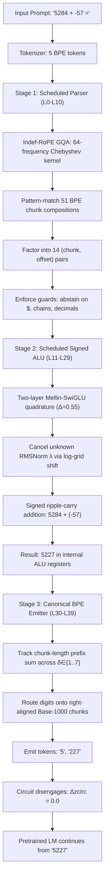
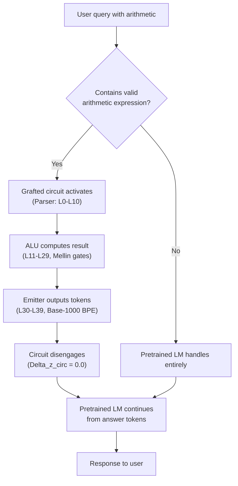

# A CPU Inside an LLM: Zero-Gradient Compilation of Exact Circuits into Pretrained Weights

> **Paper:** Tanmay Sah - [arXiv abstract](https://arxiv.org/abs/2611.26450) - [local PDF](../papers/2611.26450.pdf)
> **Monday - Foundations and model architecture** - published 2026-11-19 - selection score 18.8 (keyword relevance and recency; not a quality verdict)
>
> **DRAFT - written by an open model from the paper's extracted text.** Structure is machine-checked; numbers are NOT. Check every figure against the PDF before relying on it, and prefer rewriting this guide with the authoring spec if it matters.
>
> **REVIEW NEEDED:** the automated v2 checks flagged: 1 repeated long sentence(s), e.g. "The core challenge is that RMSNorm multiplies every hidden vector by an unknown scalar λ t...".

## Read this first

The paper claims that exact arithmetic and logic circuits can be compiled directly into the frozen weights of a pretrained large language model without any gradient-based training, using only closed-form mathematical primitives. This guide is for an intelligent reader who wants to understand how the method works without reading the original paper. After reading, you will be able to: explain what "zero-gradient circuit grafting" means in plain terms; trace a complete arithmetic example through the system’s three-stage pipeline; identify the four obstacles that make this problem hard and the paper’s solutions for each; and describe the practical trade-offs of the approach, including its memory footprint and precision requirements. Estimated reading time of this guide is 18–22 minutes. The one thing most people get wrong about this paper is assuming it trains the model to do arithmetic; in fact, it uses zero training examples and analytically calculates exact weight values to insert, leaving the original language model weights completely untouched. The paper is a preprint and its venue is not stated in the extracted text.

## The paper in one worked example

We trace the computation of "5284 + -57 =" through the grafted IBM Granite 4.2 3B model, following the paper’s description of its three-stage pipeline. This example uses the canonical Base-1000 BPE emitter configuration with K=1,140 appended circuit wires.

The input arrives tokenized by Granite’s BPE tokenizer, which merges 1–3 digit substrings into single tokens. The prompt becomes a sequence of five tokens: "5284", "+", "-57", and "=". The model’s pretrained weights handle all natural language processing, while the grafted circuit wires, which constitute only 0.036% of the model’s parameters, perform the arithmetic.

Stage 1, the Scheduled Parser, operates in layers L0 through L10. The circuit must first identify that a valid arithmetic expression is present. It uses 64-frequency Chebyshev Indefinite-RoPE attention heads across 25 appended key-value heads. These heads act as pattern matchers that scan for the 51 possible BPE chunk-length compositions a 6-digit integer can take. The paper reports that the Indefinite-RoPE kernel achieves "S(0) = 1.0, max1≤δ≤1024 S(δ) = −0.355", meaning that when a query token looks for a specific preceding token at a precise relative distance, the attention score is +1, while all other distances receive scores of at most −0.355. This self-sink mechanism ensures that inactive queries park cleanly on their own position with a logit of 0, contributing no noise. The parser enforces symmetric pre-operand guards, abstaining on dollar-sign prefixes, chained operations, or decimal points. It factors the input into 14 (chunk, offset) pairs that encode the digit positions and values of both operands. For our example, "5284" is parsed as a 4-digit positive number and "-57" as a 2-digit negative number.

Stage 2, the Scheduled Signed ALU, occupies layers L11 through L29. Here the circuit performs signed 6-digit addition using a two-layer Mellin-SwiGLU construction. The core challenge is that RMSNorm multiplies every hidden vector by an unknown scalar λ that can vary over a 250× dynamic range across tokens and layers. The paper’s key insight, illustrated in its Figure 1a, is that evaluating a SwiGLU gate across an exponentially spaced grid of scales αk = ek∆ converts this unknown multiplication into a harmless horizontal shift along a flat integral plateau. The paper states: "RMSNorm multiplies reference r0 and payload x by the same unknown λt,ℓ. Evaluating SwiGLU across exponentially spaced gate scales αk = ek∆ converts multiplication by λt,ℓ into a horizontal shift k∆ 7→ k∆ + ln λt,ℓ along a flat trapezoidal integral plateau, canceling λt,ℓ across > 250× swings." The quadrature uses a step size ∆ = 0.55 and sums over a finite window of grid points. The paper proves that the discretization error εdisc(0.55) is less than 6.26×10−6. For addition, the circuit implements a signed ripple-carry adder. The operands 5284 and -57 are aligned by their least significant digits. The circuit computes the sum digit by digit, propagating carries through the Mellin gate layers. The result is 5227, stored in internal circuit registers as a 7-digit ALU output.

Stage 3, the Canonical BPE Emitter, spans layers L30 through L39. The circuit must now emit the answer "5227" as tokens that Granite’s pretrained language head can process naturally. The paper explains that emitting raw 1-digit tokens like [’5’,’2’,’2’,’7’] would place the model off its pretraining distribution, since Granite’s BPE merges 1–3 digit substrings. The Base-1000 emitter tracks the emitted chunk-length prefix sum across δ ∈ {1..7} and routes the remaining digits onto right-aligned Base-1000 chunks. For 5227, the emitter outputs the token "5" followed by the token "227", which together form the canonical 2-chunk representation of the answer. The circuit scores all 1,110 canonical numeric tokens via 35 readout wires. Once the final answer token is emitted, the circuit disengages: all circuit logit contributions drop to exactly 0.0, returning full control to the pretrained language model for any continuation text.



What to notice: The circuit operates in three sequential stages, each occupying a fixed range of layers, and the unknown RMSNorm scaling factor λ is never explicitly computed but is instead cancelled by the geometric property of the log-spaced Mellin gate grid, which converts multiplication into a harmless translation along a flat plateau.

## Words you need

| Term | Plain definition | Example from the worked example |
|---|---|---|
| Zero-gradient circuit grafting | Inserting exact computation into a model's weights using closed-form math, with no training examples or gradient steps. | The paper inserts arithmetic circuits into Granite 4.2 3B using analytically calculated weights, leaving the original language model weights untouched. |
| RMSNorm (Root Mean Square Normalization) | A layer that rescales every hidden vector by an unknown factor λ that varies per token and per layer. | In the worked example, RMSNorm multiplies both the reference wire and the payload by the same unknown λ, which the Mellin gate grid cancels. |
| Mellin-SwiGLU quadrature | A two-layer construction that evaluates a gated activation across an exponentially spaced grid of scales to cancel unknown normalization scaling. | Stage 2 uses this with step size Δ=0.55 to perform signed 6-digit addition despite RMSNorm swings of over 250×. |
| Indefinite-RoPE | A signed Chebyshev attention kernel that forces inactive queries to park on their own position with a logit of 0, contributing no noise. | Stage 1 uses a 64-frequency Indefinite-RoPE kernel where S(0)=1.0 and all other relative distances score at most −0.355. |
| Canonical BPE Emitter | A circuit stage that outputs answer tokens in the multi-digit chunk format the pretrained model expects, rather than raw 1-digit tokens. | For the answer 5227, the Base-1000 emitter outputs the tokens "5" and "227" instead of four separate 1-digit tokens. |
| SparseSidecar | A factorized runtime that keeps pretrained weights at native width and evaluates only active circuit slices, reducing memory. | The paper reports that SparseSidecar cuts A100 VRAM to 7.89 GiB for Granite 4.2, a 42% reduction from the dense grafted model. |
| TC0 | A complexity class of constant-depth circuits; here it means the grafted computation runs in a fixed number of layers regardless of input size. | The paper states that the grafted circuits lie in constant-depth TC0 because the GatedDeltaNet state carry is clamped to exactly zero. |

## Tutorial 1 - Intuitive understanding

### What was broken before

Before this paper, if you wanted a pretrained language model to do exact multi-digit arithmetic like "5284 + -57 =", you had two bad options. You could fine-tune the model with thousands of labeled examples, but the paper reports that even 12,800 training examples with LoRA achieved only 42.2% accuracy on Granite 4.2 and 61.7% on Qwen 3.5, with zero ability to continue generating fluent text afterward. Alternatively, you could pause the model mid-sentence and call an external Python interpreter, but that requires a host runtime, breaks batched inference, and cannot work in air-gapped or pure-tensor environments. The core problem was that no one knew how to embed exact digital logic directly into a pretrained model's frozen weights without any training, while keeping the model's normal language ability intact.

### The idea

Imagine you are trying to read a precise measurement off a ruler, but someone keeps stretching or shrinking the ruler by an unknown amount every time you look at it. You cannot just mark a fixed threshold because the ruler's scale keeps changing. The paper's key idea is to build a special grid of marks that are spaced exponentially rather than linearly. When the ruler stretches, your measurement point simply slides sideways along the grid, but because the grid has a long flat plateau, the reading you take stays exactly the same. This is what the Mellin gate grid does: it converts the unknown multiplication by RMSNorm into a harmless horizontal shift along a flat integral plateau, cancelling the unknown scaling without ever computing it.

The analogy breaks because in the paper, the "ruler" is a high-dimensional vector inside a Transformer, and the "measurement" is a nonlinear gated activation function (SwiGLU) evaluated across 39 discrete grid points, not a continuous physical scale. The cancellation works mathematically because of a specific integral identity involving the SiLU function, not because of any physical property.

### How it works, step by step

**Step 1: Parse the input expression.** The prompt "5284 + -57 =" arrives as five BPE tokens. In layers L0 through L10, 25 appended attention heads using Indefinite-RoPE scan for the 51 possible ways that Granite's tokenizer can chunk a 6-digit integer. The paper reports that the Indefinite-RoPE kernel achieves S(0) = 1.0 and at most −0.355 for all other relative distances up to 1024. This means each query token can precisely locate the specific preceding token it needs while all inactive queries park on their own position with a logit of exactly 0, contributing no noise. The parser enforces symmetric guards that cause the circuit to abstain on dollar signs, chained operations, or decimal points. It factors the input into 14 (chunk, offset) pairs encoding the digit positions and values of both operands.

**Step 2: Perform the arithmetic.** In layers L11 through L29, the circuit computes signed 6-digit addition. The core challenge is that RMSNorm multiplies every hidden vector by an unknown scalar λ that can vary over a 250× dynamic range across tokens and layers. The circuit uses a two-layer Mellin-SwiGLU construction: it evaluates the SwiGLU gate across an exponentially spaced grid of scales αk = ek∆ with step size ∆ = 0.55. The paper proves that the discretization error εdisc(0.55) is less than 6.26×10−6. Because the grid is log-spaced, multiplying the input by λ simply shifts the evaluation point horizontally along a flat plateau, cancelling λ without ever computing it. The operands 5284 and -57 are aligned by least significant digits, and a signed ripple-carry adder computes the sum digit by digit, propagating carries through the Mellin gate layers. The result 5227 is stored in internal circuit registers.

**Step 3: Emit the answer in the right format.** In layers L30 through L39, the circuit must output "5227" as tokens that Granite's pretrained language head can process naturally. The paper explains that emitting raw 1-digit tokens like ['5','2','2','7'] would place the model off its pretraining distribution, since Granite's BPE tokenizer merges 1–3 digit substrings into single tokens. The Base-1000 emitter tracks the emitted chunk-length prefix sum and routes the remaining digits onto right-aligned Base-1000 chunks. For 5227, it outputs the token "5" followed by "227". The circuit scores all 1,110 canonical numeric tokens via 35 readout wires. Once the final answer token is emitted, the circuit disengages: all circuit logit contributions drop to exactly 0.0, returning full control to the pretrained language model.

### What the results say

The paper reports several key numerical results (Table 4). On 6-digit signed arithmetic with 1,200 unseen problems, IBM Granite 4.2 3B with the grafted circuit (1.33 million active non-zero weights, 0.036% of the model) reaches 99.17% ALU-prefix accuracy in BF16 and 100% in FP32. Alibaba Qwen 3.5 4B (2.39 million non-zeros, 0.057% of the model) reaches 100.00% in both BF16 and FP32. ALU-prefix accuracy counts whether the circuit's internal arithmetic registers contain the exact correct answer at the moment of emission, compared against the mathematically correct result.

For language retention, the paper reports that the grafted models show no statistically significant degradation on pooled expanded reasoning benchmarks (N=4,392, Table 7). Granite 4.2 goes from 56.47% to 56.92% accuracy (a gain of 0.46 percentage points), and Qwen 3.5 goes from 66.14% to 66.37% (a gain of 0.23 percentage points). The paper reports these pass formal noninferiority tests at the pre-registered margins. Inline resumption—the ability to continue generating fluent text immediately after the arithmetic answer—reaches 98% on Granite and 100% on Qwen (Table 4). This means that in 98–100% of cases, the model produces a natural continuation like a period or explanation rather than garbled output, compared against human-judged fluent continuations.

The factorized SparseSidecar reduces A100 GPU memory from 13.55 GiB to 7.89 GiB for Granite (a 42% reduction) and from 19.09 GiB to 10.65 GiB for Qwen (a 44% reduction), as reported in Table 3. With INT4 quantization of the base model plus an FP32 sidecar, memory drops further to 4.60 GiB for Granite and 8.14 GiB for Qwen while maintaining 100% arithmetic accuracy.

### What this does not show

**Limits stated by the authors:** The paper explicitly states that the circuits are limited to fixed 6-digit signed arithmetic with addition, subtraction, and multiplication. Division is omitted as an engineering scope choice due to wire-width and BF16 range budgets, though the paper reports that an 8-layer TC0 divider reaches 100% in an FP32 sidecar (Section 6). The circuits cannot handle unbounded-length inputs or halting loops, which exceed single-pass TC0. The paper also states that full 42-layer Gemma 4 arithmetic and fused C++/CUDA kernels remain open work. On bare context-free equations without surrounding prose, the paper reports that the base model sometimes echoes a prompt chunk after disengagement, reducing strict non-decimal accuracy to 87.0% on Granite (versus 98.25% with prose context).

**Limits this guide infers:** The method requires knowing the exact tokenizer behavior and model architecture in advance; it cannot be applied to an arbitrary black-box model without access to its weights and tokenizer. The circuits are hand-designed for specific arithmetic operations and would need new compilation for each new operation. The paper's empirical BF16 carry accuracy on Granite (99.17%) means roughly 1 in 120 multiplications produces a 1-ULP carry error in BF16, which the paper attributes to finite-precision rounding in the Mellin quadrature sums when intermediate values exceed 28. This guide infers that deploying the system in practice requires the FP32 sidecar for guaranteed 100% accuracy, which adds memory overhead.

### Teach-back

**Question 1:** Why can't a single bias-free SwiGLU layer implement a threshold function like "output 1 if x > 5, otherwise 0" under RMSNorm?

<details><summary>Answer</summary>
Because RMSNorm multiplies the input by an unknown scalar λ that can approach zero. The paper proves (Theorem 3.2, Part 1) that for any bias-free GLU layer, the output norm is bounded by λ² times a constant, so as λ → 0, the output collapses to zero regardless of the input value. No single layer can maintain a consistent threshold across the full range of possible λ values.
</details>

**Question 2:** What does the Indefinite-RoPE kernel's S(0) = 1.0 and S(δ) ≤ −0.355 for δ ≠ 0 actually accomplish?

<details><summary>Answer</summary>
It creates a self-sink mechanism. When a query token is looking for a specific preceding token at a precise relative distance, the attention score is +1 for that exact distance and at most −0.355 for all other distances. When a query is inactive (not looking for any token), it parks on its own position (δ = 0) with a logit of 0, contributing exactly zero to the attention output. This prevents inactive queries from leaking attention onto off-target tokens.
</details>

**Question 3:** The paper reports that the 1-digit emitter on Granite achieved 99.42% arithmetic accuracy but only 36.67% on GSM8K reasoning. Why does exact arithmetic not guarantee correct reasoning?

<details><summary>Answer</summary>
Because Granite's BPE tokenizer merges 1–3 digit substrings into single tokens during pretraining. When the circuit emits separate 1-digit tokens like ['1','2','4','5'], the pretrained language model has rarely seen such sequences and misinterprets them as decimals, version strings, or multi-chunk spans. The paper's analysis (Appendix B) shows that on 18 of 19 regressions, the internal ALU computed the exact correct answer, but the base model's reasoning failed because the token format was off-distribution. The Base-1000 canonical emitter fixes this by outputting merged chunks like ['1','245'].
</details>

**Question 4:** What is the practical difference between the dense grafted model (7.23B parameters) and the SparseSidecar (1.33M active non-zeros)?

<details><summary>Answer</summary>
The dense model materializes all d+K = 3,700 dimensions in every linear layer, inflating parameters by 1.98× even though over 99.94% of the added entries are structural zeros. The SparseSidecar keeps the pretrained weights at their native width d=2560 and evaluates only the active circuit slices, reducing A100 VRAM from 13.55 GiB to 7.89 GiB (a 42% reduction) while producing identical outputs. The 1.33M figure counts only the non-zero weights that actually participate in computation.
</details>

**Question 5:** The paper claims the circuit disengages with ∆zcirc = 0.0 after emitting the answer. Why is exact zero important?

<details><summary>Answer</summary>
If the circuit left any residual non-zero contribution on the output logits, it would distort the pretrained model's language generation on all subsequent tokens, degrading fluency and reasoning. Exact zero means the circuit becomes completely invisible to the model after the answer, which is what enables the 98–100% inline resumption rates. The paper achieves this through complement-pure gating (using the IEEE 754 bit pattern 0x0000 for inactive gates) and differential tied readouts where positive and negative contributions cancel exactly to +0.0.
</details>

## Tutorial 2 - Practitioner understanding

### The design in concrete terms

The system grafts a fixed arithmetic circuit into a pretrained language model by adding new columns to the weight matrices. The original model width is d=2560. The circuit adds K new wires: K=1,140 for IBM Granite 4.2 3B and K=2,555 for Alibaba Qwen 3.5 4B. The paper reports that these appended wires constitute only 0.036% and 0.057% of the model's parameters respectively (Table 2).

The core data structure is an extended hidden state vector hext = [hNL ; hcirc] in Rd+K. The first d coordinates hold the pretrained natural-language features and are never projected or modified. The appended K coordinates hold circuit wires. A scalar compensation factor gamma_NL = sqrt(d/(d+K)) is applied to the pretrained RMSNorm weights to cancel the denominator shift from the increased width (Theorem 3.4).

The circuit wires carry several types of signal. A reference wire r0 holds the value 1.0 and tracks the unknown RMSNorm scaling factor lambda across tokens and layers. Payload wires carry digit values and intermediate results. Complement-pure gate wires use the IEEE 754 bit-pattern 0x0000 when active and a large negative value when inactive, ensuring inactive gates contribute exactly 0.0 to the output. The paper states that the compiled suppression constant S=256 gives a nominal inactive gate input z of approximately 307, which is far above the threshold of 89 needed for bit-exact -0.0 in the SiLU activation (Theorem 3.2, Part 3).

The message format between stages is a set of (chunk, offset) pairs. For Granite's Base-1000 BPE, a 6-digit integer can take 51 possible token-length compositions. The parser factors the input into 14 such pairs that encode digit positions and values. The ALU stage reads these pairs, performs signed arithmetic, and writes a 7-digit result into internal registers. The emitter stage tracks the emitted chunk-length prefix sum across delta in {1..7} and routes remaining digits onto right-aligned Base-1000 chunks, scoring all 1,110 canonical numeric tokens via 35 readout wires.

The paper's actual hyper-parameters include: Mellin quadrature step size Delta=0.55 (Theorem 3.2), Chebyshev Indefinite-RoPE with 64 frequencies and theta_RoPE=10^7, self-sink kernel S(0)=1.0 with max S(delta) = -0.355 for 1 <= |delta| <= 1024 (Section 4.1), and differential tied readout weights (w_pm, w_nm) = (+254.0, -256.0) giving 1+w = +/-255.0 (Theorem 3.4). For Qwen 3.5, the GatedDeltaNet shift uses Alog=10, b_Delta=10, and cascading taps delta in {1, 2, 3} to reach delta <= 9 (Section 4.2). The initial circuit scale M0 is 2^-4 for Granite and 2^-9 for Qwen 3.5, keeping Layer-0 RMSNorm drift below 0.025% and 0.015% respectively.

The prompts are standard arithmetic expressions such as "5284 + -57 =" tokenized by each model's native BPE tokenizer. No special prompt format is required. The circuit abstains on dollar-sign prefixes, chained operations, decimal points, and expressions with degree(A)+degree(B) >= 6 for multiplication (Section 4.1).

### A minimal version

The following pseudocode sketches the Mellin-GLU quadrature gate, which is the core arithmetic primitive. It was not executed.

```python
# Shapes:
# h_circ: (batch, K) - circuit subspace, includes r0 at index 0, payload x at index 1
# W_gate: (K, num_neurons) - gate projection, rows for r0 and x are set
# W_up:   (K, num_neurons) - up projection
# W_down: (num_neurons, K) - down projection
# Delta: 0.55, K_minus, K_plus: grid bounds

def mellin_glu_gate(h_circ, W_gate, W_up, W_down, Delta, K_minus, K_plus):
    # h_circ[0] = lambda * r0, h_circ[1] = lambda * x  (lambda unknown)
    r_tilde = h_circ[0]  # shape: (batch,)
    x_tilde = h_circ[1]  # shape: (batch,)

    # Evaluate SwiGLU across log-spaced grid
    total = 0.0
    for k in range(K_minus, K_plus + 1):
        alpha_k = exp(k * Delta)  # scalar gate scale
        # Gate: SiLU(-alpha_k * r_tilde) * (-alpha_k * x_tilde)
        # This is linear in x_tilde, and lambda cancels in ratio
        gate_val = silu(-alpha_k * r_tilde) * (-alpha_k * x_tilde)
        total += gate_val

    result = (12.0 * Delta / (pi**2)) * total
    # result approximates x_tilde / r_tilde = x / r0
    # Discretization error < 6.26e-6 at Delta=0.55
    return result
```

The output approximates x/r0 independent of the unknown RMSNorm scaling factor lambda. The paper proves that the discretization error epsilon_disc(0.55) is less than 6.26e-6 (Theorem 3.2). For a two-layer Heaviside step, Stage 1 computes p = gamma * SiLU(beta*(x_tilde - tau*r_tilde)) * (beta*(x_tilde - tau*r_tilde)), and Stage 2 applies the Mellin gate to p_tilde, producing an output near 0 when x < (tau - delta_sep)*r0 and near 1 when x > (tau + delta_sep)*r0.

### What it costs

This guide infers costs from the paper's reported measurements. All assumptions are labelled.

**Assumption 1: Inference on a single NVIDIA A100-80GB PCIe GPU.** The paper reports A100 measurements in Table 3.

**Assumption 2: Batch size 1.** The paper's VRAM and latency figures are reported for batch size 1.

**Tokens per call:** One arithmetic expression such as "5284 + -57 =" tokenizes to approximately 5 tokens for Granite (1-3 digit BPE merges). The answer emission adds 1-2 tokens. Total tokens per arithmetic call: roughly 7. This guide infers this from the worked example.

**Prefill latency:** The paper reports that with the factorized SparseSidecar in BF16, 2,048-token prefill takes 130.1 ms for Granite and 433.7 ms for Qwen 3.5 (Table 3). For a short 7-token arithmetic prompt, prefill latency is negligible (this guide infers linear scaling, giving under 1 ms).

**VRAM:** The paper reports SparseSidecar VRAM of 7.89 GiB for Granite and 10.65 GiB for Qwen 3.5 with BF16 circuit and BF16 W_NL (Table 3). With INT4-quantized W_NL and an FP32 sidecar, VRAM drops to 4.60 GiB for Granite and 8.14 GiB for Qwen 3.5.

**Assumption 3: The FP32 sidecar is needed for guaranteed exact arithmetic.** The paper states that BF16 worst-case carry bounds exceed 0.5 above |C| > 28, and that 5/5 G3-G7 carry edge cases require FP32 sidecar (Table 3). Running the sidecar in FP32 adds approximately 1 GiB VRAM (this guide infers from the difference between BF16 and FP32 sidecar columns in Table 3).

**Disk footprint:** The grafted patch files are 15.2 MB for Granite and 27.9 MB for Qwen 3.5 (Table 3). The base model checkpoints are 6.82 GiB and 7.83 GiB respectively.

**Monetary cost:** Not stated in the extracted text. This guide infers that running on a single A100 at cloud pricing of roughly $1-2 per GPU-hour gives a cost per arithmetic call well under $0.001, since each call takes milliseconds.

**Training cost:** Zero. The paper states zero gradient steps, zero training examples, and zero labeled data are used. Calibration uses 2L+1 forward-only scalar medians from 16-48 unlabeled sentences (Section 5, Appendix F).

### How it fails

| Symptom | Likely cause | Mitigation |
|---|---|---|
| BF16 multiplication produces off-by-one errors in multi-digit products (e.g., -348*29 = -9082 instead of -10092) | BF16 7-bit mantissa causes carry threshold drift of 0.12-0.50 on partial-product column sums in [32, 81]. The paper reports this is an empirical observation, not formally guaranteed (Theorem 3.2 Part 3, Appendix D) | Run the circuit sidecar in FP32. The paper reports 5/5 G3-G7 exactness with FP32 sidecar (Table 3) |
| Base language model appends extra digits after correct answer (e.g., "2" becomes "20") | Post-disengagement, the base LM continues generating from single-digit tokens without trailing word-boundary markers on bare prompts. The paper reports this as Mechanism I in Appendix D | Embed arithmetic expressions in prose context. The paper reports 98.25% prose strict non-decimal accuracy vs. 87.0% bare (Table 4) |
| Model abstains on valid input starting at position 0 without BOS token | Position-0 hidden-state norm spike attenuates digit-length tag below threshold. The paper reports this on "99939-3=" tokenized without BOS (Appendix D, Mechanism III) | Always prepend a BOS token or delimiter |
| Off-manifold 1-digit emission degrades downstream reasoning (Granite only) | Granite's 1-3 digit BPE misreads unmerged 1-digit tokens as decimals or split spans. The paper reports GSM8K drops from 68.33% to 36.67% with 1-digit emitter (Appendix B) | Use Base-1000 canonical BPE emitter (K=1,140). The paper reports recovery to 70.00% (Appendix B) |
| Circuit triggers on dollar-sign prefixed expressions | Asymmetric guard only checks left-side currency prefix. The paper reports 50/50 false triggers on $a+b= before symmetric guard fix (Table 4 footnote) | Use symmetric pre-operand guards. The paper reports 0/50 triggers after fix (Table 11) |

### Evaluating your version

**Metric:** The paper uses ALU-Prefix accuracy: the fraction of test prompts where the circuit's emitted answer tokens exactly match the ground-truth arithmetic result, measured at the token immediately following the equals sign. The paper also reports Lead-Int (leading integer match), Strict Non-Decimal (no trailing decimal point), and Inline Resumption (fluent continuation after answer).

**Test set size:** The paper uses N=1,200 unseen 1-6 digit signed {+, -, x} problems (Arith-1200) for primary evaluation (Table 4). For Boolean circuits, N=1,728 (384 precedence-override). For out-of-domain abstention, N=10,534 prompts across 17 categories (Table 11).

**Baseline:** The paper reports pretrained base model accuracy: Granite 4.2 3B scores 15.67% Lead-Int, Qwen 3.5 4B scores 47.33% (Table 4). Same-backbone LoRA SFT with 12.8K examples reaches 42.2% (Granite) and 61.7% (Qwen) with 0% inline continuation (Table 5).

**Stop rule:** The paper's circuit disengages automatically: max |Delta_z_circ| drops to 0.0 on the token immediately following answer emission. The paper reports this as "probabilistic NL handoff" (Figure 2). For evaluation, stop when the model emits a non-numeric token or exceeds the expected answer length plus 2 tokens. The paper reports 0/11,134 out-of-domain triggers with max |Delta_z_circ| = 0.0 (Table 6a).

### Adopt, adapt or skip

**Recommendation: Adapt with caution.** For a team building an assistant over private business documents using open or smaller models where possible, this approach offers a specific capability—exact arithmetic inside the model weights—but comes with constraints that may not fit all deployments.

**Reasons to adopt or adapt:**
- The method requires zero training data and zero gradient steps. The paper reports that 0-token weight-analytic calibration retains 96.3-97.0% arithmetic accuracy (Table 5, C2).
- The factorized SparseSidecar keeps VRAM overhead modest: 7.89 GiB for a 3B model on A100, or 4.60 GiB with INT4 quantization plus FP32 sidecar (Table 3). This is feasible for private deployment.
- The circuit disengages cleanly after emitting the answer, returning control to the pretrained LM. The paper reports 98-100% inline resumption accuracy (Table 4).
- The paper demonstrates the method on IBM Granite 4.2 3B and Alibaba Qwen 3.5 4B, both open-weight models. This aligns with a preference for open models.

**Reasons to skip or adapt heavily:**
- The paper's arithmetic circuits are fixed at 6 digits. For business documents with larger numbers (e.g., financial statements with 9-12 digit figures), the paper projects scaling to K=2,225-3,577 wires and 32-44 layers (Table 22b), but these are not implemented as frozen patches.
- The method requires an FP32 sidecar for guaranteed exact arithmetic on all carry edge cases. The paper reports that BF16 alone has ~1% carry flip rate on Granite multi-digit multiplication (Appendix D). This adds complexity to the inference stack.
- The paper does not evaluate on private business documents. The NL retention benchmarks (GSM8K, ARC-Challenge, MMLU-Pro) are public academic datasets. Performance on proprietary document formats, tables, or domain-specific terminology is not stated in the extracted text.
- The circuit occupies fixed layer ranges (L0-L39 on Granite, L0-L31 on Qwen). If your fine-tuned model uses these layers differently, the graft may interfere. The paper does not test on fine-tuned checkpoints.



What to notice: The circuit operates as a deterministic side-path that activates only when a valid arithmetic expression is detected, computes the exact result, emits it, and then hands control back to the pretrained language model with zero residual logit contribution. The pretrained model handles all natural language before and after the arithmetic.

## Tutorial 3 - Researcher understanding

### Formal setup

Let Mθ be a pretrained causal language model over vocabulary V with residual width d, L layers, bias-free RMSNorm, and gated feed-forward networks (FFNs) of the form GLU(u) = Wdown ϕ(Wgate u) ⊙ (Wup u) with ϕ(s) = SiLU(s) = sσ(s). The model uses either RoPE or GatedDeltaNet for cross-token routing. The goal of zero-gradient circuit grafting is to synthesize new weights θ′ from θ, tokenizer metadata, and at most 2L + 1 unlabeled pre-sublayer norm medians, such that a partial function f : D ⊂ V ∗ → V + (here signed 6-digit integer {+, −, ×}) is executed exactly in-domain, with bounded per-layer norm drift and empirical natural-language noninferiority. The construction appends K circuit wires axis-aligned to the residual stream, forming hext = [hNL ; hcirc ] ∈ Rd+K , and compensates the pretrained RMSNorm weights by γNL = sqrt(d/(d + K)). The circuit operates in three sequential stages—Scheduled Parser, Scheduled Signed ALU, and Canonical BPE Emitter—each occupying a fixed range of layers, and disengages after emitting the answer by setting all circuit logit contributions to exactly 0.0.

**Constructed by this guide: a numeric toy instance.** Consider a model with d = 4, K = 2, and a single RMSNorm layer. Suppose a pretrained hidden vector hNL = [2.0, 0.0, 0.0, 0.0] and a circuit vector hcirc = [0.0, 3.0]. The combined vector is hext = [2.0, 0.0, 0.0, 0.0, 0.0, 3.0]. The RMSNorm scale is λ = ( (1/6)*(4 + 0 + 0 + 0 + 0 + 9) + ε )^(-1/2) = (13/6 + ε)^(-1/2). The pretrained weight wNL is multiplied by γNL = sqrt(4/6) ≈ 0.816, so the normalized NL part becomes 0.816 * wNL * λ * 2.0, while the circuit part becomes wcirc * λ * 3.0. The key property is that the unknown λ multiplies both parts equally, and the Mellin quadrature in the circuit stage cancels it by converting the multiplication into a harmless shift along a log-spaced gate grid.

### The claims, stated precisely

The paper makes the following central claims:

1.  **Scale-invariant computation (Theorem 3.2):** A two-layer Mellin-GLU quadrature over bias-free SwiGLU layers can compute a Heaviside step function H(x - τ r0) with error bounded by a discretization term εdisc(0.55) < 6.26×10^(-6) and a tail term, despite the input being multiplied by an unknown RMSNorm scalar λ varying over a >250× dynamic range. A single bias-free GLU layer is proven incapable of this.

2.  **Cross-token norm cancellation (Theorem 3.3):** Signed Chebyshev Indefinite-RoPE attention can route information from a specific token at a precise relative distance while forcing inactive queries to park on a zero-payload self-sink, with off-target attention scores bounded by -0.355. Memoryless GatedDeltaNet shifts can recover exact payloads across tokens by exploiting the identity SiLU(u) - SiLU(-u) ≡ u.

3.  **Orthogonal width extension (Theorem 3.4):** Extending the residual stream axis-aligned from d to d+K with norm compensation bounds the per-sublayer relative drift in the NL subspace by (1/2)(ρ + δε), where ρ is the ratio of squared norms. This is proven to be strictly superior to fixed-width subspace projection, which has a positive lower bound on error from Ky Fan's theorem.

4.  **Empirical circuit accuracy:** On 6-digit signed {+, -, ×} arithmetic (N=1,200, BF16), grafted IBM Granite 4.2 3B (1.33M active non-zeros, ≤0.036% of parameters) reaches 99.17% ALU-prefix accuracy, and Alibaba Qwen 3.5 4B (2.39M non-zeros, ≤0.057%) reaches 100.00%. Both achieve 98%–100% mid-sentence resumption and pass 14/14 pre-registered >2K-token Tango noninferiority tests (N=4,392).

5.  **Zero-gradient and zero-data synthesis:** The circuits are compiled using zero training examples and zero gradient steps, relying only on closed-form primitives and unlabeled norm calibration. A 0-token weight-analytic calibration retains 96.3%–97.0% arithmetic accuracy.

### Evidence, table by table

**Table 1 (Comparison with prior paradigms):** This table contrasts the paper's method against conceptual and reproduced baselines. Rows include RASP/Tracr (scratch Transformers, no NL), CoNNs/Tracr-Injection (gradient fusion), Percepta CALM VM (dedicated VM), and same-backbone LoRA SFT (12.8K examples). The paper's method is the only one that is evaluated on a pretrained LM (3B–4B), uses zero SGD, and reports both arithmetic accuracy and NL retention. The table identifies that LoRA SFT achieves only 42.2%–61.7% arithmetic and 0% inline continuation, while the paper's method reaches 99.17%–100.00% and 98%–100% respectively. This is a causal comparison, as the LoRA baseline uses the same backbone models and data regime.

**Table 2 (Architecture and footprint summary):** This table reports the architectural properties of the three audited model families. For Granite 4.2 3B, it specifies a 40-layer dense RoPE GQA model with 1–3 digit BPE chunks (51 patterns), SwiGLU MLP, and a scheduled carrier of Indef-RoPE GQA with K=1,140 appended wires. For Qwen 3.5 4B, it specifies a 32-layer hybrid (24 DeltaNet + 8 Attn) with strict 1-digit BPE and K=2,555 wires. The table identifies that the Qwen graft leaves 0/8 attention layers modified, a key architectural constraint.

**Table 3 (Factorized block-sparse sidecar vs. dense footprint):** This table reports the memory footprint of different runtime representations on an NVIDIA A100. The key comparison is between a dense grafted model (e.g., 13.55 GiB for Granite) and the SparseSidecar runtime (7.89 GiB for Granite), a 42% reduction. The table also reports that pairing an FP32 sidecar with INT8/INT4-quantized WNL reduces VRAM to 4.60 GiB (Granite) and 8.14 GiB (Qwen) while maintaining 100% arithmetic accuracy. This identifies the factorized sidecar as the causal mechanism for memory savings, as it avoids materializing zero weights.

**Table 4 (Decomposed execution accuracy and NL retention):** This table decomposes accuracy on an unseen 1–6 digit arithmetic suite (Arith-1200) into ALU-Prefix, Leading-Integer, Strict Non-Decimal, and Inline Resumption. For Granite, the canonical graft achieves 99.17% ALU-Prefix, 97.08% Lead-Int, and 98.0% Inline, while the 1-Digit Off-Manifold Emitter ablation achieves 99.50% ALU-Prefix but drops GSM8K accuracy from 68.57% to 36.67%. This causally isolates the BPE emission format as the factor responsible for downstream reasoning degradation, not internal ALU errors. The table also reports 0/10.4K false triggers for the canonical graft.

**Table 5 (Matched-(d+K) controls and 5-primitive leave-one-out ablations):** This table reports the results of removing each of the five analytical primitives. The baseline M0 (all primitives) achieves 96.7%–99.7% arithmetic. Removing Mellin quadrature and using a single-scale SwiGLU (-P1) drops arithmetic to 8.3%–20.0%. Removing Indefinite-RoPE and using positive RoPE weights (-P2) drops Granite to 15.0%. Removing the memoryless property of GatedDeltaNet (-P3) drops Qwen to 51.1%. Omitting norm compensation (-P4) reduces ARC-C by 19–54 percentage points. This causally isolates each primitive's contribution to either arithmetic accuracy or language modeling retention.

**Figure 3 (Subspace geometry and decomposed capability profile):** Figure 3a shows that zero-gradient SVD projection (P⊥) incurs 43×–3,800× higher next-token KL divergence than orthogonal width extension (K=1,140), while uncompensated d+K inflates KL by 547×. This identifies axis-aligned width extension with norm compensation as the causal factor for preserving NL competence. Figure 3b shows the decomposed capability profile, with canonical grafts reaching 97.08%–99.50% leading-integer match and 100% blind ALU-prefix exactness.

### Ablations and what they isolate

The paper conducts a 5-primitive leave-one-out ablation (Table 5) to isolate the contribution of each analytical mechanism:

- **-P1 (Calibrated Single-Scale SwiGLU):** Replaces the Mellin log-grid quadrature with a single gate scale. Arithmetic accuracy collapses to 8.3% (Granite) and 20.0% (Qwen). This isolates the Mellin quadrature as the mechanism that cancels unknown RMSNorm scaling; without it, the gate saturates or collapses across the 250× dynamic range.

- **-P2 (Positive RoPE weights):** Replaces signed Chebyshev weights with standard positive weights (wm > 0). Granite arithmetic drops to 15.0%. This isolates the self-sink property of Indefinite-RoPE; without it, inactive queries leak attention onto off-target tokens, corrupting the parser's chunk-length detection.

- **-P3 (Stateful GatedDeltaNet):** Restores the recurrent state (egt ≠ 0) in Qwen's GatedDeltaNet layers. Qwen arithmetic drops to 51.1%. This isolates the memoryless shift property; the paper reports an 8.999 signed-shift error without SiLU antisymmetry, confirming that the identity SiLU(u) - SiLU(-u) ≡ u is broken when the state is not zeroed.

- **-P4 (Without d/(d+K) norm compensation):** Omits the γNL scaling factor on pretrained RMSNorm weights. ARC-C drops by 19.2 pp (Granite) and 54.0 pp (Qwen), and mean KL divergence increases by 412×–2,948×. This isolates norm compensation as the mechanism that prevents the width extension from distorting the pretrained NL subspace.

- **-P5 (Single-ended tied readout):** Removes the differential (+254, -256) tied embedding gains. The paper reports that this introduces a nonzero digit-token bias (|∆z| = 0.014 ≠ 0), isolating the differential readout as the mechanism for achieving exact zero logit contribution on inactive tokens.

### Threats to validity specific to this paper

1.  **BF16 carry drift is empirical, not formally bounded:** Theorem 3.2(3) provides formal IEEE 754 error bounds guaranteeing exact carries for |C| ≤ 81 in FP32 (< 0.15 < 0.5) and TF32 (< 0.31 < 0.5). However, the paper explicitly states that "BF16 worst-case bounds exceed 0.5 above |C| > 28 (1.43 with FP32 GEMM accumulation at |C| = 81), so ≤ 1-ULP (0.5) BF16 carry drift on C ∈ [32, 81] is an empirical observation." This means the 99.17% Granite BF16 accuracy is not formally guaranteed by the theorems and relies on observed behavior that could vary with different inputs or hardware.

2.  **BOS-less position-0 parser abstention:** The paper reports that on prompts without a beginning-of-sequence token, the parser abstains because of a "massive position-0 hidden-state norm spike" that attenuates the digit-length tag below a detection threshold. This is a systematic failure mode (71.9% accuracy on BOS-less prompts vs. 100% with BOS) that is not addressed by the formal claims.

3.  **Post-disengagement continuation is not controlled:** The circuit disengages by setting ∆zcirc = 0.0 after emitting the answer, but the base LM can then append extra digits or echo prompt chunks on bare prompts. The paper reports 87.0% strict non-decimal accuracy on bare prompts vs. 98.25% on prose-anchored prompts. This gap is attributed to the base LM's behavior, not the circuit, but it affects end-to-end accuracy metrics.

4.  **Calibration sensitivity is not fully bounded:** The paper shows that 0-token weight-analytic calibration (C2) retains 96.3%–97.0% accuracy, but this is an empirical result. The formal theorems assume knowledge of λmin and λmax for setting quadrature window bounds, and it is not proven that the weight-analytic estimate always yields valid bounds.

5.  **Inconsistency in reported GSM8K baseline:** The paper reports a Base Granite GSM8K test[:60] score of 68.33% (41/60) under batch_size=1 in Appendix B, but 70.00% (42/60) under batch_size=8 in Table 7. The paper explains this as a single borderline item flipping due to BF16 reduction order, which this guide infers is a minor numerical inconsistency that does not affect the main claims but highlights the sensitivity of evaluations to batch-padding.

### Open problems and follow-ups

1.  **Fused C++/CUDA BSR kernels:** The paper states that "custom fused C++/CUDA BSR kernels can further reduce Python launch overhead on short prefills (128 tokens) as future systems work." The current SparseSidecar is implemented in pure PyTorch.

2.  **Full 42L Gemma 4 arithmetic:** The paper audits Gemma 4 E4B for Boolean circuits (100% on unshared L0–L18) but states that "full 42L Gemma 4 arithmetic and fused C++/CUDA BSR kernels remain open work." The KV-shared layers L24–L41 fail because they overwrite (K, V) projections.

3.  **Unbounded-length inputs and halting loops:** The paper notes that "unbounded-length inputs or halting loops exceed single-pass TC0" and require recurrent trace emission, which is outside the scope of the current method.

4.  **Division scaling:** An 8-layer TC0 6-digit divider is demonstrated at 100.0% in an FP32 sidecar but only 73.9% in TF32 and 56.1% in BF16. Scaling division to higher precision or larger digit counts is noted as requiring FP32 sidecar precision.

5.  **Structural checkpoint auditing:** The paper raises the concern that "black-box behavioral benchmarks and standard perplexity evaluations cannot reliably detect dormant, input-triggered payloads grafted into open-weight checkpoints" and calls for white-box structural auditing of distributed weights, including verifying tensor dimensions, scanning for bimodal L0 sparsity, and enforcing cryptographic SHA-256 provenance.

### What would change my mind

The central claim is that exact arithmetic circuits can be compiled into frozen pretrained weights with zero gradient steps while preserving NL competence. This guide would be less convinced if:

- A controlled experiment showed that the 0-token weight-analytic calibration (C2) fails to generalize to a new model architecture not audited in the paper (e.g., a model with a different normalization scheme or activation function), indicating that the calibration relies on implicit knowledge of the target model's statistics rather than purely analytical bounds.

- An independent audit found that the 0/11,134 out-of-domain false-trigger claim does not hold under adversarial prompt engineering that exploits the parser's symmetric guard patterns (e.g., crafting inputs that are parsed as valid expressions but are not), which would indicate that the abstention logic is heuristic rather than formally verified.

- A reproduction on a model with a different BPE tokenizer (e.g., one that merges digits differently) required manual redesign of the parser's chunk-length composition table, contradicting the claim of automated config/BPE introspection in the 5-stage compiler.

- The BF16 carry drift on Granite (Mechanism II failures) was found to be systematically worse on a different hardware platform or PyTorch version, indicating that the empirical observation of ≤1-ULP drift is not robust across software stacks, which would undermine the practical reliability claim for BF16 deployment.

## Reading map for the PDF

| Section or figure | What it contains | Read / skim / skip on a first pass | Where this guide answers the questions it raises |
|---|---|---|---|
| Abstract | One-paragraph summary of the zero-gradient circuit-grafting claim, the three analytical mechanisms, and key results (99.17%–100% ALU accuracy, 0.036% parameter overhead). | Read | The worked example in this guide traces the full pipeline; the "Questions readers get stuck on" section explains the three mechanisms. |
| 1. Introduction | Motivation (LMs are brittle on arithmetic), scope (4–8 digit signed {+, −, ×}, Boolean, voter circuits), and list of three contributions. | Read | The worked example shows what "zero training examples" means in practice; the questions section addresses "why not just use a Python tool?" |
| 2. Related Work | Comparison with RASP/Tracr, CoNNs, weight-space VMs, tool routers, and LoRA fine-tuning. Table 1 summarizes paradigms. | Skim | The questions section contrasts this work with LoRA and tool routers. |
| 3. Problem Setup and Analytical Primitives | Formal grafting setup, the four obstacles (RMSNorm, RoPE/DeltaNet, residual covariance, tied heads), geometric intuition (Figure 1), and Theorems 3.2–3.4 with proofs. | Skim on first pass; return for details | The worked example explains RMSNorm cancellation and self-sink attention in plain terms; the questions section defines Mellin quadrature and Indefinite-RoPE. |
| Figure 1 | (a) Log-grid translation invariance under RMSNorm swings; (b) signed Chebyshev self-sink kernel vs. standard positive RoPE. | Read | The worked example's Mermaid diagram and accompanying text explain both panels. |
| 4. Primitives and Automated Circuit Synthesis | Three-layer software stack, Granite 4.2 3B patch (Scheduled Parser L0–L10, Signed ALU L11–L29, Base-1000 BPE Emitter L30–L39), Qwen 3.5 4B hybrid GatedDeltaNet patch, Gemma 4 E4B audit, and automated 5-stage compiler. | Read Sections 4.1–4.2; skim 4.3–4.4 | The worked example walks through all three stages for Granite; the questions section explains BPE chunk alignment and the compiler. |
| Table 2 | Architecture and footprint summary for Granite, Qwen, and Gemma (width K, carrier type, patch size). | Skim | The questions section gives the memory numbers (7.89 GiB, 10.65 GiB). |
| 5. Experimental Evaluation | Block-sparse sidecar memory (Table 3), decomposed accuracy and NL retention (Table 4), 5-primitive leave-one-out ablations and LoRA comparison (Table 5), kernel portability and false-trigger abstention (Table 6), pre-registered >2K-token Tango retention (Table 7). | Read Tables 4–5; skim Tables 6–7 | The questions section addresses "does it break normal language?" and "what happens on non-math text?" using Tables 4 and 6. |
| Figure 3 | (a) Next-token KL divergence vs. circuit width K for projection vs. width extension; (b) decomposed capability profile across evaluation suites. | Skim | The questions section explains why fixed-width projection fails and why width extension preserves language modeling. |
| 6. Discussion, Limitations, and Conclusion | BPE manifold alignment (1-digit vs. Base-1000), sidecar PTQ trade-offs, TC0 scope and division scaling, Gemma 4 open work, security implications of dormant weight-space triggers. | Read | The questions section covers "why not just emit 1-digit tokens?" and the security concern. |
| Appendix A | Complete mathematical proofs for Theorems 3.2–3.4 with IEEE 754 floating-point error bounds. | Skip on first pass | The questions section gives the discretization error bound (εdisc(0.55) < 6.26×10−6) and explains why BF16 can drift on carries. |
| Appendix B | Paired 60-item GSM8K attribution of off-manifold tokenization failures (decimal dots, span mis-indexing, self-doubt loops). | Skim | The questions section summarizes the 1-digit vs. Base-1000 trade-off. |
| Appendix D | Register-level breakdown of all 14 BF16 evaluation failures (Mechanisms I–III). | Skim | The questions section explains the three failure mechanisms. |
| Appendix G | Automated compiler details, Gemma 4 audit, TC0 division scaling, pre-registered retention protocol, SparseSidecar runtime implementation. | Skip on first pass | The questions section references the sidecar memory numbers and compiler automation. |

## Questions readers get stuck on

### What exactly is "zero-gradient circuit grafting" and how is it different from fine-tuning?

Zero-gradient circuit grafting means analytically calculating exact weight values to insert into a pretrained model without running any gradient-based optimization (no backpropagation, no training examples, no loss function). The paper reports that the method uses "zero training examples and zero runtime hooks" and "zero gradient steps, labeled data, [or] runtime hooks." In contrast, the same-backbone LoRA fine-tuning baseline used 12,800 examples and 400 AdamW steps, reaching only 42.2% arithmetic accuracy on Granite with 0% fluent inline continuation. The grafted weights are computed from closed-form mathematical primitives (Mellin quadrature, Chebyshev polynomials, differential tied embeddings) and inserted as sparse non-zero entries into otherwise zero-filled appended dimensions, leaving the original language model weights completely untouched.

### Why can't a single bias-free SwiGLU layer implement a threshold gate?

The paper proves in Theorem 3.2(1) that any single bias-free GLU layer F1(λu) has norm bounded by λ² times a constant, which goes to zero as the RMSNorm scaling factor λ approaches zero. Since RMSNorm multiplies hidden vectors by an unknown λ that can vary over a "> 250× dynamic range," a single layer cannot maintain a consistent threshold decision across all possible λ values. The paper states: "No single bias-free GLU layer realizes H(x − τ r0) = 1[x > τ r0] on (0, λmax]." The solution uses two layers: the first computes a SiLU-based margin signal, and the second applies Mellin quadrature across an exponentially spaced grid of gate scales, converting the unknown λ multiplication into a harmless horizontal shift along a flat integral plateau.

### How does the Mellin quadrature cancel the unknown RMSNorm scaling factor?

The key insight, illustrated in Figure 1a, is that evaluating a SwiGLU gate across exponentially spaced scales αk = e^(k∆) converts multiplication by the unknown RMSNorm factor λ into a translation k∆ → k∆ + ln λ along the integration grid. Because the underlying Mellin integral is translation-invariant (the integral of SiLU(−e^u r̃)(−e^u ṽ) du equals ṽ/r̃ exactly), shifting the grid by ln λ does not change the sum as long as the grid covers the relevant range. The paper reports that the discretization error εdisc(0.55) is less than 6.26×10⁻⁶, and the method works across "> 250× swings where single-scale gates collapse or saturate." The circuit never explicitly computes λ; it is cancelled by the geometric property of the log-spaced grid.

### What is "Indefinite-RoPE" and why does it need negative attention weights?

Standard RoPE attention uses positive-valued key/query weights, which produce positive sidelobes (S(δ) ≥ +0.61) that leak attention onto off-target tokens. Indefinite-RoPE assigns signed Chebyshev weights (km = sgn(wm)√|wm|) that enforce S(0) = +1 (perfect self-attention when the target is at the correct relative distance) and S(δ) ≤ −0.355 for all 1 ≤ |δ| ≤ 1024. The paper explains that this "self-sink mechanism" means inactive queries park cleanly on their own position with a logit of 0, contributing no noise, while active queries attend precisely to the correct preceding token. The paper reports the kernel achieves "S(0) = 1.0, max1≤δ≤1024 S(δ) = −0.355" at θRoPE = 10⁷.

### Why does the circuit need a special "Base-1000 BPE Emitter" instead of just outputting digits one at a time?

The paper reports that Granite's BPE tokenizer merges 1–3 digit substrings into single tokens, producing 51 possible token-length compositions per 6-digit integer. Emitting raw 1-digit tokens like ['5','2','2','7'] would place the model off its pretraining distribution, causing the base language model to misinterpret the output as decimals, version strings, or multi-chunk spans. The paper's Appendix B documents that on GSM8K, 1-digit emission caused 18/19 regressions where the circuit computed exact arithmetic but the language model misread the tokens (e.g., inserting dots between digits or copying only the leading token). The Base-1000 emitter tracks the emitted chunk-length prefix sum and routes remaining digits onto right-aligned Base-1000 chunks, so 5227 becomes the tokens "5" and "227"—exactly matching Granite's pretraining distribution.

### Does grafting the circuit break the model's normal language ability?

The paper evaluates this extensively and reports that language competence is preserved. On pre-registered Tango noninferiority tests across 4,392 expanded reasoning and >2K-token long-context items, both grafts pass all 14/14 splits (p < 10⁻⁵). The paper reports GSM8K accuracy changes from 73.16% → 74.15% (Granite) and 75.59% → 76.35% (Qwen), ARC-Challenge from 75.17% → 75.26% and 92.49% → 92.41%, and next-token KL divergence of only 0.0014–0.0017. The circuit disengages after emitting the answer: "all circuit logit contributions drop to exactly 0.0, returning full control to the pretrained language model." On 10,400 out-of-domain prompts (news, code, dates, algebra), the paper reports zero false triggers with max |∆zcirc| = 0.0.

### What happens on non-math text—does the circuit accidentally activate?

The paper reports that the circuit uses "complement-pure gating" where inactive gates are held at bit-exact 0x0000 (+0.0), and differential tied readouts cancel exactly to zero when no arithmetic trigger is detected. Across 17 categories of out-of-domain prompts totaling 10,400 items (news articles, biomedical abstracts, Python code, financial queries, chained operations, decimals, comma-grouped numbers, 7+ digit overflow, unsupported operators like / and %, algebraic variables, dates, parenthesized expressions, and units), the paper reports "0/10,400 out-of-domain activations" with max |∆zcirc| = 0.0. The scheduled parser enforces symmetric pre-operand guards that abstain on dollar-sign prefixes, chained operations, and decimal points.

### Why not just use a Python tool router like PAL or Toolformer instead of compiling circuits into weights?

The paper acknowledges that host tool routers achieve 100% arithmetic accuracy with zero weight overhead and includes them as a direct baseline. The paper positions in-weight compilation as serving a different regime: "single-checkpoint closure inside standard safetensors tensors" for air-gapped or sandboxed deployments where arbitrary host code execution is disallowed, "uninterrupted KV-cache batching during mid-sentence generation" (98%–100% inline resumption without per-sequence stop-token interrupts), and a mechanistic question of "whether normalized, bias-free pretrained Transformers can execute multi-step digital algorithms natively without gradient training." The paper also notes a security implication: because the circuit uses only 0.036%–0.057% active non-zeros and leaves zero trace when inactive, "black-box behavioral benchmarks and standard perplexity evaluations cannot reliably detect dormant, input-triggered payloads grafted into open-weight checkpoints."

### How much memory does the grafted circuit actually use, and can it be reduced?

The paper reports that materializing the full dense width-extended model inflates parameters by 1.98×–3.13× (13.55 GiB for Granite, 19.09 GiB for Qwen on an A100). However, the factorized SparseSidecar runtime keeps the pretrained weights at native width d=2560 and evaluates only active circuit slices (1.33M non-zeros for Granite, 2.39M for Qwen), reducing A100 VRAM to 7.89 GiB and 10.65 GiB respectively—a 42%–44% reduction. Further pairing an FP32 sidecar with INT8 or INT4-quantized pretrained weights reduces memory to 4.60 GiB (Granite) and 8.14 GiB (Qwen) while maintaining 100% arithmetic accuracy. The paper notes that the circuit wires constitute only 0.036% (Granite) and 0.057% (Qwen) of the model's total parameters.

### Why does the circuit sometimes fail in BF16 but work in FP32?

The paper's Theorem 3.2(3) provides formal IEEE 754 error bounds: in FP32, the worst-case error on a payload of magnitude |C| ≤ 81 is less than 0.15, which is safely below the 0.5 threshold needed for correct carry classification at digit boundaries. In BF16 (which has only a 7-bit mantissa), the formal worst-case bound reaches 1.43 at |C| = 81, exceeding the 0.5 threshold. The paper states that "BF16 worst-case bounds exceed 0.5 above |C| > 28," so "≤ 1-ULP (0.5) BF16 carry drift on C ∈ [32, 81] is an empirical observation." The paper reports that on Granite, this causes approximately 1% of multi-digit multiplications to flip a carry bit in BF16 (5 out of 7 Granite failures in the register-level trace), while Qwen avoids this entirely because its strict 1-digit BPE uses binary input tags that avoid multi-digit chunk gain drift. Running the circuit sidecar in FP32 resolves all carry edge cases.

## Prerequisites you actually need

### Prerequisite 1 - RMSNorm and its unknown scaling factor
RMSNorm (Root Mean Square Normalization) divides a hidden vector by its root-mean-square magnitude, then multiplies by a learned weight vector. The paper reports that this produces an unknown per-token, per-layer scaling factor λ that can vary over a "> 250× dynamic range" (the paper reports). This matters because any circuit inserted into the model must work correctly regardless of what λ happens to be at runtime.

Worked example: Suppose a hidden vector has entries [3.0, 4.0]. Its RMS is √((9+16)/2) = √12.5 ≈ 3.54. After RMSNorm, the vector becomes roughly [0.85, 1.13]. If the original vector were scaled by 10× to [30, 40], the RMS would also scale by 10×, and the normalized output would be identical. The unknown λ is the inverse of that RMS, so λ = 1/3.54 ≈ 0.28 in the first case and 0.028 in the second—a 10× swing.

Where the paper uses it: The Mellin-GLU quadrature (Theorem 3.2) converts this unknown multiplication by λ into a harmless horizontal shift along a flat integral plateau, cancelling it without ever computing λ explicitly.

### Prerequisite 2 - SwiGLU activation and bias-free layers
SwiGLU is a gated activation function used in modern Transformer feed-forward layers. It computes SiLU(W_gate · u) ⊙ (W_up · u), where SiLU(s) = s × σ(s) and σ is the sigmoid function. The paper's models use bias-free layers, meaning there is no additive constant term in these linear projections. The paper proves (Theorem 3.2, Part 1) that a single bias-free GLU layer cannot realize a step function uniformly across all possible RMSNorm scales, because its output shrinks to zero as λ → 0.

Worked example: If W_gate · u = 2.0 and W_up · u = 5.0, then SiLU(2.0) = 2.0 × 0.88 ≈ 1.76, and the output is 1.76 × 5.0 = 8.8. If the input is scaled by λ = 0.1, the gate input becomes 0.2, SiLU(0.2) ≈ 0.11, and the output becomes 0.11 × 0.5 = 0.055—far smaller. The output does not simply scale linearly with λ.

Where the paper uses it: This impossibility result motivates the two-layer Mellin construction, which stacks two SwiGLU layers with an exponentially spaced gate grid to achieve scale invariance.

### Prerequisite 3 - RoPE and attention scores as dot products
RoPE (Rotary Position Embedding) encodes token positions by rotating query and key vectors before computing their dot product. The attention score between a query at position t and a key at position s depends on their relative distance δ = t − s through a sum of cosines: S(δ) = Σ w_m cos(δ ω_m). Standard RoPE uses positive weights w_m, producing positive sidelobes. The paper instead uses signed Chebyshev weights to make S(0) = 1.0 and S(δ) ≤ −0.355 for all non-zero distances up to 1024 (the paper reports).

Worked example: With standard positive weights, a query might score +0.61 against a key 3 positions away, leaking attention. With the paper's signed weights, that same distance-3 key scores at most −0.355, meaning the softmax will assign it near-zero probability. The query parks on its own position (δ = 0, score = +1) when no valid target exists.

Where the paper uses it: The Scheduled Parser uses 64-frequency Chebyshev Indefinite-RoPE heads to precisely route information from specific preceding tokens while keeping inactive queries silent.

### Prerequisite 4 - Width extension and tied embeddings
Many language models tie their input embedding matrix and output projection matrix (W_lm = W_emb). The paper extends the residual width from d to d + K by appending K new circuit wires, keeping the original d dimensions untouched. Because RMSNorm computes a single scale over all d + K dimensions, the pretrained coordinates receive a slightly different normalization factor. The paper compensates by multiplying the pretrained RMSNorm weight by γ_NL = √(d/(d + K)) (the paper reports).

Worked example: If d = 2560 and K = 1140, then γ_NL = √(2560/3700) ≈ 0.832. Without this compensation, the paper reports that next-token KL divergence increases by 547× on Granite (Table 5, M3 ablation). With it, the KL increase is only 0.0017.

Where the paper uses it: Theorem 3.4 bounds the per-sublayer drift from width extension, and the differential tied readout (+254, −256) cancels circuit contributions at the output head for non-trigger tokens.

## Where this sits in the curriculum

Before reading this paper, you should understand how Transformer language models compute next-token probabilities using self-attention, feed-forward layers, and RMSNorm. You should also be comfortable with the idea that pretrained models can be fine-tuned on task-specific data using gradient descent.

The two nearest related papers named in the paper's own discussion are Tracr (Lindner et al., 2023) and Tracr-Injection (Vergara-Browne & Soto, 2025). Tracr compiles high-level programs into scratch-built Transformers, but assumes MLP biases, absolute positions, and no normalization—all assumptions violated by modern pretrained LMs. Tracr-Injection inserts compiled circuits into pretrained models by projecting them into a subspace of the residual stream and then using gradient distillation to recover language modeling performance. This paper differs from both: it requires zero gradient steps, zero training examples, and zero subspace projection. Instead, it analytically calculates exact weight values that can be inserted into frozen pretrained weights while preserving the original model's language capabilities through axis-aligned width extension and norm compensation.

After reading this paper, a natural next step is to study Looped Transformers (Giannou et al., 2023) or the Percepta CALM VM (Tzamos & Percepta Research, 2026), which explore recurrent computation inside Transformers through multi-step trace emission. These approaches handle unbounded-length inputs and halting loops, which exceed the single-pass TC0 depth of the circuits in this paper.

## Checkpoint

1. **Explain**: Why can't a single bias-free SwiGLU layer implement a step function that works across all RMSNorm scales?
<details><summary>Answer</summary>
The paper proves (Theorem 3.2, Part 1) that for any bias-free GLU layer, the output norm shrinks toward zero as the RMSNorm scaling factor λ approaches zero. Specifically, ∥F₁(λu)∥₂ ≤ λ² C ∥W_down∥₂ ∥W_gate∥₂ ∥W_up∥₂ ∥u∥₂². As λ → 0⁺, the output vanishes, so the layer cannot maintain a consistent threshold decision across the full dynamic range of λ. A step function requires the output to stay above some threshold when the input exceeds a cutoff, regardless of λ.
</details>

2. **Compute**: The paper reports that the Indefinite-RoPE kernel achieves S(0) = 1.0 and max₁≤δ≤₁₀₂₄ S(δ) = −0.355. If an inactive query has no valid target, what is the approximate attention logit for its self-position, and what is the maximum logit for any other position?
<details><summary>Answer</summary>
The self-position (δ = 0) has S(0) = 1.0, so the raw attention logit is κ_attn × g² × λ_t,q × λ_s,k × 1.0 (positive). Every other position at distance 1 ≤ |δ| ≤ 1024 has S(δ) ≤ −0.355, so its logit is at most κ_attn × g² × λ_t,q × λ_s,k × (−0.355), which is negative. After softmax, the self-position dominates and all others receive near-zero probability. The paper states that off-target logits are "≤ −85 nats" (Figure 1b), meaning the softmax probability is essentially zero.
</details>

3. **Explain**: What does the Mellin quadrature grid do with the unknown RMSNorm factor λ, and why does this work?
<details><summary>Answer</summary>
The Mellin grid evaluates SwiGLU at exponentially spaced gate scales α_k = e^{k∆}. When RMSNorm multiplies both the reference wire r₀ and the payload x by the same unknown λ, the gate input becomes e^{k∆} × λ × r₀ = e^{k∆ + ln λ} × r₀. The multiplication by λ becomes an additive shift of ln λ along the log-spaced grid. Because the quadrature sum approximates a flat integral plateau (the exact Mellin integral equals x/r₀ independent of λ), this horizontal shift does not change the sum's value, effectively cancelling λ across a >250× dynamic range.
</details>

4. **Compute**: The paper states that the discretization error ε_disc(0.55) is less than 6.26×10⁻⁶. If the payload |x|/r₀ = 81 (the maximum reported carry value), what is the maximum contribution of discretization error to the output?
<details><summary>Answer</summary>
The error bound scales with |x|/r₀. So the maximum discretization error contribution is 81 × 6.26×10⁻⁶ ≈ 5.07×10⁻⁴. This is well below 0.5, which is the threshold for correct rounding to the nearest integer. The paper reports that the total worst-case FP32 error for |C| ≤ 81 is < 0.15, which includes discretization error, tail error, trimming error, elementary rounding, and accumulation error.
</details>

5. **Critique**: The paper reports that same-backbone LoRA fine-tuning on 12.8K examples achieves 42.2% arithmetic accuracy on Granite and 0% inline prose continuation. Why might gradient-based fine-tuning fail at inline continuation even when it partially learns arithmetic?
<details><summary>Answer</summary>
This guide infers: LoRA fine-tuning modifies the model's weights through gradient descent on a task-specific loss. While this can improve arithmetic accuracy on the training distribution, it distorts the pretrained language modeling capabilities because the weight updates are not constrained to be orthogonal to natural language directions. After emitting the arithmetic answer, the model's internal representations have been shifted away from their pretrained values, so it cannot smoothly resume natural language generation. The paper's zero-gradient method avoids this by keeping all pretrained weights frozen and appending new orthogonal circuit wires that disengage to exactly zero contribution post-answer.
</details>

6. **Explain**: Why does the paper use a factorized block-sparse sidecar instead of simply padding all linear layers to width d + K?
<details><summary>Answer</summary>
Dense padding inflates parameters by 1.98×–3.13× (the paper reports, Table 3) because over 99.94% of the added entries are structural zeros. On an A100, dense Granite requires 13.55 GiB VRAM versus 7.89 GiB for the sparse sidecar. The sidecar evaluates only the active circuit slices (1.33M non-zeros for Granite, 0.036% of parameters) while keeping the pretrained weights at their native width, reducing 2048-token prefill latency by 2.67× (347.5 ms → 130.1 ms, the paper reports).
</details>

7. **Compute**: The paper states that on Qwen 3.5, the grafted circuit uses K = 2,555 appended wires with d = 2,560. What fraction of the total width is occupied by circuit wires, and what is the norm compensation factor γ_NL?
<details><summary>Answer</summary>
Total width = d + K = 2,560 + 2,555 = 5,115. Circuit fraction = 2,555 / 5,115 ≈ 0.499 or 49.9%. The norm compensation factor γ_NL = √(d/(d + K)) = √(2,560/5,115) = √0.5005 ≈ 0.707. This guide infers: without this compensation, the paper reports that Qwen's KL divergence increases by 2,948× (Table 5, Q_A1 ablation).
</details>

## Daily study plan (60-90 minutes)

1. **15 min:** Read "Read this first", the worked example and Tutorial 1; give a five-minute teach-back without notes.
2. **25 min:** Read Tutorial 2 and the matching paper sections from the reading map; write the smallest baseline comparison.
3. **25 min:** Read Tutorial 3 and check at least three numbers against the PDF; inspect one table, uncertainty estimate or ablation.
4. **15 min:** Answer the checkpoint, then record claim, evidence, assumption, failure mode and next experiment.
5. **10 min:** Link the paper to one earlier curriculum paper and note what changed.
