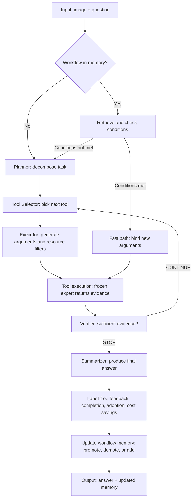
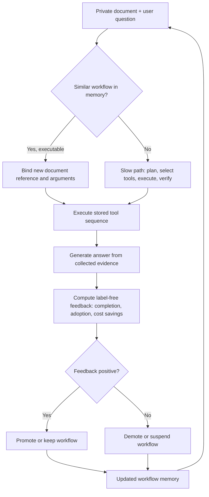

# Generalist Meets Specialists: An Evolving Multimodal Agent with Persistent Tool Orchestration for Traffic Scenario Understanding

> **Paper:** Linjia Kang, Binhan Jiang, Juan Yang, Zhiqin Song, Xiangsen Wu, Qionglin Ren, Jiang Liu, Zhongjiang He, Hao Sun - [arXiv abstract](https://arxiv.org/abs/2611.25868) - [local PDF](../papers/2611.25868.pdf)
> **Thursday - Agents, swarms, protocols, and channels** - published 2026-11-19 - selection score 15.75 (keyword relevance and recency; not a quality verdict)
>
> **DRAFT - written by an open model from the paper's extracted text.** Structure is machine-checked; numbers are NOT. Check every figure against the PDF before relying on it, and prefer rewriting this guide with the authoring spec if it matters.
>
> **REVIEW NEEDED:** the automated v2 checks flagged: 1 repeated long sentence(s), e.g. "It keeps the tool sequence (detect vehicle, detect pedestrian, detect crosswalk, check spa...".

## Read this first

The paper claims that a traffic-understanding agent can improve both accuracy and efficiency by learning when to reason carefully step-by-step and when to reuse previously successful tool sequences, achieving up to an 8.0% relative performance gain while cutting token consumption by up to 52.1%. This guide is for engineers and researchers who build or evaluate systems that combine large vision-language models with specialized perception tools, and for anyone curious about how an AI agent can learn from its own past successes without human labels. After reading, you will be able to explain how role-sensitive process feedback differs from terminal-only rewards, describe how a parameterized workflow is retrieved and adapted to a new question, and interpret the trade-off between slow reasoning and fast reuse shown in the paper's efficiency numbers. Estimated reading time: 18–22 minutes. The one thing most people get wrong about this paper is assuming that workflow reuse means blindly replaying old tool calls; in fact, the agent binds new arguments and resource references to a stored tool sequence, and it only reuses a workflow when execution feedback confirms the pattern is reliable. Venue not stated in the extracted text.

## The paper in one worked example

This section traces a single task through the StarTV-Agent system to show how slow reasoning, policy learning, and fast workflow reuse connect in practice. The example is drawn from the paper's description of the ReAct-based orchestration path and the experience evolution loop; specific numbers are taken from the stage-wise cost analysis in Table 6 and the workflow reuse statistics in Figure 2. The task is a Traffic-VQA question that asks about a traffic scene using an optical image. The paper does not provide the exact question text, so this guide constructs a representative query: "Is the car failing to yield to pedestrians?" This matches the illustration in Figure 1 of the paper and the Planner–Tool Selector–Executor–Verifier–Summary cycle described in Section 3.1.

The agent receives the optical image and the constructed question. Because this is the first task in a fresh experience store (the paper states "Each benchmark starts with an empty, isolated experience store"), no reusable workflow exists yet. The agent therefore enters the slow ReAct-based path. The policy, built on Qwen3-VL-8B-Instruct, steps through five decision roles.

First, the Planner analyzes the question and the image. It produces a structured plan that decomposes the task into subtasks: detect the car, detect pedestrians, locate the crosswalk, and check spatial relationships. The Planner outputs a JSON object with fields for subtasks, tools, and execution flow, as shown in the prompt design in Appendix F.1.1. The paper reports that on Traffic-VQA the Planner stage consumes on average 4,972 input tokens and takes 2.393 seconds (Table 6).

Second, the Tool Selector picks the next tool based on the plan and the current evidence state. For the first step it selects a detection tool, such as YOLO_Detector_Tool, to find the car. The Tool Selector's decision is guided by the shared tool-selection policy described in Appendix F.2: it checks that the tool's advertised label options contain the exact semantic label needed, and it compares capability and cost coefficients. The Tool Selector stage consumes on average 7,008 input tokens and 4.598 seconds on Traffic-VQA (Table 6).

Third, the Executor generates the tool arguments and resource references. It produces a JSON object with two fields: "resource_filters," which specifies how to select existing resources (set to null when working on the original image), and "params," which supplies tool-specific parameters such as the object class to detect. The Executor stage consumes on average 4,866 input tokens and 0.984 seconds (Table 6). The detection tool runs and returns a bounding box for the car, which is stored as a typed resource with a unique identifier and source dependency.

Fourth, the Verifier checks whether the accumulated evidence is sufficient to answer the question. It decides CONTINUE because pedestrians and the crosswalk have not yet been detected. The Verifier provides a concrete suggestion for the next step, such as "detect pedestrians in the scene." The Verifier stage consumes on average 6,617 input tokens and 4.294 seconds (Table 6). The cycle repeats: the Tool Selector picks a pedestrian detection tool, the Executor binds arguments, the tool runs, and the Verifier again checks sufficiency. After several cycles, the agent has detected the car, pedestrians, and the crosswalk, and has checked their spatial relationship.

Fifth, the Summarizer produces the final answer. It receives the accumulated resources and outputs a JSON object with an "Explain" field (a brief reasoning in Chinese, under 100 words) and an "Answer" field (a one-sentence final answer). The paper's Figure 1 shows the answer for this constructed example as "No," with the reason "The car is positioned to the right of the crosswalk and no pedestrian is waiting to cross." The Summary stage consumes on average 573 input tokens and 0.720 seconds (Table 6). Tool execution across all cycles takes 6.801 seconds.

After the answer is submitted, the agent evaluates the execution using label-free feedback signals (Section 3.3, Stage 3). It computes execution completion (the task finished successfully), tool adoption (how many of the prescribed tool calls were actually executed, using Equation 7), and cost savings relative to a reference cost updated by exponential moving average. Because no workflow was reused, the cost-savings signal is zero for this task. The agent then decides whether to store the tool sequence as a new candidate workflow. The paper states that "Completed executions not covered by existing workflows may generate new candidate workflows" (Section 3.3, Stage 4). The new workflow enters the memory in the "candidate" state. It must accumulate at least N_min = 2 uses with a positive feedback rate of at least gamma_prom = 0.6 before it can be promoted to "advice" and then "executable" (Section 4.1, implementation details).

Now suppose a second Traffic-VQA question arrives that is similar: "Is the bus failing to yield to the pedestrian at the intersection?" The agent retrieves workflows from memory using a hybrid of keyword and semantic search with reciprocal rank fusion. It checks applicability conditions against the new question and input metadata without calling the VLM. The paper reports that on Traffic-VQA, 40.00% of questions retrieve a matching workflow, and 21.51% directly reuse one (Figure 2). If the stored workflow's conditions are met, the agent enters the fast path. It keeps the tool sequence (detect vehicle, detect pedestrian, detect crosswalk, check spatial relationship) but generates new arguments: the vehicle class becomes "bus" instead of "car," and resource references point to the new image. The DAG of resource dependencies guides resolution at each step. The fast path avoids the Planner, Tool Selector, and Verifier stages entirely. The paper shows that on Traffic-VQA, workflow reuse reduces average input tokens from 27,355 to 24,189, an 11.6% saving, while accuracy improves by 0.9 percentage points (Table 5 and Figure 2). The workflow reuse step itself takes only 0.047 seconds (Table 6).

After execution, the agent again computes label-free feedback. If the tool sequence executed successfully and the adoption rate meets the threshold a_min = 0.4, and the average cost savings exceed s_min = -0.10, the use counts as positive. Over multiple tasks, the workflow's positive feedback rate determines whether it is promoted, kept, or suspended. The paper states that an invalid use immediately demotes an executable workflow to advice, while K_rev = 3 consecutive invalid uses trigger a revision that creates a new version in advice and suspends the old one (Section 3.3, Stage 4). Experience maintenance, which runs after the final answer, takes 3.649 seconds on Traffic-VQA (Table 6).



What to notice: The slow path cycles through Planner, Tool Selector, Executor, and Verifier for every tool call, while the fast path skips directly from retrieval to parameterized execution, avoiding repeated planning and verification. The feedback loop after every answer updates the memory that future tasks consult, creating a self-reinforcing cycle where successful tool sequences become reusable workflows.

## Words you need

| Term | Plain definition | Example from the worked example |
|---|---|---|
| Vision-Language Model (VLM) | A model that takes both images and text as input and produces text output, enabling it to answer questions about visual content. | The paper uses Qwen3-VL-8B-Instruct as the backbone VLM that coordinates all tool use. |
| ReAct (Reasoning + Acting) | A pattern where the agent interleaves thinking steps with tool-calling actions, observing results before deciding the next step. | The slow path cycles through Planner, Tool Selector, Executor, and Verifier, each producing a thought and an action. |
| Role-Sensitive Process Optimization (RSPO) | A training method that scores each intermediate decision by its role (planning, tool selection, etc.) rather than waiting for the final answer to judge quality. | RSPO assigns a score pi,t in [0,1] to each Planner, Tool Selector, Executor, Verifier, and Summary decision during training. |
| Weakness-Driven Demonstration Learning (WDL) | A training method that identifies questions the student model gets wrong, then generates successful teacher demonstrations only for those weak questions. | Questions with mean raw task reward below η = 0.8 are selected for teacher demonstration generation. |
| Lightweight Adaptive Workflow Reuse (LAWR) | An inference-time mechanism that retrieves stored tool sequences from memory, binds new arguments, and executes them without repeated planning. | On Traffic-VQA, 21.51% of questions directly reuse a workflow, skipping Planner, Tool Selector, and Verifier. |
| Label-free feedback | Execution quality signals computed from tool traces without human labels or reference answers, used to update workflow memory. | The three signals are execution completion, tool adoption (Equation 7), and cost savings relative to an exponential moving average reference cost. |
| Workflow state | A lifecycle stage controlling whether a stored tool sequence can be reused: candidate, advice, executable, or suspended. | A new workflow starts as candidate, needs at least N_min = 2 uses with positive feedback rate at least gamma_prom = 0.6 to reach advice, then one more positive use to become executable. |
| Directed Acyclic Graph (DAG) of resource dependencies | A structure that records which tool outputs depend on which earlier outputs, so the agent knows what evidence must exist before each step. | When reusing a workflow for a bus instead of a car, the DAG guides resolution of resource references at each step. |

## Tutorial 1 - Intuitive understanding

### What was broken before

Before this paper, traffic-understanding agents faced a dilemma. When an agent used specialized tools such as detectors and classifiers, it had to plan which tools to call, generate arguments, and check whether the collected evidence was sufficient. The only training signal came from whether the final answer was correct, a terminal reward. This is like a driving instructor who only tells you whether you arrived at the destination, never commenting on your lane changes, mirror checks, or braking decisions along the way. The paper reports that terminal-only RL improved accuracy on Traffic-VQA from 41.3% to only 42.0% (Table 4), showing that final-answer feedback alone provides weak guidance for multi-step tool orchestration. Meanwhile, many traffic questions share reusable patterns, detecting a vehicle, detecting pedestrians, checking spatial relationships, but agents planned from scratch every time, wasting computation on repeated reasoning. The paper reports that without workflow reuse, the slow path consumed 27,355 input tokens per question on Traffic-VQA (Figure 2, left panel).

### The idea

Think of a hospital emergency department. A triage nurse first assesses each patient. Patients with familiar, routine conditions such as a straightforward fracture follow a fast track: a predefined protocol of X-ray, splinting, and discharge instructions. The staff do not re-debate the protocol; they fill in patient-specific details like which bone and which arm. Patients with unusual or complex symptoms follow a slow track: a doctor plans diagnostic steps one by one, orders tests, reviews results, and decides whether more tests are needed before reaching a diagnosis. After treating any patient, the hospital reviews whether the protocol worked. If a protocol consistently produces good outcomes, it stays active. If it fails repeatedly, it is revised or suspended. New protocols can be created from successful ad-hoc treatment sequences.

This is exactly how StarTV-Agent works. The slow track is ReAct-based orchestration, where the agent plans, selects tools, executes, and verifies in a cycle. The fast track is LAWR, where a stored workflow is retrieved and executed with new arguments. The hospital review process is the label-free feedback loop that promotes, demotes, or suspends workflows based on execution completion, tool adoption, and cost savings.

Where the analogy breaks: the hospital protocols are written by human experts based on medical knowledge. StarTV-Agent's workflows are discovered automatically from its own successful executions, without human labels or reference answers. The agent decides what is worth reusing based purely on execution feedback signals, not on whether the final answer was correct. The paper states that "Observed answers may be WRONG: never memorize an answer, count, label or source value" (Appendix F.4.1).

### How it works, step by step

We trace the worked example from the opening part: the question "Is the car failing to yield to pedestrians?" with an optical image.

Step 1: Check memory for a reusable workflow. The agent searches its external memory using a hybrid of keyword and semantic search with reciprocal rank fusion. It checks applicability conditions against the question and input metadata without calling the VLM. Since this is the first task and the experience store is empty, no workflow matches. The agent enters the slow ReAct path.

Step 2: Planner decomposes the task. The Planner analyzes the question and image, producing a structured plan: detect the car, detect pedestrians, locate the crosswalk, and check spatial relationships. It outputs a JSON object with fields for subtasks, tools, and execution flow. The paper reports this stage consumes on average 4,972 input tokens and 2.393 seconds on Traffic-VQA (Table 6).

Step 3: Tool Selector picks the first tool. Based on the plan and current evidence state, it selects YOLO_Detector_Tool to find the car. It checks that the tool's advertised label options contain the exact semantic label needed, and compares capability and cost coefficients using the shared tool-selection policy. This stage consumes 7,008 input tokens and 4.598 seconds (Table 6).

Step 4: Executor generates arguments. It produces a JSON object with resource_filters (set to null when working on the original image) and params specifying the object class to detect. This stage consumes 4,866 input tokens and 0.984 seconds (Table 6). The detection tool runs and returns a bounding box for the car, stored as a typed resource with a unique identifier and source dependency.

Step 5: Verifier checks sufficiency. It decides CONTINUE because pedestrians and the crosswalk have not yet been detected. It provides a concrete suggestion for the next step. This stage consumes 6,617 input tokens and 4.294 seconds (Table 6). The cycle repeats for pedestrian detection and crosswalk detection.

Step 6: Summarizer produces the final answer. After several cycles, the agent has all needed evidence. The Summarizer outputs a JSON object with an Explain field (brief reasoning in Chinese, under 100 words) and an Answer field. The paper's Figure 1 shows the answer as "No," with the reason "The car is positioned to the right of the crosswalk and no pedestrian is waiting to cross." This stage consumes 573 input tokens and 0.720 seconds (Table 6).

Step 7: Label-free feedback evaluates the execution. The agent computes execution completion (the task finished successfully), tool adoption (how many prescribed tool calls were actually executed, using Equation 7), and cost savings relative to a reference cost updated by exponential moving average. Since no workflow was reused, the cost-savings signal is zero.

Step 8: Update workflow memory. The completed execution is not covered by any existing workflow, so it may generate a new candidate workflow. The new workflow enters memory in the candidate state. It must accumulate at least N_min = 2 uses with a positive feedback rate of at least gamma_prom = 0.6 before promotion to advice and then executable.

Now suppose a second similar question arrives: "Is the bus failing to yield to the pedestrian at the intersection?" The agent retrieves the stored workflow. If applicability conditions are met, the agent enters the fast path. It keeps the tool sequence (detect vehicle, detect pedestrian, detect crosswalk, check spatial relationship) but generates new arguments: the vehicle class becomes "bus" instead of "car," and resource references point to the new image. The DAG of resource dependencies guides resolution at each step. The fast path avoids the Planner, Tool Selector, and Verifier stages entirely. The paper reports that on Traffic-VQA, workflow reuse reduces average input tokens from 27,355 to 24,189, an 11.6% saving, while accuracy improves by 0.9 percentage points (Table 5 and Figure 2). The workflow reuse step itself takes only 0.047 seconds (Table 6).

### What the results say

The paper reports several key measurements across three benchmarks. All numbers below come from the paper's tables and figures.

Accuracy on Traffic-VQA: StarTV-Agent achieves 45.7% mean accuracy across optical, thermal infrared, and multimodal settings, compared with 42.3% for the untrained VLM-only backbone and 43.1% for TAU-Agent (Table 2). What is counted: the percentage of questions answered correctly, averaged across three visual modalities. What a change of this size means: the 3.4 percentage-point gain over the backbone represents an 8.0% relative improvement, meaning roughly one additional correct answer for every 29 questions.

Accuracy on TUMTraf VideoQA: StarTV-Agent achieves 58.3% overall accuracy, compared with 55.9% for the backbone and 55.0% for TAU-Agent (Table 1). The gain of 2.4 percentage points over the backbone is measured across ten question categories including positioning, counting, motion, class, and existence.

Token savings from workflow reuse: On Traffic-VQA, average input tokens drop from 27,355 to 24,189, an 11.6% reduction (Figure 2, left panel). On RoadSceneVQA, tokens drop from 24,294 to 11,634, a 52.1% reduction. What is counted: total input tokens consumed by the VLM across all stages per question, averaged over the benchmark. A 52.1% reduction means the agent uses roughly half the computation when workflow reuse is active.

Workflow reuse rates: On Traffic-VQA, 40.00% of questions retrieve a matching workflow, and 21.51% directly reuse one (Figure 2, right panel). On RoadSceneVQA, 80.70% retrieve a match and 77.40% reuse one. The gap between retrieval and execution shows the agent does not blindly follow retrieved workflows; only those whose conditions are met enter the fast path.

Ablation of policy learning components: Terminal-only RL improves Traffic-VQA accuracy from 41.3% to 42.0%. Adding RSPO raises it to 44.4%. Adding WDL with weakness-based selection further raises it to 44.8% (Table 4). Replacing weakness-based selection with balanced random sampling drops accuracy to 41.2%, showing that targeting the student's actual weak questions matters more than simply adding more demonstrations.

Stage-wise cost: On Traffic-VQA, the four decision stages from Planner to Verifier consume 23,463 input tokens and 12.269 seconds per question (Table 6). The workflow reuse step takes 0.047 seconds. This explains why avoiding repeated planning matters: the slow path spends over 12 seconds on reasoning before tools even run, while the fast path skips directly to execution.

### What this does not show

Limits stated by the authors: The paper states that "experience complements rather than replaces reasoning: workflows must remain applicable to new inputs, and execution feedback does not necessarily reflect answer correctness" (Section 5). This means a workflow can execute successfully and receive positive feedback while producing a wrong answer, because the feedback signals check execution completion and tool adoption, not answer accuracy. The paper also notes that future work should explore "richer feedback signals and more flexible workflow adaptation across tasks."

Limits this guide infers: The experiments use three specific traffic-understanding benchmarks with frozen expert tools. The paper does not show how StarTV-Agent behaves when the tool set changes, when new tools are added, or when tools are updated. The workflow memory starts empty for each benchmark, so the reported reuse rates reflect learning from scratch within a single evaluation run; the paper does not report how workflows accumulate across multiple runs or over much longer sequences of tasks. The policy learning uses a specific VLM backbone (Qwen3-VL-8B-Instruct) with a specific process-scoring model (Qwen3.8-27B) and a specific teacher (Kimi-K3); the paper does not show how sensitive results are to these choices. The real-world deployment evaluation uses a private dataset of 1,999 samples that cannot be publicly released, so independent verification of those results is not possible.

### Teach-back

1. Why does the agent sometimes plan from scratch even when a workflow exists in memory?
<details><summary>Answer</summary>
The agent checks each retrieved workflow's applicability conditions against the current question and input metadata. If no workflow's conditions are met, the agent falls back to the slow ReAct path. The paper reports that on Traffic-VQA, 40.00% of questions retrieve a matching workflow but only 21.51% directly reuse one, showing that nearly half of retrieved workflows are deemed unsuitable after condition checking.
</details>

2. What three signals make up the label-free feedback, and what does each measure?
<details><summary>Answer</summary>
Execution completion indicates whether the task finished successfully. Tool adoption, defined in Equation 7 as Match(T(e), T(τ)) / |T(e)|, measures how many of the prescribed tool calls were actually executed. Cost savings, defined as (Cref - C(τ)) / Cref, measures relative cost reduction compared with a reference cost updated by exponential moving average. None of these signals checks whether the final answer is correct.
</details>

3. What must happen before a candidate workflow can be reused in the fast path?
<details><summary>Answer</summary>
A candidate workflow must accumulate at least N_min = 2 uses with a positive feedback rate of at least gamma_prom = 0.6 to be promoted to advice. Then one additional positive use promotes it to executable, which is the state that enables direct reuse in the fast path. A use counts as positive when execution completes, tool adoption meets the threshold a_min = 0.4, and average cost savings exceed s_min = -0.10.
</details>

4. On RoadSceneVQA, token consumption drops by 52.1% with workflow reuse, but GPT-Score stays at 0.694. What does this tell us?
<details><summary>Answer</summary>
The fast path avoids repeated planning, tool selection, and verification, which the paper's Table 6 shows consume 11,110 input tokens on RoadSceneVQA. The unchanged GPT-Score of 0.694 (Table 5) indicates that skipping these stages does not harm answer quality for tasks where reusable workflows apply. The efficiency gain comes from not redoing work that the stored tool sequence already captures, while the answer quality is preserved because the Summarizer still receives the same tool outputs.
</details>

5. How does RSPO differ from training with only a terminal reward?
<details><summary>Answer</summary>
RSPO combines a terminal advantage (comparing whole trajectories for the same question) with a process advantage (comparing individual decisions that share the same role and occurrence index). The process evaluator assigns a score pi,t in [0,1] to each Planner, Tool Selector, Executor, Verifier, and Summary decision based on its role, available evidence, and tool feedback. The paper reports that adding RSPO to terminal-only RL improves Traffic-VQA accuracy from 42.0% to 44.4% (Table 4), showing that per-step feedback provides learning signals that a single final score cannot.
</details>

## Tutorial 2 - Practitioner understanding

### The design in concrete terms

The system is built around a shared VLM policy (Qwen3-VL-8B-Instruct) that plays five distinct roles, each with its own prompt template and output schema. The policy never sees training reference answers; it receives only the question, input media, interaction history, collected evidence resources, and remaining budget.

**Data structures.** Evidence is stored as typed resources with unique identifiers and source dependencies forming a directed acyclic graph (DAG). Each resource carries a type (e.g., IMAGE, OBJECT), attributes (label, bounding box, confidence), and a pointer to the tool call that produced it. The workflow memory M(n) stores entries ej = (Wj, gj, zj, sj) where Wj is a tool sequence with a DAG of resource placeholders, gj holds applicability conditions (required modalities, temporal flag, minimum image count, notes), zj is the state from {candidate, advice, executable, suspended}, and sj tracks usage statistics including usesj, winsj, and a rolling average of cost savings S̄j over the last KS = 3 observations.

**Message formats.** Every role outputs JSON. The Planner returns {"thought": str, "ismatch": "YES"|"NO"|"UNKNOWN", "subtasks": [str], "tools": [str], "execution_flow": [str]}. The Tool Selector returns {"thought": str, "context": str, "sub_goal": str, "tool_name": str}. The Executor returns {"resource_filters": list|null, "params": dict}. The Verifier returns {"thought": str, "Conclusion": "STOP"|"CONTINUE", "Explain": str, "result_filters": list|null, "suggestion": str}. The Summarizer returns {"Explain": str (Chinese, under 100 words), "Answer": str}. The shared tool-selection policy text (Appendix F.2) is injected into Planner and Tool Selector prompts and enforces a three-tier rule: capability and evidence first, then output sufficiency, then cost comparison using user_metadata.performance_coefficient and user_metadata.cost_coefficient.

**Hyper-parameters.** RSPO uses α = 0.8, β = 0.2 (Equation 3). WDL selects weak questions with η = 0.8 (Equation 4). LAWR sets amin = 0.4, smin = -0.10, KS = 3, Nmin = 2, γprom = 0.6, Krev = 3. The reference cost Cref uses an exponential moving average with smoothing factor 0.3. RL training uses a GSPO-style length-normalized, sequence-level clipped objective. SFT uses LoRA. The process evaluator (Qwen3.8-27B) returns scalar scores pi,t in [0,1] per decision. The teacher for WDL is Kimi-K3. Training runs on 8 × NVIDIA A800 GPUs with seed 42. Each benchmark starts with an empty, isolated experience store.

**Prompts.** The Planner prompt (Appendix F.1.1) includes a strict gate: ismatch returns "NO" only when the image clearly conflicts with the query, terminating the task. The Tool Selector prompt (Appendix F.1.2) enforces an anti-repetition rule: same tool plus same goal plus same input is forbidden. The Executor prompt (Appendix F.1.3) separates framework parameters (resource_filters) from business parameters (params) and forbids generating system parameters like image or bbox. The Verifier prompt (Appendix F.1.4) classifies queries into info type, condition type, or composite type to construct result_filters correctly. The Summarizer prompt (Appendix F.1.5) requires Chinese explanation under 100 words.

### A minimal version

The code below sketches the inference loop with workflow reuse. It was not executed and omits RL training, SFT, experience maintenance prompts, and the full tool inventory.

```python
# Shapes: question: str, images: list[Image], memory: dict, tools: dict[str, Tool]
# Each Tool has .run(params, resources) -> Resource and .metadata with label_options, cost_coefficient
# Resource: {id, type, label, bbox, confidence, source_tool}

def retrieve_workflow(question, images, memory):
    # Hybrid keyword + semantic search with reciprocal rank fusion (not shown)
    for wf in rank(memory["workflows"]):
        if check_conditions(wf["requirements"], images):
            return wf
    return None

def bind_arguments(wf, question, images):
    # Generate new params and resource_filters per step via VLM call (Executor role)
    bound_steps = []
    resources = []
    for step in wf["content"].values():
        exec_out = call_vlm("executor", question=question, tool_name=step["tool_name"],
                            sub_goal=step["sub_goal"], resources=resources)
        result = tools[step["tool_name"]].run(exec_out["params"], resources)
        resources.append(result)
        bound_steps.append(result)
    return bound_steps

def react_loop(question, images, tools):
    plan = call_vlm("planner", question=question, images=images, tools=tools)
    if plan["ismatch"] == "NO": return None
    resources, history = [], []
    while True:
        ts = call_vlm("tool_selector", question=question, plan=plan,
                      resources=resources, history=history, tools=tools)
        ex = call_vlm("executor", question=question, tool_name=ts["tool_name"],
                      sub_goal=ts["sub_goal"], resources=resources)
        result = tools[ts["tool_name"]].run(ex["params"], resources)
        resources.append(result); history.append(ts)
        ver = call_vlm("verifier", question=question, plan=plan,
                       resources=resources, history=history)
        if ver["Conclusion"] == "STOP": break
    summary = call_vlm("summary", question=question, resources=resources)
    return summary, resources, history

def feedback(trace, wf):
    complete = trace["completed"]
    adopt = len(set(trace["tools"]) & set(wf["tools"])) / len(wf["tools"])
    savings = (C_ref - trace["cost"]) / C_ref  # C_ref updated via EMA
    return complete, adopt, savings

def update_memory(memory, wf, feedback):
    # Apply promotion/demotion/suspension rules per Section 3.3 Stage 4
    # Uses N_min=2, gamma_prom=0.6, K_rev=3, a_min=0.4, s_min=-0.10
    pass  # Detailed state machine omitted for brevity

def infer(question, images, memory, tools):
    wf = retrieve_workflow(question, images, memory)
    if wf and wf["state"] == "executable":
        results = bind_arguments(wf, question, images)
        summary = call_vlm("summary", question=question, resources=results)
    else:
        summary, resources, history = react_loop(question, images, tools)
    fb = feedback(trace, wf) if wf else (True, 0.0, 0.0)
    update_memory(memory, wf, fb)
    return summary
```

### What it costs

The paper reports stage-wise costs on two benchmarks (Table 6). This guide works through the arithmetic for Traffic-VQA, where workflow reuse is less frequent, to show the upper bound.

**Token consumption per question (Traffic-VQA, slow path).** Planner: 4,972 input + 166 output = 5,138 tokens. Tool Selector: 7,008 + 337 = 7,345. Executor: 4,866 + 53 = 4,919. Verifier: 6,617 + 302 = 6,919. Summary: 573 + 55 = 628. Total VLM tokens per question: 24,949 (this guide infers by summing the five stages; the paper reports 27,355 average input tokens without reuse in Figure 2, which includes multiple tool-selector cycles). The paper states that with workflow reuse, average input tokens drop to 24,189 (an 11.6% saving).

**Time per question (Traffic-VQA, slow path).** Planner: 2.393 s. Tool Selector: 4.598 s. Executor: 0.984 s. Verifier: 4.294 s. Summary: 0.720 s. Tool execution: 6.801 s. Experience maintenance: 3.649 s. Total: 23.439 s (this guide infers by summing; the paper does not state a single total). Workflow reuse itself takes 0.047 s.

**Money.** The paper does not report API pricing or GPU-hour costs. This guide makes assumptions: (Assumption 1) Qwen3-VL-8B-Instruct pricing is approximately $0.20 per million input tokens and $0.40 per million output tokens (typical for 8B-class hosted VLMs). (Assumption 2) One slow-path Traffic-VQA question consumes roughly 27,355 input and roughly 1,100 output tokens (this guide infers from Table 6 stage sums). Cost per question: (27,355/1e6 × $0.20) + (1,100/1e6 × $0.40) ≈ $0.00547 + $0.00044 = $0.00591. At 21.51% reuse (Figure 2), roughly one in five questions takes the fast path, saving approximately 3,166 input tokens per reused question (27,355 - 24,189). (Assumption 3) A deployment handling 10,000 questions per day would spend approximately $59/day on VLM inference without reuse, and roughly $54/day with reuse, saving about $5/day. These figures exclude tool execution costs, GPU hosting for frozen experts, and experience maintenance overhead.

**Latency.** The paper reports per-stage times but not end-to-end latency percentiles. The slow path accumulates roughly 12.3 seconds in VLM decision stages plus 6.8 seconds in tool execution (Table 6). The fast path avoids Planner, Tool Selector, and Verifier, saving approximately 11.3 seconds of VLM time per question.

### How it fails

| Symptom | Likely cause | Mitigation |
|---|---|---|
| Workflow retrieval rate is high but execution reuse rate is low (gap of 18.5 percentage points on Traffic-VQA, Figure 2) | Retrieved workflow fails applicability-condition checks or is not yet promoted to executable state | Tune applicability conditions (modalities, temporal flag, min_images) per benchmark; lower N_min or γprom if promotion is too slow |
| Accuracy drops when WDL uses balanced random sampling instead of weakness-based selection (Traffic-VQA falls from 44.8% to 41.2%, Table 4) | Teacher demonstrations on already-solved tasks provide no new learning signal; the student overfits to easy patterns | Always filter demonstration candidates by R̄q < η; the paper uses η = 0.8 |
| Executable workflow is immediately demoted to advice after one invalid use (Section 3.3, Stage 4) | A single tool-call failure or resource-filter miss triggers demotion; the workflow may still be sound for most inputs | Increase the demotion threshold or require K_rev consecutive invalid uses before demotion (the paper already uses K_rev = 3 for revision, but demotion is immediate) |
| Verifier stage dominates token cost (6,617 input tokens on Traffic-VQA, 6,945 on RoadSceneVQA, Table 6) | The Verifier prompt includes extensive evidence-validation rules and resource-filter semantics (Appendix F.1.4) | Shorten the Verifier system prompt; move resource-filter construction to a separate lightweight step |
| RL training shows large fluctuations in mean task reward (Figure 3a) | Process advantages introduce variance when the process evaluator's scores are inconsistent across similar decisions | Increase β smoothing or use a larger batch of trajectories per question to stabilize group statistics µ and σ |
| Workflow reuse saves 52.1% tokens on RoadSceneVQA but only 11.6% on Traffic-VQA (Figure 2) | Traffic-VQA questions share fewer reusable tool-use patterns; the fast path is triggered less often | Accept lower reuse rates on heterogeneous benchmarks; do not force reuse where conditions are not met |

### Evaluating your version

**Metric.** Overall accuracy (OA) on Traffic-VQA, defined as the arithmetic mean of accuracy on optical (OPT), thermal infrared (TIR), and multimodal (MUL) subsets. The paper reports this in Table 2.

**Test set size.** Not stated in the extracted text. The paper states it follows the original dataset splits for each benchmark (Section 4.1); the Traffic-VQA paper (Zhang et al., 2026c) defines the split.

**Baseline.** The untrained backbone Qwen3-VL-8B-Instruct with ReAct-based tool orchestration but no workflow reuse, no RSPO, and no WDL. The paper reports this as 42.3% OA on Traffic-VQA (Table 5, VLM-only row uses no tools; the w/o LAWR row at 44.8% uses ReAct with tools but no reuse—this guide infers the appropriate baseline for a builder adding LAWR is the w/o LAWR row). A second baseline is Terminal-only RL at 42.0% (Table 4).

**Stop rule.** The paper evaluates a single final checkpoint (Section 4.1: "We use the final trained checkpoint for the main comparisons"). For a reproduction, this guide infers: train until the validation score on the held-out 5% split (Appendix D) stops improving for 5 consecutive actor update steps, monitoring both OA and approximate KL divergence (Figure 3b shows KL returning to near zero after early spikes). If KL diverges above 0.02 and does not recover within 10 steps, stop and revert to the best-validation checkpoint.

### Adopt, adapt or skip

**Recommendation for a team building an assistant over private business documents, using open or smaller models where possible: Adapt with caution.**

The paper does not bear directly on private business documents. Its domain is traffic scenario understanding with frozen perception tools (detectors, classifiers, traffic-violation assessors). However, three architectural ideas transfer:

1. **Role-sensitive process feedback (RSPO).** If your assistant uses multi-step tool calls (search, retrieve, summarize, verify), replacing terminal-only rewards with per-role advantage signals could improve intermediate decisions. You would need to define roles relevant to your domain and build a process evaluator (the paper uses a separate 27B model). This adds training complexity.

2. **Parameterized workflow reuse (LAWR).** If your users ask structurally similar questions (e.g., "Summarize the Q3 revenue section of document X"), storing tool sequences with placeholder arguments and binding new document references at runtime could cut token costs. The paper's label-free feedback signals (completion, adoption, cost savings) require no human labels, which is attractive for private data.

3. **Weakness-driven demonstrations (WDL).** Identifying questions where your assistant performs poorly and generating targeted teacher demonstrations could improve edge-case handling without annotating your entire document collection.

**Reasons to skip:** The paper's 22-tool inventory is traffic-specific. The workflow memory assumes tool sequences are reusable across inputs; business documents with heterogeneous structures may not exhibit the 77-80% retrieval hit rates seen on RoadSceneVQA. The process evaluator requires a separate, larger model (Qwen3.8-27B) for scoring, which may exceed your compute budget if you aim for open or smaller models. The paper does not evaluate with open-weight models smaller than 7B.

**If you adapt:** Start with LAWR alone (Table 5 shows it adds 0.9 points on Traffic-VQA and 0 points on RoadSceneVQA while cutting tokens by 11-52%, without any policy training). Define workflows as sequences of your existing tool calls. Use the paper's state machine (candidate → advice → executable, with N_min = 2, γprom = 0.6, immediate demotion on invalid use) as a starting point. Add RSPO and WDL only if your slow-path accuracy is insufficient.



What to notice: The loop from feedback back to memory is the self-reinforcing mechanism. Workflows that repeatedly produce complete executions with high tool adoption and acceptable cost get promoted and reused; unreliable workflows get demoted without human intervention. The slow path remains available as a fallback for novel questions, so the system degrades gracefully rather than failing when no workflow matches.

## Tutorial 3 - Researcher understanding

### Formal setup

The system is a policy π_θ that maps a traffic input x (images or video frames) and a question q to a sequence of decisions y_t, each conditioned on a state s_t and a decision role d_t. The state s_t = (q, x, H_t, R_t, b_t) contains the interaction history H_t, collected evidence resources R_t, and a remaining budget b_t. The role d_t takes one of five values: Planner, Tool Selector, Executor, Verifier, Summary. The policy coordinates a set of frozen expert tools E (22 tools across four categories, listed in Appendix E of the paper). Tool outputs are stored as typed resources with unique identifiers and source dependencies.

During training, the agent samples multiple trajectories per question and receives a terminal task reward R_i. A process evaluator assigns a per-decision score p_{i,t} in [0,1] based on the decision's role, available evidence, and tool feedback. The paper defines terminal advantage A_term_i = (R_i - μ_term_q) / (σ_term_q + ε) and process advantage A_proc_{i,t} = (p_{i,t} - μ_proc_{q,h}) / (σ_proc_{q,h} + ε), where h denotes the decision role and its occurrence index, and μ and σ are group statistics. These are combined as A_{i,t} = α A_term_i + β A_proc_{i,t} with α + β = 1. The paper sets α = 0.8 and β = 0.2. The student is trained with a GSPO-style length-normalized, sequence-level clipped objective using A_{i,t} for each role-conditioned response.

After RL training, WDL selects questions with mean raw task reward R̄_q < η where η = 0.8. An independent teacher generates demonstrations, and a filter retains those that complete successfully and meet task-specific reward requirements. The RL-trained policy is then fine-tuned with an SFT loss on accepted model-call events from all five roles.

During inference, the agent maintains an external memory M(n) = {e_j = (W_j, g_j, z_j, s_j)}_j, where W_j defines a tool sequence and a DAG of resource dependencies, g_j specifies applicability conditions, z_j denotes the workflow state in {candidate, advice, executable, suspended}, and s_j stores usage statistics. The index n denotes successive tasks. LAWR evaluates each workflow use through execution completion u(τ), tool adoption Adopt(e_j, τ) = Match(T(e_j), T(τ)) / |T(e_j)|, and relative cost savings S(τ) = (C_ref - C(τ)) / C_ref, where C_ref is updated by exponential moving average with smoothing factor 0.3. A use receives positive feedback when u(τ) is true, Adopt(e_j, τ) ≥ a_min, and S̄_j > s_min. The paper sets a_min = 0.4, s_min = -0.10, K_S = 3, N_min = 2, γ_prom = 0.6, and K_rev = 3.

A numeric toy instance (constructed by this guide): Suppose three tasks arrive. Task 1 has no matching workflow, so the slow path runs Planner (4,972 input tokens), Tool Selector (7,008), Executor (4,866), Verifier (6,617), and Summary (573), totaling 24,036 VLM input tokens. The execution completes, Adopt = 1.0, and S = 0.15. Since uses_j = 1 < N_min = 2, the new workflow stays candidate. Task 2 retrieves this candidate workflow; conditions are met, so the fast path runs, consuming only the Summary stage (573 tokens) plus workflow reuse overhead (0 tokens, 0.047 seconds). Adopt = 0.8 ≥ 0.4, S̄_j = 0.12 > -0.10, so uses_j = 2 and wins_j = 2, giving WR_j = 1.0 ≥ 0.6. The workflow promotes to advice. Task 3 retrieves it again, fast path succeeds, and one more positive use promotes it to executable. The paper reports that on Traffic-VQA, 40.00% of questions retrieve a matching workflow and 21.51% directly reuse one (Figure 2).

### The claims, stated precisely

Claim 1 (performance): StarTV-Agent achieves up to 8.0% relative performance improvement over baselines across three traffic understanding benchmarks while reducing token consumption by up to 52.1% (paper abstract, Section 1). The paper reports this as the headline result; this guide infers the 8.0% figure is computed from the largest relative gain among the three benchmarks, though the paper does not specify which benchmark yields that maximum.

Claim 2 (RSPO effectiveness): Role-Sensitive Process Optimization, which combines process advantages with terminal advantages using α = 0.8 and β = 0.2, improves accuracy on Traffic-VQA from 42.0% (terminal-only RL) to 44.4% (Table 4). The paper claims this shows that role-sensitive process feedback provides more useful learning signals than terminal rewards alone.

Claim 3 (WDL effectiveness): Weakness-Driven Demonstration Learning further improves Traffic-VQA accuracy from 44.4% to 44.8%, and replacing weakness-based question selection with balanced random sampling reduces accuracy to 41.2% (Table 4). The paper claims this demonstrates that demonstrations targeting the student's weaknesses are more effective than uniformly sampled demonstrations.

Claim 4 (LAWR efficiency): Lightweight Adaptive Workflow Reuse reduces average input tokens per question by 11.6% on Traffic-VQA (from 27,355 to 24,189) and by 52.1% on RoadSceneVQA (from 24,294 to 11,634), while maintaining or improving accuracy (Figure 2, Table 5). On Traffic-VQA, accuracy improves from 44.8% to 45.7% when LAWR is added.

Claim 5 (workflow reuse selectivity): The gap between retrieval hit rate and execution reuse rate (40.00% vs. 21.51% on Traffic-VQA; 80.70% vs. 77.40% on RoadSceneVQA, Figure 2) shows that the agent does not blindly follow retrieved workflows but only reuses those whose applicability conditions are met.

Claim 6 (real-world generalization): On a private traffic-violation dataset of 1,999 binary VQA samples, StarTV-Agent achieves 75.9% overall accuracy and 79.0% F1, outperforming the strongest VLM baseline by 15.7% and 6.1% respectively in relative terms (Table 7, Appendix A).

### Evidence, table by table

Table 1 (TUMTraf VideoQA): Rows are methods, columns are five question categories (Positioning, Counting, Motion, Class, Existence) each split into Easy and Hard, plus Overall. StarTV-Agent achieves 58.3% overall, the highest among non-frontier models. It reaches 83.8% on Easy counting (surpassing all frontier VLMs) and 71.7% on Hard existence (9.1 points above the strongest non-frontier baseline). This table identifies an association between StarTV-Agent's policy learning and improved fine-grained video understanding, but does not isolate which component (RSPO, WDL, or LAWR) drives each category gain.

Table 2 (Traffic-VQA): Rows are methods, columns are three modalities (OPT, TIR, MUL) and their Mean. StarTV-Agent achieves 45.7% mean accuracy, the highest among non-frontier models. It ranks first on OPT (44.4%) and TIR (45.4%), with a 3.5-point gain over the strongest non-frontier baseline on TIR. On MUL it ranks second at 47.2%. This table associates StarTV-Agent with strong cross-modal performance, particularly on thermal infrared, but does not causally separate policy learning from workflow reuse effects.

Table 3 (RoadSceneVQA): Rows are methods, columns are seven metrics (Exact Match, ROUGE-L, BLEU-4, METEOR, CIDEr, SPICE, GPT-Score). StarTV-Agent achieves GPT-Score 0.694, ranking second among non-frontier models and improving upon its backbone by 0.051. It approaches frontier-scale DeepSeek-V4.1-Flash (0.703) and Kimi-K3 (0.706). This table associates StarTV-Agent with competitive open-ended answer quality but does not isolate the contribution of tool use versus workflow reuse.

Table 4 (Ablation of policy learning components): Rows are five variants from untrained backbone to full StarTV-Agent. Columns are binary indicators for RL, RSPO, Demo SFT, and Weak Sel., plus RoadSceneVQA GPT-Score and Traffic-VQA OA. Terminal-only RL improves Traffic-VQA from 41.3% to 42.0%. Adding RSPO (w/o WDL) reaches 44.4%. Adding WDL with weakness selection reaches 44.8%. Replacing weakness selection with random sampling drops accuracy to 41.2% and GPT-Score from 0.694 to 0.684. This table causally isolates RSPO (comparing row 3 to row 2) and WDL with weakness selection (comparing row 5 to rows 3 and 4). It shows that both components are necessary and that weakness-driven selection is critical.

Table 5 (Ablation of LAWR): Rows are three inference variants: VLM-only (no tools, no ReAct, no LAWR), w/o LAWR (ReAct path only), and StarTV-Agent (both paths). On Traffic-VQA, w/o LAWR improves accuracy from 42.3% to 44.8% over VLM-only; adding LAWR reaches 45.7%. On RoadSceneVQA, GPT-Score improves from 0.643 to 0.694 with ReAct, and stays at 0.694 with LAWR. This table causally isolates the effect of tool orchestration (row 2 vs. row 1) and the additional effect of workflow reuse (row 3 vs. row 2). It shows that tool use alone provides most of the gain on RoadSceneVQA, while workflow reuse adds further gain on Traffic-VQA.

Table 6 (Stage-wise inference cost): Rows are stages (Planner through Experience Maintenance), columns are average input tokens, output tokens, and time in seconds, reported separately for Traffic-VQA and RoadSceneVQA. On Traffic-VQA, Planner through Verifier consume 23,463 input tokens and 12.269 seconds. Workflow reuse takes 0.047 seconds. On RoadSceneVQA, the Verifier alone consumes 6,945 input tokens and 2.897 seconds. This table identifies which stages dominate cost and explains why avoiding them via the fast path yields the savings shown in Figure 2. It does not establish causality but quantifies the mechanism.

Table 7 (Real-world traffic-violation dataset): Rows are six VLM baselines plus StarTV-Agent, columns are six violation categories with accuracy and F1 each, plus overall accuracy and F1. StarTV-Agent achieves 75.9% overall accuracy and 79.0% F1, ranking first on four of six categories. The paper reports this as evidence of practical generalization but notes the dataset is private and cannot be publicly released (Appendix A). This table associates StarTV-Agent with strong real-world performance but cannot be independently verified.

Figure 2 (Token efficiency and workflow reuse): Left panel shows average input tokens per question with and without workflow reuse on two benchmarks. Right panel shows workflow retrieval hit rate and execution reuse rate. The paper reports 11.6% token savings on Traffic-VQA and 52.1% on RoadSceneVQA. The gap between hit rate and reuse rate (40.00% vs. 21.51% on Traffic-VQA) is interpreted as evidence of selective reuse. This figure associates higher reuse rates with larger token savings but does not control for benchmark difficulty or question diversity.

Figure 3 (RL training diagnostics): Four subplots comparing StarTV-Agent (w/o WDL) with terminal-only RL. Subplot (a) shows mean raw task reward over actor update steps; both methods fluctuate but w/o WDL shows an overall upward trend. Subplot (b) shows PPO approximate KL divergence; w/o WDL rises temporarily then returns to near zero. Subplots (c) and (d) show validation scores on TUMTraf VideoQA and Traffic-VQA; w/o WDL achieves higher scores at most checkpoints. This figure associates RSPO with better training dynamics and generalization but does not establish that the KL pattern causes the validation improvement.

### Ablations and what they isolate

The paper reports four ablation comparisons, each isolating a specific component.

RSPO versus terminal-only RL (Table 4, rows 2 and 3): Both use RL with GSPO-style objective. The only difference is whether process advantages are combined with terminal advantages (α = 0.8, β = 0.2) or terminal advantages are used alone. Traffic-VQA accuracy moves from 42.0% to 44.4%. This isolates the contribution of role-sensitive process feedback during RL training.

WDL with weakness selection versus without (Table 4, rows 4 and 5): Both use RSPO and demonstration SFT. The only difference is whether teacher demonstrations are generated for questions where the student's mean reward R̄_q < 0.8 (weakness selection) or sampled uniformly (balanced random sampling). Traffic-VQA accuracy moves from 41.2% to 44.8%, and RoadSceneVQA GPT-Score from 0.684 to 0.694. This isolates the effect of targeting demonstrations to the student's actual weaknesses rather than providing generic examples.

ReAct-based tool orchestration versus VLM-only (Table 5, rows 1 and 2): Both use the same Qwen3-VL-8B-Instruct backbone without additional training. The only difference is whether the agent uses the slow ReAct path with frozen expert tools or answers directly. Traffic-VQA accuracy moves from 42.3% to 44.8%, RoadSceneVQA GPT-Score from 0.643 to 0.694. This isolates the benefit of tool-augmented reasoning over pure VLM answering, independent of policy learning or workflow reuse.

LAWR workflow reuse versus ReAct-only (Table 5, rows 2 and 3): Both use the same trained policy. The only difference is whether the fast workflow reuse path is available alongside the slow ReAct path. Traffic-VQA accuracy moves from 44.8% to 45.7%, while RoadSceneVQA GPT-Score stays at 0.694. Token consumption drops by 11.6% and 52.1% respectively (Figure 2). This isolates the efficiency benefit of workflow reuse and shows it does not harm accuracy.

### Threats to validity specific to this paper

Several internal inconsistencies and unverified assumptions merit attention.

First, the paper claims "up to 8.0% relative performance improvement" in the abstract and conclusion, but no table explicitly reports an 8.0% relative gain. This guide infers the number is derived from one of the three benchmarks, but the paper does not state which benchmark, which baseline, or which metric produces this maximum. The reader cannot verify the claim from the reported tables alone.

Second, Table 4 reports Traffic-VQA OA for the untrained backbone as 41.3%, but Table 2 reports Qwen3-VL-8B-Instruct accuracy as 42.3% on Traffic-VQA. The paper states in Section 4.3 that Table 5 uses the backbone "without additional training," where VLM-only scores 42.3%. Table 4's 41.3% for the same backbone with ReAct-based orchestration but no RL is not reconciled with Table 2's 42.3% for the same model. The 1.0 percentage point discrepancy is not explained.

Third, Table 5 shows that adding LAWR to the ReAct path improves Traffic-VQA accuracy from 44.8% to 45.7%, but Table 4 shows the full StarTV-Agent (with RSPO and WDL) achieves 44.8% on Traffic-VQA. The paper does not clarify whether the Table 5 StarTV-Agent row uses the policy trained with RSPO and WDL or a different checkpoint. If it uses the same policy, the accuracy should match Table 4's 44.8% for the w/o LAWR condition, which it does, but then the 45.7% with LAWR would represent a 0.9-point gain from workflow reuse alone. The paper reports this as a 0.9-point gain in Section 4.4, which is consistent, but the relationship between the Table 4 and Table 5 policy checkpoints is not explicitly stated.

Fourth, the experience evolution mechanism uses label-free feedback signals (execution completion, tool adoption, cost savings) that do not check answer correctness. The paper acknowledges this limitation in the conclusion: "execution feedback does not necessarily reflect answer correctness." A workflow that executes successfully with high adoption and cost savings could consistently produce wrong answers, yet the feedback mechanism would promote it. The paper does not report how often promoted workflows produce incorrect answers.

Fifth, each benchmark starts with an empty, isolated experience store (Section 4.1). This means the reported workflow reuse rates (40.00% hit rate on Traffic-VQA, 80.70% on RoadSceneVQA) reflect within-benchmark learning only. The paper does not evaluate cross-benchmark workflow transfer, so the claim that workflows capture reusable tool-use patterns is tested only within the same data distribution.

Sixth, the real-world evaluation (Table 7) uses a private dataset that "cannot be publicly released due to privacy and data-sharing restrictions" (Appendix A). The results cannot be independently reproduced or audited. The paper reports relative improvements of 15.7% and 6.1% over the strongest VLM baseline, but the baseline Qwen3-VL-32B is a 32B-parameter model while StarTV-Agent uses an 8B backbone with tools, making the comparison asymmetric in both parameter count and access to specialized tools.

Seventh, the paper uses GPT-5.5 as the judge for GPT-Score on RoadSceneVQA (Appendix B). The paper does not report the judge's agreement with human evaluators or its stability across repeated runs. Any systematic bias in GPT-5.5's scoring would affect all methods equally only if the bias is uniform across answer styles, which is not established.

### Open problems and follow-ups

The paper identifies several directions for future work. The conclusion states: "Future work will explore richer feedback signals and more flexible workflow adaptation across tasks." This guide infers several specific open problems from the paper's design choices and limitations.

First, the label-free feedback signals (completion, adoption, cost savings) do not measure answer correctness. A natural follow-up is to incorporate lightweight correctness signals, perhaps from consistency across multiple tool paths or from weak supervision sources, without requiring human labels. The paper's process evaluator already accesses training references; extending this to inference-time feedback could close the loop.

Second, the workflow memory is isolated per benchmark. Cross-benchmark workflow transfer and continual learning across sequentially encountered benchmarks are not evaluated. A follow-up study could measure whether workflows learned on Traffic-VQA transfer to TUMTraf VideoQA or RoadSceneVQA, and whether catastrophic interference occurs when benchmarks are presented sequentially.

Third, the paper uses a fixed set of 22 frozen expert tools. The system cannot learn new tools or retire obsolete ones. An open problem is whether the experience evolution mechanism can handle a dynamic tool set where tools are added, updated, or removed over time, and how workflow validity is maintained under tool API changes.

Fourth, the workflow retrieval uses hybrid keyword and semantic search with reciprocal rank fusion, but the paper does not ablate retrieval quality. A follow-up could measure whether retrieval errors (retrieving an inapplicable workflow or missing an applicable one) cause failures, and whether the promotion/demotion mechanism adequately compensates for retrieval noise.

Fifth, the paper evaluates on three academic benchmarks plus one private dataset. Deployment in a live traffic-monitoring system with streaming video, real-time latency constraints, and human-in-the-loop review would test whether the fast-slow dichotomy holds under operational pressures and whether the experience store grows without bound.

### What would change my mind

The central claim is that combining role-sensitive process optimization, weakness-driven demonstrations, and lightweight workflow reuse yields both better accuracy and lower cost than alternatives. Several findings would substantially weaken or reverse this conclusion.

If an ablation showed that terminal-only RL with a stronger reward signal (e.g., outcome reward models trained on human preferences) matches or exceeds RSPO's 44.4% on Traffic-VQA, the case for role-sensitive process feedback would weaken. The paper's terminal-only RL baseline uses a simple GSPO-style objective with task-level rewards; a more sophisticated terminal reward might close the gap.

If the workflow reuse gains disappeared when controlling for question similarity—for example, if the 21.51% of Traffic-VQA questions that reuse workflows are precisely the easiest questions that the ReAct path also answers correctly—then LAWR would be adding efficiency without improving robustness on hard cases. The paper does not report accuracy stratified by whether a workflow was reused.

If the experience evolution mechanism, when run for many more tasks, showed that workflow memory degrades over time (e.g., promoted workflows gradually become stale as the input distribution shifts, and the revision mechanism fails to keep them current), the claim of persistent, self-improving memory would be undermined. The paper evaluates on fixed benchmark test sets, not on streams with distribution shift.

If an independent replication on the same benchmarks with the same backbone but a different random seed showed substantially different results—particularly if the 0.9-point gain from LAWR on Traffic-VQA fell within noise—the reliability of the reported improvements would be questionable. The paper states each configuration uses a single run with seed 42 (Section 4.1), so variance across seeds is unknown.

If a study showed that the token savings from workflow reuse are offset by the token cost of experience maintenance (2,401 input tokens and 3.649 seconds on Traffic-VQA, per Table 6), such that the net token budget across a full benchmark run is higher with LAWR than without, the efficiency claim would be invalidated. The paper reports per-question savings but does not amortize the maintenance cost across the number of questions that benefit from reuse.

## Reading map for the PDF

| Section or figure | What it contains | Read / skim / skip on a first pass | Where this guide answers the questions it raises |
|---|---|---|---|
| Abstract | One-paragraph summary of the problem (terminal rewards, repeated planning), the proposed solution (StarTV-Agent with RSPO, WDL, LAWR), and the headline results (up to 8.0% relative gain, up to 52.1% token reduction). | Read | The worked example and Read this first section explain the numbers and mechanisms. |
| 1 Introduction | Motivation via a red-light violation example; the two challenges of terminal rewards and repeated planning; the fast–slow dichotomy; a preview of RSPO, WDL, and LAWR; the three contributions. | Read | The worked example walks through the fast and slow paths; Questions 1 and 2 below unpack the challenges. |
| 2 Related Work | Surveys traffic benchmarks, tool-augmented VLMs, policy learning (RL, process feedback), and experience evolution (memory, workflow reuse). | Skim for the gap the paper fills | Question 3 addresses why existing RL is insufficient. |
| 3.1 Framework Overview | The five decision roles (Planner, Tool Selector, Executor, Verifier, Summary), the ReAct-based slow path, and the three components (A, B, C) shown in Figure 1. | Read | The worked example traces every role; Question 4 defines the roles. |
| 3.2 Policy Learning (RSPO and WDL) | Equations for terminal and process advantages, the combined advantage, weakness identification with threshold η = 0.8, independent teacher demonstration generation, and SFT loss. | Read if implementing training | Questions 5 and 6 explain RSPO and WDL in plain terms. |
| 3.3 Experience Evolution (LAWR) | The four stages: retrieval with hybrid search and reciprocal rank fusion, parameterized execution with DAG-guided resource resolution, label-free feedback (completion, adoption, cost savings), and state-machine memory updates (candidate → advice → executable, with demotion and revision). | Read | Questions 7 and 8 explain how workflows are reused and updated without labels. |
| 4.1 Experimental Setups | Three benchmarks (TUMTraf VideoQA, Traffic-VQA, RoadSceneVQA), baseline groups, backbone (Qwen3-VL-8B-Instruct), hardware (8 × NVIDIA A800), and key hyperparameters (α = 0.8, β = 0.2, amin = 0.4, smin = −0.10, Nmin = 2, γprom = 0.6, Krev = 3). | Skim for hyperparameters | Question 8 references the thresholds. |
| 4.2 Main Results (Tables 1–3) | Accuracy comparisons against frontier VLMs, comparable-scale VLMs, and tool-augmented agents on all three benchmarks. StarTV-Agent achieves 58.3% on TUMTraf, 45.7% mean on Traffic-VQA, and GPT-Score 0.694 on RoadSceneVQA. | Read the bold numbers | The Read this first section gives the headline gains. |
| 4.3 Ablation Studies (Tables 4–5) | Table 4 isolates RSPO and WDL: RSPO lifts Traffic-VQA from 42.0% to 44.4%; WDL adds another 0.4 points. Table 5 isolates LAWR: workflow reuse adds 0.9 points on Traffic-VQA while cutting tokens. | Read | The worked example explains how the fast path saves tokens. |
| 4.4 Deep Dive (Figure 2, Figure 3, Table 6) | Token savings (11.6% on Traffic-VQA, 52.1% on RoadSceneVQA), workflow hit and reuse rates (40.00% hit, 21.51% reuse on Traffic-VQA; 80.70% hit, 77.40% reuse on RoadSceneVQA), RL training curves, and stage-wise cost breakdown (Planner through Experience Maintenance). | Read | The worked example connects the stage costs to the slow and fast paths. |
| 5 Conclusion | Restates contributions and notes that experience complements rather than replaces reasoning. | Skim | No new numbers. |
| Figure 1 | System diagram showing the five roles, the policy learning loop, and the inference paths with workflow memory. | Read | The worked example narrates Figure 1 step by step. |
| Figure 2 | Bar charts of input tokens with and without reuse, and workflow hit/reuse rates. | Read | Question 7 addresses the gap between hit and reuse rates. |
| Figure 3 | RL training diagnostics: mean task reward, approximate KL divergence, and validation scores over actor update steps. | Skim unless debugging training | The paper reports that RSPO gives higher validation scores at most checkpoints. |
| Table 6 | Stage-wise inference cost: input tokens, output tokens, and time for Planner, Tool Selector, Executor, Verifier, Summary, Tool Execution, Workflow Reuse, and Experience Maintenance. | Read | The worked example uses these numbers to quantify the slow path. |

## Questions readers get stuck on

### What exactly is a "role-sensitive process advantage" and how is it different from a terminal reward?

A terminal reward is a single score given only after the agent produces a final answer, so it cannot tell the agent which intermediate decision (planning, tool selection, argument generation, or verification) helped or hurt. A role-sensitive process advantage compares a decision only against other decisions that share the same role and occurrence index for the same question, using a scalar score pi,t ∈ [0, 1] assigned by a process evaluator. The paper reports that RSPO combines this process advantage with the terminal advantage using weights α = 0.8 and β = 0.2 (Equation 3), and that adding RSPO to terminal-only RL improves Traffic-VQA accuracy from 42.0% to 44.4% (Table 4).

### Why not just use a stronger VLM instead of building this whole agent system?

The paper compares StarTV-Agent against frontier-scale VLMs with hundreds of billions or trillions of parameters (DeepSeek-V4.1-Flash at 552B, Kimi K3 at 2.8T, Qwen3.8-Max at 2.4T, GPT-5.5). StarTV-Agent, built on an 8B-parameter backbone, achieves a GPT-Score of 0.694 on RoadSceneVQA, which approaches DeepSeek-V4.1-Flash (0.703) and Kimi-K3 (0.706) (Table 3). On TUMTraf VideoQA it reaches 83.8% on Easy counting, surpassing all frontier-scale VLMs (Table 1). This guide infers that the agent design extracts more capability per parameter by delegating fine-grained perception to frozen specialist tools while reserving the VLM for reasoning and orchestration.

### How does the agent know which tool to pick when multiple tools could do the job?

The Tool Selector follows a shared tool-selection policy (Appendix F.2) that applies three ordered criteria: first, capability and evidence requirements (checking input modality, supported labels, and output types); second, whether the expected output is sufficient for the subtask; and third, among sufficiently effective options, the expected total workflow cost using a cost coefficient where a YOLO single-image call equals 1.0. The policy explicitly forbids substituting a broader label or an unsupported tool to save cost. The paper does not report the exact tool-selection accuracy in isolation.

### What do the five decision roles actually do, and why are they separate?

The Planner decomposes the question into subtasks and proposes a tool sequence. The Tool Selector picks the next single tool based on the plan and the current evidence state, adjusting when prior steps fail. The Executor generates tool-specific arguments and resource references (which existing detections to use as input). The Verifier decides whether accumulated evidence is sufficient to answer (STOP) or more steps are needed (CONTINUE), and provides a concrete suggestion for the next step. The Summarizer produces the final answer in JSON with an explanation and a one-sentence answer. They are separate because each role has a distinct decision surface: the paper reports that on Traffic-VQA the Planner consumes 4,972 input tokens, the Tool Selector 7,008, the Executor 4,866, the Verifier 6,617, and the Summary 573 (Table 6), showing that verification and tool selection dominate the reasoning cost.

### How does RSPO give feedback on error recovery if the process evaluator only sees one decision at a time?

The process evaluator assigns a score pi,t ∈ [0, 1] to each decision based on its role, the available evidence at that moment, and tool feedback, and the paper states that "these scores cover all five roles, including error correction after failed tool calls" (Section 3.2.1). The process advantage then compares that decision only against other decisions with the same question, role, and occurrence index (Equation 2). This guide infers that a Verifier decision that correctly identifies a failed tool call and suggests an alternative would receive a higher process score than one that ignores the failure, and that comparison happens within the group of all Verifier decisions at that same step index for that question.

### What is Weakness-Driven Demonstration Learning and why does it need a separate teacher?

WDL identifies questions where the student's mean raw task reward R̄q falls below a threshold η = 0.8 after RL training (Equation 4). An independent teacher then solves those specific questions from scratch using the same tools and budget, without access to student trajectories, rewards, or reference answers. The paper reports that replacing weakness-based selection with balanced random sampling reduces Traffic-VQA accuracy from 44.8% to 41.2% (Table 4, w/o Weak Sel.). This guide infers that a separate teacher is needed because the student cannot generate successful demonstrations for tasks it still fails; using its own failed trajectories would reinforce mistakes.

### Why is there a gap between the workflow hit rate and the actual reuse rate?

On Traffic-VQA, 40.00% of questions retrieve a matching workflow but only 21.51% directly reuse one (Figure 2). The paper explains that after retrieval, LAWR checks each workflow's applicability conditions against the current question and input metadata without calling the VLM, and only the highest-ranked executable workflow whose conditions are met enters the fast path. This guide infers that the gap means the agent rejects nearly half of the retrieved workflows because their conditions (which may specify required input modalities, temporal requirements, or minimum image counts) do not match the current task, forcing those questions onto the slow ReAct path instead.

### How does the agent update its workflow memory without any human labels or ground-truth answers?

The agent computes three label-free signals from the execution trace alone: execution completion (whether the task finished without errors), tool adoption (the fraction of prescribed tool calls that were actually executed, Equation 7), and cost savings relative to a reference cost updated by exponential moving average with smoothing factor 0.3. A workflow use counts as positive when execution completed, adoption meets amin = 0.4, and average cost savings exceed smin = −0.10 (Equation 9). The paper explicitly notes that "execution feedback does not necessarily reflect answer correctness" (Section 5), meaning a workflow can be promoted even if the final answer is wrong, as long as the tool sequence executed reliably and efficiently.

## Prerequisites you actually need

### Prerequisite 1 - Tool-augmented agent loop (ReAct pattern)
An agent receives a question and an image, then cycles through thinking and acting: it decides which tool to call, generates arguments, runs the tool, inspects the result, and decides whether to stop or continue. The paper builds its slow reasoning path on this pattern, with five distinct decision roles (Planner, Tool Selector, Executor, Verifier, Summarizer) that each produce one structured decision per step. Example: given "Is the car failing to yield?", the Planner decomposes the task into subtasks, the Tool Selector picks a detector, the Executor binds the object class "car," the tool returns a bounding box, and the Verifier checks whether pedestrians and crosswalk evidence are still missing before deciding CONTINUE. The paper uses this in Section 3.1, Equation 1, and the stage-wise cost breakdown in Table 6.

### Prerequisite 2 - Advantage-weighted policy optimization
A reinforcement learning policy is updated by comparing the reward of a sampled action to a baseline. An advantage function measures how much better or worse a particular decision was relative to what is typical for similar situations. The paper uses a clipped sequence-level objective from Group Sequence Policy Optimization (GSPO) and defines two advantage terms: a terminal advantage that compares whole trajectories for the same question, and a process advantage that compares decisions sharing the same role and occurrence index. Example: if three sampled trajectories for one question earn rewards of 0.5, 0.7, and 0.9, the terminal advantage for the middle trajectory is computed by subtracting the group mean from 0.7 and dividing by the group standard deviation. The paper applies this in Equations 2 and 3, with weights alpha = 0.8 and beta = 0.2.

### Prerequisite 3 - Workflow as a parameterized tool sequence with a resource DAG
A workflow is not a fixed script of exact arguments but a stored sequence of tool names plus a directed acyclic graph (DAG) that records which resource each step depends on. At execution time, new arguments and resource references are generated for the current task while the tool sequence and dependency structure are preserved. Example: a stored workflow for red-light checking might specify step_1 = YOLO_Detector_Tool (detect vehicle), step_2 = YOLO_Detector_Tool (detect traffic signal), step_3 = RedLight_Violation_Detector_Tool, with the DAG showing that step_3 requires the bounding boxes from steps 1 and 2. When reused for a different vehicle, only the class name and image reference change. The paper defines this in Equation 6 and Section 3.3, Stage 2.

### Prerequisite 4 - Label-free execution feedback signals
Instead of requiring human labels or reference answers to evaluate a workflow, the agent computes three signals from the execution trace alone: execution completion (did the task finish without error?), tool adoption (what fraction of the prescribed tool sequence was actually executed, using Equation 7), and cost savings (how much cheaper was this execution relative to a reference cost updated by exponential moving average). Example: if a prescribed workflow lists four tools and the agent executes three of them, the adoption rate is 3/4 = 0.75. If the reference cost is 100 tokens and the actual cost is 80, the savings signal is (100 - 80)/100 = 0.20. The paper uses these in Equations 7 and 9, with thresholds a_min = 0.4 and s_min = -0.10.

### Prerequisite 5 - Workflow state machine with promotion and demotion
Each stored workflow has a state that controls whether it can be reused: candidate (newly created, not yet trusted), advice (has met minimum usage and positive-feedback thresholds but not yet promoted), executable (cleared for direct reuse), and suspended (disabled after repeated failures). Promotion from candidate to advice requires at least N_min = 2 uses with a positive feedback rate of at least gamma_prom = 0.6. One invalid use immediately demotes an executable workflow to advice. K_rev = 3 consecutive invalid uses trigger a revision that creates a new version in advice and suspends the old one. Example: a workflow used 4 times with 3 successes has a positive rate of 0.75, exceeding 0.6, so it can be promoted. The paper defines this in Section 3.3, Stage 4.

## Where this sits in the curriculum

Before reading this paper, you should understand the basic ReAct agent loop (Yao et al., 2023) and the idea that vision-language models can call external tools. You should also be comfortable with the concept of reinforcement learning from task-completion rewards, as used in prior work such as DeepEyes and VTool-R1.

The two nearest related papers named in the paper's own related-work discussion are TAU-Agent (Lin et al., 2026) and FlowEvo (Ren et al., 2026). TAU-Agent applies tool-based collaboration to traffic anomaly understanding but does not learn from intermediate process feedback or reuse workflows across tasks; it plans from scratch for each question. FlowEvo distills successful workflows into executable skills and uses them to guide later planning, but it does not combine role-sensitive process optimization with weakness-driven teacher demonstrations for policy training. This paper differs from TAU-Agent by adding RSPO, WDL, and LAWR so the agent learns which intermediate decisions matter and when to skip planning entirely. It differs from FlowEvo by coupling policy learning (RSPO + WDL) with experience evolution (LAWR) in a single framework, and by using label-free execution feedback rather than task-success signals to manage workflow memory.

After reading this paper, a natural next step is to study methods that learn richer feedback signals for agent training, such as milestone-based rewards (Wang et al., 2026) or tool-based reward models (Ding et al., 2026), which could replace or augment the scalar process scores used in RSPO. Another direction is work on cross-task workflow adaptation, since this paper's workflows are benchmark-specific and start from an empty store for each benchmark.

## Checkpoint

1. **Explain:** What are the five decision roles in the slow ReAct-based path, and what does each produce?
<details><summary>Answer</summary>
Planner produces a structured plan decomposing the task into subtasks and tool assignments. Tool Selector picks the next tool and sub-goal based on the plan and current evidence. Executor generates tool arguments and resource references. Verifier decides CONTINUE or STOP and provides a suggestion for the next step. Summarizer produces the final answer with a brief explanation and a one-sentence answer. (Section 3.1, part A)
</details>

2. **Compute:** A workflow is used 5 times. It completes successfully on 4 attempts, and on those 4 attempts the adoption rate meets the threshold and the average cost savings exceed s_min. On the 5th attempt, execution fails. What is the positive feedback rate WR_j? Does this workflow qualify for promotion from candidate to advice?
<details><summary>Answer</summary>
WR_j = wins_j / uses_j = 4 / 5 = 0.80. The paper states that promotion from candidate to advice requires uses_j >= N_min = 2 and WR_j >= gamma_prom = 0.6. Both conditions are met (5 >= 2 and 0.80 >= 0.6), so the workflow qualifies for promotion. (Section 3.3, Stage 4, and Section 4.1 implementation details)
</details>

3. **Explain:** Why does the paper combine a terminal advantage with a process advantage in RSPO, rather than using only one of them?
<details><summary>Answer</summary>
The terminal advantage compares whole trajectories for the same question, providing a signal about overall success. The process advantage compares decisions with the same role and occurrence index, providing finer-grained feedback on individual decisions such as tool selection or argument generation. The paper argues that terminal rewards alone provide limited guidance for intermediate decisions in multi-step interactions, while process feedback alone may not teach the agent how to solve tasks beyond its current ability. Combining them (with alpha = 0.8, beta = 0.2) gives both global and local learning signals. (Section 3.2.1 and the ablation in Table 4)
</details>

4. **Critique:** On Traffic-VQA, 40.00% of questions retrieve a matching workflow but only 21.51% directly reuse one. What does the gap between these two numbers tell you about the agent's behavior?
<details><summary>Answer</summary>
The gap shows that the agent does not blindly follow retrieved workflows. After retrieval, LAWR checks each workflow's applicability conditions against the current question and input metadata. Only workflows whose conditions are met enter the fast path. The remaining 18.49% of questions (40.00% - 21.51%) retrieve a workflow but fall back to the slow ReAct-based path because the conditions are not satisfied, meaning the stored tool sequence or resource dependencies do not fit the new task. (Figure 2 and Section 3.3, Stage 1)
</details>

5. **Compute:** On RoadSceneVQA, the Planner, Tool Selector, Executor, and Verifier together consume 11,110 input tokens per question on average (Table 6). With workflow reuse, total input tokens drop from 24,294 to 11,634. What percentage of the savings comes from skipping these four decision stages? Assume the Summary and Experience Maintenance token counts are unchanged.
<details><summary>Answer</summary>
The four decision stages consume 11,110 tokens. Total savings are 24,294 - 11,634 = 12,660 tokens. The four stages account for 11,110 / 12,660 = 87.8% of the savings. The remaining savings come from other differences between the two paths. This guide infers the calculation from the stage-wise costs in Table 6 and the total token figures in Figure 2.
</details>

6. **Explain:** In WDL, what does the weakness threshold eta = 0.8 control, and what happens to questions below this threshold?
<details><summary>Answer</summary>
After RL training, the mean raw task reward R_bar_q is computed for each question. Questions with R_bar_q < 0.8 are selected as weak tasks. An independent teacher then solves each selected question from scratch using the same tools and budget, without access to student trajectories, rewards, or reference answers. A filter retains only demonstrations that complete successfully and meet task-specific reward requirements. These demonstrations are then used for supervised fine-tuning of the RL-trained policy. (Section 3.2.2)
</details>

7. **Critique:** The paper reports that on RoadSceneVQA, workflow reuse reduces input tokens by 52.1% while GPT-Score remains unchanged at 0.694 (Table 5 and Figure 2). Does this mean the slow reasoning path adds no value on this benchmark? Why might the score stay the same?
<details><summary>Answer</summary>
The unchanged score does not mean the slow path adds no value. The full StarTV-Agent selects one path per task: it uses the fast path when a suitable workflow exists (77.40% of questions) and the slow path otherwise (22.60%). The slow path still handles tasks without reusable workflows, and its performance contributes to the overall score. The unchanged GPT-Score suggests that on this benchmark, the fast path preserves the accuracy of the slow path while being much cheaper, and the tasks that fall back to the slow path do not drag down the average. The paper states that the fast path can "avoid repeated planning while preserving the benefits of deliberate tool reasoning." (Section 4.4, Token efficiency paragraph)
</details>

## Daily study plan (60-90 minutes)

1. **15 min:** Read "Read this first", the worked example and Tutorial 1; give a five-minute teach-back without notes.
2. **25 min:** Read Tutorial 2 and the matching paper sections from the reading map; write the smallest baseline comparison.
3. **25 min:** Read Tutorial 3 and check at least three numbers against the PDF; inspect one table, uncertainty estimate or ablation.
4. **15 min:** Answer the checkpoint, then record claim, evidence, assumption, failure mode and next experiment.
5. **10 min:** Link the paper to one earlier curriculum paper and note what changed.
