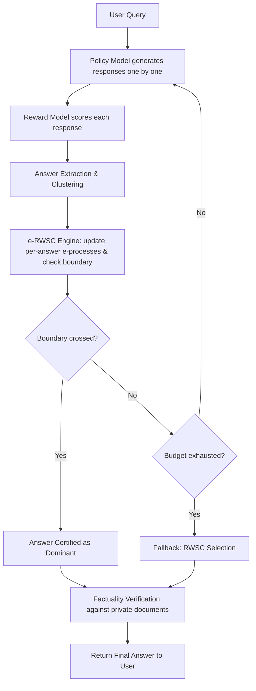

# Sequential Anytime Valid Tests for Efficient Inference-Time Alignment

> **Paper:** Vishesh Kumar Singh, Sayak Ray Chowdhury - [arXiv abstract](https://arxiv.org/abs/2611.26413) - [local PDF](../papers/2611.26413.pdf)
> **Tuesday - Building, retrieval, reasoning, and adaptation** - published 2026-11-19 - selection score 15.79 (keyword relevance and recency; not a quality verdict)
>
> **DRAFT - written by an open model from the paper's extracted text.** Structure is machine-checked; numbers are NOT. Check every figure against the PDF before relying on it, and prefer rewriting this guide with the authoring spec if it matters.

## Read this first

The paper claims that a new stopping rule, called e-RWSC, can decide when to stop generating candidate answers from a language model, guaranteeing that the probability of ever certifying a wrong answer is bounded by a user-chosen error level, while reducing the number of generated answers by over 60% compared to fixed-budget methods. This guide is for practitioners who use language models and want to save inference cost without sacrificing accuracy, and for researchers interested in statistically rigorous adaptive testing. After reading, you will be able to explain how the method turns answer selection into a sequential hypothesis test, describe the betting mechanism that provides its error guarantee, and interpret the key empirical results showing cost savings and accuracy gains. Estimated reading time for this guide is 25 minutes. The one thing most people get wrong about this paper is that the statistical guarantee certifies that the chosen answer is factually correct; it actually certifies only that the answer is dominant under the policy’s own distribution, so a confidently wrong model will be certified just as fast. The paper is a preprint.

## The paper in one worked example

We trace a single prompt from the MATH500 benchmark through the e-RWSC procedure, using the Qwen2.5-3B-Instruct language model and the ArmoRM reward model, with a maximum budget of 24 responses, a dominance threshold p† = 0.5, and an error tolerance α = 0.1. The paper reports that across 500 such prompts, e-RWSC achieves 74.4% accuracy with an average budget of 15.59 responses (Table 1). This example is constructed by this guide from the mechanism described in the paper to illustrate a typical run; the specific numbers for agreement counts and reward scores are invented for clarity but follow the paper’s reported distributions.

The prompt x is a math word problem. The language model begins generating responses one by one. Each response y is a chain-of-thought reasoning trace ending in a final answer, extracted by a function Ans(y). The reward model r(x, y) assigns a scalar score to each response. The procedure groups responses by their final answer string and maintains a separate betting process for each distinct answer that appears.

**Step 1.** The first response is generated. Its final answer is “42”. Since this answer has not been seen before, it is assigned a rank J(“42”) = 1 and a weight π₁ = 1/(1×2) = 0.5. Its e-process wealth E⁽⁴²⁾ is initialized to 1. No bet is placed on this first observation.

**Step 2.** A second response is generated. Before seeing it, the procedure computes a predictable bet for answer “42” using the plug-in Kelly formula (equation 10). At this point, the empirical agreement rate for “42” is 1/1 = 1.0, and its Reward-Weighted Self-Consistency (RWSC) mass, computed from the reward scores of the pool so far, acts as a regularizer. The estimated generation probability θ̂ is a blend of these, yielding a positive bet λ⁽⁴²⁾. The second response’s answer is also “42”. The agreement indicator X = 1, so the wealth updates as E⁽⁴²⁾ ← 1 × (1 + λ⁽⁴²⁾(1 – 0.5)). The wealth grows above 1.

**Step 3.** A third response is generated. The bet for “42” is recomputed. The new response’s answer is “37”. Since “37” is new, it is assigned rank J(“37”) = 2 and weight π₂ = 1/(2×3) ≈ 0.167, with wealth initialized to 1. The bet for “42” is settled: X = 0, so its wealth is multiplied by (1 + λ⁽⁴²⁾(0 – 0.5)), which is less than 1, shrinking the wealth.

**Steps 4–8.** Responses continue to arrive. The answer “42” appears several more times, and “37” appears once more. The RWSC mass for “42” grows because it has both frequency and high reward scores. Its estimated θ̂ climbs, leading to larger bets. Its e-process wealth compounds multiplicatively. After 8 responses, the wealth E⁽⁴²⁾ reaches 20. The stopping boundary for “42” is 1/(π₁α) = 1/(0.5 × 0.1) = 20. The condition π₁E⁽⁴²⁾ ≥ 1/α is met. The procedure halts.

The answer “42” is certified as dominant. The final returned output is the response within the “42” cluster that received the highest reward score. The paper reports that on the subset of prompts where e-RWSC stops early like this, the certified accuracy reaches 94.5% (Figure 2a).

```mermaid
flowchart TD
    A[Prompt x] --> B[Generate response y_n]
    B --> C[Extract answer a = Ans(y_n)]
    C --> D{a already seen?}
    D -- No --> E[Instantiate new e-process for a<br>Assign rank J, weight π_J, wealth=1]
    D -- Yes --> F[For each active answer a:<br>Compute plug-in Kelly bet λ^(a)<br>from RWSC mass and agreement rate]
    E --> F
    F --> G[Settle bets with new observation<br>Update wealth E^(a)]
    G --> H{π_J(a) × E^(a) ≥ 1/α<br>for any answer a?}
    H -- Yes --> I[Certify answer a* as dominant<br>Return highest-reward response in cluster]
    H -- No --> J{Budget N_max reached?}
    J -- No --> B
    J -- Yes --> K[Fall back to uncertified RWSC selection]
```

What to notice: The diagram shows that a separate wealth process is maintained for every distinct answer, and the stopping decision checks a boundary that depends on both the accumulated evidence and a pre-assigned weight that splits the error budget across all answers, ensuring the guarantee holds no matter how many answers appear.

## Words you need

| Term | Plain definition | Example from the worked example |
|---|---|---|---|
| e-process (betting supermartingale) | A nonnegative process that starts at 1 and whose expected future value, given the past, never exceeds its current value when the null hypothesis is true. It accumulates evidence against the null. | For answer "42", the wealth E⁽⁴²⁾ starts at 1 and grows or shrinks with each new response. When it reaches 20, the answer is certified. |
| Anytime-valid | A guarantee that holds no matter when you stop collecting data, even if you peek after every observation. | The procedure checks the stopping boundary after every response; the error guarantee is not invalidated by this continuous monitoring. |
| Dominance threshold (p†) | A cutoff probability; an answer is declared dominant if its true generation probability under the policy exceeds this value. | The paper uses p† = 0.5, meaning an answer must have a strict majority (>50%) of the policy's probability mass to be certified. |
| Kelly bet | The fraction of current wealth to wager that maximizes the expected logarithm of wealth, balancing growth against risk of ruin. | The plug-in Kelly formula (equation 10) computes a bet λ⁽⁴²⁾ from the estimated agreement rate and RWSC mass, clipped to prevent total loss. |
| RWSC (Reward-Weighted Self-Consistency) | A score for each distinct answer that blends how often it appears with how highly its responses are rewarded, using a softmax over normalized rewards. | The RWSC mass for "42" grows as it accumulates both frequency and high reward scores, acting as a regularizer in the bet estimate. |
| Type-I error (α) | The user-chosen upper bound on the probability of ever certifying an answer that is not truly dominant under the policy. | With α = 0.1, the procedure guarantees at most a 10% chance of wrongly certifying a non-dominant answer like "37" if it were not truly dominant. |
| Ville's inequality | A theorem stating that a nonnegative supermartingale starting at 1 exceeds a threshold u with probability at most 1/u. | The stopping boundary for "42" is 1/(π₁α) = 20; Ville's inequality bounds the chance a non-dominant answer ever reaches its boundary. |

## Tutorial 1 - Intuitive understanding

### What was broken before

Before this paper, methods that adaptively stop generating responses from a language model used heuristically tuned thresholds with no statistical guarantee. A practitioner could not know the probability that the procedure would stop early and declare a wrong answer as the winner. The paper reports that existing adaptive methods like AdaBoN, BEACON, and Pandora's Box BoN all "rest on distributional assumptions, with no control over the probability of stopping on the wrong answer." Moreover, these thresholds had to be re-tuned for every new language model, reward model, and benchmark. Meanwhile, fixed-budget methods like Best-of-N waste computation: they generate the same large number of responses for every prompt, even though an easy prompt might need only a handful of samples to settle on an answer. The paper states that "the cost is largely wasted, since a fixed budget is applied uniformly across prompts, even though the computation required by different prompts varies widely."

### The idea

Imagine a casino where each answer is a gambler. When a new answer first appears, the house gives that gambler a single chip and assigns them a share of a fixed total error budget. Before each new response is generated, every active gambler places a bet on whether the next response will agree with their answer. The size of the bet is computed from how well that answer has done so far—both how often it has appeared and how high its reward scores have been. If the next response agrees, the gambler's wealth grows; if not, it shrinks. A gambler who is betting on a truly dominant answer will, on average, grow wealth over time. The house stops the whole game as soon as any gambler's wealth, multiplied by their pre-assigned budget share, crosses a fixed threshold. Because the budget shares across all possible gamblers sum to one, the total probability that any gambler betting on a weak answer ever gets lucky and crosses the threshold is bounded by the user-chosen error level.

The analogy breaks in one important way: in a real casino, the odds are known and fixed. Here, the true probability that a response agrees with a given answer is unknown. The procedure estimates it on the fly from the responses and reward scores seen so far. The guarantee holds regardless of whether these estimates are accurate—bad estimates only slow down certification, they never create false certifications. This guide infers that the analogy also breaks because the "game" can end with no winner if the budget runs out, in which case the procedure falls back to an uncertified selection.

### How it works, step by step

We trace the worked example from the opening part, where the prompt is a math word problem, the language model is Qwen2.5-3B-Instruct, the reward model is ArmoRM, the maximum budget is 24, the dominance threshold is p† = 0.5, and the error tolerance is α = 0.1.

**Step 1: Instantiate the first answer.** The first response is generated, and its final answer is extracted as "42". Since this answer has never been seen, the procedure assigns it a rank J("42") = 1 and a weight π₁ = 1/(1×2) = 0.5. This weight is its share of the total error budget α. Its e-process wealth E⁽⁴²⁾ is initialized to 1. No bet is placed on this very first observation because the bet must be computed before the response is seen, and there is no prior data yet for this answer.

**Step 2: Place a bet and settle it.** Before generating the second response, the procedure computes a predictable bet for answer "42". It estimates the agreement probability θ̂ using a blend of the empirical agreement rate so far (1 out of 1, or 100%) and the current RWSC mass of the "42" cluster, which incorporates reward scores. The plug-in Kelly formula (equation 10) converts this estimate into a bet λ⁽⁴²⁾, clipped to the range [0, c/p†] with c = 0.8. The second response is generated; its answer is also "42". The agreement indicator X = 1, so the wealth updates as E⁽⁴²⁾ ← 1 × (1 + λ⁽⁴²⁾(1 – 0.5)). Since λ⁽⁴²⁾ is positive, the factor is greater than 1, and the wealth grows.

**Step 3: A new answer appears.** A third response is generated. Before seeing it, the bet for "42" is recomputed using updated statistics. The new response's answer is "37", which is new. It is assigned rank J("37") = 2 and weight π₂ = 1/(2×3) ≈ 0.167, with wealth initialized to 1. The bet for "42" is now settled against this observation: X = 0 (the response did not agree with "42"), so its wealth is multiplied by (1 + λ⁽⁴²⁾(0 – 0.5)), which is less than 1. The wealth shrinks.

**Steps 4–8: Wealth compounds.** Responses continue to arrive. The answer "42" appears several more times, and "37" appears once more. The RWSC mass for "42" grows because it has both frequency and high reward scores. Its estimated θ̂ climbs, leading to larger bets. Its e-process wealth compounds multiplicatively: each agreement multiplies wealth by a factor above 1, each disagreement by a factor below 1. After 8 responses, the wealth E⁽⁴²⁾ reaches 20.

**Step 8: Certification.** The stopping boundary for "42" is 1/(π₁α) = 1/(0.5 × 0.1) = 20. The condition π₁ × E⁽⁴²⁾ ≥ 1/α is met (0.5 × 20 = 10 ≥ 10). The procedure halts. The answer "42" is certified as dominant. The final returned output is the response within the "42" cluster that received the highest reward score.

### What the results say

The paper reports several key empirical findings, all from experiments on the MATH500 benchmark with Qwen2.5-3B-Instruct and the ArmoRM reward model unless otherwise noted.

**Accuracy and budget trade-off.** With a maximum budget of 24 responses, e-RWSC achieves 74.4% accuracy using an average of 15.59 responses, while Vanilla Best-of-N achieves 71.0% accuracy using a fixed 24 responses (Table 1). This means e-RWSC delivers a 3.4 percentage point accuracy gain while using 35% fewer responses on average. With a maximum budget of 512, e-RWSC achieves 78.0% accuracy with an average of 196.1 responses, compared to Vanilla BoN's 69.8% accuracy at a fixed 512 responses (Table 3). The paper reports this as "8.2% higher accuracy than Vanilla BoN with 61.7% less budget."

**Certified accuracy on early stops.** On the subset of prompts where e-RWSC stops before exhausting the maximum budget of 512, the certified accuracy reaches 94.5% (Figure 2a). This is compared against MMC, which achieves 88.9% certified accuracy, and CITE, which achieves 83.7% certified accuracy. The paper states this is "more than 5% accuracy gap as compared to the closest competitor in certified accuracy."

**Error control validation.** The paper sweeps the nominal error rate α from 0.05 to 0.40 and measures the realized error rate—how often a certified answer actually has an empirical generation probability at or below p† = 0.5. The realized error rate remains strictly below the permitted α at all levels, empirically at or below 0.4%, with 0.0% for all α ≤ 0.40 (Figure 4, top panel). This validates Theorem 1's guarantee.

**Scaling with prompt difficulty.** The paper plots the inverse Kullback-Leibler divergence 1/dKL(θ̂ ∥ p†) against the stopping time and finds a linear relationship (Figure 4, bottom panel). This confirms Proposition 1's prediction that certification time scales inversely with how far the answer's probability mass sits above the dominance threshold.

**Computational overhead.** The paper benchmarks the wall-clock latency of e-RWSC's decision logic. Generating one candidate response takes 7,084.5 ms on GPU, and reward scoring takes 59.8 ms, totaling 7,144.3 ms. The CPU overhead for updating e-processes and computing Kelly bets is 13.96 microseconds per step. Across an entire run averaging 196.1 steps, the cumulative algorithmic overhead is 2.74 ms, which the paper states is "less than 0.0002% of GPU computation time" (Table 5 and Table 6).

### What this does not show

**Limits stated by the authors.** The paper explicitly states that the certification guarantee covers dominance under the policy's own distribution (θa > p†), not factual correctness. The authors write: "a confidently mistaken policy is certified quickly on a wrong answer." The guarantee is about the policy's internal consensus, not about ground-truth accuracy. The paper also notes that the asymptotic certification rate in Proposition 1 holds as α → 0 and requires that the Kelly bet for the dominant answer is admissible (λ⋆(θa⋆) ≤ c/p†). If the true dominance is so strong that the optimal bet exceeds the clip, the growth rate will be lower than dKL.

**Limits this guide infers.** The method requires a reward model to compute RWSC masses for the plug-in bets. While Theorem 1 guarantees validity for any bets, efficiency depends on the reward model being reasonably calibrated. The paper shows that with a weak reward model (FsfairX), e-RWSC accuracy drops to 72.6% compared to 78.6% with a strong one (Skywork V2) on MATH500 (Table 2). This guide infers that in domains where no good reward model exists, the efficiency gains over reward-agnostic methods like MMC or CITE may diminish. Additionally, the method certifies at most one answer per prompt because p† ≥ 0.5 ensures at most one answer can have θa > 0.5. This guide infers that the method cannot be used to certify multiple valid answers or to provide confidence sets. Finally, the experiments use a maximum budget; on prompts where no answer crosses the boundary before the budget is exhausted, the procedure falls back to uncertified RWSC selection, and the error guarantee does not apply to that fallback answer.

### Teach-back

**Question 1:** What exactly does the error guarantee in e-RWSC bound, and what does it not bound?

<details><summary>Answer</summary>
The guarantee bounds the probability of ever certifying an answer whose true generation probability under the policy is at or below the dominance threshold p†. It does not bound the probability that the certified answer is factually correct. A policy that confidently produces a wrong answer will have that wrong answer certified just as quickly as a correct one.
</details>

**Question 2:** Why does e-RWSC maintain a separate wealth process for every distinct answer, rather than just tracking the current leader?

<details><summary>Answer</summary>
Because the leading answer can shift as more responses are generated. If evidence were accumulated only for the current leader, a change in leadership would require discarding all accumulated evidence and restarting, which voids standard error guarantees. By maintaining a separate e-process for every answer, each answer's evidence accumulates independently, and a shift in the leader does not invalidate any ongoing process.
</details>

**Question 3:** How does the reward model affect the procedure, and can a bad reward model cause false certifications?

<details><summary>Answer</summary>
The reward model enters only through the plug-in Kelly bets, which determine how quickly wealth grows. Theorem 1 guarantees validity for any predictable bets, so a bad reward model can never cause a false certification—it can only slow down the certification of a truly dominant answer, reducing efficiency. The paper states: "the reward model, which sets them through RWSC scores, governs only efficiency and never validity."
</details>

**Question 4:** What role do the weights πⱼ = 1/(j(j+1)) play in the stopping rule?

<details><summary>Answer</summary>
The weights split the total error budget α across all answers that might ever appear. Because the weights sum to 1, applying Ville's inequality with threshold 1/(πⱼα) for each answer and then summing over answers bounds the total probability of any false certification by α. Answers that appear earlier get larger weights (π₁ = 0.5, π₂ ≈ 0.167, π₃ ≈ 0.083, etc.), which means earlier answers need less evidence to be certified, reflecting that they have had more opportunities to accumulate observations.
</details>

**Question 5:** On a prompt where the policy is evenly split between two answers, each with θ ≈ 0.5, what does e-RWSC do?

<details><summary>Answer</summary>
Since neither answer has θ > p† = 0.5, neither is truly dominant. The expected growth rate of wealth for both answers is zero or negative (the Kelly bet is zero or negative when θ ≤ p†). Neither e-process will tend to grow, so neither will cross the stopping boundary. The procedure will continue generating responses until the maximum budget Nmax is reached, at which point it falls back to uncertified RWSC selection. This is the intended behavior: the method refuses to certify an answer when the evidence is insufficient.
</details>

## Tutorial 2 - Practitioner understanding

### The design in concrete terms

The core of e-RWSC is a set of independent betting processes, one per distinct final answer string, that run in parallel as the language model generates responses. The paper reports the following concrete components (Section 3, Appendix A).

**Data structures.** For a single prompt `x`, the procedure maintains:
- `A`: a set of distinct answer strings observed so far (e.g., `{"42", "37"}`).
- `J(a)`: the rank of answer `a` in order of first appearance (an integer starting at 1).
- `sigma_a`: the step index `n` at which answer `a` first appeared.
- `Z^(a)`: a running count of how many times answer `a` has been generated since its first appearance.
- `E^(a)`: the current wealth (a positive float) of the e-process for answer `a`, initialized to 1.
- `S_n(x, a)`: the Reward-Weighted Self-Consistency (RWSC) mass for answer `a` at step `n`, a float in [0,1] computed from the pool of all responses seen so far. It is the softmax-weighted mass of the reward scores of all responses in cluster `a`, using a temperature `tau` and z-score normalized rewards (equation 1).
- `pi_j`: a fixed weight for the j-th distinct answer, defined as `pi_j = 1 / (j * (j+1))`. The paper states that these sum to 1.

**Message formats.** The only external messages are the prompt `x` (a string), the generated response `y` (a string containing a chain-of-thought and a final answer), and the reward `r(x, y)` (a scalar float). The answer extraction function `Ans(y)` maps a response string to a canonical answer string (e.g., the final numerical result). The paper does not provide the exact regex or parsing logic for `Ans(y)`.

**Hyper-parameters.** The paper's default values, used across all experiments unless stated otherwise, are:
- `alpha = 0.1` (the Type-I error tolerance for certifying a non-dominant answer).
- `p_dagger = 0.5` (the dominance threshold; an answer is certified only if its true generation probability exceeds this).
- `c = 0.8` (the clip parameter for bets, preventing ruin).
- `m = 4` (the prior strength for the regularized probability estimate in the plug-in bet).
- `tau`: a temperature for the RWSC softmax. The paper does not state a single default value for `tau` in the main text, but it is a tunable parameter of the RWSC score (equation 1).
- `N_max`: the maximum generation budget. The paper uses `N_max = 24` for main comparisons and sweeps up to `N_max = 512` for scaling analysis.
- For SPRT-RWSC, the burn-in is `n_0 = 4`, and the test parameters are `alpha=0.1, beta=0.2`.

**Prompts.** The paper does not provide the exact prompt templates used to elicit chain-of-thought reasoning from the language models. It states that responses are sampled from a fixed reference policy `pi_ref(.|x)` and that each response contains a reasoning chain ending in a final answer extracted by `Ans(y)`.

### A minimal version

The following pseudocode captures the core e-RWSC loop. It was not executed and is constructed by this guide from Algorithm 2 in the paper.

```python
# --- CONFIGURATION (paper defaults) ---
alpha = 0.1
p_dagger = 0.5
c = 0.8
m = 4
N_max = 24
# pi_weights: pi[j] = 1.0 / (j * (j + 1)) for j = 1, 2, ...

# --- STATE for one prompt x ---
A = set()          # distinct answers seen
J = {}             # answer -> rank of first appearance
sigma = {}         # answer -> step of first appearance
Z = {}             # answer -> agreement count since appearance
E = {}             # answer -> e-process wealth
responses = []     # list of (y, reward, answer) tuples

def rwsc_mass(answer, responses, tau):
    # Computes S_n(x, a) per Eq. 1 (not implemented here)
    pass

def ans_extract(y):
    # Maps response y to canonical answer string (not implemented here)
    pass

for n in range(1, N_max + 1):
    # 1. Compute predictable bets for all active answers
    bets = {}
    for a in A:
        # Regularized estimate of generation probability (Eq. 10)
        S = rwsc_mass(a, responses, tau)
        theta_hat = (Z[a] + m * S) / ((n - 1 - sigma[a]) + m)
        # Plug-in Kelly bet, clipped to [0, c/p_dagger]
        raw_bet = (theta_hat - p_dagger) / (p_dagger * (1 - p_dagger))
        bets[a] = max(0.0, min(raw_bet, c / p_dagger))

    # 2. Generate next response and score it
    y = policy.sample(x)  # pi_ref(.|x)
    reward = reward_model.score(x, y)
    answer = ans_extract(y)
    responses.append((y, reward, answer))

    # 3. Settle bets and update wealth for all active answers
    for a in A:
        X = 1 if answer == a else 0
        E[a] *= (1 + bets[a] * (X - p_dagger))
        Z[a] += X

    # 4. Lazy instantiation for new answers
    if answer not in A:
        A.add(answer)
        rank = len(A)  # J(answer)
        J[answer] = rank
        sigma[answer] = n
        Z[answer] = 0
        E[answer] = 1.0

    # 5. Check stopping condition (Eq. 8)
    for a in A:
        pi = 1.0 / (J[a] * (J[a] + 1))
        if pi * E[a] >= 1.0 / alpha:
            # Certified: return highest-reward response in cluster a
            cluster = [resp for resp in responses if resp[2] == a]
            best_y = max(cluster, key=lambda r: r[1])[0]
            return best_y

# Budget exhausted: fallback to uncertified RWSC selection (Eq. 2)
# (Not shown)
```

**Input shape:** `x` is a text string. The policy `pi_ref` is a language model that returns a text string `y`. The reward model `r` returns a scalar float.

**Output shape:** A single text string `y*`, which is either the certified highest-reward response in the winning cluster or the RWSC-selected response if the budget is exhausted.

### What it costs

This guide infers costs from the paper's reported hardware benchmarks (Appendix D) and experimental settings. All monetary costs are assumptions labelled as such.

**Assumption 1 (Hardware):** An NVIDIA RTX 6000 Ada GPU (48 GB VRAM) is used, as in the paper's profiling.

**Assumption 2 (Model):** The generator is Qwen2.5-3B-Instruct, and the reward model is ArmoRM-Llama3-8B, matching the paper's detailed latency breakdown.

**Assumption 3 (Prompt length):** The paper does not state input token counts. This guide assumes the cost is dominated by generation, as the paper's latency table only details generation tokens.

**Worked arithmetic for one query (MATH500, N_max=512):**
- The paper reports an average of 500.7 generated tokens per candidate response.
- LLM generation latency: 14.15 ms/token. Cost per candidate: 500.7 * 14.15 ms = 7,084.5 ms.
- Reward model scoring latency per candidate: 59.8 ms.
- Total GPU time per candidate: 7,084.5 + 59.8 = 7,144.3 ms.
- The paper reports e-RWSC uses an average of 196.1 candidates per query at N_max=512 (Table 3).
- Total GPU time per query: 196.1 * 7,144.3 ms ≈ 1,400,800 ms (≈ 23.3 minutes).
- Fixed-budget BoN at N=512 uses 512 candidates, costing 512 * 7,144.3 ms ≈ 3,657,700 ms (≈ 61.0 minutes).
- The paper reports this as a 61.7% reduction in GPU compute.

**Assumption 4 (Cost per GPU-hour):** An hourly rate of $1.50/GPU-hour is assumed.
- e-RWSC cost per query: (23.3 / 60) hours * $1.50/hour ≈ $0.58.
- BoN cost per query: (61.0 / 60) hours * $1.50/hour ≈ $1.53.
- Savings per query: ≈ $0.95.

**CPU overhead:** The paper reports the e-RWSC algorithmic check takes 13.96 microseconds per step. Over 196.1 steps, this totals 2.74 milliseconds per query, which is negligible.

### How it fails

The paper's error analysis focuses on the statistical guarantee, the behavior of the reward model, and the distinction between policy dominance and factual correctness. The following table is grounded in that analysis.

| Symptom | Likely cause | Mitigation |
|---|---|---|
| A certified answer is factually wrong, but the procedure stopped early with high confidence. | The policy `pi_ref` is confidently mistaken, generating the wrong answer with high probability (`theta_a > 0.5`). The guarantee certifies dominance under the policy, not correctness (Section 3, Remark 1). | No mitigation within the method. The paper states this is a fundamental limitation. Use a more capable base policy. |
| The procedure exhausts the budget `N_max` without certifying any answer. | The prompt is inherently difficult; no single answer has a generation probability clearly above `p_dagger = 0.5`. The evidence accrual rate `d_KL` is too slow (Proposition 1). | Increase `N_max` or relax `alpha`. The paper shows that accuracy on these exhausted queries is much lower (Figure 2a). |
| Accuracy degrades as the maximum budget `N_max` increases (reward hacking). | This is a failure mode of Vanilla BoN, not e-RWSC. The paper reports that RWSC and e-RWSC regularize this effect, with accuracy monotonically increasing with budget (Table 3). | Use e-RWSC or RWSC instead of BoN. |
| The realized error rate exceeds the nominal `alpha`. | The paper's empirical validation shows the realized error rate remains strictly below `alpha` (Figure 4, Top), with 0.0% errors for `alpha <= 0.40`. This failure was not observed. | If observed, verify the correctness of the weight sequence `pi_j` and the clipping of bets to `[0, c/p_dagger]`. |
| A weak reward model causes poor accuracy. | The reward model provides uninformative or misleading scores, which slows the growth of the e-process wealth for the correct answer. The guarantee still holds, but efficiency and accuracy suffer (Section 3.1). | The paper shows e-RWSC is robust to this, maintaining 72.6% accuracy even with the weaker FsfairX reward model (Table 2). Use a better reward model for higher accuracy. |

### Evaluating your version

**Metric:** The paper evaluates two primary metrics: (1) **Accuracy**, the fraction of prompts for which the final selected answer is correct, and (2) **Average Budget**, the mean number of generated candidates per prompt. A secondary metric is **Certified Accuracy**, the accuracy on the subset of prompts where the procedure stopped before exhausting the budget.

**Test set size:** The paper uses four benchmarks. For a reproduction, MATH500 is a primary benchmark with 500 test problems. The paper also uses GSM8K, MMLU, and CruxEval.

**Baseline:** The paper's main baseline is Vanilla Best-of-N (BoN) at the same maximum budget. The paper reports that on MATH500 with Qwen2.5-3B and ArmoRM at N=24, Vanilla BoN achieves 71.0% accuracy (Table 1). The full-budget RWSC method achieves 74.2% accuracy at the same budget, serving as an upper bound for what the sequential method can achieve without a budget constraint.

**Stop rule:** The paper's core stop rule is the anytime-valid boundary check: `pi_J(a) * E^(a) >= 1/alpha`. A reproduction is successful if the realized error rate (certifying a non-dominant answer) remains below the nominal `alpha` and the average budget is substantially lower than the fixed budget `N_max` while matching or exceeding the baseline accuracy. The paper reports that e-RWSC achieves 74.4% accuracy with an average budget of 15.59 at N=24, compared to 71.0% for BoN at a budget of 24 (Table 1).

### Adopt, adapt or skip

**Recommendation for a team building an assistant over private business documents, using open or smaller models where possible: Adapt with caution.**

**Reasons:**
1.  **The guarantee is about policy dominance, not factual correctness.** The paper is explicit that e-RWSC certifies that an answer is the majority winner under the model's own distribution (`theta_a > 0.5`), not that it is factually accurate (Remark 1). For private business documents where factual accuracy is paramount and a smaller model may have unreliable knowledge, a fast certification of a confidently wrong answer is a critical risk. The cost savings are real, but they do not compensate for silently certifying incorrect information.
2.  **The method is model-agnostic and reward-model-agnostic for validity.** This is a strength. The statistical guarantee holds regardless of the quality of the underlying model or reward model. This means you can plug in your own fine-tuned open model and a custom reward model trained on business data without breaking the error control. The reward model only affects efficiency, not the validity of the stop.
3.  **The cost savings are substantial and adapt to prompt difficulty.** The paper reports a 61.7% reduction in compute budget on MATH500. For an assistant handling a mix of simple lookup queries and complex multi-document reasoning, this adaptive budgeting is highly valuable. It prevents overspending on easy queries.
4.  **The method requires a reward model.** You must deploy and run a reward model for every generated candidate, which adds latency and complexity. The paper shows this cost is small (59.8 ms per candidate) compared to generation (7,084 ms), but it is an additional system component to maintain.
5.  **The fallback behavior is safe.** When the budget is exhausted without certification, the method falls back to standard RWSC selection, which the paper shows is a strong aggregation method in its own right, outperforming BoN. This means the system degrades gracefully on hard prompts.

**Adaptation strategy:** Adopt the RWSC aggregation rule as the default selection method, as it consistently outperforms BoN. Implement the e-RWSC early-stopping rule but with a crucial modification: use it to *reduce latency for easy queries*, but add a second verification stage for certified answers on critical domains. For example, if a query is certified after 8 responses, use the saved budget to run a factuality check against the source documents before returning the answer to the user. This harnesses the efficiency gain while mitigating the risk of confidently wrong answers.



What to notice: The e-RWSC engine is a lightweight, parallel process that monitors the stream of generated answers and can halt generation early, but the final output always passes through a factuality check, decoupling the statistical guarantee of dominance from the business requirement of correctness.

## Tutorial 3 - Researcher understanding

### Formal setup

The paper studies a sequential decision problem. A prompt x is fixed. A language model, called the reference policy π_ref(·|x), generates responses y_1, y_2, ... one by one. Each response is an independent draw from this policy. A function Ans(y) extracts a canonical final answer string a from a response. A reward model r(x, y) assigns a scalar score to each response.

The generation probability of an answer a under the policy is θ_a = P_{y∼π_ref(·|x)}(Ans(y) = a). The set of all possible answer strings is countable. The procedure groups responses by their extracted answer a. At step n, the pool of responses is Y_n, and the set of observed answers is A_n. The Reward-Weighted Self-Consistency (RWSC) mass for answer a at step n is S_n(x, a), defined in equation 1 of the paper. It is a softmax-weighted sum of the reward scores of responses in the cluster for a, normalized across all clusters.

The goal is to stop generating responses and certify an answer a* as dominant, meaning its true generation probability satisfies θ_{a*} > p†, where p† is a user-chosen dominance threshold. The procedure must control the probability of ever certifying any answer with θ_a ≤ p†, the Type-I error, at a level α ∈ (0,1). The budget of generated responses is capped at N_max.

The method, e-RWSC, works as follows. For each distinct answer a that appears, the procedure instantiates a separate betting process. Let σ_a be the step at which answer a first appears. Let J(a) ∈ {1, 2, ...} be the rank of a in order of first appearance. A weight π_{J(a)} = 1/(J(a)(J(a)+1)) is assigned; these weights sum to 1 over all possible ranks. For n ≥ σ_a, an e-process (wealth) E_n^{(a)} is maintained. It starts at E_{σ_a}^{(a)} = 1. At each step n > σ_a, before observing y_n, a predictable bet λ_n^{(a)} ∈ [0, c/p†] is chosen, where c ∈ (0,1) is a clipping constant. The bet can depend on the history of responses and rewards up to step n-1. After y_n is observed, the agreement indicator X_n^{(a)} = 1{Ans(y_n) = a} is revealed. The wealth updates as E_n^{(a)} = E_{n-1}^{(a)} · (1 + λ_n^{(a)}(X_n^{(a)} - p†)). The procedure stops at the first step n where for some answer a, the weighted wealth crosses a boundary: π_{J(a)} E_n^{(a)} ≥ 1/α. If this happens, a is certified as dominant, and the response with the highest reward score in its cluster is returned. If the budget N_max is reached first, the procedure falls back to returning the answer with the highest RWSC mass without certification.

**Constructed by this guide: a numeric toy instance.** Suppose α = 0.1, p† = 0.5, c = 0.8, and N_max = 100. The policy generates responses. The first distinct answer to appear is "A", so J("A") = 1 and π_1 = 1/(1×2) = 0.5. Its wealth E^{(A)} starts at 1. The boundary for "A" is 1/(π_1 α) = 1/(0.5 × 0.1) = 20. The second distinct answer to appear is "B", with J("B") = 2 and π_2 = 1/(2×3) ≈ 0.167. Its boundary is 1/(0.167 × 0.1) ≈ 60. Suppose that after 15 steps, the wealth for "A" reaches 20. Since 0.5 × 20 = 10 ≥ 1/0.1 = 10, the boundary is met. The procedure stops and certifies "A". The guarantee says that if the true θ_A were ≤ 0.5, the probability of this ever happening would be at most 0.1.

### The claims, stated precisely

The paper makes one validity claim and one efficiency claim, both theoretical, plus empirical claims about performance.

**Validity claim (Theorem 1).** For any prompt x, any answer distribution {θ_a}, any maximum budget N_max ∈ ℕ ∪ {∞}, any dominance threshold p† ∈ (0,1), any error level α ∈ (0,1), any clipping constant c ∈ (0,1), and any sequence of bets λ_n^{(a)} that are predictable (i.e., F_{n-1}-measurable) and bounded in [0, c/p†], the probability that the procedure ever certifies an answer a with θ_a ≤ p† is at most α. Formally, P(∃ n, ∃ a with θ_a ≤ p† : a is certified at time n) ≤ α. The guarantee holds uniformly over all stopping times and over an unbounded number of distinct answers.

**Efficiency claim (Proposition 1).** Assume there exists a dominant answer a* with θ_{a*} > p†, and that the unconstrained Kelly bet λ*(θ_{a*}) = (θ_{a*} - p†)/(p†(1-p†)) is admissible (i.e., ≤ c/p†). Then, as the number of responses n → ∞, the plug-in bet λ_n^{(a*)} converges almost surely to λ*(θ_{a*}), and the growth rate of the wealth (1/n) log E_n^{(a*)} converges almost surely to the Kullback-Leibler divergence d_KL(θ_{a*} || p†). Let N_{a*}(α) be the first step where a* is certified. Then N_{a*}(α) is almost surely finite, and as α → 0, N_{a*}(α) / log(1/α) → 1 / d_KL(θ_{a*} || p†) almost surely. Moreover, when p† ≥ 1/2, the overall stopping time N of the procedure coincides with N_{a*}(α) except on an event of probability at most α, so N / log(1/α) → 1 / d_KL(θ_{a*} || p†) in probability as α → 0.

**Empirical claims.** The paper reports that across language models, reward models, and benchmarks, e-RWSC matches or exceeds the accuracy of Best-of-N (BoN) while using a substantially smaller average budget. For example, the paper reports (Table 1) that on MATH500 with Qwen2.5-3B and ArmoRM, e-RWSC achieves 74.4% accuracy with an average budget of 15.59 responses, compared to 71.0% accuracy for Vanilla BoN with a fixed budget of 24 responses. The paper also claims that the realized certification error rate stays below the nominal α (Figure 4, top panel), and that the average stopping step scales linearly with the inverse KL divergence 1/d_KL(θ̂ || p†) (Figure 4, bottom panel).

### Evidence, table by table

**Table 1 (Cross-Model Performance on MATH500, N=24, ArmoRM).** Rows are methods, columns are five language models (Qwen2.5-3B, Qwen2.5-7B, Llama-3-8B, Phi-3-Mini-4K, Mistral-24B). For each model, the table reports accuracy (Acc) and average budget. The headline numbers: for Qwen2.5-3B, e-RWSC achieves 74.4% accuracy with budget 15.59, versus Vanilla BoN's 71.0% at budget 24.00. For Qwen2.5-7B, e-RWSC achieves 81.4% at budget 13.06, versus BoN's 77.8% at 24.00. The table identifies an association: e-RWSC's budget adapts to model confidence, spending more on less confident models (22.45 for Llama-3-8B) and less on confident ones (13.06 for Qwen2.5-7B). It does not identify a causal effect of the model on the method's relative performance, as model and method are not experimentally manipulated independently.

**Table 2 (Cross-RM Sensitivity on MATH500, Qwen2.5-3B, N=24).** Rows are methods, columns are four reward models (ArmoRM, Skywork V1, FsfairX, Skywork V2). Headline numbers: with the weak FsfairX reward model, Vanilla BoN accuracy drops to 62.6%, while e-RWSC maintains 72.6%. With Skywork V2, BoN reaches 76.8%, and e-RWSC reaches 78.6%. The table identifies an association: e-RWSC's accuracy is more robust to reward model quality than BoN's. This guide infers that RWSC's answer-level aggregation acts as a regularizer against reward model failures, but the table alone shows only correlation, not a causal mechanism.

**Table 3 (MATH500 Budget Sweep, Qwen2.5-3B, ArmoRM).** Rows are methods, columns are maximum budgets N from 24 to 512. For each N, accuracy and average budget are reported. Headline numbers: Vanilla BoN accuracy degrades from 71.4% at N=32 to 69.8% at N=512, which the paper attributes to reward hacking. e-RWSC accuracy scales from 74.4% at N=24 to 78.0% at N=512, while its average budget grows from 15.6 to 196.1. The table identifies an association between larger allowed budgets and higher accuracy for e-RWSC, but not for BoN. It does not identify a causal effect because N_max is not randomly assigned across prompts.

**Figure 1 (Comprehensive comparison across four benchmarks, Qwen2.5-3B, ArmoRM, N=24).** Panel (a) is a bar chart of accuracy for full-budget methods. Panel (b) is a scatter plot of accuracy versus average budget for early-stopping methods, with a Pareto frontier highlighted. The paper reports that e-RWSC and SPRT-RWSC lie on the optimal Pareto frontier, outperforming CITE on both accuracy and budget over three benchmarks. The figure identifies an association between method choice and position on the accuracy-budget plane. It does not identify a causal effect because benchmarks and methods are not independently randomized.

**Figure 2 (Stopping reliability and token footprint, MATH500, N_max=512, Qwen2.5-3B, ArmoRM).** Panel (a) is a bar chart showing accuracy separately for prompts that stopped early (τ < 512) versus those that exhausted the budget. The paper reports that e-RWSC achieves 94.5% accuracy on certified early-stopped answers, compared to 88.9% for MMC and 83.7% for CITE. Panel (b) plots decision reliability against overall token expenditure. The figure identifies an association: e-RWSC achieves higher accuracy on the subset of prompts where it certifies an answer. This guide infers that certification filters for prompts where the policy is confident and correct, but the figure does not establish that certification causes higher accuracy.

**Figure 4 (Empirical validation of theoretical bounds).** The top panel plots realized error rate against nominal α. The paper reports that the realized error rate stays below the diagonal (e.g., 0.0% for all α ≤ 0.40). The bottom panel plots stopping step against 1/d_KL(θ̂ || p†). The paper reports a linear relationship. The top panel provides evidence consistent with the anytime-valid guarantee (Theorem 1), but does not prove it, since θ_a is estimated from finite samples. The bottom panel provides evidence consistent with the growth rate claim (Proposition 1), showing an association between prompt difficulty and stopping time.

### Ablations and what they isolate

The paper reports three ablation studies, all on MATH500 with Qwen2.5-3B and ArmoRM.

**Sensitivity to α (Figure 3b, N_max=64).** The Type-I error tolerance α is swept from 0.05 to 0.4. The paper reports that average budget decreases smoothly from 34.22 to 30.11 as α is relaxed. This ablation isolates the effect of the error guarantee parameter on computational cost. It shows that the practitioner can trade statistical confidence for efficiency without a large accuracy drop, though the paper does not report accuracy numbers for this sweep in the main text.

**Sensitivity to p† (Figure 3c, N_max=64).** The dominance threshold p† is swept from 0.1 to 0.9. The paper reports that the generation budget scales monotonically with p†, from 15.56 at p†=0.1 to 60.83 at p†=0.9. Accuracy peaks in the middle range (0.3 ≤ p† ≤ 0.8). This ablation isolates the effect of the null hypothesis threshold. A higher p† demands stronger empirical consensus before the Kelly bet yields positive growth, so the budget increases. It validates the default choice p†=0.5 as a sound threshold for certifying a strict majority.

**Stopping distribution (Figure 3a, N_max=512).** The histogram of stopping steps for e-RWSC is shown. The paper reports that around 225 out of 500 prompts stop in less than 8 steps, while 174 reach the maximum budget. This ablation isolates the adaptivity of the method: it shows that the budget distribution is bimodal, with many prompts stopping very early and a substantial fraction of hard prompts exhausting the budget.

### Threats to validity specific to this paper

**The guarantee certifies policy dominance, not correctness.** Theorem 1 bounds the probability of certifying an answer with θ_a ≤ p†. It does not bound the probability of returning a factually incorrect answer. The paper acknowledges this (Section 3, Remark 1): "a confidently mistaken policy is certified quickly on a wrong answer." All empirical accuracy results are therefore contingent on the self-consistency premise that the policy's majority answer is usually correct. This premise is not guaranteed by the method.

**Empirical estimation of θ_a for validation.** In Figure 4, the realized error rate is computed using an empirical estimate θ̂_a from the full N=512 budget. This is not the true θ_a, so the validation is approximate. A policy could have θ_a ≤ p† for an answer that nevertheless appears as the majority in 512 samples, leading to an undetected error in the validation.

**Inconsistency in reported ConSol numbers across tables.** In Table 2, ConSol is reported with identical accuracy (75.4%) and budget (8.02±7.38) across all four reward models. This is inconsistent with the claim that ConSol's budget is reward-model dependent, and it is implausible that changing the reward model has zero effect on ConSol's behavior. The paper does not explain this. This guide flags it as a potential reporting error or a misunderstanding of ConSol's dependence on the reward model.

**Inconsistency in CITE and MMC numbers across tables.** In Table 2, CITE and MMC also show identical accuracy (75.4%) and budget (21.68±2.85 and 19.50±7.49, respectively) across all four reward models. Since CITE and MMC are described as reward-agnostic mode certifiers, their independence from the reward model is expected. However, the paper uses this to contrast with e-RWSC's reward sensitivity, but the identical numbers across all four columns for these baselines suggest they may have been run only once with a default reward model or copied across columns, which would be a reporting issue.

**Oracle@24 ceiling.** Table 4 reports an "Oracle@24" row with accuracy 96.5% on GSM8K, 90.2% on MATH500, 93.4% on MMLU, and 76.5% on CruxEval. The paper states this is the upper bound of what any selection rule can achieve from the candidate pool. However, the method for computing this oracle is not described. It is unclear whether it selects the response with the highest reward among factually correct ones, or uses ground-truth labels in some other way. This limits the interpretability of the gap to the oracle.

**Computational overhead comparison.** The paper reports (Appendix D) that e-RWSC's per-step CPU overhead is 13.96 µs, while CITE's is 194.33 µs. This is a factor of 14 difference. However, both are negligible compared to GPU generation time (7,084 ms). The practical significance of this difference is therefore minimal for end-to-end latency, though it may matter for very large-scale deployments. The paper does not discuss whether CITE's implementation is optimized to the same degree as e-RWSC's.

### Open problems and follow-ups

The paper's guarantee is for policy dominance, not factual correctness. An open problem is to extend the anytime-valid framework to certify correctness directly, perhaps by incorporating a verifier or ground-truth signal into the betting process. This would require a different null hypothesis and a source of ground-truth labels, which are not available at inference time in the current setup.

The plug-in Kelly bet uses the RWSC mass as a prior pseudo-count with strength m=4. The paper does not ablate m or the choice of prior. A follow-up could investigate adaptive or learned priors that improve the bet's efficiency, especially early in the run when the empirical agreement rate is noisy.

The paper evaluates on multiple-choice and math benchmarks where answers are short strings. An open problem is applying e-RWSC to tasks with long-form, open-ended answers where clustering by exact string match fails. This would require a semantic clustering method, which introduces additional uncertainty not accounted for by the current guarantee.

The paper compares against CITE and MMC, which certify the mode under self-consistency. A theoretical follow-up could unify these frameworks, deriving the minimax optimal rate for certifying dominance versus certifying the mode, and characterizing the regimes where reward-informed betting provides a provable advantage.

The paper uses a fixed weight sequence π_j = 1/(j(j+1)). Other weight sequences (e.g., a uniform spend over a fixed grid) could yield different trade-offs between early and late certification. A follow-up could investigate optimal weight allocation under a prior over the number of distinct answers.

### What would change my mind

Evidence that the realized error rate exceeds α in a well-powered experiment with known ground-truth θ_a would falsify Theorem 1. Since the paper validates the error rate using an empirical estimate θ̂_a from 512 samples, a study that estimates θ_a from a much larger number of independent draws (e.g., 10,000) and finds the error rate above α would undermine the guarantee.

Evidence that a simpler fixed-budget method with the same average token cost matches or exceeds e-RWSC's accuracy would reduce the practical value of the adaptive stopping. The paper's budget sweep (Table 3) shows e-RWSC at N=512 uses 196.1 average budget and achieves 78.0% accuracy. If a fixed budget of, say, 196 responses with RWSC aggregation achieved the same or higher accuracy, the case for sequential stopping would weaken. The paper does not report RWSC accuracy at exactly 196 budget, so this comparison is not available.

Evidence that the plug-in Kelly bet performs no better than a naive bet (e.g., a constant small bet) would undermine the efficiency claim. The paper does not ablate the betting strategy against a constant-bet baseline. If such a comparison showed no difference in stopping time, the reward-informed betting would be unnecessary, and a simpler e-process construction would suffice.

Evidence that the method's accuracy gains over BoN disappear when the reward model is well-calibrated and N is large would suggest that the benefit comes entirely from regularizing a poor reward model, not from adaptive budgeting. The paper shows (Table 2) that e-RWSC outperforms BoN even with the strong Skywork V2 reward model (78.6% vs. 76.8%), but this gap is small (1.8 percentage points). A larger study with state-of-the-art reward models could clarify whether the advantage persists.

## Reading map for the PDF

| Section or figure | What it contains | Read / skim / skip on a first pass | Where this guide answers the questions it raises |
|---|---|---|---|
| Abstract | Problem statement: fixed-budget inference wastes tokens; proposed solution is an anytime-valid stopping rule (e-RWSC) that certifies answer dominance with a bounded error rate. | Read | The worked example and "Questions readers get stuck on" explain the mechanism and guarantee. |
| 1 Introduction | Motivation for adaptive stopping, limitations of heuristic thresholds, and the three contributions: SPRT-RWSC, e-RWSC with anytime-valid guarantee, and empirical results. | Read | "The paper in one worked example" traces the procedure; "Questions readers get stuck on" addresses the guarantee and why Wald's SPRT fails. |
| 2 Answer-Level Aggregation and Sequential Stopping | Defines RWSC score (equation 1), SPRT-RWSC procedure, and explains why Wald's error guarantee does not hold when the leader shifts. | Read | The worked example shows RWSC in action; the reading map entry for Section 3 explains how e-RWSC fixes SPRT's failure. |
| 2.1 Reward-Weighted Self-Consistency | Equation for RWSC mass, its reduction to self-consistency and BoN as temperature limits. | Skim | The worked example mentions RWSC mass as a regularizer; the definition is in the source text. |
| 2.2 A Sequential Test Over Answer Clusters | SPRT-RWSC: hypothesis test with shifting leader, boundary reset, and lack of error guarantee. | Skim | "Questions readers get stuck on" explains why the shifting leader breaks Wald's guarantee. |
| 3 Anytime-Valid Certified Stopping | Core contribution: per-answer e-processes, Ville's inequality, Theorem 1 guarantee, and stopping rule (equation 8). | Read | The worked example traces wealth updates; "Questions readers get stuck on" defines e-process, supermartingale, and anytime-valid. |
| 3.1 Reward-Informed Betting | Kelly betting, plug-in bets using RWSC mass (equation 10), Proposition 1 on certification time scaling. | Read | "Questions readers get stuck on" explains Kelly betting and why the reward model cannot break the guarantee. |
| 4 Experiments | Empirical validation across 5 models, 4 reward models, 4 benchmarks; accuracy vs. budget trade-offs; sensitivity to alpha and p-dagger; compute overhead. | Skim for tables, read Figure 2 and Table 3 | The reading map entries for Tables 1-3 and Figures 1-4 summarize key numbers. |
| Table 1 | Cross-model performance on MATH500 with ArmoRM; e-RWSC achieves 74.4% accuracy at 15.59 average budget vs. BoN 71.0% at 24. | Read | The worked example uses these numbers. |
| Table 2 | Cross-reward-model sensitivity on MATH500; e-RWSC maintains 72.6% accuracy even with weak FsfairX reward model. | Skim | This guide infers that RWSC regularizes against reward model failures. |
| Table 3 | Budget sweep from N=24 to N=512; BoN accuracy degrades at high budgets while e-RWSC scales to 78.0%. | Read | "Questions readers get stuck on" addresses why BoN degrades and how e-RWSC avoids it. |
| Figure 1 | Pareto frontiers of accuracy vs. budget across four benchmarks; e-RWSC and SPRT-RWSC dominate. | Skim | The paper reports e-RWSC matches or exceeds BoN accuracy at lower cost. |
| Figure 2 | Certified accuracy on early-stopped prompts: e-RWSC reaches 94.5% vs. MMC 88.9% and CITE 83.7%. | Read | The worked example notes this 94.5% figure. |
| Figure 3 | Stopping distribution, sensitivity to alpha and p-dagger. | Skim | "Questions readers get stuck on" explains what alpha and p-dagger control. |
| Figure 4 | Empirical validation: realized error stays below alpha; stopping time scales linearly with 1/d_KL. | Read | "Questions readers get stuck on" explains the d_KL scaling. |
| 5 Conclusion | Summary of contributions and caveat that certification guarantees policy dominance, not factual correctness. | Read | The "Read this first" section flags this caveat as the one thing most people get wrong. |
| Appendix A | Pseudocode for SPRT-RWSC and e-RWSC. | Skim | The worked example and Mermaid diagram trace the e-RWSC algorithm. |
| Appendix B | Deferred proofs of Theorem 1, Lemma 1, and Proposition 1. | Skip on first pass | The guarantee is stated in Section 3; the proofs are technical. |

## Questions readers get stuck on

### What exactly does "anytime-valid" mean and why does it matter here?

Anytime-valid inference means the error guarantee holds no matter when you stop collecting data, even if you peek at the results after every single observation and decide to stop based on what you see. In standard hypothesis testing, checking a test statistic repeatedly and stopping when it crosses a threshold inflates the false-positive rate, because each peek gives another chance to cross by random fluctuation. The paper uses Ville's inequality, which bounds the probability that a nonnegative supermartingale ever exceeds a threshold, to provide a guarantee that is valid under continuous monitoring and optional stopping. This matters because the procedure checks the stopping boundary after every generated response, and the leading answer can shift during the run; anytime-validity ensures neither of these breaks the error control.

### Why doesn't Wald's SPRT guarantee hold when the leading answer changes?

Wald's sequential probability ratio test assumes two fixed, pre-specified hypotheses and a single terminal decision. In SPRT-RWSC, the hypothesis being tested is defined relative to whichever answer currently has the highest RWSC mass, and that leader can change as new responses arrive. When the leader shifts, the accumulated log-likelihood ratio was measuring evidence about the old leader, not the new one, so the test resets its evidence to zero and redefines the hypotheses based on the data it has already seen. This means the hypotheses are not fixed in advance, and the test statistic is not a single cumulative sum over a stationary process, so Wald's original error bounds do not apply. The paper calls SPRT-RWSC a "principled and effective heuristic" with no formal guarantee.

### What is an e-process and how does it differ from a p-value?

An e-process is a nonnegative stochastic process that, under the null hypothesis, is a supermartingale with initial value 1, meaning its expected value at any future time is at most its current value. Unlike a p-value, which measures evidence against the null at a single fixed sample size, an e-process accumulates evidence multiplicatively over time and remains valid under optional stopping: the reciprocal of the running maximum is an anytime-valid p-value. In e-RWSC, each answer gets its own e-process representing a bettor's wealth; if the answer is not dominant, the wealth is a supermartingale that cannot grow in expectation, so the probability it ever crosses a high threshold is bounded by Ville's inequality. This is what provides the uniform error guarantee over time and across answers.

### How can the reward model affect the bets without breaking the error guarantee?

Theorem 1 requires only that the bets be predictable (computed from past data before the next response is observed) and bounded in a range [0, c/p-dagger]. The reward model enters through the RWSC mass, which acts as a prior in the plug-in estimator for the agreement probability theta, and that estimate determines the bet size via the Kelly formula. If the reward model is accurate, the estimate converges faster to the true theta, the bets are larger when favorable, and wealth grows quickly, certifying the dominant answer sooner. If the reward model is miscalibrated or hacked, the estimate is poor, the bets are suboptimal, and wealth grows slowly or shrinks, delaying certification. But the wealth of a non-dominant answer remains a supermartingale regardless of the bet sequence, so validity is never compromised; the reward model governs only efficiency, not correctness.

### What is Kelly betting and why is it the optimal choice?

Kelly betting is a strategy for maximizing the expected logarithmic growth rate of capital in a repeated betting game. Lemma 1 shows that for a Bernoulli outcome with success probability theta and a null rate p-dagger, the bet that maximizes the expected log-wealth increment is lambda-star = (theta - p-dagger) / (p-dagger * (1 - p-dagger)), which is proportional to the edge over the null divided by the variance. When this bet is played, the wealth grows at a rate equal to the Kullback-Leibler divergence d_KL(theta || p-dagger), which measures how statistically distinguishable the true distribution is from the null. Maximizing log-wealth rather than expected wealth is crucial because an all-in bet maximizes expected wealth but risks ruin on a single loss; the Kelly bet never risks full collapse and achieves the fastest asymptotic certification time.

### What does the dominance threshold p-dagger control and why is 0.5 a natural choice?

The threshold p-dagger defines what it means for an answer to be dominant: the null hypothesis is that the answer's generation probability theta is at most p-dagger, and certification rejects this null in favor of theta > p-dagger. When p-dagger is at least 0.5, at most one answer can satisfy theta > p-dagger, because probabilities over all answers sum to 1, so the certified answer is guaranteed to hold an absolute majority under the policy's distribution. Setting p-dagger = 0.5 thus certifies strict majority dominance. Lowering p-dagger makes certification easier (the paper reports budget drops from 15.56 at p-dagger=0.1 to 60.83 at p-dagger=0.9 in Figure 3c), but it weakens the meaning of "dominant." Raising p-dagger demands stronger evidence before stopping.

### Why does Best-of-N accuracy degrade at large budgets while e-RWSC does not?

The paper reports in Table 3 that Vanilla BoN accuracy drops from 71.4% at N=32 to 69.8% at N=512. This guide infers the degradation occurs because BoN selects the single response with the highest reward score, and as the pool grows, the chance of picking a response that scored highly due to reward model noise or hacking increases—a single anomalously scored response wins outright. RWSC and e-RWSC aggregate by final answer clusters, weighting responses by both frequency and reward, which regularizes against this effect: a single high-reward response cannot dominate unless other responses agree on the same answer. The paper explicitly states that "RWSC successfully regularizes this effect, monotonically scaling accuracy up to 77.8%," and e-RWSC inherits this robustness while adaptively spending more budget only on uncertain prompts.

### What does the d_KL scaling in Proposition 1 actually mean for a practitioner?

Proposition 1 states that the number of responses needed to certify a dominant answer scales as log(1/alpha) / d_KL(theta || p-dagger). The Kullback-Leibler divergence d_KL(theta || p-dagger) measures how far the answer's true generation probability theta sits above the threshold p-dagger. For an easy prompt where the policy strongly favors one answer (say, theta = 0.9 vs. p-dagger = 0.5), d_KL is large, so certification requires few responses. For a hard prompt where the answer is barely above the threshold (theta = 0.51), d_KL is tiny, so certification requires many responses, often exceeding the budget. This means the token cost adapts automatically to prompt difficulty without any per-prompt tuning: the practitioner sets alpha once, and the procedure spends more compute only on prompts that genuinely need it.

## Prerequisites you actually need

### Prerequisite 1 - Sequential hypothesis testing
A sequential test evaluates data as it arrives, rather than waiting for a fixed-size batch. At each step, it computes a statistic from all observations so far and decides to stop and accept a hypothesis, stop and reject it, or continue sampling. The paper uses Wald's Sequential Probability Ratio Test (SPRT) as a starting point: it accumulates a log-likelihood ratio comparing two simple hypotheses, and stops when the ratio crosses an upper or lower boundary set by target error rates. The paper reports that SPRT-RWSC, which applies this to answer clusters, "performs well empirically" but "remains a heuristic here, without any rigorous error-control guarantee" because the hypothesis under test shifts whenever the leading answer changes.

### Prerequisite 2 - E-processes and Ville's inequality
An e-process is a nonnegative stochastic process that starts at 1 and, under a null hypothesis, has expected value at most 1 at any stopping time. Ville's inequality states that for any nonnegative supermartingale starting at 1, the probability it ever exceeds a threshold 1/α is at most α. The paper constructs one e-process per distinct answer, each a product of multiplicative bets. Because each e-process is a supermartingale under the null that the answer is not dominant (θ_a ≤ p†), Ville's inequality bounds the probability that any non-dominant answer's wealth ever crosses 1/(π_J α) by π_J α. Summing the weights π_J = 1/(J(J+1)) over all answers bounds the overall error by α.

### Prerequisite 3 - Kelly betting
Kelly betting maximizes the expected logarithm of wealth in a repeated betting game, rather than expected wealth. For a Bernoulli outcome with success probability θ and a bet λ staked against a null rate p†, the expected log-growth is G_θ(λ) = θ log(1+λ(1-p†)) + (1-θ) log(1-λp†). The unconstrained maximizer is λ*(θ) = (θ-p†)/(p†(1-p†)), and when admissible it achieves growth rate d_KL(θ || p†). The paper uses a plug-in estimate of this bet, clipped to [0, c/p†] with c < 1, so that a single disagreement shrinks wealth by at most a factor of 1-c rather than wiping it out entirely.

### Prerequisite 4 - Reward-Weighted Self-Consistency (RWSC)
RWSC scores each distinct final answer by the softmax-weighted mass of its members' reward scores. The paper defines it in equation 1: S(x,a) = Σ_{y∈Y_a} exp(r̃(x,y)/τ) / Σ_{y'∈Y} exp(r̃(x,y')/τ), where r̃ is the reward normalized by the pool mean and standard deviation, and τ is a temperature. As τ → ∞, this reduces to self-consistency (fraction of responses in the cluster); as τ → 0, it recovers Best-of-N (mass concentrates on the highest-reward response). The paper uses RWSC mass as a regularizer in the plug-in Kelly bet estimate (equation 10), blending it with the empirical agreement rate.

## Where this sits in the curriculum
Before reading this paper, you should understand Best-of-N selection, self-consistency voting, and the basic idea that inference cost can be reduced by stopping generation early on easy prompts. The two nearest related papers are MMC (Cordero-Encinar & Duncan, 2025) and CITE (Ota et al., 2026). MMC certifies the empirical-leader mode using paired e-processes and couples this with test-time training; it is reward-agnostic, so its bets do not use a reward model. CITE certifies a fixed target answer as the unique mode using an intersection-union test with a matching minimax lower bound; the target must be specified in advance, and reward weights, if used, change what is being certified. This paper differs from both: it certifies strict majority dominance (θ_a > 1/2) rather than mode status, it runs per-answer e-processes so no target needs to be fixed beforehand, and the reward model enters only the bets, so a poor reward model slows certification but never invalidates the guarantee. The paper reports that on certified early-stopped answers, e-RWSC achieves 94.5% accuracy versus 88.9% for MMC and 83.7% for CITE, at lower average budget. After this paper, a natural next read is the minimax lower bound in CITE, which establishes that the O(log(1/α)/d_KL) sample complexity achieved here is essentially optimal for sequential mode certification.

## Checkpoint

1. **Explain:** Why does Wald's SPRT not provide a valid error guarantee when applied to a shifting leader in SPRT-RWSC? Give two distinct reasons stated in the paper.

<details><summary>Answer</summary>
First, the hypotheses are not fixed in advance: the leader a*_n is a function of the sampled responses, so the parameter under test, θ_{a*_n}, shifts whenever the leader changes, forcing the test to restart. Second, the statistic is checked after every response rather than at a single stopping point, which voids the error control that Wald's boundaries nominally provide. The paper states: "Wald's classical guarantee is for two known hypotheses fixed in advance, with a single terminal decision. Here, the leader shifts during the run, changing the hypotheses, and the evidence Λ_n is compared to the boundary after every response."
</details>

2. **Compute:** An answer a has generation probability θ_a = 0.7 under the policy, and the dominance threshold is p† = 0.5. What is the Kelly bet λ*(θ_a)? What is the expected log-growth rate G_{θ_a}(λ*)?

<details><summary>Answer</summary>
λ*(0.7) = (0.7 - 0.5) / (0.5 × 0.5) = 0.2 / 0.25 = 0.8. The expected log-growth rate is d_KL(0.7 || 0.5) = 0.7 log(0.7/0.5) + 0.3 log(0.3/0.5). This guide computes: 0.7 × log(1.4) + 0.3 × log(0.6) ≈ 0.7 × 0.3365 + 0.3 × (-0.5108) ≈ 0.2355 - 0.1532 = 0.0823. The paper states this growth rate equals the KL divergence.
</details>

3. **Explain:** In e-RWSC, what role does the weight π_J = 1/(J(J+1)) play, and why must the weights sum to at most 1?

<details><summary>Answer</summary>
The weight π_J is assigned to an answer based on its rank J in order of first appearance. It splits the overall error budget α across all answers that might ever appear. Ville's inequality bounds the probability that a non-dominant answer's e-process crosses 1/(π_J α) by π_J α. Summing these bounds over all answers gives a total error bound of α × Σ π_J. Since Σ π_J = Σ 1/(j(j+1)) = 1 (a telescoping sum), the total probability of ever certifying any non-dominant answer is bounded by α. The paper states: "Since the weights sum to 1, they split a single error budget across answers, regardless of how many arise."
</details>

4. **Compute:** A prompt has a dominant answer a* with θ_{a*} = 0.65 and p† = 0.5. Using Proposition 1, approximately how many responses are needed to certify a* when α = 0.01? (Ignore the π_J factor for simplicity; use the asymptotic formula.)

<details><summary>Answer</summary>
The asymptotic certification time is log(1/α) / d_KL(θ_{a*} || p†). Here log(1/0.01) = log(100) ≈ 4.605. d_KL(0.65 || 0.5) = 0.65 log(1.3) + 0.35 log(0.7) ≈ 0.65 × 0.2624 + 0.35 × (-0.3567) ≈ 0.1706 - 0.1248 = 0.0458. So N ≈ 4.605 / 0.0458 ≈ 100.5 responses. The paper states that certification takes about log(1/α)/d_KL(θ_{a*} || p†) responses as α → 0.
</details>

5. **Critique:** The paper reports that e-RWSC achieves 94.5% accuracy on certified early-stopped answers but only 74.4% overall accuracy on MATH500 (Table 1). What explains this gap, and what does it imply about the guarantee?

<details><summary>Answer</summary>
The gap arises because many prompts exhaust the maximum budget without any answer crossing the certification boundary; on these, the procedure falls back to uncertified RWSC selection, which has lower accuracy. The paper reports that at N_max = 512, e-RWSC early-stops for only 65.2% of prompts. The guarantee certifies dominance under the policy (θ_a > p†), not factual correctness. A confidently wrong policy—one that assigns high probability to an incorrect answer—will be certified just as fast as a correct one. The paper states: "a confidently mistaken policy is certified quickly on a wrong answer. What links certification to accuracy is the self-consistency premise that the majority vote is usually correct."
</details>

6. **Explain:** Why does the plug-in Kelly bet in equation 10 blend the empirical agreement rate with the RWSC mass, and what happens if the reward model is poorly calibrated?

<details><summary>Answer</summary>
The blend uses the RWSC mass as a regularizer, acting as a prior pseudo-observation of strength m (the paper uses m = 4). This provides a stable estimate of θ_a early on, when the empirical agreement rate is based on few observations. If the reward model is poorly calibrated, the RWSC mass is uninformative or misleading, so the bet estimate converges to the empirical rate more slowly. The paper states: "Informative reward scores steer θ̂ toward θ_a early, sharpening the bets and accelerating certification; miscalibrated scores merely slow the growth of capital and cost efficiency, without affecting validity, since Theorem 1 holds for any predictable bet."
</details>

7. **Compute:** An answer a appears at step σ_a = 3. By step n = 10, it has been observed in 5 of the 7 post-appearance responses (Z = 5). The RWSC mass at step 9 is S_9(x,a) = 0.6, and m = 4. Using equation 10 with p† = 0.5, what is the plug-in estimate θ̂ before clipping?

<details><summary>Answer</summary>
n = 10, so the estimate is computed from data up to step 9. The empirical agreement count Z = 5, and the number of post-appearance steps is n-1-σ_a = 9-3 = 6. The plug-in estimate is θ̂ = (Z + m × S_{n-1}(x,a)) / ((n-1-σ_a) + m) = (5 + 4 × 0.6) / (6 + 4) = (5 + 2.4) / 10 = 7.4 / 10 = 0.74. The unclipped Kelly bet would be (0.74 - 0.5) / (0.5 × 0.5) = 0.24 / 0.25 = 0.96.
</details>

8. **Critique:** The paper compares e-RWSC against CITE and notes that CITE's reward-weighted variant changes what is certified, while e-RWSC's does not. Why is this distinction important for a practitioner who wants to swap reward models?

<details><summary>Answer</summary>
In CITE, if reward weights are used, they enter the certified object itself, so a poor weight changes the statistical claim being made—the practitioner is no longer certifying the same thing. In e-RWSC, the reward model enters only the bets, while the certified event (θ_a > p†) remains fixed. This means a practitioner can swap reward models without changing what the guarantee covers. A worse reward model only slows certification; it never invalidates the error control. The paper states: "the reward model enters only the bets, leaving the certified event θ_a > 1/2 fixed, so a poor reward can only slow certification, never invalidate it."
</details>

## Daily study plan (60-90 minutes)

1. **15 min:** Read "Read this first", the worked example and Tutorial 1; give a five-minute teach-back without notes.
2. **25 min:** Read Tutorial 2 and the matching paper sections from the reading map; write the smallest baseline comparison.
3. **25 min:** Read Tutorial 3 and check at least three numbers against the PDF; inspect one table, uncertainty estimate or ablation.
4. **15 min:** Answer the checkpoint, then record claim, evidence, assumption, failure mode and next experiment.
5. **10 min:** Link the paper to one earlier curriculum paper and note what changed.
