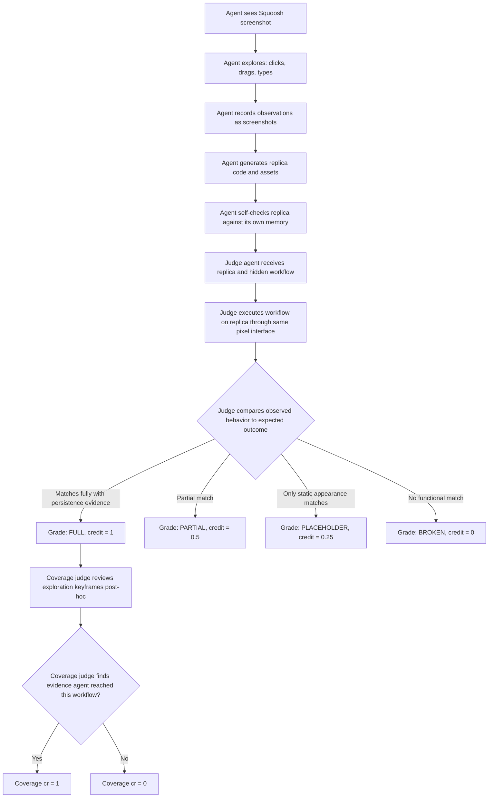
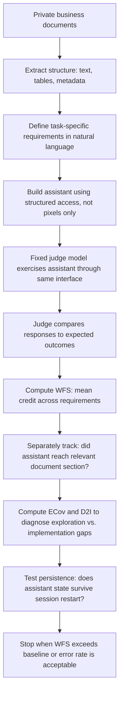

# SWE-Recreation: Benchmarking Coding Agents for Software Recreation

> **Paper:** Zhiyao Xu, Zhanjie Ding, Hongyao Yu, Jingyu Xiao - [arXiv abstract](https://arxiv.org/abs/2611.26311) - [local PDF](../papers/2611.26311.pdf)
> **Wednesday - Evaluation and source-code benchmarks** - published 2026-11-19 - selection score 24.79 (keyword relevance and recency; not a quality verdict)
>
> **DRAFT - written by an open model from the paper's extracted text.** Structure is machine-checked; numbers are NOT. Check every figure against the PDF before relying on it, and prefer rewriting this guide with the authoring spec if it matters.
>
> **REVIEW NEEDED:** the automated v2 checks flagged: 1 repeated long sentence(s), e.g. "The coverage judge operates separately after the run, examining the agent’s exploration sc...".

## Read this first
The paper claims that the strongest AI coding agents can rebuild unfamiliar software by using it like a human—seeing only pixels and using only mouse and keyboard—but they fully reproduce fewer than one in four required behaviors. This guide is for researchers and engineers who build or evaluate autonomous software agents. After reading, you will be able to: describe what "active black-box application reconstruction" means; explain how the benchmark measures both exploration and implementation separately; interpret the main fidelity and coverage scores; and identify where current systems break down. Estimated reading time: 18–22 minutes. The one thing most people get wrong about this paper is assuming the agent is told what to build—in fact, it receives no task list, no demonstration, and no specification, and must discover all functionality by exploring the running application on its own. Venue not stated in the extracted text.

## The paper in one worked example
Consider a requirement from the web application Squoosh, an image compression tool. The hidden checklist item expects the replica to support a workflow where the user loads an image, applies a compression setting, and then returns to the original image via a reset action, with the state change persisting across a page reload. The paper reports that this is a persistence requirement (Table 1 shows 143 web persistence requirements out of 848 total). The agent—in this case, the Kimi K3 system—begins with only a running instance of Squoosh visible as rendered pixels. It has no access to the Document Object Model (DOM, the tree structure representing page elements), source code, or network logs.

The mechanism proceeds in four stages, shown below.



What to notice: The judge and the agent share the same human-like interface—pixels in, pointer and keyboard actions out—so the judge cannot inspect code, only behavior. The coverage judge operates separately after the run, examining the agent’s exploration screenshots to estimate whether the agent ever reached the relevant functionality, without affecting the fidelity grade.

In the Squoosh return-and-load workflow, the paper reports that the Kimi K3 system earned full credit despite only 2 out of 4 coverage judgments being positive for that application’s requirements (this guide infers this from the statement “Squoosh’s return-and-load workflow earns full credit despite only 2/4”). This means the coverage judge found evidence that the agent reached the relevant interface states in two of the four Squoosh requirements with available coverage judgments, yet the fidelity judge still awarded FULL on this particular requirement. The grade FULL maps to a credit ω(g) of 1, per the paper’s Equation 1. This credit contributes to the Weighted Fidelity Score (WFS), which averages requirement credit across all scored requirements for a target. For Squoosh, the paper reports a mean WFS of 0.442 across systems, with a cross-system range of 0.461 (Figure 9).

The persistence requirement demands three pieces of pixel evidence: a screenshot showing the state before the reload, a screenshot showing the changed state after the reload, and a screenshot confirming the state persists after the reload. The judge agent navigates the replica, performs the load-compress-reset sequence, captures these frames, and compares them against the expected outcome written in natural language by human annotators. The paper states that “Persistence requirements need before, changed, and post-reload/restart evidence for full credit.” If the replica’s reset button only visually appears to work but does not actually restore the original image data after reload, the judge would assign PLACEHOLDER (credit 0.25) or BROKEN (credit 0), and the rationale would flag the inert behavior.

The paper’s evaluation protocol uses a fixed judge model, GPT-6-Astra, which is not among the five evaluated agent systems. Four human experts with master’s- or doctoral-level training manually reviewed 20 sampled judgments, and the paper reports that “More than 95% of the reviewed judgments were deemed correct by the experts.” This validation covers the reviewed cases only and does not guarantee correctness on all 5,555 graded requirement–system observations.

The Squoosh example illustrates why the benchmark separates exploration evidence from implementation. An agent might fully explore the reset feature—captured as positive coverage—yet fail to implement it correctly, yielding a low D2I (Discovery-to-Implementation Rate, mean credit conditional on evidenced reach). Conversely, an agent might implement a working reset without the coverage judge finding evidence it explored that specific workflow, which is possible because the coverage judge examines sampled keyframes, not a complete trace. The paper reports that across all web requirements, the pooled correlation between WFS and D2I is r=0.79 (n=199), partly because D2I shares its grades with WFS. This correlation is descriptive and does not establish that better exploration causes better implementation.

The paper’s semantic taxonomy classifies this Squoosh workflow under “import/export/recovery,” one of nine functional types. Across all web requirements, this category’s micro credit and application-equal credit appear in Figure 6, though exact values are not stated in the extracted text for this specific type. The taxonomy is AI-assisted without independent human validation, and the paper notes that fifteen Squoosh requirements have flagged inconsistencies between their titles, steps, and expected outcomes—including a geospatial-import title for an image-loading workflow—so the historical grades used in the analysis may reflect these conflicts.

## Words you need

| Term | Plain definition | Example from the worked example |
|---|---|---|
| Active black-box application reconstruction | The task of discovering what a running application does by using it like a human (seeing only pixels, using only mouse and keyboard), then building a working copy from that knowledge alone. | The Kimi K3 agent explores Squoosh by clicking and dragging, with no access to source code or the DOM, then generates a replica that must pass hidden workflow tests. |
| Weighted Fidelity Score (WFS) | A number from 0 to 1 that averages how well a replica reproduces required behaviors, where full credit counts as 1, partial as 0.5, placeholder as 0.25, and broken as 0. | The paper reports a mean WFS of 0.442 for Squoosh across systems, meaning on average replicas earned less than half the possible credit for that application's requirements. |
| Exploration Coverage (ECov) | The fraction of requirements for which a post-hoc judge finds evidence in the agent's exploration screenshots that the agent reached the relevant functionality. | The paper states that for the Squoosh return-and-load workflow, only 2 out of 4 coverage judgments were positive, meaning the coverage judge found exploration evidence for only half of Squoosh's requirements with available judgments. |
| Discovery-to-Implementation Rate (D2I) | Mean credit earned on requirements where the agent has exploration evidence of reaching the functionality, measuring how well the agent implements what it discovered. | The paper reports a pooled correlation between WFS and D2I of r=0.79 (n=199), partly because D2I shares its grades with WFS. |
| Persistence requirement | A workflow that demands state survive a reload or restart, requiring before, changed, and post-reload screenshot evidence for full credit. | The Squoosh reset workflow is a persistence requirement: the judge must see the image before reload, the changed state after reload, and confirmation that the reset state persists. |
| Nonfunctional Rate (NFR) | The fraction of requirements graded PLACEHOLDER or BROKEN, measuring how often a replica fails to produce any functional behavior. | The paper reports that Opus 4.8 has the highest combined NFR at 0.605, meaning more than 60% of its graded requirements showed no functional behavior. |
| Exclusion set | Behaviors explicitly listed as out of scope because they cannot be faithfully reproduced on a single machine, such as multi-user collaboration, payments, or real-time data. | The paper reports 438 web exclusion entries across 28 websites, covering hard, default, and conditional exclusions that define the boundary of assessable behavior. |
| Judge model | A fixed AI system that evaluates replicas through the same pixel-only, pointer-and-keyboard interface the agent used, grading each hidden workflow by comparing observed behavior to expected outcomes. | The paper uses GPT-6-Astra as the fixed judge, which is not among the five evaluated agent systems, and reports that more than 95% of 20 human-reviewed judgments were deemed correct. |

## Tutorial 1 - Intuitive understanding

### What was broken before

Before this paper, researchers who wanted to test whether AI agents could understand and rebuild software always gave the agent a head start. Some benchmarks handed the agent a recorded video of someone using the application, so the agent watched a pre-chosen demonstration rather than deciding for itself what to explore. Others let the agent read the application's internal code structure—the DOM tree, source files, or network logs—which is like giving a mechanic the factory blueprints instead of asking them to figure out a machine by operating it. Still others provided a written specification or a mock-up image showing exactly what to build. In every case, the agent was told what to achieve. The paper argues that this misses a harder and more realistic scenario: a developer encountering an unfamiliar product with no manual, who must use it until they understand it well enough to rebuild it. No existing benchmark tested whether an agent could come to understand software the way a person does—by exploring it through its ordinary user interface, with no privileged access and no human-authored hints.

### The idea

Imagine you are handed a musical instrument you have never seen before—no label, no instruction booklet, no teacher. You can touch it, press its keys, blow into it, and listen to the sounds it makes. After an hour of experimenting, someone asks you to build a working copy from scratch, using only your memory of what you discovered. A judge will then test your copy by playing it the same way you explored the original, checking whether it produces the same sounds for the same actions. This is the core idea of the paper: an AI agent is given a running application it has never seen, explores it through pixels and pointer actions alone, then generates a replica. A separate judge—using the same human-like interface—tests the replica against a hidden checklist of workflows that the agent never saw.

Where the analogy breaks: the musical instrument produces sounds you can hear directly, but the agent only sees pixels changing on a screen. It must infer from visual changes alone whether an action caused a state change, a navigation, a data update, or a persistent save. The instrument also has a fixed set of physical mechanisms, while software applications can have arbitrarily complex internal logic that may look identical on screen. Finally, you as a human bring prior knowledge of how physical objects work; the agent brings whatever its training data contains, which may include the very applications it is tested on—a limitation the paper acknowledges.

### How it works, step by step

Step 1: The agent receives a running instance of Squoosh, an image compression web application, visible only as rendered pixels. It has no access to the DOM, source code, network logs, or any structured information about the interface. The paper reports that the agent acts through coordinate-level pointer and keyboard input: click, drag, scroll, and type.

Step 2: The agent explores freely. It decides what to click, drag, and type without any task list, demonstration, or exploration plan provided. The paper states that only a generous, effectively non-binding cap on actions and time is imposed. The agent records its observations as screenshots. In the Squoosh example, the agent might upload an image, apply a compression setting, and discover a reset button that restores the original.

Step 3: The agent generates a runnable replica—code and assets that reproduce the behaviors it observed. The paper notes that the replica is built from what the agent observed, together with public fictional assets, and is judged solely by observable behavior. Layout, wording, and styling are out of scope.

Step 4: The agent self-checks its replica against its own memory of the original, then submits it for evaluation. The paper reports that self-correction rounds count recorded replica revisions after the initial review.

Step 5: A fixed judge agent, GPT-6-Astra, receives the replica and the hidden workflow checklist. For the Squoosh persistence requirement, the judge loads an image, applies compression, clicks reset, reloads the page, and checks whether the original image data is restored. The judge captures screenshots before reload, after reload, and after the state change, comparing them against the expected outcome written in natural language by human annotators.

Step 6: The judge assigns a grade. If the replica's reset button actually restores the original image data and the state survives a page reload, the grade is FULL (credit 1). If the button appears to work but does not actually restore data after reload, the grade is PLACEHOLDER (credit 0.25) or BROKEN (credit 0). The paper reports that the Kimi K3 system earned full credit on this workflow.

Step 7: Separately, after the run, a coverage judge examines the agent's exploration screenshots to estimate whether the agent ever reached the relevant functionality. The paper states that for Squoosh, only 2 out of 4 coverage judgments were positive, yet the fidelity judge still awarded FULL on the return-and-load requirement. This separation means an agent can implement a working feature without the coverage judge finding evidence it explored that specific workflow, or explore thoroughly yet fail to implement correctly.

### What the results say

The paper reports that across 42 evaluated targets (16 common websites and all 26 Android apps), the strongest system, Kimi K3, reaches a combined Weighted Fidelity Score of 0.530. This means that on average, across all scored requirements, the replicas earned slightly more than half the possible credit—where full credit is 1, partial is 0.5, placeholder is 0.25, and broken is 0. The paper reports that Kimi K3 achieves 22.9% full credit under application-equal averaging, meaning fewer than one in four requirements is fully reproduced.

The paper reports that DeepSeek V4.1 follows at 0.472 WFS, GLM-5.3 at 0.362, GPT-6-Sol at 0.352, and Opus 4.8 at 0.277. The gap between the strongest (0.530) and weakest (0.277) is 0.253, which is roughly half the strongest system's score—a substantial spread indicating that system choice matters considerably.

The paper reports that partial grades remain the largest share for the two leaders: Kimi K3 has 52.2% partial and DeepSeek V4.1 has 45.9% partial (Table 2). This means that even the best systems produce replicas that are substantially but incompletely functional, rather than consistently faithful.

The paper reports that across platforms, WFS correlates with Exploration Coverage at r=0.53 (n=208) and with Discovery-to-Implementation Rate at r=0.79 (n=199). The paper notes that D2I shares its grades with WFS, so this correlation is partly mechanical and does not establish that better exploration causes better implementation. The weaker correlation with ECov (0.53) suggests that exploration evidence alone is a modest predictor of implementation quality.

The paper reports that on the web, automation and recurrence requirements receive the lowest mean credit (0.058), while browsing and navigation receive the highest (0.487). Automation has no positive coverage judgments, so its D2I is undefined—meaning the coverage judge found no evidence any agent reached those workflows. Mathematical dependencies score 0.232 despite 31.7% coverage and D2I of 0.333, indicating that even when agents reach math-related functionality, they struggle to implement it correctly.

### What this does not show

The paper's authors state several limits. Coverage is a post-hoc judge estimate over sampled keyframes, not ground truth: negative judgments do not verify that the agent omitted a behavior, and positive judgments may cover only part of a workflow. Each system has only one run per evaluated application, so the reported scores do not estimate repeat-run variability. Live targets lack deterministic resets and may have appeared in pretraining data, so scores may reflect memorization rather than genuine exploration. The functional taxonomy is AI-assisted without independent human validation or inter-rater reliability measurement. The checklist-drafting and grading model family may share biases with the evaluated systems.

This guide infers additional limits. The paper evaluates five specific model–framework pairs, so results may not generalize to other systems, configurations, or future models. The 42 evaluated targets represent a specific mix of application types, and the paper notes that platform-specific application mixes prevent causal platform comparisons. The human validation of the judge covers only 20 sampled judgments, and the paper states this validation covers the reviewed cases only and does not guarantee correctness on all 5,555 graded observations. The paper reports fifteen flagged source-text inconsistencies in Squoosh requirements, so some historical grades may reflect conflicting specifications rather than genuine implementation failures. The pooled correlations between WFS, ECov, and D2I reflect different platform mixes and do not identify causal effects, as the paper explicitly states.

### Teach-back

1. What information does the agent receive before it begins exploring an application?

<details><summary>Answer</summary>
The agent receives only a running instance of the application visible as rendered pixels, plus a fixed scaffold and an asset package of shared public assets and fictional per-target content. It receives no task list, demonstration, exploration plan, DOM access, source code, network logs, or any human-authored hints. The paper states that what to probe, and when enough has been learned, is left entirely to the agent.
</details>

2. Why does the benchmark separate the fidelity judge from the coverage judge?

<details><summary>Answer</summary>
The fidelity judge grades whether the replica correctly implements each hidden workflow, while the coverage judge separately examines the agent's exploration screenshots to estimate whether the agent ever reached the relevant functionality. The paper states this separation makes it possible to distinguish implementation shortfalls on observed behavior from gaps in exploration evidence—an agent might fully explore a feature yet fail to implement it, or implement a working feature without the coverage judge finding evidence of exploration. The coverage judge operates post hoc and does not affect the fidelity grade.
</details>

3. What does a Weighted Fidelity Score of 0.530 for Kimi K3 actually mean in practical terms?

<details><summary>Answer</summary>
It means that across all scored requirements on 42 evaluated targets, the replicas earned slightly more than half the possible credit on average. The paper reports that Kimi K3 achieves 22.9% full credit, 52.2% partial credit, 15.9% placeholder, and 9.0% broken. So fewer than one in four requirements is fully reproduced, while more than half are partially functional—substantial but incomplete. The score of 0.530 is the highest among the five tested systems, indicating the task is far from solved.
</details>

4. What is the difference between a PLACEHOLDER grade and a BROKEN grade?

<details><summary>Answer</summary>
A PLACEHOLDER grade (credit 0.25) means the replica's interface looks correct but the behavior is inert—for example, a reset button that visually appears but does not actually restore data. A BROKEN grade (credit 0) means there is no functional match at all. The paper's Equation 1 defines these credit values. The paper also defines an Illusion Rate that additionally flags rationales describing fake, decorative, or inert behavior, capturing cases where the replica merely appears to work.
</details>

5. Why can't we conclude from the reported correlations that better exploration causes better implementation?

<details><summary>Answer</summary>
The paper explicitly states that the correlations are descriptive and do not establish causality. The D2I metric shares its grades with WFS, so the r=0.79 correlation is partly mechanical. The pooled associations also reflect different platform mixes—the web and Android strata are weighted 16:26 in the combined means, not 1:1. The paper notes that repeated runs, independent annotation, and controlled interventions would be needed to assess causal mechanisms. Additionally, the coverage judge examines only sampled keyframes, not complete traces, so positive coverage judgments may miss exploration gaps.
</details>

## Tutorial 2 - Practitioner understanding

### The design in concrete terms

The benchmark defines a closed system with three concrete components: the agent runtime, the evaluation protocol, and the data format.

**Agent runtime interface.** The agent receives only two observation types per step: a rendered screenshot (pixels) and the current cursor position. It acts through four primitive tools exposed by an MCP (Model Context Protocol) server: screenshot, tap or click, swipe or scroll, and type. The server returns only whether an action was accepted, never what element was hit. The paper states that "action receipts report only whether an action was accepted, never what it hit." No DOM, accessibility tree, source code, network traffic, storage, URLs, or selectors are available. This boundary is enforced by the runtime, not by instruction.

**Evaluation protocol.** A single fixed judge model, GPT-6-Astra, grades every replica. The judge is not among the five evaluated agent systems. The judge receives a hidden requirement specification containing ordered interaction steps and an expected outcome written in natural language. It navigates the replica through the same human-like interface, captures screenshots as pixel evidence, and returns a grade from the closed vocabulary G = {FULL, PARTIAL, PLACEHOLDER, BROKEN} plus a rationale and a set of cited evidence frames. A separate coverage judge runs post hoc on exploration keyframes and returns cr ∈ {0, 1} for requirements with available coverage judgments, plus an evidence frame for positive judgments. The paper reports that "More than 95% of the reviewed judgments were deemed correct by the experts" based on 20 sampled judgments reviewed by four human experts with master's- or doctoral-level training.

**Data format.** Each target application has a checklist file containing N requirements (mean 30.3 per website, 23.0 per mobile app). Each requirement specifies: an ordered sequence of interaction steps, an expected outcome in natural language, a persistence flag, and a multi-user flag. Web targets also carry an exclusion list with 438 total entries (213 hard, 113 default, 96 conditional, plus 16 conditional inclusions). The paper reports 1,446 total requirements across 54 applications, with 278 persistence requirements (143 web, 135 mobile).

**Credit mapping.** Grades convert to credit via Equation 1: FULL = 1, PARTIAL = 0.5, PLACEHOLDER = 0.25, BROKEN = 0. The Weighted Fidelity Score (WFS) averages this credit across all scored requirements for a target (Equation 2). Persistence Fidelity (P-WFS) restricts the average to persistence-flagged requirements only (Equation 3).

**Hyper-parameters.** The paper specifies a pixel-change threshold ε = 0.002 for counting changed frames in the Effective Action Rate (EAR) metric (Equation 7). The visual similarity metric VSim uses ℓ2-normalized CLIP ViT-L/14 embeddings (Equation 9). The paper does not state the agent temperature, top-p, or other generation hyper-parameters. The exploration cap is described as "a generous, effectively non-binding cap on actions and time" without stating exact limits.

### A minimal version

The code below sketches the evaluation loop only—not the agent's exploration or generation phases. It was not executed and is constructed by this guide from the paper's protocol description.

```python
# Shapes:
#   requirements: list[dict] with keys "steps", "expected_outcome", "is_persistence"
#   replica: a runnable application accepting screenshot() and act(action_dict)
#   judge_model: callable taking prompt (str) and images (list[bytes]) -> str
# Returns: dict mapping requirement_id to (grade, credit, rationale, evidence_frames)

GRADE_TO_CREDIT = {"FULL": 1.0, "PARTIAL": 0.5, "PLACEHOLDER": 0.25, "BROKEN": 0.0}
PERSISTENCE_EVIDENCE_COUNT = 3  # before, changed, post-reload/restart

def evaluate_replica(requirements, replica, judge_model):
    results = {}
    for req in requirements:
        frames = []
        for step in req["steps"]:
            action = parse_step_to_action(step)  # e.g., click(x,y), type(text)
            replica.act(action)
            frames.append(replica.screenshot())
        if req.get("is_persistence"):
            # Trigger reload or restart, then capture post-persistence state
            trigger_persistence_event(replica)
            frames.append(replica.screenshot())

        prompt = build_judge_prompt(req["expected_outcome"], req.get("is_persistence", False))
        response = judge_model(prompt, images=frames)
        grade, rationale = parse_judge_response(response)
        credit = GRADE_TO_CREDIT[grade]
        results[req["id"]] = (grade, credit, rationale, frames)
    return results

def compute_wfs(results):
    return sum(r[1] for r in results.values()) / len(results)
```

What the judge prompt contains is not stated in the extracted text beyond that it includes the expected outcome and persistence requirements. The paper states that "Persistence requirements need before, changed, and post-reload/restart evidence for full credit," so the minimal version captures three frames for such requirements.

### What it costs

Every number below is an assumption labelled as such, derived from the paper's reported process statistics and typical model pricing as of the paper's writing. The paper does not report token counts, API costs, or latency measurements.

**Assumption 1: exploration actions and observations.** The paper reports that Kimi averages 133.9 exploration steps and DeepSeek averages 167.9 steps (Table 3). This guide assumes each step produces one screenshot observation and one action, so roughly 134–168 screenshots per run.

**Assumption 2: screenshots as input tokens.** This guide assumes each screenshot consumes approximately 1,000–2,000 tokens when processed by a vision-language model, based on common multimodal model pricing structures. At 150 screenshots, that is 150,000–300,000 image tokens per exploration phase.

**Assumption 3: generation phase.** The paper does not report token counts for code generation. This guide assumes generating a replica of a small web application produces roughly 5,000–20,000 output tokens of HTML, CSS, and JavaScript, plus additional input tokens for the screenshots and prompts.

**Assumption 4: judge evaluation.** The judge exercises each requirement on the replica. With 30 requirements per web target and perhaps 5–10 actions per requirement, this guide assumes roughly 150–300 additional screenshots per evaluation run. The paper reports 5,555 total graded requirement–system observations across 210 runs, implying roughly 26.5 graded requirements per run on average.

**Assumption 5: total token estimate per run.** Combining exploration (150 screenshots × 1,500 tokens = 225,000 input tokens), generation (10,000 output tokens), self-checking (not quantified in the paper), and judging (200 screenshots × 1,500 tokens = 300,000 input tokens), this guide estimates roughly 500,000–800,000 input tokens and 10,000–30,000 output tokens per full agent run plus evaluation.

**Assumption 6: cost at typical pricing.** At example prices of $2.50 per million input tokens and $10 per million output tokens (this guide's assumption for a frontier multimodal model), one full run costs roughly $1.25–$2.00 for input plus $0.10–$0.30 for output, totaling approximately $1.50–$2.50 per target. Across 42 evaluated targets, that is roughly $60–$105 per system. The paper evaluates five systems, implying a total evaluation cost on the order of $300–$500 for the full study, excluding the cost of the judge model (GPT-6-Astra) which is applied once per replica.

**Assumption 7: latency.** The paper reports Kimi averages 112.9 minutes of exploration wall-clock time and DeepSeek 45.1 minutes (Table 3). This guide assumes end-to-end latency including generation and judging is roughly 2–4 hours per target per system, dominated by exploration time for the leading systems.

These estimates are speculative. The paper provides no token counts, no pricing, and no latency breakdown beyond exploration wall-clock time.

### How it fails

| Symptom | Likely cause | Mitigation |
|---|---|---|
| Replica receives BROKEN or PLACEHOLDER on most requirements (Opus 4.8: 39.3% broken, 21.1% placeholder; Table 2) | Agent fails to implement functional behavior; generates static mock-ups that look correct but do nothing | Increase implementation verification steps; the paper's self-checking phase (SCR) averages only 0.17 rounds for Opus versus 2.41 for DeepSeek (Table 3) |
| High NFR (Nonfunctional Rate) despite reasonable exploration (GPT-6-Sol: NFR 0.559, ECov 0.349; Table 2) | Agent explores but cannot translate observations into working code; the paper notes "visual change alone does not establish useful exploration" | Strengthen the generation phase with explicit state-management templates; the paper's D2I metric isolates this gap |
| Automation/recurrence requirements receive near-zero credit (micro credit 0.058, zero positive coverage judgments; Figure 6) | Agent never discovers event-driven or scheduled behaviors during exploration; the paper states "Automation has no reached pairs, hence undefined D2I" | Add explicit exploration prompts for time-based or trigger-based features; the coverage judge can only estimate reach from sampled keyframes |
| Persistence requirements fail despite functional implementation (P-WFS close to WFS but not identical; Figure 4) | Agent implements state changes that do not survive reload or restart; the paper requires "before, changed, and post-reload/restart evidence for full credit" | Test state persistence explicitly during self-checking; trigger reload and verify state restoration before submission |
| Low coverage evidence (ECov) but moderate fidelity (some systems in Figure 3 scatter plot) | Coverage judge examines sampled keyframes, not complete traces; agent may have explored functionality without the judge finding evidence | Increase keyframe sampling density during exploration; the paper notes "negative judgments do not verify omissions, and positive judgments may cover only part of a workflow" |
| Checklist inconsistencies produce misleading grades (15 Squoosh requirements flagged with title/step/expected conflicts; Appendix B) | Human annotation errors create requirements whose expected outcomes do not match their titles or steps | Audit requirement specifications before use; the paper excludes flagged items from illustrative examples but retains historical grades |

### Evaluating your version

**Metric.** Use the Weighted Fidelity Score (WFS) as defined in Equation 2: the mean of ω(g) across all scored requirements for a target, where ω(FULL)=1, ω(PARTIAL)=0.5, ω(PLACEHOLDER)=0.25, ω(BROKEN)=0. Also report the grade share distribution (percentage FULL, PARTIAL, PLACEHOLDER, BROKEN) and the Nonfunctional Rate (NFR), which is the fraction graded PLACEHOLDER or BROKEN. If your application has persistence requirements, report P-WFS separately (Equation 3).

**Test set size.** The paper's balanced study uses 42 targets (16 web, 26 Android) with 1,111 requirements producing 5,555 graded observations across five systems. For a single-system evaluation, this guide infers you need at minimum the same 42 targets to compare against the paper's reported scores. A smaller pilot could use the 16 common web targets (513 requirements) for which the paper provides requirement-level analysis in Appendix B.

**Baseline.** The strongest reported system is Kimi K3 at 0.530 combined WFS with 22.9% full credit (Table 2). The weakest is Opus 4.8 at 0.277 WFS with 5.2% full credit. The paper reports that "the strongest reaches a combined weighted fidelity of 0.530 and fully reproduces fewer than one requirement in four under application-equal averaging." A random or empty replica would score near zero.

**Stop rule.** Stop when your system's WFS exceeds 0.530 on the full 42-target set, or when grade shares show more than 22.9% FULL across targets. The paper does not define a statistical significance threshold or confidence interval for these scores. This guide infers that a practical stop rule is: your system's mean WFS across 42 targets, with one run per target, exceeds the Kimi K3 result of 0.530. Because the paper reports only one run per system per target, repeat-run variability is unknown, so a single-run comparison is the only available benchmark.

### Adopt, adapt or skip

**Recommendation: Adapt with caution, for a narrow use case.**

The paper's task—rebuilding an unfamiliar application from pixels alone, with no specification—is substantially harder than what most business document assistants need. A team building an assistant over private business documents typically has access to document structure (PDF text, OCR output, database schemas), can provide task descriptions, and does not need to reconstruct entire applications from scratch. The paper's core finding that the strongest system reaches only 0.530 WFS and fully reproduces fewer than one in four requirements suggests the full reconstruction task is not yet reliable enough for production deployment.

However, three components are worth adapting:

1. **The separation of exploration evidence from implementation quality.** The paper's ECov and D2I metrics (Equations 5–6) let you diagnose whether failures come from not finding functionality or from not building it correctly. For a document assistant, you could track whether the assistant reached the relevant document section (coverage) separately from whether it produced the correct answer (fidelity).

2. **The adaptive judge protocol.** Using a fixed judge model that exercises workflows through the same interface as the agent, rather than running pre-written test scripts, accommodates behaviorally equivalent implementations. For a document assistant, a judge could ask the assistant questions and compare answers to expected responses without requiring exact string matches.

3. **The persistence requirement pattern.** Requiring state to survive a reload or restart catches implementations that appear to work but are stateless. For a document assistant that maintains conversation context or user preferences, testing persistence across session boundaries would catch similar failures.

**What to skip.** The full black-box pixel-only interface is unnecessarily restrictive for business documents where structured text extraction is available. The paper's 1,446 hidden requirements and exclusion-set machinery is overengineered for evaluating a single-purpose assistant. The coverage judge's post-hoc keyframe sampling introduces uncertainty (the paper notes "negative judgments do not verify omissions") that a simpler logging approach would avoid.

**For open or smaller models.** The paper evaluates only frontier systems (Kimi K3, DeepSeek V4.1, GLM-5.3, GPT-6-Sol, Opus 4.8). It provides no results for open-weight or smaller models. The paper's task requires long-horizon planning, multimodal understanding, and code generation—capabilities that currently concentrate in large proprietary models. A team using open models should expect lower fidelity than the 0.277–0.530 WFS range reported. This guide infers that adapting only the evaluation protocol (judge-based grading with pixel evidence) rather than the full reconstruction task is more feasible with open models.



What to notice: The adapted workflow replaces pixel-only exploration with structured document access, keeps the judge-based evaluation and the separation of coverage from fidelity, and adds persistence testing. The full reconstruction loop (explore, generate, self-check) is replaced by a simpler build-then-evaluate cycle because the task specification is known.

## Tutorial 3 - Researcher understanding

### Formal setup

Let A⋆ be a source application and W = {w₁, …, w_N} a hidden set of workflows that a faithful replica must support. The agent explores A⋆ through a human-like interface: at every step it observes only a rendered screenshot and cursor position, and acts only through coordinate-level pointer and keyboard input (click, drag, scroll, type on web; tap, swipe, type, back on mobile). It receives no DOM, accessibility tree, source code, network traffic, storage, URLs, or selectors. Action receipts report only whether an action was accepted, never what it hit. This boundary is enforced by the runtime rather than by instruction.

The agent generates a runnable replica  and self-checks it. A fixed judge model then exercises each hidden workflow w_i on  through the same human-like interface, comparing observed behavior against a reference instance. For each requirement r in the scored set R (with N = |R| after exclusions are removed), the judge returns a grade g_r ∈ G = {FULL, PARTIAL, PLACEHOLDER, BROKEN}, a rationale ρ_r, and a set E_r of replica screenshots cited as evidence. A separate coverage judge, run post hoc on exploration keyframes without affecting the agent, returns c_r ∈ {0, 1} for requirements with an available coverage judgment, and an evidence frame f_r for positive judgments. Here c_r = 0 means not evidenced as reached, not verified absence of exploration; missing judgments are undefined. Let O ⊆ R denote requirements with available judgments.

Grades are converted to credit by:

```
        ⎧ 1,    g = FULL,
        ⎪ 0.5,  g = PARTIAL,
ω(g) =  ⎨ 0.25, g = PLACEHOLDER,
        ⎩ 0,    g = BROKEN.
```

The Weighted Fidelity Score (WFS) aggregates requirement credit: WFS = (1/N) Σ_{r∈R} ω(g_r). Exploration Coverage (ECov) is the fraction evidenced as reached among available judgments: ECov = (1/|O|) Σ_{r∈O} c_r, undefined for empty O. Discovery-to-Implementation Rate (D2I) is mean credit conditional on evidenced reach: D2I = (Σ_{r∈O} c_r ω(g_r)) / (Σ_{r∈O} c_r), undefined without positive reach judgments. Persistence Fidelity (P-WFS) restricts credit to persistence requirements R_p: P-WFS = (1/|R_p|) Σ_{r∈R_p} ω(g_r), undefined when R_p is empty.

**Constructed by this guide: a numeric toy instance.** Consider a target with N = 4 scored requirements, all with available coverage judgments (O = R). Suppose the judge returns grades g = (FULL, PARTIAL, BROKEN, PLACEHOLDER) and the coverage judge returns c = (1, 1, 0, 1). Then ω(g) = (1, 0.5, 0, 0.25). WFS = (1 + 0.5 + 0 + 0.25) / 4 = 0.4375. ECov = (1 + 1 + 0 + 1) / 4 = 0.75. D2I uses only the three reached requirements: (1 + 0.5 + 0.25) / 3 ≈ 0.583. If requirement 3 were a persistence requirement and the other three were not, then P-WFS would be undefined because R_p would contain only requirement 3, and its credit is 0, so P-WFS = 0/1 = 0. This guide infers that WFS need not equal ECov × D2I because unreached requirements can still earn credit (here, requirement 3 earned 0 credit despite c_3 = 0, but if it had earned partial credit the product would not hold).

### The claims, stated precisely

The paper makes the following central claims, all descriptive rather than causal.

1. The task of active black-box application reconstruction is far from solved. The paper reports that across 54 evaluated applications, five frontier systems reach at most 0.530 weighted fidelity and 22.9% fully reproduced requirements under application-equal averaging (Table 2). The strongest system, Kimi K3, achieves a combined WFS of 0.530.

2. Partial credit dominates even the strongest replicas. The paper reports that for Kimi K3, grade shares are 22.9% FULL, 52.2% PARTIAL, 15.9% PLACEHOLDER, and 9.0% BROKEN (Table 2, Figure 5). This indicates substantial but incomplete functionality rather than consistently faithful workflows.

3. Exploration evidence and implementation quality are distinct and can be separated. The paper reports that across platforms, WFS correlates with ECov at r = 0.53 (n = 208) and with D2I at r = 0.79 (n = 199), partly because D2I shares its grades with WFS (Figure 3). The paper explicitly states these correlations are not causal and platform mixes differ.

4. Functional difficulty varies by requirement type. The paper reports that on the web, automation/recurrence receives the lowest micro credit (0.058) and browsing/navigation the highest (0.487). Mathematical dependencies score 0.232 despite 31.7% coverage and D2I 0.333 (Figure 6). Automation/recurrence has no positive coverage judgments, so its D2I is undefined.

5. The automated judge is reliable on reviewed cases. The paper reports that four GUI-domain experts with master's- or doctoral-level training manually reviewed 20 sampled judgments, and more than 95% of the reviewed judgments were deemed correct by the experts. This provides evidence for reliability on the reviewed cases only, not on all 5,555 graded requirement–system observations.

6. Checklist composition limits difficulty claims. The paper reports that 26 of 36 Trello requirements concern automation, and Desmos Geometry's mean WFS is 0.203 with a range of 0.066, indicating uniformly low scores (Figure 9). Squoosh's return-and-load workflow earns full credit despite only 2 out of 4 positive coverage judgments for that application's requirements.

### Evidence, table by table

**Table 1: Dataset statistics.** Rows are statistics (Applications, Requirements, per application mean, per application range, Persistence requirements, Exclusion entries, Applications by category). Columns are Web and Mobile. Headline numbers: 54 total applications (28 web, 26 mobile), 1,446 total requirements (848 web, 598 mobile), 278 persistence requirements (143 web, 135 mobile), 438 web exclusion entries (mobile has none). The table identifies what is in the benchmark, not what causes any outcome. The category breakdown (Productivity & documents: 8 web, 7 mobile; Social & content: 7 web, 0 mobile; Creative & media: 6 web, 6 mobile; Commerce & travel: 3 web, 0 mobile; Math, maps & utilities: 4 web, 7 mobile; Games & puzzles: 0 web, 5 mobile) shows that platform and application family are confounded—social/content and commerce/travel appear only on web, games/puzzles only on mobile. This guide infers that platform comparisons cannot be interpreted causally because the application mixes differ.

**Table 2: Combined application-macro results.** Rows are the five evaluated systems (Kimi Code + Kimi K3, DeepSeek Harness + V4.1-Flash, ZCode + GLM-5.3-Flash, Codex + GPT-6-Sol, Claude Code + Opus 4.8). Columns are grade shares (F, P, Pl, B as percentages), WFS, P-WFS, NFR, ECov, D2I, and VSim. Headline numbers: Kimi leads at WFS 0.530, P-WFS 0.535, NFR 0.249, ECov 0.377, D2I 0.598, VSim 0.295. Opus is lowest at WFS 0.277, P-WFS 0.269, NFR 0.605, ECov 0.187, D2I 0.423, VSim 0.118. The paper reports that WFS, grade shares, and NFR use 42 targets; P-WFS uses 38; ECov/D2I/VSim use varying numbers of targets per system (41/40/41 for Kimi, 42/42/42 for DeepSeek, 42/37/42 for GLM, 42/42/42 for GPT-6-Sol, 41/38/41 for Opus). This table identifies associations between system identity and outcomes; it does not identify what causes one system to outperform another. The varying denominator counts mean that comparisons across systems on ECov, D2I, and VSim involve slightly different target sets.

**Table 3: Combined available-target process means.** Rows are the five systems. Columns are Frames, EAR, IAR, Steps, Time (minutes), SCR, PAF. Headline numbers: DeepSeek averages 167.9 exploration steps and Kimi 133.9, versus 59.4–102.5 for the other systems. Kimi averages 112.9 minutes, compared with DeepSeek's 45.1. Recorded IAR is 0.000 where available. Combined PAF is at most 0.143 per target. The paper reports that Frames/EAR/PAF use 42 targets; IAR uses 41 for GPT-6-Sol and 42 otherwise; Steps/Time use 39 for DeepSeek and 42 otherwise; SCR uses 40, 39, 42, 41, 42 targets in row order. This table identifies associations between system identity and process measures; it does not establish that more steps or time cause higher fidelity.

**Figure 3: Web and Android session-level associations.** Three scatter plots: (a) ECov vs. D2I, (b) ECov vs. WFS, (c) D2I vs. WFS. Each point is a session; colors identify systems. The paper reports r = 0.53 (n = 208) for ECov vs. WFS and r = 0.79 (n = 199) for D2I vs. WFS. Bubble area in (a) represents WFS. The paper explicitly states these correlations are not causal and platform mixes differ. This figure identifies that sessions with higher exploration coverage tend to have higher fidelity, and sessions with higher D2I tend to have higher fidelity, but the shared grades in D2I and WFS inflate their correlation.

**Figure 6: Web functional types.** Bars show micro credit, diamonds show application-equal credit, circles show ECov, crosses show D2I (absent when undefined). Nine functional types are shown. Headline numbers: automation/recurrence has micro credit 0.058 and undefined D2I; browsing/navigation has micro credit 0.487; math/dependencies has micro credit 0.232, ECov approximately 0.317, D2I 0.333. The paper reports that types are AI-assisted without independent human validation. This figure identifies which functional categories have low credit despite some exploration evidence (math/dependencies) versus those with no exploration evidence at all (automation/recurrence). It does not establish that the functional type causes the difficulty.

**Figure 7: Joint evidence/grade counts over 5,555 requirement–system pairs.** A stacked bar chart separating reached, not reached, and missing coverage observations, with grade shares within each group. Headline numbers: reached group has 786 FULL, n = 1,540 total; not-reached group has 1,397 FULL, 807 PARTIAL, 1,385 PLACEHOLDER, n = 3,953 total; missing coverage n = 62. The paper reports that both reached and non-reached groups contain full and broken grades, so neither coverage state determines implementation quality. This figure identifies that exploration evidence and implementation success are not equivalent—many requirements with no evidence of reach still receive FULL or PARTIAL credit, and some reached requirements receive BROKEN credit.

### Ablations and what they isolate

The paper does not report controlled ablation experiments that systematically remove or modify one component of an agent system while holding others constant. The evaluation compares five complete model–framework pairs end to end under the same interface, assets, and interaction cap, without task hints or privileged access. The paper states that scores characterize whole systems, including their planning, tool use, and context management.

What the paper does isolate through its metric design:

- **Fidelity versus exploration evidence.** By computing WFS, ECov, and D2I separately, the paper isolates implementation quality from evidence of having reached the relevant functionality. The joint distribution (Figure 7) shows that reached and non-reached groups both contain full and broken grades, so neither coverage state determines implementation quality. This guide infers that the separation allows a reader to distinguish "the agent never found this feature" from "the agent found it but built it wrong."

- **Persistence versus general fidelity.** P-WFS restricts credit to persistence requirements, isolating whether behavior survives reload or restart. The paper reports that P-WFS uses a different subset (38 targets versus 42 for WFS), so its proximity to WFS does not establish that working behavior generally survives reload.

- **Functional types.** The semantic taxonomy (Figure 6) isolates which categories of behavior receive credit and which have exploration evidence, though the paper notes the taxonomy is AI-assisted without independent human validation, and fifteen Squoosh requirements have flagged inconsistencies.

- **Platform strata.** Web and Android results are reported separately in some analyses (Figure 3, Figure 9), but the paper states that platform-specific application mixes and runtimes prevent causal platform comparisons.

The paper does not ablate: the effect of removing DOM access (all systems lack it by design), the effect of the self-checking stage, the effect of exploration budget, the effect of the judge model choice, or the effect of individual agent components such as planning versus tool use.

### Threats to validity specific to this paper

**Coverage is a post-hoc estimate, not ground truth.** The paper states that coverage is a post-hoc judge estimate over sampled keyframes: negative judgments do not verify omissions, and positive judgments may cover only part of a workflow. Missing judgments are excluded rather than counted as non-reach, so available-case comparisons can have different system composition. This guide infers that ECov may overestimate or underestimate true exploration reach in unknown ways.

**One run per system per target.** The paper states that each system has one run per evaluated application. Requirements within an application are dependent. The paper explicitly notes that repeated runs are needed to assess generality. This guide infers that the reported WFS ranges across systems (Figure 9) conflate genuine system differences with run-to-run variability.

**Checklist composition confounds difficulty claims.** The paper reports that 26 of 36 Trello requirements concern automation, and Desmos Geometry's mean is 0.203 with range 0.066. This guide infers that an application's mean WFS reflects the mix of requirement types in its checklist as much as the application's intrinsic difficulty.

**Flagged specification inconsistencies.** The paper reports that fifteen Squoosh requirements have flagged title/step/expected inconsistencies, including a geospatial-import title for an image-loading workflow and an inventory title for image panning. The paper retains historical grades and excludes flagged items from illustrative examples. This guide infers that some grades used in the analysis may reflect these specification conflicts rather than agent capability.

**VSim is coverage-discounted and not recomputed.** The paper states that VSim is coverage-discounted and is retained from the existing export, not recomputed from embeddings in this analysis. The exported scorer assigns zero without an exploration anchor, unlike ECov/D2I's exclusion of missing judgments. This guide infers that VSim is not a pure perceptual accuracy measure and cannot be directly compared to undiscounted similarity metrics.

**Functional taxonomy lacks independent validation.** The paper states the taxonomy is AI-assisted semantic coding, without independent human annotation or inter-rater reliability. This guide infers that the category assignments and resulting credit comparisons (Figure 6) may not replicate under independent human coding.

**Judge validation covers only 20 samples.** The paper reports that four experts reviewed 20 sampled judgments, with more than 95% deemed correct. This covers the reviewed cases only and does not guarantee correctness on all 5,555 graded observations. The checklist-drafting and grading model family may also share biases.

**Platform confounding.** The paper states that social/content and commerce/travel targets appear only on web, and games/puzzles only on mobile (Figure 8). Platform-specific application mixes and runtimes prevent causal platform comparisons.

**Numerical inconsistencies noted by this guide.** The paper reports 1,446 total requirements (848 web + 598 mobile). Table 1 reports 143 web persistence requirements and 135 mobile persistence requirements, summing to 278. The paper reports 438 web exclusion entries and zero mobile exclusions. The paper states that the balanced study covers 16 common websites and all 26 Android apps: 42 targets, 1,111 requirements, 210 runs and 5,555 grades. This guide notes that 5,555 grades = 5 systems × 1,111 requirements, which is consistent. However, 1,111 requirements across 42 targets implies a mean of approximately 26.5 requirements per target, which is lower than the full benchmark's 30.3 web and 23.0 mobile means reported in Table 1. This guide infers that the 16 common websites may have fewer requirements on average than the full set of 28 web targets.

### Open problems and follow-ups

The paper identifies several directions for future work without prescribing specific experiments:

- **Repeated runs.** The paper states that repeated runs are needed to assess generality and to estimate run-to-run variability, which the current single-run-per-target design cannot provide.

- **Independent annotation.** The paper notes that the functional taxonomy lacks independent human validation and inter-rater reliability. Independent recoding and re-evaluation would be needed to assess annotation validity.

- **Controlled interventions.** The paper states that controlled ablations are needed to explain the descriptive patterns, including what mechanisms cause the observed differences between systems and between functional categories.

- **Coverage ground truth.** The paper acknowledges that coverage is a post-hoc estimate over sampled keyframes, not ground truth. Establishing true exploration reach would require complete traces or independent verification.

- **Specification quality.** The paper flags fifteen Squoosh requirements with inconsistencies and notes that historical grades may reflect these conflicts. A sensitivity analysis excluding flagged items does not validate all remaining specifications.

- **Judge model bias.** The paper notes that the checklist-drafting and grading model family may share biases. Evaluating with a different judge model family would test robustness to judge-specific biases.

- **Causal platform comparisons.** The paper states that platform-specific application mixes prevent causal platform comparisons. A matched study with the same applications on both platforms would be needed.

- **Generalization beyond the benchmark.** The paper's 54 applications span six categories, but the paper does not claim representativeness for all software. Extending to additional domains, interaction paradigms, and application scales remains open.

### What would change my mind

The paper's central descriptive finding is that frontier agents achieve at most 0.530 WFS and 22.9% fully reproduced requirements. Several kinds of evidence would change confidence in this finding or its interpretation:

- **Evidence that the judge systematically underestimates fidelity.** If an independent human evaluation of a large random sample of grades (not just 20 selected samples) found that the judge assigns lower grades than human experts would, and the discrepancy is large enough to meaningfully shift WFS, then the reported ceiling would be too low. The current validation covers only 20 reviewed cases and reports more than 95% agreement, but this is insufficient to bound the error on all 5,555 observations.

- **Evidence that specification errors systematically depress scores.** If the fifteen flagged Squoosh inconsistencies are not isolated anomalies but indicative of broader specification quality issues, and if corrected specifications yield substantially higher grades, then the reported WFS values would reflect specification quality rather than agent capability. The paper retains historical grades and excludes flagged items only from illustrative examples, so this sensitivity is not quantified.

- **Evidence that a single run is unrepresentative.** If repeated runs of the same system on the same target show WFS variance comparable to the cross-system range (e.g., the 0.461 range reported for Squoosh in Figure 9), then the reported system rankings could reflect run-to-run noise rather than stable capability differences. The paper provides no estimate of within-system, within-target variance.

- **Evidence that exploration budget constraints are binding.** The paper states that only a generous, effectively non-binding cap on actions and time is imposed. If agents consistently hit this cap and would improve with more exploration, then the reported scores reflect a budget constraint rather than an ability ceiling. The paper reports process means (Table 3) but does not report how often agents approached the cap.

- **Evidence that the coverage judge misses exploration that occurred.** If an agent's exploration keyframes are sampled too sparsely to capture brief visits to relevant functionality, then ECov would underestimate true exploration, and the separation between exploration gaps and implementation shortfalls would be less clean than claimed. The paper acknowledges that positive judgments may cover only part of a workflow and negative judgments do not verify omissions.

- **Evidence that a different judge model changes the system ordering.** If the fixed judge (GPT-6-Astra) shares biases with some evaluated systems but not others, and a judge from a different model family produces a different ranking, then the reported ordering would be judge-dependent. The paper uses one fixed judge model and does not test robustness to judge choice.

## Reading map for the PDF

| Section or figure | What it contains | Read / skim / skip on a first pass | Where this guide answers the questions it raises |
|---|---|---|---|
| Abstract | States the core question: can an agent understand an unfamiliar product by using it, then rebuild it, seeing only pixels and using only mouse and keyboard? Introduces the benchmark of 54 applications with 1,446 hidden requirements and reports that the strongest system reaches 0.530 weighted fidelity. | Read | The worked example in this guide walks through one such hidden requirement. |
| 1 Introduction | Contrasts the paper’s setting with prior work where agents are told what to achieve. Defines active black-box application reconstruction and explains why withholding DOM, source, and logs makes the task a genuine test of autonomy. | Read | This guide’s opening defines the term and explains what most people get wrong. |
| 2 Related Work | Surveys agents that use software, agents that build software, and reconstruction-from-observation benchmarks. Positions SWE-Recreation as the only setting where the agent receives no human-authored scaffolding and works solely through a human-like interface. | Skim | The worked example’s Mermaid diagram shows the interface boundary in practice. |
| 3 Task Formulation | Formalizes the human-like interface (pixels in, pointer and keyboard out), the open-ended exploration, and the output scope. Defines the exclusion set X for behavior that cannot be reproduced on a single machine. | Read | The “Questions readers get stuck on” section defines the exclusion set and explains why it exists. |
| 4 Benchmark Construction | Describes the 54 targets, the human-in-the-loop checklist pipeline, the environments, and dataset statistics (Table 1). Notes that 143 web and 135 mobile requirements require persistence. | Skim | Table 1 statistics appear in the worked example and in the questions below. |
| Table 1 | Dataset statistics: 28 web and 26 mobile applications, 848 web and 598 mobile requirements, persistence counts, and exclusion entries. | Read | The worked example references the 143 web persistence requirements. |
| Figure 2 | Overview of the SWE-Recreation pipeline from original software through data construction to evaluation. | Skim | The Mermaid diagram in this guide shows the same pipeline from the agent’s perspective. |
| 5 Evaluation Protocol and Metrics | Defines the adaptive judge, the grade vocabulary (FULL, PARTIAL, PLACEHOLDER, BROKEN), the credit function ω(g), and all metrics: WFS, P-WFS, NFR, IR, ECov, D2I, VSim, EAR, IAR, Steps, Time, SCR, PAF. | Read for Sections 5.1–5.2; skim 5.3 on first pass | The worked example defines WFS and D2I; the questions below explain ECov, D2I, VSim, and the grade vocabulary. |
| 6 Experiments | Reports setup, human validation of the judge (>95% correct on 20 reviewed samples), and results for fidelity, conversion, grounding, process, and target analysis. Figure 3 shows correlations; Figure 5 shows grade shares; Figure 6 shows functional types. | Read | The worked example uses the Squoosh WFS and range from Figure 9; questions below address the correlations and functional types. |
| Table 2 | Combined application-macro results: grade shares, WFS, P-WFS, NFR, ECov, D2I, VSim for all five systems. | Read | The worked example references Kimi K3’s position as the strongest system. |
| Table 3 | Combined process means: frames, EAR, IAR, steps, time, SCR, PAF. | Skim | Questions below explain EAR and why it does not guarantee useful exploration. |
| Figure 6 | Web functional types with micro credit, application-equal credit, ECov, and D2I. Automation/recurrence has the lowest credit and no positive coverage judgments. | Read | The worked example places the Squoosh workflow in the import/export/recovery category. |
| 7 Conclusion | Summarizes that the strongest system reaches 0.530 WFS and that grades and reach evidence separate implementation shortfalls from exploration gaps. | Read | This guide’s opening states the same ceiling. |
| A Limitations | Lists limits: coverage is a post-hoc estimate over sampled keyframes, not ground truth; VSim is coverage-discounted; the functional taxonomy is AI-assisted without independent validation; fifteen Squoosh requirements have flagged inconsistencies; one run per system per target. | Read | The worked example notes the flagged Squoosh inconsistencies and the single-run design. |
| B Web Requirement-level Analysis | Describes the scope (16 web targets, 513 requirements), the functional taxonomy definitions, application-equal sensitivity, and joint exploration-implementation states (Figure 7). | Skim | Questions below address the taxonomy and the joint evidence-grade distribution. |
| Figure 7 | Joint evidence/grade counts over 5,555 requirement–system pairs, separating reached, not-reached, and missing-coverage observations. | Skim | Questions below explain why reached and not-reached groups both contain full and broken grades. |
| C Dataset Details | Shows application counts by category (Figure 8), mean WFS versus cross-system range (Figure 9), and metric profiles (Figure 10). | Skim | The worked example uses Figure 9’s Squoosh mean and range. |

## Questions readers get stuck on

### What exactly does “active black-box application reconstruction” mean, and why is the “black-box” part important?
The term means an agent must discover an unfamiliar application’s functionality by using it—seeing only rendered pixels and acting only through pointer and keyboard—and then rebuild a runnable replica. “Black-box” refers to the interface boundary: the agent receives no Document Object Model (DOM, the tree structure representing page elements), no source code, no network logs, no accessibility tree, and no back-end access. The paper argues this matters because pixels and pointer input are the one interface every application exposes, so an agent that can work this way can, in principle, operate wherever a person can. Withholding structured hooks also makes the task a genuine test of autonomy, since the agent must plan its own exploration without a pre-built map of the interface.

### Why does the benchmark need hidden requirements instead of just asking the agent to copy what it sees?
If the requirements were visible, the agent would be told what to build, which is exactly the assumption the paper wants to remove. The hidden checklist forces the agent to decide for itself what functionality matters and when it has explored enough. The paper states that the checklist is never revealed to the agent; it exists only for evaluation. This design means failure can enter at three distinct points: the agent may never discover a capability, may misread what it observed, or may understand a behavior yet fail to implement it. A visible specification would collapse all three into the last one alone.

### What is the difference between the fidelity judge and the coverage judge, and why are they separate?
The fidelity judge exercises each hidden workflow on the replica through the same human-like interface and assigns a grade (FULL, PARTIAL, PLACEHOLDER, or BROKEN) based on whether the observed behavior matches the expected outcome. The coverage judge operates separately after the run, examining the agent’s exploration screenshots to estimate whether the agent ever reached the relevant functionality, without affecting the fidelity grade. The paper separates them so that exploration evidence and implementation quality can be measured independently: an agent might fully explore a feature yet fail to implement it, or might implement a working feature without the coverage judge finding evidence it explored that specific workflow. The coverage judge examines sampled keyframes, not a complete trace, so a negative judgment means “not evidenced as reached,” not “verified absent.”

### What does a grade of PLACEHOLDER actually mean, and how is it different from BROKEN?
PLACEHOLDER (credit 0.25) means the replica’s interface appears to offer the right controls but the underlying behavior is missing or inert—the paper describes it as output that “merely appears to work.” BROKEN (credit 0) means there is no functional match at all. The paper also defines an Illusion Rate (IR) for the web stratum that additionally flags rationales describing fake, decorative, or inert behavior, even for requirements graded PLACEHOLDER or BROKEN. This distinction matters because it separates superficially convincing replicas from ones that fail outright, exposing a specific failure mode where the agent produces a static mock-up rather than a functional implementation.

### Why does the paper report both WFS and D2I, and what does their correlation actually tell us?
Weighted Fidelity Score (WFS) averages credit across all scored requirements for a target. Discovery-to-Implementation Rate (D2I) is mean credit conditional on evidenced reach—it asks: when the coverage judge finds evidence the agent reached a workflow, how well did the agent implement it? The paper reports a pooled correlation of r=0.79 (n=199) between WFS and D2I, but notes this is partly because D2I shares its grades with WFS. This guide infers that the correlation is therefore descriptive rather than causal: it does not establish that better exploration causes better implementation. The two metrics serve different diagnostic purposes: WFS answers “how good is the replica overall,” while D2I answers “how good is implementation when exploration evidence exists,” helping separate exploration gaps from coding failures.

### What are the exclusion sets, and why does the benchmark need them?
Exclusion sets define behavior that no single machine can faithfully reproduce and that the agent is therefore neither expected to implement nor scored on. The paper lists multi-user collaboration, payments, real-time data, generative features, and external integrations as excluded categories. The 438 web exclusions comprise 213 hard exclusions, 113 default exclusions, and 96 conditional exclusions, plus 16 conditional inclusions that keep a narrowly testable part of an otherwise excluded surface. Without these boundaries, an agent could be penalized for failing to replicate, for example, a payment flow that requires a live third-party service, which would measure access to external infrastructure rather than reconstruction ability.

### How should I interpret the Effective Action Rate (EAR), and why doesn’t a high EAR guarantee good exploration?
EAR is the fraction of observations during exploration where consecutive screenshots show a pixel change exceeding a threshold of ε=0.002. The paper reports that GPT-6-Sol has a higher EAR than DeepSeek (0.507 versus 0.484) but a lower WFS (0.352 versus 0.472). This means visual change alone does not establish useful exploration: an agent could trigger many superficial animations or navigate in circles without reaching the stateful workflows that the hidden checklist tests. The paper explicitly states that “visual change need not indicate useful exploration, nor does accepted input guarantee correct targeting.” EAR describes how much the screen changed, not whether the agent learned anything.

### Why does the functional taxonomy show automation/recurrence with zero coverage but math/dependencies with positive coverage and low credit?
The paper reports that automation/recurrence has no positive coverage judgments across any system, so its D2I is undefined—no agent produced exploration evidence of reaching those workflows at all. Math/dependencies, by contrast, has 31.7% coverage (ECov) and a D2I of 0.333, meaning agents did reach some of those workflows but implemented them poorly, earning a mean micro credit of only 0.232. This guide infers that the two categories reveal different bottlenecks: automation/recurrence may involve event-driven or time-based rules that agents never discover during exploration, while math/dependencies may involve computational logic that agents reach but cannot correctly encode in code. The paper notes that automation/recurrence occurs in only two web applications, so the zero-coverage observation may also reflect the small and specific application mix rather than a universal property of the category.

## Prerequisites you actually need

### Prerequisite 1 - Weighted averaging with credit mapping
The paper converts qualitative grades into numbers using a fixed mapping, then averages them. If a requirement earns FULL, it contributes 1.0; PARTIAL contributes 0.5; PLACEHOLDER contributes 0.25; BROKEN contributes 0. The Weighted Fidelity Score (WFS) is the mean of these credits across all scored requirements for a target. For example, if a replica receives grades FULL, PARTIAL, PARTIAL, BROKEN on four requirements, the credits are 1, 0.5, 0.5, 0, and WFS = (1 + 0.5 + 0.5 + 0) / 4 = 0.5. The paper uses this in Equation 2 and reports combined WFS values in Table 2, such as Kimi K3 at 0.530.

### Prerequisite 2 - Conditional probability and rate denominators
Several metrics are computed only over subsets where a condition holds, and are undefined otherwise. Exploration Coverage (ECov) is the fraction of requirements with available coverage judgments that are evidenced as reached: ECov = (number with cr = 1) / |O|, where O is the set with available judgments. Discovery-to-Implementation Rate (D2I) is mean credit conditional on evidenced reach: D2I = (sum of cr × ω(gr)) / (sum of cr), undefined when no requirement has cr = 1. For example, if 10 requirements have coverage judgments, 4 are reached, and their grades yield credits 1, 0.5, 0.5, 0.25, then ECov = 4/10 = 0.4 and D2I = (1 + 0.5 + 0.5 + 0.25) / 4 = 0.5625. The paper defines these in Equations 5 and 6, and reports that D2I is undefined for automation/recurrence because no pairs are reached (Section 6.7).

### Prerequisite 3 - Correlation without causation
The paper reports Pearson correlation coefficients (r) between pairs of metrics, with sample sizes (n). A correlation of r = 0.79 between WFS and D2I (n = 199) means that, across the 199 system–target sessions where both are defined, higher fidelity tends to co-occur with higher implementation-given-reach. The paper explicitly states these are descriptive fits and "do not identify causal effects" (Section 6.4), partly because D2I shares its grades with WFS. This guide infers: a high correlation does not mean better exploration causes better implementation; both could be driven by a third factor such as overall system capability.

### Prerequisite 4 - Macro-averaging across applications
The paper reports "application-macro" or "application-equal" results, meaning each application contributes equally regardless of how many requirements it has. For example, if Application A has 50 requirements and Application B has 10, a simple micro-average would weight A five times more than B. Application-equal averaging first computes the metric within each application, then averages those per-application values. The paper uses this for combined means (Table 2) and for the functional-type analysis (Figure 6, diamonds), noting that "application-equal averaging preserves these endpoints, not necessarily intermediate rankings" (Section 6.7).

### Prerequisite 5 - CLIP embeddings for visual similarity
The paper uses CLIP ViT-L/14, a vision-language model that maps images to fixed-length vectors (embeddings), to measure how visually similar an agent's exploration screenshot is to a judge's evidence screenshot. The similarity between two images is the dot product (cosine similarity) of their L2-normalized embeddings, ranging from roughly -1 to 1. The paper's VSim metric takes the maximum similarity between the coverage judge's evidence frame and any of the fidelity judge's cited screenshots, multiplies by a coverage indicator (1 if reached) and a non-broken indicator, then averages across requirements. For example, if an exploration frame has embedding [0.5, 0.5] and a judge frame has [0.6, 0.4], both L2-normalized, their dot product is 0.5×0.6 + 0.5×0.4 = 0.5. The paper defines this in Equation 9 and reports combined VSim values in Table 2, such as Kimi K3 at 0.295.

## Where this sits in the curriculum
Before reading this paper, you should understand what a benchmark is in AI evaluation and be familiar with the idea that language-model agents can interact with software through screenshots and coordinate-level actions. Two closely related papers are Interaction2Code (Xiao et al., 2025a) and RecreationWorld (Alibaba Token Hub, 2026). Interaction2Code conditions on annotated state transitions—someone has already chosen which interactions to show the agent—so the exploration problem is removed. RecreationWorld lets the agent probe a running reference application, but through code- and tool-level access to its internals, so the agent reads the machine rather than the screen. SWE-Recreation differs from both: the agent receives no human-chosen trajectory and no privileged internal access, working solely through pixels and pointer input, and must decide for itself what to explore and when it has learned enough to build. After this paper, a natural next read is IWR-Bench (Chen et al., 2026), which supplies a recorded interaction video and scores the replica along a fixed trajectory, representing a middle ground between fully specified reconstruction and fully autonomous discovery.

## Checkpoint

1. Explain why the paper withholds the DOM, source code, and network logs from the agent. What capability is being tested by removing these?

<details><summary>Answer</summary>
The paper withholds these to test whether an agent can understand software the way a person does—through pixels and pointer input alone. With no structured map of the interface and no human-authored hints, the agent must plan its own exploration and decide when it has learned enough to build. This makes the task a genuine test of autonomy: the agent must discover functionality by interacting, not by reading internal structure. The paper states the agent "sees rendered pixels and acts through pointer and keyboard, with no access to the DOM, source, logs, or back-end" (Section 1).
</details>

2. A replica earns grades FULL, PARTIAL, BROKEN, PLACEHOLDER on five requirements. Compute its WFS using the credit mapping from Equation 1.

<details><summary>Answer</summary>
Credits: FULL = 1, PARTIAL = 0.5, BROKEN = 0, PLACEHOLDER = 0.25. Sum = 1 + 0.5 + 0 + 0.25 = 1.75. WFS = 1.75 / 5 = 0.35. This guide constructed the example; the mapping is from the paper's Equation 1.
</details>

3. The paper reports that automation/recurrence requirements have the lowest micro credit (0.058) and no positive coverage judgments. What does "no positive coverage judgments" imply for the D2I metric, and why?

<details><summary>Answer</summary>
D2I is undefined for automation/recurrence. D2I is mean credit conditional on evidenced reach, computed as (sum of cr × ω(gr)) / (sum of cr). When no requirement has cr = 1, the denominator is zero, making D2I undefined. The paper states this explicitly in Section 6.7: "Automation has no reached pairs, hence undefined D2I."
</details>

4. The paper reports a correlation of r = 0.79 between WFS and D2I (n = 199). Does this mean that better exploration causes better implementation? Explain why or why not using information from the paper.

<details><summary>Answer</summary>
No. The paper explicitly states these correlations "do not identify causal effects" (Section 6.4). One reason given is that D2I shares its grades with WFS, so the two metrics are not independent. Additionally, the paper notes that "unreached or unobserved requirements can earn credit" (Section 5.3.2), meaning an agent can implement a feature correctly without the coverage judge finding evidence it explored that specific workflow. The correlation is descriptive, not causal.
</details>

5. An application has 40 requirements. The coverage judge returns available judgments for 35 of them, with cr = 1 for 14. Compute ECov, and state what the missing 5 judgments mean for the metric.

<details><summary>Answer</summary>
ECov = 14 / 35 = 0.4. The missing 5 judgments are excluded from the denominator; they are not counted as zeros. The paper states that "missing judgments are excluded rather than counted as non-reach" (Appendix A). ECov is undefined when O is empty, but here O has 35 elements so the metric is defined. This guide constructed the example numbers.
</details>

6. The paper reports that Kimi K3 has a combined WFS of 0.530 and ECov of 0.377, while Opus 4.8 has WFS 0.277 and ECov 0.187 (Table 2, Figure 4). What does the gap between these two systems' ECov values tell you that WFS alone does not?

<details><summary>Answer</summary>
WFS alone conflates exploration gaps and implementation failures. The ECov gap shows that Kimi's coverage judge found evidence the agent reached relevant functionality in a larger fraction of requirements with available judgments (0.377 versus 0.187). This means Opus not only implements worse replicas but also leaves less evidence of having discovered the target behaviors during exploration. The paper states that "the joint distribution therefore distinguishes implementation shortfalls on observed behavior from gaps in exploration evidence, which aggregate fidelity alone cannot separate" (Section 6.4).
</details>

7. The paper uses application-equal averaging for its combined results. If Application A has 50 requirements and a mean WFS of 0.6, and Application B has 10 requirements and a mean WFS of 0.2, what is the application-equal combined WFS? How would a micro-average differ?

<details><summary>Answer</summary>
Application-equal WFS = (0.6 + 0.2) / 2 = 0.4. A micro-average would weight by requirement count: (50 × 0.6 + 10 × 0.2) / 60 = (30 + 2) / 60 = 0.533. The paper states that "targets receive equal weight" in combined means (Section 6.1). This guide constructed the example numbers.
</details>

8. Critique the paper's use of a single fixed judge model (GPT-6-Astra) for all grading. What is one strength and one limitation of this choice, based on information in the paper?

<details><summary>Answer</summary>
Strength: Using one fixed model "avoids evaluator changes and self-evaluation" (Section 5.1), meaning no system grades itself and all systems face the same judge, making comparisons more consistent. Limitation: The paper acknowledges this does not eliminate judge bias (Section 5.1). Additionally, the human validation covered only 20 sampled judgments, and while "more than 95% of the reviewed judgments were deemed correct by the experts" (Section 6.2), this does not guarantee correctness on all 5,555 graded observations. The checklist-drafting and grading model family may also share biases (Appendix A).
</details>

## Daily study plan (60-90 minutes)

1. **15 min:** Read "Read this first", the worked example and Tutorial 1; give a five-minute teach-back without notes.
2. **25 min:** Read Tutorial 2 and the matching paper sections from the reading map; write the smallest baseline comparison.
3. **25 min:** Read Tutorial 3 and check at least three numbers against the PDF; inspect one table, uncertainty estimate or ablation.
4. **15 min:** Answer the checkpoint, then record claim, evidence, assumption, failure mode and next experiment.
5. **10 min:** Link the paper to one earlier curriculum paper and note what changed.
